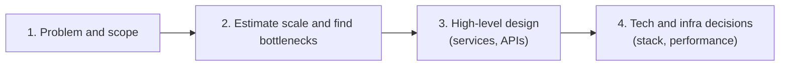
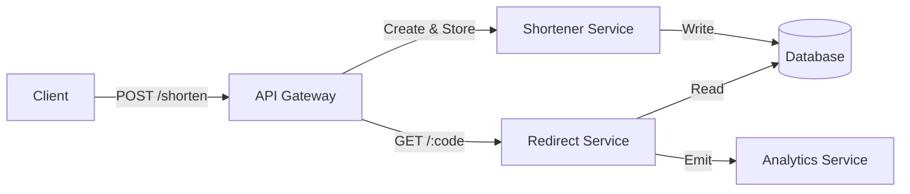

# The System Design Blueprint: A 4-Step Method for Scalable Systems

Welcome to the **capstone of the foundational chapters** of our system design series. In this chapter, we shift gears from core theory to practical application. We'll break down a proven **4-step system design approach** — a blueprint you can follow to tackle any real-world system design problem, from initial requirements to strategic technical decisions.

This is the framework we'll use for every case study (Chapters 16 onwards).

---

## 15.1 Learning Outcomes

After reading this chapter, you'll be able to:

1. Walk through any system design problem using the **4-step framework**.
2. Do **back-of-the-envelope estimations** for QPS, storage, and bandwidth.
3. Manage **45 minutes** of interview time across the four steps without running out.
4. Recognize when to **go deeper vs. zoom out** based on interviewer cues.
5. State **trade-offs explicitly** — the single skill that separates a junior from senior in design interviews.

---

## Table of Contents

- [15.2 What Is System Design?](#152-what-is-system-design)
- [15.3 The 4-Step System Design Process](#153-the-4-step-system-design-process)
- [15.4 Step 1: Understanding the Problem & Defining Scope](#154-step-1-understanding-the-problem--defining-scope)
- [15.5 Step 2: Estimating Scale & Identifying Bottlenecks](#155-step-2-estimating-scale--identifying-bottlenecks)
- [15.6 Step 3: High-Level Design — Services, APIs & Communication](#156-step-3-high-level-design--services-apis--communication)
- [15.7 Step 4: Making Tech & Infrastructure Decisions Strategically](#157-step-4-making-tech--infrastructure-decisions-strategically)
- [15.14 Tips and Tricks for System Design Interviews](#1514-tips-and-tricks-for-system-design-interviews)
- [15.15 Conclusion: Your Blueprint for Success](#1515-conclusion-your-blueprint-for-success)
- [15.16 Further Reading](#1516-further-reading)

---

## 15.2 What Is System Design?

Before we dive into the framework, let's recap what system design means in practice:

- **System design** is the process of defining a system's architecture, components, and interactions to meet requirements such as *scalability*, *performance*, and *maintainability*.
- It's about **building solutions** that are robust, scalable, and sustainable — not just working software.
- System design is full of **trade-offs:** performance vs. cost, complexity vs. simplicity, and more. Every decision must align with long-term vision and business goals.

---

## 15.3 The 4-Step System Design Process

Here's the high-level process we'll use for every case study:




Let's dig into each step.

---

## 15.4 Step 1: Understanding the Problem & Defining Scope

1. **Functional Requirements**
   - What should the system do?
   - *Example:* For a URL shortener: create short URLs, redirect to the original, track analytics.
2. **Non-Functional Requirements**
   - Performance (latency, throughput).
   - Scalability (handle millions of requests).
   - Security, Reliability, Compliance, etc.
3. **Constraints**
   - Time, budget, team, regulatory, and technical limitations.

#### 15.4.1 Example: URL Shortener

- **Functional:** Shorten URLs, redirect, analytics.
- **Non-Functional:** < 100ms latency, 99.99% uptime, GDPR compliance.
- **Constraints:** Launch in 3 months, AWS only, $1000/mo budget.

---

## 15.5 Step 2: Estimating Scale & Identifying Bottlenecks

1. **Estimate Traffic**
   - What's the expected peak load? How fast will it grow?
   - *Example:* 10M requests/day, 2× annual growth.
2. **Identify Bottlenecks**
   - Which parts could fail under load? (DB, CPU, network, etc.)
3. **Capacity Planning**
   - Estimate storage, bandwidth, and compute needs to avoid failure.

#### 15.5.1 Example: Rough Traffic Estimation

```python
DAILY_REQS = 10_000_000
BYTES_PER_REQ = 1_000  # e.g., analytics payload, overhead
bandwidth_needed = DAILY_REQS * BYTES_PER_REQ / (24 * 3600)  # bytes/sec
print(f"Required bandwidth: {bandwidth_needed/1024:.2f} KB/s")
```

---

## 15.6 Step 3: High-Level Design — Services, APIs & Communication

1. **Core Services**
   - Break into logical components (shortener service, analytics service, etc.).
2. **API Design**
   - Define endpoints and request/response formats.
3. **Communication Patterns**
   - Synchronous (REST) vs. Asynchronous (queues, events).
4. **Service Interaction**
   - How do services talk? Direct, via API Gateway, or through message queues?



#### 15.6.1 Example: API Endpoint (Flask)

```python
from flask import Flask, request, jsonify, redirect

app = Flask(__name__)

@app.route('/shorten', methods=['POST'])
def shorten():
    original_url = request.json['url']
    code = generate_code(original_url)
    store_url(code, original_url)
    return jsonify({'short_url': f'https://sho.rt/{code}'})

@app.route('/<code>', methods=['GET'])
def redirect_url(code):
    original_url = get_original_url(code)
    log_hit(code)
    return redirect(original_url)
```

---

## 15.7 Step 4: Making Tech & Infrastructure Decisions Strategically

1. **Tech Stack**
   - SQL or NoSQL? In-memory cache (e.g., Redis)? Message queues?
2. **Scalability & Availability**
   - Load balancing, auto-scaling, replication.
3. **Performance**
   - Caching, latency vs. throughput, CDN, etc.
4. **Trade-Offs**
   - Performance vs. cost, simplicity vs. flexibility, etc.

#### 15.7.1 Example Choices

- **DB:** NoSQL (Cassandra) for fast writes, high scalability.
- **Cache:** Redis to store hot URLs.
- **Load Balancer:** AWS ALB for HTTP routing.
- **Scaling:** Auto-Scaling Groups.

#### 15.7.2 Example: Redis Caching

```python
import redis

r = redis.Redis(host='localhost', port=6379)

def get_original_url(code):
    url = r.get(code)
    if url:
        return url
    # fallback: fetch from DB, then cache it
    url = db.fetch_url(code)
    r.setex(code, 3600, url)
    return url
```

---

## 15.8 Managing 45 Minutes of Interview Time

A typical system design interview is **45 minutes**. Most candidates run out of time because they spend 20 minutes on requirements. Here's the rough budget:

| Phase                                | Time      | What to do                                                       |
|--------------------------------------|-----------|------------------------------------------------------------------|
| 1. Requirements + scope              | **5 min** | Functional + 2-3 NFRs + back-of-envelope numbers. **Don't linger.** |
| 2. High-level design (boxes & arrows)| **10 min**| Sketch core components and data flow. Get the interviewer's nod. |
| 3. Deep-dive into 1-2 components     | **20 min**| Pick the most interesting/scaling-relevant pieces. Show data models, APIs, algorithms. |
| 4. Scaling, failure modes, trade-offs| **10 min**| What happens at 10× scale? What if a region fails? What did we sacrifice? |

> **The #1 mistake:** spending 25 minutes on phase 1-2 and never getting to a deep-dive. The deep-dive is where you actually *demonstrate* your level. Time-box ruthlessly.

---

## 15.9 Common Interview Frameworks

Different mentors give different acronyms. They all roughly describe the same flow. Pick whichever you remember:

- **RADIO**: Requirements → API → Data → I/O (throughput, latency) → Optimizations.
- **REACTO**: Repeat the question → Examples → Approach → Code (or design) → Test → Optimize.
- **The 4-Step** (this book): Requirements → Scale → High-level → Tech.

> **None is "right."** What matters is having *a* structure so you don't freeze when the prompt is "design YouTube."

---

## 15.10 Reading the Interviewer

System design interviews are **collaborative.** Watch for cues:

| Interviewer signal                                | What it likely means                          | What to do                                         |
|---------------------------------------------------|-----------------------------------------------|-----------------------------------------------------|
| "Interesting, what about X?"                       | They want you to go deeper on X               | Drop your current path; deep-dive X                |
| "OK, let's move on"                               | You've spent too long here                    | Wrap up in 30 seconds and move forward             |
| "How would this handle 100M users?"               | Scaling question — invite to discuss bottlenecks | Walk through 10×, 100×, 1000× and what breaks at each |
| "What if the database goes down?"                  | Failure mode question                          | Talk replicas, failover, RPO/RTO targets           |
| Silence after you propose something               | They're skeptical or want more depth          | Explain *why* you chose it; offer an alternative   |
| "Can you draw that?"                              | They want a visual aid                         | Sketch boxes and arrows — even rough is better than none |

---

## 15.11 Handling "I Don't Know"

The right answer is **never "I don't know" and stop.** It's: "I don't know, but here's how I'd approach finding out."

**Good:** "I haven't used Cassandra in production, but I know it's a wide-column store optimized for high write throughput. For our use case — append-heavy event logs — that seems like a fit. I'd want to validate by checking it handles our read patterns too."

**Bad:** "I don't know Cassandra. Pass."

Showing how you reason in the face of uncertainty is **more impressive** than memorized facts.

---

## 15.12 State Trade-offs Explicitly (the One Skill That Matters Most)

Juniors propose solutions. Seniors propose solutions *and name what they're sacrificing.* In every interview, after every choice, say:

> "I'm choosing X. The trade-off is that we lose Y, but Y is acceptable here because Z."

Examples:
- "We'll use eventual consistency for the feed. **Trade-off:** users might briefly see stale posts. **Acceptable because** feed staleness <1s is fine, and we gain massive read throughput."
- "We'll shard by user_id. **Trade-off:** cross-user analytics queries get harder. **Acceptable because** 99% of queries are single-user; we'll run analytics on a separate column store."
- "We'll cache aggressively. **Trade-off:** cache invalidation gets complex. **Acceptable because** writes are <5% of traffic, and 60s of staleness is fine for this data."

This sentence pattern alone is worth a level on the rubric.

---

## 15.13 Approaching a System Design Problem: A 7-Step Method

What system design is, how HLD differs from LLD, and a repeatable method — requirements, estimates, API, data, architecture, deep dive, trade-offs — for starting any design problem.

**In one sentence:** system design is deciding, before and while you build, which components a system has, how they talk, where data lives, and which trade-offs you accept so that it meets its requirements at the scale and cost you can afford.

**Mental model — city planning vs building plans.** HLD is the city plan: roads, districts, power and water, how many people each can serve. LLD is the blueprint of one building: rooms, doors, wiring. You cannot draw a good building without knowing the district it sits in, and a city plan with no building constraints cannot be built. Most design failures come from skipping the plan, not from a bad blueprint.

#### 15.13.1 What system design is, and why it matters

* **Definition:** the process of defining architecture, components, interfaces, and data for a system so that it satisfies stated requirements. It produces decisions and diagrams, not code.
* **Why it matters:** the expensive mistakes are structural (wrong data store, no partitioning story, a single point of failure, a chatty service boundary). They are cheap to change on a whiteboard and costly after launch — migrations, rewrites, outages.
* **Where it sits in the SDLC:** after requirements and analysis, before implementation; it is revisited every iteration, and revised by what testing and operations teach you.
* **System analysis vs system design:**

| | System analysis | System design |
|---|-----------------|---------------|
| Question | **What** must the system do, and for whom? | **How** will it do it? |
| Input | stakeholders, existing processes, pain points | the agreed requirements and constraints |
| Output | requirements, use cases, scope, acceptance criteria | architecture, APIs, data model, deployment plan |
| Typical owner | product / business analyst with engineering | architects and engineers |

#### 15.13.2 HLD vs LLD

| | High-Level Design (HLD) | Low-Level Design (LLD) |
|---|-------------------------|------------------------|
| Scope | whole system or a group of services | one service, module, or class group |
| Question | which components, what data stores, how they communicate and scale | which classes, methods, patterns, schemas, algorithms |
| Artifacts | architecture diagram, API list, data-flow diagram, capacity estimate, tech choices, trade-off notes (ADRs) | class and sequence diagrams, detailed schema, interface signatures, state machines, pseudo-code |
| Audience | architects, tech leads, product, other teams | the engineers who implement it |
| Needs knowledge of | networking, databases, caching, queues, consistency, cloud | OOP, SOLID, design patterns, UML, concurrency |
| Failure if skipped | system cannot meet scale, availability, or cost goals | code is rigid, untestable, hard to change |

Where to go: LLD is Volume 3 (Ch 1 OOP, Ch 2 SOLID, Ch 4 UML). HLD is the rest of this volume: capacity, scalability and reliability, caching, queues, database scaling, and the worked cases in Ch 22.

#### 15.13.3 Monolith vs distributed systems

| Aspect | Monolith (one deployable) | Distributed (services, many nodes) |
|--------|---------------------------|-------------------------------------|
| Complexity | low; in-process calls | high; network calls fail, are slow, are partial |
| Deploy and test | one artifact, simple end-to-end tests | independent deploys, but contract and integration testing needed |
| Scaling | scale whole app together | scale each part to its own load |
| Data consistency | one database, ACID transactions | per-service data; eventual consistency, sagas |
| Fault isolation | one bug can take down everything | failures can be contained, but also cascade |
| Team scaling | fine for small teams | lets many teams ship independently |
| Latency | function-call cost | each hop adds latency |

Rule of thumb: **start with a well-modularized monolith** and split along proven seams when team size, scaling needs, or release independence demand it. Choose distributed from the start only when you already know those pressures exist. Distributed systems must handle the network being unreliable — see Ch 4.

#### 15.13.4 Requirements gathering

Ask before drawing. Who are the users? What are the core use cases? What is in scope and explicitly out? What scale (users, data, traffic), what geography, what budget and deadline? Write the answers down and get them confirmed — this is the output of system analysis.

**Functional requirements (FR)** say what the system does; **non-functional requirements (NFR)** say how well.

| Kind | Examples |
|------|----------|
| Functional | users can post, follow, search; an order can be placed, paid, cancelled; admin can approve refunds |
| Non-functional | latency, throughput, availability, durability, consistency, security, cost, compliance, maintainability |

An NFR is useless until it is a **number with a measurement**.

| Vague NFR | Measurable form |
|-----------|-----------------|
| "fast" | **latency SLO:** p99 of `GET /feed` < 300 ms, measured at the gateway over 30 days |
| "always up" | **availability SLO:** 99.9% of requests succeed per month (about 43.8 min of allowed downtime per 30-day-ish month; 99.99% is about 4.4 min; 99.999% about 26 s) |
| "never lose data" | **durability:** no acknowledged write lost; backups with RPO of 5 min (see Ch 17) |
| "always correct" | **consistency:** read-your-writes for the author; others may lag up to 5 s (eventual) |
| "handles growth" | **throughput:** 5,000 writes/s sustained, 15,000/s peak, 10× headroom in 12 months |

An **SLI** is the measured indicator (for example, ratio of good requests), an **SLO** is the target for it, and an **SLA** is a contract with consequences if the target is missed. Allowed downtime: 100% minus SLO, times the period.

#### 15.13.5 A repeatable 7-step method

| # | Step | You produce | Time (interview, rule of thumb) |
|---|------|-------------|--------------------------------|
| 1 | Requirements | FR list, NFR numbers, scope and non-goals | ~5 min |
| 2 | Estimates | requests/s, read:write, storage, bandwidth, peak factor | ~5 min |
| 3 | API | endpoints or RPCs, auth, pagination, idempotency | ~5 min |
| 4 | Data model | entities, keys, access patterns, store choice, partition key | ~5 min |
| 5 | High-level architecture | box-and-arrow diagram covering every use case | ~10 min |
| 6 | Deep dive | the 1–2 hardest or riskiest components in detail | ~10 min |
| 7 | Bottlenecks and trade-offs | single points of failure, hot spots, what you chose and what you gave up | ~5 min |

Steps loop: estimates may change the data model, the deep dive may expose a missing requirement. In real work, replace the time column with design reviews and ADRs. The time column is only a rough interview guide.

**Worked mini example — a "like" counter for posts.** Numbers are assumptions chosen to show the method, not measurements.

1. **Requirements:** FR — like and unlike a post, see the like count and whether I liked it. NFR — read p99 < 100 ms, 99.9% availability, count may lag by a few seconds, no duplicate likes per user. Non-goal: who-liked-it lists.
2. **Estimates:** assume 50M daily users × 5 likes = 250M likes/day ≈ 2,900/s average, peak ×3 ≈ 9,000/s. Assume reads 100× writes ≈ 290,000/s average. A like row of ~24 B (two 8-byte ids plus timestamp) × 250M/day ≈ 6 GB/day, about 2.2 TB/year before indexes and replicas.
3. **API:** `PUT /posts/{id}/like` and `DELETE /posts/{id}/like` (idempotent), `GET /posts/{id}/likes/count`; batch endpoint for feeds: `POST /posts/likes/counts` with a list of ids.
4. **Data model:** `likes(post_id, user_id, created_at)`, primary key `(post_id, user_id)` — the key enforces "no duplicates". Partition by `post_id`. `like_counts(post_id, n)` is a derived table.
5. **Architecture:** clients → API gateway → like service → likes store; like events go to a queue; a counter worker updates counts; counts are served from a cache (Redis) in front of the counts table.
6. **Deep dive — hot posts:** a viral post concentrates writes on one key. Split its counter into N sub-counters (for example 16), increment a random one, sum on read, and refresh the cached total every second or two.
7. **Trade-offs:** counts are eventually consistent (cheaper, scalable) versus an exact count in the write transaction (slower, one hot row). The cache can lose counts on restart; rebuild from the likes table. Single point of failure: the queue — replicate it.

#### 15.13.6 Performance vs scalability, latency vs throughput

* **Latency** — time for one request to finish (ms). **Throughput** — work completed per unit time (requests/s, MB/s). They are linked by Little's law: concurrent requests in the system = throughput × average latency.
* **Performance** problem: the system is slow **for one user** even when idle. **Scalability** problem: it is fast for one user but slows down or fails **as load grows**. A scalable system keeps performance acceptable by adding resources in proportion to load.
* **They trade off:** batching and queuing raise throughput but add latency to each item; running servers near 100% utilization maximizes throughput but latency climbs sharply as queues build.
* **Percentiles, not averages:** p50 is the median, p99 is the value 99% of requests beat. Averages hide the slow tail, and with fan-out (a page needing 20 backend calls) the chance that a user meets at least one slow call is much larger than 1%.

| Scalability approach | Idea | Watch out for |
|----------------------|------|---------------|
| Vertical (scale up) | bigger machine | hard ceiling, single point of failure, cost curve |
| Horizontal (scale out) | more machines behind a load balancer | needs stateless services or partitioned state |
| Replication | copies serve reads, give redundancy | replication lag, failover |
| Partitioning (sharding) | split data by key | hot keys, cross-shard queries and transactions |
| Caching | serve repeats from memory | invalidation, stampede (Ch 7) |
| Asynchrony | queue work, respond early | ordering, duplicates, visibility |
| Offload | CDN, object storage, managed services | vendor and cost trade-offs |

**Common bottlenecks:** a single database primary; hot partitions or hot keys; lock contention; synchronous call chains; slow or missing indexes; connection and thread pool exhaustion; chatty cross-service calls; network bandwidth; unbounded queues; a shared dependency with no limit (Ch 8). Find them by measuring, not guessing.

#### 15.13.7 Design qualities checklist

| Quality | Question to ask | Typical levers |
|---------|-----------------|----------------|
| Reliability | does it keep working correctly despite faults? | redundancy, retries with backoff, timeouts, idempotency, graceful degradation |
| Maintainability | can new engineers change it safely? | clear module boundaries, tests, observability, documentation, small deployable units |
| Interoperability | can other systems and versions work with it? | open standards, stable contracts, schema evolution, adapters |
| Usability | is it easy and predictable to use (also for API consumers)? | consistent naming, clear errors, good defaults, docs, SDKs |
| Security | who can do what, and is data protected? | authN/authZ, encryption in transit and at rest, least privilege (Ch 18) |
| Cost-effectiveness | does it meet needs at an affordable price? | right-sizing, autoscaling, tiered storage, build vs buy (Ch 21) |

#### 15.13.8 Optimization techniques

| Technique | Use when | Cost / risk |
|-----------|----------|-------------|
| Caching | same data read often, tolerates staleness | invalidation, memory, stampede |
| Batching | many small operations to one target | adds latency per item, partial-failure handling |
| Indexing | queries filter or sort on a column | slower writes, more storage |
| Async processing | work need not finish before responding | complexity, eventual results, retries |
| Compression | payloads or storage are large | CPU time, hard to debug |
| Denormalization | joins dominate read time | duplicated data to keep in sync |
| Connection pooling | connections are costly to open | pool sizing, exhaustion under load |
| Pagination | lists can be large | cursor design, consistency while paging |
| Precomputation / materialized views | expensive aggregates read often | stale until refreshed, storage |
| Load shedding and limits | overload is possible | rejected requests need clear errors |

Optimize after measuring: profile first, change one thing, measure again.

#### 15.13.9 Modularity and interfaces

* **Module boundary:** group things that change together (high cohesion) and hide internals behind a narrow interface (low coupling). Boundaries follow business capabilities, not technical layers; they become service boundaries only when you must scale or deploy them separately.
* **Contract:** the interface is a promise — inputs, outputs, errors, ordering, latency and idempotency expectations. Write it as OpenAPI, protobuf, or JSON Schema, and test against it (consumer-driven contract tests).
* **Versioning:** adding optional fields is usually backward compatible; removing or renaming a field, or changing meaning, is breaking. Version in the URL or header, support old and new in parallel, deprecate with a date, and roll out schema changes in expand-then-contract steps. See Vol 2 Ch 14 — API Design and Versioning.

#### 15.13.10 Data structures and algorithms that show up in system design

| Structure / algorithm | Property | Where it appears |
|-----------------------|----------|------------------|
| Hash map | O(1) average lookup | caches, indexes, deduplication, sessions |
| LRU (hash map + doubly linked list) | O(1) get, put, evict least-recent | cache eviction policies |
| Heap / priority queue | O(log n) insert, O(1) peek of min or max | schedulers, timers, top-K, merging sorted streams |
| Trie | prefix search by path | autocomplete, routing tables, IP prefix lookup |
| Bloom filter | set membership; **no false negatives**, some false positives | skip disk lookups for missing keys (LSM stores), crawler "seen URL" check |
| Consistent hashing | adding or removing a node moves only about K/N keys | partitioning caches and databases, load balancing |
| Skip list | ordered set with expected O(log n) operations | sorted sets in Redis, in-memory LSM memtables in some stores |
| HyperLogLog | approximate distinct count in small fixed memory | unique visitors, cardinality in analytics (Redis `PFADD`) |
| Count-Min sketch | approximate frequency counts | heavy hitters, trending items |
| Inverted index | term to list of documents | search engines (Lucene, Elasticsearch) |
| B-tree / LSM tree | read-optimized vs write-optimized on-disk indexes | relational databases vs Cassandra, RocksDB |
| Merkle tree | compare large data sets by hash | replica repair (Dynamo-style stores), Git |
| Geohash / quadtree | map 2-D location to a key or tree | nearby-search, ride matching |
| Ring buffer | fixed-size circular queue | bounded queues, logging, backpressure |
| Token bucket | rate with burst allowance | rate limiting (Ch 8) |

Background: Vol 1 Ch 30 — Trees, Ch 31 — Hash Tables and Graphs.

#### 15.13.11 Activity diagrams

An **activity diagram** is a UML behavior diagram that shows a workflow: the ordered actions, decisions, and parallel branches of one process. Use it for business flows, approval chains, and algorithms where *what happens next* matters more than *who owns the data*. Other UML diagrams (class, sequence, state, component) are in Vol 3 Ch 4 — UML and Diagramming.

| Notation | Meaning |
|----------|---------|
| Filled circle | initial node (start) |
| Circle with inner dot (bullseye) | final node (end) |
| Rounded rectangle | action |
| Diamond | decision (guards like `[valid]`) or merge |
| Thick bar | fork (split into parallel flows) or join (wait for all) |
| Arrow | control flow |
| Swimlane | partition showing who or which system performs the actions |

## 15.14 Tips and Tricks for System Design Interviews

- **Always start with requirements:** Don't jump to solutions; clarify what's needed.
- **Think in trade-offs:** There's no perfect design — always state what you're optimizing for.
- **Draw diagrams:** Visuals help clarify architecture and component interactions.
- **Estimate with numbers:** Even rough calculations (requests/sec, data size) show your depth.
- **Consider failure modes:** Think about what happens when a component fails (DB down? Cache miss?).
- **Justify tech choices:** Explain *why* you picked a tool or architecture.
- **Iterate:** Revise your design as you find new bottlenecks or constraints.

---

## 15.15 Conclusion: Your Blueprint for Success

- **Start with clear requirements and constraints.**
- **Use scale and bottleneck analysis to guide architecture.**
- **Create a high-level design balancing performance, cost, and complexity.**
- **Make informed infrastructure and tech choices to ensure scalability and availability.**

By following this four-step process, you'll build systems that are robust, reliable, and ready for real-world growth.

---

## 15.16 Further Reading

- [System Design Primer (GitHub)](https://github.com/donnemartin/system-design-primer)
- [Designing Data-Intensive Applications by Martin Kleppmann](https://dataintensive.net/)
- [AWS Architecture Center](https://aws.amazon.com/architecture/)

---

**Next Up:** [Chapter 16 — Design a URL Shortener (TinyURL) →](./16%20-%20Design%20a%20URL%20Shortener%20(TinyURL).md) — applying this blueprint to our first real-world case study.
