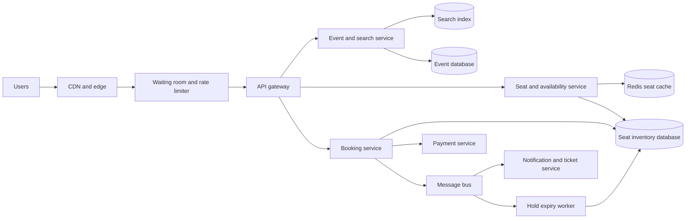
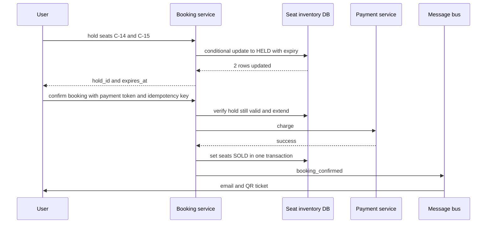
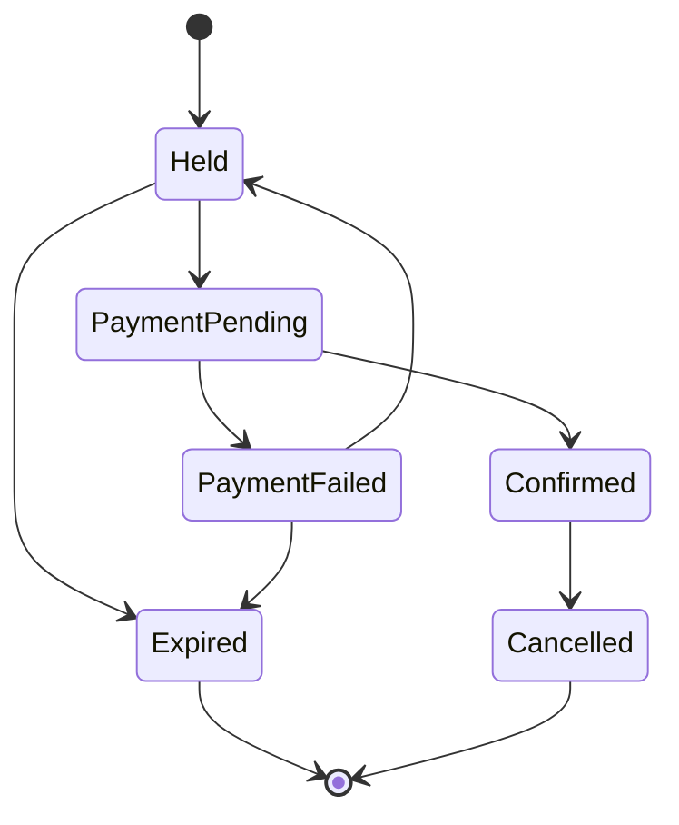
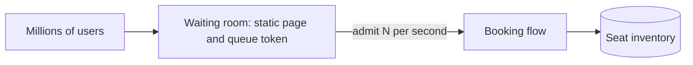

# Designing a Ticket Booking System (Ticketmaster) — A System Design Deep Dive

In this case study we design a **ticket booking system** like Ticketmaster, BookMyShow, Eventbrite or an airline's seat reservation. Its signature challenge is **contention**: thousands (sometimes millions) of people try to buy the same few scarce items at the same moment, and **no seat may ever be sold twice**.

We apply the 4-step blueprint from Chapter 15: understand the problem, estimate scale, design at a high level, then decide on technology.

---

## 22.1 Learning Outcomes

After working through this case study, you'll be able to:

1. Prevent **double booking** with database constraints, optimistic locking, and **temporary seat holds with expiry**.
2. Choose between **pessimistic locking, optimistic concurrency and distributed locks**, and know where each fails.
3. Design the **booking flow** as a state machine that includes payment, timeouts and cleanup.
4. Survive **flash-sale traffic spikes** with a **virtual waiting room**, rate limiting, caching and admission control.
5. Split the system into a **read-heavy browsing path** and a **write-critical booking path** and scale each differently.
6. Handle **payment failures, abandoned carts and refunds** without leaking inventory.
7. Keep search, seat maps and availability fast with caching and eventual consistency where it is safe.

---

## Table of Contents

- [22.2 Introduction & Scope](#222-introduction--scope)
- [22.3 Functional Requirements](#223-functional-requirements)
- [22.4 Non-Functional Requirements](#224-non-functional-requirements)
- [22.5 Estimating Scale & Bottlenecks](#225-estimating-scale--bottlenecks)
- [22.6 API Design](#226-api-design)
- [22.7 High-Level Architecture](#227-high-level-architecture)
- [22.8 Data Model](#228-data-model)
- [22.9 Preventing Double Booking](#229-preventing-double-booking)
- [22.10 Seat Holds and Expiry](#2210-seat-holds-and-expiry)
- [22.11 The Booking Flow](#2211-the-booking-flow)
- [22.12 Handling Flash Sales](#2212-handling-flash-sales)
- [22.13 Search, Browsing and the Seat Map](#2213-search-browsing-and-the-seat-map)
- [22.14 Payments, Failures and Refunds](#2214-payments-failures-and-refunds)
- [22.15 Tech Stack & Infrastructure Decisions](#2215-tech-stack--infrastructure-decisions)
- [22.16 Beyond MVP — What a Senior Designer Adds](#2216-beyond-mvp--what-a-senior-designer-adds)
- [22.17 Tips and Tricks](#2217-tips-and-tricks)
- [22.18 Summary](#2218-summary)
- [22.19 Further Reading](#2219-further-reading)

---

## 22.2 Introduction & Scope

A ticketing system sells **limited, unique inventory**: seat 14 in row C for a Friday concert exists once. This is very different from selling a million identical books.

### 22.2.1 What Makes It Hard

| Challenge | Description |
|-----------|-------------|
| **Scarce inventory** | Each seat can be sold exactly once; overselling is a serious failure |
| **Extreme spikes** | A popular on-sale can bring more than a million users in minutes, all wanting the same few thousand seats |
| **Time pressure** | People select seats, then must pay before a deadline; unpaid seats must return to the pool |
| **Fairness** | Users expect an orderly queue, not a free-for-all where bots win |
| **Read/write skew** | Millions browse, a small fraction buy |

### 22.2.2 Browsing vs Booking

| Path | Characteristic | Strategy |
|------|----------------|----------|
| **Browse and search** | Read-heavy, tolerates slightly stale data | Cache, CDN, search index, eventual consistency |
| **Select seats and book** | Write-critical, must be correct | Strong consistency, transactions, tight control of concurrency |

Designing these as **separate paths with different guarantees** is the key architectural idea.

---

## 22.3 Functional Requirements

**In scope**

1. **Browse and search** events by city, date, category and artist.
2. **View event details** and the **seat map with live availability**.
3. **Select seats** (specific seats, or "best available" in a section).
4. **Hold the seats temporarily** (for example 5 to 10 minutes) while the user pays.
5. **Pay and confirm**; receive a ticket (QR code) by email and in the app.
6. **Cancel and refund** according to the event's policy.
7. **Admin:** create events and venues, define seat maps and pricing tiers, release or block inventory.
8. **Waiting room** for high-demand events.

**Out of scope here:** resale marketplace, dynamic pricing algorithms, ticket transfer, venue entry scanning (we mention it in the beyond-MVP section).

---

## 22.4 Non-Functional Requirements

| Requirement | Target | Why |
|-------------|--------|-----|
| **Correctness** | Zero double bookings; a seat is held and sold by at most one user | The core promise |
| **Consistency** | Strong consistency for seat state; eventual for search and counts | Money and trust |
| **Availability** | 99.99% for browsing; booking may shed load rather than fail incorrectly | Revenue, reputation |
| **Latency** | Browse p99 under 300 ms; seat selection under 500 ms | Responsiveness under load |
| **Scalability** | Absorb a spike of 100x normal load during on-sales | Flash sales |
| **Fairness** | First-come, first-served; resistance to bots and scalpers | User trust |
| **Durability** | Confirmed bookings are never lost | Legal and financial |

---

## 22.5 Estimating Scale & Bottlenecks

| Quantity | Assumption | Result |
|----------|-----------|--------|
| Daily active users (normal) | 10 million | |
| Events live at once | 500,000 | |
| Normal browse traffic | 10 M × 20 page views | about 2,300 requests/s |
| Bookings per day (normal) | 500,000 | about 6/s average |
| **Flash sale** | 2 million users for a 60,000-seat stadium, all within 10 minutes | about 3,300 users/s arriving, each polling and refreshing |
| Seat map reads in a spike | 2 M users × 1 refresh per 2 s | about 1 million requests/s on one event |
| Booking attempts in a spike | Perhaps 100,000 distinct seat-hold requests/s at peak | Contended writes on 60,000 rows |
| Storage | 500K events × 5,000 seats = 2.5 billion seat rows at any time; 100 bytes each | about 250 GB |

**What the numbers say**

- Average booking rate is tiny; the **spike** defines the design. Capacity must be planned for the **worst 10 minutes of the year**, not the average.
- The hottest data is **one event's seats**, so one database shard can become a hotspot. Partition by **event**, and give mega-events dedicated resources.
- The seat map is read **orders of magnitude more** than it is written. Serve it from cache with short TTL, and only confirm availability at hold time.

---

## 22.6 API Design

| Endpoint | Purpose |
|----------|---------|
| `GET /v1/events?city=&date=&q=` | Search events |
| `GET /v1/events/{id}` | Event details |
| `GET /v1/events/{id}/seats` | Seat map with status per seat (available, held, sold), cached |
| `POST /v1/events/{id}/holds` | Hold seats `{seat_ids[]}`; returns `hold_id` and `expires_at` |
| `DELETE /v1/holds/{hold_id}` | Release a hold |
| `POST /v1/bookings` | Confirm a booking from a hold `{hold_id, payment_method_token}` with an **Idempotency-Key** |
| `GET /v1/bookings/{id}` | Booking status and tickets |
| `POST /v1/bookings/{id}/cancel` | Cancel and refund |
| `POST /v1/queue/join` | Join the waiting room for an event |

Returning the **hold expiry time** lets the client show a countdown. **Idempotency keys** on booking calls prevent a double charge when the user double-clicks or retries after a timeout.

---

## 22.7 High-Level Architecture



### 22.7.1 Component Responsibilities

| Component | Job |
|-----------|-----|
| **CDN / edge** | Serves static assets, event pages and public seat-map snapshots |
| **Waiting room and rate limiter** | Admits users to the booking flow at a rate the back end can handle |
| **Event and search service** | Events, venues, artists; powers search from an index |
| **Seat and availability service** | Fast reads of the seat map from cache, authoritative state in the inventory database |
| **Booking service** | Holds seats, drives the booking state machine, calls payments, issues tickets |
| **Seat inventory database** | The **single source of truth** for each seat's state; strongly consistent |
| **Payment service** | Charges and refunds (see the Payment System chapter) |
| **Hold expiry worker** | Releases unpaid holds when they time out |
| **Notification and ticket service** | Emails, push, QR-coded tickets |

---

## 22.8 Data Model

```
events(event_id, venue_id, name, starts_at, on_sale_at, status)
venues(venue_id, name, city, layout_id)

seats(
  event_id      bigint,
  seat_id       text,          -- e.g. 'C-14'
  section       text,
  price_cents   int,
  status        text,          -- AVAILABLE, HELD, SOLD
  hold_id       uuid  NULL,
  hold_expires  timestamp NULL,
  booking_id    uuid  NULL,
  version       int,           -- optimistic lock
  PRIMARY KEY (event_id, seat_id)
)

holds(hold_id, event_id, user_id, seat_ids, expires_at, status)
bookings(booking_id, user_id, event_id, seat_ids, total_cents,
         state, payment_id, idempotency_key UNIQUE, created_at)
```

**Partition and shard by `event_id`.** All seats of an event live together, so a hold or booking touching several seats of one event is a **single-shard transaction**, avoiding distributed transactions entirely. Hot events can be placed on dedicated shards.

---

## 22.9 Preventing Double Booking

The core correctness problem: two users click the same seat at the same millisecond. The database must allow exactly one to win.

### 22.9.1 Option 1: Pessimistic Locking

```sql
BEGIN;
SELECT * FROM seats
 WHERE event_id = 7 AND seat_id IN ('C-14','C-15') AND status = 'AVAILABLE'
 FOR UPDATE;                         -- locks the rows
-- if both rows returned: mark HELD
UPDATE seats SET status='HELD', hold_id=:h, hold_expires=now()+interval '8 minutes'
 WHERE event_id = 7 AND seat_id IN ('C-14','C-15');
COMMIT;
```

| Pros | Cons |
|------|------|
| Simple and obviously correct | Waiters queue on the lock; under a spike, many connections block |
| | Deadlocks if seats are locked in different orders (always lock in sorted order) |

### 22.9.2 Option 2: Optimistic Concurrency / Conditional Update

Do not lock. Make the **update itself conditional** and check how many rows changed.

```sql
UPDATE seats
   SET status = 'HELD', hold_id = :h, hold_expires = now() + interval '8 minutes',
       version = version + 1
 WHERE event_id = 7 AND seat_id = 'C-14'
   AND (status = 'AVAILABLE' OR (status = 'HELD' AND hold_expires < now()));
-- rows_affected = 1 -> you got it; 0 -> someone else did
```

For several seats, run all updates in one transaction and **roll back if any affected zero rows**. Under high contention this wastes work on losers, but it never blocks.

### 22.9.3 Option 3: Atomic Operation in a Fast Store

For flash sales, do the first contention in **Redis**: a Lua script (atomic) checks that every requested seat is free and marks them held with a TTL in one step.

```lua
-- KEYS = seat keys, ARGV[1] = hold id, ARGV[2] = ttl seconds
for i, k in ipairs(KEYS) do
  if redis.call('EXISTS', k) == 1 then return 0 end   -- any seat taken -> fail
end
for i, k in ipairs(KEYS) do
  redis.call('SET', k, ARGV[1], 'EX', ARGV[2])
end
return 1
```

Redis absorbs the stampede; the authoritative record is still written to the database, and the database **uniqueness / conditional-update rule is the final guard**.

### 22.9.4 Defence in Depth

| Layer | Guard |
|-------|-------|
| **Database constraint** | A `UNIQUE (event_id, seat_id)` on sold tickets, or the conditional update, so double sale is impossible even if upper layers are buggy |
| **Atomic hold** | One transaction or one Lua script for all seats in a request |
| **Idempotency keys** | A retried request does not create a second hold or booking |
| **Monitoring** | A job that detects any seat with two tickets and alarms |

### 22.9.5 Why Not a Distributed Lock?

A distributed lock (Redis `SET NX`, ZooKeeper) can work, but it adds a second system that can fail, expire or be misconfigured (clock drift, GC pauses, a lock holder that continues after its lease expires). The safest rule is to **put the invariant in the database** and use locks only as a performance optimisation.

---

## 22.10 Seat Holds and Expiry

Selecting seats and paying takes minutes. During that time the seats must be reserved but not sold.

1. **Hold:** mark seats `HELD` with `hold_expires` (say 8 minutes) and return the expiry to the client.
2. **Pay:** while the user pays, the hold stays valid. The booking service **re-verifies the hold** (still owned by this user, not expired) at confirmation.
3. **Confirm:** in one transaction, set seats `SOLD`, set `booking_id`, and clear the hold.
4. **Expire:** if no confirmation arrives, the seats must return to `AVAILABLE`.

### 22.10.1 Making Expiry Reliable

| Mechanism | How |
|-----------|-----|
| **Lazy expiry in queries** | Treat `HELD` with `hold_expires < now()` as available (the conditional update above does this), so correctness never depends on a cleanup job |
| **Redis TTL** | Hold keys expire automatically |
| **Background sweeper** | A worker periodically flips expired holds back to `AVAILABLE` and publishes an event so caches and seat maps refresh |
| **Delay queue / scheduled message** | Publish "expire hold X at T" when the hold is created |

**Race to watch:** the user pays at second 479 of 480, the hold expires at 480, and the payment confirmation arrives at 481. Design for it: extend the hold when a **payment is in progress**, and on confirmation re-check whether the seats are still ours; if not, **refund automatically** and tell the user.

---

## 22.11 The Booking Flow



### 22.11.1 State Machine



- **PaymentPending** has its own timeout; a payment that returns an unknown result is resolved by querying the payment service, never by assuming.
- A failed payment returns the user to **Held** if the hold is still valid, so they can retry with another card.
- Every transition is recorded as an event for audit and support.

---

## 22.12 Handling Flash Sales

When a hot tour goes on sale, a tiny front door meets an enormous crowd. Without protection the database collapses and the fastest bots win.

### 22.12.1 The Virtual Waiting Room



1. Before the on-sale time, the event page is **static and CDN-cached**.
2. When users arrive, they receive a **queue position token** (signed, so it cannot be forged) and see a lightweight waiting page that polls for status or uses server-sent events.
3. The system **admits users at a controlled rate** matched to what the booking path can handle (for example 500 per second), giving each an **admission token** valid for a limited time.
4. Only requests carrying a valid admission token can reach seat selection and booking.

| Benefit | Detail |
|---------|--------|
| **Protects the back end** | Concurrency into the database is bounded |
| **Fairness** | Position is by arrival time, or by randomised lottery within a window (fairer to people with slow connections) |
| **Bot resistance** | Combine with CAPTCHA, device fingerprinting, one-session-per-account, per-IP and per-account limits and verified-fan programmes |
| **Better UX** | Users see progress instead of errors |

### 22.12.2 Other Defences

- **Rate limit** per user, IP and token at the gateway; shed load with clear "busy" responses rather than timing out.
- **Cache the seat map** at the edge for a second or two; serve **section-level availability** ("12 left") first and only reveal individual seats after admission.
- **Pre-warm** caches, connection pools and autoscaling before a known on-sale.
- **Isolate** the hot event: separate shard, separate Redis, dedicated capacity, so one on-sale cannot degrade every other event.
- **Degrade gracefully:** disable non-essential features (recommendations, personalised content) during the spike.
- **Purchase limits** (for example 6 tickets per customer) to limit hoarding.

---

## 22.13 Search, Browsing and the Seat Map

### 22.13.1 Search

Use a **search index** (Elasticsearch or OpenSearch) fed from the event database through change events. Support filters (city, date, category), text queries and ranking by popularity and date. Search results can lag by seconds without harm.

### 22.13.2 Seat Map and Availability

- Store the **static layout** (venue geometry, sections) separately; it rarely changes and is CDN-cacheable.
- Store **dynamic status** per seat in Redis (bitmap or hash per event) for fast reads.
- The service renders the map by combining layout plus status.
- Availability on the map is **advisory**: it may be a second stale. The **hold request is the real check**, and if a seat has just been taken, the user gets a clear "seat no longer available" and the map refreshes.

### 22.13.3 Real-Time Updates

Push seat changes to open seat maps through **WebSockets or server-sent events** for the small number of users inside the booking flow, instead of polling a million times a second.

---

## 22.14 Payments, Failures and Refunds

(The payment mechanics are covered in the Payment System chapter; here is what matters for booking.)

| Situation | Handling |
|-----------|----------|
| **Payment succeeds but the booking write fails** | Reconcile: a recovery job finds payments with no confirmed booking and either completes the booking (if seats are still held) or refunds |
| **Payment times out with unknown result** | Booking stays `PaymentPending`; query the payment provider; do not release seats until resolved |
| **Duplicate submit** | Idempotency key on `POST /bookings` returns the same result |
| **Hold expired during payment** | Refund automatically, notify the user, offer similar seats |
| **User cancels** | Policy check, refund through payment service, set seats `AVAILABLE` (or to a resale pool), send confirmation |
| **Event cancelled** | Bulk refund workflow with rate limits to the payment provider |

Use the **outbox pattern** so "seats marked SOLD" and "booking_confirmed event" cannot diverge, and keep consumers (email, ticket generation) idempotent.

---

## 22.15 Tech Stack & Infrastructure Decisions

| Need | Choices | Notes |
|------|---------|-------|
| **Seat inventory** | PostgreSQL or MySQL, sharded by `event_id` (or Spanner / CockroachDB for global scale) | ACID and row-level conditional updates are exactly what is needed |
| **Hot-path hold cache** | Redis Cluster with Lua scripts | Absorbs the stampede; TTL gives natural expiry |
| **Search** | Elasticsearch / OpenSearch | Event discovery |
| **Event metadata** | PostgreSQL plus cache | Low write rate |
| **Queue / bus** | Kafka or SQS | Notifications, expiry, outbox |
| **Waiting room** | Edge service (Cloudflare Waiting Room, a custom queue on Redis sorted sets) | Sits before the application |
| **Ticket delivery** | Signed QR payloads with a rotating code | Anti-fraud |
| **Observability** | Hold success rate, conflicts per second, DB lock waits, queue length and admission rate, expiry lag, payment failure rate | Dashboards watched live during an on-sale |
| **Deployment** | Multi-AZ, autoscaling for the stateless tier, pre-scaled for known on-sales | Capacity is planned, not reactive |

---

## 22.16 Beyond MVP — What a Senior Designer Adds

### 22.16.1 Best-Available Selection

"Give me 4 together in the best section" requires an **allocation algorithm**: scan contiguous available seats in a row ordered by quality, then hold atomically. Precompute candidate blocks per section and keep them in Redis to avoid scanning the database during a spike.

### 22.16.2 Dynamic Pricing and Tiers

Prices can change with demand. Store the **price at hold time on the hold**, so the user pays the price they were shown, and record price history for audit.

### 22.16.3 Anti-Scalping

Verified accounts, purchase limits, bot detection, transfer restrictions and tickets tied to identity or a rotating-barcode app.

### 22.16.4 Ticket Validation at the Door

Entry scanners need an **offline-capable** validation mode: sync the list of valid tickets, mark a ticket used on scan, and reconcile when connectivity returns. Rotating QR codes stop screenshot sharing.

### 22.16.5 Resale Marketplace

Add a secondary market where a sold ticket is reissued: invalidate the old barcode, create a new ticket, and move money between buyer, seller and platform through the ledger.

### 22.16.6 Multi-Region

Keep each event's inventory in a **single home region** (single-writer) to preserve strong consistency; serve browsing from all regions. Cross-region active-active seat writes add conflict resolution that is rarely worth it.

### 22.16.7 Data and Analytics

Stream booking and hold events into a warehouse for demand forecasting, fraud signals and capacity planning of future on-sales.

---

## 22.17 Tips and Tricks

- **Separate browsing from booking** and say they have different consistency needs.
- **State the invariant first:** "a seat is sold at most once." Then show that the **database enforces it**, not the application or a lock.
- **Hold, then pay, then confirm**, with an expiry and a sweeper, and name the race at the expiry boundary.
- **Use conditional updates** or atomic scripts; mention lock ordering to avoid deadlocks.
- **Plan for the spike**, not the average: waiting room, rate limits, edge caching, isolation of the hot event.
- **Partition by event** so multi-seat bookings stay single-shard.
- **Make everything idempotent:** holds, bookings, notifications.
- **Mention reconciliation** between payments and bookings, as in the payment chapter.
- **Quantify:** 1 M seat-map reads/s, 60,000 seats, 500 admissions/s.

---

## 22.18 Summary

### 22.18.1 Final Design Flow

1. Users browse through the **CDN, search index and cached seat maps**; this path is read-heavy and eventually consistent.
2. For a hot on-sale, a **virtual waiting room** admits users at a rate the booking path can sustain.
3. The user selects seats; the **booking service** performs an **atomic hold** (conditional update or Redis script) with an expiry, and the database enforces that a seat has at most one owner.
4. The user pays within the hold window; the booking service re-verifies the hold, calls the **payment service** with an idempotency key, and on success marks seats `SOLD` in one transaction.
5. An **outbox event** triggers ticket generation and notifications.
6. **Expired holds** return to the pool through lazy expiry, TTLs and a sweeper; **reconciliation** fixes payment and booking mismatches.
7. Inventory is **sharded by event**, with hot events isolated.

### 22.18.2 Scale Estimates Recap

| Item | Estimate |
|------|----------|
| Normal bookings | About 500,000/day, about 6/s |
| Flash sale | 2 M users, 60,000 seats, about 1 M seat-map reads/s, tens of thousands of hold attempts/s |
| Inventory rows | About 2.5 B seats at any time, about 250 GB |
| Key defences | Waiting room, atomic holds, database invariants, idempotency |

---

## 22.19 Further Reading

- Alex Xu, *System Design Interview*, chapters on hotel reservation and ticketing systems
- Martin Kleppmann, *Designing Data-Intensive Applications*, chapter 7 (transactions) and the section on fencing tokens for distributed locks
- Martin Kleppmann, *How to do distributed locking*
- Cloudflare, *Waiting Room* documentation and engineering blog
- PostgreSQL documentation, *Explicit Locking* and `SELECT ... FOR UPDATE SKIP LOCKED`
- Pat Helland, *Life Beyond Distributed Transactions: An Apostate's Opinion*
- Ticketmaster and Live Nation engineering talks on high-demand on-sales

---

**Next Up:** [Chapter 23 — Design a Cloud Storage Solution (Google Drive, Dropbox) →](./23%20-%20Design%20a%20Cloud%20Storage%20Solution%20(aka%20Google%20Drive%2C%20Dropbox).md)
