# Mastering System Design: Database and Storage Deep Dive

Welcome to this in-depth chapter on **Databases and Storage** — crucial pillars of modern system design. Whether you're building a small app or architecting a global platform, your storage choices directly impact performance, scalability, and reliability.

In this chapter we'll cover: structured vs. unstructured data, storage categories (database/object/file/block), the CAP theorem, SQL vs. NoSQL, advanced topics (replication/sharding/polyglot persistence), object storage, distributed file systems, and big data fundamentals.

---

## 7.1 Learning Outcomes

After reading this chapter, you'll be able to:

1. Pick SQL vs NoSQL (and which NoSQL flavor) for a given workload.
2. Reason about CAP **during a partition** (the only time CAP applies).
3. Choose **strong vs eventual consistency** and name the spectrum in between (read-your-writes, monotonic reads, etc.).
4. Understand the difference between **B-tree** and **LSM-tree** storage engines — and which DB uses which.
5. Decide when to use **object storage, block storage, or file storage** — they're not interchangeable.
6. Name the transaction isolation levels, the anomalies each one allows (dirty read, non-repeatable read, phantom, lost update, write skew), and fix a lost update with an atomic update, `SELECT ... FOR UPDATE`, or a version column.

---

## Table of Contents

- [7.2 Why Storage Matters](#72-why-storage-matters)
- [7.3 Structured vs. Unstructured Data](#73-structured-vs-unstructured-data)
- [7.4 Storage Categories and Properties](#74-storage-categories-and-properties)
   - [7.4.4 Transaction Isolation Levels & Anomalies](#744-transaction-isolation-levels--anomalies)
- [7.5 Trade-offs: Scalability, Reliability, and Performance](#75-trade-offs-scalability-reliability-and-performance)
- [7.6 The CAP Theorem](#76-the-cap-theorem)
- [7.7 Database Models — SQL vs. NoSQL](#77-database-models--sql-vs-nosql)
- [7.8 SQL in Practice: Querying Beyond the Basics](#78-sql-in-practice-querying-beyond-the-basics)
- [7.9 Advanced Database Topics](#79-advanced-database-topics)
- [7.10 Object Storage](#710-object-storage)
- [7.11 File Systems and Distributed Storage](#711-file-systems-and-distributed-storage)
- [7.12 Big Data Fundamentals](#712-big-data-fundamentals)
- [7.17 Choosing the Right Storage Solution](#717-choosing-the-right-storage-solution)
- [7.18 Combined Tips & Tricks](#718-combined-tips--tricks)
- [7.19 Sample Interview Questions](#719-sample-interview-questions)
- [7.20 Summary & Key Takeaways](#720-summary--key-takeaways)
- [7.21 Further Reading](#721-further-reading)

---

## 7.2 Why Storage Matters

> **All systems generate and consume data — storing it effectively is essential.**

**Storage** is foundational to every system, powering features such as user profiles, watch histories, analytics, recommendations, and more. The right choice affects:

- **Performance:** Fast data access = better user experience.
- **Reliability:** Durable storage ensures data isn't lost.
- **Cost:** Efficient storage saves resources at scale.

**Example:** A messaging app's history, a banking platform's accounts, and a content delivery network's cache — all rely on robust storage solutions.

---

## 7.3 Structured vs. Unstructured Data

### 7.3.1 Structured Data

- **Format:** Rows and columns, predefined schema (e.g., SQL tables).
- **Example:** User table in a relational database.

```sql
CREATE TABLE users (
  id SERIAL PRIMARY KEY,
  email VARCHAR(255) NOT NULL,
  created_at TIMESTAMP DEFAULT NOW()
);
```

### 7.3.2 Unstructured Data

- **Format:** No fixed schema, flexible format (e.g., images, logs, videos).
- **Example:** Product images, chat logs, user-uploaded files.

**Diagram: Structured vs. Unstructured**

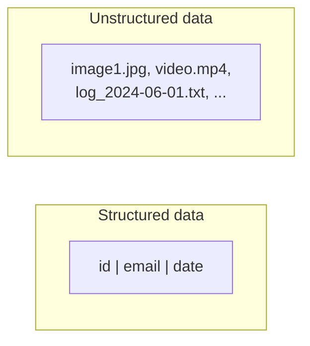


---

## 7.4 Storage Categories and Properties

### 7.4.1 Categories

| Category         | Examples              | Use Case                                 |
|------------------|-----------------------|------------------------------------------|
| Database         | PostgreSQL, MongoDB   | Structured / semi-structured data        |
| Object Storage   | Amazon S3, GCS, MinIO | Unstructured data (media, logs, backups) |
| File Storage     | NFS, SMB              | Shared file access, legacy systems       |
| Block Storage    | EBS, SAN              | Low-latency, high-performance (DB disks) |

### 7.4.2 Core Storage Properties

- **Durability:** Data persists even after failures (power loss, crashes).
- **Availability:** Data accessible when needed, even during outages.
- **Consistency:** Every read returns the most recent write.
- **Atomicity (transactional):** Operations are all-or-nothing.

### 7.4.3 ACID Properties

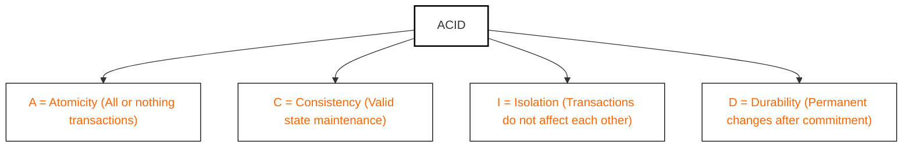

| Property    | Description                                                          |
|-------------|----------------------------------------------------------------------|
| Atomicity   | All steps in a transaction succeed or none do (all-or-nothing).      |
| Consistency | Data must always be valid according to all defined rules/constraints.|
| Isolation   | Transactions do not interfere with each other.                       |
| Durability  | Once committed, data survives crashes/failures.                      |

### 7.4.4 Transaction Isolation Levels & Anomalies

"Isolation" in ACID is not on/off. Full isolation (every transaction behaves as if it ran alone, one after another) is expensive, so databases offer **isolation levels**: weaker levels allow more concurrency but let certain **anomalies** through.

**The anomalies:**

| Anomaly | What goes wrong | Example |
|---------|-----------------|---------|
| **Dirty read** | You read another transaction's change before it commits, and it then rolls back | A report counts a €500 deposit that is later cancelled |
| **Non-repeatable read** | You read the same row twice in one transaction and get different values, because another transaction committed in between | An invoice total changes between the line that shows it and the line that charges it |
| **Phantom read** | You re-run a range query and rows have appeared or vanished | `COUNT(*) WHERE status = 'pending'` returns 10, then 11 |
| **Lost update** | Two transactions read the same value, both modify it, and the second write silently overwrites the first | Two clerks each add 1 to stock of 5; the result is 6, not 7 |
| **Write skew** | Two transactions read overlapping data, each updates a *different* row, and together they break a rule neither broke alone | Two on-call doctors each check "someone else is on call" and both sign off, leaving nobody |

**What each level prevents** (✓ = prevented). The SQL standard only defines the first three anomalies; the last two columns show how PostgreSQL behaves, and other engines differ:

| Isolation level | Dirty read | Non-repeatable read | Phantom | Lost update | Write skew |
|-----------------|:----------:|:-------------------:|:-------:|:-----------:|:----------:|
| **Read Uncommitted** | ✗ (✓ in PostgreSQL, which treats it as Read Committed) | ✗ | ✗ | ✗ | ✗ |
| **Read Committed** (default in PostgreSQL, Oracle, SQL Server) | ✓ | ✗ | ✗ | ✗ | ✗ |
| **Repeatable Read** (default in MySQL InnoDB; snapshot isolation in PostgreSQL) | ✓ | ✓ | ✓ in PostgreSQL; the standard allows phantoms | ✓ in PostgreSQL (one transaction aborts) | ✗ |
| **Serializable** | ✓ | ✓ | ✓ | ✓ | ✓ (one transaction aborts) |

At Repeatable Read and Serializable, the database may abort a transaction with a **serialization failure** instead of letting an anomaly through. Application code must catch that error and **retry the whole transaction**. Also note that MySQL's Repeatable Read does *not* detect lost updates the way PostgreSQL's does; check your engine's documentation rather than assuming the level name means the same thing everywhere.

**How databases implement it — MVCC.** Most modern engines (PostgreSQL, MySQL InnoDB, Oracle, SQL Server with snapshot isolation) use **multi-version concurrency control**: an update writes a *new version* of the row rather than overwriting it in place. Each transaction reads from a **snapshot**, the set of versions that were committed when its statement (Read Committed) or the transaction itself (Repeatable Read) began. Readers never block writers and writers never block readers; the cost is that old versions pile up and must be cleaned out later (`VACUUM` in PostgreSQL, purge threads in InnoDB).

**Example — fixing a lost update.** Two requests reserve a seat at the same moment, both under Read Committed:

```sql
-- Both transactions run this and both see seats_left = 1
SELECT seats_left FROM flights WHERE id = 42;
-- Application checks seats_left > 0, then both run:
UPDATE flights SET seats_left = 0 WHERE id = 42;
-- Result: two bookings, one seat. The second write overwrote the first.
```

Four standard fixes, from simplest to heaviest:

1. **Atomic update** — let the database do the read-modify-write in one statement, with the check in the `WHERE` clause:
   ```sql
   UPDATE flights SET seats_left = seats_left - 1 WHERE id = 42 AND seats_left > 0;
   -- 0 rows affected = sold out
   ```
2. **Pessimistic lock** — `SELECT ... FOR UPDATE` locks the row, so the second transaction waits until the first commits and then sees the new value:
   ```sql
   BEGIN;
   SELECT seats_left FROM flights WHERE id = 42 FOR UPDATE;
   -- check, then UPDATE ...
   COMMIT;
   ```
3. **Optimistic concurrency with a version column** — no lock is held; the write only succeeds if nobody changed the row since it was read. This is the database half of the HTTP `ETag` / `If-Match` pattern from the Protocols chapter:
   ```sql
   UPDATE flights SET seats_left = 0, version = version + 1
   WHERE id = 42 AND version = 17;
   -- 0 rows affected = someone else won; re-read and retry
   ```
4. **Raise the isolation level** to Repeatable Read or Serializable and retry on serialization failures. Serializable is the only level that also stops write skew without extra locking; the alternative is to lock the rows the decision depends on with `FOR UPDATE`.

**Keep transactions short.** A long transaction holds its locks longer, raises the odds of conflicts and aborts, and (under MVCC) stops old row versions from being cleaned up, which bloats tables. Never wait for user input, call a slow external API, or send email inside a transaction: gather everything first, then open the transaction, write, and commit.

**Interview angle:** when a design involves counters, balances, inventory, or booking, say which anomaly you are guarding against and which fix you'd use. Atomic updates or optimistic versions are the usual default for high-traffic paths; `FOR UPDATE` suits short, high-contention critical sections.

---

## 7.5 Trade-offs: Scalability, Reliability, and Performance

No storage system is perfect. Real-world solutions must **trade off** between:

- **Scalability:** Handles data/user/request growth.
- **Reliability:** Continues functioning despite failures.
- **Performance:** Fast reads/writes.

*Optimizing one often impacts the others.* (See `image-1.png` — Scalability/Reliability/Performance triangle diagram.)

---

## 7.6 The CAP Theorem

**CAP:** In a distributed system, you can only fully guarantee **two** of:

- **Consistency (C):** Every read gets the latest write.
- **Availability (A):** Every request receives a response.
- **Partition Tolerance (P):** System functions despite network splits.

**No distributed system can have all three at the same time.**

### 7.6.1 Diagram: CAP Venn Diagram

```venn
title: CAP theorem: pick two
sets: C | A | P
name C: Consistency
name A: Availability
name P: Partition tolerance
universe: off
label C&A: CA
label C&P: CP
label A&P: AP
label C&A&P: ✕
note: During a network partition you must give up consistency (AP) or availability (CP). The centre, all three at once, cannot be had.
```

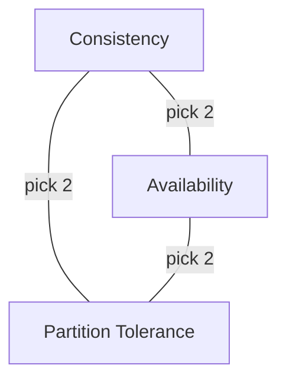

### 7.6.2 Types of Systems Based on CAP Trade-offs

#### 7.6.2.1 CP (Consistency + Partition Tolerance)

- Prioritizes data correctness over availability.
- During a partition, the system may reject requests to avoid inconsistent reads.
- Not always available, but when it is — data is guaranteed to be correct.
- **Example:** HBase — strongly consistent. If a node can't confirm a write across replicas, it won't serve it — even if it means being unavailable briefly.
- **When to use:** Financial systems, banking apps — anything where data integrity is critical.

#### 7.6.2.2 AP (Availability + Partition Tolerance)

- Prioritizes system uptime over consistency.
- During a partition, the system will serve requests, even if they return stale or eventually consistent data.
- **Example:** DynamoDB — inspired by Amazon's Dynamo model, uses eventual consistency by default for high availability.
- **When to use:** Social media feeds, product catalogs, content delivery — where being up is more important than perfect accuracy.

#### 7.6.2.3 CA (Consistency + Availability) — The "Unicorn"

- Only possible if no network partitions ever occur — i.e., in single-node or tightly coupled systems.
- In practice, not achievable in distributed systems that need to tolerate network faults.
- **Example:** Relational databases (like PostgreSQL) in standalone mode (not distributed) could be considered CA.

### 7.6.3 Database Models in CAP

| Model | Tends Toward                       | Example Use Case                     | Typical DB |
|-------|------------------------------------|--------------------------------------|------------|
| **CP**| Consistency + Partition Tolerance  | Financial, banking, critical systems | SQL        |
| **AP**| Availability + Partition Tolerance | Social media, product catalogs       | NoSQL      |
| **CA**| Consistency + Availability         | Standalone SQL (non-distributed)     | SQL        |

> **Key takeaway:** At scale, network partitions are inevitable — real-world systems must choose between Consistency and Availability during a partition.

---

## 7.7 Database Models — SQL vs. NoSQL

At its core, a **database** provides a structured way to store, retrieve, and manage data persistently — even across restarts or failures.

(See `image-2.png` for an overview diagram of databases as data managers.)

### 7.7.1 Relational Databases (SQL): The Traditional Powerhouse

(See `image-3.png` for SQL DB schema/diagram.)

- **Schema:** Fixed, structured tables.
- **Query Language:** SQL.
- **ACID Properties:** Atomicity, Consistency, Isolation, Durability.
- **Examples:** MySQL, PostgreSQL, Oracle, SQL Server.

**Core concepts:**

- **Schema-based:** Structure (tables, columns, data types) is defined upfront.
- **Rows and Columns:** Data organized like a spreadsheet.
- **Joins:** Combine data across tables.
- **ACID transactions.**

#### 7.7.1.1 Example: SQL Table Schema

```sql
CREATE TABLE users (
    id SERIAL PRIMARY KEY,
    username VARCHAR(50) UNIQUE,
    email VARCHAR(100),
    created_at TIMESTAMP DEFAULT CURRENT_TIMESTAMP
);
```

A more complete example with a foreign key:

```sql
CREATE TABLE users (
    id SERIAL PRIMARY KEY,
    username VARCHAR(50) NOT NULL,
    email VARCHAR(255) UNIQUE NOT NULL,
    created_at TIMESTAMP DEFAULT CURRENT_TIMESTAMP
);

CREATE TABLE orders (
    id SERIAL PRIMARY KEY,
    user_id INT REFERENCES users(id),
    total DECIMAL(10,2),
    created_at TIMESTAMP DEFAULT CURRENT_TIMESTAMP
);
```

#### 7.7.1.2 Example: Complex Query with Join

```sql
SELECT users.email, orders.total
FROM users
JOIN orders ON users.id = orders.user_id
WHERE orders.date > '2024-06-01';
```

#### 7.7.1.3 When to Use SQL

- Complex queries & relationships.
- Strong consistency needed.
- Well-known, structured schema.

#### 7.7.1.4 Limitations of Relational Databases

- **Rigid schema:** Not ideal when data structure changes frequently.
- **Scaling:** Typically scale *vertically* (bigger server), which has limits and cost challenges.
- **Nested data:** Handling deeply nested or variable data (e.g., JSON blobs) is clunky.

### 7.7.2 NoSQL Databases: Designed for Scale and Flexibility

(See `image-4.png` for NoSQL DB diagrams and `image-5.png` for NoSQL types.)

- **Schema:** Schema-less or dynamic.
- **Types:** Document, Key-Value, Columnar, Graph.
- **BASE Properties:** Basically Available, Soft state, Eventually consistent.

#### 7.7.2.1 NoSQL Types — Deep Dive

| Type        | Example DBs        | Best For                            |
|-------------|--------------------|--------------------------------------|
| Document    | MongoDB            | Nested/flexible data, CMS, profiles |
| Key-Value   | Redis, DynamoDB    | Caching, sessions, fast lookups     |
| Columnar    | Cassandra, HBase   | Analytics, time-series, big writes  |
| Graph       | Neo4j              | Social networks, recommendations    |

**Document Databases:**

- JSON-like structure (key-value pairs, nesting supported).
- Ideal for content management, user profiles.
- **Example:** MongoDB.

**Key-Value Databases:**

- Simple, fast, key-based lookups.
- High performance, low latency.
- **Example:** Redis, DynamoDB.

**Columnar Databases:**

- Store data by column, not row.
- Optimized for analytical queries over large datasets.
- **Example:** Cassandra, HBase.

**Graph Databases:**

- Store entities and relationships as nodes and edges.
- Efficient for highly connected data (social networks).
- **Example:** Neo4j.

#### 7.7.2.2 NoSQL Database Types Diagram

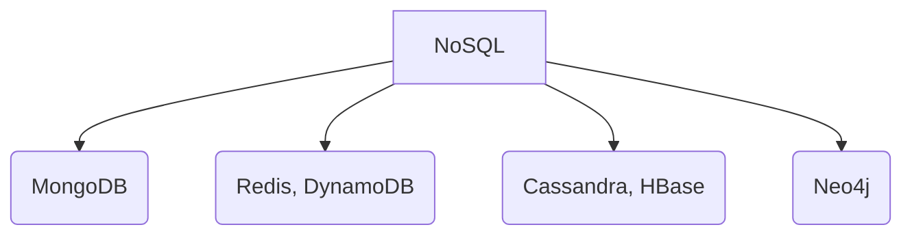

#### 7.7.2.3 Example: Document Store (MongoDB)

```json
{
    "user_id": "12345",
    "username": "jane_doe",
    "profile": {
        "bio": "Engineer. Coffee lover.",
        "social": ["twitter", "github"]
    },
    "created_at": "2024-06-20T15:32:00Z"
}
```

**MongoDB document insert:**

```javascript
db.users.insertOne({
  name: "Alice",
  email: "alice@example.com",
  preferences: { theme: "dark", notifications: true }
});
```

A simpler variant:

```javascript
db.users.insertOne({
  username: "alice",
  email: "alice@example.com",
  created_at: new Date()
});
```

**MongoDB query:**

```javascript
db.users.find({ "profile.social": "github" })
```

#### 7.7.2.4 Embedding vs. Referencing: The Duplication Trade-off

In a document store you choose between **embedding** related data inside a document and **referencing** it by id.

| | **Embed** (for example the seller's details inside each product) | **Reference** (store `seller_id`, keep sellers in their own collection) |
|--|-----------------------------------------------------------------|-----------------------------------------------------------------------|
| Reads | one read returns the product *and* seller; no join | two reads (or a lookup/join) |
| Writes | changing a seller's name means updating it in **every** product that embeds it (10,000 products = 10,000 writes) | change it in one place |
| Consistency | copies can drift apart | single source of truth |
| Best when | the embedded data is read together, changes rarely, and belongs to one parent | the data is shared, changes often, or grows without bound |

**Rule of thumb:** embed what you always read together and rarely change; reference what is shared or volatile. Some systems do both, keeping the embedded copy for fast reads and the referenced record as the truth.

**Flexibility has a cost.** Documents in one collection may have different fields and need no migrations, which is why NoSQL is quick to build with while the data shape is still changing (for example an MVP). But enforcing structure, joins and one-place updates is harder later, and moving to SQL when the design settles is a normal path.

#### 7.7.2.5 BASE Properties

NoSQL systems often relax ACID guarantees in favor of scalability and availability, summarized as **BASE**:

- **Basically Available:** System always returns a response (even if stale).
- **Soft state:** State may change over time, even without input (due to eventual sync).
- **Eventually consistent:** System guarantees data consistency... eventually.

#### 7.7.2.6 When to Use NoSQL

- High scalability needed.
- Flexible / evolving data structures.
- Low-latency or high-volume ops.

### 7.7.3 SQL vs. NoSQL — When to Use Which?

| Use SQL (Relational) When...               | Use NoSQL (Non-Relational) When...                       |
|--------------------------------------------|----------------------------------------------------------|
| Complex queries, joins, relationships      | High scalability, massive traffic/data volume            |
| Strong consistency is required             | Flexible, evolving, or nested data                       |
| Data is structured & predictable           | Low-latency / high-throughput writes, caching, analytics |
| Examples: Banking, ERP, inventory          | Examples: IoT, social feeds, logs, recommendations       |

### 7.7.4 Scaling Approaches: Vertical vs. Horizontal

| Vertical Scaling (Scale-Up)         | Horizontal Scaling (Scale-Out)         |
|-------------------------------------|----------------------------------------|
| Add more CPU/RAM to one server      | Add more nodes; distribute data        |
| Simpler, but hardware-limited       | Elastic, fault-tolerant, scalable      |
| SQL DBs (MySQL, PostgreSQL)         | NoSQL DBs (MongoDB, Cassandra)         |

---

## 7.8 SQL in Practice: Querying Beyond the Basics

> **Starting point:** this section assumes the database and SQL primer in Chapter 1 (tables, keys, `SELECT`/`INSERT`/`UPDATE`/`DELETE`, basic joins, indexes, transactions). Here we go further: how a query is really evaluated, all the join types, subqueries and CTEs, window functions, upserts, `NULL`, and the habits that make ORM-generated SQL slow.
> **Why it matters:** interviewers expect you to read a query, predict its result and spot why it is slow. ORMs hide the SQL but not its cost.

### 7.8.1 A Small Schema to Follow Along

The examples use these tables:

```sql
users    (id, name, country)
orders   (id, user_id, status, total_cents, created_at)   -- user_id → users.id
accounts (id, balance)
inventory(id, item, quantity)
```

### 7.8.2 The Clauses and Their Real Execution Order

One query shows nearly the whole language. Question: *which countries bring in the most revenue, counting only countries with more than three shipped orders?*

```sql
SELECT   u.country,
         COUNT(*)           AS orders,
         SUM(o.total_cents) AS revenue
FROM     orders o
JOIN     users  u ON u.id = o.user_id
WHERE    o.status = 'shipped'
GROUP BY u.country
HAVING   COUNT(*) > 3
ORDER BY revenue DESC
LIMIT    10;
```

You *write* `SELECT` first, but the database *evaluates* the clauses in a different order:

| Step | Clause | Job |
|------|--------|-----|
| 1 | `FROM` / `JOIN` | build the working set of rows (`o` and `u` are table aliases) |
| 2 | `WHERE` | filter **individual rows**, before any grouping |
| 3 | `GROUP BY` | collapse rows into groups |
| 4 | `HAVING` | filter **groups**, after grouping |
| 5 | `SELECT` | compute and name the output columns (`AS` only renames the display) |
| 6 | `ORDER BY` | sort the result |
| 7 | `LIMIT` | keep the first N rows |

Consequences worth remembering:

- **A column alias defined in `SELECT` does not exist yet in `WHERE`.** `WHERE revenue > 100` fails with "column does not exist". Repeat the expression, or wrap the query in a subquery or CTE. `ORDER BY` runs after `SELECT`, so it *can* use the alias.
- **`WHERE` filters rows; `HAVING` filters groups.** Use `WHERE` whenever you can, because it shrinks the data before the costly grouping step.
- Every column in `SELECT` must either appear in `GROUP BY` or sit inside an aggregate (`COUNT`, `SUM`, `AVG`, `MIN`, `MAX`).
- Common `WHERE` operators: `=`, `<`, `>`, `<=`, `>=`, `BETWEEN a AND b`, `IN (...)`, `LIKE 'abc%'`, `IS NULL`.

### 7.8.3 All the Join Types

| Join | Keeps | Unmatched rows |
|------|-------|----------------|
| `INNER JOIN` | only rows that match on both sides | dropped |
| `LEFT JOIN` | every row of the left table | right columns become `NULL` |
| `RIGHT JOIN` | every row of the right table | left columns become `NULL` |
| `FULL OUTER JOIN` | every row of both tables | the missing side becomes `NULL` |
| `CROSS JOIN` | every pairing (3 rows × 3 rows = 9 rows) | not applicable |

```sql
-- every user, even those with no orders (order columns are NULL for them)
SELECT u.name, o.id
FROM users u
LEFT JOIN orders o ON o.user_id = u.id;

-- users who have NO orders: keep the NULL rows
SELECT u.name
FROM users u
LEFT JOIN orders o ON o.user_id = u.id
WHERE o.id IS NULL;
```

> **A classic bug:** after a `LEFT JOIN`, a `WHERE` condition on a column of the right-hand table (such as `WHERE o.status = 'shipped'`) throws away the `NULL` rows, so the query quietly behaves like an inner join. Put the condition in the `ON` clause if you want to keep the unmatched left rows.

### 7.8.4 Subqueries

A **subquery** is a query nested inside another.

```sql
-- IN: build a list from the inner query, then test membership
SELECT name FROM users
WHERE id IN (SELECT user_id FROM orders WHERE status = 'shipped');

-- EXISTS: stops at the first match and returns true or false
SELECT name FROM users u
WHERE EXISTS (SELECT 1 FROM orders o WHERE o.user_id = u.id);
```

A **correlated subquery** refers to a column of the outer query (`u.id` above), so it cannot run on its own: conceptually it is evaluated once per outer row. Planners often rewrite these into joins, but do not count on that for large tables.

### 7.8.5 CTEs (Common Table Expressions)

A **CTE** gives a query a name and places it above the main statement. It is easier to read than deep nesting, and the intermediate result can be computed once.

```sql
WITH busy_users AS (
  SELECT user_id, COUNT(*) AS n
  FROM orders
  GROUP BY user_id
  HAVING COUNT(*) > 5
)
SELECT u.name, b.n
FROM busy_users b
JOIN users u ON u.id = b.user_id;
```

Use a CTE when the same intermediate result feeds the main query, or when a long query needs to be read top to bottom.

### 7.8.6 Window Functions

`GROUP BY` collapses rows. A **window function** keeps every row and adds a computed column next to it. `OVER (...)` defines the window.

```sql
SELECT user_id, total_cents,
       ROW_NUMBER() OVER (PARTITION BY user_id ORDER BY created_at) AS nth_order,
       SUM(total_cents) OVER (PARTITION BY user_id)                 AS user_total
FROM orders;
```

| Function | Behaviour |
|----------|-----------|
| `ROW_NUMBER` | 1, 2, 3, ... never ties |
| `RANK` | ties share a rank and the next rank is skipped (1, 2, 2, 4) |
| `DENSE_RANK` | ties share a rank, no gaps (1, 2, 2, 3) |
| `LAG` / `LEAD` | the value from the previous / next row |
| `SUM`, `AVG`, `COUNT` with `OVER` | running totals and moving averages |

A common interview task, "the latest order per user", is a `ROW_NUMBER()` partitioned by user and filtered to `1`.

### 7.8.7 Transactions in Practice: BEGIN, COMMIT and ROLLBACK

A transaction groups statements so that **all succeed or none do**. The money-transfer example, with the balance check done safely:

```sql
BEGIN;                                   -- start the transaction

UPDATE accounts SET balance = balance - 100
WHERE id = 1 AND balance >= 100;         -- the check and the deduction happen atomically
-- the application looks at "rows affected":
--   0 rows  → insufficient funds: run ROLLBACK; and stop
--   1 row   → carry on

UPDATE accounts SET balance = balance + 100 WHERE id = 2;

COMMIT;                                  -- make both changes permanent
```

- **`COMMIT`** saves everything done since `BEGIN`.
- **`ROLLBACK`** cancels everything since `BEGIN`, as if it never happened. A crash or error before `COMMIT` has the same effect.
- Putting the check inside the `UPDATE` (`AND balance >= 100`) avoids a gap between "read the balance" and "write the new one" in which another transaction could change it.

**Isolation:** concurrent transactions can interfere (dirty reads, phantom rows). You choose how much protection you want, trading safety for concurrency:

```sql
SET TRANSACTION ISOLATION LEVEL SERIALIZABLE;   -- strongest: behaves as if transactions ran one at a time
```

Higher levels prevent more anomalies but allow less concurrency and can abort transactions you must retry. The isolation levels and the anomalies they stop are explained under Transaction Isolation Levels earlier in this chapter.

### 7.8.8 Upsert: Insert or Update in One Step

```sql
-- PostgreSQL / SQLite
INSERT INTO inventory (id, item, quantity) VALUES (42, 'widget', 50)
ON CONFLICT (id) DO UPDATE SET quantity = EXCLUDED.quantity;

-- MySQL equivalent:
-- INSERT ... ON DUPLICATE KEY UPDATE quantity = VALUES(quantity);
```

Doing the check and the write in one statement avoids the race where two clients both see "not found" and both insert.

### 7.8.9 NULL: Unknown, Not Zero

`NULL` means *unknown*. Any comparison with an unknown is unknown: `NULL = NULL` and `price > NULL` are neither true nor false. Test with `IS NULL` and `IS NOT NULL`.

The classic trap is `NOT IN` when the list contains a `NULL`:

```sql
-- archived contains the ids (3, 7, NULL): this returns ZERO rows
SELECT * FROM products WHERE category_id NOT IN (SELECT id FROM archived);

-- safe form
SELECT * FROM products p
WHERE NOT EXISTS (SELECT 1 FROM archived a WHERE a.id = p.category_id);
```

Also remember that aggregates skip `NULL` values (`COUNT(col)` ignores them, `COUNT(*)` does not).

### 7.8.10 ORM Habits That Hurt at Scale

An ORM writes the SQL, but you still own the performance. A query that is instant on 200 rows can take tens of seconds on 2 million.

| Problem | What happens | Fix |
|---------|--------------|-----|
| **N+1 queries** | load 100 posts, then touch each post's author in a loop: 1 + 100 = 101 queries | eager-load with a join, or two queries (`posts`, then `authors WHERE id IN (...)`) |
| `SELECT *` on wide tables | pulls large text columns just to render a list of titles | select only the columns you need |
| Counting in application code | loads 10,000 rows to read `.length` | `SELECT COUNT(*)` returns one number |
| No `LIMIT` | an unbounded query on a table of unknown size can run for seconds | always limit or paginate |
| Giant `IN (...)` lists | 50,000 ids: some drivers reject them and planners handle them badly | split the ids into chunks, or join against a temporary table |

Log the SQL your ORM actually sends while you develop. For query plans, indexing and pagination in practice, see Database Performance Optimization in Chapter 8.

### 7.8.11 Key Takeaways

- Evaluation order is `FROM → WHERE → GROUP BY → HAVING → SELECT → ORDER BY → LIMIT`, which is why a `SELECT` alias fails in `WHERE`.
- `WHERE` filters rows, `HAVING` filters groups.
- Pick joins on purpose; a `WHERE` on the right table after a `LEFT JOIN` undoes it.
- Use `EXISTS` and CTEs for clarity; correlated subqueries run per row.
- Window functions keep rows and add computed columns (`ROW_NUMBER`, `RANK`, `LAG`, running sums).
- `ON CONFLICT` (or `ON DUPLICATE KEY`) makes insert-or-update atomic.
- `NULL` is unknown: use `IS NULL`, and prefer `NOT EXISTS` over `NOT IN` when `NULL` may appear.
- Know what your ORM sends: eager-load to kill N+1, select needed columns, `COUNT` in SQL, always `LIMIT`.

### 7.8.12 Sample Interview Questions

1. What is the difference between `WHERE` and `HAVING`? Give an example that needs both.
2. Why does `SELECT price * qty AS total FROM t WHERE total > 100` fail, and how do you fix it?
3. Your `LEFT JOIN` returns fewer rows than the left table. What probably happened?
4. Explain the N+1 problem and two ways to fix it.
5. Write a query for "the latest order per user" using a window function.
6. Why can `NOT IN (subquery)` return no rows, and what is the safer form?

---

## 7.9 Advanced Database Topics

### 7.9.1 Scaling Strategies — A Recap

#### 7.9.1.1 Vertical Scaling (Scale-Up)

- **Definition:** Boost the capacity of a single server (more CPU, RAM, SSD).
- **Typical with:** Relational/SQL databases.
- **Pros:** Simpler setup; strong consistency via ACID.
- **Cons:** Limited by hardware ceilings; cost grows non-linearly; single point of failure.

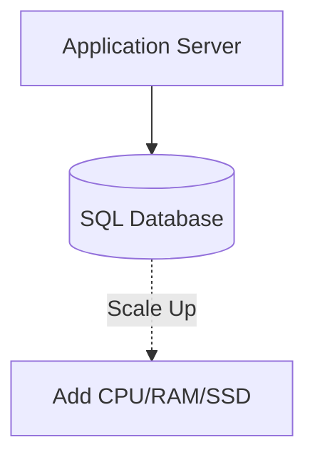

#### 7.9.1.2 Horizontal Scaling (Scale-Out)

- **Definition:** Add more servers/nodes to distribute load and data.
- **Typical with:** NoSQL databases.
- **Pros:** Elastic scalability; handles large-scale traffic and big data; better fault tolerance.
- **Cons:** Increased operational complexity; weaker consistency (often eventual).

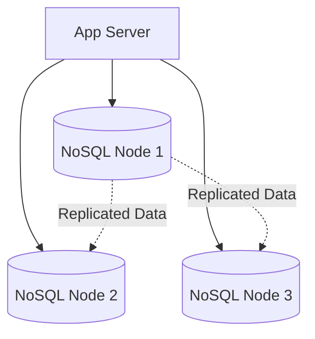

**When to use which?**

- **SQL / Vertical:** Banking, ERP, transactional systems.
- **NoSQL / Horizontal:** Social feeds, product catalogs, IoT, analytics.

### 7.9.2 Replication

**Replication** copies data across multiple database nodes for redundancy and increased throughput.

**Benefits:**

- **Fault Tolerance:** If one node fails, others can serve data.
- **Read Scalability:** Distribute read load across replicas.
- **Data Availability:** Users access data despite node failures.

#### 7.9.2.1 Leader-Follower (Primary-Replica) Replication

(See `image-7.png` for a primary-replica diagram.)

- **All writes** go to the **Leader**.
- **Reads** can go to **Followers** (replicas).
- **Asynchronous replication** may cause followers to lag (eventual consistency).
- **Synchronous replication** offers strong consistency but can impact availability.

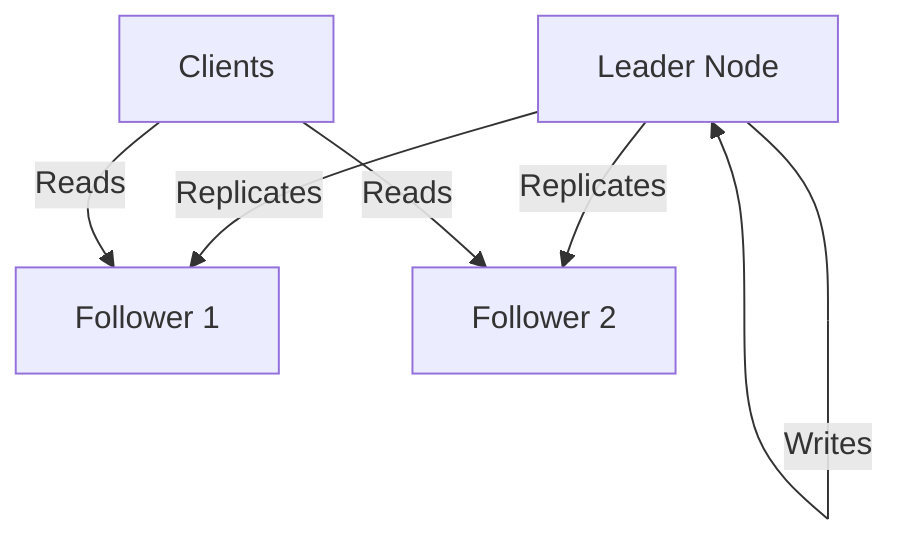

```
           +------------+
           |  Leader    |
           +-----+------+
                 |
         +-------+--------+
         |                |
     +---+----+      +----+---+
     |Follower|      |Follower|
     +--------+      +--------+
```

A wider topology view:

```
      +-------+         +--------+      +--------+
      |Leader |  --->   |Follower| ...  |Follower|
      +-------+         +--------+      +--------+
        (writes)           (reads)         (reads)
```

#### 7.9.2.2 Read Replicas

(See `image-6.png` for a read-replica diagram.)

- **Purpose:** Scale read-heavy workloads.
- **All writes** go to the primary; **reads** are balanced across replicas.
- **Trade-off:** Potential for stale reads if replication lags.

#### 7.9.2.3 Multi-Leader Replication and Conflict Resolution

In leader-follower replication, only the leader accepts writes. In **multi-leader** (also called leader-leader or multi-master) replication, **several nodes accept writes** and copy them to each other.

**Why use it:**

- **Multi-region writes:** each region writes to a nearby leader for low latency.
- **No single write bottleneck or single point of failure** for writes.
- **Offline-capable clients:** a phone or laptop acts like a small leader that syncs later.

**The price: write conflicts.** Two leaders can change the same row at the same time, and each only learns of the other's change after replication lag.

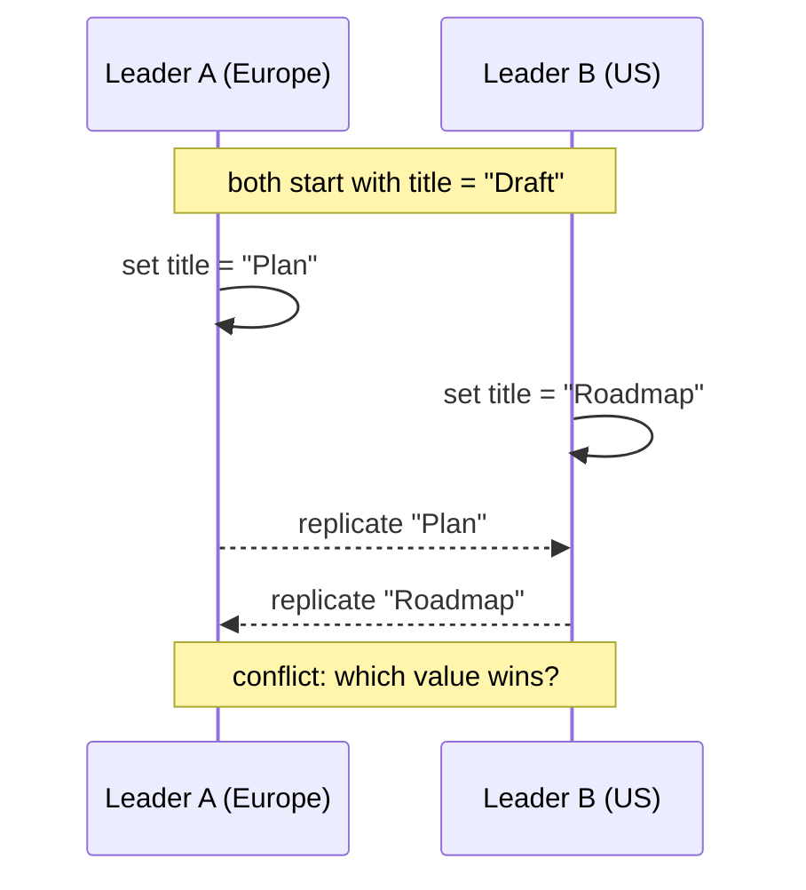

**Ways to resolve a conflict:**

| Strategy | How | Trade-off |
|----------|-----|-----------|
| **Last write wins (LWW)** | keep the change with the latest timestamp | simple, but silently **loses** the other write, and clocks differ between machines |
| **Version vectors / vector clocks** | track causality to detect which changes were truly concurrent | detects conflicts precisely; something still has to decide |
| **Application-level merge** | store both versions and let the app, or the user, merge them | correct but more code |
| **CRDTs** | data types designed to merge automatically (counters, sets, text) | no lost updates; limited to suitable data shapes |
| **Avoid conflicts** | route all writes for a given record to one leader (by user, region or key) | simplest and most common; gives up some of the multi-leader benefit |

**Rule of thumb:** use multi-leader only when you truly need multi-region writes or offline sync, and design around conflicts from the start. Otherwise prefer leader-follower plus read replicas.

#### 7.9.2.4 Example: Configuring Read Replicas in PostgreSQL

```bash
# On the primary server (postgresql.conf)
wal_level = replica
max_wal_senders = 10
hot_standby = on

# On the replica server
standby_mode = 'on'
primary_conninfo = 'host=primary_ip user=replicator password=secret'
```

### 7.9.3 Sharding

As systems outgrow the capacity of a single node, **sharding** divides data across multiple databases or nodes.

#### 7.9.3.1 Types of Sharding

- **Horizontal sharding:** Split data by rows — e.g., user_id ranges.
- **Vertical sharding:** Split by feature/domain — e.g., profiles vs. analytics.

#### 7.9.3.2 Sharding Strategies

**a) Range-Based Sharding:**

- **How:** Data split by value ranges (e.g., user_id 1-1000 → Shard A).
- **Pro:** Simple, intuitive.
- **Con:** Risk of hotspots if data is skewed.

**b) Hash-Based Sharding:**

- **How:** Apply a hash function to a key (e.g., user_id) for shard assignment.
- **Pro:** Even distribution.
- **Con:** Range queries are hard; re-sharding is painful.

```python
def get_shard(user_id, num_shards):
    return hash(user_id) % num_shards

# Usage example
shard_index = get_shard(12345, 4)  # returns shard index 0-3
```

**c) Consistent Hashing:**

Solves the re-sharding problem: only a small subset of keys move when adding/removing nodes.

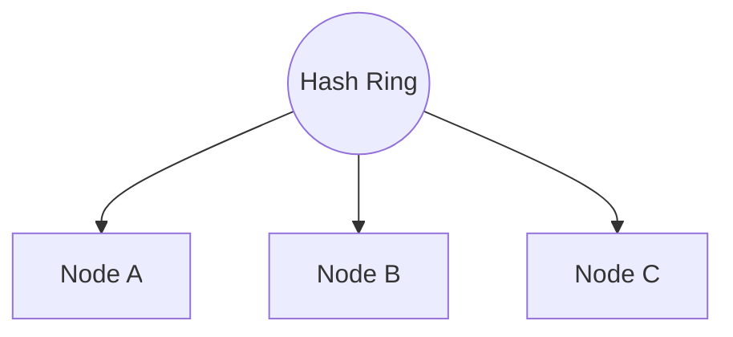

```
[Node1]---[Node2]---[Node3]---[Node1]
   |          |        |        |
[Key1]    [Key2]   [Key3]   [Key4]
```

> Only a subset of keys are remapped when nodes are added/removed.

**d) Geo-Based Sharding:**

- **How:** Shard by geographic region for latency/compliance.
- **Use Case:** Social media, CDN, regionally regulated data.

#### 7.9.3.3 Hands-On Lab: Sharding MongoDB on One Machine

This lab builds the real architecture of a sharded MongoDB cluster. For learning, every process runs on one machine with a single member per replica set; production uses three or more members per set and separate hosts.

**The pieces:**

| Component | Job |
|-----------|-----|
| **Config server** (a replica set) | stores the cluster's metadata: which key ranges live on which shard |
| **Shards** (each a replica set) | hold the actual data |
| **`mongos` router** | the entry point applications talk to; it routes each query to the right shard(s) |

**1. Start the processes** (each in its own terminal, with its own data folder):

```bash
mkdir -p data/cfg data/shardA data/shardB
mongod --configsvr --replSet cfg    --port 27019 --dbpath data/cfg
mongod --shardsvr  --replSet shardA --port 27018 --dbpath data/shardA
mongod --shardsvr  --replSet shardB --port 27028 --dbpath data/shardB
```

**2. Initiate each replica set:**

```bash
mongosh --port 27019 --eval 'rs.initiate({_id:"cfg", configsvr:true, members:[{_id:0, host:"localhost:27019"}]})'
mongosh --port 27018 --eval 'rs.initiate({_id:"shardA", members:[{_id:0, host:"localhost:27018"}]})'
mongosh --port 27028 --eval 'rs.initiate({_id:"shardB", members:[{_id:0, host:"localhost:27028"}]})'
```

**3. Start the router and connect to it:**

```bash
mongos --configdb cfg/localhost:27019 --port 27017
mongosh --port 27017
```

**4. Add the shards, enable sharding and choose a shard key:**

```javascript
sh.addShard("shardA/localhost:27018")
sh.addShard("shardB/localhost:27028")
sh.enableSharding("shop")
sh.shardCollection("shop.orders", { user_id: "hashed" })   // hash-based: even spread
```

**5. Load data and see how it spread:**

```javascript
use shop
for (let i = 0; i < 20000; i++) db.orders.insertOne({ user_id: i, total: i % 100 })
db.orders.getShardDistribution()   // roughly half the documents on each shard
sh.status()
```

**What to notice:**

- A **hashed** key spreads writes evenly but makes **range queries** on `user_id` hit every shard. A **ranged** key (`{ user_id: 1 }`) keeps neighbours together but can create a **hot shard** if new ids always increase.
- A query that includes the shard key goes to one shard; one that does not is **scattered** to all shards. This is why shard-key choice is the most important sharding decision (see Sharding Strategies above).
- Clean up by stopping the processes and deleting the `data` folder.

### 7.9.4 Polyglot Persistence

**Polyglot persistence** means using multiple database types in one architecture, choosing the best tool for each job.

**Why:** Each DB excels at different tasks (search, analytics, relationships).

**Benefit:** Better performance, optimized storage.

| Data Need           | Recommended DB           | Example Use Case            |
|---------------------|--------------------------|-----------------------------|
| Relationships       | Relational (PostgreSQL)  | User profiles, transactions |
| Flexible Documents  | Document (MongoDB)       | Product catalogs            |
| Fast Key Access     | Key-Value (Redis)        | Caching, session storage    |
| Full-Text Search    | Search Engine (Elastic)  | Search functionality        |
| Analytics           | Columnar (Cassandra)     | Log/metrics pipelines       |

#### 7.9.4.1 Example: Microservices with Polyglot Persistence

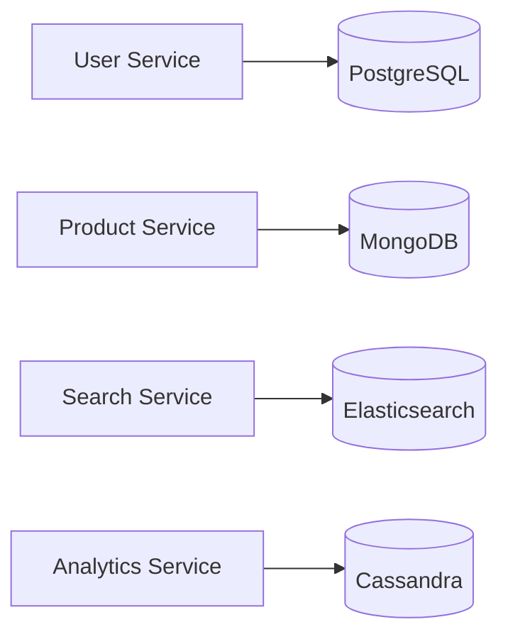

---

## 7.10 Object Storage

(See `image-8.png` for object-storage architecture.)

**Object storage** is a storage architecture that manages data as *objects*, rather than as files in a hierarchy (file storage) or blocks (block storage). It stores data as a **flat namespace**.

Each object contains:

- The data itself (e.g., an image, video, or document).
- A unique identifier (object key).
- Metadata (extra info: content-type, tags, timestamps, etc.).

Unlike traditional file or block storage, object storage systems are:

- **Scalable:** Billions of objects, petabytes+ of data.
- **Distributed:** Spans servers, data centers, regions, even continents.
- **Optimized for unstructured data:** Handles images, videos, logs, backups, etc.

### 7.10.1 What Does "Flat Namespace" Mean?

When we say **object storage uses a flat namespace**, it means there are **no hierarchical folders or directories** — every object is stored in a **single logical container (bucket)** and identified by a **unique key (name or ID)**.

#### 7.10.1.1 Example Comparison

**File Storage (Hierarchical):**

```
/images/2025/travel/beach.png
/images/2025/travel/mountains.png
```

Here, files exist inside real folders (`images/`, `travel/`).

**Object Storage (Flat):**

```
images/2025/travel/beach.png
images/2025/travel/mountains.png
```

There are **no real folders** — the slashes (`/`) are *just part of the object name*. Everything exists in **one big flat space**.

#### 7.10.1.2 AWS S3 Example

In an S3 bucket:

```
my-bucket/photos/beach.jpg
my-bucket/docs/report.pdf
my-bucket/backups/2025/jan.zip
```

Under the hood, S3 does **not** create real directories — it simply stores object keys:

```
"photos/beach.jpg"
"docs/report.pdf"
"backups/2025/jan.zip"
```

The folder view in the AWS Console is **just a visual convenience**.

#### 7.10.1.3 Why Flat Namespace?

| Advantage    | Explanation                                                                |
|--------------|----------------------------------------------------------------------------|
| Scalability  | Easier to distribute data across nodes — no directory hierarchy to manage. |
| Simplicity   | Each object has a globally unique key — easy to retrieve directly.         |
| Performance  | Ideal for billions of objects — key-based lookup is faster than path traversal. |

**Analogy:**

- **File storage** → like a *folder tree* on your computer.
- **Object storage** → like a *key-value store* — each object is fetched by its **key**, not its folder path.

### 7.10.2 Key Concepts & Architecture

**Object:**

- **Definition:** The fundamental unit — a self-contained package of data + metadata + identifier.
- **Analogy:** Like a ZIP file with all relevant info bundled inside.

**Bucket:**

- **Definition:** A logical container for objects (similar to folders, but flat).
- **Role:** Organizes objects; every object must belong to a bucket.

**Metadata:**

- **Definition:** Flexible, extensible info about the object.
- **Examples:** MIME type, creation date, owner, custom tags, access controls.

#### 7.10.2.1 Object Storage Structure

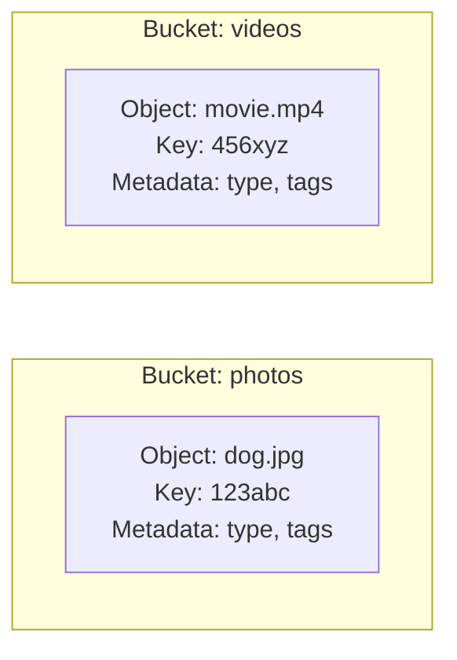


A simpler conceptual view:

```
Bucket: "user-photos"
    ├── photo1.jpg (metadata: {uploaded_by: "alice", tags: ["vacation"]})
    ├── photo2.jpg (metadata: {uploaded_by: "bob", tags: ["profile"]})
```

### 7.10.3 Popular Object Storage Platforms

- **Amazon S3:** Industry gold standard, highly durable, vast ecosystem.
- **Google Cloud Storage (GCS):** Simple tiers, ML/data-lake friendly.
- **Azure Blob Storage:** Deep Microsoft stack integration, flexible tiers.
- **On-prem / Hybrid (Open Source):** MinIO, Ceph — cloud-native APIs in your datacenter.

### 7.10.4 Common Use Cases

- **Media Storage:** Images, videos, design files (YouTube, asset management).
- **Backups & Archives:** Durable, cheap, long-term backup and compliance storage.
- **Data Lakes:** Massive raw-data repositories for analytics/AI (e.g., S3 Data Lake).
- **Static Website Hosting:** Host HTML/CSS/JS directly from S3/GCS buckets.
- **IoT & ML Data Pipelines:** Sink for sensor/model data, high-throughput ingestion.

### 7.10.5 Performance and Cost Considerations

**Performance:**

- **Latency:** Higher than block/file storage; not ideal for rapid small reads/writes.
- **Throughput:** Designed for massive parallel access — great for large data sets.
- **Consistency:** Often eventual (e.g., S3), so changes may not be instantly visible.
- **Access Patterns:** Best for "write-once, read-many" workloads; not optimized for frequent updates/appends.

**Cost:**

- **Storage Tiers:** Standard, Infrequent Access, Archive (e.g., S3 Glacier).
- **Pricing:** Pay for storage used, *and* for API requests (PUT, GET), and data egress.
- **Best practices:**
  - Use lifecycle rules to move stale data to cheaper tiers or delete it.
  - Monitor usage, adjust storage classes as access patterns change.

### 7.10.6 Signed URLs and Signed Cookies: Temporary Access to Private Objects

Private objects in a bucket cannot simply be linked to: a plain URL either exposes the file to everyone or to no one. **Signed access** gives a **time-limited key** to one user without making the bucket public.

**How a signed URL works:** the server builds a URL that contains the resource path, an **expiry time** and a **signature**: a cryptographic hash (HMAC) of those parts made with a secret the storage service also knows. When the request arrives, the service recomputes the signature. If the URL was tampered with, or the time has passed, it refuses.

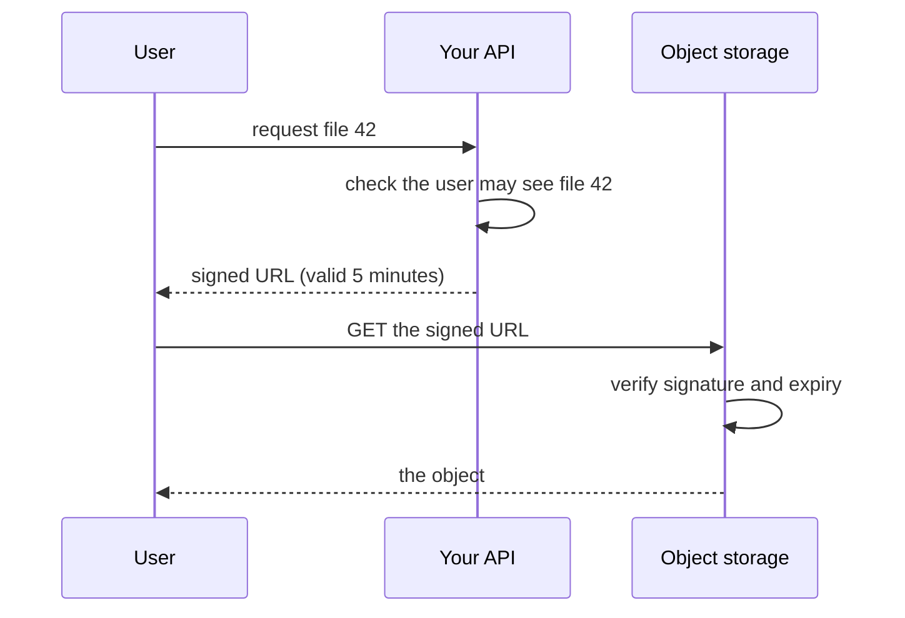

```python
import boto3
s3 = boto3.client("s3")
url = s3.generate_presigned_url(
    "get_object",
    Params={"Bucket": "private-media", "Key": "reports/q3.pdf"},
    ExpiresIn=300,          # seconds
)
```

The same pattern works for **uploads** (a signed `PUT` lets a client upload straight to storage, so large files never pass through your servers).

**Signed URL or signed cookie?** (for example with a CDN such as CloudFront)

| | **Signed URL** | **Signed cookie** |
|--|----------------|-------------------|
| Grants access to | one object per URL | many objects, for example every file under a path |
| Best for | a single download or upload link, sharing one file | a streaming video split into hundreds of segments, or a whole members-only area |
| URL stays | different for every file | unchanged, so existing links and players keep working |

**Good practice:** keep lifetimes short, use HTTPS, check authorization *before* signing, sign only the path needed, and avoid logging full URLs. A signed URL **cannot be revoked** before it expires, so a short expiry is your only control.

### 7.10.7 Sample Code: Using Amazon S3 with Python (`boto3`)

A simple upload:

```python
import boto3
s3 = boto3.client('s3')
s3.upload_file('photo.jpg', 'mybucket', 'photos/photo.jpg')
```

Upload with metadata, download, and head_object:

```python
import boto3

s3 = boto3.client('s3')

# Upload a file with metadata
s3.upload_file('local_photo.jpg', 'my-photo-bucket', 'photos/dog.jpg',
               ExtraArgs={'Metadata': {'uploaded_by': 'alice', 'project': 'pets'}})

# Download a file
s3.download_file('my-photo-bucket', 'photos/dog.jpg', 'downloaded_dog.jpg')

# Get object metadata
response = s3.head_object(Bucket='my-photo-bucket', Key='photos/dog.jpg')
print(response['Metadata'])
```

Just upload with metadata:

```python
import boto3

s3 = boto3.client('s3')
s3.upload_file('photo1.jpg', 'mybucket', 'photos/photo1.jpg', ExtraArgs={'Metadata': {'uploaded_by': 'alice'}})
```

### 7.10.8 Object Storage — Tips & Tricks

- **Use metadata wisely:** Tag objects for easier search, access control, and automation.
- **Lifecycle rules:** Automate moving old data to cheaper storage or deletion to control costs.
- **Monitor usage:** Use built-in analytics to spot unused or rarely-accessed data.
- **Secure your buckets:** Enforce least-privilege, use bucket policies, enable object versioning.
- **Optimize for access patterns:** Use Standard tier for hot data, Archive/Glacier for cold data.
- **Batch operations:** When possible, batch uploads/downloads to reduce request costs.

### 7.10.9 Object Storage — Interview Questions

- What is object storage and how is it different from file or block storage?
- When would you choose object storage over a traditional file system?
- Explain the structure of an object in object storage. What role does metadata play?
- Design a media hosting platform (e.g., YouTube). How would you use object storage for video uploads and streaming?
- What are the performance trade-offs of using object storage for real-time access?

---

## 7.11 File Systems and Distributed Storage

### 7.11.1 What is a File System?

A **file system** is the foundational layer that defines how data is stored, organized, and accessed on storage media (hard drives, SSDs, removable disks).

**Responsibilities:**

- Stores files and manages metadata (name, timestamps, permissions, size).
- Manages directory hierarchy (folders/subfolders).
- Handles read/write operations and access control.

**Common file systems:**

- `ext4` (Linux), `NTFS` (Windows), `XFS` (high-performance Linux).

### 7.11.2 Traditional File Systems: Strengths & Limitations

Traditional file systems use a **hierarchical structure** — folders and files arranged in a tree:

```
/ (root)
└── home/
    ├── user/
    │   ├── docs/
    │   └── photos/
```

**Key limitations:**

- **Single-node design:** All storage is managed on one machine.
- **Limited scalability:** Cannot easily scale across multiple servers.
- **Not fault tolerant:** Hardware failure = data loss unless external backups are used.

**Best suited for:** Personal computers, small servers, workloads not requiring distributed, parallel access or massive scale.

### 7.11.3 Distributed File Systems (DFS): The Need for Scale

> **Definition:** A DFS allows files to be **stored and accessed across multiple nodes/servers**, but appears as a single file system to users and applications.

**Key benefits:**

- **Redundancy & Fault Tolerance:** Data is replicated across nodes; hardware failure does not mean data loss.
- **Horizontal Scalability:** Add more nodes to increase capacity and throughput.
- **High Throughput:** Parallel read/write operations across the cluster.

**Real-world examples:**

- **HDFS (Hadoop Distributed File System):** Powers Hadoop and Spark analytics.
- **CephFS, GlusterFS:** Enterprise and scientific storage.

### 7.11.4 DFS Architecture: NameNode & DataNodes

(See `image-9.png` for HDFS architecture diagram.)

A classic DFS architecture (like HDFS) has:

- **NameNode:** The "brain" of DFS. Manages metadata (file names, directories, permissions, block locations).
- **DataNodes:** The "workhorses." Store actual data blocks.

**How it works:**

1. **File upload:** Split into fixed-size blocks (e.g., 128MB).
2. **Block distribution:** Blocks are distributed across DataNodes.
3. **Replication:** Each block is stored on multiple DataNodes (default: 3 copies).
4. **Metadata:** NameNode keeps track of where each block lives.

**Block size & striping:**

- Larger blocks = fewer metadata entries, but less flexibility.
- Striping enables parallel access and higher throughput.

### 7.11.5 Scalability, Fault Tolerance, and Performance

**Scalability:**

- **Horizontal scaling:** Add more DataNodes to increase capacity & speed.
- **Automatic rebalancing:** DFS redistributes data as nodes are added/removed.

**Fault Tolerance:**

- **Replication factor** (e.g., 3) ensures that if one node fails, data is available from another replica.
- **Self-healing:** DFS automatically copies data to healthy nodes if a node goes offline.

**Performance:**

- **Parallel I/O:** Multiple nodes serve read/write requests simultaneously.
- **High throughput:** Ideal for analytics, machine learning, and backup workloads.

### 7.11.6 Code Snippet: Accessing HDFS in Python

```python
from hdfs import InsecureClient

# Connect to HDFS (assumes NameNode at localhost:9870)
client = InsecureClient('http://localhost:9870', user='hadoop')

# List files in a directory
print(client.list('/user/data'))

# Write a file to HDFS
with client.write('/user/data/example.txt', encoding='utf-8') as writer:
    writer.write('Hello, HDFS!')

# Read a file from HDFS
with client.read('/user/data/example.txt', encoding='utf-8') as reader:
    content = reader.read()
    print(content)
```

### 7.11.7 Diagram: DFS Architecture

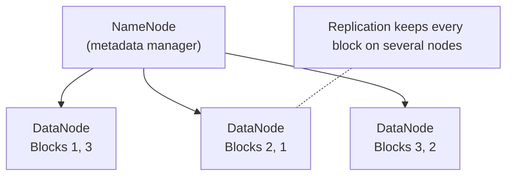


A simplified view:

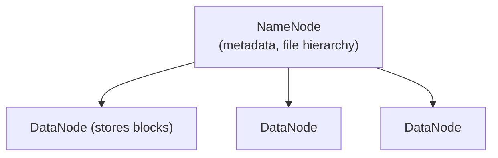


### 7.11.8 File Systems & DFS — Tips & Tricks

- **Tune block size:** Adjust based on workload. Larger files → larger blocks.
- **Monitor replication:** Avoid under- or over-replication. Too few = risk of data loss; too many = wasted space.
- **Automate rebalancing:** Enable DFS's built-in rebalancer to redistribute data as nodes are added/removed.
- **Secure your cluster:** Use Kerberos or other authentication for NameNode/DataNodes in production.
- **Optimize for access patterns:** For analytics, use striping and partitioning to maximize parallel access.
- **Plan for NameNode failure:** In HDFS, the NameNode is a single point of failure (unless using HA mode). Always configure NameNode HA for production.

---

## 7.12 Big Data Fundamentals

Modern software systems — from Netflix recommendations to IoT-driven smart factories — are fueled by data. But as data grows in **volume**, **speed**, and **complexity**, traditional storage and processing systems struggle to keep up.

### 7.12.1 The 6 V's of Big Data

| V              | Description                                            | Example                                |
|----------------|--------------------------------------------------------|----------------------------------------|
| **Volume**     | Massive data quantities (TBs, PBs, EBs)                | Social media, IoT, transaction logs    |
| **Velocity**   | High speed of data generation and processing           | Clickstreams, sensor feeds, stock data |
| **Variety**    | Diverse formats: structured, semi/unstructured         | Tables, JSON, images, videos, logs     |
| **Veracity**   | Data quality: accuracy, noise, trustworthiness         | Incomplete, noisy, or ambiguous data   |
| **Value**      | Business or analytical value derived from data         | Insights, decisions, model training    |
| **Variability**| Inconsistency and unpredictability in data structure   | Changing context, evolving schemas     |

> **Tip:** In interviews, referencing the 6 V's demonstrates deep understanding of Big Data challenges.

### 7.12.2 Why Traditional Storage Fails at Scale

- **Limited scalability:** Vertical scaling hits physical and cost limits.
- **Performance bottlenecks:** Not optimized for parallel reads/writes.
- **Cost inefficiency:** Scaling up is expensive; maintenance is labor-intensive.
- **Lack of fault tolerance:** No built-in redundancy — data loss risk on hardware failure.

> **Example:** Imagine storing petabytes of logs from millions of sensors on a single server — simply infeasible.

### 7.12.3 Distributed Storage for Big Data

Modern Big Data solutions rely on **distributed file systems** and **cloud-native object storage**:

| Storage Type                | Example                     | Best For                            | Key Features                        |
|-----------------------------|-----------------------------|-------------------------------------|-------------------------------------|
| **Distributed File System** | HDFS, CephFS, GlusterFS     | Analytics, high-throughput workloads| Replication, horizontal scale, fault tolerance |
| **Object Storage**          | Amazon S3, GCS, Azure Blob  | Unstructured data, backups, data lakes | Scalable, metadata-rich, API-driven |

**How Distributed Storage Works:**

- Data is split into blocks/objects and distributed across many nodes.
- **Replication** ensures that if one node fails, data is safe elsewhere.
- **Horizontal scaling:** Add more nodes to grow storage and throughput.

### 7.12.4 Big Data Workloads: Real-World Examples

- **Logs & Events:** Application/system logs, server metrics (monitoring & auditing).
- **Clickstreams:** Tracks user navigation on websites/apps (personalization, analytics).
- **IoT Data:** Streams from sensors, smart meters, wearables.
- **Machine Learning Pipelines:** Model training, feature extraction, data versioning.

> **Commonality:** All require infrastructure that is scalable, flexible, and can handle both *large volumes* and *high velocity*.

### 7.12.5 Batch vs. Stream Processing

#### 7.12.5.1 Batch Processing

- **Definition:** Processes large data chunks at intervals (hourly, nightly).
- **Use Cases:** Historical analysis, ETL jobs, aggregations.
- **Tools:** Hadoop, Apache Spark (batch mode).
- **Trade-offs:** High throughput, but higher latency.

#### 7.12.5.2 Stream Processing

- **Definition:** Processes data in real-time as it arrives.
- **Use Cases:** Monitoring, fraud detection, real-time recommendations.
- **Tools:** Apache Kafka, Spark Streaming, Apache Flink.
- **Trade-offs:** Low latency, continuous insights, but may need more complex infrastructure.

| Batch Processing      | Stream Processing       |
|-----------------------|-------------------------|
| Large data chunks     | Real-time, continuous   |
| High throughput       | Low latency             |
| Higher latency        | Continuous insights     |
| Example: Hadoop, Spark| Example: Kafka, Flink   |

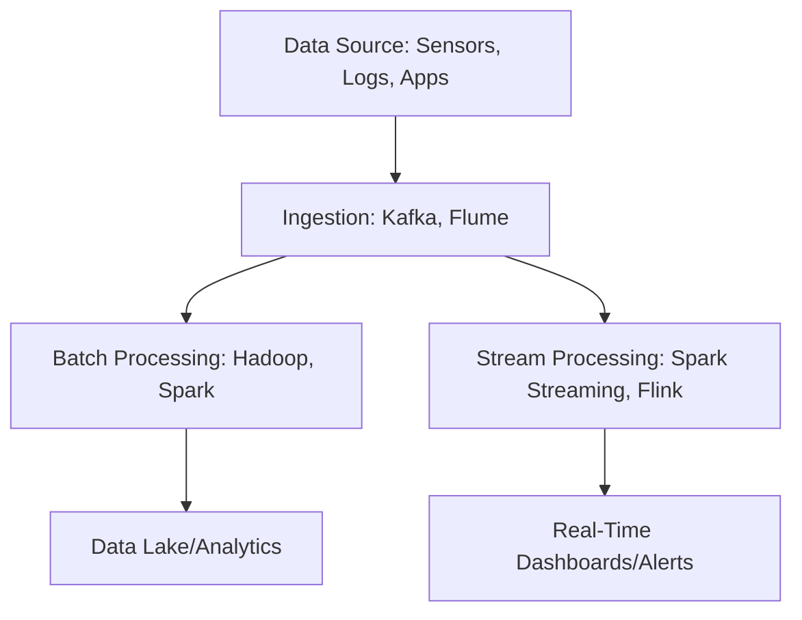

### 7.12.6 MapReduce: The Model Behind Batch Processing

**MapReduce** is a way to process a huge dataset by splitting it across many machines. You write two small functions; the framework handles distribution, retries and sorting.

1. **Map:** each machine reads its own slice of the data and emits **key → value** pairs.
2. **Shuffle and sort:** the framework groups all values by key and sends each key's group to one reducer.
3. **Reduce:** each reducer combines the values for its keys into a result.

**Example: count requests per status code in terabytes of web logs.**

```python
def map_fn(log_line):                    # runs on every machine, on its own slice
    status = log_line.split()[8]         # e.g. "200", "404", "500"
    yield (status, 1)

def reduce_fn(status, counts):           # receives all counts for one status
    yield (status, sum(counts))
```

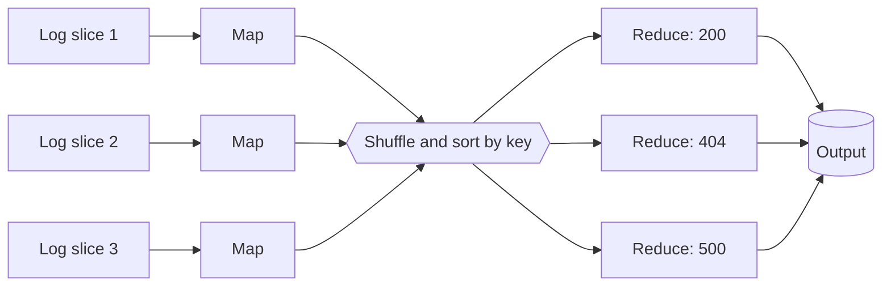

**Why it was a breakthrough:** the work **moves to the data** (each map task runs where its slice is stored, for example on HDFS), failed tasks are simply re-run, and adding machines speeds it up almost linearly.

**Where it falls short:**

- Every stage writes to **disk**, so it is slow for small jobs and **iterative** workloads such as machine learning.
- It is **batch only**: results arrive after the whole job finishes, not in real time.

**What replaced it in practice:**

| Tool | Idea |
|------|------|
| **Apache Spark** | the same map/reduce thinking but data stays **in memory** between steps, much faster for iterative work; also offers **micro-batch** streaming (tiny batches every second or so) |
| **Apache Flink, Kafka Streams** | true record-by-record **stream processing** with low latency |
| **Managed cloud services** (EMR, Dataproc, HDInsight, BigQuery) | run Hadoop or Spark clusters, or SQL engines, without managing the machines |
| **YARN** | the resource manager that schedules these jobs on a Hadoop cluster |

**Choosing:** batch jobs where hours of latency are fine (nightly reports, indexing) suit MapReduce-style processing; anything needing answers in seconds needs stream processing. See Batch vs. Stream Processing above.

### 7.12.7 Code Example: Simple Batch & Stream Processing

**Batch Example — Apache Spark (PySpark):**

```python
from pyspark.sql import SparkSession

spark = SparkSession.builder.appName("BatchExample").getOrCreate()
df = spark.read.json("logs/2024-06-01.json")
agg = df.groupBy("event_type").count()
agg.show()
```

**Stream Example — Kafka Consumer (Python):**

```python
from kafka import KafkaConsumer

consumer = KafkaConsumer('iot-stream', bootstrap_servers='localhost:9092')
for msg in consumer:
    process(msg.value)   # Custom function for real-time processing
```

### 7.12.8 Big Data Architecture Diagrams

**Storage & Processing Pipeline:**

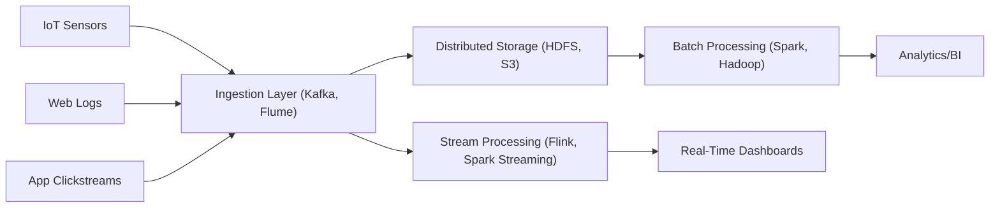

**HDFS Cluster:**

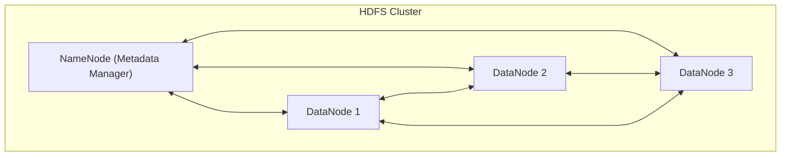

---

## 7.13 Consistency Models — A Spectrum, Not a Binary

CAP says "C or A." Reality is more nuanced — between strict serializability and pure eventual consistency lies a useful spectrum:

| Model                     | Guarantee                                                      | Where you see it                |
|---------------------------|----------------------------------------------------------------|--------------------------------|
| **Strict Serializability** | Operations appear to happen in some total order, in real time   | Spanner, FoundationDB          |
| **Linearizability**        | A read returns the most-recent committed write                  | Standalone PostgreSQL           |
| **Sequential consistency** | All clients see operations in the same order                    | etcd, Zookeeper                 |
| **Causal consistency**     | If A causes B, all clients see A before B (concurrent ops may differ) | Many distributed databases |
| **Read-your-writes**       | A client sees its own writes immediately                        | Important for UX (your tweet shows up after you post it) |
| **Monotonic reads**        | A client never sees data going "backward"                       | Avoids confusing UI flickers     |
| **Eventual**               | Replicas converge eventually (no time bound)                    | DynamoDB defaults, S3            |

> **Practical takeaway:** Most apps want **read-your-writes + monotonic reads** at minimum. Pure "eventual" is usually too weak — users will see things appear and disappear. Most modern databases offer read-your-writes via *session consistency* or *primary-read*.

---

## 7.14 Storage Engines: B-Tree vs LSM-Tree

Two foundational data structures power almost every database. Knowing which one your DB uses tells you what it's good at.

| Engine       | Used by                                  | Optimized for | Cost                          |
|--------------|------------------------------------------|---------------|--------------------------------|
| **B-Tree**   | PostgreSQL, MySQL (InnoDB), SQLite       | Read-heavy, point lookups, range queries | Write amplification on update; in-place updates |
| **LSM-Tree** | Cassandra, RocksDB, LevelDB, HBase, ScyllaDB | Write-heavy, append-only | Reads may touch multiple SSTables; needs compaction |

**Rule of thumb:**
- Mostly reads? B-tree DB.
- Mostly writes (time series, log ingest, IoT)? LSM-tree DB.
- Mixed? Most modern OLTP DBs (Postgres, MySQL) work fine — don't over-optimize.

---

## 7.15 Block vs File vs Object Storage — They're NOT Interchangeable

Probably the most common confusion in storage design.

| Type     | Access pattern                  | Examples                          | Use case                            |
|----------|----------------------------------|-----------------------------------|--------------------------------------|
| **Block** | Raw blocks, low-level, fast    | AWS EBS, Azure Disk, on-prem SAN  | Database disks, VM filesystems       |
| **File**  | Hierarchical filesystem, POSIX | AWS EFS, Azure Files, NFS         | Shared filesystem across servers     |
| **Object**| HTTP API, no hierarchy         | S3, GCS, Azure Blob               | Media, backups, data lakes, static sites |

> **Rule:** Use **block** for things that need a filesystem (DBs, VMs). Use **file** for legacy apps that need shared file access. Use **object** for everything else — it's cheaper, infinitely scalable, and HTTP-native.

---

## 7.16 Specialized Database Types Worth Knowing

Beyond SQL and the four NoSQL categories, modern systems often use specialized stores:

| Type           | Examples                              | Use case                                       |
|----------------|---------------------------------------|------------------------------------------------|
| **Time-series**| InfluxDB, TimescaleDB, Prometheus     | Metrics, IoT, financial ticks                  |
| **Search**     | Elasticsearch, OpenSearch, Meilisearch| Full-text search, faceting, log analytics      |
| **Vector**     | Pinecone, Weaviate, Milvus, pgvector  | Embeddings for ML/AI (semantic search, RAG)    |
| **Graph**      | Neo4j, JanusGraph, Neptune            | Highly connected data (social, fraud, knowledge graphs) |
| **Wide-column**| Cassandra, HBase, ScyllaDB            | Huge write throughput, time-series scale       |
| **In-memory KV**| Redis, Memcached                     | Caching, rate limiting, leaderboards            |

> **Polyglot persistence** (Chapter 7) means using multiple databases for different parts of one system. Modern apps routinely mix PostgreSQL + Redis + Elasticsearch + S3.

---

### 7.16.1 Graph Databases: Why Traversal Beats Joins

A **graph database** stores **nodes** (people, companies) and **edges** (relationships such as *knows* or *works at*), both of which can carry properties. Examples: Neo4j, Amazon Neptune, Dgraph, and Meta's in-house graph store (TAO) behind its social graph.

**The problem it solves.** Question: *which of my connections, or their connections, work at Stripe?*

- In **SQL** you keep a `friendships` table and an `employment` table. Each extra hop needs another join: one for friends, one for friends of friends, one more for the employer. Cost grows quickly with depth.
- In a **graph database** the relationships are stored directly with each node, so the query simply **walks** the connections. Work depends on the neighbourhood you touch, not on the size of the whole table.

```cypher
// Neo4j Cypher: people within 3 hops of me who work at Stripe
MATCH (me:Person {name: "You"})-[:KNOWS*1..3]-(p:Person)-[:WORKS_AT]->(:Company {name: "Stripe"})
RETURN DISTINCT p.name
```

**Trade-offs:** excellent for highly connected data (social networks, fraud rings, recommendations, knowledge graphs); weaker at bulk scans and aggregations over everything, and harder to split across machines (partition) than key-based stores.

### 7.16.2 Vector Databases in More Depth

A **vector database** stores **embeddings**: lists of numbers (often 384 to 3,072 of them) that a machine-learning model produces to capture the *meaning* of text, images or audio. Items with similar meaning end up with **nearby vectors**.

**What it is for:** finding "things like this" instead of exact matches.

- **Semantic search:** "how do I reset my login?" finds the article titled "Recovering account access".
- **Retrieval-augmented generation (RAG):** fetch the most relevant passages and give them to a large language model (LLM) such as GPT or Claude as context.
- **Recommendations and de-duplication:** nearest neighbours of a product, song or image.

**How similarity is measured:** **cosine similarity** (the angle between vectors; the most common for text), **dot product**, or **Euclidean (L2) distance**.

**Why a normal index does not work:** comparing a query against every stored vector is too slow at millions of items. Vector databases use **approximate nearest neighbour (ANN)** indexes that trade a little accuracy for large speed-ups:

| Index | Idea | Trade-off |
|-------|------|-----------|
| **HNSW** | a layered graph; hop from coarse to fine neighbours | fast and accurate, uses a lot of memory |
| **IVF** | cluster the vectors, search only the nearest clusters | smaller memory, accuracy depends on how many clusters you probe |
| **Quantization** | compress vectors | much less memory, some accuracy lost |

The key measure is **recall**: the fraction of the true nearest neighbours the index actually returns.

```sql
-- PostgreSQL with the pgvector extension
CREATE EXTENSION vector;
CREATE TABLE docs (id bigserial PRIMARY KEY, body text, embedding vector(768));
CREATE INDEX ON docs USING hnsw (embedding vector_cosine_ops);

SELECT id, body
FROM docs
ORDER BY embedding <=> $1      -- $1 is the query's embedding; <=> is cosine distance
LIMIT 5;
```

**Design considerations:**

- **Filtering:** real queries mix similarity with filters ("only documents the user may see, from this year"). Check how the database combines the two.
- **Hybrid search:** combine vector search with keyword search (BM25) for better results on names and exact terms.
- **Model changes:** a new embedding model produces vectors that are **not comparable** with old ones, so you must re-embed and re-index everything. Store the model version with each vector.
- **Cost:** vectors are large; memory use is often the main bill.
- **Dedicated store or extension?** For moderate scale, `pgvector` inside your existing PostgreSQL keeps things simple. For very large collections, or heavy vector traffic, a dedicated system (Pinecone, Weaviate, Milvus) may pay off.

## 7.17 Choosing the Right Storage Solution

| Requirement                          | Best Storage Type                                       |
|--------------------------------------|---------------------------------------------------------|
| Structured, relational data          | SQL (e.g., PostgreSQL, MySQL)                           |
| Flexible, large-scale, evolving      | NoSQL (e.g., MongoDB, Cassandra)                        |
| Unstructured, large media/files      | Object Storage (e.g., S3, GCS)                          |
| High throughput, analytics           | Distributed File Systems (e.g., HDFS, CephFS)           |
| Real-time or batch big data          | Distributed Storage + Processing (HDFS, S3, Delta Lake) |

---

### 7.17.1 Five Questions Before You Choose a Database

1. **What are the access patterns?** Look-ups by key, ad-hoc queries and joins, full-text search, graph traversals, time-ordered writes, or similarity search?
2. **How connected is the data?** Many relationships point to relational or graph; self-contained records point to documents.
3. **What does wrong or stale data cost?** A stale like count on a photo is harmless; charging someone twice is a lawsuit. Money, inventory and identity need strong consistency and transactions (usually SQL); feeds, counters and caches can accept eventual consistency.
4. **What scale and growth do you expect?** Read-heavy or write-heavy, how many records, and whether you will need to shard.
5. **What can your team run?** A database you cannot operate, back up and debug is a liability, however fast it benchmarks.

**Derived stores are not the source of truth.** A search engine (Elasticsearch) or a cache is built *from* a primary database and lags behind it, so it can be stale and is weak at transactions and updates. Keep the system of record in a database designed for it, and rebuild derived stores from it when needed.

## 7.18 Combined Tips & Tricks

A consolidated master list drawn from across all sections.

### 7.18.1 Data Modeling

- **Always know your data!** Structured or unstructured? This guides storage and DB choice.
- For SQL, design normalized schemas; for NoSQL, optimize for access patterns.
- **Know your consistency needs:** Financial or mission-critical systems need strong consistency (ACID/CP). For social feeds or caching, availability (AP/BASE) is often more valuable.

### 7.18.2 Scaling

- **Design for scale from day one:** Use distributed storage and sharding for growth.
- **Plan for scale:** If you expect massive growth, design for horizontal scaling — favor NoSQL or distributed SQL solutions.
- **Always anticipate growth:** Use horizontal scaling and sharding from the beginning if you expect rapid user/data growth.
- **Mix and match (polyglot) for best results:** Use the right database for the right task.
- **Use consistent hashing for dynamic clusters**, especially if you expect nodes to be added/removed frequently.
- **Document your sharding key choices:** Poorly chosen sharding keys can lead to hotspots or unbalanced data.

### 7.18.3 Reliability & Replication

- **Replication for read-heavy systems:** Deploy read replicas to distribute load but monitor replication lag.
- **Automate failover and recovery:** Use managed database services or robust orchestration for quick failover.
- **Test failover and replication regularly:** Don't just set it and forget it.
- **Simulate failures:** Test your replication and failover strategies (e.g., using Chaos Engineering).

### 7.18.4 Trade-offs

- **Monitor the CAP trade-offs:** Decide early if your system values consistency over availability, or vice versa.
- **Monitor trade-offs:** Optimize for the property (scalability, reliability, or performance) that aligns with your business needs.

### 7.18.5 Object & Distributed Storage

- **Use object storage for unstructured, growing data:** Images, backups, logs belong here.
- **Choose storage class wisely:** For S3, select Standard, Infrequent Access, or Glacier based on retrieval needs and cost.
- **Automate lifecycle management:** Set up archiving/deletion policies to control costs.
- **Object Storage Cost:** Use lifecycle policies to move old data to cheaper storage classes (e.g., S3 Glacier).
- **DFS for Analytics:** Choose HDFS or similar for big data processing pipelines, ensuring replication and scalability.

### 7.18.6 Big Data

- **Know your 6 V's:** Always consider volume, velocity, variety, veracity, value, and variability.
- **Hybrid processing:** Combine batch (for large-scale analytics) and stream (for real-time actions) for robust solutions.
- **Choose storage wisely:** Use distributed file/object storage for unstructured or high-scale data.
- **Design for failure:** Plan for node failures — replication and redundancy are non-negotiable.
- **Optimize cost:** Leverage storage class tiers for hot vs. cold data.
- **Processing tool selection:** Spark/Hadoop for batch, Kafka/Flink/Spark Streaming for real-time.
- **Monitor and clean data:** Poor veracity can taint downstream analytics.
- **Scalability first:** Assume your data will grow — design horizontally scalable systems from the start.

### 7.18.7 Security & Operations

- **Security:** Implement access controls and encryption, especially for object and distributed storage.
- **Backup:** Regularly backup critical data, and test restoration procedures.
- **Utilize managed services:** Cloud databases (AWS RDS, DynamoDB, Google Cloud Firestore) can offload maintenance and scalability headaches.
- **Monitor and revisit:** Periodically reassess data models, scaling strategies, and storage trade-offs.

---

## 7.19 Sample Interview Questions

1. Why is storage a critical component in system design?
2. How do you differentiate between structured and unstructured data?
3. What are the different types of storage systems and their use cases?
4. Explain the CAP theorem with real-world examples.
5. When would you use SQL vs. NoSQL?
6. How would you architect storage for a photo-sharing app?
7. What are the pros and cons of sharding and replication?
8. How do object, file, and block storage differ in access patterns and scalability?
9. What is object storage and how is it different from file or block storage?
10. When would you choose object storage over a traditional file system?
11. Design a media hosting platform (e.g., YouTube) — how would you use object storage?
12. What are the core constraints of REST?
13. Explain the difference between PUT and PATCH.

---

## 7.20 Summary & Key Takeaways

- **Storage is foundational:** Impacts every system's performance, reliability, and cost.
- **Understand your data:** Structured vs. unstructured shapes your architecture.
- **No one-size-fits-all:** Use the right combination of storage types — real-world systems often combine several.
- **CAP theorem drives trade-offs:** Know where your system stands.
- **SQL and NoSQL both matter:** Choose based on access patterns, schema, and scale.
- **Scale smart:** Use sharding, replication, and polyglot persistence for modern workloads.
- **Object and distributed file storage:** Power unstructured data and big data analytics.
- **Plan for big data:** Use distributed storage and batch/stream processing for large, fast data.
- **Big Data** is defined not just by size, but by its speed, diversity, quality, and business value.
- **System design** for Big Data is about managing trade-offs: scale, reliability, consistency, and cost.

---

## 7.21 Further Reading

- [AWS Storage Services Overview](https://aws.amazon.com/products/storage/)
- [Google Cloud Storage Documentation](https://cloud.google.com/storage/docs/)
- [Amazon S3 Overview](https://aws.amazon.com/s3/)
- [CAP Theorem on Wikipedia](https://en.wikipedia.org/wiki/CAP_theorem)
- [CAP Theorem Explained (Martin Kleppmann)](https://martin.kleppmann.com/2012/05/14/cap-theorem.html)
- [Polyglot Persistence Patterns (Martin Fowler)](https://martinfowler.com/bliki/PolyglotPersistence.html)
- [ACID vs. BASE Explained](https://www.ibm.com/cloud/blog/acid-vs-base)
- [Jepsen: Consistency Models](https://jepsen.io/)
- [AWS Architecture Blog: Scaling Databases](https://aws.amazon.com/architecture/databases/)
- [HDFS Architecture Guide (Apache)](https://hadoop.apache.org/docs/current/hadoop-project-dist/hadoop-hdfs/HdfsDesign.html)
- [HDFS Design Doc](https://hadoop.apache.org/docs/r1.2.1/hdfs_design.html)
- [CephFS Documentation](https://docs.ceph.com/en/latest/cephfs/)
- [GlusterFS Overview](https://docs.gluster.org/en/latest/)
- [Apache Spark Streaming](https://spark.apache.org/streaming/)

---

**Next Up:** [Chapter 8 — Performance: Concepts, Tools & Techniques →](./8%20-%20Performance%20-%20Concepts%2C%20Tools%20%26%20Techniques.md) — making systems not just work, but work *fast and efficiently*.
