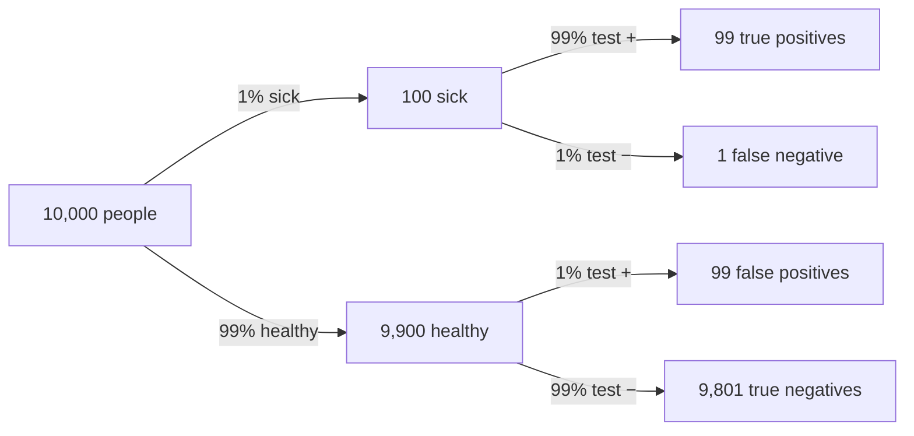
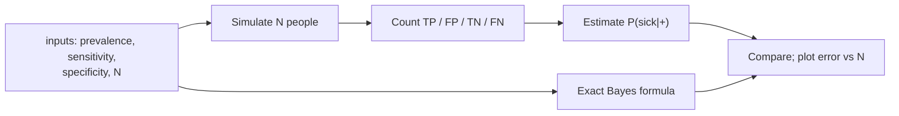

# Chapter 8 — Probability, Distributions & Bayes

> **Volume 0 — Math & Mental Models** · [Contents](index.md) · ← [Chapter 7 — Time/Space Complexity & Amortized Analysis](ch07-time-space-complexity-and-amortized-analysis.md) · Next → [Chapter 9 — Linear Algebra for AI](ch09-linear-algebra-for-ai.md)

---

## Concept

Sample spaces, independence, expectation, variance, common distributions (uniform, binomial, normal), Bayes' theorem.

**In one sentence:** probability is counting with weights, expectation is the long-run average, variance is how far results scatter, and Bayes tells you how to update a belief when new evidence arrives.

**Mental model — 1,000 people in a room.** Instead of juggling percentages, imagine a concrete crowd. "1% have the disease" means 10 people. "The test catches 99%" means about 10 of those 10 test positive. Counting heads is almost always easier than multiplying fractions.

**Core rules**

| Rule | Formula |
|------|---------|
| Probability of an event | `P(A) = favorable / total` (equally likely outcomes) |
| Complement | `P(¬A) = 1 − P(A)` |
| Addition | `P(A ∪ B) = P(A) + P(B) − P(A ∩ B)` |
| Conditional | `P(A \| B) = P(A ∩ B) / P(B)` |
| Multiplication | `P(A ∩ B) = P(A \| B) · P(B)` |
| Independence | `P(A ∩ B) = P(A) · P(B)`, i.e. `P(A \| B) = P(A)` |
| Total probability | `P(B) = P(B\|A)P(A) + P(B\|¬A)P(¬A)` |
| **Bayes** | `P(A \| B) = P(B \| A) · P(A) / P(B)` |

**Expectation and variance**

* `E[X] = Σ x · P(X = x)` — the weighted average. Linear: `E[aX + bY] = aE[X] + bE[Y]`, always, even if X and Y are dependent.
* `Var(X) = E[(X − E[X])²] = E[X²] − E[X]²` — the average squared distance from the mean.
* Standard deviation `σ = √Var(X)` — in the same units as X.

**Common distributions**

| Distribution | Models | Mean | Variance | Example |
|--------------|--------|------|----------|---------|
| Uniform (discrete, 1..n) | equally likely outcomes | `(n+1)/2` | `(n²−1)/12` | a die roll |
| Bernoulli(p) | one yes/no trial | `p` | `p(1−p)` | a single click |
| Binomial(n, p) | successes in n independent trials | `np` | `np(1−p)` | heads in 10 flips |
| Geometric(p) | trials until first success | `1/p` | `(1−p)/p²` | retries until a request succeeds |
| Poisson(λ) | events per interval at a steady rate | `λ` | `λ` | requests per second |
| Normal(μ, σ²) | sums of many small effects | `μ` | `σ²` | measurement noise, latencies (roughly) |

---

## Prereqs

* [Chapter 3 — Combinatorics & Counting](ch03-combinatorics-and-counting.md)

---

## Diagram

**Bayes as a two-branch tree** — disease prevalence 1%, test sensitivity 99%, false-positive rate 1%, population 10,000.



```
 Positives: 99 true + 99 false = 198
 P(sick | positive) = 99 / 198 = 50%      ← not 99%!
```

**The same thing as a count of 198 positive results**

<div class="fig">
<svg xmlns="http://www.w3.org/2000/svg" viewBox="0 0 700 170" role="img" aria-label="Two equal bars: true positives and false positives are both 99" style="width:100%;max-width:700px;height:auto;font-family:inherit"><defs><marker id="ar" viewBox="0 0 10 10" refX="8" refY="5" markerWidth="7" markerHeight="7" orient="auto-start-reverse"><path d="M0 0L10 5L0 10z" fill="context-stroke"/></marker></defs><text x="190" y="46" font-size="13" text-anchor="end" fill="var(--text)">true positives (sick)</text><text x="190" y="96" font-size="13" text-anchor="end" fill="var(--text)">false positives (healthy)</text><rect x="204" y="28" width="400" height="28" rx="4" fill="var(--success)" fill-opacity=".5" stroke="var(--success)" stroke-width="1.6"/><rect x="204" y="78" width="400" height="28" rx="4" fill="var(--danger)" fill-opacity=".5" stroke="var(--danger)" stroke-width="1.6"/><text x="616" y="48" font-size="14" text-anchor="start" fill="var(--text)" font-weight="700">99</text><text x="616" y="98" font-size="14" text-anchor="start" fill="var(--text)" font-weight="700">99</text><line x1="204" y1="114" x2="204" y2="128" stroke="var(--text-muted)" stroke-width="1.2"/><text x="214" y="126" font-size="12.5" text-anchor="start" fill="var(--text-muted)">same size: a rare disease × a small error rate</text><text x="214" y="144" font-size="12.5" text-anchor="start" fill="var(--text-muted)">≈ a common condition × a small error rate</text></svg>
</div>

**Normal distribution: the 68–95–99.7 rule**

<div class="fig">
<svg xmlns="http://www.w3.org/2000/svg" viewBox="0 0 700 330" role="img" aria-label="Normal distribution with 68, 95 and 99.7 percent of the area within 1, 2 and 3 standard deviations" style="width:100%;max-width:700px;height:auto;font-family:inherit"><defs><marker id="ar" viewBox="0 0 10 10" refX="8" refY="5" markerWidth="7" markerHeight="7" orient="auto-start-reverse"><path d="M0 0L10 5L0 10z" fill="context-stroke"/></marker></defs><path d="M40.0,199.8 L44.3,199.7 L48.6,199.7 L52.9,199.6 L57.2,199.5 L61.5,199.4 L65.8,199.3 L70.1,199.2 L74.4,199.0 L78.8,198.9 L83.1,198.7 L87.4,198.5 L91.7,198.2 L96.0,197.9 L100.3,197.6 L104.6,197.2 L108.9,196.8 L113.2,196.4 L117.5,195.8 L121.8,195.2 L126.1,194.6 L130.4,193.8 L134.7,193.0 L139.0,192.0 L143.3,191.0 L147.6,189.9 L151.9,188.6 L156.2,187.3 L160.6,185.8 L164.9,184.1 L169.2,182.4 L173.5,180.4 L177.8,178.3 L182.1,176.1 L186.4,173.7 L190.7,171.1 L195.0,168.3 L199.3,165.4 L203.6,162.3 L207.9,159.0 L212.2,155.5 L216.5,151.9 L220.8,148.1 L225.1,144.1 L229.4,140.0 L233.8,135.7 L238.1,131.3 L242.4,126.7 L246.7,122.1 L251.0,117.4 L255.3,112.6 L259.6,107.8 L263.9,103.0 L268.2,98.1 L272.5,93.3 L276.8,88.5 L281.1,83.8 L285.4,79.2 L289.7,74.8 L294.0,70.5 L298.3,66.4 L302.6,62.5 L306.9,58.8 L311.2,55.4 L315.6,52.3 L319.9,49.5 L324.2,47.0 L328.5,44.9 L332.8,43.2 L337.1,41.8 L341.4,40.8 L345.7,40.2 L350.0,40.0 L354.3,40.2 L358.6,40.8 L362.9,41.8 L367.2,43.2 L371.5,44.9 L375.8,47.0 L380.1,49.5 L384.4,52.3 L388.8,55.4 L393.1,58.8 L397.4,62.5 L401.7,66.4 L406.0,70.5 L410.3,74.8 L414.6,79.2 L418.9,83.8 L423.2,88.5 L427.5,93.3 L431.8,98.1 L436.1,103.0 L440.4,107.8 L444.7,112.6 L449.0,117.4 L453.3,122.1 L457.6,126.7 L461.9,131.3 L466.2,135.7 L470.6,140.0 L474.9,144.1 L479.2,148.1 L483.5,151.9 L487.8,155.5 L492.1,159.0 L496.4,162.3 L500.7,165.4 L505.0,168.3 L509.3,171.1 L513.6,173.7 L517.9,176.1 L522.2,178.3 L526.5,180.4 L530.8,182.4 L535.1,184.1 L539.4,185.8 L543.8,187.3 L548.1,188.6 L552.4,189.9 L556.7,191.0 L561.0,192.0 L565.3,193.0 L569.6,193.8 L573.9,194.6 L578.2,195.2 L582.5,195.8 L586.8,196.4 L591.1,196.8 L595.4,197.2 L599.7,197.6 L604.0,197.9 L608.3,198.2 L612.6,198.5 L616.9,198.7 L621.2,198.9 L625.6,199.0 L629.9,199.2 L634.2,199.3 L638.5,199.4 L642.8,199.5 L647.1,199.6 L651.4,199.7 L655.7,199.7 L660.0,199.8 L660.0,200 L40.0,200 Z" stroke="var(--primary)" stroke-width="2" fill="var(--primary)" fill-opacity="0.14"/><line x1="40" y1="200" x2="660" y2="200" stroke="var(--text-muted)" stroke-width="1.6"/><line x1="91.66666666666667" y1="200" x2="91.66666666666667" y2="206" stroke="var(--text-muted)" stroke-width="1.6"/><text x="91.66666666666667" y="222" font-size="12.5" text-anchor="middle" fill="var(--text)">μ−3σ</text><line x1="91.66666666666667" y1="200" x2="91.66666666666667" y2="198.22256055388124" stroke="var(--primary)" stroke-width="1" stroke-dasharray="3 4"/><line x1="177.7777777777778" y1="200" x2="177.7777777777778" y2="206" stroke="var(--text-muted)" stroke-width="1.6"/><text x="177.7777777777778" y="222" font-size="12.5" text-anchor="middle" fill="var(--text)">μ−2σ</text><line x1="177.7777777777778" y1="200" x2="177.7777777777778" y2="178.34635468214196" stroke="var(--primary)" stroke-width="1" stroke-dasharray="3 4"/><line x1="263.8888888888889" y1="200" x2="263.8888888888889" y2="206" stroke="var(--text-muted)" stroke-width="1.6"/><text x="263.8888888888889" y="222" font-size="12.5" text-anchor="middle" fill="var(--text)">μ−σ</text><line x1="263.8888888888889" y1="200" x2="263.8888888888889" y2="102.95509444597866" stroke="var(--primary)" stroke-width="1" stroke-dasharray="3 4"/><line x1="350.0" y1="200" x2="350.0" y2="206" stroke="var(--text-muted)" stroke-width="1.6"/><text x="350.0" y="222" font-size="12.5" text-anchor="middle" fill="var(--text)" font-weight="600">μ</text><line x1="350.0" y1="200" x2="350.0" y2="40.0" stroke="var(--primary)" stroke-width="1" stroke-dasharray="3 4"/><line x1="436.1111111111111" y1="200" x2="436.1111111111111" y2="206" stroke="var(--text-muted)" stroke-width="1.6"/><text x="436.1111111111111" y="222" font-size="12.5" text-anchor="middle" fill="var(--text)">μ+σ</text><line x1="436.1111111111111" y1="200" x2="436.1111111111111" y2="102.95509444597866" stroke="var(--primary)" stroke-width="1" stroke-dasharray="3 4"/><line x1="522.2222222222222" y1="200" x2="522.2222222222222" y2="206" stroke="var(--text-muted)" stroke-width="1.6"/><text x="522.2222222222222" y="222" font-size="12.5" text-anchor="middle" fill="var(--text)">μ+2σ</text><line x1="522.2222222222222" y1="200" x2="522.2222222222222" y2="178.34635468214196" stroke="var(--primary)" stroke-width="1" stroke-dasharray="3 4"/><line x1="608.3333333333333" y1="200" x2="608.3333333333333" y2="206" stroke="var(--text-muted)" stroke-width="1.6"/><text x="608.3333333333333" y="222" font-size="12.5" text-anchor="middle" fill="var(--text)">μ+3σ</text><line x1="608.3333333333333" y1="200" x2="608.3333333333333" y2="198.22256055388124" stroke="var(--primary)" stroke-width="1" stroke-dasharray="3 4"/><line x1="263.8888888888889" y1="248" x2="436.1111111111111" y2="248" stroke="var(--success)" stroke-width="2.4" marker-end="url(#ar)" marker-start="url(#ar)"/><text x="350.0" y="242" font-size="13" text-anchor="middle" fill="var(--success)" font-weight="700">68%</text><line x1="177.7777777777778" y1="274" x2="522.2222222222222" y2="274" stroke="var(--accent)" stroke-width="2.4" marker-end="url(#ar)" marker-start="url(#ar)"/><text x="350.0" y="268" font-size="13" text-anchor="middle" fill="var(--accent)" font-weight="700">95%</text><line x1="91.66666666666667" y1="300" x2="608.3333333333333" y2="300" stroke="#8b5cf6" stroke-width="2.4" marker-end="url(#ar)" marker-start="url(#ar)"/><text x="350.0" y="294" font-size="13" text-anchor="middle" fill="#8b5cf6" font-weight="700">99.7%</text></svg>
</div>

---

## Example

```python
from fractions import Fraction

# Expectation and variance of a fair die
faces = range(1, 7)
E = sum(Fraction(x, 6) for x in faces)
E2 = sum(Fraction(x * x, 6) for x in faces)
print(E, E2 - E**2)            # 7/2  35/12

# Bayes: P(disease | positive)
p_d, sens, fpr = 0.01, 0.99, 0.01
p_pos = sens * p_d + fpr * (1 - p_d)       # total probability
print(sens * p_d / p_pos)                  # 0.5
```

**Monte Carlo check**

```python
import numpy as np
rng = np.random.default_rng(0)

n = 1_000_000
sick = rng.random(n) < 0.01
positive = np.where(sick, rng.random(n) < 0.99, rng.random(n) < 0.01)
print(sick[positive].mean())               # ≈ 0.50

print(rng.integers(1, 7, n).mean())        # ≈ 3.5
```

**Independence in engineering** — if 3 independent replicas each fail with probability 0.01, all three fail with probability `0.01³ = 10⁻⁶`. If they share a power supply, they are *not* independent, and that math is wrong.

---

## Exercises

1. Compute expectation of a fair six-sided die.

   <details><summary>Solution</summary><code>(1+2+3+4+5+6)/6 = 21/6 = 3.5</code>.</details>

2. A test is 99% accurate, disease prevalence 1% — what's P(disease|positive)?

   <details><summary>Solution</summary>With "99% accurate" meaning 99% sensitivity and 99% specificity: <code>0.99·0.01 / (0.99·0.01 + 0.01·0.99) = 0.5</code>. Half of positives are false alarms, because healthy people vastly outnumber sick ones.</details>

3. A request fails independently with probability 0.2. With up to 3 retries (4 attempts), what is the probability it eventually succeeds? What is the expected number of attempts without a limit?

   <details><summary>Solution</summary><code>1 − 0.2⁴ = 0.9984</code>. Unlimited attempts follow Geometric(0.8): expected <code>1/0.8 = 1.25</code>.</details>

---

## Mini project

**A Monte Carlo simulation of a false-positive diagnosis and a die-roll expectation.**



**Steps**

1. Simulate N people with `numpy.random`; draw sickness, then a test result.
2. Print the 2×2 confusion table and the estimated `P(sick | +)`.
3. Compare with the exact Bayes answer; plot the error for N = 10², 10³, …, 10⁶. It should shrink like `1/√N`.
4. Add a slider (or CLI flag) for prevalence and show how `P(sick | +)` changes.
5. Repeat for the die: sample mean and variance vs 3.5 and 35/12.

**Done when:** the simulation matches the exact answer to 2 decimals at N = 10⁶.

---

## Open source

* [`numpy/numpy`](https://github.com/numpy/numpy) — `numpy.random`. Read `numpy/random/_generator.pyx` for `binomial`, `normal`, and `poisson` samplers.

---

## Interview

1. **"Explain Bayes' theorem in plain words."**
   <details><summary>Answer</summary>Your new belief equals your old belief, reweighted by how well each possibility explains the evidence. How likely is A, given I saw B? Take how often B happens when A is true, multiply by how common A was to begin with, and divide by how common B is overall.</details>

2. **"What's the difference between expectation and variance?"**
   <details><summary>Answer</summary>Expectation is the center — the long-run average. Variance is the spread — the average squared distance from that center. Two services can both average 100 ms, but one with high variance has terrible tail latency.</details>

---

## Checklist

- [ ] compute expectation/variance
- [ ] apply Bayes to a real example
- [ ] recognize independence vs conditional dependence

---

> [Contents](index.md) · ← [Chapter 7 — Time/Space Complexity & Amortized Analysis](ch07-time-space-complexity-and-amortized-analysis.md) · Next → [Chapter 9 — Linear Algebra for AI](ch09-linear-algebra-for-ai.md)
