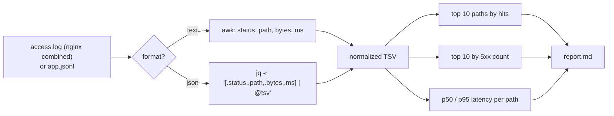

# Chapter 18 — Terminal Tools: grep, sed, awk, jq, curl, wget, find, xargs, tmux, rsync

> **Volume 1 — Computer Science Foundations** · [Contents](index.md) · ← [Chapter 17 — Linux: Processes, Signals, Services, systemd, SSH, Cron & Networking](ch17-linux-processes-signals-services-systemd-ssh-cron.md) · Next → [Chapter 19 — Git: Branching, Merge, Rebase & Cherry-Pick](ch19-git-branching-merge-rebase-and-cherry-pick.md)

---

## Concept

The Unix toolbox — text search/transform, JSON, HTTP clients, file discovery, multiplexing, and sync.

**In one sentence:** each Unix tool does one small job on a stream of text, and the pipe `|` snaps them together into programs you write in one line.

### Mental model — a factory conveyor belt

Text rides along the belt. `grep` is a filter that removes items. `sed` is a stamping machine that edits each item. `awk` is a sorter that splits items into columns and does arithmetic. `sort | uniq -c` is the counting station at the end.

### The toolbox

| Tool | Job | Most-used forms |
|------|-----|-----------------|
| `grep` | keep lines matching a pattern | `-i` ignore case, `-v` invert, `-r` recurse, `-n` line numbers, `-E` extended regex, `-o` only the match, `-c` count |
| `sed` | edit lines in a stream | `s/old/new/g`, `-n '5,10p'`, `-i` in place (GNU) |
| `awk` | column processing + small programs | `awk -F, '{s+=$3} END {print s}'`, `$1`, `NF`, `NR` |
| `sort` / `uniq` | order / collapse duplicates | `sort -n`, `-r`, `-k2,2`, `-t,`; `uniq -c` needs sorted input |
| `cut` / `tr` / `wc` / `head` / `tail` | slice columns, translate chars, count, peek | `cut -d, -f2`, `tr a-z A-Z`, `wc -l`, `tail -f` |
| `jq` | query and transform JSON | `.field`, `.[]`, `select(.x > 1)`, `-r` raw output |
| `curl` | HTTP (and more) client | `-sS` quiet with errors, `-X POST`, `-H`, `-d`, `-o`, `-L` follow redirects, `-w '%{http_code}'` |
| `wget` | download files, recursively | `wget -c` resume, `-r -np` mirror |
| `find` | locate files by name, type, size, time | `-name '*.py'`, `-type f`, `-size +100M`, `-mtime -1`, `-exec … {} +` |
| `xargs` | turn input lines into command arguments | `-0` with `find -print0`, `-n1` one at a time, `-P8` in parallel |
| `tmux` | persistent terminal sessions, splits | `tmux new -s work`, detach `Ctrl-b d`, `tmux attach -t work` |
| `rsync` | efficient sync (sends only differences) | `rsync -avz --delete src/ host:dst/`, `-n` dry run |

**Why `xargs`?** Many commands take file names as *arguments*, not as *stdin*. `find … | rm` does nothing useful, because `rm` doesn't read stdin. `xargs` converts the stream into arguments, and batches them to stay under the OS argument-length limit.

### curl: talk HTTP from the shell

**What it is.** `curl` sends one request and prints the response body to stdout, so it slots straight into a pipeline (`curl … | jq`). It speaks HTTP(S) and a dozen other protocols, and it is the quickest way to poke an API, check a health endpoint, or reproduce a bug report exactly.

| You want | Command |
|----------|---------|
| a script-friendly GET: quiet, but errors still shown, fail on 4xx/5xx, follow redirects | `curl -fsSL https://api.example.com/items` |
| the response headers | `curl -I URL` (HEAD request), or `-i` to show headers and the body |
| send JSON | `curl -sS --json '{"name":"ada"}' URL` (curl 7.82+), or `-H 'Content-Type: application/json' -d @body.json` |
| authenticate | `-H "Authorization: Bearer $TOKEN"`, or `-u user:pass` for basic auth |
| save to a file | `-o out.bin`, or `-O` to keep the remote file name |
| see exactly what went over the wire | `-v` (TLS handshake, request headers, response headers) |
| timing and status for a monitoring script | `-o /dev/null -w '%{http_code} %{time_total}\n'` |
| give up instead of hanging | `--connect-timeout 5 --max-time 30 --retry 3` |

**Gotchas.** By default curl exits with 0 even on a 404 or 500, so a script carries on as if all went well. Add `-f` (or `--fail-with-body`) to get a non-zero exit code. `-d` sends `application/x-www-form-urlencoded` and strips newlines from `@file` input; use `--data-binary @file` to send a file byte for byte. `-X POST` is implied by `-d`, so you rarely need `-X` at all. Never use `-k` (skip TLS verification) outside a throwaway test, because it silently accepts any certificate.

### wget: fetch files and whole sites

**What it is.** `wget` is built for *downloading*: it writes to a file by default, retries on its own, and can follow links recursively. Reach for it when the job is "get this big file, or this tree of files, onto disk and survive a flaky network". Use curl when the job is "make an API call and read the answer".

```bash
wget https://example.com/data.tar.gz                  # saves data.tar.gz in the current directory
wget -c https://example.com/data.tar.gz               # resume a partial download after a drop
wget -q -O - https://example.com/install.sh | less    # print to stdout instead of a file (read before you run!)
wget -i urls.txt                                      # download every URL listed in a file
wget -r -np -nH --cut-dirs=2 https://example.com/pub/docs/   # recursive, never climb above docs/
wget --mirror --convert-links --page-requisites https://example.com/   # offline copy of a site
```

**Gotchas.** `-r` without `-np` ("no parent") can wander up the directory tree and download far more than you meant. Add `--wait=1` and a `--limit-rate` when mirroring someone else's server. Downloading again into the same folder creates `file.1`, `file.2`; use `-N` (only fetch if the remote copy is newer) or `-O name` to control this.

### rsync: copy only what changed

**What it is.** `rsync` makes a destination match a source, locally or over SSH. It compares the two sides first and transfers only the files that differ, and only the changed *blocks* of large files, so the second run of a 50 GB backup takes seconds.

<div class="fig">
<svg xmlns="http://www.w3.org/2000/svg" viewBox="0 0 760 250" role="img" aria-label="rsync with a trailing slash on the source copies the folder&#x27;s contents into the destination; without the slash it copies the folder itself, creating dst/src inside the destination" style="width:100%;max-width:760px;height:auto;font-family:inherit"><defs><marker id="v1c18x1-ar" viewBox="0 0 10 10" refX="8" refY="5" markerWidth="7" markerHeight="7" orient="auto-start-reverse"><path d="M0 0L10 5L0 10z" fill="context-stroke"/></marker></defs><text x="20" y="28" font-size="14" text-anchor="start" fill="var(--text)" font-weight="800" font-family="ui-monospace,Consolas,monospace">rsync -a src/ dst/</text><rect x="20" y="44" width="262.8" height="21" rx="10.5" fill="var(--success-faint)" stroke="var(--success)" stroke-width="1.2"/><text x="151.4" y="59" font-size="12" text-anchor="middle" fill="var(--success)" font-weight="700">trailing slash = copy the CONTENTS</text><text x="20" y="100" font-size="12.5" text-anchor="start" fill="var(--text-muted)" font-weight="400" font-family="ui-monospace,Consolas,monospace">src/</text><text x="38" y="120" font-size="12.5" text-anchor="start" fill="var(--text-muted)" font-weight="400" font-family="ui-monospace,Consolas,monospace">└ a.txt</text><text x="38" y="140" font-size="12.5" text-anchor="start" fill="var(--text-muted)" font-weight="400" font-family="ui-monospace,Consolas,monospace">└ b.txt</text><line x1="130" y1="120" x2="190" y2="120" stroke="var(--primary)" stroke-width="1.6" marker-end="url(#v1c18x1-ar)"/><text x="210" y="100" font-size="12.5" text-anchor="start" fill="var(--text)" font-weight="400" font-family="ui-monospace,Consolas,monospace">dst/</text><text x="228" y="120" font-size="12.5" text-anchor="start" fill="var(--success)" font-weight="700" font-family="ui-monospace,Consolas,monospace">└ a.txt</text><text x="228" y="140" font-size="12.5" text-anchor="start" fill="var(--success)" font-weight="700" font-family="ui-monospace,Consolas,monospace">└ b.txt</text><text x="400" y="28" font-size="14" text-anchor="start" fill="var(--text)" font-weight="800" font-family="ui-monospace,Consolas,monospace">rsync -a src dst/</text><rect x="400" y="44" width="255.6" height="21" rx="10.5" fill="var(--warning-faint)" stroke="var(--warning)" stroke-width="1.2"/><text x="527.8" y="59" font-size="12" text-anchor="middle" fill="var(--warning)" font-weight="700">no slash = copy the FOLDER itself</text><text x="400" y="100" font-size="12.5" text-anchor="start" fill="var(--text-muted)" font-weight="400" font-family="ui-monospace,Consolas,monospace">src/</text><text x="418" y="120" font-size="12.5" text-anchor="start" fill="var(--text-muted)" font-weight="400" font-family="ui-monospace,Consolas,monospace">└ a.txt</text><text x="418" y="140" font-size="12.5" text-anchor="start" fill="var(--text-muted)" font-weight="400" font-family="ui-monospace,Consolas,monospace">└ b.txt</text><line x1="510" y1="120" x2="570" y2="120" stroke="var(--primary)" stroke-width="1.6" marker-end="url(#v1c18x1-ar)"/><text x="590" y="100" font-size="12.5" text-anchor="start" fill="var(--text)" font-weight="400" font-family="ui-monospace,Consolas,monospace">dst/</text><text x="608" y="120" font-size="12.5" text-anchor="start" fill="var(--success)" font-weight="700" font-family="ui-monospace,Consolas,monospace">└ src/</text><text x="626" y="140" font-size="12.5" text-anchor="start" fill="var(--text)" font-weight="400" font-family="ui-monospace,Consolas,monospace">└ a.txt</text><text x="626" y="160" font-size="12.5" text-anchor="start" fill="var(--text)" font-weight="400" font-family="ui-monospace,Consolas,monospace">└ b.txt</text><line x1="380" y1="16" x2="380" y2="200" stroke="var(--border-strong)" stroke-width="1" stroke-dasharray="3 4"/><text x="380" y="222" font-size="12.5" text-anchor="middle" fill="var(--text)" font-weight="600">Only the SOURCE&#x27;s slash matters; a slash on the destination changes nothing.</text><text x="380" y="242" font-size="12" text-anchor="middle" fill="var(--text-muted)" font-weight="400" font-style="italic">Think of src/ as &quot;everything inside src&quot;.</text></svg>
</div>

```bash
rsync -avP src/ backup/                        # -a archive (keep times, permissions, links), -v list files, -P progress + resume partial files
rsync -avz src/ user@host:/srv/app/            # over SSH; -z compresses on the wire
rsync -avn --delete src/ host:/srv/app/        # -n DRY RUN: show what would change, including deletions
rsync -av --delete src/ host:/srv/app/         # make dst an exact mirror (deletes files not in src)
rsync -av --exclude '.git' --exclude '*.log' src/ dst/
rsync -av -e 'ssh -p 2222' src/ host:dst/      # custom SSH port or options
```

**Gotchas.** `--delete` removes everything in the destination that is not in the source, so a wrong path or a missing trailing slash can wipe a directory. Always run with `-n` first and read the list. `-a` does not preserve ownership unless rsync runs as root on the receiving side. Because rsync decides by size and modification time, add `-c` (compare checksums) if timestamps can't be trusted.

### tmux: terminals that survive disconnects

**What it is.** `tmux` is a *terminal multiplexer*. A tmux server runs on the machine and owns your shells; the terminal window you look at is only a client attached to it. Close the window, lose Wi-Fi or log out of SSH, and the shells, the long build and the open editor keep running; `tmux attach` brings you back to exactly where you were. It also splits one window into several panes.

<div class="fig">
<svg xmlns="http://www.w3.org/2000/svg" viewBox="0 0 760 300" role="img" aria-label="A tmux server on the remote machine holds sessions, each session holds windows like tabs, and each window is split into panes; when the SSH connection drops only the client disappears, and tmux attach reconnects to the still-running session" style="width:100%;max-width:760px;height:auto;font-family:inherit"><defs><marker id="v1c18x2-ar" viewBox="0 0 10 10" refX="8" refY="5" markerWidth="7" markerHeight="7" orient="auto-start-reverse"><path d="M0 0L10 5L0 10z" fill="context-stroke"/></marker></defs><text x="20" y="24" font-size="12" text-anchor="start" fill="var(--primary)" font-weight="800">ON THE SERVER (keeps running)</text><rect x="20" y="36" width="470" height="220" rx="12" fill="var(--primary)" fill-opacity=".04" stroke="var(--primary)" stroke-width="1.6"/><text x="36" y="58" font-size="12" text-anchor="start" fill="var(--text-muted)" font-weight="700" font-family="ui-monospace,Consolas,monospace">tmux server</text><rect x="36" y="68" width="438" height="174" rx="10" fill="var(--success)" fill-opacity=".05" stroke="var(--success)" stroke-width="1.4"/><text x="50" y="88" font-size="12" text-anchor="start" fill="var(--success)" font-weight="700" font-family="ui-monospace,Consolas,monospace">session &quot;work&quot;</text><rect x="170" y="76" width="92" height="20" rx="5" fill="var(--accent)" fill-opacity=".25" stroke="var(--accent)" stroke-width="1.2"/><text x="216" y="90" font-size="11" text-anchor="middle" fill="var(--text)" font-weight="600" font-family="ui-monospace,Consolas,monospace">0: editor</text><rect x="268" y="76" width="92" height="20" rx="5" fill="var(--bg)" fill-opacity="1" stroke="var(--accent)" stroke-width="1.2"/><text x="314" y="90" font-size="11" text-anchor="middle" fill="var(--text)" font-weight="600" font-family="ui-monospace,Consolas,monospace">1: logs</text><rect x="366" y="76" width="92" height="20" rx="5" fill="var(--bg)" fill-opacity="1" stroke="var(--accent)" stroke-width="1.2"/><text x="412" y="90" font-size="11" text-anchor="middle" fill="var(--text)" font-weight="600" font-family="ui-monospace,Consolas,monospace">2: db</text><text x="372" y="112" font-size="11" text-anchor="middle" fill="var(--text-muted)" font-weight="400" font-style="italic">↑ windows (like tabs)</text><rect x="50" y="122" width="240" height="108" rx="6" fill="var(--bg)" stroke="var(--border-strong)" stroke-width="1.2"/><rect x="298" y="122" width="162" height="50" rx="6" fill="var(--bg)" stroke="var(--border-strong)" stroke-width="1.2"/><rect x="298" y="180" width="162" height="50" rx="6" fill="var(--bg)" stroke="var(--border-strong)" stroke-width="1.2"/><text x="170" y="180" font-size="11.5" text-anchor="middle" fill="var(--text-muted)" font-weight="400" font-family="ui-monospace,Consolas,monospace">pane: vim app.py</text><text x="379" y="151" font-size="11.5" text-anchor="middle" fill="var(--text-muted)" font-weight="400" font-family="ui-monospace,Consolas,monospace">pane: pytest -f</text><text x="379" y="209" font-size="11.5" text-anchor="middle" fill="var(--text-muted)" font-weight="400" font-family="ui-monospace,Consolas,monospace">pane: htop</text><text x="520" y="24" font-size="12" text-anchor="start" fill="var(--text-muted)" font-weight="800">YOUR LAPTOP</text><rect x="520" y="60" width="220" height="44" rx="9" fill="var(--text-muted)" fill-opacity=".12" stroke="var(--text-muted)" stroke-width="1.6"/><text x="630.0" y="80.0" font-size="13" text-anchor="middle" fill="var(--text)" font-weight="700">ssh + tmux attach</text><text x="630.0" y="96.0" font-size="11" text-anchor="middle" fill="var(--text-muted)" font-weight="400">the client: just a view</text><path d="M520 82 C 505 82, 505 150, 490 150" fill="none" stroke="var(--primary)" stroke-width="1.6" marker-end="url(#v1c18x2-ar)"/><polygon points="634.0,134.0 621.0,152.0 629.0,152.0 625.0,166.0 639.0,147.0 631.0,147.0" fill="var(--danger)"/><text x="630" y="186" font-size="12" text-anchor="middle" fill="var(--danger)" font-weight="600">Wi-Fi drops, laptop sleeps</text><text x="630" y="204" font-size="12" text-anchor="middle" fill="var(--text-muted)" font-weight="400">→ only the client dies</text><rect x="545.4" y="224" width="169.20000000000002" height="21" rx="10.5" fill="var(--success-faint)" stroke="var(--success)" stroke-width="1.2"/><text x="630.0" y="239" font-size="12" text-anchor="middle" fill="var(--success)" font-weight="700">tmux attach -t work ✓</text><text x="380" y="286" font-size="12" text-anchor="middle" fill="var(--text-muted)" font-weight="400" font-style="italic">Prefix key Ctrl-b, then: d detach · c new window · % split side by side · &quot; split top/bottom · arrows move</text></svg>
</div>

```bash
tmux new -s work            # start a named session
#   Ctrl-b d                  detach (everything keeps running)
tmux ls                     # list sessions
tmux attach -t work         # reattach (from any SSH login)
#   Ctrl-b c / n / p          new window / next / previous
#   Ctrl-b %  or  Ctrl-b "    split side by side / top and bottom
#   Ctrl-b arrow              move between panes;  Ctrl-b z  zoom one pane
#   Ctrl-b [                  scroll mode (q to leave)
tmux kill-session -t work   # end it for real
```

**When to use it.** Run anything long on a remote server, such as a migration, a training run or a big `rsync`, inside tmux, so a dropped connection doesn't kill it with `SIGHUP`. For services that must restart on their own or after a reboot, use systemd instead ([Ch 17](ch17-linux-processes-signals-services-systemd-ssh-cron.md)). tmux keeps an interactive session alive; it does not supervise a process. `screen` is the older tool that does the same job.

---

## Prereqs

* [Chapter 16 — Linux: Filesystem, Shell, Bash, Permissions, Users & Groups](ch16-linux-filesystem-shell-bash-permissions-users-and.md)

---

## Diagram

### A pipeline: top error paths in an access log


| Stage | Sample output |
|---|---|
| `grep` | `10.0.0.7 - - [..] "GET /api/cart?id=9 HTTP/1.1" 500 ...` |
| `sed` | `10.0.0.7 - - [..] "GET /api/cart HTTP/1.1" 500 ...` |
| `awk` | `/api/cart` |
| `sort \| uniq -c` | `412 /api/cart` and `97 /api/pay` |
| `sort -rn \| head` | `412 /api/cart` ← the answer |

### Streams: stdin, stdout, stderr

<div class="fig">
<svg xmlns="http://www.w3.org/2000/svg" viewBox="0 0 640 190" role="img" aria-label="A command reads stdin, writes stdout to the next command in the pipe and stderr to the terminal" style="width:100%;max-width:640px;height:auto;font-family:inherit"><defs><marker id="ar" viewBox="0 0 10 10" refX="8" refY="5" markerWidth="7" markerHeight="7" orient="auto-start-reverse"><path d="M0 0L10 5L0 10z" fill="context-stroke"/></marker></defs><rect x="230" y="50" width="160" height="80" rx="8" fill="var(--primary)" fill-opacity=".14" stroke="var(--primary)" stroke-width="1.6"/><text x="310.0" y="95.25" font-size="15" text-anchor="middle" fill="var(--text)" font-weight="600">command</text><text x="60" y="94" font-size="13" text-anchor="start" fill="var(--text)" font-weight="600">stdin (0)</text><line x1="130" y1="90" x2="230" y2="90" stroke="var(--text-muted)" stroke-width="1.6" marker-end="url(#ar)"/><text x="410" y="76" font-size="13" text-anchor="start" fill="var(--success)" font-weight="600">stdout (1)</text><line x1="390" y1="80" x2="470" y2="80" stroke="var(--success)" stroke-width="1.6" marker-end="url(#ar)"/><text x="480" y="84" font-size="13" text-anchor="start" fill="var(--text)">next command in the pipe</text><text x="410" y="124" font-size="13" text-anchor="start" fill="var(--danger)" font-weight="600">stderr (2)</text><line x1="390" y1="116" x2="470" y2="116" stroke="var(--danger)" stroke-width="1.6" marker-end="url(#ar)"/><text x="480" y="120" font-size="13" text-anchor="start" fill="var(--text)">terminal</text><text x="480" y="138" font-size="12" text-anchor="start" fill="var(--text-muted)">(not piped unless 2&gt;&amp;1)</text></svg>
</div>

---

## Example

```bash
# Count HTTP statuses in JSON logs (one object per line)
jq -r '.status' logs.json | sort | uniq -c | sort -rn

# Find TODOs in Python files (safe with spaces in names)
find . -name '*.py' -print0 | xargs -0 grep -n TODO

# Sum the 3rd column of a CSV, skipping the header
awk -F, 'NR > 1 { total += $3 } END { printf "%.2f\n", total }' sales.csv

# In-place replace across files (GNU sed; on macOS use sed -i '')
grep -rl 'old_name' src/ | xargs sed -i 's/old_name/new_name/g'

# The 10 largest files under a directory
find /var -type f -printf '%s %p\n' 2>/dev/null | sort -rn | head -10
du -ah /var 2>/dev/null | sort -rh | head -10           # alternative, human-readable

# HTTP: status code and timing only
curl -sS -o /dev/null -w '%{http_code} %{time_total}s\n' https://example.com

# POST JSON and pick a field
curl -sS -X POST https://httpbin.org/post -H 'Content-Type: application/json' \
     -d '{"name":"ada"}' | jq -r '.json.name'

# jq: filter and reshape
jq '[.[] | select(.age >= 18) | {name, email}]' users.json

# Parallel: compress logs with 8 workers
find logs -name '*.log' -print0 | xargs -0 -n1 -P8 gzip

# Sync a folder to a server (dry run first!)
rsync -avzn --delete ./site/ web:/var/www/site/
```

---

## Exercises

1. Sum a CSV column with awk.

   <details><summary>Solution</summary><code>awk -F, 'NR&gt;1 {s+=$3} END {print s}' file.csv</code>. For CSVs with quoted commas, awk is the wrong tool; use <code>mlr</code>, <code>csvkit</code>, or Python.</details>

2. Extract all URLs from logs with grep + sed.

   <details><summary>Solution</summary><code>grep -oE 'https?://[^ "]+' app.log | sed -E 's/[).,;]+$//' | sort -u</code>. <code>-o</code> prints only the match, the sed strips trailing punctuation, and <code>sort -u</code> dedups.</details>

3. Why is `for f in $(find . -name '*.txt')` dangerous?

   <details><summary>Solution</summary>Word splitting breaks names containing spaces or newlines into several items, and globs in names expand. Use <code>find … -print0 | xargs -0</code>, <code>find … -exec cmd {} +</code>, or a <code>while IFS= read -r -d '' f</code> loop.</details>

---

## Mini project

### A shell pipeline that parses access logs into a top-N report using jq/awk/sort



### Steps

1. `report.sh LOGFILE [N]` with `set -euo pipefail` and a usage message.
2. Normalize both input formats into TSV: `status  path  bytes  ms`.
3. Build three tables with `sort | uniq -c | sort -rn | head -N`, and compute p95 by sorting the `ms` values per path in awk.
4. Write Markdown tables to `report.md`.
5. Benchmark it on 1 GB of logs and compare with a Python version.

**Done when:** one command produces the report for both formats, and the numbers match a Python cross-check.

---

## Open source

* [`jqlang/jq`](https://github.com/jqlang/jq) — the manual's "Basic filters" and "Builtin operators and functions" sections; `src/builtin.jq` shows many built-ins are written in jq itself.
* [`curl/curl`](https://github.com/curl/curl) — `docs/cmdline-opts/` has one file per option; `everything.curl.dev` is the free book.

---

## Interview

1. **"How do you find the 10 largest files under a directory?"**
   <details><summary>Answer</summary><code>find DIR -type f -printf '%s %p\n' | sort -rn | head -10</code> (GNU), or <code>du -ah DIR | sort -rh | head -10</code>. On macOS: <code>find DIR -type f -exec stat -f '%z %N' {} + | sort -rn | head</code>. For interactive use, <code>ncdu</code>.</details>

2. **"xargs — why is it needed?"**
   <details><summary>Answer</summary>It turns lines on stdin into command-line arguments for commands that don't read stdin (<code>rm</code>, <code>grep</code> on files, <code>gzip</code>). It batches arguments to stay under the OS limit and can run in parallel (<code>-P</code>). Use <code>-0</code> with <code>find -print0</code> to handle any file name safely.</details>

---

## Checklist

- [ ] compose pipelines fluently
- [ ] use jq for JSON
- [ ] batch safely with xargs
- [ ] script HTTP calls with `curl -fsS` and timeouts; resume big downloads with `wget -c`
- [ ] dry-run every `rsync --delete` (`-n`) and mind the source's trailing slash
- [ ] run long remote jobs inside tmux so a dropped SSH session doesn't kill them

---

> [Contents](index.md) · ← [Chapter 17 — Linux: Processes, Signals, Services, systemd, SSH, Cron & Networking](ch17-linux-processes-signals-services-systemd-ssh-cron.md) · Next → [Chapter 19 — Git: Branching, Merge, Rebase & Cherry-Pick](ch19-git-branching-merge-rebase-and-cherry-pick.md)
