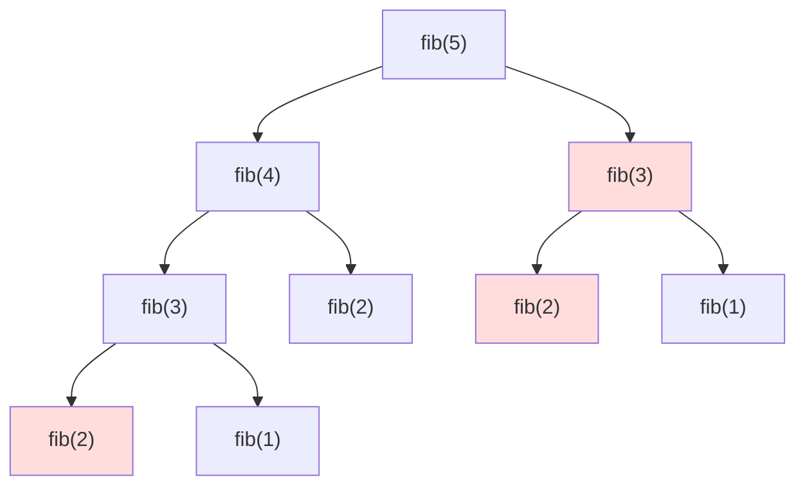
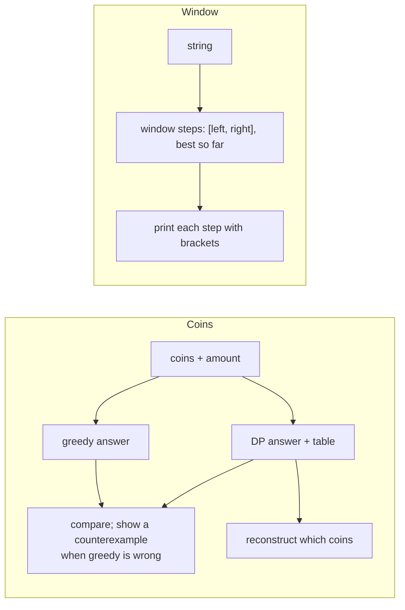

# Chapter 35 — Dynamic Programming, Greedy, Divide & Conquer, Sliding Window & Two Pointers

> **Volume 1 — Computer Science Foundations** · [Contents](index.md) · ← [Chapter 34 — Graph Algorithms: DFS, BFS, Topological Sort & Backtracking](ch34-graph-algorithms-dfs-bfs-topological-sort-and.md) · Next → [Chapter 36 — Binary, CPU, Registers, Cache & Memory Hierarchy](ch36-binary-cpu-registers-cache-and-memory-hierarchy.md)

---

## Concept

Overlapping subproblems + memoization (DP), local-optimal choices (greedy), split-and-combine (divide & conquer), and the sliding-window / two-pointer patterns.

**In one sentence:** these are five recipes for turning an obvious-but-slow brute force into a fast algorithm — remember answers you already computed (DP), commit to the best-looking choice when that's provably safe (greedy), split the problem in half (divide & conquer), or move two indices through the data instead of trying every pair (window / two pointers).

### Mental model

* **DP** — a notebook: before solving a subproblem, check whether you already wrote down its answer.
* **Greedy** — always grab the biggest coin that fits. Works for euros, fails for some odd coin systems.
* **Divide & conquer** — split a stack of exams between two helpers, then merge their sorted piles.
* **Sliding window** — a magnifying glass sliding along a line of text: add the character entering on the right, drop the one leaving on the left.

### Recognizing the pattern

| Clue in the problem | Try |
|---------------------|-----|
| "number of ways", "min/max cost", choices that affect later choices, brute force recomputes the same subproblems | **DP** |
| a local choice provably never hurts (exchange argument), intervals, scheduling | **greedy** |
| the problem splits into independent halves; combining is cheap | **divide & conquer** |
| contiguous subarray/substring with a constraint (sum ≤ k, no repeats) | **sliding window** |
| sorted array, pairs/triples meeting a target, partitioning in place | **two pointers** |

### DP in four steps

1. **State:** what defines a subproblem? e.g. `best(i, cap)` = best value using items `i..n` with capacity `cap`.
2. **Transition:** how does a state depend on smaller ones? `best(i, cap) = max(skip, take)`.
3. **Base cases:** `best(n, cap) = 0`.
4. **Order:** top-down with memoization (recursion + cache) or bottom-up (fill a table in dependency order).

Time = number of states × work per state. Space can often shrink to one or two rows.

### Greedy needs a proof

The usual one is an *exchange argument*: take any optimal solution, swap in the greedy choice, and show it's no worse. Example that works: activity selection by earliest finish time. Example that fails: coins {1, 3, 4} for amount 6 — greedy gives 4+1+1 (3 coins), optimal is 3+3 (2 coins).

### Divide & conquer in three steps

1. **Divide:** split the input into smaller pieces of the *same* problem, usually halves.
2. **Conquer:** solve each piece recursively, until a piece is so small the answer is obvious (the base case).
3. **Combine:** build the answer for the whole from the pieces' answers.

The speed comes from the halving: an input of size *n* can only be halved about log₂ *n* times, so as long as each level of the recursion does linear work, the total is O(*n* log *n*) rather than the O(*n*²) of comparing everything with everything.

<div class="fig">
<svg xmlns="http://www.w3.org/2000/svg" viewBox="0 0 760 400" role="img" aria-label="Merge sort on 5 2 8 1 9 3 7 4: the array is halved three times down to single items, which are trivially sorted, then pairs of sorted runs are merged back up level by level until one sorted array 1 2 3 4 5 7 8 9 remains" style="width:100%;max-width:760px;height:auto;font-family:inherit"><defs><marker id="v1c35x1-ar" viewBox="0 0 10 10" refX="8" refY="5" markerWidth="7" markerHeight="7" orient="auto-start-reverse"><path d="M0 0L10 5L0 10z" fill="context-stroke"/></marker></defs><rect x="276.0" y="20" width="208" height="24" rx="5" fill="var(--primary)" fill-opacity=".12" stroke="var(--primary)" stroke-width="1.4"/><text x="289.0" y="37" font-size="13" text-anchor="middle" fill="var(--text)" font-weight="700" font-family="ui-monospace,Consolas,monospace">5</text><line x1="302.0" y1="20" x2="302.0" y2="44" stroke="var(--primary)" stroke-opacity=".5" stroke-width="1"/><text x="315.0" y="37" font-size="13" text-anchor="middle" fill="var(--text)" font-weight="700" font-family="ui-monospace,Consolas,monospace">2</text><line x1="328.0" y1="20" x2="328.0" y2="44" stroke="var(--primary)" stroke-opacity=".5" stroke-width="1"/><text x="341.0" y="37" font-size="13" text-anchor="middle" fill="var(--text)" font-weight="700" font-family="ui-monospace,Consolas,monospace">8</text><line x1="354.0" y1="20" x2="354.0" y2="44" stroke="var(--primary)" stroke-opacity=".5" stroke-width="1"/><text x="367.0" y="37" font-size="13" text-anchor="middle" fill="var(--text)" font-weight="700" font-family="ui-monospace,Consolas,monospace">1</text><line x1="380.0" y1="20" x2="380.0" y2="44" stroke="var(--primary)" stroke-opacity=".5" stroke-width="1"/><text x="393.0" y="37" font-size="13" text-anchor="middle" fill="var(--text)" font-weight="700" font-family="ui-monospace,Consolas,monospace">9</text><line x1="406.0" y1="20" x2="406.0" y2="44" stroke="var(--primary)" stroke-opacity=".5" stroke-width="1"/><text x="419.0" y="37" font-size="13" text-anchor="middle" fill="var(--text)" font-weight="700" font-family="ui-monospace,Consolas,monospace">3</text><line x1="432.0" y1="20" x2="432.0" y2="44" stroke="var(--primary)" stroke-opacity=".5" stroke-width="1"/><text x="445.0" y="37" font-size="13" text-anchor="middle" fill="var(--text)" font-weight="700" font-family="ui-monospace,Consolas,monospace">7</text><line x1="458.0" y1="20" x2="458.0" y2="44" stroke="var(--primary)" stroke-opacity=".5" stroke-width="1"/><text x="471.0" y="37" font-size="13" text-anchor="middle" fill="var(--text)" font-weight="700" font-family="ui-monospace,Consolas,monospace">4</text><rect x="203.0" y="70" width="104" height="24" rx="5" fill="var(--primary)" fill-opacity=".12" stroke="var(--primary)" stroke-width="1.4"/><text x="216.0" y="87" font-size="13" text-anchor="middle" fill="var(--text)" font-weight="700" font-family="ui-monospace,Consolas,monospace">5</text><line x1="229.0" y1="70" x2="229.0" y2="94" stroke="var(--primary)" stroke-opacity=".5" stroke-width="1"/><text x="242.0" y="87" font-size="13" text-anchor="middle" fill="var(--text)" font-weight="700" font-family="ui-monospace,Consolas,monospace">2</text><line x1="255.0" y1="70" x2="255.0" y2="94" stroke="var(--primary)" stroke-opacity=".5" stroke-width="1"/><text x="268.0" y="87" font-size="13" text-anchor="middle" fill="var(--text)" font-weight="700" font-family="ui-monospace,Consolas,monospace">8</text><line x1="281.0" y1="70" x2="281.0" y2="94" stroke="var(--primary)" stroke-opacity=".5" stroke-width="1"/><text x="294.0" y="87" font-size="13" text-anchor="middle" fill="var(--text)" font-weight="700" font-family="ui-monospace,Consolas,monospace">1</text><rect x="453.0" y="70" width="104" height="24" rx="5" fill="var(--primary)" fill-opacity=".12" stroke="var(--primary)" stroke-width="1.4"/><text x="466.0" y="87" font-size="13" text-anchor="middle" fill="var(--text)" font-weight="700" font-family="ui-monospace,Consolas,monospace">9</text><line x1="479.0" y1="70" x2="479.0" y2="94" stroke="var(--primary)" stroke-opacity=".5" stroke-width="1"/><text x="492.0" y="87" font-size="13" text-anchor="middle" fill="var(--text)" font-weight="700" font-family="ui-monospace,Consolas,monospace">3</text><line x1="505.0" y1="70" x2="505.0" y2="94" stroke="var(--primary)" stroke-opacity=".5" stroke-width="1"/><text x="518.0" y="87" font-size="13" text-anchor="middle" fill="var(--text)" font-weight="700" font-family="ui-monospace,Consolas,monospace">7</text><line x1="531.0" y1="70" x2="531.0" y2="94" stroke="var(--primary)" stroke-opacity=".5" stroke-width="1"/><text x="544.0" y="87" font-size="13" text-anchor="middle" fill="var(--text)" font-weight="700" font-family="ui-monospace,Consolas,monospace">4</text><line x1="380.0" y1="44" x2="255.0" y2="67" stroke="var(--primary)" stroke-width="1.2" marker-end="url(#v1c35x1-ar)"/><line x1="380.0" y1="44" x2="505.0" y2="67" stroke="var(--primary)" stroke-width="1.2" marker-end="url(#v1c35x1-ar)"/><rect x="166.5" y="120" width="52" height="24" rx="5" fill="var(--primary)" fill-opacity=".12" stroke="var(--primary)" stroke-width="1.4"/><text x="179.5" y="137" font-size="13" text-anchor="middle" fill="var(--text)" font-weight="700" font-family="ui-monospace,Consolas,monospace">5</text><line x1="192.5" y1="120" x2="192.5" y2="144" stroke="var(--primary)" stroke-opacity=".5" stroke-width="1"/><text x="205.5" y="137" font-size="13" text-anchor="middle" fill="var(--text)" font-weight="700" font-family="ui-monospace,Consolas,monospace">2</text><rect x="291.5" y="120" width="52" height="24" rx="5" fill="var(--primary)" fill-opacity=".12" stroke="var(--primary)" stroke-width="1.4"/><text x="304.5" y="137" font-size="13" text-anchor="middle" fill="var(--text)" font-weight="700" font-family="ui-monospace,Consolas,monospace">8</text><line x1="317.5" y1="120" x2="317.5" y2="144" stroke="var(--primary)" stroke-opacity=".5" stroke-width="1"/><text x="330.5" y="137" font-size="13" text-anchor="middle" fill="var(--text)" font-weight="700" font-family="ui-monospace,Consolas,monospace">1</text><rect x="416.5" y="120" width="52" height="24" rx="5" fill="var(--primary)" fill-opacity=".12" stroke="var(--primary)" stroke-width="1.4"/><text x="429.5" y="137" font-size="13" text-anchor="middle" fill="var(--text)" font-weight="700" font-family="ui-monospace,Consolas,monospace">9</text><line x1="442.5" y1="120" x2="442.5" y2="144" stroke="var(--primary)" stroke-opacity=".5" stroke-width="1"/><text x="455.5" y="137" font-size="13" text-anchor="middle" fill="var(--text)" font-weight="700" font-family="ui-monospace,Consolas,monospace">3</text><rect x="541.5" y="120" width="52" height="24" rx="5" fill="var(--primary)" fill-opacity=".12" stroke="var(--primary)" stroke-width="1.4"/><text x="554.5" y="137" font-size="13" text-anchor="middle" fill="var(--text)" font-weight="700" font-family="ui-monospace,Consolas,monospace">7</text><line x1="567.5" y1="120" x2="567.5" y2="144" stroke="var(--primary)" stroke-opacity=".5" stroke-width="1"/><text x="580.5" y="137" font-size="13" text-anchor="middle" fill="var(--text)" font-weight="700" font-family="ui-monospace,Consolas,monospace">4</text><line x1="255.0" y1="94" x2="192.5" y2="117" stroke="var(--primary)" stroke-width="1.2" marker-end="url(#v1c35x1-ar)"/><line x1="255.0" y1="94" x2="317.5" y2="117" stroke="var(--primary)" stroke-width="1.2" marker-end="url(#v1c35x1-ar)"/><line x1="505.0" y1="94" x2="442.5" y2="117" stroke="var(--primary)" stroke-width="1.2" marker-end="url(#v1c35x1-ar)"/><line x1="505.0" y1="94" x2="567.5" y2="117" stroke="var(--primary)" stroke-width="1.2" marker-end="url(#v1c35x1-ar)"/><rect x="148.25" y="170" width="26" height="24" rx="5" fill="var(--primary)" fill-opacity=".12" stroke="var(--primary)" stroke-width="1.4"/><text x="161.25" y="187" font-size="13" text-anchor="middle" fill="var(--text)" font-weight="700" font-family="ui-monospace,Consolas,monospace">5</text><rect x="210.75" y="170" width="26" height="24" rx="5" fill="var(--primary)" fill-opacity=".12" stroke="var(--primary)" stroke-width="1.4"/><text x="223.75" y="187" font-size="13" text-anchor="middle" fill="var(--text)" font-weight="700" font-family="ui-monospace,Consolas,monospace">2</text><rect x="273.25" y="170" width="26" height="24" rx="5" fill="var(--primary)" fill-opacity=".12" stroke="var(--primary)" stroke-width="1.4"/><text x="286.25" y="187" font-size="13" text-anchor="middle" fill="var(--text)" font-weight="700" font-family="ui-monospace,Consolas,monospace">8</text><rect x="335.75" y="170" width="26" height="24" rx="5" fill="var(--primary)" fill-opacity=".12" stroke="var(--primary)" stroke-width="1.4"/><text x="348.75" y="187" font-size="13" text-anchor="middle" fill="var(--text)" font-weight="700" font-family="ui-monospace,Consolas,monospace">1</text><rect x="398.25" y="170" width="26" height="24" rx="5" fill="var(--primary)" fill-opacity=".12" stroke="var(--primary)" stroke-width="1.4"/><text x="411.25" y="187" font-size="13" text-anchor="middle" fill="var(--text)" font-weight="700" font-family="ui-monospace,Consolas,monospace">9</text><rect x="460.75" y="170" width="26" height="24" rx="5" fill="var(--primary)" fill-opacity=".12" stroke="var(--primary)" stroke-width="1.4"/><text x="473.75" y="187" font-size="13" text-anchor="middle" fill="var(--text)" font-weight="700" font-family="ui-monospace,Consolas,monospace">3</text><rect x="523.25" y="170" width="26" height="24" rx="5" fill="var(--primary)" fill-opacity=".12" stroke="var(--primary)" stroke-width="1.4"/><text x="536.25" y="187" font-size="13" text-anchor="middle" fill="var(--text)" font-weight="700" font-family="ui-monospace,Consolas,monospace">7</text><rect x="585.75" y="170" width="26" height="24" rx="5" fill="var(--primary)" fill-opacity=".12" stroke="var(--primary)" stroke-width="1.4"/><text x="598.75" y="187" font-size="13" text-anchor="middle" fill="var(--text)" font-weight="700" font-family="ui-monospace,Consolas,monospace">4</text><line x1="192.5" y1="144" x2="161.25" y2="167" stroke="var(--primary)" stroke-width="1.2" marker-end="url(#v1c35x1-ar)"/><line x1="192.5" y1="144" x2="223.75" y2="167" stroke="var(--primary)" stroke-width="1.2" marker-end="url(#v1c35x1-ar)"/><line x1="317.5" y1="144" x2="286.25" y2="167" stroke="var(--primary)" stroke-width="1.2" marker-end="url(#v1c35x1-ar)"/><line x1="317.5" y1="144" x2="348.75" y2="167" stroke="var(--primary)" stroke-width="1.2" marker-end="url(#v1c35x1-ar)"/><line x1="442.5" y1="144" x2="411.25" y2="167" stroke="var(--primary)" stroke-width="1.2" marker-end="url(#v1c35x1-ar)"/><line x1="442.5" y1="144" x2="473.75" y2="167" stroke="var(--primary)" stroke-width="1.2" marker-end="url(#v1c35x1-ar)"/><line x1="567.5" y1="144" x2="536.25" y2="167" stroke="var(--primary)" stroke-width="1.2" marker-end="url(#v1c35x1-ar)"/><line x1="567.5" y1="144" x2="598.75" y2="167" stroke="var(--primary)" stroke-width="1.2" marker-end="url(#v1c35x1-ar)"/><rect x="166.5" y="220" width="52" height="24" rx="5" fill="var(--success)" fill-opacity=".12" stroke="var(--success)" stroke-width="1.4"/><text x="179.5" y="237" font-size="13" text-anchor="middle" fill="var(--text)" font-weight="700" font-family="ui-monospace,Consolas,monospace">2</text><line x1="192.5" y1="220" x2="192.5" y2="244" stroke="var(--success)" stroke-opacity=".5" stroke-width="1"/><text x="205.5" y="237" font-size="13" text-anchor="middle" fill="var(--text)" font-weight="700" font-family="ui-monospace,Consolas,monospace">5</text><rect x="291.5" y="220" width="52" height="24" rx="5" fill="var(--success)" fill-opacity=".12" stroke="var(--success)" stroke-width="1.4"/><text x="304.5" y="237" font-size="13" text-anchor="middle" fill="var(--text)" font-weight="700" font-family="ui-monospace,Consolas,monospace">1</text><line x1="317.5" y1="220" x2="317.5" y2="244" stroke="var(--success)" stroke-opacity=".5" stroke-width="1"/><text x="330.5" y="237" font-size="13" text-anchor="middle" fill="var(--text)" font-weight="700" font-family="ui-monospace,Consolas,monospace">8</text><rect x="416.5" y="220" width="52" height="24" rx="5" fill="var(--success)" fill-opacity=".12" stroke="var(--success)" stroke-width="1.4"/><text x="429.5" y="237" font-size="13" text-anchor="middle" fill="var(--text)" font-weight="700" font-family="ui-monospace,Consolas,monospace">3</text><line x1="442.5" y1="220" x2="442.5" y2="244" stroke="var(--success)" stroke-opacity=".5" stroke-width="1"/><text x="455.5" y="237" font-size="13" text-anchor="middle" fill="var(--text)" font-weight="700" font-family="ui-monospace,Consolas,monospace">9</text><rect x="541.5" y="220" width="52" height="24" rx="5" fill="var(--success)" fill-opacity=".12" stroke="var(--success)" stroke-width="1.4"/><text x="554.5" y="237" font-size="13" text-anchor="middle" fill="var(--text)" font-weight="700" font-family="ui-monospace,Consolas,monospace">4</text><line x1="567.5" y1="220" x2="567.5" y2="244" stroke="var(--success)" stroke-opacity=".5" stroke-width="1"/><text x="580.5" y="237" font-size="13" text-anchor="middle" fill="var(--text)" font-weight="700" font-family="ui-monospace,Consolas,monospace">7</text><line x1="161.25" y1="194" x2="192.5" y2="217" stroke="var(--success)" stroke-width="1.2" marker-end="url(#v1c35x1-ar)"/><line x1="223.75" y1="194" x2="192.5" y2="217" stroke="var(--success)" stroke-width="1.2" marker-end="url(#v1c35x1-ar)"/><line x1="286.25" y1="194" x2="317.5" y2="217" stroke="var(--success)" stroke-width="1.2" marker-end="url(#v1c35x1-ar)"/><line x1="348.75" y1="194" x2="317.5" y2="217" stroke="var(--success)" stroke-width="1.2" marker-end="url(#v1c35x1-ar)"/><line x1="411.25" y1="194" x2="442.5" y2="217" stroke="var(--success)" stroke-width="1.2" marker-end="url(#v1c35x1-ar)"/><line x1="473.75" y1="194" x2="442.5" y2="217" stroke="var(--success)" stroke-width="1.2" marker-end="url(#v1c35x1-ar)"/><line x1="536.25" y1="194" x2="567.5" y2="217" stroke="var(--success)" stroke-width="1.2" marker-end="url(#v1c35x1-ar)"/><line x1="598.75" y1="194" x2="567.5" y2="217" stroke="var(--success)" stroke-width="1.2" marker-end="url(#v1c35x1-ar)"/><rect x="203.0" y="270" width="104" height="24" rx="5" fill="var(--success)" fill-opacity=".12" stroke="var(--success)" stroke-width="1.4"/><text x="216.0" y="287" font-size="13" text-anchor="middle" fill="var(--text)" font-weight="700" font-family="ui-monospace,Consolas,monospace">1</text><line x1="229.0" y1="270" x2="229.0" y2="294" stroke="var(--success)" stroke-opacity=".5" stroke-width="1"/><text x="242.0" y="287" font-size="13" text-anchor="middle" fill="var(--text)" font-weight="700" font-family="ui-monospace,Consolas,monospace">2</text><line x1="255.0" y1="270" x2="255.0" y2="294" stroke="var(--success)" stroke-opacity=".5" stroke-width="1"/><text x="268.0" y="287" font-size="13" text-anchor="middle" fill="var(--text)" font-weight="700" font-family="ui-monospace,Consolas,monospace">5</text><line x1="281.0" y1="270" x2="281.0" y2="294" stroke="var(--success)" stroke-opacity=".5" stroke-width="1"/><text x="294.0" y="287" font-size="13" text-anchor="middle" fill="var(--text)" font-weight="700" font-family="ui-monospace,Consolas,monospace">8</text><rect x="453.0" y="270" width="104" height="24" rx="5" fill="var(--success)" fill-opacity=".12" stroke="var(--success)" stroke-width="1.4"/><text x="466.0" y="287" font-size="13" text-anchor="middle" fill="var(--text)" font-weight="700" font-family="ui-monospace,Consolas,monospace">3</text><line x1="479.0" y1="270" x2="479.0" y2="294" stroke="var(--success)" stroke-opacity=".5" stroke-width="1"/><text x="492.0" y="287" font-size="13" text-anchor="middle" fill="var(--text)" font-weight="700" font-family="ui-monospace,Consolas,monospace">4</text><line x1="505.0" y1="270" x2="505.0" y2="294" stroke="var(--success)" stroke-opacity=".5" stroke-width="1"/><text x="518.0" y="287" font-size="13" text-anchor="middle" fill="var(--text)" font-weight="700" font-family="ui-monospace,Consolas,monospace">7</text><line x1="531.0" y1="270" x2="531.0" y2="294" stroke="var(--success)" stroke-opacity=".5" stroke-width="1"/><text x="544.0" y="287" font-size="13" text-anchor="middle" fill="var(--text)" font-weight="700" font-family="ui-monospace,Consolas,monospace">9</text><line x1="192.5" y1="244" x2="255.0" y2="267" stroke="var(--success)" stroke-width="1.2" marker-end="url(#v1c35x1-ar)"/><line x1="317.5" y1="244" x2="255.0" y2="267" stroke="var(--success)" stroke-width="1.2" marker-end="url(#v1c35x1-ar)"/><line x1="442.5" y1="244" x2="505.0" y2="267" stroke="var(--success)" stroke-width="1.2" marker-end="url(#v1c35x1-ar)"/><line x1="567.5" y1="244" x2="505.0" y2="267" stroke="var(--success)" stroke-width="1.2" marker-end="url(#v1c35x1-ar)"/><rect x="276.0" y="320" width="208" height="24" rx="5" fill="var(--success)" fill-opacity=".12" stroke="var(--success)" stroke-width="1.4"/><text x="289.0" y="337" font-size="13" text-anchor="middle" fill="var(--text)" font-weight="700" font-family="ui-monospace,Consolas,monospace">1</text><line x1="302.0" y1="320" x2="302.0" y2="344" stroke="var(--success)" stroke-opacity=".5" stroke-width="1"/><text x="315.0" y="337" font-size="13" text-anchor="middle" fill="var(--text)" font-weight="700" font-family="ui-monospace,Consolas,monospace">2</text><line x1="328.0" y1="320" x2="328.0" y2="344" stroke="var(--success)" stroke-opacity=".5" stroke-width="1"/><text x="341.0" y="337" font-size="13" text-anchor="middle" fill="var(--text)" font-weight="700" font-family="ui-monospace,Consolas,monospace">3</text><line x1="354.0" y1="320" x2="354.0" y2="344" stroke="var(--success)" stroke-opacity=".5" stroke-width="1"/><text x="367.0" y="337" font-size="13" text-anchor="middle" fill="var(--text)" font-weight="700" font-family="ui-monospace,Consolas,monospace">4</text><line x1="380.0" y1="320" x2="380.0" y2="344" stroke="var(--success)" stroke-opacity=".5" stroke-width="1"/><text x="393.0" y="337" font-size="13" text-anchor="middle" fill="var(--text)" font-weight="700" font-family="ui-monospace,Consolas,monospace">5</text><line x1="406.0" y1="320" x2="406.0" y2="344" stroke="var(--success)" stroke-opacity=".5" stroke-width="1"/><text x="419.0" y="337" font-size="13" text-anchor="middle" fill="var(--text)" font-weight="700" font-family="ui-monospace,Consolas,monospace">7</text><line x1="432.0" y1="320" x2="432.0" y2="344" stroke="var(--success)" stroke-opacity=".5" stroke-width="1"/><text x="445.0" y="337" font-size="13" text-anchor="middle" fill="var(--text)" font-weight="700" font-family="ui-monospace,Consolas,monospace">8</text><line x1="458.0" y1="320" x2="458.0" y2="344" stroke="var(--success)" stroke-opacity=".5" stroke-width="1"/><text x="471.0" y="337" font-size="13" text-anchor="middle" fill="var(--text)" font-weight="700" font-family="ui-monospace,Consolas,monospace">9</text><line x1="255.0" y1="294" x2="380.0" y2="317" stroke="var(--success)" stroke-width="1.2" marker-end="url(#v1c35x1-ar)"/><line x1="505.0" y1="294" x2="380.0" y2="317" stroke="var(--success)" stroke-width="1.2" marker-end="url(#v1c35x1-ar)"/><text x="20" y="92" font-size="12" text-anchor="start" fill="var(--primary)" font-weight="800">DIVIDE</text><text x="20" y="108" font-size="11" text-anchor="start" fill="var(--text-muted)" font-weight="400">halve until</text><text x="20" y="122" font-size="11" text-anchor="start" fill="var(--text-muted)" font-weight="400">trivial</text><text x="20" y="186" font-size="12" text-anchor="start" fill="var(--text-muted)" font-weight="800">BASE CASE</text><text x="20" y="202" font-size="11" text-anchor="start" fill="var(--text-muted)" font-weight="400">1 item = sorted</text><text x="20" y="270" font-size="12" text-anchor="start" fill="var(--success)" font-weight="800">COMBINE</text><text x="20" y="286" font-size="11" text-anchor="start" fill="var(--text-muted)" font-weight="400">merge two</text><text x="20" y="300" font-size="11" text-anchor="start" fill="var(--text-muted)" font-weight="400">sorted runs</text><text x="740" y="92" font-size="12" text-anchor="end" fill="var(--text)" font-weight="700">log₂ 8 = 3 levels</text><text x="740" y="286" font-size="12" text-anchor="end" fill="var(--text)" font-weight="700">each level merges all 8</text><text x="740" y="302" font-size="11" text-anchor="end" fill="var(--text-muted)" font-weight="400">items: O(n) per level</text><rect x="237.79999999999998" y="366" width="284.40000000000003" height="21" rx="10.5" fill="var(--success-faint)" stroke="var(--success)" stroke-width="1.2"/><text x="380.0" y="381" font-size="12" text-anchor="middle" fill="var(--success)" font-weight="700">O(n) work × log n levels = O(n log n)</text></svg>
</div>

**Worked example: merge sort.** All the cleverness is in *combine*: merging two already sorted lists takes one pass, because you only ever compare the two front items.

```python
def merge_sort(a):
    if len(a) <= 1:                       # base case: already sorted
        return a
    mid = len(a) // 2
    left, right = merge_sort(a[:mid]), merge_sort(a[mid:])   # divide + conquer
    out, i, j = [], 0, 0
    while i < len(left) and j < len(right):                  # combine: one linear pass
        if left[i] <= right[j]:           # <= keeps equal items in order (stable)
            out.append(left[i]); i += 1
        else:
            out.append(right[j]); j += 1
    return out + left[i:] + right[j:]

assert merge_sort([5, 2, 8, 1, 9, 3, 7, 4]) == [1, 2, 3, 4, 5, 7, 8, 9]
```

**The same recipe, different shapes.**

| Algorithm | Divide | Recurse into | Combine | Time |
|-----------|--------|--------------|---------|------|
| merge sort | split at the middle (free) | both halves | merge (linear) | O(*n* log *n*) |
| quicksort | partition around a pivot (linear) | both sides | nothing | O(*n* log *n*) average, O(*n*²) worst |
| binary search ([Ch 33](ch33-sorting-searching-and-binary-search.md)) | compare with the middle | **one** half | nothing | O(log *n*) |
| quickselect (k-th smallest) | partition around a pivot | only the side holding *k* | nothing | O(*n*) average |
| fast power `x**n` | `n // 2` | one subproblem, reused | square it (×x if *n* is odd) | O(log *n*) |
| closest pair of points | split by x-coordinate | both halves | check a narrow strip around the split | O(*n* log *n*) |

**Estimating the cost: the master theorem, intuitively.** Write the running time as **T(n) = a·T(n/b) + f(n)**: *a* subproblems, each 1/*b* of the size, plus *f(n)* work to divide and combine. Then compare the work at the top of the recursion tree with the number of leaves at the bottom, n^(log_b a):
- **Leaves dominate** (combine is cheap): T = Θ(n^(log_b a)). Karatsuba multiplication, with a = 3 and b = 2, is Θ(n^1.58).
- **Balanced**, the same work on every level: T = Θ(f(n) · log n). Merge sort: a = 2, b = 2, f = n gives Θ(n log n). Binary search: a = 1, b = 2, f = 1 gives Θ(log n).
- **The root dominates** (combine is expensive): T = Θ(f(n)).

**Divide & conquer vs DP.** Both break a problem into subproblems. In divide & conquer the pieces are *disjoint*: the left half and the right half never share work, so there is nothing to cache. In DP the subproblems *overlap*, so the same ones come up again and again (the fib(5) tree below), which is why DP memoizes. If you draw the recursion tree and see repeated nodes, you need DP; if every node is new, plain recursion is already optimal.

**Pitfalls**
- A missing or wrong base case: without `len(a) <= 1`, a one-item list splits into `[]` and itself, and the recursion never ends.
- Slicing (`a[:mid]`) copies data on every call. For big inputs pass index bounds (`lo`, `hi`) instead.
- Python's recursion limit is about 1000 calls deep. Balanced halving is safe (log₂ of a billion is 30), but a bad quicksort pivot on sorted input recurses *n* deep.
- Quicksort's O(*n*²) worst case: choose a random pivot, or the median of three.

---

## Prereqs

* [Chapter 33 — Sorting, Searching & Binary Search](ch33-sorting-searching-and-binary-search.md)
* [Chapter 34 — Graph Algorithms: DFS, BFS, Topological Sort & Backtracking](ch34-graph-algorithms-dfs-bfs-topological-sort-and.md)

---

## Diagram

**Why memoization helps: the fib(5) call tree**



Red nodes are repeats. With a memo, each `fib(k)` is computed once: O(n) instead of O(φⁿ).

### A DP memo table for 0/1 knapsack

Items (weight, value): A(1, 1), B(3, 4), C(4, 5), D(5, 7); capacity 7.

```
 dp[i][c] = best value using the first i items with capacity c

            c=0  1   2   3   4   5   6   7
 no items    0   0   0   0   0   0   0   0
 +A (1,1)    0   1   1   1   1   1   1   1
 +B (3,4)    0   1   1   4   5   5   5   5
 +C (4,5)    0   1   1   4   5   6   6   9     ← B + C = 4 + 5
 +D (5,7)    0   1   1   4   5   7   8   9
 each cell = max(cell above,  value + cell above at c − weight)
             (skip the item)  (take it)
```

### A sliding window shrinking and expanding

Longest substring without repeats in `"abcabcbb"`

String `a b c a b c b b`:

| Window | What happens |
|---|---|
| `[a b c]` | expand right: window "abc", best = 3 |
| `[b c a]` | 'a' repeats → shrink left past the old 'a' |
| `[c a b]` | |
| `[a b c]` | |
| `[c b]` | 'b' repeats → jump left past it |
| `[b]` | best stays 3 |

Each index enters and leaves the window at most once → **O(n)**.

### Two pointers on a sorted array

Find a pair summing to 10 in `[1, 2, 4, 6, 8, 9]`

```
 L=1, R=9  → 10 ✓ found in one step
 (if sum < target, move L right; if sum > target, move R left)
```

---

## Example

```python
from functools import lru_cache

@lru_cache(maxsize=None)
def fib(n):
    return n if n < 2 else fib(n - 1) + fib(n - 2)

def knapsack_top_down(items, cap):
    @lru_cache(maxsize=None)
    def best(i, c):
        if i == len(items):
            return 0
        w, v = items[i]
        skip = best(i + 1, c)
        take = v + best(i + 1, c - w) if w <= c else 0
        return max(skip, take)
    return best(0, cap)

def knapsack_bottom_up(items, cap):
    dp = [0] * (cap + 1)                 # one row is enough
    for w, v in items:
        for c in range(cap, w - 1, -1):  # go downward so each item is used at most once
            dp[c] = max(dp[c], v + dp[c - w])
    return dp[cap]

items = [(1, 1), (3, 4), (4, 5), (5, 7)]
print(knapsack_top_down(items, 7), knapsack_bottom_up(items, 7))   # 9 9

def max_sum_window(xs, k):               # fixed-size sliding window
    s = best = sum(xs[:k])
    for i in range(k, len(xs)):
        s += xs[i] - xs[i - k]           # add the entering element, drop the leaving one
        best = max(best, s)
    return best

def longest_unique(s):                   # variable-size window
    last, left, best = {}, 0, 0
    for right, ch in enumerate(s):
        if ch in last and last[ch] >= left:
            left = last[ch] + 1          # shrink past the previous copy
        last[ch] = right
        best = max(best, right - left + 1)
    return best

def coin_change(coins, amount):          # min coins; DP because greedy can fail
    INF = float("inf")
    dp = [0] + [INF] * amount
    for a in range(1, amount + 1):
        dp[a] = min((dp[a - c] + 1 for c in coins if c <= a), default=INF)
    return dp[amount] if dp[amount] != INF else -1

print(max_sum_window([2, 1, 5, 1, 3, 2], 3), longest_unique("abcabcbb"), coin_change([1, 3, 4], 6))
# 9 3 2
```

---

## Exercises

1. Solve 0/1 knapsack top-down and bottom-up.

   <details><summary>Solution</summary>See both versions above. Top-down has O(n·cap) states with O(1) work each. The bottom-up single row must iterate capacity <i>downward</i>; upward would let one item be taken many times, which is the <i>unbounded</i> knapsack.</details>

2. Longest substring without repeating chars via sliding window.

   <details><summary>Solution</summary>See <code>longest_unique</code>: track each character's last index; when the entering character was seen inside the window, move <code>left</code> just past it. O(n) time, O(alphabet) space.</details>

3. Is "pick the interval that starts first" a correct greedy rule for scheduling the most non-overlapping meetings?

   <details><summary>Solution</summary>No: one long early meeting can block many short ones. The correct rule is <i>earliest finish time</i>. Exchange argument: the first meeting of any optimal schedule can be swapped for the earliest-finishing meeting without creating an overlap.</details>

---

## Mini project

### A coin-change solver and a longest-substring tool with visual step output



### Steps

1. Coin change: DP for the minimum count, plus back-pointers to print the coins used.
2. Run greedy alongside; search small coin systems for inputs where greedy loses, and print them.
3. Count the number of *ways* to make the amount (a different DP: `ways[a] += ways[a − c]`, looping coins in the outer loop).
4. Window tool: print each step as `a b [c a b] c b b  best=3`.
5. Test both against brute force for small inputs.

**Done when:** the tool finds greedy counterexamples automatically, and every DP answer matches brute force for amounts ≤ 30.

---

## Open source

* [`TheAlgorithms/Python`](https://github.com/TheAlgorithms/Python) — `dynamic_programming/`, `greedy_methods/`, and `divide_and_conquer/` hold hundreds of small, documented implementations to compare with yours.

---

## Interview

1. **"How do you recognize a DP problem?"**
   <details><summary>Answer</summary>The question asks for an optimum or a count; the answer is built from answers to smaller versions of the same question (optimal substructure); and a naive recursion solves the same subproblems repeatedly (overlapping subproblems). Then define the state, the transition, and the base cases, and memoize or tabulate.</details>

2. **"When is greedy provably optimal?"**
   <details><summary>Answer</summary>When the problem has the greedy-choice property (some optimal solution starts with the greedy choice) plus optimal substructure. Prove it with an exchange argument, or with matroid theory. Classic correct cases: activity selection by earliest finish, Huffman coding, Dijkstra with non-negative weights, Kruskal/Prim MST. Without a proof, test against brute force.</details>

3. **"Divide & conquer and DP both use subproblems. What is the difference?"**
   <details><summary>Answer</summary>In divide & conquer the subproblems are disjoint (merge sort's halves share nothing), so each is solved once and nothing needs caching. In DP the subproblems overlap (fib(n-1) and fib(n-2) both need fib(n-3)), so without memoization the same work is repeated exponentially often. Draw the recursion tree: repeated nodes mean DP.</details>

---

## Checklist

- [ ] write top-down + bottom-up DP
- [ ] prove a greedy choice
- [ ] write a divide & conquer solution (merge sort) and estimate it with T(n) = a·T(n/b) + f(n)
- [ ] apply two-pointer/sliding-window

---

> [Contents](index.md) · ← [Chapter 34 — Graph Algorithms: DFS, BFS, Topological Sort & Backtracking](ch34-graph-algorithms-dfs-bfs-topological-sort-and.md) · Next → [Chapter 36 — Binary, CPU, Registers, Cache & Memory Hierarchy](ch36-binary-cpu-registers-cache-and-memory-hierarchy.md)
