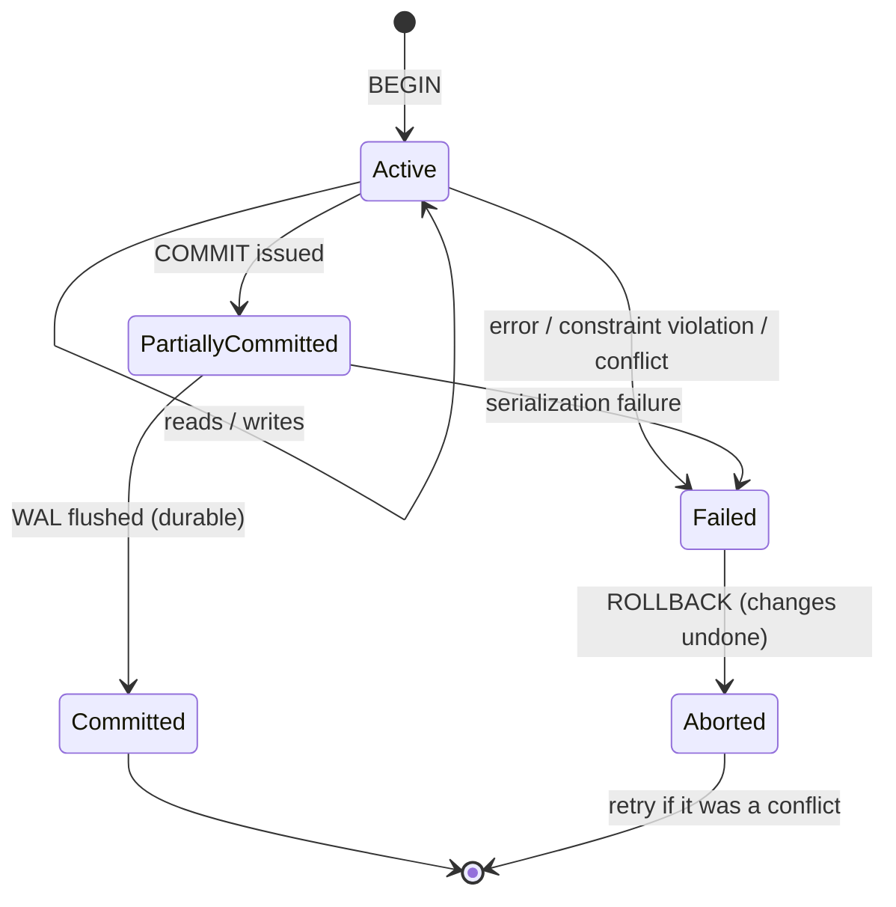
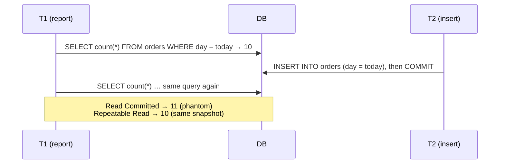
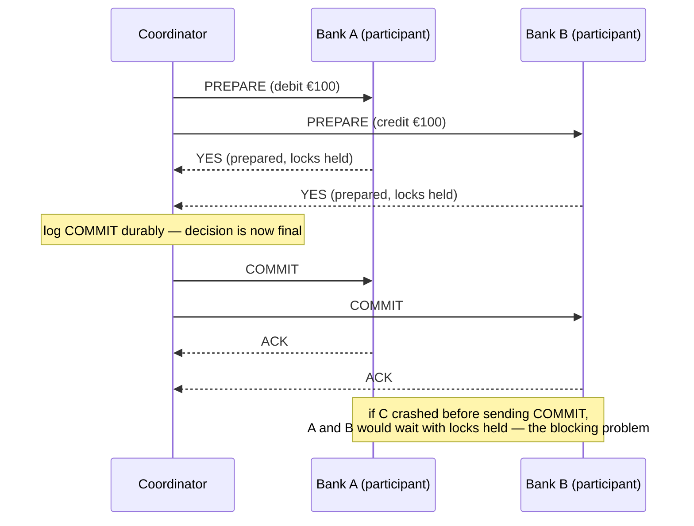
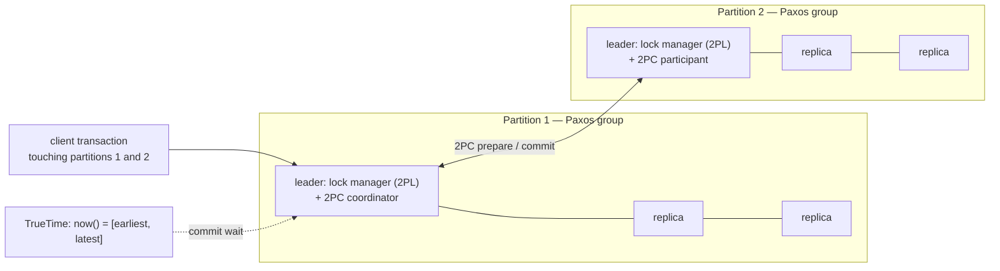
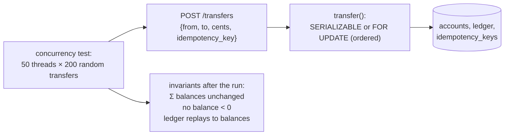

# Chapter 47 — ACID, Transactions & Isolation

> **Volume 1 — Computer Science Foundations** · [Contents](index.md) · ← [Chapter 46 — Schema Design, Normalization & Indexing](ch46-schema-design-normalization-and-indexing.md) · Next → [Chapter 48 — NoSQL: MongoDB, Cassandra & DynamoDB](ch48-nosql-mongodb-cassandra-and-dynamodb.md)

---

## Concept

Atomicity/Consistency/Isolation/Durability; transactions; isolation levels (read committed, repeatable read, serializable) and anomalies.

**In one sentence:** a transaction groups several changes into one all-or-nothing unit, and the isolation level decides how much concurrent transactions can see of each other's half-finished work — trading correctness against speed.

### Mental model — a bank teller's window

Moving €100 from savings to checking is two steps. ACID promises that you never see the money vanish or appear twice, even if the power fails halfway (atomicity, durability), that the rules still hold afterward (consistency), and that another teller working on the same accounts at the same time doesn't mess up your math (isolation).

### ACID

| Property | Promise | How databases do it |
|----------|---------|---------------------|
| **Atomicity** | all changes commit, or none do | an undo log / old row versions; rollback on error |
| **Consistency** | constraints hold before and after | PK, FK, UNIQUE, CHECK, triggers (plus *your* invariants) |
| **Isolation** | concurrent transactions behave as if more or less serial | locks and/or MVCC snapshots |
| **Durability** | once committed, it survives crashes | a write-ahead log (WAL) flushed with fsync before COMMIT returns; replication |

### Anomalies

| Anomaly | What happens |
|---------|--------------|
| Dirty read | you read another transaction's *uncommitted* change, which then rolls back |
| Non-repeatable read | you read a row twice and get different values (another transaction committed in between) |
| Phantom read | you re-run a range query and new rows appear |
| **Lost update** | two transactions read-modify-write the same value; one overwrites the other |
| **Write skew** | two transactions read overlapping data, each writes a *different* row, and together they break a rule (e.g. both doctors go off call) |

### Isolation levels (as implemented in PostgreSQL)

| Level | Dirty read | Non-repeatable | Phantom | Lost update | Write skew |
|-------|:-:|:-:|:-:|:-:|:-:|
| Read Uncommitted (behaves as Read Committed in PG) | ✗ | possible | possible | possible | possible |
| **Read Committed** (PG default) | ✗ | possible | possible | possible | possible |
| **Repeatable Read** (snapshot isolation in PG) | ✗ | ✗ | ✗ (in PG) | ✗ (one aborts) | **possible** |
| **Serializable** (SSI in PG) | ✗ | ✗ | ✗ | ✗ | ✗ (one aborts) |

✗ = prevented. At Repeatable Read and Serializable, the database may abort you with a *serialization failure* — your code must **retry** the transaction.

### MVCC (multi-version concurrency control)

Writers create new row *versions* instead of overwriting. Each transaction reads from a *snapshot*: the versions committed before it started (Repeatable Read) or before each statement (Read Committed). Readers never block writers and writers never block readers. Old versions are later cleaned up (`VACUUM` in Postgres).

### Fixing lost updates

Use an atomic update (`SET balance = balance - 100`), `SELECT … FOR UPDATE` (a pessimistic row lock), optimistic concurrency (a version column: `UPDATE … WHERE id = $1 AND version = $2`, and check the row count), or a higher isolation level plus retries.

### Keep transactions short

Long transactions hold locks, block `VACUUM`, bloat tables, and raise conflict rates. Never wait for user input or call slow external APIs inside a transaction.

### How a database actually enforces isolation: pessimistic vs optimistic

| Approach | How it works | Wins when | Costs |
|----------|-------------|-----------|-------|
| **Two-phase locking (2PL)** — pessimistic | Shared (read) locks can be held by many; an exclusive (write) lock by one. A transaction only *acquires* locks during its growing phase and only *releases* them in its shrinking phase. **Strict 2PL** keeps every lock until commit, so nobody ever reads uncommitted data and one abort never forces others to abort (no *cascading aborts*). | many conflicting writes: waiting is cheaper than redoing work | blocking; **deadlocks** (T1 waits for T2, T2 waits for T1) — the database finds the cycle in a wait-for graph and aborts a *victim* |
| **Optimistic concurrency control (OCC)** | Run without locks, buffering writes in a private workspace. At commit, *validate*: did anything I read change since? If not, publish the writes; if so, abort and retry. Short internal *latches* still protect shared structures during validation — not the same as logical locks. | reads dominate and conflicts are rare | wasted work and retries when conflicts are common |
| **MVCC** (above) | Readers get a snapshot; writers still use 2PL or OCC between themselves | read-only queries must never block or abort | old versions to garbage-collect |

The version-column trick under *Fixing lost updates* is OCC applied to a single row: read version 42, write only if it is still 42 (a compare-and-swap), else retry.

### Serializable vs strict serializable

*serializable* only promises the result equals *some* serial order, which may not match real time (a transaction that committed later can appear earlier). *Strict serializable* adds the real-time rule: once a transaction commits, every transaction that starts afterwards sees it. It is serializability plus linearizability (see [Chapter 50](ch50-cap-consistency-and-consensus.md)); Spanner and CockroachDB-style systems advertise it.

### Atomicity across machines: two-phase commit (2PC)

A WAL makes a transaction atomic inside *one* database. Once a transfer touches two databases (two banks, two shards, two services), you need a protocol so both commit or both abort:

1. **Prepare.** A *coordinator* asks every *participant* "can you commit?". A participant that answers yes first makes the changes durable in a *prepared* state and keeps its locks. From that moment it has given up the right to decide alone.
2. **Commit or abort.** If every vote is yes, the coordinator durably logs "commit" and tells everyone; any no or timeout means "abort". Once logged, the decision is final, and the coordinator retries until every participant acknowledges.

The weak spot is the gap between the phases: if the coordinator crashes after participants voted yes, they are **blocked** — holding locks, unable to commit or abort — until it comes back. 2PC also costs two round trips plus forced log writes, and every participant must speak the protocol (the X/Open **XA** standard in relational databases; most queues, search engines and SaaS APIs don't). Making it fault-tolerant means replicating the coordinator's and participants' state with consensus (Paxos/Raft) so a replica can take over a stuck transaction. Agreeing on commit is actually a harder problem than ordinary consensus (*uniform* consensus): even a participant that later fails must not have decided differently.

### XA: two-phase commit across different products

**XA** is the X/Open standard (1991) that lets one **transaction manager** run 2PC across **resource managers** made by different vendors: say, a PostgreSQL debit and a message sent to an IBM MQ queue, committed as one unit. Each resource manager implements a small set of calls (`xa_start`, `xa_end`, `xa_prepare`, `xa_commit`, `xa_rollback`, `xa_recover`), and the transaction manager drives them. In Java this is JTA, with managers such as Narayana or Atomikos. Databases expose it too: PostgreSQL through `PREPARE TRANSACTION` / `COMMIT PREPARED`, MySQL through `XA START … XA COMMIT`.

Why it is rare in modern systems:

- **In-doubt transactions.** If the transaction manager dies after the prepare phase, each database keeps the prepared transaction and its locks until someone resolves it. In PostgreSQL these show up in `pg_prepared_xacts`, survive restarts, and block vacuum and other writers until committed or rolled back by hand.
- **Off by default.** PostgreSQL ships with `max_prepared_transactions = 0`, so XA must be switched on deliberately.
- **Little support outside relational databases.** Kafka, most cloud queues, search engines and SaaS APIs don't speak XA. Kafka's own transactions cover only Kafka.
- **Cost.** Two extra round trips and forced log writes on every participant for every transaction.

So when one action must change a database *and* tell another system, the usual design avoids XA: write the change and an outbox row in one local transaction, and let a relay publish the message afterwards (see "When 2PC is not an option" below, and [Chapter 12 of Volume 4](../volume-4-high-level-design/ch12-event-driven-systems.md)).

### Spanner: 2PC that doesn't block, and global time

Spanner splits data into partitions; each partition is a Paxos group whose leader also runs 2PL for that partition. A cross-partition transaction runs 2PC between the group leaders, but since each leader's log is replicated by Paxos, a failed coordinator or participant is replaced by another replica of its group instead of blocking everyone. Read-only transactions use MVCC snapshots and take no locks. To give every transaction a globally meaningful timestamp, **TrueTime** returns an *interval* `[earliest, latest]` that is guaranteed to contain the real time (GPS and atomic clocks keep it to a few ms). On commit, Spanner waits until `earliest` has passed its chosen timestamp — **commit wait** — before releasing locks, so timestamp order matches real-time order: strict serializability. CockroachDB and YugabyteDB, lacking atomic clocks, use **hybrid logical clocks** (physical time + a logical counter) and restart reads that fall into the clock-uncertainty window.

### When 2PC is not an option

Long-running steps (hours), services you don't control, or stores without XA. Then trade isolation for availability: commit locally and send a durable message ([outbox](../volume-4-high-level-design/ch12-event-driven-systems.md)), or run a **saga** — a chain of local transactions, each with a compensating action that undoes it on failure. Sagas are atomic in the end but not isolated: other requests can see the half-done state. A common patch is a **semantic lock** — mark touched records `PENDING` until the saga finishes, and make other operations wait, fail, or treat pending records specially.

---

## Prereqs

* [Chapter 45 — SQL & the Relational Model](ch45-sql-and-the-relational-model.md)

---

## Diagram

### Transaction state diagram



### A lost update (Read Committed, read-then-write in the app)

```
 balance = 100
 T1: SELECT balance → 100                 T2: SELECT balance → 100
 T1: UPDATE SET balance = 100 + 50        
 T1: COMMIT                               T2: UPDATE SET balance = 100 − 30
                                          T2: COMMIT
 result: 70   (expected 120 — T1's +50 was lost)
 fix: UPDATE accounts SET balance = balance + 50  (atomic)  or  SELECT … FOR UPDATE
```

### A phantom read under two isolation levels



### MVCC row versions

```
 row id=1:  [v1 balance=100, created by tx 90, deleted by tx 95] → [v2 balance=150, created by tx 95]
 tx 93 (started before 95 committed) sees v1   ·   tx 97 sees v2   ·   VACUUM removes v1 once no one can see it
```

### Two-phase commit — and where it blocks



### Spanner: Paxos groups + 2PL + 2PC



---

## Example

```sql
BEGIN;
UPDATE accounts SET balance = balance - 100 WHERE id = 1 AND balance >= 100;
-- check the row count in the app: 0 rows → insufficient funds → ROLLBACK
UPDATE accounts SET balance = balance + 100 WHERE id = 2;
INSERT INTO ledger (from_id, to_id, amount_cents) VALUES (1, 2, 100);
COMMIT;

-- Pessimistic locking: lock rows in a consistent order (avoids deadlocks)
BEGIN;
SELECT id, balance FROM accounts WHERE id IN (1, 2) ORDER BY id FOR UPDATE;
-- … compute, then UPDATE both …
COMMIT;

-- Serializable with a retry loop in the app
BEGIN ISOLATION LEVEL SERIALIZABLE;
SELECT count(*) FROM doctors WHERE on_call AND shift = 'night';   -- 2
UPDATE doctors SET on_call = false WHERE id = 7;                   -- ok if count > 1
COMMIT;   -- may fail: ERROR: could not serialize access (SQLSTATE 40001) → retry
```

```python
import psycopg, time, random
from psycopg import errors

def transfer(conn, src, dst, cents, attempts=5):
    for i in range(attempts):
        try:
            with conn.transaction():
                conn.execute("SET TRANSACTION ISOLATION LEVEL SERIALIZABLE")
                cur = conn.execute("UPDATE accounts SET balance = balance - %s "
                                   "WHERE id = %s AND balance >= %s", (cents, src, cents))
                if cur.rowcount == 0:
                    raise ValueError("insufficient funds")
                conn.execute("UPDATE accounts SET balance = balance + %s WHERE id = %s", (cents, dst))
            return
        except errors.SerializationFailure:
            time.sleep((2 ** i) * 0.01 * random.random())   # jittered backoff, then retry
    raise RuntimeError("transfer failed after retries")
```

---

## Exercises

1. Reproduce a lost update and fix it with a lock.

   <details><summary>Solution</summary>Open two <code>psql</code> sessions. Both <code>BEGIN; SELECT balance FROM accounts WHERE id=1;</code>, then each <code>UPDATE … SET balance = &lt;value computed from its read&gt;</code> and commit: one change is lost. Fix: <code>SELECT … FOR UPDATE</code> in both (the second blocks until the first commits and then reads the new value), an atomic <code>SET balance = balance + x</code>, or a version column with <code>WHERE version = n</code>.</details>

2. Explain what each isolation level prevents.

   <details><summary>Solution</summary>Read Committed: no dirty reads; each statement sees the latest committed data. Repeatable Read (a PG snapshot): the whole transaction sees one snapshot — no non-repeatable or phantom reads, and a conflicting concurrent update aborts one side — but write skew is possible. Serializable: the result is equivalent to some serial order; PG detects dangerous patterns (SSI) and aborts one transaction.</details>

3. Two doctors are on call. Each, in their own transaction, checks "at least 2 on call?" and then goes off call. Which level prevents both leaving?

   <details><summary>Solution</summary>This is write skew. Repeatable Read (snapshot isolation) allows it: they update different rows, so there's no write conflict. Serializable prevents it (one transaction aborts), as does locking the relevant rows with <code>SELECT … FOR UPDATE</code>.</details>

---

## Mini project

### A money-transfer service with transactions that pass a concurrency test



### Steps

1. Tables: `accounts(id, balance CHECK (balance >= 0))`, `ledger(id, from_id, to_id, cents, created_at)`, `idempotency_keys(key PK, response)`.
2. Implement `transfer` twice: (a) `SELECT … FOR UPDATE` with ordered locking, (b) `SERIALIZABLE` with a retry loop.
3. An idempotency key stored in the *same* transaction as the transfer.
4. Concurrency test: many threads doing random transfers among 10 accounts; count retries and deadlocks.
5. Check the invariants; then deliberately break the code (a read-modify-write without a lock) and watch the test fail.

**Done when:** both versions keep all invariants under load, the broken version fails the test, and retried requests with the same key never double-charge.

---

## Open source

* [`postgres/postgres`](https://github.com/postgres/postgres) (MVCC) — `src/backend/storage/lmgr/README-SSI` explains Serializable Snapshot Isolation; the docs' "Concurrency Control" chapter is essential reading.

---

## Interview

1. **"What anomalies does each isolation level allow?"**
   <details><summary>Answer</summary>Read Uncommitted: dirty reads and everything below. Read Committed: non-repeatable reads, phantoms, lost updates, write skew. Repeatable Read (ANSI): phantoms (and in snapshot implementations like PG, write skew but not phantoms). Serializable: none. Implementations vary, so know your database: MySQL's Repeatable Read uses gap locks; PG's is snapshot isolation.</details>

2. **"How does MVCC work?"**
   <details><summary>Answer</summary>Each write creates a new row version tagged with the creating transaction's ID, and marks the old version as deleted by that ID. Each transaction reads with a snapshot that defines which transaction IDs count as committed and visible. So readers see a consistent past state without locking, and writers don't block readers. Write–write conflicts are still detected. Garbage collection (VACUUM, undo purge) reclaims versions no snapshot can see.</details>

3. **"How does two-phase commit work, and what is its main weakness?"**
   <details><summary>Answer</summary>A coordinator asks all participants to prepare; each makes its changes durable in a prepared state, keeps its locks, and votes. If all vote yes, the coordinator durably logs commit and tells everyone; otherwise it aborts. Its weakness is blocking: a participant that voted yes cannot decide alone, so if the coordinator dies between the phases, participants sit on locks until it recovers. It is also slow (two round trips plus forced writes) and needs every participant to implement it (XA). Spanner fixes the blocking by replicating each participant and the coordinator with Paxos; long-running or cross-company flows use sagas instead.</details>

4. **"Pessimistic or optimistic concurrency control?"**
   <details><summary>Answer</summary>Pessimistic (two-phase locking) blocks conflicting transactions up front; it wins when conflicts are frequent, because waiting is cheaper than redoing work, but it brings deadlocks that the database must detect and break by aborting a victim. Optimistic (OCC) runs without locks and validates at commit, aborting on conflict; it wins for read-heavy, low-conflict workloads. Most databases add MVCC on top so read-only transactions never block or abort, and use 2PL or OCC only between writers.</details>

5. **"What is strict serializability, and how does Spanner provide it across data centers?"**
   <details><summary>Answer</summary>Serializability plus real-time order: a transaction that starts after another commits must see it. Spanner timestamps transactions with TrueTime, which returns an uncertainty interval instead of a single instant, and waits out that uncertainty before releasing locks (commit wait). Any later transaction therefore gets a strictly larger timestamp, so timestamp order equals real-time order everywhere.</details>

---

## Checklist

- [ ] name the ACID properties
- [ ] pick an isolation level deliberately
- [ ] keep transactions short
- [ ] explain 2PL vs OCC vs MVCC and when each wins
- [ ] walk through 2PC and its blocking failure
- [ ] know when to use a saga instead of 2PC

---

> [Contents](index.md) · ← [Chapter 46 — Schema Design, Normalization & Indexing](ch46-schema-design-normalization-and-indexing.md) · Next → [Chapter 48 — NoSQL: MongoDB, Cassandra & DynamoDB](ch48-nosql-mongodb-cassandra-and-dynamodb.md)
