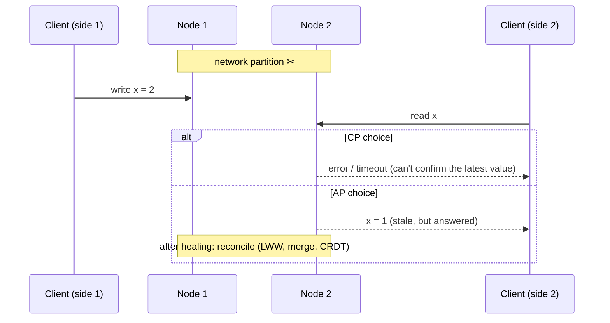
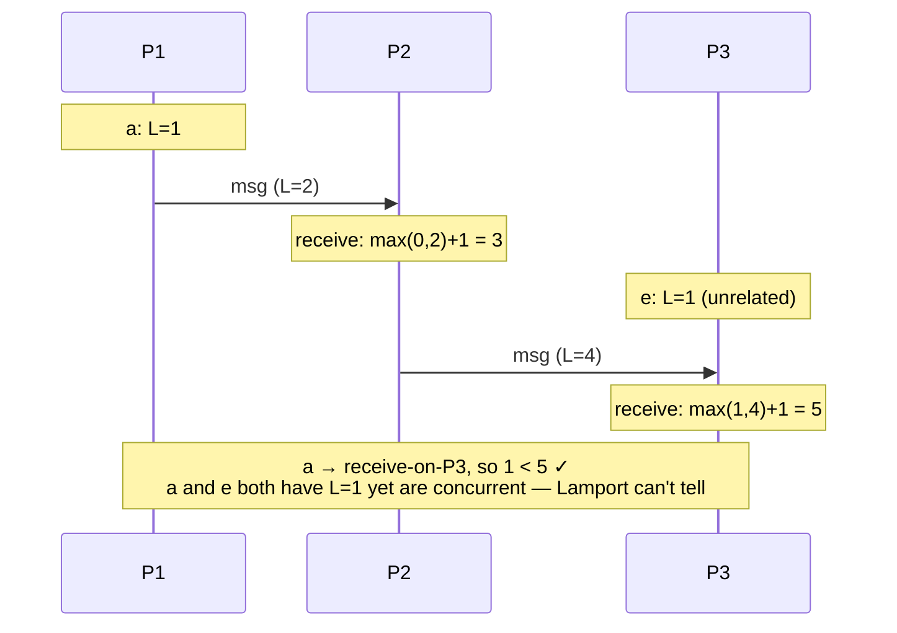
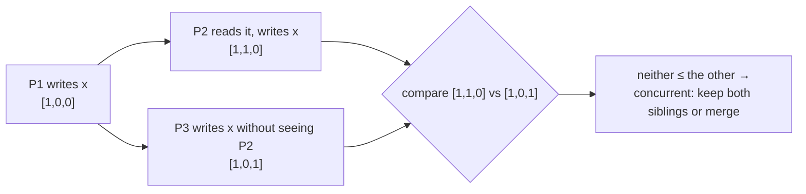
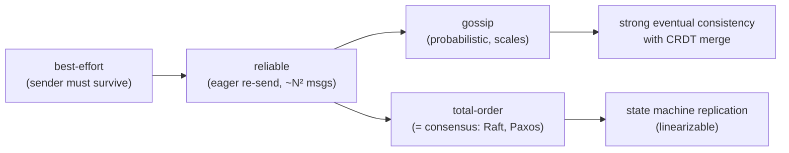
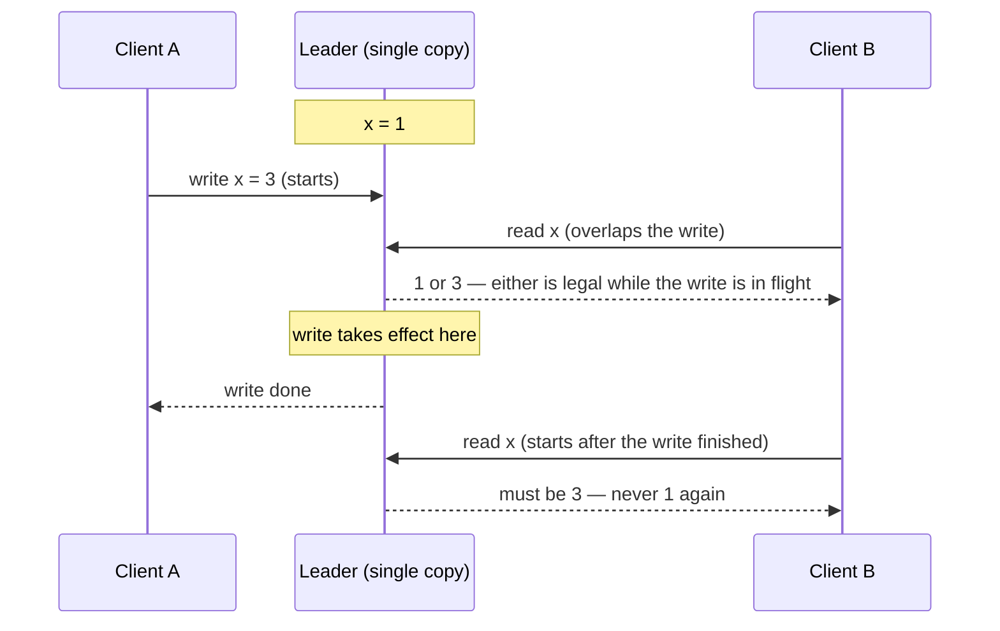
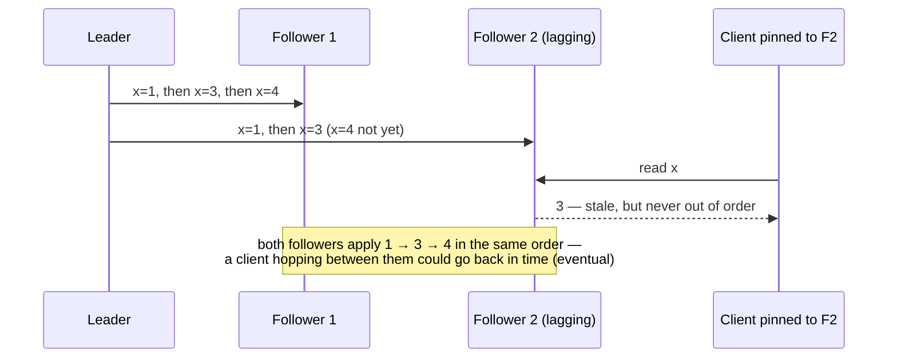
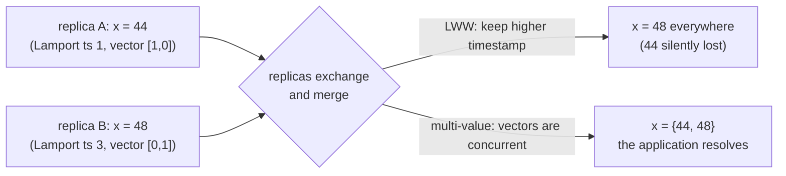
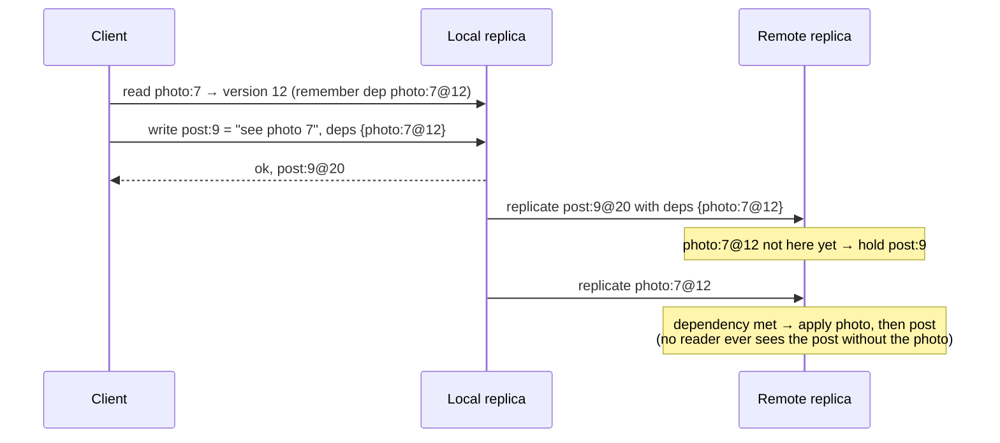
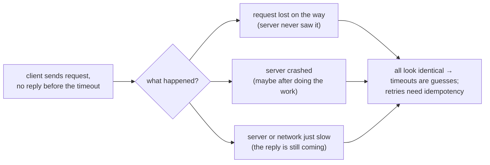
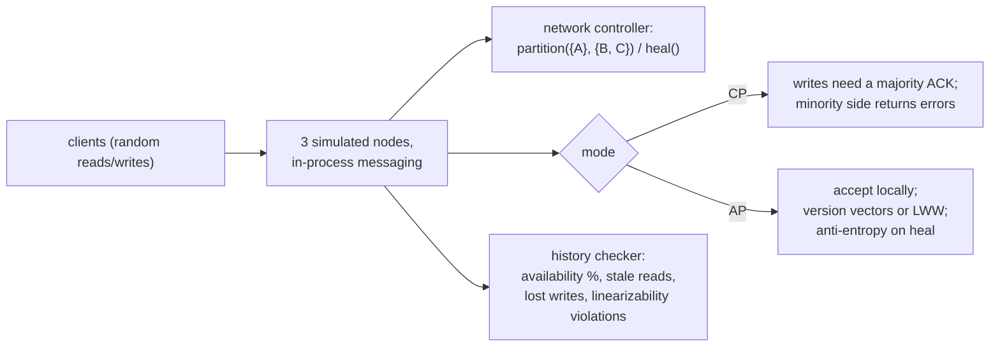

# Chapter 50 — CAP, Consistency & Consensus

> **Volume 1 — Computer Science Foundations** · [Contents](index.md) · ← [Chapter 49 — Redis, Elasticsearch, Neo4j & Vector Databases](ch49-redis-elasticsearch-neo4j-and-vector-databases.md) · Next → [Chapter 51 — Replication, Sharding, Raft & Paxos](ch51-replication-sharding-raft-and-paxos.md)

---

## Concept

CAP theorem, consistency models, the need for consensus, and how systems trade availability vs consistency.

**In one sentence:** when the network splits a replicated system in two, each side must choose between refusing requests (staying consistent) and answering with possibly stale or conflicting data (staying available), and consensus algorithms are how nodes agree on one truth despite failures.

### Mental model — two bank branches with a broken phone line

A customer withdraws money at branch A. Branch B hasn't heard about it because the line is down. If B lets the customer withdraw again, the bank stays *available* but becomes *inconsistent*. If B refuses until the line is back, the bank stays *consistent* but becomes *unavailable*. There is no third choice while the line is down.

### CAP, stated precisely

| Letter | Means (in the theorem) |
|--------|------------------------|
| **C** — Consistency | *linearizability*: every read sees the most recent completed write, as if there were one copy |
| **A** — Availability | every request to a non-failed node gets a (non-error) response |
| **P** — Partition tolerance | the system keeps working even if messages between nodes are lost |

Networks *do* partition, so P isn't optional. CAP really says: **during a partition, choose C or A.** When there's no partition, you can have both — but then the trade-off is latency (**PACELC**: if Partition, A or C; Else, Latency or Consistency).

### The consistency spectrum (strongest → weakest)

| Model | Guarantee | Example systems |
|-------|-----------|-----------------|
| Linearizable (strong) | one global order matching real time; reads see the latest write | etcd, ZooKeeper, Spanner, a single Postgres primary |
| Sequential | one global order all nodes agree on, not tied to real time | |
| Causal | if A caused B, everyone sees A before B; unrelated writes may differ in order | MongoDB causal sessions, COPS |
| Read-your-writes / monotonic reads | per-client guarantees: you see your own writes; you never go back in time | sticky sessions, session tokens |
| Eventual | if writes stop, replicas converge *eventually* | DNS, Cassandra at `ONE`, S3 listings (historically) |

**Why consensus?** Leader election, distributed locks, configuration, and replicated logs all need nodes to agree on *one* value even if some crash. The FLP result says that with fully asynchronous networks, no deterministic algorithm can guarantee agreement if even one node may fail — so real algorithms (Paxos, Raft) are always *safe* and make progress when the network is "stable enough", using timeouts. They need a **majority (quorum)**: 3 nodes tolerate 1 failure; 5 tolerate 2.

### Safety and liveness

Every distributed algorithm promises two kinds of things. *Safety*: nothing bad ever happens (never two leaders in one term, never two different committed values). *Liveness*: something good eventually happens (an election eventually finishes, a write is eventually committed). FLP says you can't guarantee both in a fully asynchronous network, so Raft and Paxos never give up safety and only promise liveness when the network behaves.

### System models — the assumptions behind every algorithm

An algorithm is only correct *under a model* of what can go wrong. Three dimensions:

| Dimension | Options (weakest assumption last) | What real systems assume |
|-----------|----------------------------------|--------------------------|
| **Links** | *reliable* (every message delivered exactly once) · *authenticated reliable* (plus you know who sent it) · *fair-loss* (messages may be lost or duplicated, but keep resending and one gets through) | fair-loss — and build reliability on top: TCP adds retransmission and de-duplication, TLS adds authentication |
| **Processes** | *crash-stop* (a crashed node never returns) · *crash-recovery* (it restarts, losing memory but keeping disk) · *Byzantine / arbitrary* (it may lie or misbehave) | crash-recovery. Byzantine tolerance needs **3f + 1 nodes to survive f traitors** (vs 2f + 1 for crashes) and is used by blockchains and safety-critical systems |
| **Timing** | *synchronous* (known upper bound on message and processing delay) · *partially synchronous* (bounded most of the time) · *asynchronous* (no bound at all) | partially synchronous: GC pauses, page faults and congestion break any fixed bound now and then |

When you read about an algorithm, ask which model it assumes — then imagine how a real network, disk or GC pause could violate it.

### The two generals problem — why "just confirm it" never ends

Two armies on opposite hills must attack at the same time, and can only talk through messengers who may be captured. General 1 sends "attack at dawn", but can't know it arrived. General 2 sends back a confirmation, but can't know *that* arrived — so it would need a confirmation of the confirmation, and so on forever. No finite number of messages over an unreliable channel guarantees both sides are certain. Real systems live with this: they make operations idempotent and retry, use timeouts, and settle agreement with protocols like 2PC and consensus that tolerate uncertainty instead of eliminating it.

### Failure detection: slow and dead look the same

When a request gets no reply, the caller cannot tell a crashed server from a slow one or from a lost message. A timeout is therefore a *guess*: too short and you declare healthy nodes dead (and trigger needless failovers); too long and you wait on corpses. No failure detector can be both always-accurate and always-fast. Two ways to watch peers proactively:

- **Ping** — I ask you periodically "are you alive?" and expect an answer in time.
- **Heartbeat** — you tell me periodically "I'm alive"; silence past a deadline marks you suspect.

Use them when you must react quickly to a peer vanishing (leader liveness, cluster membership); otherwise detecting failure when you next call is enough. Adaptive detectors such as *phi-accrual* (Cassandra, Akka) output a suspicion level from the observed heartbeat-interval distribution instead of a fixed timeout.

### Time and ordering

*Physical clocks lie.* A machine's quartz clock runs slightly fast or slow (**drift**, tens of ppm), so two clocks disagree at any instant (**skew**). **NTP** corrects the clock by comparing it with a server, estimating the network delay — and the correction can make the clock **jump backwards**, so an event that happened later can carry an earlier timestamp. Rules of thumb:

- Measure durations (timeouts, latency) with a **monotonic clock**: it only moves forward, but is meaningless across machines.
- Never order events on *different* machines by wall-clock timestamps unless you can bound the error (Spanner's TrueTime, [Chapter 47](ch47-acid-transactions-and-isolation.md)). Wall time is fine for human-readable logs.

*Logical clocks* order events by causality instead of time. Event a **happened-before** b (a → b) if they are on the same process and a came first, or a is sending a message and b is receiving it, or there is a chain of such steps. Otherwise a and b are **concurrent** — neither could have influenced the other.

| Clock | Rules | Guarantees | Can't do |
|-------|-------|-----------|----------|
| **Lamport clock** — one integer per process | increment before each local event; attach the value to every message sent; on receive, set `clock = max(local, received) + 1` | if a → b then L(a) < L(b). Break ties with the process id to get a total order everyone agrees on (handy for last-writer-wins) | L(a) < L(b) does **not** mean a → b; it can't detect concurrency |
| **Vector clock** — one counter *per process* | increment your own slot on each event; send the whole vector; on receive, take the element-wise max, then increment your slot | a → b **iff** V(a) ≤ V(b) in every slot and < in at least one; if neither is ≤ the other, the events are concurrent — a conflict | size grows with the number of participants; real systems prune it or use *version vectors* / *dotted version vectors* (Riak) that track only replicas that write |
| **Hybrid logical clock (HLC)** | physical time plus a logical counter for events within the same tick | close to wall time, yet still respects causality; fits in 64 bits | needs clocks to be roughly synchronized |

Dynamo-style stores use vector-style versions to spot concurrent writes to the same key and return both siblings or merge them; CockroachDB and MongoDB use HLCs.

### Broadcast: from best-effort to total order

Delivering one message to a whole group must be built from point-to-point links:

| Kind | Promise | Typical implementation | Cost |
|------|---------|------------------------|------|
| Best-effort | if the sender stays up, everyone gets it | send to each member in turn | a sender crash mid-loop leaves some members without it |
| Reliable | every live member gets it, even if the sender crashes | *eager*: each receiver re-sends it to everyone on first receipt | about N² messages |
| Gossip | almost certainly everyone gets it | re-send only to a few random peers | probabilistic, tunable; scales to thousands of nodes |
| **Total-order** | everyone gets every message *in the same order* | needs consensus — it is equivalent to consensus | a single sequencer/leader is a bottleneck, and it stops during partitions (CAP applies) |

Raft's log replication is total-order broadcast. Give that up and any replica can accept writes — at the price of replicas temporarily diverging.

### Coordination avoidance: strong eventual consistency and CALM

- **Strong eventual consistency** = every update eventually reaches every replica, *and* any two replicas that have received the same set of updates are in the same state, regardless of order. No consensus, no conflicts — if the data type's merge is commutative, associative and idempotent. Those data types are **CRDTs** (counters, sets, last-writer-wins and multi-value registers, maps); see [Volume 4, Ch 50 — Collaborative Docs](../volume-4-high-level-design/ch50-library-28-collaborative-docs.md). A periodic full-state exchange (*anti-entropy*) lets even an unreliable broadcast converge.
- **The CALM theorem** (Consistency As Logical Monotonicity) tells you *when* you can skip coordination: a program can be consistent without coordination **if and only if it is monotonic** — new inputs only add to the output and never retract it. Adding to a set, taking a max, incrementing a counter: monotonic, coordination-free. Overwriting a value, deleting, or answering "is X absent?": not monotonic, so it needs coordination, or a redesign (e.g. tombstones plus version numbers turn a delete into an addition).
- **Causal consistency** is the strongest model that stays available during partitions. A typical implementation (as in COPS): every client records the versions it has read; a write carries those dependencies; a replica receiving a replicated write *waits to apply it until its dependencies are applied locally*. Wrapping values in last-writer-wins registers (*causal+*) makes replicas converge even on concurrent writes. Example: a photo upload and the gallery post that references it — a replica will never show the post before the photo exists.

### Classifying real systems (roughly)

| System | Under a partition | Notes |
|--------|------------------|-------|
| etcd / ZooKeeper / Consul | **CP** — the minority side refuses writes (and linearizable reads) | built on Raft / ZAB |
| Postgres primary + async replicas | CP for writes (only the primary accepts); replicas may serve stale reads | failover can lose recent writes |
| Redis (single primary + replicas) | neither, strictly: async replication can lose acknowledged writes on failover | Redis Cluster favors availability within limits |
| Cassandra / DynamoDB (default) | **AP** — both sides accept writes; reconcile later (last-write-wins, read repair) | tunable per query: QUORUM → closer to CP |
| Spanner | CP with very high availability (private network, TrueTime) | |

---

## Prereqs

* [Chapter 47 — ACID, Transactions & Isolation](ch47-acid-transactions-and-isolation.md)
* [Chapter 49 — Redis, Elasticsearch, Neo4j & Vector Databases](ch49-redis-elasticsearch-neo4j-and-vector-databases.md)

---

## Diagram

### The CAP triangle with a partition

<div class="fig">
<svg xmlns="http://www.w3.org/2000/svg" viewBox="0 0 760 360" role="img" aria-label="CAP triangle: consistency at the top, partition tolerance and availability at the bottom; CP, AP and CA sit on its edges" style="width:100%;max-width:760px;height:auto;font-family:inherit"><defs><marker id="ar" viewBox="0 0 10 10" refX="8" refY="5" markerWidth="7" markerHeight="7" orient="auto-start-reverse"><path d="M0 0L10 5L0 10z" fill="context-stroke"/></marker></defs><polygon points="380,40 120,300 640,300" fill="var(--primary)" fill-opacity=".08" stroke="var(--primary)" stroke-width="2"/><text x="380" y="28" font-size="14" text-anchor="middle" fill="var(--text)" font-weight="700">Consistency (linearizable)</text><text x="120" y="322" font-size="14" text-anchor="middle" fill="var(--text)" font-weight="700">Partition tolerance</text><text x="640" y="322" font-size="14" text-anchor="middle" fill="var(--text)" font-weight="700">Availability</text><text x="190" y="160" font-size="16" text-anchor="middle" fill="var(--success)" font-weight="700">CP</text><text x="190" y="180.0" font-size="12.5" text-anchor="middle" fill="var(--text)">etcd, ZooKeeper,</text><text x="190" y="196.5" font-size="12.5" text-anchor="middle" fill="var(--text)">Spanner</text><text x="590" y="160" font-size="16" text-anchor="middle" fill="var(--accent)" font-weight="700">CA</text><text x="590" y="180.0" font-size="12.5" text-anchor="middle" fill="var(--text)">only without partitions</text><text x="590" y="196.5" font-size="12.5" text-anchor="middle" fill="var(--text)">(a single-node database)</text><text x="380" y="275" font-size="16" text-anchor="middle" fill="var(--danger)" font-weight="700">AP</text><text x="380" y="292" font-size="12.5" text-anchor="middle" fill="var(--text)">Cassandra, DynamoDB (default), DNS</text></svg>
</div>

### What happens during a partition



### Majority quorums always overlap

<div class="fig">
<svg xmlns="http://www.w3.org/2000/svg" viewBox="0 0 760 250" role="img" aria-label="Five replicas with write and read quorums of 3 overlap in at least one replica, so a read sees the latest write" style="width:100%;max-width:760px;height:auto;font-family:inherit"><defs><marker id="ar" viewBox="0 0 10 10" refX="8" refY="5" markerWidth="7" markerHeight="7" orient="auto-start-reverse"><path d="M0 0L10 5L0 10z" fill="context-stroke"/></marker></defs><text x="20" y="22" font-size="13.5" text-anchor="start" fill="var(--text)" font-weight="700">5 replicas, write quorum W = 3, read quorum R = 3   (R + W &gt; N)</text><text x="180" y="62" font-size="14" text-anchor="middle" fill="var(--text-muted)" font-weight="700">A</text><rect x="150" y="70" width="60" height="34" rx="8" fill="var(--success)" fill-opacity=".3" stroke="var(--success)" stroke-width="1.6"/><text x="180.0" y="91.2" font-size="12" text-anchor="middle" fill="var(--text)" font-weight="600">write</text><rect x="150" y="112" width="60" height="34" rx="8" fill="var(--border)" fill-opacity=".05" stroke="var(--border)" stroke-width="1.6"/><text x="180.0" y="133.2" font-size="12" text-anchor="middle" fill="var(--text)" font-weight="600"></text><text x="270" y="62" font-size="14" text-anchor="middle" fill="var(--text-muted)" font-weight="700">B</text><rect x="240" y="70" width="60" height="34" rx="8" fill="var(--success)" fill-opacity=".3" stroke="var(--success)" stroke-width="1.6"/><text x="270.0" y="91.2" font-size="12" text-anchor="middle" fill="var(--text)" font-weight="600">write</text><rect x="240" y="112" width="60" height="34" rx="8" fill="var(--border)" fill-opacity=".05" stroke="var(--border)" stroke-width="1.6"/><text x="270.0" y="133.2" font-size="12" text-anchor="middle" fill="var(--text)" font-weight="600"></text><text x="360" y="62" font-size="14" text-anchor="middle" fill="var(--text-muted)" font-weight="700">C</text><rect x="330" y="70" width="60" height="34" rx="8" fill="var(--success)" fill-opacity=".3" stroke="var(--success)" stroke-width="1.6"/><text x="360.0" y="91.2" font-size="12" text-anchor="middle" fill="var(--text)" font-weight="600">write</text><rect x="330" y="112" width="60" height="34" rx="8" fill="var(--primary)" fill-opacity=".3" stroke="var(--primary)" stroke-width="1.6"/><text x="360.0" y="133.2" font-size="12" text-anchor="middle" fill="var(--text)" font-weight="600">read</text><text x="450" y="62" font-size="14" text-anchor="middle" fill="var(--text-muted)" font-weight="700">D</text><rect x="420" y="70" width="60" height="34" rx="8" fill="var(--border)" fill-opacity=".05" stroke="var(--border)" stroke-width="1.6"/><text x="450.0" y="91.2" font-size="12" text-anchor="middle" fill="var(--text)" font-weight="600"></text><rect x="420" y="112" width="60" height="34" rx="8" fill="var(--primary)" fill-opacity=".3" stroke="var(--primary)" stroke-width="1.6"/><text x="450.0" y="133.2" font-size="12" text-anchor="middle" fill="var(--text)" font-weight="600">read</text><text x="540" y="62" font-size="14" text-anchor="middle" fill="var(--text-muted)" font-weight="700">E</text><rect x="510" y="70" width="60" height="34" rx="8" fill="var(--border)" fill-opacity=".05" stroke="var(--border)" stroke-width="1.6"/><text x="540.0" y="91.2" font-size="12" text-anchor="middle" fill="var(--text)" font-weight="600"></text><rect x="510" y="112" width="60" height="34" rx="8" fill="var(--primary)" fill-opacity=".3" stroke="var(--primary)" stroke-width="1.6"/><text x="540.0" y="133.2" font-size="12" text-anchor="middle" fill="var(--text)" font-weight="600">read</text><text x="130" y="92" font-size="12.5" text-anchor="end" fill="var(--text)">write lands on</text><text x="130" y="134" font-size="12.5" text-anchor="end" fill="var(--text)">read asks</text><rect x="325" y="64" width="70" height="88" rx="8" fill="none" stroke="var(--accent)" stroke-width="2.4"/><text x="360" y="176" font-size="12.5" text-anchor="start" fill="var(--accent)" font-weight="600">▲ at least one replica saw the latest write</text><text x="20" y="222" font-size="12.5" text-anchor="start" fill="var(--text)">a partition {A, B} | {C, D, E}: only the 3-node side can form a quorum and accept writes</text></svg>
</div>

### The consistency spectrum

<div class="fig">
<svg xmlns="http://www.w3.org/2000/svg" viewBox="0 0 800 160" role="img" aria-label="Consistency spectrum from strong to weak: linearizable, sequential, causal, read-your-writes, eventual" style="width:100%;max-width:800px;height:auto;font-family:inherit"><defs><marker id="ar" viewBox="0 0 10 10" refX="8" refY="5" markerWidth="7" markerHeight="7" orient="auto-start-reverse"><path d="M0 0L10 5L0 10z" fill="context-stroke"/></marker></defs><line x1="40" y1="56" x2="760" y2="56" stroke="var(--text-muted)" stroke-width="1.6" marker-end="url(#ar)" marker-start="url(#ar)"/><text x="40" y="34" font-size="13" text-anchor="start" fill="var(--success)" font-weight="700">strong</text><text x="760" y="34" font-size="13" text-anchor="end" fill="var(--danger)" font-weight="700">weak</text><circle cx="100" cy="56" r="7" fill="var(--success)" fill-opacity="1" stroke="var(--success)" stroke-width="1.6"/><text x="100" y="86" font-size="13" text-anchor="middle" fill="var(--text)" font-weight="600">linearizable</text><circle cx="250" cy="56" r="7" fill="var(--success)" fill-opacity="1" stroke="var(--success)" stroke-width="1.6"/><text x="250" y="86" font-size="13" text-anchor="middle" fill="var(--text)" font-weight="600">sequential</text><circle cx="400" cy="56" r="7" fill="var(--accent)" fill-opacity="1" stroke="var(--accent)" stroke-width="1.6"/><text x="400" y="86" font-size="13" text-anchor="middle" fill="var(--text)" font-weight="600">causal</text><circle cx="550" cy="56" r="7" fill="var(--accent)" fill-opacity="1" stroke="var(--accent)" stroke-width="1.6"/><text x="550" y="86" font-size="13" text-anchor="middle" fill="var(--text)" font-weight="600">read-your-writes</text><circle cx="700" cy="56" r="7" fill="var(--danger)" fill-opacity="1" stroke="var(--danger)" stroke-width="1.6"/><text x="700" y="86" font-size="13" text-anchor="middle" fill="var(--text)" font-weight="600">eventual</text><text x="40" y="130" font-size="12.5" text-anchor="start" fill="var(--text-muted)">slower, less available under partitions</text><text x="760" y="130" font-size="12.5" text-anchor="end" fill="var(--text-muted)">faster, always answers</text></svg>
</div>

### Lamport clocks: causality gives order, but not the reverse



### Vector clocks detect concurrency



### Broadcast guarantees, weakest to strongest



**Linearizable: each operation takes effect at one instant between its start and its end**



### Sequential: everyone sees the same order, but not at the same time



### Concurrent writes: last-writer-wins vs multi-value register



### Causal consistency: a replica waits for a write's dependencies



### A missing reply has three possible causes the caller can't tell apart



---

## Example

```bash
# etcd (CP): 3-node cluster; kill 2 nodes, then try to write
etcdctl put /config/feature on                 # OK with a quorum (2 of 3 alive)
# … stop two members …
etcdctl put /config/feature off                # Error: context deadline exceeded — no quorum → refuses
etcdctl get /config/feature --consistency=s    # serializable (possibly stale) read from the local member
```

```sql
-- Cassandra (AP, tunable). RF = 3.
CONSISTENCY ONE;       -- fastest, most available; may read stale data
INSERT INTO kv (k, v) VALUES ('x', '2');
CONSISTENCY QUORUM;    -- 2 of 3 replicas; QUORUM reads + QUORUM writes → read-your-latest-write
SELECT v FROM kv WHERE k = 'x';
-- during a partition that leaves only 1 replica reachable, QUORUM fails; ONE still answers
```

```python
# Read-your-writes on top of async replicas: route a user's reads to the
# primary for a short window after they write.
import time
LAST_WRITE = {}
def write(user, sql):
    primary.execute(sql); LAST_WRITE[user] = time.time()
def read(user, sql):
    fresh = time.time() - LAST_WRITE.get(user, 0) < 5      # replica lag budget
    return (primary if fresh else replica).execute(sql)
```

---

## Exercises

1. Classify Postgres, Redis, Cassandra by CAP.

   <details><summary>Solution</summary>Postgres (single primary): CP for writes — a partitioned-away primary can't be written through the other side, and failover risks losing unreplicated writes unless replication is synchronous. Redis with async replication: not strictly C (acknowledged writes can be lost on failover) nor fully A (a minority primary stops accepting writes with <code>min-replicas-to-write</code>). Cassandra: AP by default, tunable toward C with QUORUM. The honest answer is "it depends on configuration" — say which knob.</details>

2. Explain why a network partition forces a CP/AP choice.

   <details><summary>Solution</summary>Suppose replicas A and B can't talk and a client writes x = 2 to A. A client reading from B must get <i>some</i> response to stay available, but B can't know about the write, so it would return the old value (not linearizable). To stay consistent, B must refuse or wait (not available). No algorithm avoids this: the information simply can't cross the partition.</details>

3. Why do consensus clusters use odd sizes (3, 5), not 4?

   <details><summary>Solution</summary>A majority of 4 is 3, so 4 nodes tolerate only 1 failure — the same as 3 nodes, with more cost and more replication traffic. 5 nodes tolerate 2. An even size also allows an even split in which neither side has a majority.</details>

---

## Mini project

**A tiny KV store simulator that flips between CP and AP behavior during a partition.**



### Steps

1. Three node objects with a dict store; messages go through a controller that can drop messages between groups.
2. CP mode: a write succeeds only if a majority acknowledges; reads go through the majority too.
3. AP mode: always accept; tag values with (timestamp, node) for last-writer-wins; on heal, exchange and merge.
4. Record every operation with start/end times; count failed requests, stale reads, and writes lost after the merge.
5. Run the same workload in both modes with a 10-second partition; show the numbers side by side.

**Done when:** CP shows errors but zero stale reads, AP shows 100% availability but measurable stale reads and lost writes — and you can explain both.

---

## Open source

* [`etcd-io/etcd`](https://github.com/etcd-io/etcd) (Raft/CP) — a strongly consistent key-value store; the `raft/` library is reused by many projects.
* [`apache/cassandra`](https://github.com/apache/cassandra) (AP) — tunable consistency, hinted handoff, read repair, and anti-entropy repair. Also read Kleppmann's essay "Please stop calling databases CP or AP" and the Jepsen analyses.

---

## Interview

1. **"What does CAP actually guarantee?"**
   <details><summary>Answer</summary>It's an impossibility result: a replicated system can't offer both linearizable consistency and availability (every non-failed node answers) while a network partition is happening. Since partitions happen, designers choose per operation what to sacrifice during one. It says nothing about latency or the no-partition case (see PACELC), and it uses very specific definitions of C and A.</details>

2. **"Linearizable vs eventually consistent?"**
   <details><summary>Answer</summary>Linearizable: every operation appears to take effect at one instant between its start and end, and all clients see one order consistent with real time — it behaves like a single copy. It costs coordination (quorums), latency, and availability under partitions. Eventual: replicas may disagree for a while but converge when writes stop — fast and always available, but clients can see stale or out-of-order data, and conflicts need resolution.</details>

3. **"Why can't you order events across machines with timestamps?"**
   <details><summary>Answer</summary>Clocks drift and are only loosely synchronized by NTP, whose corrections can even move a clock backwards; two machines can disagree by milliseconds or more, so a later event can carry an earlier timestamp. Use logical clocks to capture causality: Lamport clocks give an order consistent with causality, vector clocks also detect concurrent (conflicting) events, and hybrid logical clocks stay close to wall time. Only systems with bounded clock error (Spanner's TrueTime) can safely order by physical time.</details>

4. **"Lamport clock vs vector clock?"**
   <details><summary>Answer</summary>A Lamport clock is one counter: if a happened before b then L(a) < L(b), and with a tie-breaker it gives a total order, but a smaller timestamp does not prove causality, so it can't detect conflicts. A vector clock keeps one counter per participant; comparing two vectors tells you whether one event happened before the other or whether they are concurrent. The price is size proportional to the number of participants.</details>

5. **"How can a replica tell a slow node from a dead one?"**
   <details><summary>Answer</summary>It can't with certainty: a missing reply could be a crash, a slow process (GC pause) or a lost message. Systems use timeouts, pings or heartbeats as an educated guess and tune them: too short means false failovers, too long means slow recovery. Adaptive detectors like phi-accrual adjust to observed heartbeat timing. Because suspicion can be wrong, algorithms must stay safe even when a "dead" node comes back — hence terms, epochs and fencing tokens.</details>

6. **"What does the CALM theorem tell a system designer?"**
   <details><summary>Answer</summary>That an operation can be made consistent without any coordination exactly when it is monotonic — it only ever adds information (set union, max, counters). Those parts can run on any replica and merge later (CRDTs). Non-monotonic operations — overwrites, deletes, checks for absence, enforcing "at most N" — need coordination such as consensus or locks, or a redesign that turns them into additions.</details>

---

## Checklist

- [ ] state CAP precisely
- [ ] pick consistency per workload
- [ ] know what a partition does
- [ ] name the system model (links, process failures, timing) an algorithm assumes
- [ ] explain why timeouts can't tell slow from dead
- [ ] order events with Lamport or vector clocks, not wall clocks
- [ ] spot which operations are monotonic and can skip coordination (CALM)

---

> [Contents](index.md) · ← [Chapter 49 — Redis, Elasticsearch, Neo4j & Vector Databases](ch49-redis-elasticsearch-neo4j-and-vector-databases.md) · Next → [Chapter 51 — Replication, Sharding, Raft & Paxos](ch51-replication-sharding-raft-and-paxos.md)
