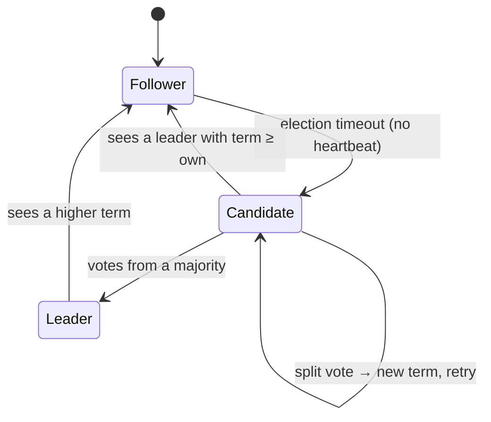
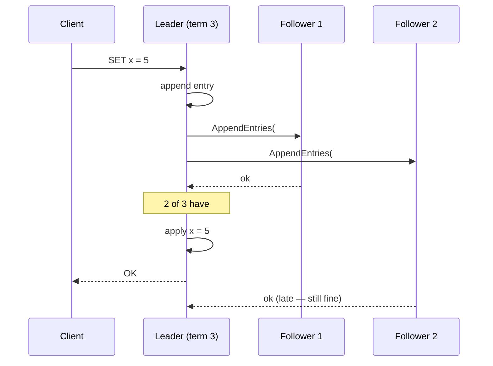
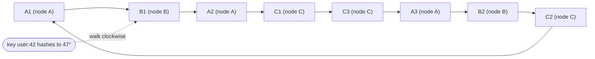
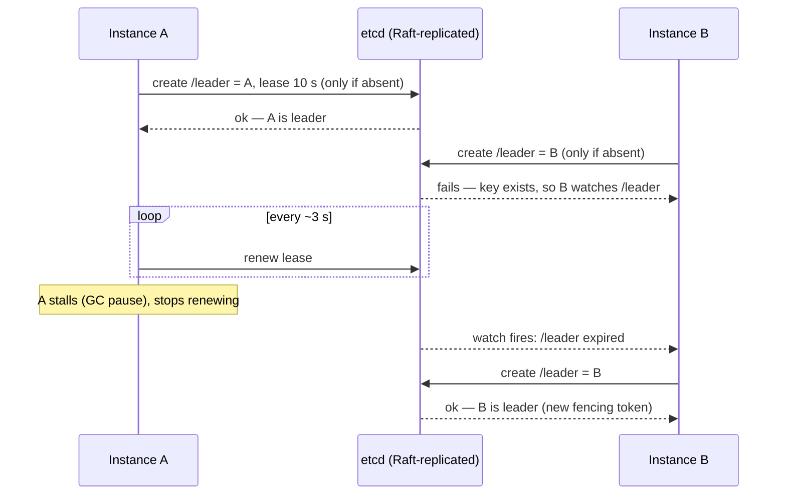
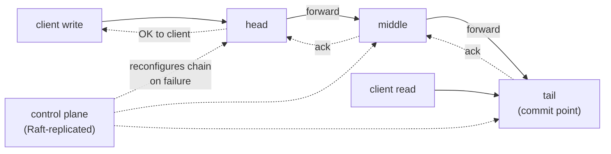
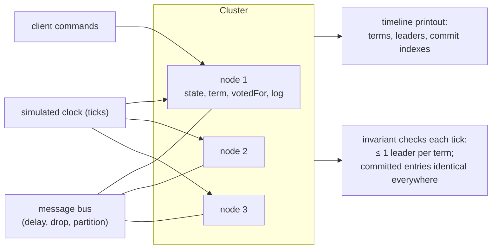

# Chapter 51 — Replication, Sharding, Raft & Paxos

> **Volume 1 — Computer Science Foundations** · [Contents](index.md) · ← [Chapter 50 — CAP, Consistency & Consensus](ch50-cap-consistency-and-consensus.md) · Next → [Chapter 52 — Event Sourcing & CQRS (Distributed View)](ch52-event-sourcing-and-cqrs-distributed-view.md)

---

## Concept

Replication strategies, sharding/partitioning, distributed locks, gossip, leader election, and the Raft/Paxos consensus families.

**In one sentence:** replication keeps copies of the same data on several machines for safety and read scale, sharding splits different data across machines for write scale, and consensus algorithms like Raft make a group of machines agree on one ordered log so that they act like a single, reliable machine.

**Mental model — a class taking notes.** Replication: several students copy the same lecture notes, so losing one notebook is fine. Sharding: each student is responsible for a different chapter, so the work spreads out. Raft: the class elects a note-taker (the leader) who reads each line aloud; a line counts as official once most of the class has written it down; if the note-taker falls asleep, the class elects a new one.

**Replication strategies**

| Strategy | Writes go to | Pros | Cons | Examples |
|----------|-------------|------|------|----------|
| Single leader (primary/replica) | the leader, which streams changes to followers | simple; no write conflicts | the leader is a bottleneck; failover is needed | Postgres, MySQL, MongoDB |
| Multi-leader | any of several leaders (often one per region) | local writes in each region | write conflicts to resolve | multi-region active-active, CouchDB |
| Leaderless | any replica; quorum reads and writes (R + W > N) | highly available | conflicts, read repair, sloppy quorums | Cassandra, DynamoDB, Riak |
| **Sync vs async** | sync: wait for replicas before ACK | sync: no loss on failover / async: fast | sync: slow, blocked by one slow replica / async: data loss on failover | semi-sync: wait for one replica |

**Sharding (partitioning)**

| Scheme | How | Good | Bad |
|--------|-----|------|-----|
| Range | shard by key ranges (A–F, G–M…) | range scans | hot spots (all new timestamps hit one shard) |
| Hash | `hash(key) mod N` | even spread | resharding moves almost everything |
| **Consistent hashing** | keys and nodes on a ring; a key goes to the next node clockwise; virtual nodes | adding a node moves only ~1/N of keys | uneven without virtual nodes |
| Directory / lookup | a service maps key → shard | flexible, supports moves | an extra hop; the directory must be highly available |

**Leader election and distributed locks — use leases, not bare locks.** A process that holds a lock can pause (GC, VM freeze) past its expiry while another process takes the lock → two holders (*split-brain*). Fix: **fencing tokens** — every lock grant carries a monotonically increasing number, and the storage rejects writes with an older token.

**Leader election in practice — borrow consensus, don't build it.** Unless you are writing a database, don't implement Raft yourself. Use a coordination service (etcd, ZooKeeper, Consul) that offers a linearizable **compare-and-swap with a TTL**:

1. Every candidate tries to *create* the key `/leader` with its id and a lease (TTL). The create only succeeds if the key is absent, so exactly one wins.
2. The winner keeps renewing the lease. If it dies or stalls, the lease expires and the key disappears.
3. The others *watch* the key and race to create it again when it disappears.

Even so, **plan for two leaders at once**: a stalled old leader may not yet know its lease expired, and an in-flight request can land after expiry. Protect shared state with fencing tokens or conditional writes ("write only if the version is still 42"), or make the leader's work idempotent so a duplicate does no harm. Two more rules: keep the leader's work small, because it is a throughput bottleneck and a single point of failure with a large blast radius; and when one leader isn't enough, **partition** the work and elect a **leader per partition** (Kafka partition leaders, CockroachDB ranges, Spanner Paxos groups).

**Consensus, seen from the outside** — consensus means every non-faulty process eventually decides, all decide the same value, and that value was actually proposed by someone. Think of it as a **write-once register**: the first value written wins forever, and everyone can read it. A Raft log is just a sequence of such registers, one per log slot.

**Linearizable reads in Raft** — writes are linearizable because they go through the log, but reads need care. A node that *thinks* it is the leader may already have been replaced (it was partitioned or paused), so answering from its local state could return stale data. Options:

| Read path | Consistency | Cost |
|-----------|------------|------|
| Leader confirms it is still leader with a heartbeat round to a majority, then reads (Raft *ReadIndex*) | linearizable | one quorum round trip per read (batched in practice) |
| **Leader lease**: majority promises not to elect anyone else for T seconds; leader serves reads locally during the lease | linearizable *if* clock drift is bounded | cheap; unsafe if clocks misbehave |
| Read from any follower | stale (sequential if you stick to one follower; eventual if you hop) | cheapest; scales reads |

**Chain replication — a different shape than Raft**

Arrange the replicas in a line: **head → middle → … → tail**.

- **Writes** go to the head, which applies and forwards them down the chain. When the **tail** applies a write, it is committed; the acknowledgement travels back up and the head answers the client.
- **Reads** go to the tail only. Every write the tail has seen is committed, so reads are strongly consistent *and* need no quorum round trip.
- **Failures are handled by a separate control plane** (itself replicated with Raft/Paxos), which keeps one agreed view of the chain:
  - head dies → its successor becomes the head; an unacknowledged write simply times out at the client and is retried;
  - tail dies → its predecessor becomes the tail (it already has everything the tail had);
  - a middle node dies → the control plane links its neighbours and has the predecessor re-send the updates the successor is missing.
- A chain of N nodes survives N − 1 failures, so replace failed nodes promptly (a new node joins as the tail after copying its predecessor).

| | Raft | Chain replication |
|---|------|-------------------|
| Write commits when | a majority has it | *every* node has it |
| Linearizable reads | leader must confirm leadership (a quorum round) | tail answers immediately |
| A slow replica | doesn't slow writes (majority suffices) | slows every write |
| A failed replica | writes continue | writes stall until the control plane removes it |
| Failure cases to reason about | many (partial logs, term conflicts) | three: head, middle, tail |

Writes can be **pipelined** down the chain for high throughput. **CRAQ** (Chain Replication with Apportioned Queries) also spreads reads over every node: each node keeps versions of an object marked *dirty* until the tail's acknowledgement flows back (then *clean*). A read of a clean object is answered locally; a read of a dirty one asks the tail which version is committed — still linearizable, but read throughput grows with the chain length. Chain replication shows a recurring idea: a lean **data plane** (the chain, which serves requests) and a consensus-backed **control plane** (membership), which keeps expensive coordination off the request path. Azure Storage replicates its storage extents this way.

**Gossip** — each node periodically tells a few random peers what it knows (membership, heartbeats, versions). Information spreads to all N nodes in O(log N) rounds with no central coordinator. Used for failure detection and membership (Cassandra, Consul/Serf SWIM).

**Raft in five facts**

1. Nodes are **followers**, **candidates**, or the **leader**. Time is divided into numbered **terms**.
2. A follower that hears nothing for a randomized election timeout (150–300 ms) becomes a candidate, increments the term, votes for itself, and asks others for votes.
3. A node grants at most one vote per term, and only to a candidate whose log is at least as up to date as its own. A **majority** of votes makes a leader.
4. The leader appends client commands to its log and replicates them (`AppendEntries`). An entry is **committed** once stored on a majority; then it is applied to the state machine.
5. Safety: at most one leader per term, and a committed entry is never lost — any future leader must have it.

**Paxos vs Raft** — both reach consensus with majorities and survive f failures with 2f + 1 nodes. Paxos (Lamport, 1989) is minimal and general, but famously hard to understand and to turn into a full system (Multi-Paxos). Raft (2014) was designed for understandability, with a strong leader and a clearly specified log, elections, and membership changes. Most new systems use Raft (etcd, Consul, CockroachDB, TiKV); Google's Chubby and Spanner use Paxos.

---

## Prereqs

* [Chapter 50 — CAP, Consistency & Consensus](ch50-cap-consistency-and-consensus.md)

---

## Diagram

**Raft leader election**



**Raft log replication**



```
 logs (index: term command)
 Leader  1:1 x=1  2:1 y=2  3:2 x=3  …  7:3 x=5   commitIndex = 7
 F1      1:1 x=1  2:1 y=2  3:2 x=3  …  7:3 x=5
 F2      1:1 x=1  2:1 y=2  3:2 x=3              (catching up)
```

**A consistent-hash ring with virtual nodes**



Keys hash to a point on the ring and walk clockwise to the first virtual node ("user:42" lands at 47° and is owned by B1, node B). Adding node D takes over only the arcs just before its virtual points, so about 1/4 of keys move, not all of them.

**Leader election with a lease in etcd / ZooKeeper**



**Chain replication: writes flow down, reads hit the tail**



**Gossip spreading a membership change**

```
 round 0:  ● ○ ○ ○ ○ ○ ○ ○        ● = knows "node 9 joined"
 round 1:  ● ● ○ ● ○ ○ ○ ○        each informed node tells 2 random peers
 round 2:  ● ● ● ● ● ○ ● ●
 round 3:  ● ● ● ● ● ● ● ●        ~log₂ N rounds
```

---

## Example

```python
import bisect, hashlib

class HashRing:
    def __init__(self, nodes, vnodes=100):
        self.ring = []                               # sorted list of (hash, node)
        for n in nodes:
            self.add(n, vnodes)

    @staticmethod
    def _h(key: str) -> int:
        return int.from_bytes(hashlib.md5(key.encode()).digest()[:8], "big")

    def add(self, node, vnodes=100):
        for i in range(vnodes):
            bisect.insort(self.ring, (self._h(f"{node}#{i}"), node))

    def get(self, key):
        i = bisect.bisect(self.ring, (self._h(key), "")) % len(self.ring)
        return self.ring[i][1]

ring = HashRing(["A", "B", "C"])
before = {k: ring.get(k) for k in (f"user:{i}" for i in range(10_000))}
ring.add("D")
moved = sum(before[k] != ring.get(k) for k in before)
print(f"{moved / len(before):.0%} of keys moved")      # ≈ 25%, not ≈ 75% as with mod N
```

```python
# Lease + fencing token (sketch). The store refuses stale tokens.
class Store:
    def __init__(self): self.max_token = 0; self.data = {}
    def write(self, key, value, token):
        if token < self.max_token:
            raise PermissionError(f"stale fencing token {token} < {self.max_token}")
        self.max_token = token; self.data[key] = value

# lock service grants: client A → token 33, lease 10 s
# A pauses 15 s (GC); the lease expires; client B → token 34, writes
# A wakes up and writes with token 33 → rejected. No split-brain damage.
```

```go
// etcd election (Go client): campaign for leadership with a lease
session, _ := concurrency.NewSession(cli, concurrency.WithTTL(10))
e := concurrency.NewElection(session, "/service/leader")
e.Campaign(ctx, "node-2")            // blocks until this node is the leader
// the leader key disappears if the session's lease expires → someone else wins
```

---

## Exercises

1. Explain a Raft leader election step by step.

   <details><summary>Solution</summary>(1) Followers receive heartbeats from the term-4 leader, which then crashes. (2) Follower B's randomized timeout fires first; it becomes a candidate for term 5, votes for itself, and sends RequestVote to A and C. (3) A and C haven't voted in term 5, and B's log is at least as up to date, so they grant their votes. (4) B has 3/3 (a majority), becomes leader, and immediately sends heartbeats to stop other elections. If two candidates split the vote, both time out at random and retry in term 6.</details>

2. Design a sharded store with a consistent-hash ring.

   <details><summary>Solution</summary>A ring with ~100–256 virtual nodes per physical node; each key is stored on the next 3 distinct physical nodes clockwise (RF = 3); clients or a routing layer hold the ring map (from a config service like etcd). Adding a node: it takes ranges from its neighbors and streams data before taking traffic. Hot keys: add a random suffix or cache in front. Rebalance with background copy + a switch-over.</details>

3. Why must Raft's election timeouts be randomized?

   <details><summary>Solution</summary>With equal timeouts, all followers would become candidates at the same time, split the vote, and repeat forever. Random timeouts make it likely one node starts first and wins before the others time out.</details>

---

## Mini project

**A Raft leader-election + log-replication simulator (3 nodes).**



**Steps**

1. Implement `RequestVote` and `AppendEntries` (including the log-consistency check on `prevLogIndex/prevLogTerm`) as messages on a bus.
2. Randomized election timeouts in ticks; the leader sends heartbeats every few ticks.
3. Client commands go to the leader; commit on majority; apply to a dict state machine.
4. Fault injection: crash the leader, partition one node, drop 20% of messages, heal.
5. Assert the Raft safety invariants on every tick; print a timeline.

**Done when:** under random crashes and partitions for 10,000 ticks, no invariant ever fails and the cluster keeps committing whenever a majority can talk.

---

## Open source

* [`etcd-io/etcd`](https://github.com/etcd-io/etcd) (Raft) — `etcd-io/raft` is a battle-tested Raft library (`raft.go`: `stepLeader`, `stepCandidate`, `stepFollower`).
* [`hashicorp/raft`](https://github.com/hashicorp/raft) — used by Consul, Nomad, and Vault; readable Go. Read the Raft paper ("In Search of an Understandable Consensus Algorithm") and try the visualization at raft.github.io.

---

## Interview

1. **"Raft vs Paxos?"**
   <details><summary>Answer</summary>Both solve consensus with majority quorums and the same fault tolerance (2f + 1 nodes for f failures). Classic Paxos agrees on single values; practical systems need Multi-Paxos plus many unspecified details. Raft specifies the whole replicated-log system — a strong leader, elections, log matching, membership changes — with understandability as a goal, so it is easier to implement correctly. Performance is similar.</details>

2. **"How do distributed locks avoid split-brain?"**
   <details><summary>Answer</summary>Use a consensus-backed lock service (etcd, ZooKeeper) with <i>leases</i> that expire, so a crashed holder doesn't block forever. Because a paused holder may still believe it holds the lock, also use <i>fencing tokens</i>: each grant gets a strictly increasing number, and every protected resource rejects writes carrying a lower token than it has seen. Redis-based locks without fencing are not safe for correctness.</details>

3. **"Chain replication or Raft?"**
   <details><summary>Answer</summary>Chain replication commits a write once it reaches the tail, and serves linearizable reads straight from the tail with no quorum round — simple failure handling (head, middle or tail) and high read and pipelined write throughput. The cost: every write waits for the slowest node, and writes stall when a node fails until the external control plane removes it. Raft needs only a majority, so a slow or failed replica doesn't block writes, but linearizable reads need the leader to confirm its leadership. CRAQ lets every chain node serve reads, asking the tail only for objects with uncommitted ("dirty") versions.</details>

4. **"How would you elect a leader for a fleet of workers?"**
   <details><summary>Answer</summary>Don't implement consensus: use etcd, ZooKeeper or Consul. Each worker tries to create a <code>/leader</code> key with a lease using compare-and-swap; the winner renews the lease, the rest watch the key and retry when it expires. Because a paused old leader can still act briefly, protect shared resources with fencing tokens or conditional writes, keep the leader's work small, and partition work with one leader per partition if a single leader becomes a bottleneck.</details>

5. **"How do you serve a linearizable read from a Raft cluster?"**
   <details><summary>Answer</summary>The leader can't just read its local state: it might have been deposed without knowing. It either confirms leadership with a heartbeat round to a majority before answering (ReadIndex), or relies on a time-based leader lease, which assumes bounded clock drift. Reading from followers is faster but returns possibly stale data.</details>

---

## Checklist

- [ ] trace Raft election
- [ ] choose a shard key
- [ ] use leases, not bare locks
- [ ] elect a leader with a coordination service and survive two leaders
- [ ] serve linearizable reads from Raft
- [ ] compare chain replication with Raft

---

> [Contents](index.md) · ← [Chapter 50 — CAP, Consistency & Consensus](ch50-cap-consistency-and-consensus.md) · Next → [Chapter 52 — Event Sourcing & CQRS (Distributed View)](ch52-event-sourcing-and-cqrs-distributed-view.md)
