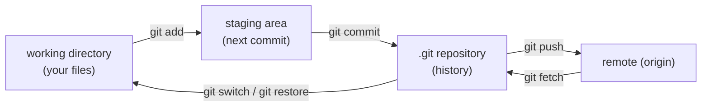
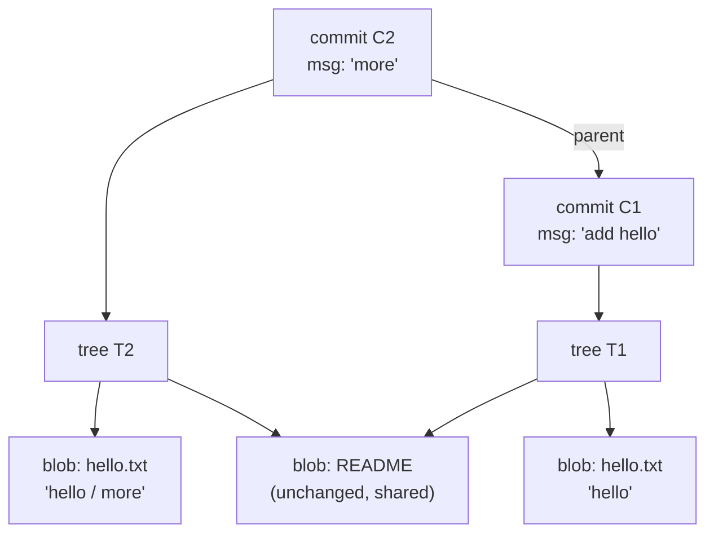
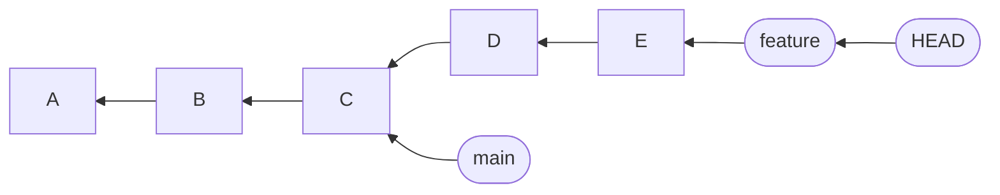
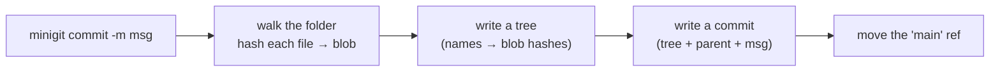

# Chapter 1 — Version Control & Git Fundamentals

> **Volume 2 — Software Engineering** · [Contents](index.md) · Next → [Chapter 2 — Professional Git Workflow](ch02-professional-git-workflow.md)

---

## Concept

What version control is and why every team needs it, why Git won, and how Git works inside: snapshots, the object database, the three areas, branches as pointers, and remotes.

**In one sentence:** version control is a database of every saved state of your project, so you can go back, compare, work in parallel, and know who changed what and why. Git is the version control system that stores each state as a full snapshot and links the snapshots into a history.

**Mental model — a photo album with labels.** Each commit is a photo of the whole project at one moment. Each photo points to the one before it. A branch is a sticky label on one photo. `HEAD` is your finger on the label you are working from. Moving a label is cheap; the photos never change.

### Layer 1 — What problem does version control solve?

Without it, people copy folders: `report_final`, `report_final_v2`, `report_REAL_final`. This breaks as soon as the work is shared.

| Without version control | With version control |
|-------------------------|----------------------|
| No safe way to undo a bad change | Go back to any saved state |
| "Who broke this, and when?" is a guess | Every change has an author, a time, and a message |
| Two people edit the same file → one overwrites the other | Changes are merged; real clashes are shown as conflicts |
| Trying an idea risks the working code | A branch lets you try it on the side |
| No record of why the code looks this way | The history is the record |
| A release cannot be rebuilt exactly | A tag names the exact state that shipped |

**Why it matters beyond code:** CI/CD builds from commits, code review reviews commits, and incident response asks "which commit broke it?". Almost every chapter in this volume assumes a history exists.

### Layer 2 — Kinds of version control

| Kind | Idea | Examples | Weakness |
|------|------|----------|----------|
| **Local** | A history on one machine | RCS, "copy the folder" | No sharing; one disk failure loses all |
| **Centralized (CVCS)** | One server holds the history; you check files out | Subversion (SVN), Perforce | The server is a single point of failure; most actions need the network |
| **Distributed (DVCS)** | Everyone has the **full history** locally; servers are just peers | **Git**, Mercurial | More concepts to learn |

### Layer 3 — Why Git?

* **Fast and local.** Commit, diff, log, and branch need no network.
* **Cheap branching.** A branch is a 41-byte file, so you branch for every task.
* **Safe by design.** Every object is named by a hash of its content; damage and tampering are detectable. Commits are never changed in place.
* **Distributed.** Every clone is a full backup. You can work offline.
* **Standard.** GitHub, GitLab, and Bitbucket, every CI system, and almost every tool speak Git. Built in 2005 for the Linux kernel, it scales to huge repositories.

### Layer 4 — Git stores snapshots, not differences

Many older tools store a base file plus a list of changes (deltas). Git stores the **whole tree** at each commit. Unchanged files are not copied again; the new commit points at the same stored object. (Git packs objects with deltas later for disk space, but that is a storage detail, not the model.)

### Layer 5 — The object database

Everything lives in the hidden `.git` folder. It is a **key-value store**: the key is the SHA-1 (a 40-character hash) of the content, the value is the content. Git has four object types:

| Object | Holds | Analogy |
|--------|-------|---------|
| **blob** | the bytes of one file (no name) | the file's content |
| **tree** | a list of `mode, type, hash, name` — a folder | a directory listing |
| **commit** | a pointer to one tree + parent commit(s) + author + message | a labelled photo |
| **tag** (annotated) | a name + message pointing at one object | a permanent sticker |

Because the key is a hash of the content, **same content → same hash → stored once**. Change one byte and the hash changes, so history cannot be edited silently. A commit's hash covers its tree, parent, author, and message, so each commit's hash also vouches for **all history behind it**.

> SHA-1 is being replaced by SHA-256 in newer Git (`git init --object-format=sha256`). The model does not change.

### Layer 6 — The three areas

| Area | What it is | Moved by |
|------|------------|----------|
| **Working directory** | the files you edit | your editor |
| **Staging area** (index) | the *next* commit, being prepared | `git add` |
| **Repository** (`.git`) | all committed history | `git commit` |

```text
 working dir ──git add──▶ staging area ──git commit──▶ repository
      ◀────────────────── git restore / git switch ◀──────────────
```

The staging area lets you build a commit from part of your changes (`git add -p`), so each commit holds one idea.

A file is in one of these states: **untracked** (new, unknown to Git), **modified** (changed since the last commit), **staged** (queued for the next commit), or **committed**.

### Layer 7 — History is a graph; branches are pointers

* Each commit stores its **parent**. A merge commit has **two parents**. So history is a **directed acyclic graph (DAG)**: arrows point back in time, and there are no loops.
* A **branch** is a file holding one commit hash (`.git/refs/heads/main`). Making a commit moves the current branch's label forward. Creating a branch just writes a new 41-byte file.
* **`HEAD`** says where you are. Usually it holds `ref: refs/heads/main` — "I am on `main`". If it holds a raw hash instead, you are in **detached HEAD**: commits you make have no branch label, and can be lost unless you create one.
* A **tag** is a label that never moves.
* **Merge** joins two lines of history. If one branch is simply behind the other, Git just moves the label (a **fast-forward**). If both moved, Git makes a merge commit. If both changed the same lines, you get a **conflict** to resolve by hand.

### Layer 8 — Remotes and sharing

* A **remote** is another copy of the repository (`origin` is the usual name for the one you cloned from).
* `git fetch` downloads new commits and moves your **remote-tracking branches** (`origin/main`). It never touches your work.
* `git pull` = `fetch` + merge (or rebase). `git push` sends your commits and moves the remote's branch label.
* A push is refused if it would lose commits on the remote (not a fast-forward). That is the safety rule that protects other people's work.

### Layer 9 — Under the hood, briefly

* **Packfiles:** Git periodically compresses loose objects into packs, storing similar objects as deltas. This is why a repo with long history is still small.
* **Reachability and garbage collection:** an object is kept while some branch, tag, or `reflog` entry can reach it. Unreachable objects are deleted after a grace period (`git gc`).
* **Reflog:** a local log of where `HEAD` and each branch have been. It is the safety net behind most "I lost my commit" recoveries (see [Chapter 2](ch02-professional-git-workflow.md)).
* **`.gitignore`** lists files Git should not track (build output, secrets, `node_modules`). Never commit secrets: once committed, they live in history even after you delete the file.

---

## Prereqs

* [Vol 1 Ch 16 — Linux: Filesystem, Shell, Bash, Permissions & Users](../volume-1-cs-foundations/ch16-linux-filesystem-shell-bash-permissions-users-and.md)

Go deeper on branching, rebase, tags, hooks, and internals in [Vol 1 Ch 19](../volume-1-cs-foundations/ch19-git-branching-merge-rebase-and-cherry-pick.md) and [Vol 1 Ch 20](../volume-1-cs-foundations/ch20-git-tags-stash-hooks-and-internals.md).

---

## Diagram

**The three areas, and what each command moves**



**Objects behind one commit**



**Branches are labels on commits**



`HEAD` points at `feature`, which points at commit `E`; `main` stays at `C`. Each commit points back to its parent.

---

## Example

```bash
git init demo && cd demo                  # creates the hidden .git folder
echo "hello" > hello.txt

git status -s                             # ?? hello.txt   (untracked)
git hash-object hello.txt                 # ce013625030ba8dba906f756967f9e9ca394464a
                                          # the same content gives the same hash on any machine

git add hello.txt                         # staged
git commit -m "add hello"                 # committed

git log --oneline                         # one line per commit
git cat-file -t HEAD                      # commit
git cat-file -p HEAD                      # tree aaa96ced...  (+ author, message)
git cat-file -p 'HEAD^{tree}'             # 100644 blob ce013625...  hello.txt
git cat-file -p ce013625                  # hello

cat .git/HEAD                             # ref: refs/heads/main
cat .git/refs/heads/main                  # the hash of the latest commit

git switch -c feature                     # a new branch = one new 41-byte file
echo more >> hello.txt
git commit -am "more"
git log --oneline --graph --all           # see both labels and the history

git diff HEAD~1                           # what the last commit changed
git restore hello.txt                     # throw away unstaged edits to a file
```

<div class="fig">
<svg xmlns="http://www.w3.org/2000/svg" viewBox="0 0 760 202" role="img" aria-label="Contents of the .git directory" style="width:100%;max-width:760px;height:auto;font-family:inherit"><defs><marker id="ar" viewBox="0 0 10 10" refX="8" refY="5" markerWidth="7" markerHeight="7" orient="auto-start-reverse"><path d="M0 0L10 5L0 10z" fill="context-stroke"/></marker></defs><text x="14" y="20" font-size="13" font-family="ui-monospace,Menlo,Consolas,monospace" fill="var(--primary)" font-weight="600">📁 .git/</text><line x1="24" y1="32" x2="24" y2="44" stroke="var(--border)" stroke-width="1.4"/><line x1="24" y1="44" x2="34" y2="44" stroke="var(--border)" stroke-width="1.4"/><text x="38" y="46" font-size="13" font-family="ui-monospace,Menlo,Consolas,monospace" fill="var(--text)" font-weight="400">📄 HEAD</text><text x="250" y="46" font-size="12.5" text-anchor="start" fill="var(--text-muted)">← which branch you are on</text><line x1="24" y1="58" x2="24" y2="70" stroke="var(--border)" stroke-width="1.4"/><line x1="24" y1="70" x2="34" y2="70" stroke="var(--border)" stroke-width="1.4"/><text x="38" y="72" font-size="13" font-family="ui-monospace,Menlo,Consolas,monospace" fill="var(--text)" font-weight="400">📄 config</text><text x="250" y="72" font-size="12.5" text-anchor="start" fill="var(--text-muted)">← settings for this repo (remotes, user)</text><line x1="24" y1="84" x2="24" y2="96" stroke="var(--border)" stroke-width="1.4"/><line x1="24" y1="96" x2="34" y2="96" stroke="var(--border)" stroke-width="1.4"/><text x="38" y="98" font-size="13" font-family="ui-monospace,Menlo,Consolas,monospace" fill="var(--text)" font-weight="400">📄 index</text><text x="250" y="98" font-size="12.5" text-anchor="start" fill="var(--text-muted)">← the staging area</text><line x1="24" y1="110" x2="24" y2="122" stroke="var(--border)" stroke-width="1.4"/><line x1="24" y1="122" x2="34" y2="122" stroke="var(--border)" stroke-width="1.4"/><text x="38" y="124" font-size="13" font-family="ui-monospace,Menlo,Consolas,monospace" fill="var(--primary)" font-weight="600">📁 objects/</text><text x="250" y="124" font-size="12.5" text-anchor="start" fill="var(--text-muted)">← blobs, trees, commits (the key-value store)</text><line x1="24" y1="136" x2="24" y2="148" stroke="var(--border)" stroke-width="1.4"/><line x1="24" y1="148" x2="34" y2="148" stroke="var(--border)" stroke-width="1.4"/><text x="38" y="150" font-size="13" font-family="ui-monospace,Menlo,Consolas,monospace" fill="var(--primary)" font-weight="600">📁 refs/heads/</text><text x="250" y="150" font-size="12.5" text-anchor="start" fill="var(--text-muted)">← one file per branch</text><line x1="24" y1="162" x2="24" y2="174" stroke="var(--border)" stroke-width="1.4"/><line x1="24" y1="174" x2="34" y2="174" stroke="var(--border)" stroke-width="1.4"/><text x="38" y="176" font-size="13" font-family="ui-monospace,Menlo,Consolas,monospace" fill="var(--primary)" font-weight="600">📁 refs/tags/</text><text x="250" y="176" font-size="12.5" text-anchor="start" fill="var(--text-muted)">← one file per tag</text></svg>
</div>

---

## Exercises

1. Show that Git names content by its hash.

   <details><summary>Solution</summary>Create two files with identical text in different folders and run <code>git hash-object</code> on both: the hashes match. Add one character to one file and run it again: the hash changes completely. Run <code>git add</code> on both and look in <code>.git/objects</code>: there is one object for the shared content, not two.</details>

2. Find the three objects behind your first commit.

   <details><summary>Solution</summary>Run <code>git cat-file -p HEAD</code> to see the <code>tree</code> hash, then <code>git cat-file -p &lt;tree-hash&gt;</code> to see the blob hashes and file names, then <code>git cat-file -p &lt;blob-hash&gt;</code> to see the file text. That is commit → tree → blob.</details>

3. You commit on a detached HEAD, then switch to <code>main</code>. The commit seems lost. How do you get it back?

   <details><summary>Solution</summary>Git printed the commit's short hash when you left, and <code>git reflog</code> lists it too. Run <code>git branch rescue &lt;hash&gt;</code> to put a label on it. A commit with no branch, tag, or reflog entry reaching it is only deleted after the garbage-collection grace period.</details>

4. Explain why `git fetch` is safer than `git pull`.

   <details><summary>Solution</summary><code>fetch</code> only downloads commits and moves <code>origin/*</code> labels; your branches and files stay as they are, so you can look first with <code>git log main..origin/main</code>. <code>pull</code> also merges or rebases straight away, which can start a conflict at a bad moment.</details>

---

## Mini project

**Build a tiny version control system: `minigit` (blobs, trees, commits, log).**



**Steps**

1. `minigit init` creates `.minigit/objects` and a `HEAD` file.
2. `hash_object(bytes)` returns the SHA-1 of `"blob <size>\0" + bytes` and stores the content zlib-compressed at `objects/ab/cdef...`.
3. `write_tree(dir)` stores a blob for each file and a tree for each folder, and returns the tree hash.
4. `commit(msg)` stores `tree`, `parent`, and `message`, then updates the branch file.
5. `log` walks from `HEAD` back through parents and prints hash and message.
6. Check your work: `git cat-file -p <your-hash>` should read your objects if you copy them into a real `.git/objects`.

**Done when:** committing the same folder twice stores no new blobs, and changing one file stores exactly one new blob, one new tree per changed folder, and one commit.

---

## Open source

* [`git/git`](https://github.com/git/git) — `Documentation/gitcore-tutorial.txt` and `Documentation/technical/` (object formats, packfiles).
* [`libgit2/libgit2`](https://github.com/libgit2/libgit2) — a small, readable C implementation of the object database and refs.
* [`go-git/go-git`](https://github.com/go-git/go-git) — Git written in pure Go; good for reading how objects are stored.

---

## Interview

1. **"What is version control, and why use it?"**
   <details><summary>Answer</summary>A system that records every saved state of a project so you can undo, compare, branch, merge parallel work, and trace who changed what and why. It replaces copying folders and makes releases, reviews, and CI reproducible.</details>

2. **"Why Git, and how is it different from SVN?"**
   <details><summary>Answer</summary>Git is distributed: each clone has the full history, so most work is local, fast, and offline, and every clone is a backup. SVN is centralized: one server holds the history and most actions need it. Git also makes branching almost free, and names every object by a content hash for integrity.</details>

3. **"What is a Git branch?"**
   <details><summary>Answer</summary>A movable pointer (a file with one commit hash) to a commit. Committing moves the current branch's pointer forward. It is not a copy of the files.</details>

4. **"What are the working directory, staging area, and repository?"**
   <details><summary>Answer</summary>Your files, the prepared next commit, and the stored history. <code>git add</code> moves changes from the first to the second; <code>git commit</code> moves them from the second to the third.</details>

5. **"What does a commit actually contain?"**
   <details><summary>Answer</summary>A pointer to a tree (a full snapshot of the project), the parent commit hash(es), author, committer, timestamps, and a message. Its hash is computed over all of that, so it vouches for the whole history behind it.</details>

---

## Checklist

- [ ] explain version control without naming a tool
- [ ] explain blob, tree, commit and how a branch points at a commit
- [ ] know what `git add` and `git commit` each move
- [ ] never commit secrets

---

> [Contents](index.md) · Next → [Chapter 2 — Professional Git Workflow](ch02-professional-git-workflow.md)
