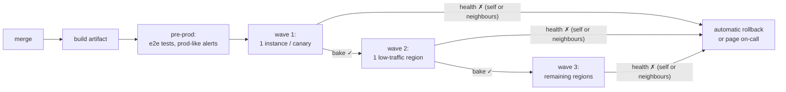
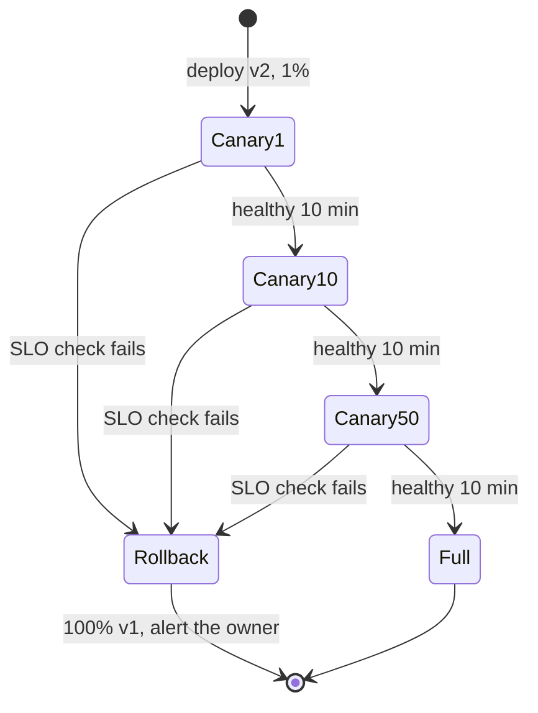
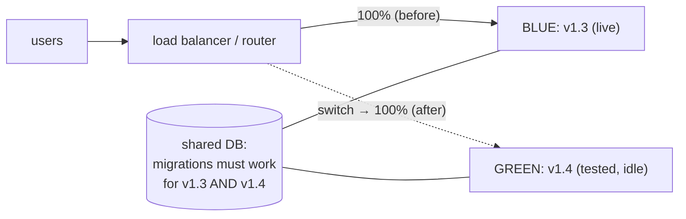
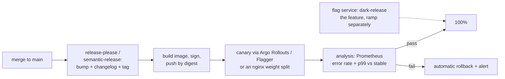

# Chapter 7 — Packaging & Release Engineering

> **Volume 2 — Software Engineering** · [Contents](index.md) · ← [Chapter 6 — CI/CD](ch06-ci-cd.md) · Next → [Chapter 8 — Code Reviews](ch08-code-reviews.md)

---

## Concept

Versioning, changelogs, artifacts, feature flags, and progressive delivery (blue-green, canary, rollbacks).

**In one sentence:** release engineering turns a green commit into a versioned, traceable artifact and gets it in front of users gradually — separating *deploying* code from *releasing* features with flags, and always keeping a fast way back.

**Mental model — a new recipe in a restaurant chain.** You package the recipe with a version number and a list of what changed (artifact + changelog). You try it in one branch first (canary), watching complaints. If fine, you roll out to all branches; if not, you go back to the old recipe tonight (rollback). A feature flag is a laminated card at each counter saying "offer the new dish: yes/no" — you can flip it without re-printing menus.

**Artifacts**

| Ecosystem | Build | Artifact | Registry |
|-----------|-------|----------|----------|
| Python | `uv build` / `poetry build` | wheel (`.whl`) + sdist | PyPI, a private index (devpi, Artifactory) |
| Rust | `cargo package` / `cargo build --release` | `.crate` / a binary | crates.io |
| Node | `npm pack` | tarball | npm |
| Services | `docker build` | OCI image, addressed by **digest** | GHCR, ECR, Artifact Registry |

Good artifacts are **immutable** (a version is never overwritten), **reproducible** (same source → same bytes), **traceable** (version → commit SHA), and **verifiable** (signature + SBOM, e.g. `cosign`, SLSA provenance).

**Versioning** — SemVer for libraries ([Vol 1 Ch 21](../volume-1-cs-foundations/ch21-build-systems-and-package-management.md)); for services, calendar versions or build numbers plus the git SHA are common. Automate the bump from Conventional Commits ([Ch 2](ch02-professional-git-workflow.md)) and generate the changelog.

**Deploy ≠ release**

| | Deploy | Release |
|-|--------|---------|
| Means | new code is running on servers | users can see or use the feature |
| Controlled by | the pipeline | **feature flags** / config |
| Undo | rollback (minutes) | flip the flag (seconds) |

**Feature flags**

| Kind | Life | Example |
|------|------|---------|
| Release toggle | days–weeks, then **delete** | hide the new checkout until it's ready |
| Experiment (A/B) | weeks | 50% see variant B |
| Ops / **kill switch** | long-lived | turn off recommendations if the service struggles |
| Permission | long-lived | premium-only features |

Flag hygiene: an owner and expiry per flag, default to the safe value when the flag service is down, test both paths, and remove dead flags (they are technical debt).

**Progressive delivery strategies**

| Strategy | How | Rollback | Cost | Risk |
|----------|-----|----------|------|------|
| Recreate | stop old, start new | redeploy old | cheap | downtime |
| Rolling | replace instances a few at a time | roll back the same way | cheap | mixed versions during the rollout |
| **Blue-green** | a full parallel environment; switch traffic at once | switch back instantly | 2× capacity during a release | all users hit the new version at once |
| **Canary** | send 1% → 10% → 50% → 100% of traffic to the new version while comparing metrics | shift traffic back | small extra | tiny blast radius; needs good metrics |
| Shadow / dark launch | copy real traffic to the new version; discard its responses | n/a | extra capacity | none for users; watch side effects |

**Rollback readiness** — keep the previous artifact; make DB migrations backward compatible (**expand → migrate → contract**, so old and new code both work mid-rollout); automate the trigger (error rate or latency above the baseline → roll back); practice it.

**A safe production rollout, step by step**

Releases are one of the biggest sources of outages, so the pipeline — not a person watching dashboards — should carry every change (code, config, static assets, infrastructure-as-code) from merge to production:

1. **Review and build.** Before approving, ask: are there tests at the right levels? Metrics, logs and traces for the new path? Could it break production — a backward-incompatible API or schema change, a service limit? Can it be rolled back safely? Then build one artifact.
2. **Pre-production.** Deploy to environments that judge health with the *same* signals and alerts as production (otherwise pre-prod becomes a second-class check that catches nothing), run end-to-end tests, and optionally mirror a slice of production traffic.
3. **Production in waves** — one instance or canary, then one low-traffic region, then larger groups of regions in parallel as confidence grows. Keep spare capacity: instances being replaced aren't serving.
4. **Bake time** after each wave: wait long enough for slow-burning problems to show (memory growth, peak-hour latency, a nightly job), or until enough requests have hit each endpoint. Shorten the bake in later waves once early ones are clean.
5. **Watch neighbours too:** a release can break its upstream callers or overload its downstream dependencies, so the gate checks their health as well as the service's own.
6. **Act on a bad signal:** roll back automatically, or page the on-call engineer to choose: retry the step (the trouble was something else), roll back, or **roll forward** with a hotfix. Rolling back is safer than rolling forward, so every change must be backward compatible enough to be rolled back.



**Breaking changes in three safe steps (prepare → activate → cleanup).** Suppose a producer must change its message format in a way the consumer can't read:

| Step | Change | Safe to roll back? |
|------|--------|--------------------|
| **Prepare** | consumer learns to read *both* the old and the new format | yes — the new reader is just unused |
| **Activate** | producer starts writing the new format | yes — the consumer still reads the old one |
| **Cleanup** | consumer drops support for the old format, once activate won't be rolled back | yes, after the activate step has baked |

The same idea is *expand → migrate → contract* for database schemas. Changing a serialization format used for storage or messages is the classic way to make a release impossible to roll back, so add an automated **upgrade → downgrade test** in pre-production: deploy the new version, write data, roll back, and check that the old version still reads everything.

**Configuration you can change without a deploy** — settings live outside the artifact in a configuration store (AWS AppConfig, Azure App Configuration, Consul), and secrets in a secrets manager, never in code. Values injected as environment variables at deploy time need a redeploy to change; for operators to act fast, the application should **re-read configuration at runtime** and rebuild whatever depends on it. That is what turns a feature flag into an operations tool: release dark, enable for 1% of users, run A/B tests, and switch off instantly in an incident — and config changes deserve the same review, validation and gradual rollout as code.

---

## Prereqs

* [Chapter 6 — CI/CD](ch06-ci-cd.md)

---

## Diagram

**A canary ramp: 1% → 10% → 100% with a rollback trigger**

<div class="fig">
<svg xmlns="http://www.w3.org/2000/svg" viewBox="0 0 780 340" role="img" aria-label="Canary rollout: traffic to v2 steps from 1 to 10 to 50 to 100 percent, each step held 10 minutes and checked against v1, with instant rollback on failure" style="width:100%;max-width:780px;height:auto;font-family:inherit"><defs><marker id="ar" viewBox="0 0 10 10" refX="8" refY="5" markerWidth="7" markerHeight="7" orient="auto-start-reverse"><path d="M0 0L10 5L0 10z" fill="context-stroke"/></marker></defs><line x1="90" y1="50" x2="90" y2="250" stroke="var(--text-muted)" stroke-width="1.6"/><line x1="90" y1="250" x2="740" y2="250" stroke="var(--text-muted)" stroke-width="1.6" marker-end="url(#ar)"/><text x="82" y="46" font-size="12" text-anchor="end" fill="var(--text-muted)">traffic to v2</text><text x="82" y="254.0" font-size="12" text-anchor="end" fill="var(--text-muted)">0%</text><line x1="86" y1="250.0" x2="90" y2="250.0" stroke="var(--text-muted)" stroke-width="1"/><text x="82" y="235.95" font-size="12" text-anchor="end" fill="var(--text-muted)">1%</text><line x1="86" y1="231.95" x2="90" y2="231.95" stroke="var(--text-muted)" stroke-width="1"/><text x="82" y="196.92088823396074" font-size="12" text-anchor="end" fill="var(--text-muted)">10%</text><line x1="86" y1="192.92088823396074" x2="90" y2="192.92088823396074" stroke="var(--text-muted)" stroke-width="1"/><text x="82" y="126.36722599582818" font-size="12" text-anchor="end" fill="var(--text-muted)">50%</text><line x1="86" y1="122.36722599582818" x2="90" y2="122.36722599582818" stroke="var(--text-muted)" stroke-width="1"/><text x="82" y="64.0" font-size="12" text-anchor="end" fill="var(--text-muted)">100%</text><line x1="86" y1="60.0" x2="90" y2="60.0" stroke="var(--text-muted)" stroke-width="1"/><rect x="100" y="231.95" width="124" height="18.05" rx="2" fill="var(--success)" fill-opacity=".4" stroke="var(--success)" stroke-width="1.6"/><rect x="230" y="192.92088823396074" width="124" height="57.07911176603925" rx="2" fill="var(--success)" fill-opacity=".4" stroke="var(--success)" stroke-width="1.6"/><rect x="360" y="122.36722599582818" width="124" height="127.63277400417182" rx="2" fill="var(--success)" fill-opacity=".4" stroke="var(--success)" stroke-width="1.6"/><rect x="490" y="60" width="124" height="190" rx="2" fill="var(--primary)" fill-opacity=".4" stroke="var(--primary)" stroke-width="1.6"/><text x="555.0" y="52" font-size="13" text-anchor="middle" fill="var(--primary)" font-weight="700">promote</text><text x="740" y="272" font-size="12" text-anchor="end" fill="var(--text-muted)">time</text><text x="20" y="288" font-size="12.5" text-anchor="start" fill="var(--text)" font-weight="600">each step: hold 10 min, compare v2 vs v1:</text><text x="20" y="306" font-size="12.5" text-anchor="start" fill="var(--text-muted)">error rate ≤ baseline + 0.5 pp?   p99 ≤ baseline × 1.1?</text><text x="20" y="326" font-size="12.5" text-anchor="start" fill="var(--danger)" font-weight="700">any check fails → ROLLBACK: 0% to v2 in seconds</text></svg>
</div>



**Blue-green**



**Expand → migrate → contract (a safe schema change for renaming a column)**

| Release | Phase | What happens |
|---|---|---|
| 1 | **expand** | add new column `full_name`; write to both; read old |
| | backfill | copy `name` → `full_name` for existing rows |
| 2 | **migrate** | read `full_name`; still write both |
| 3 | **contract** | stop writing `name`; later drop it |

At every step the previous release still works, so **rollback is always safe**.

---

## Example

```bash
uv build                                           # dist/mylib-1.4.0-py3-none-any.whl
uv publish --publish-url http://localhost:3141/root/dev/   # a local devpi index
cargo package && cargo publish --dry-run
docker build -t ghcr.io/acme/api:1.4.0 . && docker push ghcr.io/acme/api:1.4.0
cosign sign ghcr.io/acme/api@sha256:3f9a…          # sign the digest, not the tag
```

```python
# A feature flag with a kill switch and a safe default (OpenFeature-style API)
from openfeature import api
client = api.get_client()

def checkout(cart, user):
    if client.get_boolean_value("new-checkout", False, evaluation_context_for(user)):
        return new_checkout(cart)          # released gradually: 5% → 50% → 100%
    return old_checkout(cart)

def recommendations(user):
    if not client.get_boolean_value("recs-enabled", True):   # kill switch for ops
        return []                           # graceful degradation
    return recs_service.for_user(user)
```

```yaml
# Argo Rollouts canary (Kubernetes) with automatic analysis
apiVersion: argoproj.io/v1alpha1
kind: Rollout
metadata: { name: api }
spec:
  strategy:
    canary:
      steps:
        - setWeight: 1
        - pause: { duration: 10m }
        - analysis: { templates: [{ templateName: error-rate }] }   # fails → automatic abort
        - setWeight: 10
        - pause: { duration: 10m }
        - setWeight: 50
        - pause: { duration: 10m }
```

---

## Exercises

1. Package a library and publish it to a local index.

   <details><summary>Solution</summary>Run a local devpi (or <code>pypiserver</code>), build with <code>uv build</code>, publish with <code>uv publish --publish-url …</code>, then in a fresh venv <code>pip install --index-url … mylib==1.4.0</code>. Try to re-publish 1.4.0 with a change and see it refused — versions must be immutable.</details>

2. Implement a feature flag with a kill switch.

   <details><summary>Solution</summary>A tiny flag store (a JSON file or Redis) read with a short cache; <code>is_enabled(name, user)</code> with percentage rollout via <code>hash(user_id + flag) % 100 &lt; pct</code> (sticky per user); a default when the store is unreachable; a kill-switch flag defaulting to "on" that ops can flip to disable an expensive feature. Test both code paths.</details>

3. A canary at 10% shows the same error rate but p99 latency up 40%. Roll back or not?

   <details><summary>Solution</summary>Roll back, or at least stop the ramp. Latency is a user-facing signal and a regression that large will likely burn the SLO at 100%. Investigate with traces from the canary pods, fix, and ramp again. Define this as an automatic analysis rule so the decision isn't made under pressure.</details>

---

## Mini project

**A release pipeline with version bump, artifact, canary deploy, and rollback.**



**Steps**

1. Automate the version and changelog from Conventional Commits.
2. Build an immutable, signed image; record digest → version → commit.
3. Canary on kind with Argo Rollouts (or two nginx upstreams with weights you script).
4. Analysis queries compare canary vs stable; abort automatically on failure.
5. Put one feature behind a flag; deploy it dark, then ramp the flag separately from the deploy.
6. Release a deliberately broken version (it returns 500 for 20% of requests) and show the automatic rollback.

**Done when:** a good release reaches 100% hands-off, a bad release is rolled back automatically within one analysis step, and you can turn the flagged feature off in seconds.

---

## Open source

* [`open-feature/open-feature`](https://github.com/open-feature/open-feature) — a vendor-neutral feature-flag API and SDKs (providers for flagd, LaunchDarkly, Unleash, and others).
* [`semver/semver`](https://github.com/semver/semver) — the Semantic Versioning spec. See also `argoproj/argo-rollouts` and `fluxcd/flagger` for canaries on Kubernetes.

---

## Interview

1. **"Blue-green vs canary?"**
   <details><summary>Answer</summary>Blue-green runs two full environments and switches all traffic at once: rollback is instant, and the new version can be fully tested before the switch, but capacity doubles during releases and every user hits the new version together. Canary shifts a small, growing share of traffic while comparing metrics against the stable version: a tiny blast radius and data-driven promotion, but it needs good metrics and routing, and both versions run side by side (so compatibility matters). Many teams use both: a canary inside a blue-green switch.</details>

2. **"Why feature flags for releases?"**
   <details><summary>Answer</summary>They decouple deploying from releasing. Code can merge and deploy continuously while hidden (trunk-based development). Features can be rolled out gradually, per segment, or as experiments. Kill switches give instant mitigation without a deploy. Risky changes can be tested in production with internal users first. The costs are flag debt and combinatorial paths, so flags need owners, expiries, and cleanup.</details>

3. **"How would you roll out a change that alters a message format?"**
   <details><summary>Answer</summary>In three individually reversible releases. Prepare: consumers accept both formats. Activate: producers emit the new format. Cleanup: consumers drop the old format, only after the activate step has baked and won't be rolled back. Verify reversibility with an upgrade-then-downgrade test in pre-production, and roll each step out in waves with bake time and automatic rollback.</details>

4. **"What is bake time and why does it matter?"**
   <details><summary>Answer</summary>The wait after each rollout wave before moving on, so problems that only appear over time — memory leaks, peak-hour load, daily jobs, rarely used endpoints — can show up while the blast radius is still small. It can be a fixed duration or gated on enough traffic having hit each endpoint, and it can shrink in later waves as confidence builds.</details>

---

## Checklist

- [ ] automate versioning
- [ ] ship behind flags
- [ ] always be able to roll back
- [ ] roll out in waves with bake time and automatic rollback
- [ ] split breaking changes into prepare / activate / cleanup

---

> [Contents](index.md) · ← [Chapter 6 — CI/CD](ch06-ci-cd.md) · Next → [Chapter 8 — Code Reviews](ch08-code-reviews.md)
