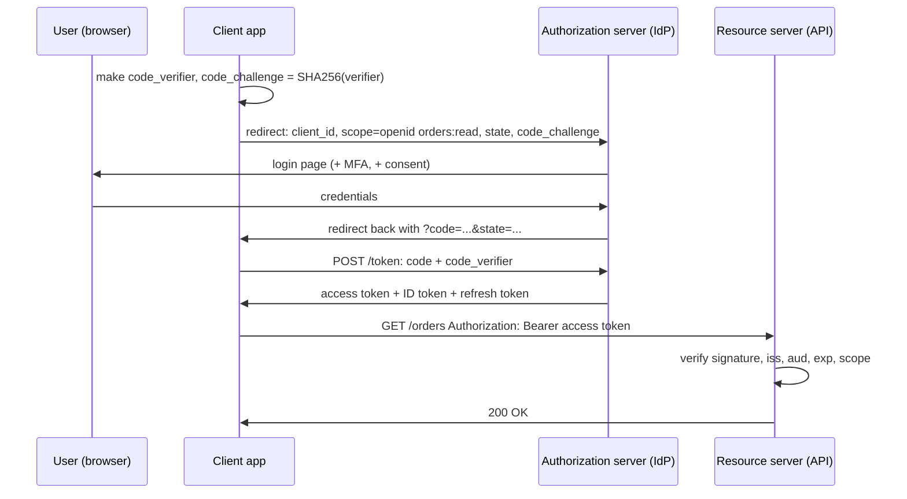
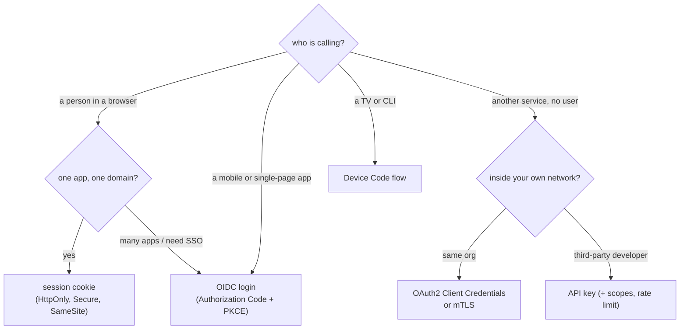
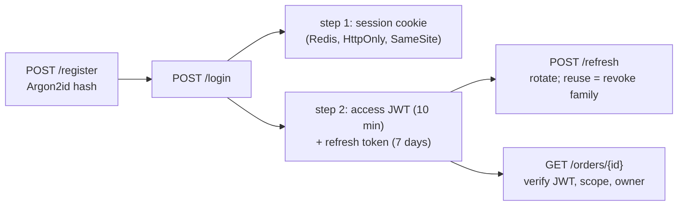

# Chapter 12 — Authentication & Authorization

> **Volume 2 — Software Engineering** · [Contents](index.md) · ← [Chapter 11 — Security & Threat Modeling](ch11-security-and-threat-modeling.md) · Next → [Chapter 13 — Licensing & OSS Compliance](ch13-licensing-and-oss-compliance.md)

---

## Concept

How a system learns **who you are** (authentication) and decides **what you may do** (authorization): passwords, Basic and Digest, API keys, sessions, JWTs, access and refresh tokens, OAuth2, OpenID Connect, SSO, SAML, and access-control models.

**In one sentence:** authentication proves identity ("you are Priya"); authorization decides permission ("Priya may read this invoice"); every request to a protected system needs both, in that order.

**Mental model — a hotel.** At the front desk you show your passport (**authentication**) and get a key card. The card only opens your room and the gym (**authorization**). The card is a **token**: the doors do not call the desk each time; they just check the card. A lost card can be cancelled, or it expires on its own. Staying at a partner hotel with the same loyalty account is **SSO**.

### 1. What is authentication?

| Term | Question it answers | Example |
|------|---------------------|---------|
| **Identification** | Who do you claim to be? | a username |
| **Authentication (authN)** | Can you prove it? | a password, a code, a passkey |
| **Authorization (authZ)** | What may you do? | "admins can delete" |

**Factors** (use more than one for MFA): something you **know** (password), something you **have** (phone, hardware key), something you **are** (fingerprint). Passkeys (WebAuthn) replace the password with a key pair on your device; the private key never leaves it, and there is nothing to phish.

**Status codes:** `401 Unauthorized` really means "not authenticated" (missing or bad credentials). `403 Forbidden` means "authenticated, but not allowed".

**Storing passwords:** never store the password or a fast hash. Store a **slow, salted** hash — **Argon2id** (first choice), scrypt, or bcrypt. The salt is random per user, so equal passwords give different hashes and precomputed tables fail. Verify with a constant-time compare.

### 2. Basic authentication

The client sends `Authorization: Basic base64(username:password)` on **every** request.

* `base64` is an *encoding*, not encryption: anyone who sees it can read the password. **Use only over TLS.**
* The password travels with every request, and the browser keeps it until closed. There is no clean logout and no expiry.
* Fine for simple internal tools and for sending a client ID and secret to a token endpoint. Poor for user login.

### 3. Digest authentication

The server sends a random **nonce**; the client replies with a **hash** of the password, nonce, method, and URL, so the password itself is not sent.

* Protects a plain-HTTP connection from sniffing, and replay is limited by the nonce.
* Needs the server to hold password-equivalent data (hard to combine with salted slow hashes), uses MD5 in the classic form, and does nothing against a fake server or a stolen hash.
* In practice **TLS + a modern scheme replaced it**. Know it for interviews and legacy systems; do not choose it for new work.

### 4. API keys

A long random string that identifies the **calling application or project** (sent in a header such as `X-API-Key`, or `Authorization: Bearer`).

* Good for: server-to-server calls, usage tracking, rate limits per customer.
* **Not a user identity.** It cannot tell you which person acted, and it has no built-in expiry.
* Practices: generate with a secure random source; show it **once**; store only a **hash**; give each key **scopes** and an owner; allow **rotation** (two live keys during a switch); put a prefix on it (`sk_live_...`) so secret scanners find leaks; never put keys in URLs, front-end code, or Git.

### 5. Session-based authentication

1. User posts a username and password.
2. The server checks them, creates a **session** (a record in a store) and returns a random **session ID** in a cookie.
3. The browser sends the cookie on each request; the server looks the session up.
4. Logout = delete the session. It is **stateful**: the server decides, at any moment, who is logged in.

**Cookie flags:** `HttpOnly` (JavaScript cannot read it: limits XSS theft), `Secure` (HTTPS only), `SameSite=Lax` or `Strict` (limits **CSRF**, where another site makes your browser send the cookie). Also rotate the session ID at login (against *session fixation*) and set idle and absolute timeouts.

**Scaling:** with several servers, keep sessions in a shared store (Redis, a database), or use sticky routing. Each request costs a lookup. In return you get instant revocation: delete the record and the user is out.

### 6. Bearer tokens and JWTs

A **bearer token** is a string; whoever *bears* (holds) it gets access: `Authorization: Bearer <token>`. Protect it like a password. Tokens can be **opaque** (a random string the server looks up, or asks the issuer about via *introspection*) or **self-contained**.

**JWT (JSON Web Token)** is the common self-contained token: three base64url parts, `header.payload.signature`.

```text
header   {"alg":"RS256","typ":"JWT","kid":"2026-key-1"}
payload  {"iss":"https://auth.example.com","sub":"user_42","aud":"orders-api",
          "exp":1790000900,"iat":1790000000,"scope":"orders:read"}
signature  sign(base64url(header) + "." + base64url(payload), private key)
```

* A normal JWT is **signed, not encrypted**. Anyone can read the payload, so put no secrets in it. The signature proves it was not changed.
* **HS256** uses one shared secret (every verifier can also forge tokens). **RS256 / ES256** use a private key to sign and a public key to verify; the issuer publishes public keys at a **JWKS** URL, so many services can verify without being able to mint.
* **Validate every time:** signature; the algorithm you expect (**pin it**: never trust the token's own `alg`, and reject `none`); `exp`, `nbf`; `iss` (issuer); `aud` (this API is the audience). Skip one and you have a hole.
* **Claims:** `iss` issuer, `sub` subject (user ID), `aud` audience, `exp` expiry, `iat` issued-at, `nbf` not-before, `jti` unique ID.

**The catch — revocation.** A self-contained token stays valid until `exp`, with no server lookup. So keep access tokens **short-lived**, and for instant revocation add a deny-list or keep sessions. "JWT instead of sessions" is a trade, not an upgrade.

| | Session cookie | JWT access token |
|-|----------------|------------------|
| State | server stores it | in the token (stateless) |
| Revoke | instant | wait for expiry, or a deny-list |
| Each request | a store lookup | verify a signature (no network) |
| Best for | one web app, browser users | APIs, many services, mobile |
| Main risk | CSRF | theft, long lifetime, bad validation |

### 7. Access tokens and refresh tokens

Short life limits damage but forces re-login. The fix is two tokens:

* **Access token:** short (about 5–15 minutes); sent to the API on each call.
* **Refresh token:** long (days to weeks); sent **only** to the auth server to get a new access token.

**Refresh-token rotation:** each use returns a **new** refresh token and invalidates the old one. If an *old* one appears again, someone stole it: revoke the whole family. Store refresh tokens server-side (hashed) so you can revoke them, and bind them to a device or client where possible.

**Where to keep tokens in a browser:** an `HttpOnly; Secure; SameSite` cookie, or in memory. Avoid `localStorage` for tokens: any XSS can read it.

### 8. OAuth 2.0

OAuth2 is a **delegated authorization** framework: it lets an app act on your behalf **without learning your password**. ("Let this photo app read my Drive files.") It is **not** a login protocol by itself.

| Role | Who |
|------|-----|
| **Resource owner** | the user |
| **Client** | the app that wants access |
| **Authorization server** | issues tokens (Google, Okta, Keycloak) |
| **Resource server** | the API that accepts the access token |

**Grant types (flows):**

| Grant | Use for | Note |
|-------|---------|------|
| **Authorization Code + PKCE** | web, mobile, and single-page apps with a user | the default for everything with a user |
| **Client Credentials** | machine-to-machine, no user | the client's own identity |
| **Device Code** | TVs, CLIs with no browser | user approves on another device |
| **Refresh Token** | getting a new access token | not a login flow |
| ~~Implicit~~, ~~Password~~ | **do not use** | removed in OAuth 2.1 |

**Authorization Code + PKCE:** the client invents a random `code_verifier`, sends its hash (`code_challenge`) in the first request, and sends the verifier when trading the code for tokens. A stolen authorization code is then useless to an attacker. Also use `state` (against CSRF) and exact-match `redirect_uri`s.

**Scopes** name what the token may do (`orders:read`). The user consents to them; the API enforces them.

### 9. OpenID Connect (OIDC)

OIDC is a thin **identity layer on top of OAuth2**. It answers "who logged in?".

* Add the scope `openid`. Along with the access token you get an **ID token**: a JWT for the **client** with `iss`, `sub` (stable user ID), `aud` (your client ID), `exp`, and `nonce` (replay protection), plus optional name and email claims.
* The **access token** is for the API; the **ID token** is for the app. Do not send an ID token to an API.
* **Discovery:** `/.well-known/openid-configuration` lists endpoints and the JWKS URL, so a client configures itself from one URL.
* Rule of thumb: **OAuth2 = may this app access that?  OIDC = who is this user?**

### 10. Single Sign-On (SSO)

One login, many applications. A central **Identity Provider (IdP)** (Okta, Entra ID, Google, Keycloak) authenticates you once and keeps a session; each app (**service provider** or **relying party**) trusts the IdP and gets a signed proof of identity instead of asking for a password.

* **Gains:** one place for passwords and MFA; fewer passwords to leak; one switch to disable a leaver; central audit.
* **Costs:** the IdP is a critical dependency and target; "single logout" is hard to do reliably; each app still keeps its own session after the IdP step.
* **Provisioning** (creating and removing accounts in each app) is separate: use **SCIM**.

### 11. Identity protocols: SAML and OIDC

| | **SAML 2.0** | **OIDC** |
|-|--------------|----------|
| Format | XML assertions, signed | JSON / JWT |
| Transport | browser redirects and form POSTs | HTTPS redirects and API calls |
| Age | 2005, big in enterprise and legacy | 2014, built on OAuth2 |
| Fits | browser SSO to enterprise SaaS | web, mobile, SPAs, APIs |
| Pain | heavy XML, tricky signature handling | fewer surprises, simpler libraries |

New builds use **OIDC**. Support **SAML** when enterprise customers demand it. Never write the protocol yourself: use a maintained library or an identity service.

### 12. Authorization

After "who are you?" comes "what can you do?". Check it **on the server**, on **every** request, and **deny by default**.

| Model | Rule looks like | Good for | Weakness |
|-------|-----------------|----------|----------|
| **ACL** | this resource lists who may access it | a few resources | does not scale |
| **RBAC** (role-based) | user → role → permissions (`editor` can `post:update`) | most business apps | "role explosion" when rules get fine |
| **ABAC** (attribute-based) | policy over attributes: user, resource, action, context (time, IP, department) | fine, dynamic rules | policies are harder to test |
| **ReBAC** (relationship-based) | "can edit if member of the owning team"; a graph of relationships (Google Zanzibar style) | documents, sharing, orgs | needs a relationship store |

* **Scopes** (OAuth) limit what a *token* can do for an *app*; **roles and permissions** limit what a *user* can do. A request needs both to pass.
* **Broken object-level authorization (BOLA / IDOR)** is the top API flaw: `GET /orders/42` works for anyone logged in. Always check that *this user* may access *this object*, not just that the user is logged in.
* **Keep policy out of scattered `if` statements.** Put it in one layer (a library, or a policy engine such as OPA or Cedar) so it can be reviewed and tested.
* **Least privilege:** give the smallest scope or role that does the job, and expire elevated access.

---

## Prereqs

* [Vol 1 Ch 25 — Configuration & Secrets Management](../volume-1-cs-foundations/ch25-configuration-and-secrets-management.md)
* [Vol 1 Ch 41 — Transport & Security: TCP, UDP, QUIC, TLS](../volume-1-cs-foundations/ch41-transport-and-security-tcp-udp-quic-tls.md)
* [Vol 1 Ch 42 — HTTP, REST, GraphQL & JSON-RPC](../volume-1-cs-foundations/ch42-http-rest-graphql-and-json-rpc.md)
* [Chapter 11 — Security & Threat Modeling](ch11-security-and-threat-modeling.md)

For the system-level view (gateway checks, service-to-service trust, multi-tenant identity), see [Vol 4 Ch 19 — Authentication & Authorization in System Design](../volume-4-high-level-design/ch19-authentication-and-authorization-in-system-design.md) (and [Vol 4 Ch 18 — Security at the System Level](../volume-4-high-level-design/ch18-security-at-the-system-level.md)).

---

## Diagram

**Authorization Code + PKCE (OAuth2 with OIDC)**



**Which method should I use?**



**Sessions vs tokens**

```text
 session   browser ── cookie: sid=abc ──▶ server ── lookup ──▶ session store
 JWT       client ── Bearer eyJ... ─────▶ API ── verify signature locally (no lookup)
 refresh   client ── refresh token ─────▶ auth server ──▶ new access token + new refresh token
```

---

## Example

```bash
# Basic auth: base64 of "user:pass" — readable by anyone who sees it (use TLS)
curl -u alice:s3cret https://api.example.com/me
#   same as:  -H "Authorization: Basic YWxpY2U6czNjcmV0"
echo YWxpY2U6czNjcmV0 | base64 -d            # alice:s3cret   ← not secret!

# API key and bearer token
curl -H "X-API-Key: sk_live_9f2c..." https://api.example.com/v1/charges
curl -H "Authorization: Bearer eyJhbGciOi..." https://api.example.com/orders

# Client Credentials (machine to machine)
curl -u "$CLIENT_ID:$CLIENT_SECRET" \
     -d grant_type=client_credentials -d scope=orders:read \
     https://auth.example.com/oauth2/token

# Look at an OIDC provider's configuration
curl -s https://accounts.google.com/.well-known/openid-configuration | head
```

```python
# Verify a JWT correctly (PyJWT): pin the algorithm, check audience and issuer.
import jwt
from jwt import PyJWKClient

jwks = PyJWKClient("https://auth.example.com/.well-known/jwks.json")

def verify(token: str) -> dict:
    key = jwks.get_signing_key_from_jwt(token).key          # picks the key by "kid"
    return jwt.decode(
        token, key,
        algorithms=["RS256"],                                # never trust the token's own alg
        audience="orders-api",
        issuer="https://auth.example.com",
        options={"require": ["exp", "iss", "aud", "sub"]},
    )                                                        # raises on a bad or expired token

def can_read_order(claims: dict, order) -> bool:
    return "orders:read" in claims.get("scope", "").split() and order.owner_id == claims["sub"]
    # scope allows the *kind* of action; the owner check stops BOLA/IDOR
```

```text
Set-Cookie: sid=9d3f...; Path=/; HttpOnly; Secure; SameSite=Lax; Max-Age=3600
```

---

## Exercises

1. Decode a JWT by hand and explain what is and is not protected.

   <details><summary>Solution</summary>Split on <code>.</code> and base64url-decode the first two parts: you can read every claim. The third part is only the signature. So the token is tamper-evident, not secret. Change a claim and the signature check fails; that is its only protection. Never put passwords or personal data in the payload.</details>

2. A teammate says "we use JWTs, so logout just deletes the token in the browser." What is wrong?

   <details><summary>Solution</summary>The token is still valid until <code>exp</code>; a copy stolen earlier still works. Fixes: short access tokens (minutes), revoke the refresh token on logout, and for instant cut-off keep a deny-list of <code>jti</code> values (or a per-user "tokens issued before" timestamp) that the API checks.</details>

3. List three checks an API must make on an incoming JWT besides the signature.

   <details><summary>Solution</summary>Expiry (<code>exp</code>, with small clock-skew allowance), issuer (<code>iss</code> is the one you trust), and audience (<code>aud</code> names this API). Also pin the expected algorithm, check <code>scope</code>/permissions, and check the user may access the specific object.</details>

4. Pick an auth method for: (a) a company dashboard used by staff, (b) a public payments API used by other companies, (c) a nightly job calling an internal API.

   <details><summary>Solution</summary>(a) OIDC SSO with the company IdP (Authorization Code + PKCE) and MFA. (b) API keys with scopes, rotation, and per-key rate limits, or OAuth2 Client Credentials. (c) OAuth2 Client Credentials with a short-lived token, or mTLS, with the secret in a secret manager.</details>

5. Why is a plain OAuth2 access token not enough to prove who logged in?

   <details><summary>Solution</summary>It is meant for the <em>API</em> and may be opaque; it says an app may do something, not who the user is or that the user just authenticated for <em>this</em> client. An OIDC ID token has <code>aud</code> = your client, <code>sub</code>, and <code>nonce</code>, which is the proof of login. Using an access token as login proof enables token-substitution attacks.</details>

---

## Mini project

**Build a login service in two steps: sessions first, then tokens with refresh rotation.**



**Steps**

1. Store users with an **Argon2id** password hash; rate-limit login attempts per account and per IP.
2. Step 1: create a server-side session in Redis on login; set the cookie flags; add CSRF protection for state-changing requests; build `/logout`.
3. Step 2: issue an **RS256** access JWT (10 minutes) with `iss`, `aud`, `sub`, `exp`, `scope`, and publish a JWKS endpoint.
4. Issue a **refresh token** (random, stored as a hash with a family ID). On `/refresh`, return a new pair and mark the old token used. If a used token comes back, revoke the whole family.
5. Add `GET /orders/{id}` that checks the signature, `aud`, `exp`, the scope, **and** that the order belongs to the caller.
6. Write tests: tampered token, expired token, wrong audience, `alg: none`, replayed refresh token, and another user's order ID.

**Done when:** all six tests pass, logout kills a session at once, a stolen-and-replayed refresh token signs everyone in that family out, and another user's order returns `403` or `404`.

---

## Open source

* [`keycloak/keycloak`](https://github.com/keycloak/keycloak) — a full open-source identity provider: OIDC, OAuth2, SAML, SSO, MFA.
* [`ory/hydra`](https://github.com/ory/hydra) — an OAuth2 and OIDC server; [`ory/kratos`](https://github.com/ory/kratos) — login, registration, and recovery.
* [`panva/jose`](https://github.com/panva/jose) and [`jpadilla/pyjwt`](https://github.com/jpadilla/pyjwt) — readable JWT libraries; see how they refuse `alg: none`.
* [`open-policy-agent/opa`](https://github.com/open-policy-agent/opa), [`cedar-policy/cedar`](https://github.com/cedar-policy/cedar), [`authzed/spicedb`](https://github.com/authzed/spicedb) — policy and relationship-based authorization engines.
* [`OWASP/CheatSheetSeries`](https://github.com/OWASP/CheatSheetSeries) — the Authentication, Session Management, JWT, and OAuth2 cheat sheets.

---

## Interview

1. **"Authentication vs authorization?"**
   <details><summary>Answer</summary>Authentication verifies who you are; authorization decides what you may do. Authentication comes first. A wrong or missing identity gives <code>401</code>; a known identity without permission gives <code>403</code>.</details>

2. **"Sessions vs JWTs — when would you choose each?"**
   <details><summary>Answer</summary>Sessions are stateful: the server stores them, so logout and revocation are instant, but each request needs a lookup and a shared store. JWTs are self-contained: any service can verify them locally, which suits APIs and microservices, but they cannot be revoked before expiry without extra state, so keep them short-lived. A single web app with browser users usually does best with sessions; APIs and many services lean on tokens.</details>

3. **"How does OAuth2 differ from OIDC?"**
   <details><summary>Answer</summary>OAuth2 delegates access to resources (an access token for an API). OIDC adds an ID token and a standard way to learn who the user is. OAuth2 alone is not a login protocol.</details>

4. **"Explain the Authorization Code flow with PKCE, and why PKCE."**
   <details><summary>Answer</summary>The app redirects the user to the authorization server with a code challenge; the user logs in and consents; the server redirects back with a short-lived code; the app trades the code plus the original verifier for tokens. PKCE binds the code to the client that started the flow, so a stolen code is useless. It is required for public clients (mobile, SPA) and recommended for all.</details>

5. **"How do you log a user out and revoke access when using JWTs?"**
   <details><summary>Answer</summary>Keep access tokens short, revoke the refresh token (and its family) server-side, and for immediate effect check a deny-list of token IDs or a per-user "valid since" time. Clearing the browser copy alone does not stop a copied token.</details>

6. **"How would you design SSO for ten internal apps?"**
   <details><summary>Answer</summary>Use one IdP (Keycloak, Okta, Entra ID) speaking OIDC, with SAML only for apps that need it. Each app is a registered client using Authorization Code + PKCE and validating ID tokens (<code>iss</code>, <code>aud</code>, <code>nonce</code>, <code>exp</code>). Enforce MFA at the IdP, use SCIM for provisioning and removal, and each app enforces its own authorization from groups or roles in the token.</details>

7. **"What is BOLA/IDOR and how do you prevent it?"**
   <details><summary>Answer</summary>A user changes an ID in a request (<code>/orders/42</code>) and reads another user's data because the server only checked "logged in". Prevent it by checking ownership or permission for the specific object on every request, in a shared policy layer, with tests that use two different users.</details>

---

## Checklist

- [ ] know authentication from authorization, and 401 from 403
- [ ] hash passwords with Argon2id, bcrypt, or scrypt, with a salt
- [ ] send credentials and tokens only over TLS
- [ ] validate JWT signature, algorithm, `exp`, `iss`, and `aud` every time
- [ ] keep access tokens short and rotate refresh tokens
- [ ] use Authorization Code + PKCE, never implicit or password grants
- [ ] check authorization on the server for each object, deny by default

---

> [Contents](index.md) · ← [Chapter 11 — Security & Threat Modeling](ch11-security-and-threat-modeling.md) · Next → [Chapter 13 — Licensing & OSS Compliance](ch13-licensing-and-oss-compliance.md)
