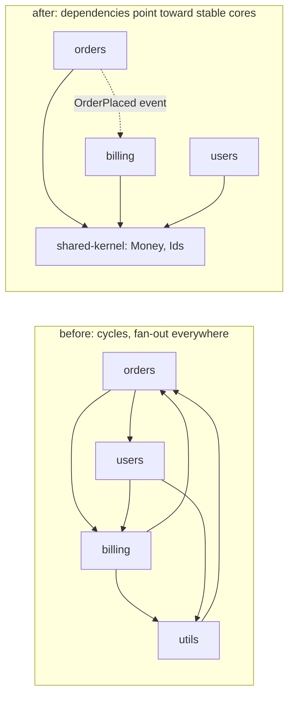
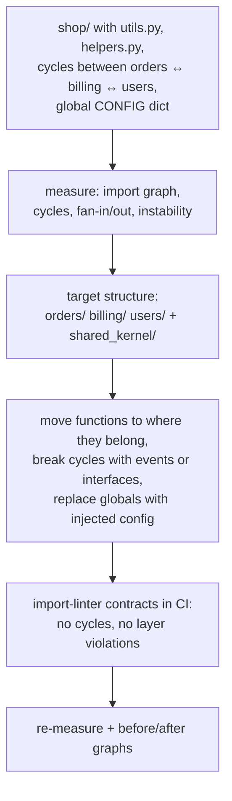

# Chapter 3 — Design Principles (Cohesion, Coupling, YAGNI, DRY, KISS)

> **Volume 3 — Low-Level Design** · [Contents](index.md) · ← [Chapter 2 — SOLID Principles](ch02-solid-principles.md) · Next → [Chapter 4 — UML & Diagramming](ch04-uml-and-diagramming.md)

---

## Concept

Cohesion vs coupling; YAGNI/DRY/KISS as heuristics, and when they conflict.

**In one sentence:** good design keeps things that change together in the same place (high cohesion) and minimizes how much separate places need to know about each other (low coupling) — while DRY, YAGNI, and KISS are rules of thumb that help, but can pull in opposite directions and must be weighed, not obeyed blindly.

### Mental model — a toolbox with drawers

A well-organized toolbox has one drawer for screwdrivers, one for wrenches (cohesion: related things together). You can take out the screwdriver drawer without disturbing the wrenches (low coupling). A drawer labeled "misc" is low cohesion. A drawer that only opens if two others are open first is high coupling.

### Cohesion

How strongly the parts of one module belong together.

| Level (worst → best) | Parts are together because… | Example |
|----------------------|-----------------------------|---------|
| Coincidental | no reason | `utils.py` with date helpers, a CSV parser, and an email regex |
| Logical | they're the "same kind" of thing | `handlers.py` with every HTTP handler of every feature |
| Temporal | they run at the same time | `startup()` that inits the DB, loads config, warms caches |
| Communicational | they use the same data | functions all operating on the `orders` table |
| **Functional** | they all contribute to one well-defined job | `pricing/` computing an order's price, and nothing else |

### Coupling

How much one module depends on another's details.

| Level (worst → best) | Means | Example |
|----------------------|-------|---------|
| Content | reaches into another module's internals | `orders._cache.clear()` from outside |
| Common / global | shares global mutable state | a module-level `CONFIG` dict everyone mutates |
| Control | passes flags that steer the other's logic | `render(data, mode=3)` |
| Stamp | passes a big structure when a field would do | `send_email(user)` when it only needs `user.email` |
| **Data** | passes only the simple data needed | `send_email(to="a@b.c", subject=…)` |
| **Message / interface** | talks through a small, stable interface or events | `payments.charge(amount)`; an `OrderPlaced` event |

### Measuring coupling

*fan-out* (how many modules this one imports) and *fan-in* (how many import it); Martin's *instability* `I = fan_out / (fan_in + fan_out)` (0 = stable, relied upon; 1 = unstable, relies on others). Stable modules should be abstract; dependencies should point toward stability. Cycles between modules are the strongest smell.

### The heuristics

| Heuristic | Says | Protects against | Over-applied, it causes |
|-----------|------|------------------|------------------------|
| **DRY** — Don't Repeat Yourself | every piece of *knowledge* has one authoritative place | inconsistent copies of a rule (tax rate in 4 places) | "shared" helpers that couple unrelated features; flag-laden functions |
| **YAGNI** — You Aren't Gonna Need It (see below) | don't build for imagined futures | speculative generality: plugin systems with one plugin, unused parameters | refusing obvious, cheap design for known needs |
| **KISS** — Keep It Simple (see below) | the simplest thing that works | cleverness, needless layers and indirection | oversimplifying a truly complex domain |

### When DRY hurts

DRY is about *knowledge*, not *text*. Two snippets that look the same but represent different decisions ("a user's display name" vs "an invoice's legal name") will change for different reasons. Merging them couples two features: a change for one breaks the other, and the shared function grows flags. Rule of three: tolerate duplication until the third occurrence *and* you're sure it's the same concept. "Duplication is far cheaper than the wrong abstraction" (Sandi Metz).

### YAGNI: You Aren't Gonna Need It

**What it says.** Build what today's requirement needs, and no more. Not the plugin system "in case we add more payment providers", not the `currency` parameter "for when we go international", not the abstract base class with one subclass. The phrase comes from Extreme Programming, where it was paired with refactoring: you can afford to wait because you keep the code easy to change.

**Why speculative code is expensive.** A feature built before it is needed is paid for three times. First you build it. Then you carry it: every reader has to understand it, every test run exercises it, and every refactor has to keep it working, even though nothing uses it. Finally, when the real need does arrive, it rarely has the shape you guessed, so the "ready" code gets reworked or worked around anyway.

<div class="fig">
<svg xmlns="http://www.w3.org/2000/svg" viewBox="0 0 760 300" role="img" aria-label="Building a speculative plugin system in month 1 costs the build, then a little every month to read, test and keep working, and when the real need arrives in month 6 it has a different shape and must be reworked; waiting costs nothing until month 6 and then builds exactly what is needed" style="width:100%;max-width:760px;height:auto;font-family:inherit"><defs><marker id="v3c03x1-ar" viewBox="0 0 10 10" refX="8" refY="5" markerWidth="7" markerHeight="7" orient="auto-start-reverse"><path d="M0 0L10 5L0 10z" fill="context-stroke"/></marker></defs><text x="243.0" y="26" font-size="11" text-anchor="middle" fill="var(--text-muted)" font-weight="600">month 1</text><text x="309.0" y="26" font-size="11" text-anchor="middle" fill="var(--text-muted)" font-weight="600">month 2</text><text x="375.0" y="26" font-size="11" text-anchor="middle" fill="var(--text-muted)" font-weight="600">month 3</text><text x="441.0" y="26" font-size="11" text-anchor="middle" fill="var(--text-muted)" font-weight="600">month 4</text><text x="507.0" y="26" font-size="11" text-anchor="middle" fill="var(--text-muted)" font-weight="600">month 5</text><text x="573.0" y="26" font-size="11" text-anchor="middle" fill="var(--text-muted)" font-weight="600">month 6</text><text x="639.0" y="26" font-size="11" text-anchor="middle" fill="var(--text-muted)" font-weight="600">month 7</text><text x="705.0" y="26" font-size="11" text-anchor="middle" fill="var(--text-muted)" font-weight="600">month 8</text><line x1="540" y1="34" x2="540" y2="236" stroke="var(--accent)" stroke-width="1.6" stroke-dasharray="5 4"/><text x="534" y="252" font-size="11.5" text-anchor="end" fill="var(--accent)" font-weight="700">the real need arrives, and it looks different →</text><text x="20" y="62" font-size="12" text-anchor="start" fill="var(--danger)" font-weight="800">BUILD IT NOW</text><text x="20" y="78" font-size="11.5" text-anchor="start" fill="var(--text-muted)" font-weight="400" font-style="italic">&quot;we&#x27;ll need plugins&quot;</text><rect x="212" y="50" width="101.60000000000001" height="30" rx="6" fill="var(--warning)" fill-opacity=".22" stroke="var(--warning)" stroke-width="1.3"/><text x="262.8" y="70" font-size="11.5" text-anchor="middle" fill="var(--text)" font-weight="700">build</text><rect x="317.6" y="50" width="62.0" height="30" rx="6" fill="var(--text-faint)" fill-opacity=".12" stroke="var(--text-faint)" stroke-width="1.3"/><text x="348.6" y="70" font-size="11.5" text-anchor="middle" fill="var(--text)" font-weight="700">carry</text><rect x="383.6" y="50" width="62.0" height="30" rx="6" fill="var(--text-faint)" fill-opacity=".12" stroke="var(--text-faint)" stroke-width="1.3"/><text x="414.6" y="70" font-size="11.5" text-anchor="middle" fill="var(--text)" font-weight="700">carry</text><rect x="449.6" y="50" width="61.99999999999997" height="30" rx="6" fill="var(--text-faint)" fill-opacity=".12" stroke="var(--text-faint)" stroke-width="1.3"/><text x="480.59999999999997" y="70" font-size="11.5" text-anchor="middle" fill="var(--text)" font-weight="700">carry</text><rect x="542" y="50" width="101.59999999999998" height="30" rx="6" fill="var(--danger)" fill-opacity=".22" stroke="var(--danger)" stroke-width="1.3"/><text x="592.8" y="70" font-size="11.5" text-anchor="middle" fill="var(--text)" font-weight="700">rework</text><text x="548" y="98" font-size="11" text-anchor="start" fill="var(--text-muted)" font-weight="400" font-style="italic">+ the unused code is still there</text><rect x="20" y="104" width="270.0" height="21" rx="10.5" fill="var(--danger-faint)" stroke="var(--danger)" stroke-width="1.2"/><text x="155.0" y="119" font-size="12" text-anchor="middle" fill="var(--danger)" font-weight="700">paid 3 times, built the wrong shape</text><text x="20" y="172" font-size="12" text-anchor="start" fill="var(--success)" font-weight="800">WAIT (YAGNI)</text><text x="20" y="188" font-size="11.5" text-anchor="start" fill="var(--text-muted)" font-weight="400" font-style="italic">keep the code easy to change</text><line x1="210" y1="175" x2="534" y2="175" stroke="var(--border)" stroke-width="1.4" stroke-dasharray="2 5"/><text x="375.0" y="168" font-size="11.5" text-anchor="middle" fill="var(--text-muted)" font-weight="400" font-style="italic">nothing to read, test or carry</text><rect x="542" y="160" width="75.20000000000002" height="30" rx="6" fill="var(--success)" fill-opacity=".22" stroke="var(--success)" stroke-width="1.3"/><text x="579.5999999999999" y="180" font-size="11.5" text-anchor="middle" fill="var(--text)" font-weight="700">build</text><rect x="20" y="214" width="234.0" height="21" rx="10.5" fill="var(--success-faint)" stroke="var(--success)" stroke-width="1.2"/><text x="137.0" y="229" font-size="12" text-anchor="middle" fill="var(--success)" font-weight="700">paid once, for the right shape</text><text x="380" y="288" font-size="12" text-anchor="middle" fill="var(--text-muted)" font-weight="400" font-style="italic">YAGNI is not &quot;don&#x27;t design&quot;: it is &quot;don&#x27;t build features before you know their shape&quot;.</text></svg>
</div>

```python
# Speculative: a strategy registry for exactly one exporter
class Exporter(ABC):
    @abstractmethod
    def export(self, rows): ...

class CsvExporter(Exporter):
    def export(self, rows): ...

EXPORTERS: dict[str, type[Exporter]] = {"csv": CsvExporter}
def export(rows, fmt="csv", **options):        # options: reserved for future formats
    return EXPORTERS[fmt]().export(rows)

# YAGNI: the one thing that is actually needed
def export_csv(rows, path):
    with open(path, "w", newline="") as f:
        csv.writer(f).writerows(rows)
# When a second format really arrives, extracting an interface from two concrete cases takes minutes,
# and it will fit those two cases instead of a guess.
```

**What YAGNI does *not* mean.** It is not permission to skip design or to write code that is hard to change. It applies to *features and flexibility*, not to quality: tests, clear names, sensible module boundaries, input validation and security are needed today. It also doesn't forbid cheap decisions that are expensive to reverse later, such as a schema's primary keys, a public API's versioning, or storing timestamps in UTC. Ask: *if we wait and turn out to be wrong, how much does it cost to add this later?* If the answer is "a day of refactoring", wait. If it is "migrating a billion rows" or "breaking every client", decide now.

**Smells:** parameters that every caller passes the same value to; an interface with one implementation and no test double; config options nobody sets; "framework" code in an application; comments such as "for future use".

### KISS: Keep It Simple

**What it says.** Choose the simplest design that fully solves the problem, so the next reader, who is often you in six months at 3 a.m., can understand it quickly and change it safely. "Simple" means *few moving parts and few concepts to hold in your head*, not "fewest characters".

**Essential vs accidental complexity.** Some complexity belongs to the problem: tax law really does have exceptions, and a distributed system really can lose messages. That is *essential* complexity. You can organize it, but you can't delete it. *Accidental* complexity is what we add on top: layers that only forward calls, a message queue between two functions in the same process, generic machinery for one case, or a clever one-liner that needs a comment to explain it. KISS targets the accidental kind.

```python
# Clever: correct, dense, and slow to verify
def is_leap(y): return bool((not y % 4) ^ (not y % 100) ^ (not y % 400))

# Simple: reads like the rule it implements
def is_leap(year):
    if year % 400 == 0:
        return True
    if year % 100 == 0:
        return False
    return year % 4 == 0
```

| Instead of… | Usually simpler |
|-------------|-----------------|
| a microservice for one table | a module with a clear interface inside the existing service |
| a custom cache class | `functools.lru_cache`, or the database's own cache |
| a hand-built state machine framework | an `Enum` plus a dict of allowed transitions |
| inheritance three levels deep | a function, or composition |
| a regex no one can read | two or three plain string operations |

**When the heuristics collide.** YAGNI and KISS both push *against* abstraction; DRY pushes *toward* it. Extracting a shared helper after the second copy is DRY, but if the two copies are different concepts, the helper is the speculative, complex thing YAGNI and KISS warn about (see *When DRY hurts* above). The usual resolution is the **rule of three**: keep the duplicate until a third case shows what really varies, then abstract from real examples. The opposite failure exists too: refusing any structure in a genuinely complex domain spreads the essential complexity across every caller. KISS means as simple as the problem allows, and no simpler.

---

## Prereqs

* [Chapter 2 — SOLID Principles](ch02-solid-principles.md)

---

## Diagram

### A cohesion/coupling matrix with the target zone

<div class="fig">
<svg xmlns="http://www.w3.org/2000/svg" viewBox="0 0 780 400" role="img" aria-label="Cohesion against coupling: high cohesion and low coupling is the target; low cohesion and high coupling is a big ball of mud" style="width:100%;max-width:780px;height:auto;font-family:inherit"><defs><marker id="ar" viewBox="0 0 10 10" refX="8" refY="5" markerWidth="7" markerHeight="7" orient="auto-start-reverse"><path d="M0 0L10 5L0 10z" fill="context-stroke"/></marker></defs><text x="430" y="24" font-size="13" text-anchor="middle" fill="var(--text-muted)" font-weight="700">COUPLING  →</text><text x="280" y="50" font-size="13" text-anchor="middle" fill="var(--text-muted)" font-weight="600">low</text><text x="580" y="50" font-size="13" text-anchor="middle" fill="var(--text-muted)" font-weight="600">high</text><text x="50" y="200" font-size="13" text-anchor="middle" fill="var(--text-muted)" font-weight="700" transform="rotate(-90 50 200)">COHESION</text><text x="110" y="120" font-size="13" text-anchor="end" fill="var(--text-muted)" font-weight="600">high</text><text x="110" y="290" font-size="13" text-anchor="end" fill="var(--text-muted)" font-weight="600">low</text><rect x="130" y="60" width="300" height="160" rx="10" fill="var(--success)" fill-opacity=".14" stroke="var(--success)" stroke-width="1.6"/><text x="280" y="116" font-size="15" text-anchor="middle" fill="var(--text)" font-weight="700">✅ TARGET</text><text x="280" y="150" font-size="13" text-anchor="middle" fill="var(--text)">focused modules,</text><text x="280" y="167" font-size="13" text-anchor="middle" fill="var(--text)">small interfaces</text><rect x="440" y="60" width="300" height="160" rx="10" fill="var(--accent)" fill-opacity=".14" stroke="var(--accent)" stroke-width="1.6"/><text x="590" y="116" font-size="15" text-anchor="middle" fill="var(--text)" font-weight="700">"distributed monolith"</text><text x="590" y="150" font-size="13" text-anchor="middle" fill="var(--text)">each part is neat but</text><text x="590" y="167" font-size="13" text-anchor="middle" fill="var(--text)">everything calls everything</text><rect x="130" y="230" width="300" height="160" rx="10" fill="var(--accent)" fill-opacity=".14" stroke="var(--accent)" stroke-width="1.6"/><text x="280" y="286" font-size="15" text-anchor="middle" fill="var(--text)" font-weight="700">"junk drawers"</text><text x="280" y="320" font-size="13" text-anchor="middle" fill="var(--text)">utils.py, misc/,</text><text x="280" y="337" font-size="13" text-anchor="middle" fill="var(--text)">isolated but random</text><rect x="440" y="230" width="300" height="160" rx="10" fill="var(--danger)" fill-opacity=".14" stroke="var(--danger)" stroke-width="1.6"/><text x="590" y="286" font-size="15" text-anchor="middle" fill="var(--text)" font-weight="700">❌ BIG BALL OF MUD</text><text x="590" y="320" font-size="13" text-anchor="middle" fill="var(--text)">change anything,</text><text x="590" y="337" font-size="13" text-anchor="middle" fill="var(--text)">break everything</text></svg>
</div>

### A tangled module graph vs a clean one



### DRY that increased coupling

| before: two similar functions | the "DRY" merge | undone |
|---|---|---|
| `format_user_name(u)`<br>`format_invoice_name(i)` | `format_name(x, kind, legal=False, uppercase=False, strip_suffix=…)`: every change for invoices risks breaking user profiles | `format_user_name(u)`<br>`format_invoice_name(i)`: each changes for its own reason again |

---

## Example

```python
# The "DRY" mistake: one shared helper for two concepts
def format_name(first, last, *, legal=False, company=None, uppercase=False):
    if legal and company:                  # invoices need the company's legal name
        name = company
    else:
        name = f"{first} {last}".strip()   # profiles show a friendly name
    return name.upper() if uppercase else name

# Callers:
#   profile:  format_name(u.first, u.last)
#   invoice:  format_name(c.first, c.last, legal=True, company=c.legal_name, uppercase=True)
# A new invoice rule ("append the VAT number") now risks the profile page too.

# Undo it: duplication of TEXT is fine when the KNOWLEDGE differs
def display_name(user) -> str:
    return f"{user.first} {user.last}".strip()

def invoice_party_name(customer) -> str:
    base = customer.legal_name or f"{customer.first} {customer.last}"
    return f"{base.upper()} (VAT {customer.vat_id})" if customer.vat_id else base.upper()

# Real DRY: one authoritative place for a real rule
VAT_RATE = {"DE": 0.19, "FR": 0.20, "NL": 0.21}   # used by pricing, invoices, and reports
```

```python
# Measure coupling: fan-in, fan-out, instability, and cycles from imports
import ast, pathlib, collections

def import_graph(pkg_dir: str, pkg: str):
    graph = collections.defaultdict(set)
    for f in pathlib.Path(pkg_dir).rglob("*.py"):
        mod = f.relative_to(pkg_dir).with_suffix("").parts[0]
        for node in ast.walk(ast.parse(f.read_text(encoding="utf-8"))):
            names = []
            if isinstance(node, ast.ImportFrom) and node.module:
                names = [node.module]
            elif isinstance(node, ast.Import):
                names = [a.name for a in node.names]
            for n in names:
                parts = n.split(".")
                if parts[0] == pkg and len(parts) > 1 and parts[1] != mod:
                    graph[mod].add(parts[1])
    return graph

def report(graph):
    mods = set(graph) | {d for ds in graph.values() for d in ds}
    fan_in = {m: sum(m in ds for ds in graph.values()) for m in mods}
    for m in sorted(mods):
        out = len(graph.get(m, ()))
        inst = out / (out + fan_in[m]) if out + fan_in[m] else 0
        print(f"{m:12s} fan-in {fan_in[m]}  fan-out {out}  instability {inst:.2f}")
    cycles = [(a, b) for a in graph for b in graph[a] if a in graph.get(b, ())]
    print("cycles:", sorted({tuple(sorted(c)) for c in cycles}))
```

---

## Exercises

1. Measure coupling of two modules and reduce it.

   <details><summary>Solution</summary>Run the import-graph script (or <code>pydeps</code>, <code>import-linter</code>). Suppose <code>orders</code> and <code>billing</code> import each other (a cycle). Fix: move shared value types (<code>Money</code>, <code>OrderId</code>) into a small shared kernel both depend on; let <code>billing</code> react to an <code>OrderPlaced</code> event instead of <code>orders</code> calling billing internals; pass data, not whole objects. Re-measure: the cycle is gone and fan-out drops. Add an <code>import-linter</code> contract to CI so it can't return.</details>

2. Find a premature abstraction (YAGNI violation) and remove it.

   <details><summary>Solution</summary>Typical finds: an <code>AbstractStorageFactoryProvider</code> with one implementation; a plugin registry with one plugin; config options nobody sets; a generic <code>Repository[T]</code> used by one type. Inline it: replace the interface + factory with the concrete class and delete unused parameters. Keep a seam only where a test double or a second implementation actually exists. The code gets shorter and easier to follow; re-add the abstraction when the second real case arrives.</details>

3. Two teams' services both define `normalize_phone()`. Should you share it?

   <details><summary>Solution</summary>If it represents the same business rule (for example E.164 normalization required by your SMS provider), put it in one library or service with an owner. If each team normalizes for different reasons (display vs fraud checks), keep separate copies: they will diverge, and a shared version would couple two release cycles.</details>

---

## Mini project

### Refactor a tangled module into high-cohesion, low-coupling components



### Steps

1. Start from a messy package (write one, or take an old project).
2. Generate the import graph and a table of fan-in, fan-out, and instability; list the cycles.
3. Dissolve `utils.py`: move each function next to the feature that uses it (or into a small shared kernel if truly shared).
4. Break each cycle using a shared kernel, dependency inversion, or events.
5. Replace global mutable config with injected settings.
6. Add `import-linter` contracts (forbidden imports, layers, independence) to CI; re-measure and draw the before/after graphs.

**Done when:** there are no import cycles, no junk-drawer modules, and a CI contract fails if someone reintroduces a forbidden dependency.

---

## Open source

* [`rust-lang/rust`](https://github.com/rust-lang/rust) (module boundaries) — the standard library's split into `core` (no allocation, no OS), `alloc`, and `std` is a large-scale lesson in low coupling: each layer depends only on the one below.
* [`golang/go`](https://github.com/golang/go) (packages) — Go forbids import cycles at compile time and encourages small, focused packages (`net/http`, `encoding/json`); `internal/` directories enforce boundaries. See also `seddonym/import-linter` for Python.

---

## Interview

1. **"DRY vs coupling — when does DRY hurt?"**
   <details><summary>Answer</summary>When it merges code that looks alike but represents different knowledge that changes for different reasons. The shared abstraction couples the callers: a change for one risks the others, and the function accumulates flags and special cases. DRY is about a single source of truth for a <i>rule</i>, not about deleting similar lines. Wait for the rule of three and confirm it's the same concept; otherwise prefer duplication to the wrong abstraction.</details>

2. **"What's cohesion?"**
   <details><summary>Answer</summary>The degree to which the elements of a module belong together — ideally they all serve one clearly defined purpose (functional cohesion), so a change to that purpose is local and the module is easy to name, understand, and test. Low cohesion shows up as "utils" or "manager" modules, "and" in the description, and unrelated changes landing in the same file. High cohesion inside modules plus low coupling between them is the core goal of modular design.</details>

3. **"YAGNI says don't build it yet. When should you design for the future anyway?"**
   <details><summary>Answer</summary>When the decision is cheap now and expensive to reverse later: database keys and schemas holding lots of data, public API contracts and versioning, data formats other teams consume, time zones and money types, security boundaries. YAGNI targets speculative <i>features and flexibility</i>; it never excuses code that is hard to change, untested, or insecure. The test is: if we wait and are wrong, what does it cost to add later?</details>

---

## Checklist

- [ ] keep related things together
- [ ] reduce cross-module fan-in/fan-out
- [ ] say no to speculative generality
- [ ] before building for the future, ask what adding it later would really cost
- [ ] remove accidental complexity: layers, indirection and cleverness the problem doesn't need

---

> [Contents](index.md) · ← [Chapter 2 — SOLID Principles](ch02-solid-principles.md) · Next → [Chapter 4 — UML & Diagramming](ch04-uml-and-diagramming.md)
