# Chapter 8 — Clean Architecture

> **Volume 3 — Low-Level Design** · [Contents](index.md) · ← [Chapter 7 — GoF Behavioral Patterns](ch07-gof-behavioral-patterns.md) · Next → [Chapter 9 — Hexagonal Architecture (Ports & Adapters)](ch09-hexagonal-architecture-ports-and-adapters.md)

---

## Concept

Entities → use cases → interface adapters → frameworks; the dependency rule pointing inward.

**In one sentence:** organize code in rings, with business rules in the middle and databases, web frameworks, and UIs on the outside, and let source-code dependencies point *only inward* — so the core never knows or cares which database or framework is plugged in.

**Mental model — a country's constitution.** The constitution (entities: core business rules) doesn't mention which brand of computer the courts use. Laws (use cases) follow the constitution. Government agencies (adapters) translate laws into forms and procedures. Buildings and phones (frameworks, DB) can be replaced without amending the constitution.

**The four rings**

| Ring | Contains | Knows about | Example |
|------|----------|-------------|---------|
| **Entities** (enterprise business rules) | core domain objects and rules | nothing outside itself | `Order`, `Money`, "an order total can't be negative" |
| **Use cases** (application business rules) | one class or function per user intention; orchestrates entities; defines **ports** (interfaces) it needs | entities, its own ports | `PlaceOrder`, `RefundPayment` |
| **Interface adapters** | controllers, presenters, gateways, repositories implementing the ports; mapping between domain and DTOs/rows | use cases, entities | `SqlOrderRepository`, `OrderController`, `OrderJsonPresenter` |
| **Frameworks & drivers** | web framework, ORM, DB, message broker, UI | everything inside (plugs in) | FastAPI, SQLAlchemy, Postgres, Kafka |

**The Dependency Rule** — *source code dependencies can only point inward*. Nothing in an inner ring can name anything in an outer ring: no `import fastapi` or `import sqlalchemy` in the domain or use cases. When control must flow outward (a use case needs to save data), the use case defines an interface (a port) and an outer adapter implements it — the Dependency Inversion Principle ([Ch 2](ch02-solid-principles.md)).

**Crossing boundaries** — pass simple data structures (DTOs, plain dataclasses) across rings, never ORM rows or HTTP request objects.

**Why isolate the domain?**

| Benefit | How |
|---------|-----|
| Fast, pure tests | the domain and use cases run with in-memory fakes, no DB or HTTP |
| Swappable technology | change the ORM, DB, or framework by writing a new adapter |
| Deferred decisions | build business logic before choosing the database |
| Readable intent | the use-case folder "screams" what the system does (`place_order.py`), not which framework it uses |

**Cost** — more files and mapping code. For a simple CRUD app it may be overkill; apply it where business rules are rich and long-lived.

### More on this topic, from the AI Library

The sections below come from the AI Library's system-design course and cover the same ground at architecture level.

### Layered (N-Tier) Architecture

**Layered architecture** divides the system into layers, each with a specific responsibility (e.g., Presentation, Business Logic, Data Access).

#### Diagram

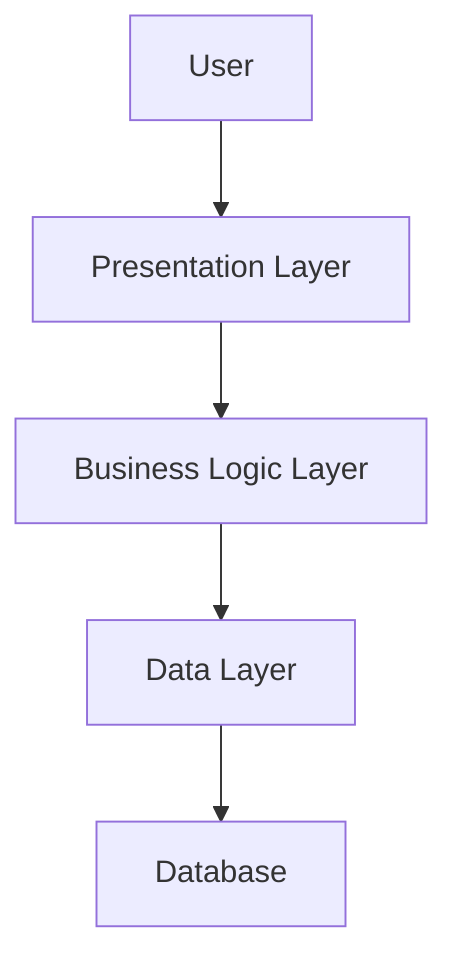

A simpler version:

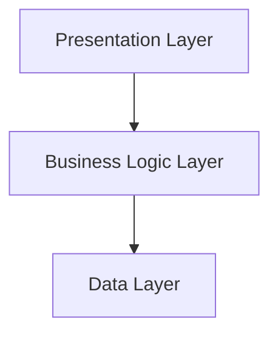

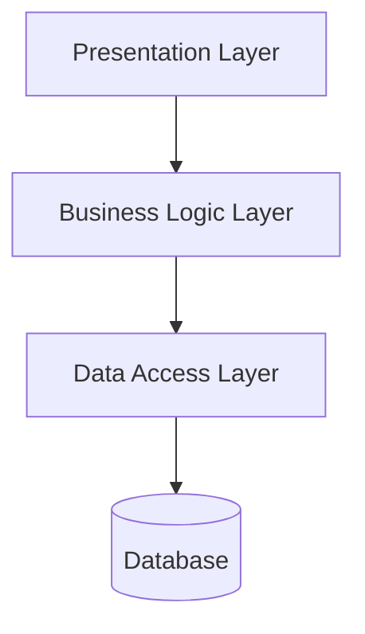

ASCII view:

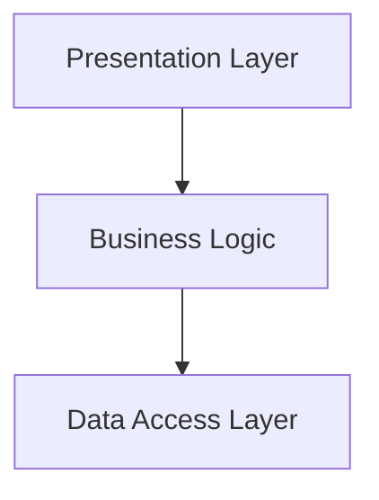

#### Code Structure

```plaintext
/app
  /presentation
      user_controller.py
  /business_logic
      user_service.py
  /data_access
      user_repository.py
```

#### Example Code: Python Flask 3-Layer

```python
# Presentation Layer
@app.route('/users')
def get_users():
    return jsonify(UserController().get_users())

# Business Logic Layer
class UserController:
    def get_users(self):
        return UserService().fetch_users()

# Data Access Layer
class UserService:
    def fetch_users(self):
        return UserModel.query.all()
```

A simpler module-based variant:

```python
# presentation.py
def show_user_profile(user_id):
    data = get_user_profile(user_id)
    return render_profile(data)

# business_logic.py
def get_user_profile(user_id):
    return fetch_user_from_db(user_id)

# data_access.py
def fetch_user_from_db(user_id):
    # Fetch from database
    pass
```

#### Pros & Cons

| Pros                                      | Cons                                         |
|-------------------------------------------|----------------------------------------------|
| Clear separation of concerns              | Performance overhead due to layer traversal  |
| Easier to maintain and scale              | Layers may become tightly coupled            |
| Easy to test                              | Can become rigid; changes in one layer may impact others |

#### Use Cases

- Enterprise applications (CRM, ERP)
- Banking / financial systems
- Large web applications

*(From AI Library chapter 4.)*

### Multi-Tier Architecture — A Deep Dive

**Multi-tier architecture** is a software design pattern that organizes an application into multiple logical layers (or "tiers"), each responsible for a specific set of tasks. This pattern powers everything from small desktop apps to global-scale web services like Amazon and Netflix.

#### Key Benefits

- **Separation of concerns:** Each layer handles a specific role, making the codebase easier to manage.
- **Improved scalability:** Layers can be scaled independently.
- **Better security:** Isolating sensitive operations (like database access) reduces attack surfaces.
- **Maintainability:** Changes in one layer have minimal impact on others.
- **Organizes applications into independent layers.**
- **Used in:** Web apps, enterprise systems, cloud architectures.

#### Types of Multi-Tier Architectures

| Type      | Layers                                       | Use Case                          |
|-----------|----------------------------------------------|-----------------------------------|
| 2-Tier    | Client ↔ DB                                  | Simple desktop apps               |
| 3-Tier    | UI ↔ Business Logic ↔ DB                     | Standard web apps                 |
| N-Tier    | UI ↔ API ↔ Logic ↔ Cache ↔ DB                | Large-scale / cloud, microservices|

#### 2-Tier Architecture

The client contains both the UI and application logic, communicating directly with the database.

```
[Client Application] <------> [Database Server]
```

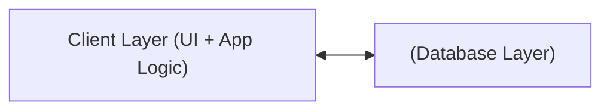

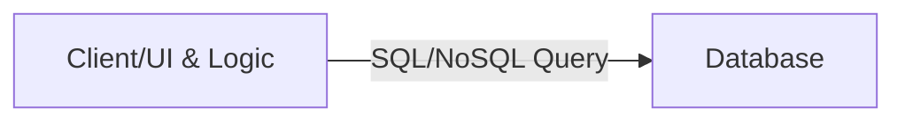

**Example (Python + SQLite):**

```python
# Two-tier example: direct database access
import sqlite3

conn = sqlite3.connect('example.db')
cursor = conn.cursor()
cursor.execute("SELECT * FROM users")
for row in cursor.fetchall():
    print(row)
conn.close()
```

**Pros & Cons:**

| Pros                  | Cons                                   |
|-----------------------|----------------------------------------|
| Simple to implement   | Poor scalability (few users)           |
| Fast for small apps   | Security risks (direct DB access)      |
|                       | Limited to small/simple apps           |

**Use case:** A desktop app directly querying a local SQL database.

#### 3-Tier Architecture

Adds a **Business Logic Layer** between the UI and the database.

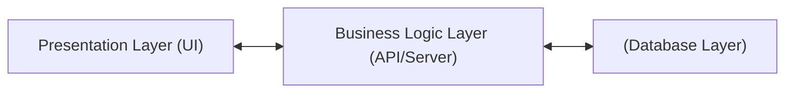

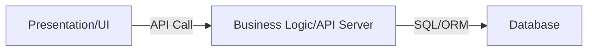

Or with the database on the right:

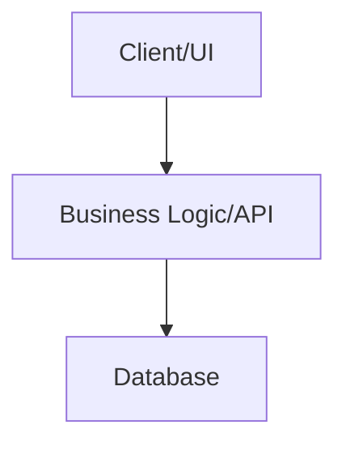

**Example (Node.js Express API as the Business Logic layer):**

```js
// Business Logic Layer (API)
const express = require('express');
const app = express();
const db = require('./db'); // Assume db.js handles DB connection

app.get('/users', async (req, res) => {
  const users = await db.query('SELECT * FROM users');
  res.json(users);
});

app.listen(3000, () => console.log('API running on port 3000'));
```

A more decoupled version with separate route and data-access modules:

```js
// server/routes/users.js
const express = require('express');
const router = express.Router();
const { getUserById } = require('../services/userService'); // Business logic

router.get('/:id', async (req, res) => {
  const user = await getUserById(req.params.id); // Calls data access layer
  res.json(user);
});

module.exports = router;
```

```js
// server/data/userRepository.js
const db = require('./dbConnection');

async function getUserById(id) {
  return db.query('SELECT * FROM users WHERE id = $1', [id]);
}

module.exports = { getUserById };
```

**Project structure:**

<div class="fig">
<svg xmlns="http://www.w3.org/2000/svg" viewBox="0 0 760 124" role="img" aria-label="Project folders mapped to presentation, business logic and data layers" style="width:100%;max-width:760px;height:auto;font-family:inherit"><defs><marker id="ar" viewBox="0 0 10 10" refX="8" refY="5" markerWidth="7" markerHeight="7" orient="auto-start-reverse"><path d="M0 0L10 5L0 10z" fill="context-stroke"/></marker></defs><text x="14" y="20" font-size="13" font-family="ui-monospace,Menlo,Consolas,monospace" fill="var(--primary)" font-weight="600">📁 project/</text><line x1="24" y1="32" x2="24" y2="44" stroke="var(--border)" stroke-width="1.4"/><line x1="24" y1="44" x2="34" y2="44" stroke="var(--border)" stroke-width="1.4"/><text x="38" y="46" font-size="13" font-family="ui-monospace,Menlo,Consolas,monospace" fill="var(--primary)" font-weight="600">📁 frontend/</text><text x="220" y="46" font-size="12.5" text-anchor="start" fill="var(--text-muted)">← Presentation Layer (React, Angular, etc.)</text><line x1="24" y1="58" x2="24" y2="70" stroke="var(--border)" stroke-width="1.4"/><line x1="24" y1="70" x2="34" y2="70" stroke="var(--border)" stroke-width="1.4"/><text x="38" y="72" font-size="13" font-family="ui-monospace,Menlo,Consolas,monospace" fill="var(--primary)" font-weight="600">📁 server/</text><text x="220" y="72" font-size="12.5" text-anchor="start" fill="var(--text-muted)">← Business Logic Layer (Node.js/Express)</text><line x1="24" y1="84" x2="24" y2="96" stroke="var(--border)" stroke-width="1.4"/><line x1="24" y1="96" x2="34" y2="96" stroke="var(--border)" stroke-width="1.4"/><text x="38" y="98" font-size="13" font-family="ui-monospace,Menlo,Consolas,monospace" fill="var(--primary)" font-weight="600">📁 database/</text><text x="220" y="98" font-size="12.5" text-anchor="start" fill="var(--text-muted)">← Data Layer (PostgreSQL, MongoDB)</text></svg>
</div>

**Pros & Cons:**

| Pros                                | Cons                      |
|-------------------------------------|---------------------------|
| Improved scalability & security     | Slightly higher latency   |
| Better separation of concerns       | More complex than 2-tier  |
| Easier maintenance                  |                           |

**Use case:** Traditional web applications (React front-end → Node.js/Express API → PostgreSQL DB).

#### N-Tier Architecture

Extends 3-tier by adding specialized layers (caching, API gateway, microservices, etc.).

**Example layers:**

- API Gateway
- Authentication Service
- Caching Layer (e.g., Redis)
- Microservices (e.g., User Service, Payment Service)
- Database Layer

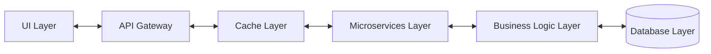

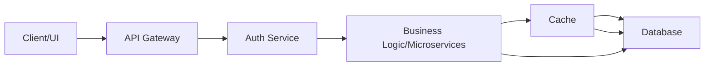

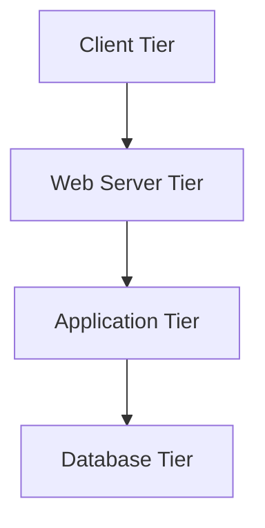

*Note: actual order and number of layers may vary based on requirements.*

**Example (Pseudo-code: API Gateway forwards to microservice, checks cache):**

```python
def get_user_profile(user_id):
    cached = redis.get(f"profile:{user_id}")
    if cached:
        return cached
    profile = user_service.get_profile(user_id)
    redis.set(f"profile:{user_id}", profile)
    return profile
```

**Caching example:**

```python
def get_product(product_id):
    product = cache.get(product_id)
    if not product:
        product = db.fetch(product_id)
        cache.set(product_id, product)
    return product
```

**Pros & Cons:**

| Pros                                          | Cons              |
|-----------------------------------------------|-------------------|
| Handles high-traffic & complex business logic | Higher complexity |
| Independent scaling of layers                 | More moving parts |
| Highly scalable                               | More points of failure |
| Fault tolerant                                | Requires robust monitoring and deployment |

**Use case:** Large-scale enterprise software, microservices-based applications, e-commerce platforms.

#### Performance and Scalability — How Do Tiers Impact Your System?

##### Latency Considerations

- **More tiers = higher latency** (if not optimized).
- Each request passes through more processing steps.

**Mitigations:**

- **Caching:** Store frequently accessed data for quick retrieval (e.g., Redis, Memcached).
- **Load Balancing:** Distribute requests across servers/layers for resilience and speed.

##### Scaling Strategies

- **Vertical Scaling:** Add resources to a single server (CPU, RAM).
- **Horizontal Scaling:** Add more servers (better for high-traffic systems).
- **Optimizations:** Caching, load balancing, and asynchronous messaging can reduce bottlenecks.

#### Multi-Tier — Tips and Tricks

- **Keep layers independent:** Avoid tight coupling; use clear interfaces/APIs between layers.
- **Optimize for latency:** Introduce caching and asynchronous processing where possible.
- **Secure inter-layer communication:** Use encryption (TLS), API keys, and input validation.
- **Monitor and log each layer:** Add observability (logging, tracing, metrics) to identify bottlenecks quickly.
- **Scale horizontally where possible:** Especially for API/business logic and caching layers.
- **Automate deployments and testing:** CI/CD pipelines ensure each layer is robust and can be deployed independently.
- **Start simple:** Begin with three-tier unless you know you'll need n-tier complexity.
- **Isolate secrets and credentials:** Never expose DB credentials in the UI/client layer.
- **Leverage caching:** Use Redis or Memcached for reducing database load.
- **Use load balancers:** Distribute API requests with load balancers for horizontal scaling.
- **Secure APIs:** Validate and sanitize all input at the business logic layer.

#### Multi-Tier — Common Interview Questions

1. What is Multi-Tier Architecture, and why is it used?
2. How does a 2-Tier architecture differ from a 3-Tier architecture?
3. What are the key components of a 3-Tier architecture?
4. How does scalability improve in a multi-tier system?
5. What strategies can reduce latency in a multi-tier app?

*(From AI Library chapter 4.)*

---

## Prereqs

* [Chapter 2 — SOLID Principles](ch02-solid-principles.md)

---

## Diagram

**The concentric circles, with dependencies pointing inward only**

<div class="fig">
<svg xmlns="http://www.w3.org/2000/svg" viewBox="0 0 780 380" role="img" aria-label="Clean architecture rings: frameworks and drivers outside, then interface adapters, use cases, and entities at the center; dependencies point inward" style="width:100%;max-width:780px;height:auto;font-family:inherit"><defs><marker id="ar" viewBox="0 0 10 10" refX="8" refY="5" markerWidth="7" markerHeight="7" orient="auto-start-reverse"><path d="M0 0L10 5L0 10z" fill="context-stroke"/></marker></defs><rect x="10" y="10" width="760" height="330" rx="14" fill="var(--danger)" fill-opacity=".10" stroke="var(--danger)" stroke-width="1.6"/><text x="28" y="34" font-size="13" text-anchor="start" fill="var(--danger)" font-weight="700">Frameworks &amp; drivers: FastAPI · SQLAlchemy · Postgres · Kafka</text><rect x="50" y="50" width="680" height="250" rx="14" fill="var(--accent)" fill-opacity=".10" stroke="var(--accent)" stroke-width="1.6"/><text x="68" y="74" font-size="13" text-anchor="start" fill="var(--accent)" font-weight="700">Interface adapters: controllers · presenters · repos</text><rect x="90" y="90" width="600" height="170" rx="14" fill="var(--primary)" fill-opacity=".10" stroke="var(--primary)" stroke-width="1.6"/><text x="108" y="114" font-size="13" text-anchor="start" fill="var(--primary)" font-weight="700">Use cases: PlaceOrder · RefundOrder  (+ ports)</text><rect x="130" y="130" width="520" height="90" rx="14" fill="var(--success)" fill-opacity=".10" stroke="var(--success)" stroke-width="1.6"/><text x="148" y="154" font-size="13" text-anchor="start" fill="var(--success)" font-weight="700">Entities: Order · Money · rules</text><text x="390" y="368" font-size="13" text-anchor="middle" fill="var(--text)" font-weight="600">every import arrow points toward the center  ──►  ●</text></svg>
</div>

**Control flow vs dependency direction**

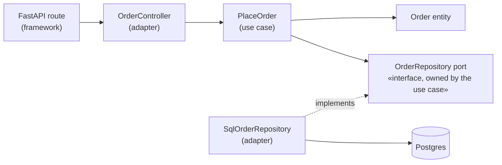

Control flows HTTP → controller → use case → repository → DB. But the use case depends only on the *port*; the SQL adapter depends inward on that port.

**Folder layout that screams intent**

```
 src/shop/
   domain/        order.py  money.py           (no imports from outside domain/)
   application/   place_order.py  ports.py     (imports domain only)
   adapters/      sql_order_repo.py  http_api.py  stripe_payments.py
   main.py        composition root: wires adapters into use cases
```

---

## Example

```python
# domain/order.py — pure, no framework imports
from dataclasses import dataclass, field

@dataclass
class Order:
    id: str
    customer_id: str
    lines: list[tuple[str, int, int]] = field(default_factory=list)   # (sku, qty, unit_cents)
    status: str = "new"

    def add_line(self, sku, qty, unit_cents):
        if qty <= 0: raise ValueError("quantity must be positive")
        self.lines.append((sku, qty, unit_cents))

    @property
    def total_cents(self): return sum(q * p for _, q, p in self.lines)

# application/ports.py — interfaces the use case NEEDS (owned here, implemented outside)
from typing import Protocol
class OrderRepository(Protocol):
    def save(self, order: Order) -> None: ...
    def get(self, order_id: str) -> Order | None: ...

class IdGenerator(Protocol):
    def new_id(self) -> str: ...

# application/place_order.py — one use case
@dataclass(frozen=True)
class PlaceOrderInput:
    customer_id: str
    lines: list[tuple[str, int, int]]

@dataclass(frozen=True)
class PlaceOrderOutput:
    order_id: str
    total_cents: int

class PlaceOrder:
    def __init__(self, repo: OrderRepository, ids: IdGenerator):
        self.repo, self.ids = repo, ids
    def execute(self, data: PlaceOrderInput) -> PlaceOrderOutput:
        order = Order(id=self.ids.new_id(), customer_id=data.customer_id)
        for sku, qty, price in data.lines:
            order.add_line(sku, qty, price)
        if order.total_cents == 0:
            raise ValueError("empty order")
        self.repo.save(order)
        return PlaceOrderOutput(order.id, order.total_cents)

# adapters/memory.py — a swappable adapter (a SQL one has the same methods)
class InMemoryOrderRepository:
    def __init__(self): self.rows = {}
    def save(self, order): self.rows[order.id] = order
    def get(self, order_id): return self.rows.get(order_id)

class SeqIds:
    def __init__(self): self.n = 0
    def new_id(self): self.n += 1; return f"o-{self.n}"

# test: the use case runs with no DB and no web framework
out = PlaceOrder(InMemoryOrderRepository(), SeqIds()).execute(
    PlaceOrderInput("c1", [("pen", 2, 150), ("pad", 1, 400)]))
print(out)                      # PlaceOrderOutput(order_id='o-1', total_cents=700)
```

```python
# adapters/http_api.py — the framework lives at the edge
from fastapi import FastAPI, HTTPException
from pydantic import BaseModel

class OrderIn(BaseModel):
    customer_id: str
    lines: list[tuple[str, int, int]]

def make_api(place_order: PlaceOrder) -> FastAPI:
    api = FastAPI()
    @api.post("/orders", status_code=201)
    def create(body: OrderIn):
        try:
            out = place_order.execute(PlaceOrderInput(body.customer_id, body.lines))
        except ValueError as e:
            raise HTTPException(422, str(e))
        return {"id": out.order_id, "total_cents": out.total_cents}
    return api
```

---

## Exercises

1. Invert a dependency so the domain no longer imports the framework.

   <details><summary>Solution</summary>Find domain code importing SQLAlchemy models or <code>requests</code>. Define a port (Protocol) in the application layer describing what's needed (<code>OrderRepository.save/get</code>, <code>RatesProvider.rate(currency)</code>). Make the domain/use case depend on that port. Move the framework code into an adapter that implements it, and wire it in <code>main.py</code>. Verify with an import-linter rule (<code>domain</code> may not import <code>sqlalchemy</code>, <code>fastapi</code>, or <code>adapters</code>).</details>

2. Swap a SQL adapter for an in-memory one.

   <details><summary>Solution</summary>Both implement <code>OrderRepository</code>. In the composition root, choose by config (<code>REPO=memory|sql</code>). Run the same use-case test suite against both (a parametrized fixture) — a "contract test" for the port that proves the adapters behave the same.</details>

3. Where does input validation belong — the controller or the entity?

   <details><summary>Solution</summary>Both, for different rules. The controller/adapter checks <i>shape</i> (JSON types, required fields) and translates to a DTO. The entity and use case enforce <i>business</i> invariants (quantity > 0, not an empty order), so they hold no matter which adapter calls them.</details>

---

## Mini project

**A service with a pure domain layer and swappable DB/HTTP adapters.**

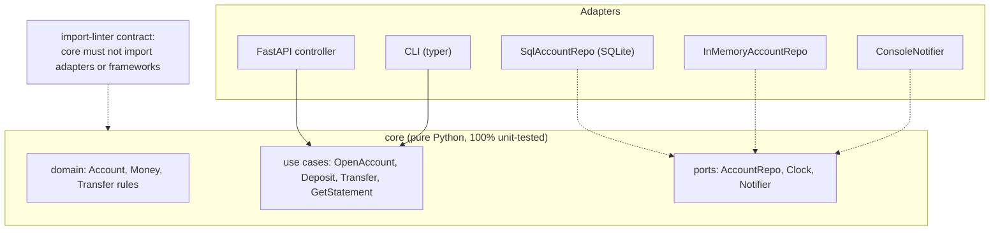

**Steps**

1. Write the domain and use cases first, with in-memory fakes and tests, before choosing any framework.
2. Add two driving adapters (HTTP and CLI) that call the same use cases.
3. Add two driven adapters for persistence (SQLite and in-memory); run a shared contract-test suite against both.
4. A composition root chooses adapters by config.
5. Enforce the dependency rule with `import-linter` in CI.

**Done when:** the core has zero framework imports (checked by CI), both repositories pass the same contract tests, and the CLI and HTTP API share every use case.

---

## Open source

* [`ivanpaulovich/clean-architecture-manga`](https://github.com/ivanpaulovich/clean-architecture-manga) — a .NET reference implementation with use cases, ports, presenters, and adapters. For Python, see `cosmicpython/book` (*Architecture Patterns with Python*) and the `import-linter` tool.

---

## Interview

1. **"What is the dependency rule?"**
   <details><summary>Answer</summary>Source-code dependencies must point only inward, toward higher-level policy: entities know nothing outside themselves, use cases know only entities and their own ports, adapters know use cases, and frameworks sit outermost. When an inner layer must call outward (to save data or send email), it defines an interface that an outer adapter implements, so the call goes outward at runtime while the dependency still points inward.</details>

2. **"Why isolate the domain from frameworks?"**
   <details><summary>Answer</summary>Business rules outlive frameworks and databases. Isolation makes the core fast and simple to test (no DB or HTTP), lets you swap or upgrade technology by writing new adapters, keeps framework concerns (annotations, sessions, request objects) out of business logic, lets you defer technology decisions, and makes the code express the business rather than the plumbing. The trade-off is extra mapping code, so apply it where the domain is complex.</details>

---

## Checklist

- [ ] domain has zero framework imports
- [ ] depend on ports, not adapters
- [ ] test the domain in isolation

---

> [Contents](index.md) · ← [Chapter 7 — GoF Behavioral Patterns](ch07-gof-behavioral-patterns.md) · Next → [Chapter 9 — Hexagonal Architecture (Ports & Adapters)](ch09-hexagonal-architecture-ports-and-adapters.md)
