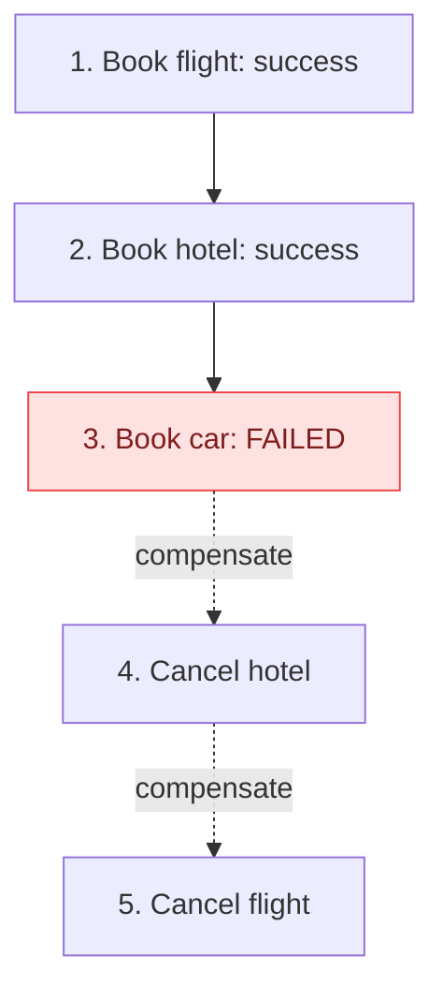
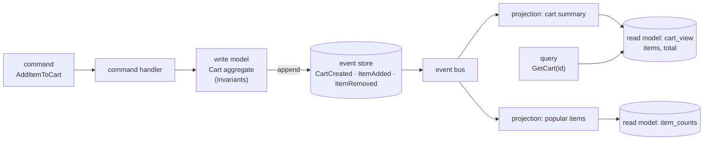
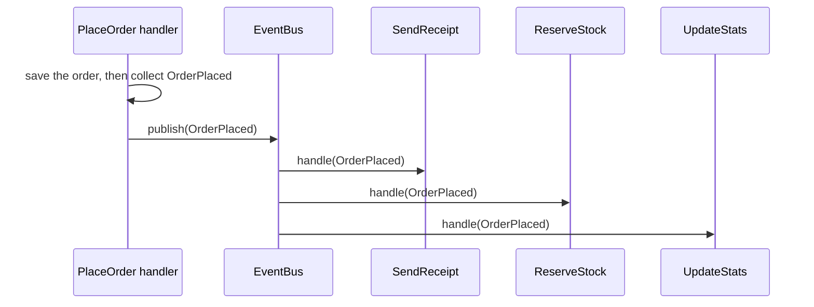
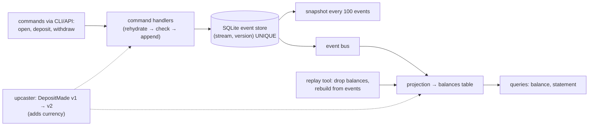

# Chapter 12 — Event Bus, CQRS & Event Sourcing

> **Volume 3 — Low-Level Design** · [Contents](index.md) · ← [Chapter 11 — Repository Pattern & Data Mapping](ch11-repository-pattern-and-data-mapping.md) · Next → [Chapter 13 — Concurrency Patterns & Thread Safety](ch13-concurrency-patterns-and-thread-safety.md)

---

## Concept

In-process event bus; command/query separation; storing events as the source of truth and projecting state.

**In one sentence:** inside one application, an event bus lets parts of the code react to "something happened" without calling each other directly; CQRS splits the code that *changes* data from the code that *reads* it so each can be shaped for its job; and event sourcing stores the list of changes itself as the truth and rebuilds current state by replaying it.

**Mental model — a chess game.** The board you see is the *read model*. The move list ("e4, e5, Nf3…") is the *event store*: from it you can rebuild the board at any point, replay the game, or analyze it in new ways later. A move request ("move the knight to f3") is a *command*, which the rules may reject. Announcing "white played Nf3" to the commentators is publishing an *event* on a bus.

This chapter is the **in-process, code-level** view. For the distributed version (Kafka, projections across services, the outbox), see [Vol 1 Ch 52](../volume-1-cs-foundations/ch52-event-sourcing-and-cqrs-distributed-view.md).

**Three ideas, separable**

| Idea | What it is | You can use it without the others? |
|------|-----------|:-:|
| **Event bus** (in-process) | `bus.publish(OrderPlaced(...))` → registered handlers run | yes |
| **CQRS** | commands (write side, domain model, invariants) are separate from queries (read side: denormalized, fast, no domain logic) | yes — even with a normal DB and no events |
| **Event sourcing** | the write model's state = `fold(events)`; the event store is append-only; read models are *projections* | usually paired with CQRS |

**Commands vs queries vs events**

| | Command | Query | Event |
|-|---------|-------|-------|
| Tense | imperative: `PlaceOrder` | question: `GetOrderSummary` | past: `OrderPlaced` |
| Changes state? | yes | **never** | it *records* a change |
| Can fail / be rejected? | yes | no (may return empty) | no — it already happened |
| Handlers | exactly one | exactly one | zero or many |

**CQRS — when is it worth it?**

| Worth it | Not worth it |
|----------|--------------|
| reads and writes have very different shapes or scale (1000:1 reads, dashboards, search) | simple CRUD screens |
| complex domain invariants on the write side | a small team and a simple domain |
| several read models from the same data (list, search, analytics) | when strong read-after-write consistency is required everywhere |
| paired with event sourcing | "because it's modern" |

**How event sourcing enables replay** — because every change is stored as an immutable event in order, you can: rebuild the aggregate's state at any time (`fold`); build a *new* read model later from the full history; fix a buggy projection and rebuild it; answer "what did this look like last Tuesday?" (temporal queries); and audit every change. Costs: event versioning forever, snapshots for long streams, and eventual consistency between write and read models.

**Event bus rules** — handlers must not depend on each other's order; one failing handler shouldn't break others (or should fail the whole command, as a deliberate choice); publish *after* the state change is committed (or use an outbox); keep handlers idempotent if events can be redelivered.

<!-- eventbus:start -->
### The in-process event bus

**What it is.** An event bus is a small object inside one running program. It holds a map from event type to a list of handler functions. `subscribe(OrderPlaced, send_receipt)` adds a handler to the list, and `publish(OrderPlaced(...))` calls every handler on that list. There is no network, no broker and no serialisation: the event is an ordinary immutable object, and "delivery" is a function call. It is the Observer pattern ([Ch 7](ch07-gof-behavioral-patterns.md)) with a middleman added, so the publisher knows only the bus, never the listeners.

**Why bother.** Without it, the code that places an order has to call the receipt sender, the stock reserver and the stats updater itself. Every new reaction means editing that code and adding another dependency to it. With a bus, the order code announces one fact, and each reaction registers itself.

<div class="fig">
<svg xmlns="http://www.w3.org/2000/svg" viewBox="0 0 760 342" role="img" aria-label="Without a bus the order handler calls every reaction itself and must be edited for each new one; with a bus it publishes OrderPlaced once and any number of handlers subscribe without changing it" style="width:100%;max-width:760px;height:auto;font-family:inherit"><defs><marker id="eb1-ar" viewBox="0 0 10 10" refX="8" refY="5" markerWidth="7" markerHeight="7" orient="auto-start-reverse"><path d="M0 0L10 5L0 10z" fill="context-stroke"/></marker></defs><text x="20" y="26" font-size="13" text-anchor="start" fill="var(--danger)" font-weight="800">WITHOUT A BUS</text><text x="20" y="44" font-size="12" text-anchor="start" fill="var(--text-muted)" font-weight="400">the handler calls every reaction itself</text><rect x="20" y="136" width="150" height="44" rx="9" fill="var(--primary)" fill-opacity=".12" stroke="var(--primary)" stroke-width="1.6"/><text x="95.0" y="156.0" font-size="13" text-anchor="middle" fill="var(--text)" font-weight="700">PlaceOrder</text><text x="95.0" y="172.0" font-size="11" text-anchor="middle" fill="var(--text-muted)" font-weight="400">handler</text><line x1="170" y1="158" x2="226" y2="78" stroke="var(--text-muted)" stroke-width="1.6" marker-end="url(#eb1-ar)"/><g><rect x="230" y="60" width="140" height="36" rx="9" fill="var(--text-muted)" fill-opacity=".12" stroke="var(--text-muted)" stroke-width="1.6"/><text x="300.0" y="83.0" font-size="13" text-anchor="middle" fill="var(--text)" font-weight="700">send receipt</text></g><line x1="170" y1="158" x2="226" y2="138" stroke="var(--text-muted)" stroke-width="1.6" marker-end="url(#eb1-ar)"/><g><rect x="230" y="120" width="140" height="36" rx="9" fill="var(--text-muted)" fill-opacity=".12" stroke="var(--text-muted)" stroke-width="1.6"/><text x="300.0" y="143.0" font-size="13" text-anchor="middle" fill="var(--text)" font-weight="700">reserve stock</text></g><line x1="170" y1="158" x2="226" y2="198" stroke="var(--text-muted)" stroke-width="1.6" marker-end="url(#eb1-ar)"/><g><rect x="230" y="180" width="140" height="36" rx="9" fill="var(--text-muted)" fill-opacity=".12" stroke="var(--text-muted)" stroke-width="1.6"/><text x="300.0" y="203.0" font-size="13" text-anchor="middle" fill="var(--text)" font-weight="700">update stats</text></g><line x1="170" y1="158" x2="226" y2="258" stroke="var(--text-faint)" stroke-width="1.6" stroke-dasharray="6 5" marker-end="url(#eb1-ar)"/><g opacity=".5"><rect x="230" y="240" width="140" height="36" rx="9" fill="var(--text-muted)" fill-opacity=".12" stroke="var(--text-muted)" stroke-width="1.6"/><text x="300.0" y="263.0" font-size="13" text-anchor="middle" fill="var(--text)" font-weight="700">award points</text></g><rect x="172.2" y="290" width="255.6" height="21" rx="10.5" fill="var(--danger-faint)" stroke="var(--danger)" stroke-width="1.2"/><text x="300.0" y="305" font-size="12" text-anchor="middle" fill="var(--danger)" font-weight="700">new reaction = edit the handler ✗</text><line x1="392" y1="16" x2="392" y2="292" stroke="var(--border-strong)" stroke-width="1" stroke-dasharray="3 4"/><text x="412" y="26" font-size="13" text-anchor="start" fill="var(--success)" font-weight="800">WITH AN IN-PROCESS BUS</text><text x="412" y="44" font-size="12" text-anchor="start" fill="var(--text-muted)" font-weight="400">the handler announces once and moves on</text><rect x="412" y="136" width="112" height="44" rx="9" fill="var(--primary)" fill-opacity=".12" stroke="var(--primary)" stroke-width="1.6"/><text x="468.0" y="156.0" font-size="13" text-anchor="middle" fill="var(--text)" font-weight="700">PlaceOrder</text><text x="468.0" y="172.0" font-size="11" text-anchor="middle" fill="var(--text-muted)" font-weight="400">handler</text><line x1="524" y1="158" x2="548" y2="158" stroke="var(--accent)" stroke-width="1.6" marker-end="url(#eb1-ar)"/><rect x="552" y="136" width="56" height="44" rx="8" fill="var(--accent)" fill-opacity=".10" stroke="var(--accent)" stroke-width="1.5"/><rect x="567" y="149" width="26" height="18" rx="3" fill="var(--accent)" fill-opacity=".22" stroke="var(--accent)" stroke-width="1.5"/><path d="M567 149 l13.0 10.799999999999999 l13.0 -10.799999999999999" fill="none" stroke="var(--accent)" stroke-width="1.5"/><text x="580" y="198" font-size="12" text-anchor="middle" fill="var(--text-muted)" font-weight="600">bus</text><line x1="608" y1="158" x2="628" y2="78" stroke="var(--success)" stroke-width="1.6" marker-end="url(#eb1-ar)"/><g><rect x="632" y="60" width="118" height="36" rx="9" fill="var(--success)" fill-opacity=".12" stroke="var(--success)" stroke-width="1.6"/><text x="691.0" y="83.0" font-size="13" text-anchor="middle" fill="var(--text)" font-weight="700">send receipt</text></g><line x1="608" y1="158" x2="628" y2="138" stroke="var(--success)" stroke-width="1.6" marker-end="url(#eb1-ar)"/><g><rect x="632" y="120" width="118" height="36" rx="9" fill="var(--success)" fill-opacity=".12" stroke="var(--success)" stroke-width="1.6"/><text x="691.0" y="143.0" font-size="13" text-anchor="middle" fill="var(--text)" font-weight="700">reserve stock</text></g><line x1="608" y1="158" x2="628" y2="198" stroke="var(--success)" stroke-width="1.6" marker-end="url(#eb1-ar)"/><g><rect x="632" y="180" width="118" height="36" rx="9" fill="var(--success)" fill-opacity=".12" stroke="var(--success)" stroke-width="1.6"/><text x="691.0" y="203.0" font-size="13" text-anchor="middle" fill="var(--text)" font-weight="700">update stats</text></g><line x1="608" y1="158" x2="628" y2="258" stroke="var(--text-faint)" stroke-width="1.6" stroke-dasharray="6 5" marker-end="url(#eb1-ar)"/><g opacity=".5"><rect x="632" y="240" width="118" height="36" rx="9" fill="var(--success)" fill-opacity=".12" stroke="var(--success)" stroke-width="1.6"/><text x="691.0" y="263.0" font-size="13" text-anchor="middle" fill="var(--text)" font-weight="700">award points</text></g><text x="468" y="222" font-size="11" text-anchor="middle" fill="var(--text-muted)" font-weight="400" font-family="ui-monospace,Consolas,monospace">publish(</text><text x="468" y="238" font-size="11" text-anchor="middle" fill="var(--text-muted)" font-weight="400" font-family="ui-monospace,Consolas,monospace">OrderPlaced)</text><rect x="455.8" y="290" width="248.4" height="21" rx="10.5" fill="var(--success-faint)" stroke="var(--success)" stroke-width="1.2"/><text x="580.0" y="305" font-size="12" text-anchor="middle" fill="var(--success)" font-weight="700">new reaction = one subscribe() ✓</text><text x="380" y="334" font-size="12" text-anchor="middle" fill="var(--text-muted)" font-weight="400" font-style="italic">Same process, same thread, plain function calls. Only the knowledge of who reacts has moved.</text></svg>
</div>

**Commands and events are different messages.** A command (`PlaceOrder`) asks for something and has exactly one handler, which may refuse. An event (`OrderPlaced`) states something that already happened and has zero or many handlers, none of which can refuse it. Name events in the past tense, and put the data handlers need inside the event (`order_id`, `customer_id`, `total`), so a handler never has to call back into the publisher to ask.

**Four design choices every bus makes**

| Choice | Option A | Option B | Usual default |
|---|---|---|---|
| **When handlers run** | synchronously, inside `publish`, before it returns | asynchronously, queued to a worker or `asyncio` task | synchronous: simple to test, errors are visible, order is predictable |
| **If a handler fails** | the whole command fails and rolls back | the failure is caught and logged, and the other handlers still run | isolate side effects (email, stats); fail the command only when the reaction is part of the same business rule |
| **Order** | handlers of one event run in subscription order | no promise about order | never rely on handler order; if B must follow A, A should publish its own event |
| **Transaction** | handlers run inside the same database transaction | handlers run after the commit | after the commit, with an outbox when losing an event is not acceptable |

**Publish after the commit, never before.** The most common event-bus bug is publishing at the wrong moment. If you publish first and the commit then fails, listeners have acted on something that never happened. If you commit first and the process dies before `publish`, the change is saved but nobody hears about it. The outbox pattern closes both holes: write the event into an `outbox` table in the same transaction as the data, and let a small relay read that table and publish. The relay may publish an event twice after a crash, so handlers must be idempotent ([Ch 14](ch14-resilience-patterns-idempotency-retries-backoff-circuit-breakers.md)).

<div class="fig">
<svg xmlns="http://www.w3.org/2000/svg" viewBox="0 0 760 330" role="img" aria-label="When to publish: publishing before the commit can announce an order that never saved; publishing after the commit loses the event if the process crashes in between; an outbox saves the event in the same transaction and a relay publishes it at least once" style="width:100%;max-width:760px;height:auto;font-family:inherit"><defs><marker id="eb2-ar" viewBox="0 0 10 10" refX="8" refY="5" markerWidth="7" markerHeight="7" orient="auto-start-reverse"><path d="M0 0L10 5L0 10z" fill="context-stroke"/></marker></defs><text x="20" y="32" font-size="13" text-anchor="start" fill="var(--text)" font-weight="700">1 · publish, then commit</text><rect x="20" y="50" width="154.8" height="21" rx="10.5" fill="var(--warning-faint)" stroke="var(--warning)" stroke-width="1.2"/><text x="97.4" y="65" font-size="12" text-anchor="middle" fill="var(--warning)" font-weight="700">publish OrderPlaced</text><line x1="178.8" y1="61" x2="200.8" y2="61" stroke="var(--text-muted)" stroke-width="1.6" marker-end="url(#eb2-ar)"/><rect x="206.8" y="50" width="126.0" height="21" rx="10.5" fill="var(--success-faint)" stroke="var(--success)" stroke-width="1.2"/><text x="269.8" y="65" font-size="12" text-anchor="middle" fill="var(--success)" font-weight="700">receipt emailed</text><line x1="336.8" y1="61" x2="358.8" y2="61" stroke="var(--text-muted)" stroke-width="1.6" marker-end="url(#eb2-ar)"/><rect x="364.8" y="50" width="104.4" height="21" rx="10.5" fill="var(--danger-faint)" stroke="var(--danger)" stroke-width="1.2"/><text x="417.0" y="65" font-size="12" text-anchor="middle" fill="var(--danger)" font-weight="700">COMMIT fails</text><text x="20" y="98" font-size="12.5" text-anchor="start" fill="var(--danger)" font-weight="700">✗ the customer got a receipt for an order that does not exist</text><text x="20" y="138" font-size="13" text-anchor="start" fill="var(--text)" font-weight="700">2 · commit, then publish</text><rect x="20" y="156" width="75.6" height="21" rx="10.5" fill="var(--success-faint)" stroke="var(--success)" stroke-width="1.2"/><text x="57.8" y="171" font-size="12" text-anchor="middle" fill="var(--success)" font-weight="700">COMMIT ✓</text><line x1="99.6" y1="167" x2="121.6" y2="167" stroke="var(--text-muted)" stroke-width="1.6" marker-end="url(#eb2-ar)"/><rect x="127.6" y="156" width="126.0" height="21" rx="10.5" fill="var(--danger-faint)" stroke="var(--danger)" stroke-width="1.2"/><text x="190.6" y="171" font-size="12" text-anchor="middle" fill="var(--danger)" font-weight="700">process crashes</text><line x1="257.6" y1="167" x2="279.6" y2="167" stroke="var(--text-muted)" stroke-width="1.6" marker-end="url(#eb2-ar)"/><rect x="285.6" y="156" width="147.6" height="21" rx="10.5" fill="var(--danger-faint)" stroke="var(--danger)" stroke-width="1.2"/><text x="359.40000000000003" y="171" font-size="12" text-anchor="middle" fill="var(--danger)" font-weight="700">publish never runs</text><text x="20" y="204" font-size="12.5" text-anchor="start" fill="var(--danger)" font-weight="700">✗ the order is saved, but nothing that reacts to it ever hears</text><text x="20" y="244" font-size="13" text-anchor="start" fill="var(--text)" font-weight="700">3 · outbox: save the event with the data</text><rect x="20" y="262" width="198.0" height="21" rx="10.5" fill="var(--success-faint)" stroke="var(--success)" stroke-width="1.2"/><text x="119.0" y="277" font-size="12" text-anchor="middle" fill="var(--success)" font-weight="700">COMMIT order + outbox row</text><line x1="222.0" y1="273" x2="244.0" y2="273" stroke="var(--text-muted)" stroke-width="1.6" marker-end="url(#eb2-ar)"/><rect x="250.0" y="262" width="147.6" height="21" rx="10.5" fill="var(--primary-faint)" stroke="var(--primary)" stroke-width="1.2"/><text x="323.8" y="277" font-size="12" text-anchor="middle" fill="var(--primary)" font-weight="700">relay reads outbox</text><line x1="401.6" y1="273" x2="423.6" y2="273" stroke="var(--text-muted)" stroke-width="1.6" marker-end="url(#eb2-ar)"/><rect x="429.6" y="262" width="147.6" height="21" rx="10.5" fill="var(--success-faint)" stroke="var(--success)" stroke-width="1.2"/><text x="503.40000000000003" y="277" font-size="12" text-anchor="middle" fill="var(--success)" font-weight="700">publish, mark sent</text><text x="20" y="310" font-size="12.5" text-anchor="start" fill="var(--success)" font-weight="700">✓ never lost; may arrive twice, so every handler must be idempotent</text><line x1="20" y1="116" x2="740" y2="116" stroke="var(--border)" stroke-width="1"/><line x1="20" y1="222" x2="740" y2="222" stroke="var(--border)" stroke-width="1"/></svg>
</div>

**Collect, commit, then dispatch.** A clean way to get the order right is to let the aggregate record its events in a list while it changes, and let the unit of work ([Ch 11](ch11-repository-pattern-and-data-mapping.md)) publish them only after the commit succeeds:

```python
class Order:
    def __init__(self): self.events = []
    def place(self, items):
        ...                                    # check the rules, change state
        self.events.append(OrderPlaced(self.id, total=self.total))

class UnitOfWork:
    def commit(self):
        self.session.commit()                  # 1. the data is durable
        for agg in self.seen:                  # 2. only now tell the rest of the program
            while agg.events:
                self.bus.publish(agg.events.pop(0))
```

**In-process bus vs message broker**

| | In-process bus | Message broker (Kafka, RabbitMQ) |
|---|---|---|
| Reaches | handlers in the same process | consumers in other processes and services |
| If the process dies | events in flight are lost | events are stored and redelivered |
| Speed | a function call, microseconds | a network hop, milliseconds |
| Replay | none: what was not handled is gone | consumers can re-read from an offset |
| Running cost | nothing | a cluster to operate and monitor |

Start in-process. Move an event to a broker when its listeners live in another service, or when it must survive a restart. The outbox is the usual bridge: the in-process bus handles local reactions, and the relay forwards the same events to the broker. The distributed side is covered in [Vol 1 Ch 52](../volume-1-cs-foundations/ch52-event-sourcing-and-cqrs-distributed-view.md).

**Pitfalls**

- **Hidden control flow.** Reading `publish(OrderPlaced)` does not tell you what will run. Register all subscriptions in one place at start-up, and log every dispatch with the handler name.
- **Chains and loops.** A handler that publishes another event, whose handler publishes a third, is hard to follow and can loop back on itself. Keep chains short and test them as one flow.
- **Events used as commands.** `SendEmailRequested` with exactly one expected listener is a command in disguise. Call that code directly.
- **Leaking internals.** Events that carry whole ORM objects tie every handler to your table layout. Publish small, stable data.
<!-- eventbus:end -->

<!-- eventsourcing:start -->
### Event sourcing in practice

**What it is.** A normal table stores the *current state* and overwrites it on every change. An event-sourced aggregate stores the *changes*: an append-only *stream* of events per aggregate (`cart-7`: created, item added, item removed…). It never updates or deletes a row. To load the aggregate, you read its stream and fold the events into an object; to change it, you run the command against that object and append the new events it produces. The stream *is* the database. Tables for screens are projections built from it (see CQRS below).

<div class="fig">
<svg xmlns="http://www.w3.org/2000/svg" viewBox="0 0 760 330" role="img" aria-label="Storing state overwrites the cart row so the history is gone; storing events appends each change with a version number, and a writer that loaded version 4 but finds version 5 already written is rejected and must reload, which is optimistic concurrency" style="width:100%;max-width:760px;height:auto;font-family:inherit"><defs><marker id="v3c12x1-ar" viewBox="0 0 10 10" refX="8" refY="5" markerWidth="7" markerHeight="7" orient="auto-start-reverse"><path d="M0 0L10 5L0 10z" fill="context-stroke"/></marker></defs><text x="20" y="26" font-size="13" text-anchor="start" fill="var(--danger)" font-weight="800">STORE THE STATE</text><text x="20" y="44" font-size="12" text-anchor="start" fill="var(--text-muted)" font-weight="400">UPDATE overwrites the row</text><g><rect x="20" y="60" width="190" height="62" rx="7" fill="var(--bg)" stroke="var(--text-muted)" stroke-width="1.4"/><path d="M20 82 v-15 a7 7 0 0 1 7 -7 h176 a7 7 0 0 1 7 7 v15 z" fill="var(--text-muted)"/><text x="28" y="75" font-size="12" text-anchor="start" fill="#fff" font-weight="700" font-family="ui-monospace,Consolas,monospace">carts</text><text x="28" y="97" font-size="11" text-anchor="start" fill="var(--text-muted)" font-weight="600" font-family="ui-monospace,Consolas,monospace">id</text><text x="68" y="97" font-size="11" text-anchor="start" fill="var(--text-muted)" font-weight="600" font-family="ui-monospace,Consolas,monospace">items</text><text x="158" y="97" font-size="11" text-anchor="start" fill="var(--text-muted)" font-weight="600" font-family="ui-monospace,Consolas,monospace">total</text><line x1="20" y1="102" x2="210" y2="102" stroke="var(--border)" stroke-width="1"/><text x="28" y="116" font-size="12" text-anchor="start" fill="var(--text)" font-weight="400" font-family="ui-monospace,Consolas,monospace">7</text><text x="68" y="116" font-size="12" text-anchor="start" fill="var(--text)" font-weight="400" font-family="ui-monospace,Consolas,monospace">pad ×1</text><text x="158" y="116" font-size="12" text-anchor="start" fill="var(--text)" font-weight="400" font-family="ui-monospace,Consolas,monospace">400</text></g><text x="20" y="140" font-size="11" text-anchor="start" fill="var(--text-muted)" font-weight="400" font-family="ui-monospace,Consolas,monospace">UPDATE carts SET items=&#x27;pad ×1&#x27;,</text><text x="20" y="156" font-size="11" text-anchor="start" fill="var(--text-muted)" font-weight="400" font-family="ui-monospace,Consolas,monospace">  total=400 WHERE id=7</text><rect x="20" y="178" width="262.8" height="21" rx="10.5" fill="var(--danger-faint)" stroke="var(--danger)" stroke-width="1.2"/><text x="151.4" y="193" font-size="12" text-anchor="middle" fill="var(--danger)" font-weight="700">was a pen ever in it? unknowable ✗</text><line x1="300" y1="16" x2="300" y2="250" stroke="var(--border-strong)" stroke-width="1" stroke-dasharray="3 4"/><text x="320" y="26" font-size="13" text-anchor="start" fill="var(--primary)" font-weight="800">STORE THE EVENTS</text><text x="320" y="44" font-size="12" text-anchor="start" fill="var(--text-muted)" font-weight="400">append-only stream cart-7; state = fold(events)</text><g><rect x="320" y="60" width="194" height="142" rx="7" fill="var(--bg)" stroke="var(--primary)" stroke-width="1.4"/><path d="M320 82 v-15 a7 7 0 0 1 7 -7 h180 a7 7 0 0 1 7 7 v15 z" fill="var(--primary)"/><text x="328" y="75" font-size="12" text-anchor="start" fill="#fff" font-weight="700" font-family="ui-monospace,Consolas,monospace">stream cart-7</text><text x="328" y="97" font-size="11" text-anchor="start" fill="var(--text-muted)" font-weight="600" font-family="ui-monospace,Consolas,monospace">ver</text><text x="372" y="97" font-size="11" text-anchor="start" fill="var(--text-muted)" font-weight="600" font-family="ui-monospace,Consolas,monospace">event</text><line x1="320" y1="102" x2="514" y2="102" stroke="var(--border)" stroke-width="1"/><text x="328" y="116" font-size="12" text-anchor="start" fill="var(--text)" font-weight="400" font-family="ui-monospace,Consolas,monospace">1</text><text x="372" y="116" font-size="12" text-anchor="start" fill="var(--text)" font-weight="400" font-family="ui-monospace,Consolas,monospace">CartCreated</text><line x1="320" y1="122" x2="514" y2="122" stroke="var(--border)" stroke-width="1"/><text x="328" y="136" font-size="12" text-anchor="start" fill="var(--text)" font-weight="400" font-family="ui-monospace,Consolas,monospace">2</text><text x="372" y="136" font-size="12" text-anchor="start" fill="var(--text)" font-weight="400" font-family="ui-monospace,Consolas,monospace">ItemAdded pen×2</text><line x1="320" y1="142" x2="514" y2="142" stroke="var(--border)" stroke-width="1"/><text x="328" y="156" font-size="12" text-anchor="start" fill="var(--text)" font-weight="400" font-family="ui-monospace,Consolas,monospace">3</text><text x="372" y="156" font-size="12" text-anchor="start" fill="var(--text)" font-weight="400" font-family="ui-monospace,Consolas,monospace">ItemAdded pad×1</text><line x1="320" y1="162" x2="514" y2="162" stroke="var(--border)" stroke-width="1"/><text x="328" y="176" font-size="12" text-anchor="start" fill="var(--text)" font-weight="400" font-family="ui-monospace,Consolas,monospace">4</text><text x="372" y="176" font-size="12" text-anchor="start" fill="var(--text)" font-weight="400" font-family="ui-monospace,Consolas,monospace">ItemRemoved pen</text><rect x="321" y="183" width="192" height="19" fill="var(--success-faint)"/><line x1="320" y1="182" x2="514" y2="182" stroke="var(--border)" stroke-width="1"/><text x="328" y="196" font-size="12" text-anchor="start" fill="var(--success)" font-weight="400" font-family="ui-monospace,Consolas,monospace">5</text><text x="372" y="196" font-size="12" text-anchor="start" fill="var(--success)" font-weight="400" font-family="ui-monospace,Consolas,monospace">CouponApplied</text></g><text x="530" y="78" font-size="11.5" text-anchor="start" fill="var(--text)" font-weight="400">writer A loaded v4,</text><text x="530" y="94" font-size="11.5" text-anchor="start" fill="var(--success)" font-weight="700">appended v5 first ✓</text><text x="530" y="140" font-size="11.5" text-anchor="start" fill="var(--text)" font-weight="400">writer B also loaded v4:</text><text x="530" y="156" font-size="11.5" text-anchor="start" fill="var(--text)" font-weight="400" font-family="ui-monospace,Consolas,monospace">append(expected=4)</text><rect x="530" y="170" width="198.0" height="21" rx="10.5" fill="var(--danger-faint)" stroke="var(--danger)" stroke-width="1.2"/><text x="629.0" y="185" font-size="12" text-anchor="middle" fill="var(--danger)" font-weight="700">rejected: stream is at v5</text><text x="530" y="212" font-size="11.5" text-anchor="start" fill="var(--text-muted)" font-weight="400">→ reload, re-check, retry</text><text x="380" y="282" font-size="12.5" text-anchor="middle" fill="var(--text)" font-weight="600">History is free with events: rebuild any past state, audit every change, build new views later.</text><text x="380" y="304" font-size="12" text-anchor="middle" fill="var(--text-muted)" font-weight="400" font-style="italic">The version check is optimistic concurrency: no locks, just &quot;append only if nobody else did&quot;.</text></svg>
</div>

**The write path, in code.** The aggregate turns a command into events, and each event is applied with one small `apply` method. That same method is used both when replaying history and when recording a new change, so the two can never disagree.

```python
class Cart:
    def __init__(self):
        self.version, self.items, self.pending = 0, {}, []

    @classmethod
    def load(cls, events):                     # rebuild = fold over history
        cart = cls()
        for e in events:
            cart._apply(e)
        return cart

    def remove(self, sku):                     # command: check rules, then record a fact
        if sku not in self.items:
            raise ValueError(f"{sku} not in cart")
        self._record(ItemRemoved(sku))

    def _record(self, event):
        self._apply(event)
        self.pending.append(event)

    def _apply(self, e):                       # the only place state changes
        if isinstance(e, ItemAdded):
            self.items[e.sku] = self.items.get(e.sku, 0) + e.qty
        elif isinstance(e, ItemRemoved):
            del self.items[e.sku]
        self.version += 1

events = store.read("cart-7")
cart = Cart.load(events)
cart.remove("pen")
store.append("cart-7", cart.pending, expected_version=len(events))  # fails if someone appended first
```

**Concurrency without locks.** `expected_version` is *optimistic concurrency*. The store accepts the append only if the stream is still at the version you loaded. If another request got there first, you get a conflict: reload, re-run the command against the new state, and try again. Two writers can never both act on stale state.

**Problems you must solve up front**

| Problem | Usual answer |
|---------|--------------|
| long streams make loading slow | **snapshots**: every N events, save the folded state together with its version; load the snapshot, then replay only the events after it |
| event shapes change, but old events live forever | never edit stored events. Add *versioned* event types, and **upcast** old versions to the new shape as you read them |
| read models lag behind writes | eventual consistency between the write and read sides; show "saved" from the command result, not from a re-query |
| personal data and "the right to be forgotten" | keep personal fields out of events, or encrypt them per person and delete the key (*crypto-shredding*) |
| side effects during replay | handlers that send emails or charge cards must not run again on a rebuild; replay into projections only |

**When it pays off, and when it doesn't.** Event sourcing fits domains where history *is* the product, or where it is legally required: ledgers and payments, orders and fulfilment, bookings, audit-heavy workflows, anything where people ask "how did it get into this state?". It also fits when you expect to need new read models from old data. It is a poor fit for simple CRUD, or where the current value is all anyone needs (a user's avatar URL). It adds real cost: versioning events forever, building projections, and designing for eventual consistency. It is usually applied to a few core aggregates, not to a whole system. The distributed version, with Kafka, projections across services and the outbox, is in [Vol 1 Ch 52](../volume-1-cs-foundations/ch52-event-sourcing-and-cqrs-distributed-view.md).
<!-- eventsourcing:end -->

### More on this topic, from the AI Library

The sections below come from the AI Library's system-design course and cover the same ground at architecture level.

### CQRS (Command Query Responsibility Segregation)

**Separate the model used for writes from the model used for reads.** Writes go through a "command" model (often *normalized*, meaning split into separate related tables to avoid duplicated data, see Chapter 8; and transactional); reads go through a "query" model (often denormalized, materialized views).

**Why:** read and write patterns are wildly different at scale. Reads vastly outnumber writes; denormalized views serve them in O(1). Writes can use a clean normalized model without performance pressure.

**Trade-off:** complexity. Don't reach for CQRS unless your read/write asymmetry is extreme.

*(From AI Library chapter 4.)*

### Saga Pattern (Distributed Transactions Without 2PC)

In a monolith, you wrap multi-step operations in a database transaction. In microservices, **you can't** — each service has its own DB. The **Saga pattern** is the answer.

**The idea:** break the transaction into a sequence of *local* transactions, each in its own service. If step N fails, run **compensating transactions** to undo steps 1..N-1.

**Example: book a trip (flight + hotel + car)**




Two implementation styles:
- **Choreography:** each service listens for events and decides what to do. No central coordinator. Simple but hard to reason about at scale.
- **Orchestration:** a central "saga orchestrator" service tells each step what to do. Easier to debug; one more service to operate.

*(From AI Library chapter 4.)*

---

## Prereqs

* [Chapter 10 — Domain-Driven Design (Tactical)](ch10-domain-driven-design-tactical.md)
* [Chapter 11 — Repository Pattern & Data Mapping](ch11-repository-pattern-and-data-mapping.md)

---

## Diagram

<!-- cqrs-figs:start -->
**CQRS in six pictures** — blue is the write side, green is the read side, ✗ marks what breaks.

**Two paths, not one.** A command changes the write store and only says whether it worked; a query reads a prepared view and changes nothing.

<div class="fig">
<svg xmlns="http://www.w3.org/2000/svg" viewBox="0 0 760 330" role="img" aria-label="Commands and queries take two separate paths: a command changes the write store and returns only ok or an error; a query reads a prepared view and changes nothing" style="width:100%;max-width:760px;height:auto;font-family:inherit"><defs><marker id="cq1-ar" viewBox="0 0 10 10" refX="8" refY="5" markerWidth="7" markerHeight="7" orient="auto-start-reverse"><path d="M0 0L10 5L0 10z" fill="context-stroke"/></marker></defs><text x="20" y="42" font-size="15" text-anchor="start" fill="var(--primary)" font-weight="800">COMMANDS</text><text x="20" y="60" font-size="12" text-anchor="start" fill="var(--text-muted)" font-weight="400">change something</text><circle cx="170" cy="62" r="8" fill="var(--text-muted)"/><path d="M156 86 a14 13 0 0 1 28 0 z" fill="var(--text-muted)"/><line x1="195" y1="72" x2="290" y2="72" stroke="var(--primary)" stroke-width="1.6" marker-end="url(#cq1-ar)"/><text x="242" y="62" font-size="11" text-anchor="middle" fill="var(--text-muted)" font-weight="400" font-family="ui-monospace,Consolas,monospace">AddItem(pad)</text><rect x="295" y="47" width="200" height="52" rx="9" fill="var(--primary)" fill-opacity=".12" stroke="var(--primary)" stroke-width="1.6"/><text x="313" y="79.0" font-size="17" text-anchor="middle" fill="var(--primary)" font-weight="700">⚙</text><text x="405.0" y="71.0" font-size="13" text-anchor="middle" fill="var(--text)" font-weight="700">command handler</text><text x="405.0" y="87.0" font-size="11" text-anchor="middle" fill="var(--text-muted)" font-weight="400">validate → rules → save</text><line x1="495" y1="72" x2="585" y2="72" stroke="var(--primary)" stroke-width="1.6" marker-end="url(#cq1-ar)"/><g><path d="M590 49 v48 a40.0 9 0 0 0 80 0 v-48" fill="var(--primary)" fill-opacity=".16" stroke="var(--primary)" stroke-width="1.6"/><ellipse cx="630.0" cy="49" rx="40.0" ry="9" fill="var(--primary)" fill-opacity=".30" stroke="var(--primary)" stroke-width="1.6"/></g><text x="630.0" y="122" font-size="12" text-anchor="middle" fill="var(--text-muted)" font-weight="600">write store</text><rect x="599.4" y="16" width="61.2" height="21" rx="10.5" fill="var(--primary-faint)" stroke="var(--primary)" stroke-width="1.2"/><text x="630.0" y="31" font-size="12" text-anchor="middle" fill="var(--primary)" font-weight="700">+1 row</text><text x="195" y="128" font-size="12" text-anchor="start" fill="var(--text)" font-weight="400" font-family="ui-monospace,Consolas,monospace">← returns: ok  (or: rejected, out of stock)</text><text x="195" y="148" font-size="12" text-anchor="start" fill="var(--text-muted)" font-weight="400" font-style="italic">may be rejected · exactly one handler · imperative name</text><text x="20" y="212" font-size="15" text-anchor="start" fill="var(--success)" font-weight="800">QUERIES</text><text x="20" y="230" font-size="12" text-anchor="start" fill="var(--text-muted)" font-weight="400">ask something</text><circle cx="170" cy="232" r="8" fill="var(--text-muted)"/><path d="M156 256 a14 13 0 0 1 28 0 z" fill="var(--text-muted)"/><line x1="195" y1="242" x2="290" y2="242" stroke="var(--success)" stroke-width="1.6" marker-end="url(#cq1-ar)"/><text x="242" y="232" font-size="11" text-anchor="middle" fill="var(--text-muted)" font-weight="400" font-family="ui-monospace,Consolas,monospace">GetCart(7)</text><rect x="295" y="217" width="200" height="52" rx="9" fill="var(--success)" fill-opacity=".12" stroke="var(--success)" stroke-width="1.6"/><text x="313" y="249.0" font-size="17" text-anchor="middle" fill="var(--success)" font-weight="700">⌕</text><text x="405.0" y="241.0" font-size="13" text-anchor="middle" fill="var(--text)" font-weight="700">query handler</text><text x="405.0" y="257.0" font-size="11" text-anchor="middle" fill="var(--text-muted)" font-weight="400">look up a prepared view</text><line x1="495" y1="242" x2="585" y2="242" stroke="var(--success)" stroke-width="1.6" marker-end="url(#cq1-ar)"/><g><path d="M590 219 v48 a40.0 9 0 0 0 80 0 v-48" fill="var(--success)" fill-opacity=".16" stroke="var(--success)" stroke-width="1.6"/><ellipse cx="630.0" cy="219" rx="40.0" ry="9" fill="var(--success)" fill-opacity=".30" stroke="var(--success)" stroke-width="1.6"/></g><text x="630.0" y="292" font-size="12" text-anchor="middle" fill="var(--text-muted)" font-weight="600">read store</text><rect x="588.6" y="186" width="82.8" height="21" rx="10.5" fill="var(--success-faint)" stroke="var(--success)" stroke-width="1.2"/><text x="630.0" y="201" font-size="12" text-anchor="middle" fill="var(--success)" font-weight="700">unchanged</text><text x="195" y="298" font-size="12" text-anchor="start" fill="var(--text)" font-weight="400" font-family="ui-monospace,Consolas,monospace">← returns: { pad ×1, total 400 }</text><text x="195" y="318" font-size="12" text-anchor="start" fill="var(--text-muted)" font-weight="400" font-style="italic">never changes data · run it 100 times, same result</text><line x1="20" y1="168" x2="740" y2="168" stroke="var(--border-strong)" stroke-width="1" stroke-dasharray="3 4"/></svg>
</div>

**Why the read side gets its own shape.** The write tables stay small and clean, which makes every read join them. The read side stores the answer already joined.

<div class="fig">
<svg xmlns="http://www.w3.org/2000/svg" viewBox="0 0 760 330" role="img" aria-label="The write side keeps small normalised tables, so GetCart needs a three-table join on every read; the read side stores one ready-made row per cart, so GetCart is a single lookup" style="width:100%;max-width:760px;height:auto;font-family:inherit"><defs><marker id="cq2-ar" viewBox="0 0 10 10" refX="8" refY="5" markerWidth="7" markerHeight="7" orient="auto-start-reverse"><path d="M0 0L10 5L0 10z" fill="context-stroke"/></marker></defs><text x="20" y="26" font-size="13" text-anchor="start" fill="var(--primary)" font-weight="800">WRITE SIDE</text><text x="112" y="26" font-size="12" text-anchor="start" fill="var(--text-muted)" font-weight="400">small tables, no duplicates (normalised)</text><g><rect x="20" y="42" width="102" height="62" rx="7" fill="var(--bg)" stroke="var(--primary)" stroke-width="1.4"/><path d="M20 64 v-15 a7 7 0 0 1 7 -7 h88 a7 7 0 0 1 7 7 v15 z" fill="var(--primary)"/><text x="28" y="57" font-size="12" text-anchor="start" fill="#fff" font-weight="700" font-family="ui-monospace,Consolas,monospace">carts</text><text x="28" y="79" font-size="11" text-anchor="start" fill="var(--text-muted)" font-weight="600" font-family="ui-monospace,Consolas,monospace">id</text><text x="68" y="79" font-size="11" text-anchor="start" fill="var(--text-muted)" font-weight="600" font-family="ui-monospace,Consolas,monospace">owner</text><line x1="20" y1="84" x2="122" y2="84" stroke="var(--border)" stroke-width="1"/><text x="28" y="98" font-size="12" text-anchor="start" fill="var(--text)" font-weight="400" font-family="ui-monospace,Consolas,monospace">7</text><text x="68" y="98" font-size="12" text-anchor="start" fill="var(--text)" font-weight="400" font-family="ui-monospace,Consolas,monospace">c1</text></g><g><rect x="140" y="42" width="130" height="62" rx="7" fill="var(--bg)" stroke="var(--primary)" stroke-width="1.4"/><path d="M140 64 v-15 a7 7 0 0 1 7 -7 h116 a7 7 0 0 1 7 7 v15 z" fill="var(--primary)"/><text x="148" y="57" font-size="12" text-anchor="start" fill="#fff" font-weight="700" font-family="ui-monospace,Consolas,monospace">cart_items</text><text x="148" y="79" font-size="11" text-anchor="start" fill="var(--text-muted)" font-weight="600" font-family="ui-monospace,Consolas,monospace">cart</text><text x="194" y="79" font-size="11" text-anchor="start" fill="var(--text-muted)" font-weight="600" font-family="ui-monospace,Consolas,monospace">item</text><text x="240" y="79" font-size="11" text-anchor="start" fill="var(--text-muted)" font-weight="600" font-family="ui-monospace,Consolas,monospace">qty</text><line x1="140" y1="84" x2="270" y2="84" stroke="var(--border)" stroke-width="1"/><text x="148" y="98" font-size="12" text-anchor="start" fill="var(--text)" font-weight="400" font-family="ui-monospace,Consolas,monospace">7</text><text x="194" y="98" font-size="12" text-anchor="start" fill="var(--text)" font-weight="400" font-family="ui-monospace,Consolas,monospace">pad</text><text x="240" y="98" font-size="12" text-anchor="start" fill="var(--text)" font-weight="400" font-family="ui-monospace,Consolas,monospace">1</text></g><g><rect x="290" y="42" width="106" height="62" rx="7" fill="var(--bg)" stroke="var(--primary)" stroke-width="1.4"/><path d="M290 64 v-15 a7 7 0 0 1 7 -7 h92 a7 7 0 0 1 7 7 v15 z" fill="var(--primary)"/><text x="298" y="57" font-size="12" text-anchor="start" fill="#fff" font-weight="700" font-family="ui-monospace,Consolas,monospace">products</text><text x="298" y="79" font-size="11" text-anchor="start" fill="var(--text-muted)" font-weight="600" font-family="ui-monospace,Consolas,monospace">item</text><text x="348" y="79" font-size="11" text-anchor="start" fill="var(--text-muted)" font-weight="600" font-family="ui-monospace,Consolas,monospace">price</text><line x1="290" y1="84" x2="396" y2="84" stroke="var(--border)" stroke-width="1"/><text x="298" y="98" font-size="12" text-anchor="start" fill="var(--text)" font-weight="400" font-family="ui-monospace,Consolas,monospace">pad</text><text x="348" y="98" font-size="12" text-anchor="start" fill="var(--text)" font-weight="400" font-family="ui-monospace,Consolas,monospace">400</text></g><line x1="71" y1="106" x2="200" y2="160" stroke="var(--danger)" stroke-width="1.6" stroke-dasharray="6 5"/><line x1="205" y1="106" x2="200" y2="160" stroke="var(--danger)" stroke-width="1.6" stroke-dasharray="6 5"/><line x1="343" y1="106" x2="200" y2="160" stroke="var(--danger)" stroke-width="1.6" stroke-dasharray="6 5"/><rect x="110" y="160" width="180" height="40" rx="9" fill="var(--danger)" fill-opacity=".12" stroke="var(--danger)" stroke-width="1.6"/><text x="200.0" y="185.0" font-size="13" text-anchor="middle" fill="var(--text)" font-weight="700">JOIN 3 tables</text><rect x="83.0" y="212" width="234.0" height="21" rx="10.5" fill="var(--danger-faint)" stroke="var(--danger)" stroke-width="1.2"/><text x="200.0" y="227" font-size="12" text-anchor="middle" fill="var(--danger)" font-weight="700">every read pays for the join ✗</text><line x1="420" y1="20" x2="420" y2="250" stroke="var(--border-strong)" stroke-width="1" stroke-dasharray="3 4"/><text x="440" y="26" font-size="13" text-anchor="start" fill="var(--success)" font-weight="800">READ SIDE</text><text x="524" y="26" font-size="12" text-anchor="start" fill="var(--text-muted)" font-weight="400">one row per screen (denormalised)</text><g><rect x="440" y="42" width="254" height="62" rx="7" fill="var(--bg)" stroke="var(--success)" stroke-width="1.4"/><path d="M440 64 v-15 a7 7 0 0 1 7 -7 h240 a7 7 0 0 1 7 7 v15 z" fill="var(--success)"/><text x="448" y="57" font-size="12" text-anchor="start" fill="#fff" font-weight="700" font-family="ui-monospace,Consolas,monospace">cart_view</text><text x="448" y="79" font-size="11" text-anchor="start" fill="var(--text-muted)" font-weight="600" font-family="ui-monospace,Consolas,monospace">cart</text><text x="494" y="79" font-size="11" text-anchor="start" fill="var(--text-muted)" font-weight="600" font-family="ui-monospace,Consolas,monospace">owner</text><text x="550" y="79" font-size="11" text-anchor="start" fill="var(--text-muted)" font-weight="600" font-family="ui-monospace,Consolas,monospace">items</text><text x="642" y="79" font-size="11" text-anchor="start" fill="var(--text-muted)" font-weight="600" font-family="ui-monospace,Consolas,monospace">total</text><rect x="441" y="85" width="252" height="19" fill="var(--success-faint)"/><line x1="440" y1="84" x2="694" y2="84" stroke="var(--border)" stroke-width="1"/><text x="448" y="98" font-size="12" text-anchor="start" fill="var(--success)" font-weight="400" font-family="ui-monospace,Consolas,monospace">7</text><text x="494" y="98" font-size="12" text-anchor="start" fill="var(--success)" font-weight="400" font-family="ui-monospace,Consolas,monospace">c1</text><text x="550" y="98" font-size="12" text-anchor="start" fill="var(--success)" font-weight="400" font-family="ui-monospace,Consolas,monospace">pad ×1</text><text x="642" y="98" font-size="12" text-anchor="start" fill="var(--success)" font-weight="400" font-family="ui-monospace,Consolas,monospace">400</text></g><line x1="567" y1="106" x2="567" y2="156" stroke="var(--success)" stroke-width="1.6" marker-end="url(#cq2-ar)"/><rect x="487" y="160" width="160" height="40" rx="9" fill="var(--success)" fill-opacity=".12" stroke="var(--success)" stroke-width="1.6"/><text x="567.0" y="185.0" font-size="13" text-anchor="middle" fill="var(--text)" font-weight="700">1 lookup by id</text><rect x="453.6" y="212" width="226.8" height="21" rx="10.5" fill="var(--success-faint)" stroke="var(--success)" stroke-width="1.2"/><text x="567.0" y="227" font-size="12" text-anchor="middle" fill="var(--success)" font-weight="700">the answer is already built ✓</text><text x="380" y="278" font-size="12.5" text-anchor="middle" fill="var(--text)" font-weight="600">A read replica copies the left side, joins and all. Copies add capacity; only a new shape removes the join.</text><text x="380" y="300" font-size="12" text-anchor="middle" fill="var(--text-muted)" font-weight="400" font-style="italic">Who builds cart_view, and when? That is the next three figures.</text></svg>
</div>

**One truth, many shapes.** Every read model is built from the same events. Adding one more never touches the write side.

<div class="fig">
<svg xmlns="http://www.w3.org/2000/svg" viewBox="0 0 760 350" role="img" aria-label="One event store feeds an event bus; projections turn each event into several read models shaped for different screens, and a new read model is just a new projection" style="width:100%;max-width:760px;height:auto;font-family:inherit"><defs><marker id="cq3-ar" viewBox="0 0 10 10" refX="8" refY="5" markerWidth="7" markerHeight="7" orient="auto-start-reverse"><path d="M0 0L10 5L0 10z" fill="context-stroke"/></marker></defs><text x="20" y="24" font-size="12" text-anchor="start" fill="var(--primary)" font-weight="800">ONE SOURCE OF TRUTH</text><g><rect x="20" y="36" width="166" height="122" rx="7" fill="var(--bg)" stroke="var(--primary)" stroke-width="1.4"/><path d="M20 58 v-15 a7 7 0 0 1 7 -7 h152 a7 7 0 0 1 7 7 v15 z" fill="var(--primary)"/><text x="28" y="51" font-size="12" text-anchor="start" fill="#fff" font-weight="700" font-family="ui-monospace,Consolas,monospace">events · cart-7</text><text x="28" y="73" font-size="11" text-anchor="start" fill="var(--text-muted)" font-weight="600" font-family="ui-monospace,Consolas,monospace">#</text><text x="54" y="73" font-size="11" text-anchor="start" fill="var(--text-muted)" font-weight="600" font-family="ui-monospace,Consolas,monospace">event</text><line x1="20" y1="78" x2="186" y2="78" stroke="var(--border)" stroke-width="1"/><text x="28" y="92" font-size="12" text-anchor="start" fill="var(--text)" font-weight="400" font-family="ui-monospace,Consolas,monospace">1</text><text x="54" y="92" font-size="12" text-anchor="start" fill="var(--text)" font-weight="400" font-family="ui-monospace,Consolas,monospace">CartCreated</text><line x1="20" y1="98" x2="186" y2="98" stroke="var(--border)" stroke-width="1"/><text x="28" y="112" font-size="12" text-anchor="start" fill="var(--text)" font-weight="400" font-family="ui-monospace,Consolas,monospace">2</text><text x="54" y="112" font-size="12" text-anchor="start" fill="var(--text)" font-weight="400" font-family="ui-monospace,Consolas,monospace">ItemAdded pen×2</text><line x1="20" y1="118" x2="186" y2="118" stroke="var(--border)" stroke-width="1"/><text x="28" y="132" font-size="12" text-anchor="start" fill="var(--text)" font-weight="400" font-family="ui-monospace,Consolas,monospace">3</text><text x="54" y="132" font-size="12" text-anchor="start" fill="var(--text)" font-weight="400" font-family="ui-monospace,Consolas,monospace">ItemAdded pad×1</text><rect x="21" y="139" width="164" height="19" fill="var(--success-faint)"/><line x1="20" y1="138" x2="186" y2="138" stroke="var(--border)" stroke-width="1"/><text x="28" y="152" font-size="12" text-anchor="start" fill="var(--success)" font-weight="400" font-family="ui-monospace,Consolas,monospace">4</text><text x="54" y="152" font-size="12" text-anchor="start" fill="var(--success)" font-weight="400" font-family="ui-monospace,Consolas,monospace">ItemRemoved pen</text></g><line x1="190" y1="120" x2="250" y2="120" stroke="var(--primary)" stroke-width="1.6" marker-end="url(#cq3-ar)"/><rect x="255" y="98" width="110" height="44" rx="8" fill="var(--accent)" fill-opacity=".10" stroke="var(--accent)" stroke-width="1.5"/><rect x="266" y="111" width="26" height="18" rx="3" fill="var(--accent)" fill-opacity=".22" stroke="var(--accent)" stroke-width="1.5"/><path d="M266 111 l13.0 10.799999999999999 l13.0 -10.799999999999999" fill="none" stroke="var(--accent)" stroke-width="1.5"/><rect x="297" y="111" width="26" height="18" rx="3" fill="var(--accent)" fill-opacity=".22" stroke="var(--accent)" stroke-width="1.5"/><path d="M297 111 l13.0 10.799999999999999 l13.0 -10.799999999999999" fill="none" stroke="var(--accent)" stroke-width="1.5"/><rect x="328" y="111" width="26" height="18" rx="3" fill="var(--accent)" fill-opacity=".22" stroke="var(--accent)" stroke-width="1.5"/><path d="M328 111 l13.0 10.799999999999999 l13.0 -10.799999999999999" fill="none" stroke="var(--accent)" stroke-width="1.5"/><text x="310" y="160" font-size="12" text-anchor="middle" fill="var(--text-muted)" font-weight="600">event bus</text><line x1="365" y1="120" x2="405" y2="120" stroke="var(--accent)" stroke-width="1.6" marker-end="url(#cq3-ar)"/><polygon points="429.8,100.8 414.2,122.4 423.8,122.4 419.0,139.2 435.8,116.4 426.2,116.4" fill="var(--accent)"/><text x="425" y="160" font-size="12" text-anchor="middle" fill="var(--text-muted)" font-weight="600">projections</text><text x="520" y="24" font-size="12" text-anchor="start" fill="var(--success)" font-weight="800">MANY SHAPES</text><path d="M445 120 C 480 120, 480 66, 512 66" fill="none" stroke="var(--success)" stroke-width="1.6" stroke-dasharray="6 5" marker-end="url(#cq3-ar)"/><g><rect x="520" y="36" width="130" height="62" rx="7" fill="var(--bg)" stroke="var(--success)" stroke-width="1.4"/><path d="M520 58 v-15 a7 7 0 0 1 7 -7 h116 a7 7 0 0 1 7 7 v15 z" fill="var(--success)"/><text x="528" y="51" font-size="12" text-anchor="start" fill="#fff" font-weight="700" font-family="ui-monospace,Consolas,monospace">cart_view</text><text x="528" y="73" font-size="11" text-anchor="start" fill="var(--text-muted)" font-weight="600" font-family="ui-monospace,Consolas,monospace">cart</text><text x="588" y="73" font-size="11" text-anchor="start" fill="var(--text-muted)" font-weight="600" font-family="ui-monospace,Consolas,monospace">total</text><line x1="520" y1="78" x2="650" y2="78" stroke="var(--border)" stroke-width="1"/><text x="528" y="92" font-size="12" text-anchor="start" fill="var(--text)" font-weight="400" font-family="ui-monospace,Consolas,monospace">7</text><text x="588" y="92" font-size="12" text-anchor="start" fill="var(--text)" font-weight="400" font-family="ui-monospace,Consolas,monospace">400</text></g><text x="660" y="71.0" font-size="11" text-anchor="start" fill="var(--text-muted)" font-weight="400" font-style="italic">the cart page</text><path d="M445 120 C 480 120, 480 142, 512 142" fill="none" stroke="var(--success)" stroke-width="1.6" stroke-dasharray="6 5" marker-end="url(#cq3-ar)"/><g><rect x="520" y="112" width="130" height="82" rx="7" fill="var(--bg)" stroke="var(--success)" stroke-width="1.4"/><path d="M520 134 v-15 a7 7 0 0 1 7 -7 h116 a7 7 0 0 1 7 7 v15 z" fill="var(--success)"/><text x="528" y="127" font-size="12" text-anchor="start" fill="#fff" font-weight="700" font-family="ui-monospace,Consolas,monospace">item_counts</text><text x="528" y="149" font-size="11" text-anchor="start" fill="var(--text-muted)" font-weight="600" font-family="ui-monospace,Consolas,monospace">item</text><text x="588" y="149" font-size="11" text-anchor="start" fill="var(--text-muted)" font-weight="600" font-family="ui-monospace,Consolas,monospace">adds</text><line x1="520" y1="154" x2="650" y2="154" stroke="var(--border)" stroke-width="1"/><text x="528" y="168" font-size="12" text-anchor="start" fill="var(--text)" font-weight="400" font-family="ui-monospace,Consolas,monospace">pad</text><text x="588" y="168" font-size="12" text-anchor="start" fill="var(--text)" font-weight="400" font-family="ui-monospace,Consolas,monospace">1</text><line x1="520" y1="174" x2="650" y2="174" stroke="var(--border)" stroke-width="1"/><text x="528" y="188" font-size="12" text-anchor="start" fill="var(--text)" font-weight="400" font-family="ui-monospace,Consolas,monospace">pen</text><text x="588" y="188" font-size="12" text-anchor="start" fill="var(--text)" font-weight="400" font-family="ui-monospace,Consolas,monospace">1</text></g><text x="660" y="157.0" font-size="11" text-anchor="start" fill="var(--text-muted)" font-weight="400" font-style="italic">popular items</text><path d="M445 120 C 480 120, 480 238, 512 238" fill="none" stroke="var(--success)" stroke-width="1.6" stroke-dasharray="6 5" marker-end="url(#cq3-ar)"/><g><rect x="520" y="208" width="130" height="62" rx="7" fill="var(--bg)" stroke="var(--success)" stroke-width="1.4"/><path d="M520 230 v-15 a7 7 0 0 1 7 -7 h116 a7 7 0 0 1 7 7 v15 z" fill="var(--success)"/><text x="528" y="223" font-size="12" text-anchor="start" fill="#fff" font-weight="700" font-family="ui-monospace,Consolas,monospace">search_index</text><text x="528" y="245" font-size="11" text-anchor="start" fill="var(--text-muted)" font-weight="600" font-family="ui-monospace,Consolas,monospace">term</text><text x="588" y="245" font-size="11" text-anchor="start" fill="var(--text-muted)" font-weight="600" font-family="ui-monospace,Consolas,monospace">carts</text><line x1="520" y1="250" x2="650" y2="250" stroke="var(--border)" stroke-width="1"/><text x="528" y="264" font-size="12" text-anchor="start" fill="var(--text)" font-weight="400" font-family="ui-monospace,Consolas,monospace">pad</text><text x="588" y="264" font-size="12" text-anchor="start" fill="var(--text)" font-weight="400" font-family="ui-monospace,Consolas,monospace">7</text></g><text x="660" y="243.0" font-size="11" text-anchor="start" fill="var(--text-muted)" font-weight="400" font-style="italic">search box</text><path d="M445 120 C 480 120, 480 304, 512 304" fill="none" stroke="var(--text-faint)" stroke-width="1.6" stroke-dasharray="6 5" marker-end="url(#cq3-ar)"/><g opacity=".45"><rect x="520" y="284" width="160" height="62" rx="7" fill="var(--bg)" stroke="var(--success)" stroke-width="1.4"/><path d="M520 306 v-15 a7 7 0 0 1 7 -7 h146 a7 7 0 0 1 7 7 v15 z" fill="var(--success)"/><text x="528" y="299" font-size="12" text-anchor="start" fill="#fff" font-weight="700" font-family="ui-monospace,Consolas,monospace">recommendations</text><text x="528" y="321" font-size="11" text-anchor="start" fill="var(--text-muted)" font-weight="600" font-family="ui-monospace,Consolas,monospace">cart</text><text x="588" y="321" font-size="11" text-anchor="start" fill="var(--text-muted)" font-weight="600" font-family="ui-monospace,Consolas,monospace">suggest</text><line x1="520" y1="326" x2="680" y2="326" stroke="var(--border)" stroke-width="1"/><text x="528" y="340" font-size="12" text-anchor="start" fill="var(--text)" font-weight="400" font-family="ui-monospace,Consolas,monospace">7</text><text x="588" y="340" font-size="12" text-anchor="start" fill="var(--text)" font-weight="400" font-family="ui-monospace,Consolas,monospace">pen refill</text></g><rect x="115.2" y="246" width="219.6" height="21" rx="10.5" fill="var(--primary-faint)" stroke="var(--primary)" stroke-width="1.2"/><text x="225.0" y="261" font-size="12" text-anchor="middle" fill="var(--primary)" font-weight="700">+ new read model next month?</text><text x="225" y="286" font-size="12" text-anchor="middle" fill="var(--text-muted)" font-weight="400">add a projection and replay the events.</text><text x="225" y="304" font-size="12" text-anchor="middle" fill="var(--text-muted)" font-weight="400">The write side does not change.</text></svg>
</div>

**Keeping the read side in sync: three options.** Writing every read model from the handler breaks halfway; a nightly rebuild is stale; events keep each view fresh.

<div class="fig">
<svg xmlns="http://www.w3.org/2000/svg" viewBox="0 0 760 380" role="img" aria-label="Three ways to keep read models in sync: the handler writes every read model itself and is left half-updated when one write fails; a nightly rebuild is hours stale; publishing an event lets projections catch up within about a second" style="width:100%;max-width:760px;height:auto;font-family:inherit"><defs><marker id="cq4-ar" viewBox="0 0 10 10" refX="8" refY="5" markerWidth="7" markerHeight="7" orient="auto-start-reverse"><path d="M0 0L10 5L0 10z" fill="context-stroke"/></marker></defs><text x="20" y="34" font-size="11" text-anchor="start" fill="var(--text-muted)" font-weight="800">OPTION 1</text><text x="90" y="34" font-size="13" text-anchor="start" fill="var(--text)" font-weight="700">the handler writes every read model itself</text><text x="20" y="154" font-size="11" text-anchor="start" fill="var(--text-muted)" font-weight="800">OPTION 2</text><text x="90" y="154" font-size="13" text-anchor="start" fill="var(--text)" font-weight="700">rebuild all read models every night</text><text x="20" y="274" font-size="11" text-anchor="start" fill="var(--text-muted)" font-weight="800">OPTION 3</text><text x="90" y="274" font-size="13" text-anchor="start" fill="var(--text)" font-weight="700">save, publish an event, let projections catch up</text><rect x="30" y="52" width="130" height="40" rx="9" fill="var(--primary)" fill-opacity=".12" stroke="var(--primary)" stroke-width="1.6"/><text x="95.0" y="77.0" font-size="13" text-anchor="middle" fill="var(--text)" font-weight="700">handler</text><line x1="160" y1="72" x2="300" y2="52" stroke="var(--success)" stroke-width="1.6" marker-end="url(#cq4-ar)"/><rect x="306" y="43" width="97.2" height="21" rx="10.5" fill="var(--success-faint)" stroke="var(--success)" stroke-width="1.2"/><text x="354.6" y="58" font-size="12" text-anchor="middle" fill="var(--success)" font-weight="700">cart_view ✓</text><line x1="160" y1="72" x2="300" y2="78" stroke="var(--success)" stroke-width="1.6" marker-end="url(#cq4-ar)"/><rect x="306" y="69" width="111.60000000000001" height="21" rx="10.5" fill="var(--success-faint)" stroke="var(--success)" stroke-width="1.2"/><text x="361.8" y="84" font-size="12" text-anchor="middle" fill="var(--success)" font-weight="700">item_counts ✓</text><line x1="160" y1="72" x2="300" y2="104" stroke="var(--danger)" stroke-width="1.6" stroke-dasharray="6 5" marker-end="url(#cq4-ar)"/><rect x="306" y="95" width="133.2" height="21" rx="10.5" fill="var(--danger-faint)" stroke="var(--danger)" stroke-width="1.2"/><text x="372.6" y="110" font-size="12" text-anchor="middle" fill="var(--danger)" font-weight="700">search ✗ timeout</text><rect x="469.2" y="62" width="291.6" height="21" rx="10.5" fill="var(--danger-faint)" stroke="var(--danger)" stroke-width="1.2"/><text x="615.0" y="77" font-size="12" text-anchor="middle" fill="var(--danger)" font-weight="700">✗ half-updated: the dual-write problem</text><circle cx="60" cy="192" r="20" fill="var(--bg)" stroke="var(--text-muted)" stroke-width="1.8"/><line x1="60" y1="192" x2="60" y2="178" stroke="var(--text)" stroke-width="2"/><line x1="60" y1="192" x2="69" y2="197" stroke="var(--text)" stroke-width="2"/><text x="60" y="228" font-size="12" text-anchor="middle" fill="var(--text-muted)" font-weight="400" font-family="ui-monospace,Consolas,monospace">02:00</text><line x1="85" y1="192" x2="165" y2="192" stroke="var(--text-muted)" stroke-width="1.6" marker-end="url(#cq4-ar)"/><g><path d="M170 179 v28 a30.0 9 0 0 0 60 0 v-28" fill="var(--success)" fill-opacity=".16" stroke="var(--success)" stroke-width="1.6"/><ellipse cx="200.0" cy="179" rx="30.0" ry="9" fill="var(--success)" fill-opacity=".30" stroke="var(--success)" stroke-width="1.6"/></g><text x="250" y="190" font-size="12" text-anchor="start" fill="var(--text)" font-weight="400">at 16:00 the cart page still</text><text x="250" y="207" font-size="12" text-anchor="start" fill="var(--text)" font-weight="400">shows last night&#x27;s totals</text><rect x="505.2" y="182" width="219.6" height="21" rx="10.5" fill="var(--danger-faint)" stroke="var(--danger)" stroke-width="1.2"/><text x="615.0" y="197" font-size="12" text-anchor="middle" fill="var(--danger)" font-weight="700">✗ hours stale on a live site</text><rect x="30" y="292" width="110" height="40" rx="9" fill="var(--primary)" fill-opacity=".12" stroke="var(--primary)" stroke-width="1.6"/><text x="85.0" y="317.0" font-size="13" text-anchor="middle" fill="var(--text)" font-weight="700">handler</text><text x="85" y="350" font-size="11" text-anchor="middle" fill="var(--text-muted)" font-weight="400" font-family="ui-monospace,Consolas,monospace">save + publish</text><line x1="140" y1="312" x2="182" y2="312" stroke="var(--accent)" stroke-width="1.6" marker-end="url(#cq4-ar)"/><rect x="186" y="303" width="26" height="18" rx="3" fill="var(--accent)" fill-opacity=".22" stroke="var(--accent)" stroke-width="1.5"/><path d="M186 303 l13.0 10.799999999999999 l13.0 -10.799999999999999" fill="none" stroke="var(--accent)" stroke-width="1.5"/><line x1="214" y1="312" x2="252" y2="312" stroke="var(--accent)" stroke-width="1.6" marker-end="url(#cq4-ar)"/><polygon points="272.0,296.0 259.0,314.0 267.0,314.0 263.0,328.0 277.0,309.0 269.0,309.0" fill="var(--accent)"/><line x1="284" y1="312" x2="330" y2="292" stroke="var(--success)" stroke-width="1.6" marker-end="url(#cq4-ar)"/><line x1="284" y1="312" x2="330" y2="312" stroke="var(--success)" stroke-width="1.6" marker-end="url(#cq4-ar)"/><line x1="284" y1="312" x2="330" y2="332" stroke="var(--success)" stroke-width="1.6" marker-end="url(#cq4-ar)"/><text x="338" y="297" font-size="11" text-anchor="start" fill="var(--success)" font-weight="600" font-family="ui-monospace,Consolas,monospace">cart_view</text><text x="338" y="317" font-size="11" text-anchor="start" fill="var(--success)" font-weight="600" font-family="ui-monospace,Consolas,monospace">item_counts</text><text x="338" y="337" font-size="11" text-anchor="start" fill="var(--success)" font-weight="600" font-family="ui-monospace,Consolas,monospace">search</text><rect x="516.0" y="302" width="198.0" height="21" rx="10.5" fill="var(--success-faint)" stroke="var(--success)" stroke-width="1.2"/><text x="615.0" y="317" font-size="12" text-anchor="middle" fill="var(--success)" font-weight="700">✓ fresh in about a second</text><text x="615" y="342" font-size="12" text-anchor="middle" fill="var(--text-muted)" font-weight="400" font-style="italic">the handler never knows who listens</text><line x1="20" y1="122" x2="740" y2="122" stroke="var(--border)" stroke-width="1"/><line x1="20" y1="242" x2="740" y2="242" stroke="var(--border)" stroke-width="1"/></svg>
</div>

**Eventual consistency, frame by frame.** For a few milliseconds the two sides disagree. The truth is safe; the read side is just behind.

<div class="fig">
<svg xmlns="http://www.w3.org/2000/svg" viewBox="0 0 760 300" role="img" aria-label="Eventual consistency in three moments: the command is saved, the event is still travelling so a read shows the old total, then the projection applies it and both sides agree" style="width:100%;max-width:760px;height:auto;font-family:inherit"><defs><marker id="cq5-ar" viewBox="0 0 10 10" refX="8" refY="5" markerWidth="7" markerHeight="7" orient="auto-start-reverse"><path d="M0 0L10 5L0 10z" fill="context-stroke"/></marker></defs><rect x="8" y="10" width="238" height="250" rx="12" fill="var(--bg-elevated)" stroke="var(--border)" stroke-width="1"/><text x="127" y="34" font-size="14" text-anchor="middle" fill="var(--text)" font-weight="800" font-family="ui-monospace,Consolas,monospace">t = 0 ms</text><text x="127" y="53" font-size="12" text-anchor="middle" fill="var(--text-muted)" font-weight="400">ItemAdded(pad) is saved</text><g><path d="M28 87 v42 a35.0 9 0 0 0 70 0 v-42" fill="var(--primary)" fill-opacity=".16" stroke="var(--primary)" stroke-width="1.6"/><ellipse cx="63.0" cy="87" rx="35.0" ry="9" fill="var(--primary)" fill-opacity=".30" stroke="var(--primary)" stroke-width="1.6"/></g><text x="63.0" y="154" font-size="12" text-anchor="middle" fill="var(--text-muted)" font-weight="600">write store</text><g><path d="M158 87 v42 a35.0 9 0 0 0 70 0 v-42" fill="var(--success)" fill-opacity=".16" stroke="var(--success)" stroke-width="1.6"/><ellipse cx="193.0" cy="87" rx="35.0" ry="9" fill="var(--success)" fill-opacity=".30" stroke="var(--success)" stroke-width="1.6"/></g><text x="193.0" y="154" font-size="12" text-anchor="middle" fill="var(--text-muted)" font-weight="600">read store</text><text x="63" y="115" font-size="12" text-anchor="middle" fill="var(--text)" font-weight="700" font-family="ui-monospace,Consolas,monospace">total 700</text><text x="193" y="115" font-size="12" text-anchor="middle" fill="var(--danger)" font-weight="700" font-family="ui-monospace,Consolas,monospace">total 300</text><line x1="100" y1="108" x2="154" y2="108" stroke="var(--text-muted)" stroke-width="1.6" stroke-dasharray="6 5" marker-end="url(#cq5-ar)"/><rect x="104" y="84" width="22" height="15" rx="3" fill="var(--accent)" fill-opacity=".22" stroke="var(--accent)" stroke-width="1.5"/><path d="M104 84 l11.0 9.0 l11.0 -9.0" fill="none" stroke="var(--accent)" stroke-width="1.5"/><circle cx="193" cy="190" r="8" fill="var(--text-muted)"/><path d="M179 214 a14 13 0 0 1 28 0 z" fill="var(--text-muted)"/><line x1="193" y1="160" x2="193" y2="182" stroke="var(--success)" stroke-width="1.6" marker-end="url(#cq5-ar)"/><text x="127" y="248" font-size="12" text-anchor="middle" fill="var(--danger)" font-weight="700" font-family="ui-monospace,Consolas,monospace">GetCart → 300 (stale)</text><rect x="261" y="10" width="238" height="250" rx="12" fill="var(--bg-elevated)" stroke="var(--border)" stroke-width="1"/><text x="380" y="34" font-size="14" text-anchor="middle" fill="var(--text)" font-weight="800" font-family="ui-monospace,Consolas,monospace">t = 40 ms</text><text x="380" y="53" font-size="12" text-anchor="middle" fill="var(--text-muted)" font-weight="400">event still travelling</text><g><path d="M281 87 v42 a35.0 9 0 0 0 70 0 v-42" fill="var(--primary)" fill-opacity=".16" stroke="var(--primary)" stroke-width="1.6"/><ellipse cx="316.0" cy="87" rx="35.0" ry="9" fill="var(--primary)" fill-opacity=".30" stroke="var(--primary)" stroke-width="1.6"/></g><text x="316.0" y="154" font-size="12" text-anchor="middle" fill="var(--text-muted)" font-weight="600">write store</text><g><path d="M411 87 v42 a35.0 9 0 0 0 70 0 v-42" fill="var(--success)" fill-opacity=".16" stroke="var(--success)" stroke-width="1.6"/><ellipse cx="446.0" cy="87" rx="35.0" ry="9" fill="var(--success)" fill-opacity=".30" stroke="var(--success)" stroke-width="1.6"/></g><text x="446.0" y="154" font-size="12" text-anchor="middle" fill="var(--text-muted)" font-weight="600">read store</text><text x="316" y="115" font-size="12" text-anchor="middle" fill="var(--text)" font-weight="700" font-family="ui-monospace,Consolas,monospace">total 700</text><text x="446" y="115" font-size="12" text-anchor="middle" fill="var(--danger)" font-weight="700" font-family="ui-monospace,Consolas,monospace">total 300</text><line x1="353" y1="108" x2="407" y2="108" stroke="var(--text-muted)" stroke-width="1.6" stroke-dasharray="6 5" marker-end="url(#cq5-ar)"/><rect x="379" y="84" width="22" height="15" rx="3" fill="var(--accent)" fill-opacity=".22" stroke="var(--accent)" stroke-width="1.5"/><path d="M379 84 l11.0 9.0 l11.0 -9.0" fill="none" stroke="var(--accent)" stroke-width="1.5"/><circle cx="446" cy="190" r="8" fill="var(--text-muted)"/><path d="M432 214 a14 13 0 0 1 28 0 z" fill="var(--text-muted)"/><line x1="446" y1="160" x2="446" y2="182" stroke="var(--success)" stroke-width="1.6" marker-end="url(#cq5-ar)"/><text x="380" y="248" font-size="12" text-anchor="middle" fill="var(--danger)" font-weight="700" font-family="ui-monospace,Consolas,monospace">GetCart → 300 (stale)</text><rect x="514" y="10" width="238" height="250" rx="12" fill="var(--bg-elevated)" stroke="var(--border)" stroke-width="1"/><text x="633" y="34" font-size="14" text-anchor="middle" fill="var(--text)" font-weight="800" font-family="ui-monospace,Consolas,monospace">t = 120 ms</text><text x="633" y="53" font-size="12" text-anchor="middle" fill="var(--text-muted)" font-weight="400">projection applied</text><g><path d="M534 87 v42 a35.0 9 0 0 0 70 0 v-42" fill="var(--primary)" fill-opacity=".16" stroke="var(--primary)" stroke-width="1.6"/><ellipse cx="569.0" cy="87" rx="35.0" ry="9" fill="var(--primary)" fill-opacity=".30" stroke="var(--primary)" stroke-width="1.6"/></g><text x="569.0" y="154" font-size="12" text-anchor="middle" fill="var(--text-muted)" font-weight="600">write store</text><g><path d="M664 87 v42 a35.0 9 0 0 0 70 0 v-42" fill="var(--success)" fill-opacity=".16" stroke="var(--success)" stroke-width="1.6"/><ellipse cx="699.0" cy="87" rx="35.0" ry="9" fill="var(--success)" fill-opacity=".30" stroke="var(--success)" stroke-width="1.6"/></g><text x="699.0" y="154" font-size="12" text-anchor="middle" fill="var(--text-muted)" font-weight="600">read store</text><text x="569" y="115" font-size="12" text-anchor="middle" fill="var(--text)" font-weight="700" font-family="ui-monospace,Consolas,monospace">total 700</text><text x="699" y="115" font-size="12" text-anchor="middle" fill="var(--success)" font-weight="700" font-family="ui-monospace,Consolas,monospace">total 700</text><line x1="606" y1="108" x2="660" y2="108" stroke="var(--text-muted)" stroke-width="1.6" stroke-dasharray="6 5" marker-end="url(#cq5-ar)"/><circle cx="699" cy="190" r="8" fill="var(--text-muted)"/><path d="M685 214 a14 13 0 0 1 28 0 z" fill="var(--text-muted)"/><line x1="699" y1="160" x2="699" y2="182" stroke="var(--success)" stroke-width="1.6" marker-end="url(#cq5-ar)"/><text x="633" y="248" font-size="12" text-anchor="middle" fill="var(--success)" font-weight="700" font-family="ui-monospace,Consolas,monospace">GetCart → 700 ✓</text><text x="380" y="284" font-size="12.5" text-anchor="middle" fill="var(--text)" font-weight="600">Nothing was lost: the truth was saved at t = 0. The read side was only behind.</text></svg>
</div>

**Replay: state is a fold over events.** The same events rebuild the current state, any past state, or a read model that went bad.

<div class="fig">
<svg xmlns="http://www.w3.org/2000/svg" viewBox="0 0 760 250" role="img" aria-label="State is a fold over the events: replaying events one to four gives totals 0, 300, 700 and 400, and a corrupted read model is rebuilt by dropping it and replaying the same events" style="width:100%;max-width:760px;height:auto;font-family:inherit"><defs><marker id="cq6-ar" viewBox="0 0 10 10" refX="8" refY="5" markerWidth="7" markerHeight="7" orient="auto-start-reverse"><path d="M0 0L10 5L0 10z" fill="context-stroke"/></marker></defs><text x="20" y="24" font-size="12" text-anchor="start" fill="var(--primary)" font-weight="800">STATE = FOLD OVER THE EVENTS</text><rect x="20" y="40" width="118" height="54" rx="8" fill="var(--primary)" fill-opacity=".12" stroke="var(--primary)" stroke-width="1.5"/><text x="30" y="58" font-size="12" text-anchor="start" fill="var(--primary)" font-weight="800" font-family="ui-monospace,Consolas,monospace">1</text><text x="46" y="58" font-size="12" text-anchor="start" fill="var(--text)" font-weight="700" font-family="ui-monospace,Consolas,monospace">CartCreated</text><text x="30" y="80" font-size="11.5" text-anchor="start" fill="var(--text-muted)" font-weight="400" font-family="ui-monospace,Consolas,monospace">{}</text><line x1="79" y1="96" x2="79" y2="120" stroke="var(--text-muted)" stroke-width="1.6" marker-end="url(#cq6-ar)"/><text x="79" y="140" font-size="13" text-anchor="middle" fill="var(--text)" font-weight="700" font-family="ui-monospace,Consolas,monospace">total 0</text><line x1="138" y1="67" x2="150" y2="67" stroke="var(--primary)" stroke-width="1.6" marker-end="url(#cq6-ar)"/><rect x="152" y="40" width="118" height="54" rx="8" fill="var(--primary)" fill-opacity=".12" stroke="var(--primary)" stroke-width="1.5"/><text x="162" y="58" font-size="12" text-anchor="start" fill="var(--primary)" font-weight="800" font-family="ui-monospace,Consolas,monospace">2</text><text x="178" y="58" font-size="12" text-anchor="start" fill="var(--text)" font-weight="700" font-family="ui-monospace,Consolas,monospace">ItemAdded</text><text x="162" y="80" font-size="11.5" text-anchor="start" fill="var(--text-muted)" font-weight="400" font-family="ui-monospace,Consolas,monospace">pen×2 @150</text><line x1="211" y1="96" x2="211" y2="120" stroke="var(--text-muted)" stroke-width="1.6" marker-end="url(#cq6-ar)"/><text x="211" y="140" font-size="13" text-anchor="middle" fill="var(--text)" font-weight="700" font-family="ui-monospace,Consolas,monospace">total 300</text><line x1="270" y1="67" x2="282" y2="67" stroke="var(--primary)" stroke-width="1.6" marker-end="url(#cq6-ar)"/><rect x="284" y="40" width="118" height="54" rx="8" fill="var(--primary)" fill-opacity=".12" stroke="var(--primary)" stroke-width="1.5"/><text x="294" y="58" font-size="12" text-anchor="start" fill="var(--primary)" font-weight="800" font-family="ui-monospace,Consolas,monospace">3</text><text x="310" y="58" font-size="12" text-anchor="start" fill="var(--text)" font-weight="700" font-family="ui-monospace,Consolas,monospace">ItemAdded</text><text x="294" y="80" font-size="11.5" text-anchor="start" fill="var(--text-muted)" font-weight="400" font-family="ui-monospace,Consolas,monospace">pad×1 @400</text><line x1="343" y1="96" x2="343" y2="120" stroke="var(--text-muted)" stroke-width="1.6" marker-end="url(#cq6-ar)"/><text x="343" y="140" font-size="13" text-anchor="middle" fill="var(--text)" font-weight="700" font-family="ui-monospace,Consolas,monospace">total 700</text><line x1="402" y1="67" x2="414" y2="67" stroke="var(--primary)" stroke-width="1.6" marker-end="url(#cq6-ar)"/><rect x="416" y="40" width="118" height="54" rx="8" fill="var(--primary)" fill-opacity=".12" stroke="var(--primary)" stroke-width="1.5"/><text x="426" y="58" font-size="12" text-anchor="start" fill="var(--primary)" font-weight="800" font-family="ui-monospace,Consolas,monospace">4</text><text x="442" y="58" font-size="12" text-anchor="start" fill="var(--text)" font-weight="700" font-family="ui-monospace,Consolas,monospace">ItemRemoved</text><text x="426" y="80" font-size="11.5" text-anchor="start" fill="var(--text-muted)" font-weight="400" font-family="ui-monospace,Consolas,monospace">pen</text><line x1="475" y1="96" x2="475" y2="120" stroke="var(--text-muted)" stroke-width="1.6" marker-end="url(#cq6-ar)"/><text x="475" y="140" font-size="13" text-anchor="middle" fill="var(--text)" font-weight="700" font-family="ui-monospace,Consolas,monospace">total 400</text><text x="272" y="172" font-size="12" text-anchor="middle" fill="var(--text-muted)" font-weight="400" font-style="italic">replay any prefix to see the cart at that moment</text><line x1="552" y1="20" x2="552" y2="230" stroke="var(--border-strong)" stroke-width="1" stroke-dasharray="3 4"/><text x="650" y="24" font-size="12" text-anchor="middle" fill="var(--success)" font-weight="800">REBUILD A BROKEN VIEW</text><g><path d="M566 55 v32 a30.0 9 0 0 0 60 0 v-32" fill="var(--success)" fill-opacity=".16" stroke="var(--success)" stroke-width="1.6"/><ellipse cx="596.0" cy="55" rx="30.0" ry="9" fill="var(--success)" fill-opacity=".30" stroke="var(--success)" stroke-width="1.6"/></g><text x="596" y="76" font-size="13" text-anchor="middle" fill="var(--danger)" font-weight="800" font-family="ui-monospace,Consolas,monospace">??</text><rect x="554.6" y="104" width="82.8" height="21" rx="10.5" fill="var(--danger-faint)" stroke="var(--danger)" stroke-width="1.2"/><text x="596.0" y="119" font-size="12" text-anchor="middle" fill="var(--danger)" font-weight="700">corrupt ✗</text><line x1="630" y1="70" x2="654" y2="70" stroke="var(--text-muted)" stroke-width="1.6" marker-end="url(#cq6-ar)"/><polygon points="669.6,55.6 657.9,71.8 665.1,71.8 661.5,84.4 674.1,67.3 666.9,67.3" fill="var(--accent)"/><g><path d="M678 55 v32 a30.0 9 0 0 0 60 0 v-32" fill="var(--success)" fill-opacity=".16" stroke="var(--success)" stroke-width="1.6"/><ellipse cx="708.0" cy="55" rx="30.0" ry="9" fill="var(--success)" fill-opacity=".30" stroke="var(--success)" stroke-width="1.6"/></g><text x="708" y="76" font-size="13" text-anchor="middle" fill="var(--success)" font-weight="800" font-family="ui-monospace,Consolas,monospace">400</text><rect x="666.6" y="104" width="82.8" height="21" rx="10.5" fill="var(--success-faint)" stroke="var(--success)" stroke-width="1.2"/><text x="708.0" y="119" font-size="12" text-anchor="middle" fill="var(--success)" font-weight="700">rebuilt ✓</text><text x="650" y="160" font-size="12" text-anchor="middle" fill="var(--text)" font-weight="400">drop it, replay events 1 → 4</text><text x="650" y="180" font-size="12" text-anchor="middle" fill="var(--text-muted)" font-weight="400" font-style="italic">a read model is derived,</text><text x="650" y="197" font-size="12" text-anchor="middle" fill="var(--text-muted)" font-weight="400" font-style="italic">never the truth</text></svg>
</div>

<!-- cqrs-figs:end -->

**A CQRS flow: command → write model → events → projections → read model**



**State = fold over events**

Stream `cart-7`:

| # | Event | State after |
|---|---|---|
| 1 | `CartCreated(customer=c1)` | `{items: {}, total: 0}` |
| 2 | `ItemAdded(pen, 2, 150)` | `{pen: 2}`, total 300 |
| 3 | `ItemAdded(pad, 1, 400)` | `{pen: 2, pad: 1}`, total 700 |
| 4 | `ItemRemoved(pen)` | `{pad: 1}`, total 400 |

`state(cart-7) = reduce(apply, events, initial)`: replay any prefix to time-travel.

**An in-process event bus**



---

## Example

```python
from collections import defaultdict
from dataclasses import dataclass, field
from functools import reduce

# ---- events ---------------------------------------------------------------------
@dataclass(frozen=True)
class CartCreated:  cart_id: str; customer: str
@dataclass(frozen=True)
class ItemAdded:    cart_id: str; sku: str; qty: int; price: int
@dataclass(frozen=True)
class ItemRemoved:  cart_id: str; sku: str

# ---- in-process event bus ----------------------------------------------------------------
class EventBus:
    def __init__(self): self._handlers = defaultdict(list)
    def subscribe(self, event_type, handler): self._handlers[event_type].append(handler)
    def publish(self, event):
        for h in self._handlers[type(event)]:
            h(event)

# ---- event store (append-only, per stream) + optimistic concurrency ------------------------
class ConcurrencyError(Exception): ...

class EventStore:
    def __init__(self, bus): self.streams, self.bus = defaultdict(list), bus
    def load(self, stream): return list(self.streams[stream])
    def append(self, stream, events, expected_version):
        if len(self.streams[stream]) != expected_version:
            raise ConcurrencyError(f"{stream}: expected v{expected_version}")
        self.streams[stream].extend(events)
        for e in events:
            self.bus.publish(e)                     # after append; in a real system via an outbox

# ---- write model: aggregate state = fold(events) ------------------------------------------
@dataclass
class Cart:
    id: str = ""
    items: dict = field(default_factory=dict)       # sku → (qty, price)
    version: int = 0

def apply(cart: Cart, e) -> Cart:
    match e:
        case CartCreated(): cart.id = e.cart_id
        case ItemAdded():
            q, _ = cart.items.get(e.sku, (0, e.price))
            cart.items[e.sku] = (q + e.qty, e.price)
        case ItemRemoved(): cart.items.pop(e.sku, None)
    cart.version += 1
    return cart

def rehydrate(events): return reduce(apply, events, Cart())

# ---- command handlers (write side) ----------------------------------------------------------
def add_item(store, cart_id, sku, qty, price):
    cart = rehydrate(store.load(cart_id))
    if qty <= 0: raise ValueError("qty must be positive")           # invariant check
    if sum(q for q, _ in cart.items.values()) + qty > 20: raise ValueError("cart limit is 20 items")
    store.append(cart_id, [ItemAdded(cart_id, sku, qty, price)], expected_version=cart.version)

# ---- projection (read side) -------------------------------------------------------------
cart_view = {}                                        # the read model: ready-to-serve rows
def project(e):
    v = cart_view.setdefault(e.cart_id, {"lines": {}, "total": 0})
    if isinstance(e, ItemAdded):
        q = v["lines"].get(e.sku, (0, e.price))[0] + e.qty
        v["lines"][e.sku] = (q, e.price)
    elif isinstance(e, ItemRemoved):
        v["lines"].pop(e.sku, None)
    v["total"] = sum(q * p for q, p in v["lines"].values())

bus = EventBus()
for t in (CartCreated, ItemAdded, ItemRemoved):
    bus.subscribe(t, project)
store = EventStore(bus)

store.append("cart-7", [CartCreated("cart-7", "c1")], expected_version=0)
add_item(store, "cart-7", "pen", 2, 150)
add_item(store, "cart-7", "pad", 1, 400)
store.append("cart-7", [ItemRemoved("cart-7", "pen")], expected_version=3)
print(cart_view["cart-7"])                        # {'lines': {'pad': (1, 400)}, 'total': 400}

# Replay: rebuild the read model from scratch
cart_view.clear()
for e in store.load("cart-7"):
    project(e)
print(cart_view["cart-7"]["total"], rehydrate(store.load("cart-7")).version)   # 400 4
```

---

## Exercises

1. Implement an in-process event bus.

   <details><summary>Solution</summary>See <code>EventBus</code>. Extensions: subscribe by base class (dispatch on <code>type(event).__mro__</code>); an error policy (collect handler exceptions and log them vs fail the command); an async variant with <code>asyncio</code>; and publishing only after the unit of work commits (<a href="ch11-repository-pattern-and-data-mapping.md">Ch 11</a>).</details>

2. Split a read/write model and build a projection.

   <details><summary>Solution</summary>The write side keeps the <code>Cart</code> aggregate with invariants and accepts commands only. The read side is <code>cart_view</code>: denormalized, shaped exactly for the "show cart" screen, updated by a projection handler, and queried directly. Queries never touch the aggregate; commands never read the view.</details>

3. Two requests add items to the same cart at the same moment. How does the example stop a lost update?

   <details><summary>Solution</summary>Optimistic concurrency: each command reads the stream at version n and appends with <code>expected_version=n</code>. The second append sees the version is now n+1 and raises <code>ConcurrencyError</code>; the handler reloads and retries, re-checking the invariants against the new state.</details>

---

## Mini project

**An event-sourced counter/aggregate with replay and a CQRS read model.**



**Steps**

1. A bank-account aggregate (`AccountOpened`, `MoneyDeposited`, `MoneyWithdrawn`) with the invariant "no overdraft".
2. A SQLite event store with a `UNIQUE(stream_id, version)` constraint for optimistic concurrency.
3. Projections for `balances` and `statements`; queries read only these tables.
4. A replay command that rebuilds all projections from zero and compares them with the current ones.
5. Snapshots every N events; prove that loading from snapshot + tail equals a full replay.
6. Add a v2 event schema and an upcaster so old events still load.

**Done when:** replay reproduces the read models exactly, concurrent withdrawals can't overdraw, and old v1 events load through the upcaster.

---

## Open source

* [`microsoft/orleans`](https://github.com/microsoft/orleans) — virtual actors ("grains") with `JournaledGrain` for event-sourced state.
* [`EventStore/EventStore`](https://github.com/EventStore/EventStore) — a purpose-built event store: streams, expected-version appends, subscriptions, and projections. For Python, see the `eventsourcing` library.

---

## Interview

1. **"CQRS — when is it worth it?"**
   <details><summary>Answer</summary>When the write side has rich invariants and the read side needs very different, often multiple, shapes or scale — dashboards, search, feeds, heavy read traffic — so optimizing one model for both hurts. It pairs naturally with event sourcing. It isn't worth it for simple CRUD, since it adds code, two models, and eventual consistency between them. You can also apply it lightly: separate query services over the same database.</details>

2. **"How does event sourcing enable replay?"**
   <details><summary>Answer</summary>The events are the source of truth: an ordered, append-only, immutable log of every change. Current state is a deterministic fold over them, so you can recompute it at any point in time, rebuild corrupted or buggy projections, create brand-new read models over the full history, and debug by replaying exactly what happened. That requires deterministic apply functions (no clock or random calls inside them), versioned events, and snapshots for long streams.</details>

3. **"With an in-process event bus, when do you publish, and what happens if a handler fails?"**
   <details><summary>Answer</summary>Publish only after the state change has committed: publishing first can announce something that then rolls back, and publishing after the commit with no outbox loses the event if the process dies in between. When an event must not be lost, write it to an outbox table in the same transaction and let a relay publish it; that gives at-least-once delivery, so handlers must be idempotent. For failures, decide per handler: a side effect such as an email or a stats update is isolated (catch, log, retry later) so it cannot break the order, while a reaction that is part of the same business rule should run inside the command and fail it. Never rely on the order in which handlers of one event run.</details>

---

## Checklist

- [ ] decouple via events
- [ ] publish events only after the commit (or through an outbox), with idempotent handlers
- [ ] separate read/write models when needed
- [ ] rebuild state by replaying events
- [ ] append events with an expected version, snapshot long streams, and version events instead of editing them

---

> [Contents](index.md) · ← [Chapter 11 — Repository Pattern & Data Mapping](ch11-repository-pattern-and-data-mapping.md) · Next → [Chapter 13 — Concurrency Patterns & Thread Safety](ch13-concurrency-patterns-and-thread-safety.md)
