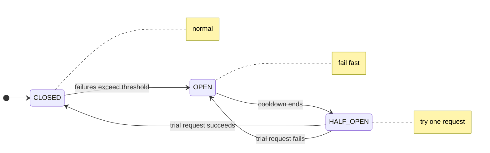
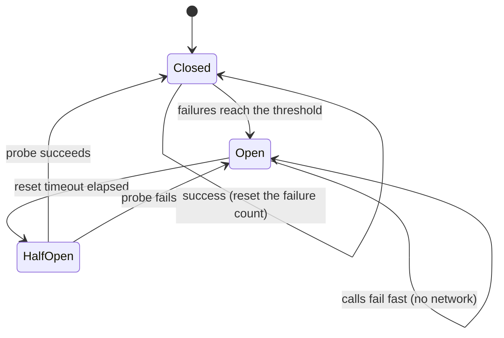
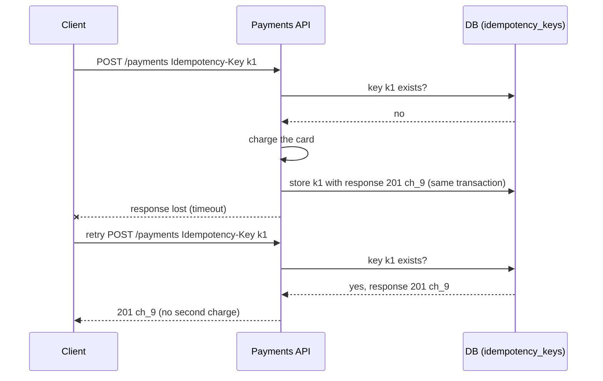
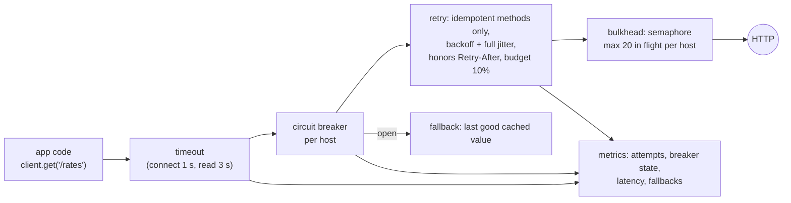

# Chapter 14 — Resilience Patterns (Idempotency, Retries, Backoff, Circuit Breakers)

> **Volume 3 — Low-Level Design** · [Contents](index.md) · ← [Chapter 13 — Concurrency Patterns & Thread Safety](ch13-concurrency-patterns-and-thread-safety.md)

---

## Concept

Making components survive failure — idempotency keys, retry with exponential backoff + jitter, and circuit breakers.

**In one sentence:** networks and dependencies fail all the time, so resilient code retries *safe* operations with growing, randomized waits, makes writes idempotent so a retry can't do something twice, and stops calling a dependency that is clearly down so it can recover.

**Mental model — calling a busy restaurant.** If the line is busy, you don't redial every second (you'd jam the line for everyone): you wait a bit longer each time, and a bit randomly so all the callers don't redial together (exponential backoff with jitter). If you're not sure your order went through, you give your order number so they don't cook it twice (idempotency key). If the restaurant has been closed all evening, you stop calling for a while and just check once later (circuit breaker).

**The patterns**

| Pattern | Protects against | Key idea |
|---------|-----------------|----------|
| **Timeout** | hanging forever | every remote call has a deadline; it's the prerequisite for everything else |
| **Retry** | transient failures (timeouts, 503, connection resets) | try again, but only for *retryable* errors and *idempotent* operations, with a limit |
| **Exponential backoff** | hammering a struggling dependency | wait `base × 2^attempt`, capped |
| **Jitter** | synchronized retry storms ("thundering herd") | randomize the wait: "full jitter" = `random(0, backoff)` |
| **Idempotency key** | duplicate side effects from retries | the client sends a unique key; the server stores key → result and returns the stored result on repeats |
| **Circuit breaker** | wasting time and resources on a dead dependency; cascading failure | after N failures, *open*: fail fast; after a cooldown, *half-open*: allow a probe; success → *closed* |
| **Bulkhead** | one slow dependency exhausting all threads | a separate pool or semaphore per dependency |
| **Fallback / graceful degradation** | total failure of a feature | cached value, default, or reduced functionality |
| **Retry budget** | retries multiplying load (3 layers × 3 retries = 27×) | retry at one layer only; cap retries at ~10% of requests |

**What is retryable?**

| Retry ✓ | Don't retry ✗ |
|---------|---------------|
| timeouts, connection errors (if idempotent) | 400, 401, 403, 404, 422 — retrying won't help |
| 502, 503, 504 | 500 without idempotency (it may have succeeded partly) |
| 429 — but honor `Retry-After` | non-idempotent `POST` without an idempotency key |
| database serialization failures, deadlocks | business rejections (card declined) |

**Idempotency** — an operation is idempotent if doing it twice has the same effect as doing it once. `GET`, `PUT`, and `DELETE` are idempotent by definition; `POST /payments` is not, unless you make it so:

1. The client generates `Idempotency-Key: <uuid>` once per logical operation and reuses it on every retry.
2. The server, in one transaction: if the key exists → return the stored response; otherwise do the work and store (key, request hash, response).
3. Same key with a *different* request body → `422` (a client bug).
4. Keys expire after a retention window (e.g. 24 h).

**Circuit breaker states**

| State | Behavior | Transition |
|-------|----------|------------|
| **Closed** | calls pass through; failures are counted | failure rate/count over a threshold → **open** |
| **Open** | calls fail immediately (`CircuitOpenError`), no network call | after `reset_timeout` → **half-open** |
| **Half-open** | allow a limited number of probe calls | probes succeed → **closed**; any probe fails → **open** again |

### More on this topic, from the AI Library

The sections below come from the AI Library's system-design course and cover the same ground at architecture level.

### Retry Patterns Done Right

Retries are the #1 way to convert a single transient failure into a system-wide outage. Done wrong, they're an amplifier. Done right, they're a lifesaver.

#### The Five Rules of Retries

1. **Only retry idempotent operations.** Retrying a non-idempotent POST can double-charge a credit card.
2. **Exponential backoff** — `delay = base × 2^attempt`. Not constant delay.
3. **Add jitter** — `delay = random(0, base × 2^attempt)`. Without jitter, retries from many clients synchronize and stampede.
4. **Cap the retries.** Usually 3-5. Past that, give up and report failure.
5. **Respect `Retry-After` and `429`.** If the server tells you when to retry, listen.

#### Example

```python
import random, time

def with_retry(fn, max_attempts=4, base=0.1):
    for attempt in range(max_attempts):
        try:
            return fn()
        except TransientError:
            if attempt == max_attempts - 1:
                raise
            delay = random.uniform(0, base * (2 ** attempt))  # exponential + jitter
            time.sleep(delay)
```

*(From AI Library chapter 9.)*

### Idempotency Keys

Even with retries done right, network failures can leave you unsure whether a request succeeded. The fix: **idempotency keys.**

Client generates a unique key (UUID) per logical operation. Server stores `(key → result)`. On retry, server returns the cached result instead of executing again.

```
POST /payments
Idempotency-Key: 6f7d3e4a-9b2c-4f1d-8e3a-1c2b3d4e5f60
{
  "amount": 100,
  "user_id": 42
}
```

Stripe, PayPal, and modern payment APIs all use this. **You should too** for any non-idempotent operation.

*(From AI Library chapter 9.)*

### Failure Containment Patterns

Scaling isn't only about handling load — it's about preventing one failure from cascading.

#### Circuit Breaker

If a downstream service is failing, **stop calling it for a while** so the failing service can recover and your service doesn't waste resources waiting on timeouts.



**Implementation:** count failures in a window; trip if >N% fail; after a cooldown, allow one trial request.

#### Bulkhead

Isolate resources so failure in one part of the system can't drown the rest. Just like the watertight compartments on a ship — if one floods, the rest stay dry.

**Example:** dedicate separate thread pools (or connection pools) per downstream service. If the slow payment service eats all 200 threads, your auth calls still have their own pool.

#### Rate Limiting

Cap how many requests any one client (IP, user, API key) can send in a window. Protects against abuse *and* against your own systems thundering when something goes wrong.

**Algorithms (in order of sophistication):**

| Algorithm        | Simplicity | Burst handling | Memory cost |
|------------------|-----------|-----------------|-------------|
| Fixed window     | simplest   | bad (allows 2× burst at window edges) | tiny |
| Sliding window log | precise  | great           | high (stores timestamps) |
| Sliding window counter | balanced | good       | low |
| Token bucket     | most flexible | great (allows bursts up to bucket size) | small |
| Leaky bucket     | smoothes traffic | enforces constant rate | small |

> **Default choice:** token bucket. Easy to reason about, allows reasonable bursts, well-supported in libraries.

#### Backpressure

When you can't keep up, **tell upstream to slow down** rather than silently dropping or queuing forever. Standard mechanisms: HTTP 429, gRPC `RESOURCE_EXHAUSTED`, blocking writes on a bounded queue.

### Choosing Timeouts

**Assume the default is "wait forever".** Many popular clients ship with no timeout at all: browser `XMLHttpRequest` (0 = none), the original `fetch` (needs an `AbortController`), Python `requests`, Go's default `http.Client`. Others have very lax ones (.NET `HttpClient`: 100 s). A call that never returns holds a thread, a socket and a pooled connection forever — the classic resource leak behind slow-motion outages. Set a timeout on every network call, including calls made inside third-party libraries.

**Pick the number from data, not instinct.** Decide what share of calls that *would* have succeeded you are willing to cut off — the *false-timeout rate* — and use that percentile of the dependency's latency. Accept 0.1% false timeouts → time out at the dependency's **p99.9**. Then check the budget end to end: a caller's timeout must be larger than its callee's timeout plus its own work, or the caller gives up while the callee is still working (pass a *deadline* down the chain, as gRPC does).

**Measure every integration point.** Wrap outbound calls in one shared helper (or let a sidecar proxy do it) that sets the timeout and records duration, status code and whether it timed out — otherwise you can't debug the dependency when it misbehaves.

**Retry later, not now** — for batch or background work, a failed request can be parked in a *retry queue* and processed later by the same or another worker, instead of blocking a thread on backoff.

### Protecting Yourself from Your Callers

Timeouts, retries and circuit breakers protect you from *downstream* failures. Overload comes from *upstream*, and needs its own defences:

| Defence | Decides based on | How | Good for |
|---------|-----------------|-----|----------|
| **Load shedding** | *local* state of this process (in-flight requests, queue length, CPU) | when over capacity, fail fast with `503` instead of letting latency explode; drop low-priority traffic first, or the oldest requests (they'll time out and be retried anyway) | protecting a server from overload of any origin |
| **Load leveling** | — | put a queue between callers and the service; it works at its own pace | spiky load where callers can wait |
| **Rate limiting** | *global* state: a quota per API key, user or IP across all instances | reject over-quota requests with `429` + `Retry-After` | fairness, abuse protection, enforcing pricing tiers |
| **Autoscaling** | load metrics | add capacity | sustained growth — combine with shedding, which buys time while new instances start |

Rejecting is **not free**: the server may still pay for the TLS handshake and for reading the request to find the API key, so shedding and rate limiting delay collapse but can't stop a big enough flood. That is also why rate limiting only partially protects against **DDoS**; the real defence is scale — one large shared edge/gateway (a CDN, a cloud edge service) absorbs attacks aimed at any of the services behind it, and its cost is shared across all of them.

A distributed rate limiter keeps counters in a shared store; use atomic increments (`INCR`) rather than transactions, batch updates in memory and flush them periodically, and if the store is unreachable keep enforcing the **last known state** instead of rejecting everything (see Rate Limiting above and [Vol 4 Ch 8](../volume-4-high-level-design/ch08-rate-limiting-throttling-and-backpressure.md)).

### Static Stability and Constant Work

**Static stability** — a system should keep doing its job when a dependency it needs only for *changes* is down. The usual case is a **control plane / data plane** split: the data plane serves every request (the gateway, the load balancer, the rate limiter); the control plane manages its configuration (routes, API keys, quotas). If the data plane can't start or can't serve without reaching the control plane, the system is only as available as the product of the two (`0.9999 × 0.99 ≈ 0.9899`). So the data plane keeps a **local copy** of the last good configuration and keeps serving with it when the control plane is unreachable. The same idea: serve stale DNS or cache entries when the source is down; a rate limiter that remembers its last counters.

**Watch for scale imbalance** — the data plane is huge and the control plane is small. If thousands of data-plane instances restart together and all ask the control plane for their full configuration, they knock it over — and then can't start. Two common fixes:

- **Snapshot in a file store:** the control plane periodically writes its *entire* state to S3/Blob storage; data-plane instances read it from there. The file store absorbs the load; the control plane never sees the stampede.
- **Push, not pull:** the control plane pushes changes (or small deltas) to connected data-plane instances at its own pace, so it slows down rather than falls over; new instances load the snapshot first, then ask only for the recent delta.

**Constant work** — systems that behave differently under stress (a "slow path" that only runs during overload, a flood of individual config updates after a big change) fail in ways nobody tested. Prefer designs that do **the same amount of work every time**, however much changed: e.g. the control plane rewrites the full configuration file every 10 seconds, changed or not, and every data-plane instance reads all of it every 10 seconds. It costs more on a quiet day, but load is flat and predictable, a corrupt file heals itself on the next cycle, and rolling back a bad change is just writing the old file again. Pre-allocating capacity for the maximum number of tenants in a cell is the same idea. A related rule: keep the number of **operating modes** small — which is one reason data planes favour simple key-value stores with predictable latency over relational query planners.

**Close the loop** — a control plane that pushes configuration but never checks it was applied is open-loop. Like a thermostat, it should *monitor* the data plane, *compare* with the desired state, and *act* (re-push, restart, eject a stale node). Kubernetes controllers and a deployment pipeline that watches health and rolls back are closed loops.

*(From AI Library chapter 6.)*

---

## Prereqs

* [Chapter 13 — Concurrency Patterns & Thread Safety](ch13-concurrency-patterns-and-thread-safety.md)

---

## Diagram

**A circuit breaker state machine (closed → open → half-open)**



**Exponential backoff with and without jitter**

Base 100 ms, cap 5 s.

| Attempt | 1 | 2 | 3 | 4 | 5 | |
|---|---|---|---|---|---|---|
| no jitter | 100 ms | 200 ms | 400 ms | 800 ms | 1600 ms | 1,000 clients retry at the **same** instants |
| full jitter | 0–100 | 0–200 | 0–400 | 0–800 | 0–1600 | retries spread out evenly |

| Load on the recovering service | Shape |
|---|---|
| no jitter | spikes at each attempt that knock it down again |
| full jitter | smooth |

**Idempotency key flow**



---

## Example

```python
import random, time, threading, functools

# ---- retry with exponential backoff + full jitter ---------------------------------
class TransientError(Exception): ...

def retry(times=5, base=0.1, cap=5.0, retry_on=(TransientError, TimeoutError), sleep=time.sleep):
    def deco(fn):
        @functools.wraps(fn)
        def wrapper(*args, **kwargs):
            for attempt in range(times):
                try:
                    return fn(*args, **kwargs)
                except retry_on:
                    if attempt == times - 1:
                        raise                                         # out of attempts
                    backoff = min(cap, base * 2 ** attempt)
                    sleep(random.uniform(0, backoff))                 # full jitter
        return wrapper
    return deco

calls = {"n": 0}
@retry(times=4, sleep=lambda s: None)                                 # no real sleeping in the demo
def flaky():
    calls["n"] += 1
    if calls["n"] < 3: raise TransientError("503")
    return "ok"
print(flaky(), calls["n"])                                            # ok 3

# ---- circuit breaker ------------------------------------------------------------
class CircuitOpenError(Exception): ...

class CircuitBreaker:
    def __init__(self, threshold=3, reset_timeout=10.0, clock=time.monotonic):
        self.threshold, self.reset_timeout, self.clock = threshold, reset_timeout, clock
        self.state, self.failures, self.opened_at = "closed", 0, 0.0
        self._lock = threading.Lock()

    def call(self, fn, *args, **kwargs):
        with self._lock:
            if self.state == "open":
                if self.clock() - self.opened_at < self.reset_timeout:
                    raise CircuitOpenError("failing fast")
                self.state = "half_open"                             # allow one probe
        try:
            result = fn(*args, **kwargs)
        except Exception:
            with self._lock:
                self.failures += 1
                if self.state == "half_open" or self.failures >= self.threshold:
                    self.state, self.opened_at = "open", self.clock()
            raise
        with self._lock:
            self.state, self.failures = "closed", 0
        return result

now = [0.0]
cb = CircuitBreaker(threshold=2, reset_timeout=10, clock=lambda: now[0])
def down(): raise ConnectionError("refused")
for _ in range(2):
    try: cb.call(down)
    except ConnectionError: pass
print(cb.state)                                                       # open
try: cb.call(down)
except CircuitOpenError as e: print(e)                                # failing fast (no call made)
now[0] = 11                                                           # cooldown passes
print(cb.call(lambda: "recovered"), cb.state)                          # recovered closed

# ---- idempotency key (server side) ------------------------------------------------
_store: dict[str, tuple[int, dict]] = {}                              # in production: a DB table, same transaction
def create_payment(idem_key: str, body: dict, charge=lambda b: {"id": f"ch_{len(_store) + 1}"}):
    fingerprint = hash(frozenset(body.items()))
    if idem_key in _store:
        fp, response = _store[idem_key]
        if fp != fingerprint:
            return 422, {"error": "idempotency key reused with a different request"}
        return 201, response                                          # replay: no second charge
    response = charge(body)
    _store[idem_key] = (fingerprint, response)
    return 201, response

print(create_payment("k1", {"amount": 500}), create_payment("k1", {"amount": 500}))
# (201, {'id': 'ch_1'}) (201, {'id': 'ch_1'})
print(create_payment("k1", {"amount": 900})[0])                        # 422
```

---

## Exercises

1. Add idempotency to a payment endpoint.

   <details><summary>Solution</summary>Require an <code>Idempotency-Key</code> header on <code>POST /payments</code>. Create table <code>idempotency_keys(key PK, request_hash, status, response_json, created_at)</code>. In one transaction: <code>INSERT … ON CONFLICT DO NOTHING</code>; if it already existed, return the stored response (or 409 "in progress" if the first attempt is still running); otherwise charge (passing the same key to the payment provider), store the response, and commit. A different body with the same key → 422. Expire keys after 24 h.</details>

2. Implement a circuit breaker with half-open probing.

   <details><summary>Solution</summary>See <code>CircuitBreaker</code>. Improvements: a failure <i>rate</i> over a sliding window instead of a count (so rare errors under high traffic don't trip it); only count relevant errors (timeouts and 5xx, not 4xx); allow N concurrent probes in half-open; emit metrics on state changes; and give each dependency its own breaker. Test it with an injected clock.</details>

3. Service A retries 3× calling B, which retries 3× calling C, which retries 3× calling D. D is down. How many calls does D get per user request?

   <details><summary>Solution</summary>Up to 3 × 3 × 3 = 27 — a retry storm that makes the outage worse. Retry at only one layer (usually the outermost, or the one closest to the failing dependency), use retry budgets, and add circuit breakers so the others fail fast.</details>

---

## Mini project

**A resilient HTTP client with retries, backoff, and a circuit breaker.**



**Steps**

1. Wrap `httpx` in `ResilientClient(base_url, timeouts, retry_policy, breaker_policy)`.
2. Retry only idempotent methods (or requests carrying an `Idempotency-Key`), only on retryable errors, with capped exponential backoff and full jitter, honoring `Retry-After`.
3. One circuit breaker per host; fail fast when open; an optional fallback function.
4. A bulkhead semaphore per host.
5. Test against a local fault-injecting server (random 503s, slow responses, hard down) with a fake clock; show that recovery closes the breaker.
6. Chart attempts and load on the fake server with and without jitter.

**Done when:** under a 30% failure rate the success rate stays near 100%, a dead host costs callers under 5 ms per call (breaker open), and the jitter chart shows no synchronized spikes.

---

## Open source

* [`resilience4j/resilience4j`](https://github.com/resilience4j/resilience4j) — Java: CircuitBreaker (sliding-window failure rate, half-open permits), Retry, Bulkhead, RateLimiter, TimeLimiter.
* [`ihrwein/backoff`](https://github.com/ihrwein/backoff) — Rust exponential backoff with jitter. In Python: `tenacity` for retries and `pybreaker` for circuit breakers. Read the AWS Architecture Blog post "Exponential Backoff and Jitter" and Stripe's "Designing robust and predictable APIs with idempotency".

---

## Interview

1. **"Why jitter in backoff?"**
   <details><summary>Answer</summary>Without jitter, clients that failed at the same moment retry at the same moments too (100 ms, 200 ms, 400 ms…), creating synchronized spikes that hit the recovering service just when it's weakest and can knock it down again. Randomizing each wait (full jitter: uniform between 0 and the backoff) spreads retries evenly over time, reducing peak load and total completion time.</details>

2. **"How does a circuit breaker recover?"**
   <details><summary>Answer</summary>After it opens, it fails calls immediately for a cooldown period, giving the dependency room to recover and protecting the caller's resources. When the cooldown expires it goes half-open and lets a limited number of trial requests through. If they succeed, it closes and normal traffic resumes, with counters reset. If a trial fails, it opens again for another cooldown (often with growing cooldowns).</details>

3. **"How do you choose a timeout?"**
   <details><summary>Answer</summary>From the dependency's latency distribution and the share of slow-but-successful calls you're willing to abandon: accept 0.1% false timeouts, so use about its p99.9. Make sure each caller's timeout exceeds its callee's timeout plus its own work (or propagate a deadline), never rely on library defaults (several are infinite), and record duration and timeouts for every outbound call.</details>

4. **"Load shedding vs rate limiting?"**
   <details><summary>Answer</summary>Load shedding looks only at the server's own state — in-flight requests, queue depth — and rejects excess work with 503 so it can finish what it already accepted; it protects against overload from any cause. Rate limiting enforces a quota per client across the whole fleet, so it needs shared state, and returns 429 with Retry-After; it gives fairness and abuse protection. Neither is free, because rejecting still costs TLS and parsing, so pair them with autoscaling and, for DDoS, a large shared edge.</details>

5. **"What is static stability?"**
   <details><summary>Answer</summary>The property that the request-serving part of a system keeps working, with its last known configuration, when the parts it depends on for changes (control plane, config service, DNS, rate-limit store) are unavailable. You get it by caching the last good state locally, distributing config through a highly available file store, and avoiding designs where startup or serving needs a live call to the control plane.</details>

---

## Checklist

- [ ] idempotent writes
- [ ] back off with jitter
- [ ] fail fast with a breaker when downstream is down
- [ ] set every timeout from the dependency's latency percentiles
- [ ] shed load and rate-limit to protect against callers
- [ ] keep the data plane serving when the control plane is down

---

> [Contents](index.md) · ← [Chapter 13 — Concurrency Patterns & Thread Safety](ch13-concurrency-patterns-and-thread-safety.md)
