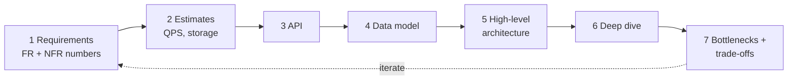
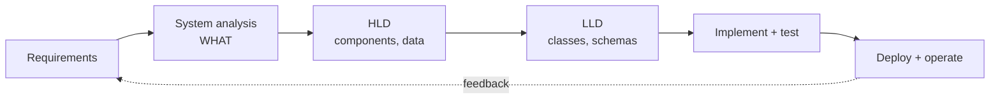
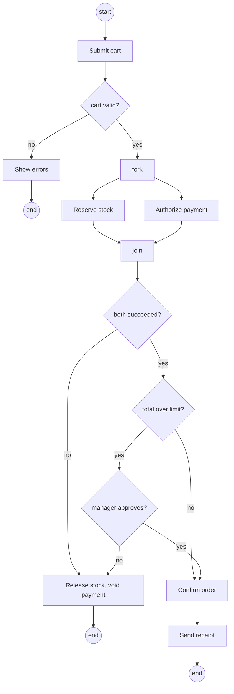
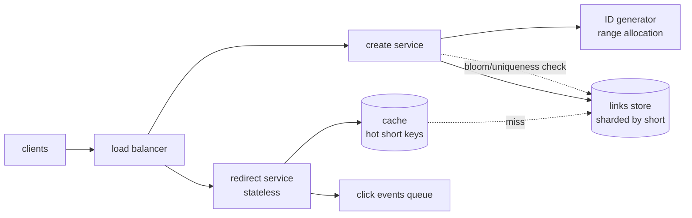

# Chapter 1 — Approaching a System Design Problem

> **Volume 4 — High-Level Design** · [Contents](index.md) · Next → [Chapter 2 — Capacity Planning](ch02-capacity-planning.md)

---

## Concept

What system design is, how HLD differs from LLD, and a repeatable method — requirements, estimates, API, data, architecture, deep dive, trade-offs — for starting any design problem.

**In one sentence:** system design is deciding, before and while you build, which components a system has, how they talk, where data lives, and which trade-offs you accept so that it meets its requirements at the scale and cost you can afford.

**Mental model — city planning vs building plans.** HLD is the city plan: roads, districts, power and water, how many people each can serve. LLD is the blueprint of one building: rooms, doors, wiring. You cannot draw a good building without knowing the district it sits in, and a city plan with no building constraints cannot be built. Most design failures come from skipping the plan, not from a bad blueprint.

### What system design is, and why it matters

* **Definition:** the process of defining architecture, components, interfaces, and data for a system so that it satisfies stated requirements. It produces decisions and diagrams, not code.
* **Why it matters:** the expensive mistakes are structural (wrong data store, no partitioning story, a single point of failure, a chatty service boundary). They are cheap to change on a whiteboard and costly after launch — migrations, rewrites, outages.
* **Where it sits in the SDLC:** after requirements and analysis, before implementation; it is revisited every iteration, and revised by what testing and operations teach you.
* **System analysis vs system design:**

| | System analysis | System design |
|---|-----------------|---------------|
| Question | **What** must the system do, and for whom? | **How** will it do it? |
| Input | stakeholders, existing processes, pain points | the agreed requirements and constraints |
| Output | requirements, use cases, scope, acceptance criteria | architecture, APIs, data model, deployment plan |
| Typical owner | product / business analyst with engineering | architects and engineers |

### HLD vs LLD

| | High-Level Design (HLD) | Low-Level Design (LLD) |
|---|-------------------------|------------------------|
| Scope | whole system or a group of services | one service, module, or class group |
| Question | which components, what data stores, how they communicate and scale | which classes, methods, patterns, schemas, algorithms |
| Artifacts | architecture diagram, API list, data-flow diagram, capacity estimate, tech choices, trade-off notes (ADRs) | class and sequence diagrams, detailed schema, interface signatures, state machines, pseudo-code |
| Audience | architects, tech leads, product, other teams | the engineers who implement it |
| Needs knowledge of | networking, databases, caching, queues, consistency, cloud | OOP, SOLID, design patterns, UML, concurrency |
| Failure if skipped | system cannot meet scale, availability, or cost goals | code is rigid, untestable, hard to change |

Where to go: LLD is Volume 3 ([Ch 1 OOP](../volume-3-low-level-design/ch01-oop-fundamentals.md), [Ch 2 SOLID](../volume-3-low-level-design/ch02-solid-principles.md), [Ch 4 UML](../volume-3-low-level-design/ch04-uml-and-diagramming.md)). HLD is the rest of this volume: [capacity](ch02-capacity-planning.md), [scalability and reliability](ch03-scalability-and-reliability-fundamentals.md), [caching](ch07-caching-strategies.md), [queues](ch09-message-queues-and-streaming-kafka-sqs-pub.md), [database scaling](ch11-database-scaling.md), and the worked cases in [Ch 22](ch22-the-30-system-design-portfolio.md).

### Monolith vs distributed systems

| Aspect | Monolith (one deployable) | Distributed (services, many nodes) |
|--------|---------------------------|-------------------------------------|
| Complexity | low; in-process calls | high; network calls fail, are slow, are partial |
| Deploy and test | one artifact, simple end-to-end tests | independent deploys, but contract and integration testing needed |
| Scaling | scale whole app together | scale each part to its own load |
| Data consistency | one database, ACID transactions | per-service data; eventual consistency, sagas |
| Fault isolation | one bug can take down everything | failures can be contained, but also cascade |
| Team scaling | fine for small teams | lets many teams ship independently |
| Latency | function-call cost | each hop adds latency |

Rule of thumb: **start with a well-modularized monolith** and split along proven seams when team size, scaling needs, or release independence demand it. Choose distributed from the start only when you already know those pressures exist. Distributed systems must handle the network being unreliable — see [Ch 4](ch04-distributed-systems-patterns.md).

### Requirements gathering

Ask before drawing. Who are the users? What are the core use cases? What is in scope and explicitly out? What scale (users, data, traffic), what geography, what budget and deadline? Write the answers down and get them confirmed — this is the output of system analysis.

**Functional requirements (FR)** say what the system does; **non-functional requirements (NFR)** say how well.

| Kind | Examples |
|------|----------|
| Functional | users can post, follow, search; an order can be placed, paid, cancelled; admin can approve refunds |
| Non-functional | latency, throughput, availability, durability, consistency, security, cost, compliance, maintainability |

An NFR is useless until it is a **number with a measurement**.

| Vague NFR | Measurable form |
|-----------|-----------------|
| "fast" | **latency SLO:** p99 of `GET /feed` < 300 ms, measured at the gateway over 30 days |
| "always up" | **availability SLO:** 99.9% of requests succeed per month (about 43.8 min of allowed downtime per 30-day-ish month; 99.99% is about 4.4 min; 99.999% about 26 s) |
| "never lose data" | **durability:** no acknowledged write lost; backups with RPO of 5 min (see [Ch 17](ch17-disaster-recovery-backups-rto-rpo.md)) |
| "always correct" | **consistency:** read-your-writes for the author; others may lag up to 5 s (eventual) |
| "handles growth" | **throughput:** 5,000 writes/s sustained, 15,000/s peak, 10× headroom in 12 months |

An **SLI** is the measured indicator (for example, ratio of good requests), an **SLO** is the target for it, and an **SLA** is a contract with consequences if the target is missed. Allowed downtime: 100% minus SLO, times the period.

### A repeatable 7-step method

| # | Step | You produce | Time (interview, rule of thumb) |
|---|------|-------------|--------------------------------|
| 1 | Requirements | FR list, NFR numbers, scope and non-goals | ~5 min |
| 2 | Estimates | requests/s, read:write, storage, bandwidth, peak factor | ~5 min |
| 3 | API | endpoints or RPCs, auth, pagination, idempotency | ~5 min |
| 4 | Data model | entities, keys, access patterns, store choice, partition key | ~5 min |
| 5 | High-level architecture | box-and-arrow diagram covering every use case | ~10 min |
| 6 | Deep dive | the 1–2 hardest or riskiest components in detail | ~10 min |
| 7 | Bottlenecks and trade-offs | single points of failure, hot spots, what you chose and what you gave up | ~5 min |

Steps loop: estimates may change the data model, the deep dive may expose a missing requirement. In real work, replace the time column with design reviews and ADRs. The time column is only a rough interview guide.

**Worked mini example — a "like" counter for posts.** Numbers are assumptions chosen to show the method, not measurements.

1. **Requirements:** FR — like and unlike a post, see the like count and whether I liked it. NFR — read p99 < 100 ms, 99.9% availability, count may lag by a few seconds, no duplicate likes per user. Non-goal: who-liked-it lists.
2. **Estimates:** assume 50M daily users × 5 likes = 250M likes/day ≈ 2,900/s average, peak ×3 ≈ 9,000/s. Assume reads 100× writes ≈ 290,000/s average. A like row of ~24 B (two 8-byte ids plus timestamp) × 250M/day ≈ 6 GB/day, about 2.2 TB/year before indexes and replicas.
3. **API:** `PUT /posts/{id}/like` and `DELETE /posts/{id}/like` (idempotent), `GET /posts/{id}/likes/count`; batch endpoint for feeds: `POST /posts/likes/counts` with a list of ids.
4. **Data model:** `likes(post_id, user_id, created_at)`, primary key `(post_id, user_id)` — the key enforces "no duplicates". Partition by `post_id`. `like_counts(post_id, n)` is a derived table.
5. **Architecture:** clients → API gateway → like service → likes store; like events go to a queue; a counter worker updates counts; counts are served from a cache (Redis) in front of the counts table.
6. **Deep dive — hot posts:** a viral post concentrates writes on one key. Split its counter into N sub-counters (for example 16), increment a random one, sum on read, and refresh the cached total every second or two.
7. **Trade-offs:** counts are eventually consistent (cheaper, scalable) versus an exact count in the write transaction (slower, one hot row). The cache can lose counts on restart; rebuild from the likes table. Single point of failure: the queue — replicate it.

### Performance vs scalability, latency vs throughput

* **Latency** — time for one request to finish (ms). **Throughput** — work completed per unit time (requests/s, MB/s). They are linked by Little's law: concurrent requests in the system = throughput × average latency.
* **Performance** problem: the system is slow **for one user** even when idle. **Scalability** problem: it is fast for one user but slows down or fails **as load grows**. A scalable system keeps performance acceptable by adding resources in proportion to load.
* **They trade off:** batching and queuing raise throughput but add latency to each item; running servers near 100% utilization maximizes throughput but latency climbs sharply as queues build.
* **Percentiles, not averages:** p50 is the median, p99 is the value 99% of requests beat. Averages hide the slow tail, and with fan-out (a page needing 20 backend calls) the chance that a user meets at least one slow call is much larger than 1%.

| Scalability approach | Idea | Watch out for |
|----------------------|------|---------------|
| Vertical (scale up) | bigger machine | hard ceiling, single point of failure, cost curve |
| Horizontal (scale out) | more machines behind a load balancer | needs stateless services or partitioned state |
| Replication | copies serve reads, give redundancy | replication lag, failover |
| Partitioning (sharding) | split data by key | hot keys, cross-shard queries and transactions |
| Caching | serve repeats from memory | invalidation, stampede ([Ch 7](ch07-caching-strategies.md)) |
| Asynchrony | queue work, respond early | ordering, duplicates, visibility |
| Offload | CDN, object storage, managed services | vendor and cost trade-offs |

**Common bottlenecks:** a single database primary; hot partitions or hot keys; lock contention; synchronous call chains; slow or missing indexes; connection and thread pool exhaustion; chatty cross-service calls; network bandwidth; unbounded queues; a shared dependency with no limit ([Ch 8](ch08-rate-limiting-throttling-and-backpressure.md)). Find them by measuring, not guessing.

### Design qualities checklist

| Quality | Question to ask | Typical levers |
|---------|-----------------|----------------|
| Reliability | does it keep working correctly despite faults? | redundancy, retries with backoff, timeouts, idempotency, graceful degradation |
| Maintainability | can new engineers change it safely? | clear module boundaries, tests, observability, documentation, small deployable units |
| Interoperability | can other systems and versions work with it? | open standards, stable contracts, schema evolution, adapters |
| Usability | is it easy and predictable to use (also for API consumers)? | consistent naming, clear errors, good defaults, docs, SDKs |
| Security | who can do what, and is data protected? | authN/authZ, encryption in transit and at rest, least privilege ([Ch 18](ch18-security-at-the-system-level.md)) |
| Cost-effectiveness | does it meet needs at an affordable price? | right-sizing, autoscaling, tiered storage, build vs buy ([Ch 21](ch21-cost-and-capacity-economics.md)) |

### Optimization techniques

| Technique | Use when | Cost / risk |
|-----------|----------|-------------|
| Caching | same data read often, tolerates staleness | invalidation, memory, stampede |
| Batching | many small operations to one target | adds latency per item, partial-failure handling |
| Indexing | queries filter or sort on a column | slower writes, more storage |
| Async processing | work need not finish before responding | complexity, eventual results, retries |
| Compression | payloads or storage are large | CPU time, hard to debug |
| Denormalization | joins dominate read time | duplicated data to keep in sync |
| Connection pooling | connections are costly to open | pool sizing, exhaustion under load |
| Pagination | lists can be large | cursor design, consistency while paging |
| Precomputation / materialized views | expensive aggregates read often | stale until refreshed, storage |
| Load shedding and limits | overload is possible | rejected requests need clear errors |

Optimize after measuring: profile first, change one thing, measure again.

### Modularity and interfaces

* **Module boundary:** group things that change together (high cohesion) and hide internals behind a narrow interface (low coupling). Boundaries follow business capabilities, not technical layers; they become service boundaries only when you must scale or deploy them separately.
* **Contract:** the interface is a promise — inputs, outputs, errors, ordering, latency and idempotency expectations. Write it as OpenAPI, protobuf, or JSON Schema, and test against it (consumer-driven contract tests).
* **Versioning:** adding optional fields is usually backward compatible; removing or renaming a field, or changing meaning, is breaking. Version in the URL or header, support old and new in parallel, deprecate with a date, and roll out schema changes in expand-then-contract steps. See [Vol 2 Ch 14 — API Design and Versioning](../volume-2-software-engineering/ch14-api-design-and-versioning.md).

### Data structures and algorithms that show up in system design

| Structure / algorithm | Property | Where it appears |
|-----------------------|----------|------------------|
| Hash map | O(1) average lookup | caches, indexes, deduplication, sessions |
| LRU (hash map + doubly linked list) | O(1) get, put, evict least-recent | cache eviction policies |
| Heap / priority queue | O(log n) insert, O(1) peek of min or max | schedulers, timers, top-K, merging sorted streams |
| Trie | prefix search by path | autocomplete, routing tables, IP prefix lookup |
| Bloom filter | set membership; **no false negatives**, some false positives | skip disk lookups for missing keys (LSM stores), crawler "seen URL" check |
| Consistent hashing | adding or removing a node moves only about K/N keys | partitioning caches and databases, load balancing |
| Skip list | ordered set with expected O(log n) operations | sorted sets in Redis, in-memory LSM memtables in some stores |
| HyperLogLog | approximate distinct count in small fixed memory | unique visitors, cardinality in analytics (Redis `PFADD`) |
| Count-Min sketch | approximate frequency counts | heavy hitters, trending items |
| Inverted index | term to list of documents | search engines (Lucene, Elasticsearch) |
| B-tree / LSM tree | read-optimized vs write-optimized on-disk indexes | relational databases vs Cassandra, RocksDB |
| Merkle tree | compare large data sets by hash | replica repair (Dynamo-style stores), Git |
| Geohash / quadtree | map 2-D location to a key or tree | nearby-search, ride matching |
| Ring buffer | fixed-size circular queue | bounded queues, logging, backpressure |
| Token bucket | rate with burst allowance | rate limiting ([Ch 8](ch08-rate-limiting-throttling-and-backpressure.md)) |

Background: [Vol 1 Ch 30 — Trees](../volume-1-cs-foundations/ch30-trees-bst-heap-and-trie.md), [Ch 31 — Hash Tables and Graphs](../volume-1-cs-foundations/ch31-hash-tables-and-graphs.md).

### Activity diagrams

An **activity diagram** is a UML behavior diagram that shows a workflow: the ordered actions, decisions, and parallel branches of one process. Use it for business flows, approval chains, and algorithms where *what happens next* matters more than *who owns the data*. Other UML diagrams (class, sequence, state, component) are in [Vol 3 Ch 4 — UML and Diagramming](../volume-3-low-level-design/ch04-uml-and-diagramming.md).

| Notation | Meaning |
|----------|---------|
| Filled circle | initial node (start) |
| Circle with inner dot (bullseye) | final node (end) |
| Rounded rectangle | action |
| Diamond | decision (guards like `[valid]`) or merge |
| Thick bar | fork (split into parallel flows) or join (wait for all) |
| Arrow | control flow |
| Swimlane | partition showing who or which system performs the actions |

---

## Prereqs

* [Vol 1 Ch 44 — Delivery: Load Balancing, Reverse Proxies & CDN](../volume-1-cs-foundations/ch44-delivery-load-balancing-reverse-proxies-and-cdn.md)
* [Vol 1 Ch 46 — Schema Design, Normalization & Indexing](../volume-1-cs-foundations/ch46-schema-design-normalization-and-indexing.md)
* [Vol 3 Ch 4 — UML and Diagramming](../volume-3-low-level-design/ch04-uml-and-diagramming.md)
* [Chapter 2 — Capacity Planning](ch02-capacity-planning.md)

---

## Diagram

**The 7-step method (it loops)**



**Where system design sits in the SDLC**



**Activity diagram — checkout with manager approval**



---

## Example

A back-of-envelope estimator and a consistent-hash ring — two small tools used often when reasoning about a design. Run with Python 3.9+.

```python
# estimate.py — turn assumptions into numbers. Every input is an ASSUMPTION; change them.
SECONDS_PER_MONTH = 30 * 24 * 3600

def estimate(new_per_month, read_write_ratio, bytes_per_record, years, peak_factor=3):
    writes_s = new_per_month / SECONDS_PER_MONTH
    reads_s = writes_s * read_write_ratio
    storage_tb = new_per_month * 12 * years * bytes_per_record / 1e12
    return {
        "writes/s avg": round(writes_s, 1),
        "reads/s avg": round(reads_s),
        "reads/s peak": round(reads_s * peak_factor),
        "storage TB": round(storage_tb, 2),
    }

# URL shortener: 100M new links/month, 100 reads per write, 500 B per record, 5 years
print(estimate(100_000_000, 100, 500, 5))
# {'writes/s avg': 38.6, 'reads/s avg': 3858, 'reads/s peak': 11574, 'storage TB': 3.0}
```

```python
# ring.py — consistent hashing with virtual nodes
import bisect, hashlib

class Ring:
    def __init__(self, nodes, vnodes=100):
        self.ring = sorted((self._h(f"{n}#{i}"), n) for n in nodes for i in range(vnodes))
        self.keys = [h for h, _ in self.ring]

    @staticmethod
    def _h(s):
        return int(hashlib.md5(s.encode()).hexdigest(), 16)

    def node_for(self, key):
        i = bisect.bisect(self.keys, self._h(key)) % len(self.ring)
        return self.ring[i][1]

keys = [f"user{i}" for i in range(10_000)]
before = Ring(["a", "b", "c"])
after = Ring(["a", "b", "c", "d"])
moved = sum(before.node_for(k) != after.node_for(k) for k in keys)
print(moved / len(keys))   # about 0.2 (expected ~1/4): only keys that now belong to the new node move; plain hash(key) % N would move ~3/4
```

---

## Exercises

1. Rewrite these vague NFRs as measurable SLOs: "the site must be fast", "must not lose orders", "must be highly available".

   <details><summary>Solution</summary>Example: p99 of <code>GET /product</code> under 250 ms measured at the load balancer; every order acknowledged to the user is durable (replicated in at least two zones before the 201 response) with RPO of 0 for orders; 99.95% of requests succeed per calendar month (about 22 min of allowed downtime in a 30-day month). Each states the metric, the threshold, the measurement point and the window. Your exact numbers should come from business input.</details>

2. Estimate for a chat app: 10M daily users, 40 messages sent per user per day, 100 B per message, 3× peak. Give writes/s, daily storage, and yearly storage.

   <details><summary>Solution</summary>10M × 40 = 400M messages/day. 400M / 86,400 ≈ 4,630/s average, ≈ 13,900/s at 3× peak. Storage: 400M × 100 B = 40 GB/day, about 14.6 TB/year before replication (×3 if triple replicated ≈ 44 TB) and indexes. State that fan-out to recipients is separate and multiplies delivery work, not stored bytes.</details>

3. Your team of 6 is building a new B2B product. Monolith or microservices? Justify, and name when you would revisit.

   <details><summary>Solution</summary>A modular monolith: one deployable, strict module boundaries and interfaces, one database with schemas per module. Six people cannot absorb the operational cost of many services, and early domain boundaries are guesses. Revisit when a module needs independent scaling, teams grow so that deploys collide, or a component needs a different technology or fault isolation. Clean module contracts make the later split cheap.</details>

4. Choose a data structure for each: (a) top 10 trending hashtags in the last hour, (b) "has this URL been crawled?" over 10 billion URLs, (c) distributing keys over a changing set of cache nodes, (d) unique visitors per page per day.

   <details><summary>Solution</summary>(a) Count-Min sketch or exact counters plus a min-heap of size 10 over a sliding window. (b) Bloom filter in front of a persistent store — a false positive means an unneeded lookup or a skipped page, never a false "not seen"; accept the rate you size it for. (c) Consistent hashing with virtual nodes. (d) HyperLogLog per page per day — small fixed memory, approximate count (use exact sets only if exactness is required and the volume is small).</details>

---

## Mini project

**A design-review kit: a one-page template and a calculator.**

**Steps**

1. Write a Markdown design-doc template with the 7 steps as headings, plus "Non-goals", "Open questions", and "Decisions (ADR links)".
2. Extend the `estimate()` function into a CLI that reads a YAML file of assumptions and prints QPS, storage, bandwidth and instance counts, flagging every input as an assumption.
3. Use it on three systems from [Chapter 22](ch22-the-30-system-design-portfolio.md): fill the template for each in 45 minutes, timed.
4. Draw each architecture in Mermaid and the main workflow as an activity diagram.
5. Swap with a peer; they review only for unmeasurable NFRs, single points of failure, and missing trade-offs.

**Done when:** each doc has numeric NFRs, estimates with stated assumptions, an API, a data model with a partition key, a diagram, and at least three trade-offs written as "chose X over Y because Z".

---

## Design

**Design a URL shortener, using the 7 steps.**

1. **Requirements.** FR — create a short link for a long URL, redirect from short to long, optional custom alias, link expiry. NFR — redirect p99 < 100 ms, 99.99% redirect availability, links never silently change or vanish before expiry, creation may be slower. Non-goals: analytics dashboards, user accounts.
2. **Estimates (assumptions).** 100M new links/month ≈ 39 writes/s; reads 100× ≈ 3,900/s average, ≈ 11,600/s peak at 3×. Storage 100M × 12 × 5 years × 500 B ≈ 3 TB. A 7-character base62 key gives 62^7 ≈ 3.5 × 10^12 possible keys, enough for 6 × 10^9 links.
3. **API.** `POST /links {url, alias?, ttl?}` returns `{short}`; `GET /{short}` returns `301` or `302` with `Location`. Use `302` if you need every click to reach your server (analytics, edits); `301` lets browsers cache it, cutting load.
4. **Data model.** `links(short PK, long_url, created_at, expires_at, owner)`. Access pattern is key-value by `short`, so use a key-value or wide-column store, partitioned by `short`.



5. **Architecture** is the diagram above: read path and write path separated so each scales alone.
6. **Deep dive — key generation.** Options: hash the URL and truncate (collisions to detect and retry), random 7 chars (check uniqueness), or a counter encoded in base62. A counter is collision-free; to avoid one global bottleneck each create-service instance leases a range of, for example, 100,000 ids from a coordinator and hands them out locally. Sequential ids are guessable; if links must be unguessable, encode a permuted or encrypted counter.
7. **Bottlenecks and trade-offs.** Redirects dominate, so cache hot keys (popularity is skewed — rule of thumb, verify with data). `302` costs more load but keeps control; `301` is cheaper but irreversible in browsers. Range leasing wastes ids on crash (harmless). Expiry via TTL in the store. Single points of failure: the coordinator (replicate it, instances keep working with their remaining range) and the store (replicate across zones).

---

## Open source

* [`donnemartin/system-design-primer`](https://github.com/donnemartin/system-design-primer) — a long, free study guide on designing large-scale systems, with worked cases.
* [`ByteByteGoHQ/system-design-101`](https://github.com/ByteByteGoHQ/system-design-101) — short visual explanations of common architectural topics.
* [`karanpratapsingh/system-design`](https://github.com/karanpratapsingh/system-design) — a system design course with concepts and case studies.
* [`binhnguyennus/awesome-scalability`](https://github.com/binhnguyennus/awesome-scalability) — curated reading list of real-world architecture write-ups.
* [`redis/redis`](https://github.com/redis/redis) — source for real hash tables, skip lists (sorted sets) and HyperLogLog implementations.
* [`apache/cassandra`](https://github.com/apache/cassandra) — consistent hashing partitioning, Merkle trees for repair, and an LSM storage engine in one codebase.
* [`mermaid-js/mermaid`](https://github.com/mermaid-js/mermaid) and [`plantuml/plantuml`](https://github.com/plantuml/plantuml) — text-to-diagram tools, including activity diagrams.

---

## Interview

1. **"What is the difference between HLD and LLD?"**
   <details><summary>Answer</summary>HLD is the system-level view: components, data stores, communication, scaling and failure handling, and technology choices, shown in architecture diagrams. LLD is the component-level view: classes, interfaces, schemas, algorithms and sequence flows, shown in class and sequence diagrams. HLD decides what the pieces are and how they connect; LLD decides how one piece is built. The HLD constraints (latency budget, consistency, ownership of data) shape the LLD.</details>

2. **"Walk me through how you start a design problem."**
   <details><summary>Answer</summary>Clarify requirements and scope first, separating functional from non-functional and turning the latter into numbers. Estimate load and storage with stated assumptions. Define the API, then the data model and access patterns. Draw a simple end-to-end architecture covering every use case. Deep-dive on the riskiest parts, and finish with bottlenecks, single points of failure, and explicit trade-offs. State assumptions aloud and invite correction.</details>

3. **"Latency vs throughput — can you improve both?"**
   <details><summary>Answer</summary>Latency is time per request; throughput is requests per time. Sometimes both improve together (a faster algorithm, a cache). Often they trade off: batching and queues raise throughput but add per-item delay, and high utilization raises throughput until queues make latency climb. Say which one the requirement prioritizes and measure percentiles (p99), not averages.</details>

4. **"Why not use microservices for everything?"**
   <details><summary>Answer</summary>Each service boundary replaces a function call with a network call that can fail, be slow, or return partial results, and splits transactions across data stores. You then need service discovery, tracing, contract versioning, and per-service deployment. They pay off when teams, scaling needs, or fault isolation justify the cost. Otherwise start with a modular monolith and split along proven seams.</details>

---

## Checklist

- [ ] requirements written with numeric NFRs before any boxes are drawn
- [ ] estimates show assumptions, peak factor, and storage growth
- [ ] API and data model cover every use case and name the partition key
- [ ] each single point of failure and hot spot is identified
- [ ] every major choice is written as "X over Y because Z"
- [ ] module boundaries and versioning rules are defined for each interface

---

> [Contents](index.md) · Next → [Chapter 2 — Capacity Planning](ch02-capacity-planning.md)
