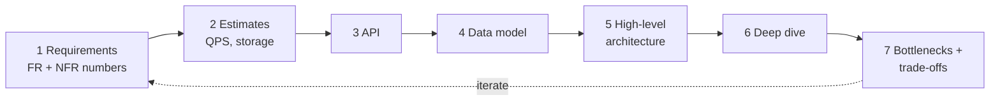
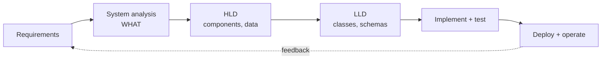
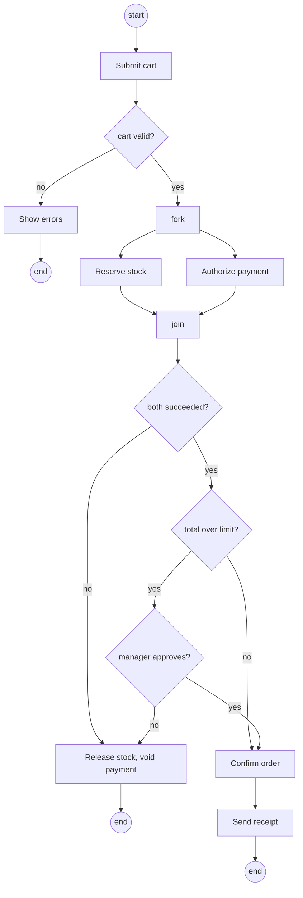
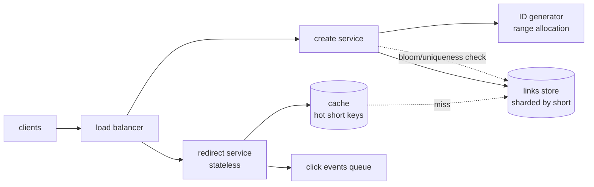

# Chapter 1 — Approaching a System Design Problem

> **Volume 4 — High-Level Design** · [Contents](index.md) · Next → [Chapter 2 — Capacity Planning](ch02-capacity-planning.md)

---

## Concept

What system design is, how HLD differs from LLD, and a repeatable method — requirements, estimates, API, data, architecture, deep dive, trade-offs — for starting any design problem.

**In one sentence:** system design is deciding, before and while you build, which components a system has, how they talk, where data lives, and which trade-offs you accept so that it meets its requirements at the scale and cost you can afford.

**Read the full explanation in the AI Library** (it is explained there once, so this chapter does not repeat it):

* [Chapter 15 — Approaching a System Design Problem: A 7-Step Method](https://charikshith.github.io/AI_Library/notes/system-design/chapters/15%20-%20The%20System%20Design%20Blueprint.html#1513-approaching-a-system-design-problem-a-7-step-method)
* [Chapter 15 — The 4-Step System Design Process](https://charikshith.github.io/AI_Library/notes/system-design/chapters/15%20-%20The%20System%20Design%20Blueprint.html#153-the-4-step-system-design-process)

This chapter is the **practice layer**: the diagram, worked example, exercises, mini-project, design prompt, open-source reading, interview questions and checklist below.

---

## Prereqs

* [Vol 1 Ch 44 — Delivery: Load Balancing, Reverse Proxies & CDN](../volume-1-cs-foundations/ch44-delivery-load-balancing-reverse-proxies-and-cdn.md)
* [Vol 1 Ch 46 — Schema Design, Normalization & Indexing](../volume-1-cs-foundations/ch46-schema-design-normalization-and-indexing.md)
* [Vol 3 Ch 4 — UML and Diagramming](../volume-3-low-level-design/ch04-uml-and-diagramming.md)
* [Chapter 2 — Capacity Planning](ch02-capacity-planning.md)

---

## Diagram

**The 7-step method (it loops)**



**Where system design sits in the SDLC**



**Activity diagram — checkout with manager approval**



---

## Example

A back-of-envelope estimator and a consistent-hash ring — two small tools used often when reasoning about a design. Run with Python 3.9+.

```python
# estimate.py — turn assumptions into numbers. Every input is an ASSUMPTION; change them.
SECONDS_PER_MONTH = 30 * 24 * 3600

def estimate(new_per_month, read_write_ratio, bytes_per_record, years, peak_factor=3):
    writes_s = new_per_month / SECONDS_PER_MONTH
    reads_s = writes_s * read_write_ratio
    storage_tb = new_per_month * 12 * years * bytes_per_record / 1e12
    return {
        "writes/s avg": round(writes_s, 1),
        "reads/s avg": round(reads_s),
        "reads/s peak": round(reads_s * peak_factor),
        "storage TB": round(storage_tb, 2),
    }

# URL shortener: 100M new links/month, 100 reads per write, 500 B per record, 5 years
print(estimate(100_000_000, 100, 500, 5))
# {'writes/s avg': 38.6, 'reads/s avg': 3858, 'reads/s peak': 11574, 'storage TB': 3.0}
```

```python
# ring.py — consistent hashing with virtual nodes
import bisect, hashlib

class Ring:
    def __init__(self, nodes, vnodes=100):
        self.ring = sorted((self._h(f"{n}#{i}"), n) for n in nodes for i in range(vnodes))
        self.keys = [h for h, _ in self.ring]

    @staticmethod
    def _h(s):
        return int(hashlib.md5(s.encode()).hexdigest(), 16)

    def node_for(self, key):
        i = bisect.bisect(self.keys, self._h(key)) % len(self.ring)
        return self.ring[i][1]

keys = [f"user{i}" for i in range(10_000)]
before = Ring(["a", "b", "c"])
after = Ring(["a", "b", "c", "d"])
moved = sum(before.node_for(k) != after.node_for(k) for k in keys)
print(moved / len(keys))   # about 0.2 (expected ~1/4): only keys that now belong to the new node move; plain hash(key) % N would move ~3/4
```

---

## Exercises

1. Rewrite these vague NFRs as measurable SLOs: "the site must be fast", "must not lose orders", "must be highly available".

   <details><summary>Solution</summary>Example: p99 of <code>GET /product</code> under 250 ms measured at the load balancer; every order acknowledged to the user is durable (replicated in at least two zones before the 201 response) with RPO of 0 for orders; 99.95% of requests succeed per calendar month (about 22 min of allowed downtime in a 30-day month). Each states the metric, the threshold, the measurement point and the window. Your exact numbers should come from business input.</details>

2. Estimate for a chat app: 10M daily users, 40 messages sent per user per day, 100 B per message, 3× peak. Give writes/s, daily storage, and yearly storage.

   <details><summary>Solution</summary>10M × 40 = 400M messages/day. 400M / 86,400 ≈ 4,630/s average, ≈ 13,900/s at 3× peak. Storage: 400M × 100 B = 40 GB/day, about 14.6 TB/year before replication (×3 if triple replicated ≈ 44 TB) and indexes. State that fan-out to recipients is separate and multiplies delivery work, not stored bytes.</details>

3. Your team of 6 is building a new B2B product. Monolith or microservices? Justify, and name when you would revisit.

   <details><summary>Solution</summary>A modular monolith: one deployable, strict module boundaries and interfaces, one database with schemas per module. Six people cannot absorb the operational cost of many services, and early domain boundaries are guesses. Revisit when a module needs independent scaling, teams grow so that deploys collide, or a component needs a different technology or fault isolation. Clean module contracts make the later split cheap.</details>

4. Choose a data structure for each: (a) top 10 trending hashtags in the last hour, (b) "has this URL been crawled?" over 10 billion URLs, (c) distributing keys over a changing set of cache nodes, (d) unique visitors per page per day.

   <details><summary>Solution</summary>(a) Count-Min sketch or exact counters plus a min-heap of size 10 over a sliding window. (b) Bloom filter in front of a persistent store — a false positive means an unneeded lookup or a skipped page, never a false "not seen"; accept the rate you size it for. (c) Consistent hashing with virtual nodes. (d) HyperLogLog per page per day — small fixed memory, approximate count (use exact sets only if exactness is required and the volume is small).</details>

---

## Mini project

**A design-review kit: a one-page template and a calculator.**

**Steps**

1. Write a Markdown design-doc template with the 7 steps as headings, plus "Non-goals", "Open questions", and "Decisions (ADR links)".
2. Extend the `estimate()` function into a CLI that reads a YAML file of assumptions and prints QPS, storage, bandwidth and instance counts, flagging every input as an assumption.
3. Use it on three systems from [Chapter 22](ch22-the-30-system-design-portfolio.md): fill the template for each in 45 minutes, timed.
4. Draw each architecture in Mermaid and the main workflow as an activity diagram.
5. Swap with a peer; they review only for unmeasurable NFRs, single points of failure, and missing trade-offs.

**Done when:** each doc has numeric NFRs, estimates with stated assumptions, an API, a data model with a partition key, a diagram, and at least three trade-offs written as "chose X over Y because Z".

---

## Design

**Design a URL shortener, using the 7 steps.**

1. **Requirements.** FR — create a short link for a long URL, redirect from short to long, optional custom alias, link expiry. NFR — redirect p99 < 100 ms, 99.99% redirect availability, links never silently change or vanish before expiry, creation may be slower. Non-goals: analytics dashboards, user accounts.
2. **Estimates (assumptions).** 100M new links/month ≈ 39 writes/s; reads 100× ≈ 3,900/s average, ≈ 11,600/s peak at 3×. Storage 100M × 12 × 5 years × 500 B ≈ 3 TB. A 7-character base62 key gives 62^7 ≈ 3.5 × 10^12 possible keys, enough for 6 × 10^9 links.
3. **API.** `POST /links {url, alias?, ttl?}` returns `{short}`; `GET /{short}` returns `301` or `302` with `Location`. Use `302` if you need every click to reach your server (analytics, edits); `301` lets browsers cache it, cutting load.
4. **Data model.** `links(short PK, long_url, created_at, expires_at, owner)`. Access pattern is key-value by `short`, so use a key-value or wide-column store, partitioned by `short`.



5. **Architecture** is the diagram above: read path and write path separated so each scales alone.
6. **Deep dive — key generation.** Options: hash the URL and truncate (collisions to detect and retry), random 7 chars (check uniqueness), or a counter encoded in base62. A counter is collision-free; to avoid one global bottleneck each create-service instance leases a range of, for example, 100,000 ids from a coordinator and hands them out locally. Sequential ids are guessable; if links must be unguessable, encode a permuted or encrypted counter.
7. **Bottlenecks and trade-offs.** Redirects dominate, so cache hot keys (popularity is skewed — rule of thumb, verify with data). `302` costs more load but keeps control; `301` is cheaper but irreversible in browsers. Range leasing wastes ids on crash (harmless). Expiry via TTL in the store. Single points of failure: the coordinator (replicate it, instances keep working with their remaining range) and the store (replicate across zones).

---

## Open source

* [`donnemartin/system-design-primer`](https://github.com/donnemartin/system-design-primer) — a long, free study guide on designing large-scale systems, with worked cases.
* [`ByteByteGoHQ/system-design-101`](https://github.com/ByteByteGoHQ/system-design-101) — short visual explanations of common architectural topics.
* [`karanpratapsingh/system-design`](https://github.com/karanpratapsingh/system-design) — a system design course with concepts and case studies.
* [`binhnguyennus/awesome-scalability`](https://github.com/binhnguyennus/awesome-scalability) — curated reading list of real-world architecture write-ups.
* [`redis/redis`](https://github.com/redis/redis) — source for real hash tables, skip lists (sorted sets) and HyperLogLog implementations.
* [`apache/cassandra`](https://github.com/apache/cassandra) — consistent hashing partitioning, Merkle trees for repair, and an LSM storage engine in one codebase.
* [`mermaid-js/mermaid`](https://github.com/mermaid-js/mermaid) and [`plantuml/plantuml`](https://github.com/plantuml/plantuml) — text-to-diagram tools, including activity diagrams.

---

## Interview

1. **"What is the difference between HLD and LLD?"**
   <details><summary>Answer</summary>HLD is the system-level view: components, data stores, communication, scaling and failure handling, and technology choices, shown in architecture diagrams. LLD is the component-level view: classes, interfaces, schemas, algorithms and sequence flows, shown in class and sequence diagrams. HLD decides what the pieces are and how they connect; LLD decides how one piece is built. The HLD constraints (latency budget, consistency, ownership of data) shape the LLD.</details>

2. **"Walk me through how you start a design problem."**
   <details><summary>Answer</summary>Clarify requirements and scope first, separating functional from non-functional and turning the latter into numbers. Estimate load and storage with stated assumptions. Define the API, then the data model and access patterns. Draw a simple end-to-end architecture covering every use case. Deep-dive on the riskiest parts, and finish with bottlenecks, single points of failure, and explicit trade-offs. State assumptions aloud and invite correction.</details>

3. **"Latency vs throughput — can you improve both?"**
   <details><summary>Answer</summary>Latency is time per request; throughput is requests per time. Sometimes both improve together (a faster algorithm, a cache). Often they trade off: batching and queues raise throughput but add per-item delay, and high utilization raises throughput until queues make latency climb. Say which one the requirement prioritizes and measure percentiles (p99), not averages.</details>

4. **"Why not use microservices for everything?"**
   <details><summary>Answer</summary>Each service boundary replaces a function call with a network call that can fail, be slow, or return partial results, and splits transactions across data stores. You then need service discovery, tracing, contract versioning, and per-service deployment. They pay off when teams, scaling needs, or fault isolation justify the cost. Otherwise start with a modular monolith and split along proven seams.</details>

---

## Checklist

- [ ] requirements written with numeric NFRs before any boxes are drawn
- [ ] estimates show assumptions, peak factor, and storage growth
- [ ] API and data model cover every use case and name the partition key
- [ ] each single point of failure and hot spot is identified
- [ ] every major choice is written as "X over Y because Z"
- [ ] module boundaries and versioning rules are defined for each interface

---

> [Contents](index.md) · Next → [Chapter 2 — Capacity Planning](ch02-capacity-planning.md)
