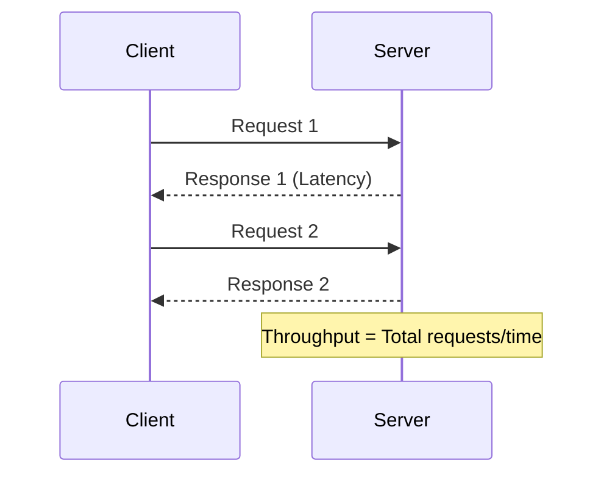
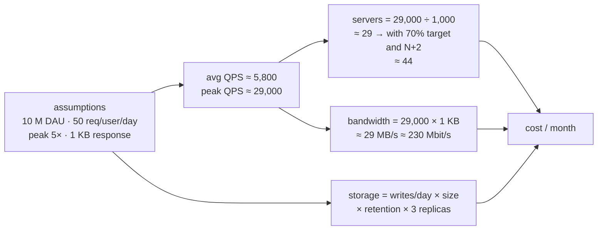
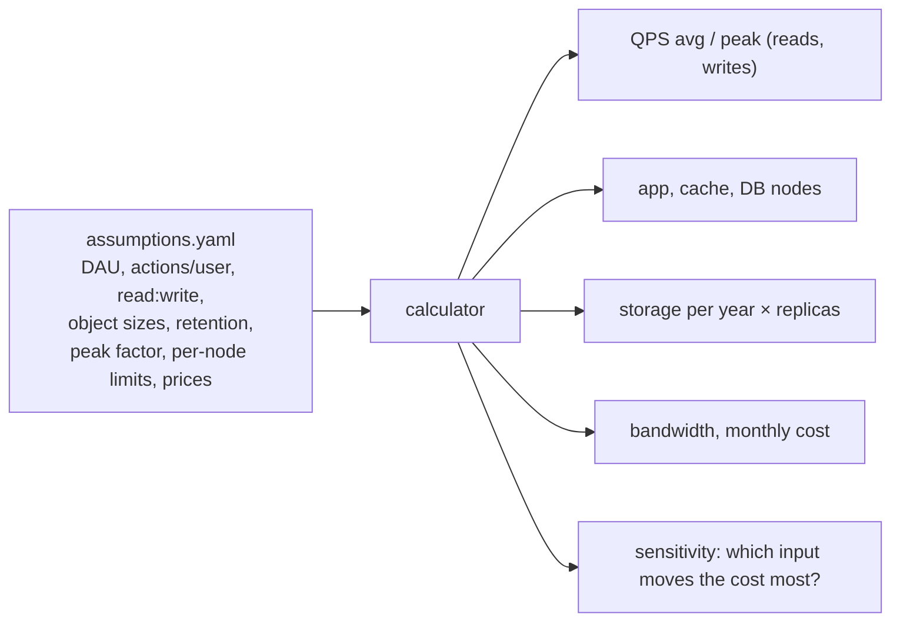
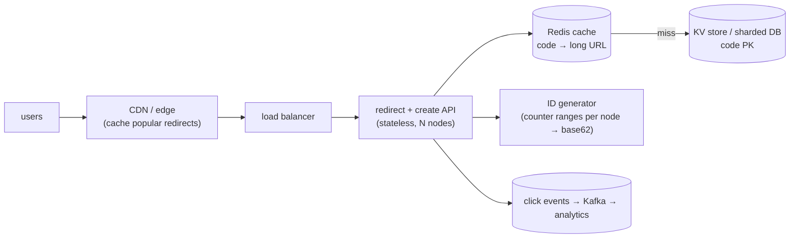

# Chapter 2 — Capacity Planning

> **Volume 4 — High-Level Design** · [Contents](index.md) · ← [Chapter 1 — Approaching a System Design Problem](ch01-approaching-a-system-design-problem.md) · Next → [Chapter 3 — Scalability & Reliability Fundamentals](ch03-scalability-and-reliability-fundamentals.md)

---

## Concept

QPS, latency percentiles (p50/p99), throughput, storage sizing, and translating requirements into hardware/tier estimates.

**In one sentence:** capacity planning turns product numbers ("10 million daily users") into engineering numbers (requests per second, servers, terabytes, dollars) with quick, explicit, back-of-envelope math — sized for the peak, not the average.

### Numbers Every Programmer Should Know

This table is the single most important reference in this course. **Memorize the orders of magnitude.** They will let you reason about why caching helps, why a cross-region call is bad, why disk seek is to be avoided, and why "just put it in memory" works.

Adapted from Jeff Dean's classic talk:

| Operation                                  | Time                | Mental shorthand                 |
|--------------------------------------------|---------------------|----------------------------------|
| L1 cache reference                         | 0.5 ns              | basically free                   |
| Branch mispredict                          | 5 ns                |                                  |
| L2 cache reference                         | 7 ns                | 14× L1                           |
| Mutex lock/unlock                          | 25 ns               |                                  |
| Main memory reference                      | 100 ns              | 200× L1, 20× L2                  |
| Compress 1 KB with Snappy                  | 3,000 ns (3 µs)     |                                  |
| Send 2 KB over commodity network           | ~1,000 ns (1 µs)    |                                  |
| Read 1 MB sequentially from memory         | 250,000 ns (250 µs) |                                  |
| Round trip within same datacenter          | 500,000 ns (0.5 ms) | network within a datacenter      |
| Read 4 KB randomly from SSD                | 150,000 ns (150 µs) |                                  |
| Read 1 MB sequentially from SSD            | 1,000,000 ns (1 ms) |                                  |
| Disk seek                                  | 10,000,000 ns (10 ms) | always avoid if possible       |
| Read 1 MB sequentially from disk           | 20,000,000 ns (20 ms) |                                |
| Round trip CA → Netherlands → CA           | 150,000,000 ns (150 ms) | speed of light over fiber     |

#### What this means in practice

- **Memory is ~100× faster than SSD, ~100,000× faster than disk seek.** That's why caches exist.
- **Same-datacenter round trip (0.5 ms) is ~300× faster than cross-continent (150 ms).** That's why CDNs and regional replicas matter.
- **Compression often pays off:** 3 µs to compress vs. saving network/disk time later.
- **A modern API endpoint that takes >100 ms has spent most of its time on something *other* than CPU.** It's usually network or disk.

> **Whenever you propose a design, sanity-check it against this table.** If your design has 5 sequential cross-region calls in a hot path, your p99 is already ≥ 750 ms — no amount of code optimization will fix that.

*(From AI Library chapter 1.)*

### Capacity Planning — Back-of-the-Envelope

Given:
- p99 latency budget: **100 ms**
- Each request takes: **~20 ms** of CPU
- Each server: **8 cores**

**Throughput per server:** `(8 cores × 1000 ms/s) / 20 ms ≈ 400 req/s` (ignoring I/O wait)

**At 10K req/s peak load:** `10,000 / 400 = 25 servers`, plus **+50% headroom** for spikes and rolling deploys → **40 servers**.

> **Rule of thumb:** aim for **60-70% steady-state utilization.** Higher = no margin for spikes. Lower = wasted money.

---

#### Capacity Estimation Cheat Sheet

Turn product numbers ("10 million daily users") into engineering numbers with quick, explicit math. Size for the **peak**, not the average, and be right within about 2×.

| Quantity | Formula or rule of thumb |
|----------|--------------------------|
| Average QPS | `daily active users × requests per user per day ÷ 86,400` |
| Peak QPS | `average × peak factor` (2–10×; 5× is a common assumption) |
| Read : write ratio | often 10:1 to 100:1 for consumer apps |
| Servers | `peak QPS ÷ QPS per server`, then add headroom (aim for about 60–70% utilization) and N+2 spare capacity for failures |
| Storage | `items per day × bytes per item × retention days × replication factor` |
| Bandwidth | `QPS × response size` |

**Numbers worth memorizing**

| Item | Value |
|------|-------|
| Seconds per day | 86,400, roughly 10⁵ |
| 1 million requests per day | about 12 QPS |
| 1 billion requests per day | about 12,000 QPS |
| One typical web/API server | about 1,000 QPS (anywhere from 100 to 10,000+) |
| One PostgreSQL primary, simple queries | about 10,000–50,000 QPS |
| Round trip inside a data center | about 0.5 ms; across continents about 100–150 ms |
| Powers of two | 2¹⁰ ≈ 10³ (KB), 2²⁰ ≈ 10⁶ (MB), 2³⁰ ≈ 10⁹ (GB), 2⁴⁰ ≈ 10¹² (TB) |

**The tail dominates when requests fan out.** A page that calls 100 services, each with a 1% chance of being slow, is slow about 63% of the time (`1 − 0.99¹⁰⁰`). So track **p50** (typical), **p99** (what the unlucky users feel) and **p99.9** for high-volume services, not just the average.

**State your assumptions.** Every estimate is only as good as its inputs. Write them down so others can challenge the right number.

*(From AI Library chapter 6.)*

### Key Metrics — Latency, Throughput, Scalability & Responsiveness

#### Latency vs. Throughput

| Metric      | Description                          | Unit       | Affects                |
|-------------|--------------------------------------|------------|------------------------|
| Latency     | Time to process a single request     | ms, s      | Responsiveness         |
| Throughput  | Requests processed per second        | RPS, TPS   | Scalability            |

> **Note:** Low latency ≠ high throughput. Both must be balanced per use case.

#### Code: Measuring Latency and Throughput (Python)

```python
import time
import requests

def measure_latency(url):
    start = time.time()
    response = requests.get(url)
    latency = time.time() - start
    return latency

def measure_throughput(url, n_requests):
    start = time.time()
    for _ in range(n_requests):
        requests.get(url)
    total_time = time.time() - start
    return n_requests / total_time

print("Latency:", measure_latency("https://example.com"))
print("Throughput:", measure_throughput("https://example.com", 100), "req/sec")
```

#### Diagram: Latency vs. Throughput

```
|--- Latency ---|
[Client]----request---->[Server]----response---->[Client]
            (1 request)
Throughput = Requests handled in 1 second
```



#### Scalability vs. Responsiveness

- **Scalability:** Can the system handle more load as users/data grow?
  - **Horizontal scaling:** Adding more servers.
  - **Vertical scaling:** Increasing resources of existing servers.
- **Responsiveness:** How quickly the system replies, even under heavy load. Tightly linked to latency.

> **Goal:** Good design should ensure responsiveness at scale.

*(From AI Library chapter 8.)*

### Measuring Performance — SLAs, SLOs, SLIs, and Percentiles

#### SLAs, SLOs, and SLIs

- **SLA (Service Level Agreement):** External contractual performance guarantee.
- **SLO (Service Level Objective):** Internal performance target.
- **SLI (Service Level Indicator):** Actual measured value.

**Example:**

```
SLA: 99.9% uptime for customers
SLO: 95% of requests < 300ms latency
SLI: Actual: 93% of requests < 300ms (need improvement!)
```

#### Percentiles: P50, P95, P99

**Why not just use averages?** Because averages hide outliers.

- **P50:** 50% (median) requests are faster.
- **P95:** 95% of requests are faster; 5% are slower.
- **P99:** The slowest 1% (tail latency) — critical for user experience.

**Visualization:**

```
|----|------------------|------------------|------------------|----|
  0%   50% (P50)         95% (P95)          99% (P99)         100%
```

*(From AI Library chapter 8.)*

The diagram, worked example, exercises, mini-project, design prompt, open-source reading, interview questions and checklist below are this chapter's practice layer.

---

## Prereqs

* [Vol 1 Ch 44 — Delivery: Load Balancing, Reverse Proxies & CDN](../volume-1-cs-foundations/ch44-delivery-load-balancing-reverse-proxies-and-cdn.md)
* [Vol 2 Ch 10 — Performance Engineering](../volume-2-software-engineering/ch10-performance-engineering.md)

---

## Diagram

**A capacity worksheet: QPS → servers → storage → cost**



**Average vs peak traffic over a day**

<div class="fig">
<svg xmlns="http://www.w3.org/2000/svg" viewBox="0 0 760 330" role="img" aria-label="Daily QPS curve with a peak of 29k that you size for and a misleading average of 5.8k" style="width:100%;max-width:760px;height:auto;font-family:inherit"><defs><marker id="ar" viewBox="0 0 10 10" refX="8" refY="5" markerWidth="7" markerHeight="7" orient="auto-start-reverse"><path d="M0 0L10 5L0 10z" fill="context-stroke"/></marker></defs><line x1="90" y1="270" x2="90" y2="30" stroke="var(--text-muted)" stroke-width="1.6" marker-end="url(#ar)"/><line x1="90" y1="270" x2="730" y2="270" stroke="var(--text-muted)" stroke-width="1.6" marker-end="url(#ar)"/><text x="82" y="28" font-size="12.5" text-anchor="end" fill="var(--text-muted)">QPS</text><path d="M90.0,254.7 L92.6,254.7 L95.2,254.7 L97.9,254.7 L100.5,254.7 L103.1,254.7 L105.8,254.7 L108.4,254.7 L111.0,254.7 L113.6,254.7 L116.2,254.7 L118.9,254.7 L121.5,254.7 L124.1,254.7 L126.8,254.7 L129.4,254.7 L132.0,254.7 L134.6,254.7 L137.2,254.7 L139.9,254.7 L142.5,254.7 L145.1,254.7 L147.8,254.7 L150.4,254.7 L153.0,254.7 L155.6,254.7 L158.2,254.7 L160.9,254.7 L163.5,254.7 L166.1,254.7 L168.8,254.7 L171.4,254.6 L174.0,254.6 L176.6,254.6 L179.2,254.6 L181.9,254.6 L184.5,254.6 L187.1,254.6 L189.8,254.6 L192.4,254.6 L195.0,254.6 L197.6,254.6 L200.2,254.6 L202.9,254.5 L205.5,254.5 L208.1,254.5 L210.8,254.5 L213.4,254.4 L216.0,254.4 L218.6,254.4 L221.2,254.3 L223.9,254.3 L226.5,254.2 L229.1,254.2 L231.8,254.1 L234.4,254.0 L237.0,253.9 L239.6,253.8 L242.2,253.7 L244.9,253.6 L247.5,253.5 L250.1,253.3 L252.8,253.2 L255.4,253.0 L258.0,252.8 L260.6,252.5 L263.2,252.3 L265.9,252.0 L268.5,251.7 L271.1,251.3 L273.8,250.9 L276.4,250.5 L279.0,250.1 L281.6,249.6 L284.2,249.0 L286.9,248.4 L289.5,247.8 L292.1,247.1 L294.8,246.3 L297.4,245.4 L300.0,244.5 L302.6,243.6 L305.2,242.5 L307.9,241.4 L310.5,240.2 L313.1,238.8 L315.8,237.4 L318.4,235.9 L321.0,234.3 L323.6,232.6 L326.2,230.8 L328.9,228.9 L331.5,226.8 L334.1,224.7 L336.8,222.4 L339.4,220.0 L342.0,217.4 L344.6,214.7 L347.2,211.9 L349.9,209.0 L352.5,205.9 L355.1,202.7 L357.8,199.4 L360.4,196.0 L363.0,192.4 L365.6,188.7 L368.2,184.8 L370.9,180.9 L373.5,176.8 L376.1,172.6 L378.8,168.4 L381.4,164.0 L384.0,159.6 L386.6,155.1 L389.2,150.5 L391.9,145.8 L394.5,141.1 L397.1,136.4 L399.8,131.7 L402.4,126.9 L405.0,122.2 L407.6,117.5 L410.2,112.8 L412.9,108.2 L415.5,103.6 L418.1,99.1 L420.8,94.7 L423.4,90.4 L426.0,86.3 L428.6,82.3 L431.2,78.4 L433.9,74.7 L436.5,71.2 L439.1,67.9 L441.8,64.8 L444.4,61.9 L447.0,59.3 L449.6,56.9 L452.2,54.8 L454.9,52.9 L457.5,51.3 L460.1,50.0 L462.8,48.9 L465.4,48.2 L468.0,47.7 L470.6,47.6 L473.2,47.7 L475.9,48.1 L478.5,48.8 L481.1,49.8 L483.8,51.1 L486.4,52.6 L489.0,54.4 L491.6,56.5 L494.2,58.8 L496.9,61.3 L499.5,64.1 L502.1,67.1 L504.8,70.2 L507.4,73.6 L510.0,77.1 L512.6,80.7 L515.2,84.5 L517.9,88.4 L520.5,92.4 L523.1,96.4 L525.8,100.6 L528.4,104.7 L531.0,108.9 L533.6,113.1 L536.2,117.2 L538.9,121.4 L541.5,125.4 L544.1,129.5 L546.8,133.4 L549.4,137.3 L552.0,141.0 L554.6,144.7 L557.2,148.2 L559.9,151.6 L562.5,154.8 L565.1,158.0 L567.8,160.9 L570.4,163.8 L573.0,166.4 L575.6,169.0 L578.2,171.4 L580.9,173.6 L583.5,175.7 L586.1,177.7 L588.8,179.6 L591.4,181.4 L594.0,183.0 L596.6,184.6 L599.2,186.1 L601.9,187.5 L604.5,188.9 L607.1,190.2 L609.8,191.5 L612.4,192.8 L615.0,194.0 L617.6,195.3 L620.2,196.6 L622.9,197.9 L625.5,199.2 L628.1,200.5 L630.8,201.9 L633.4,203.3 L636.0,204.7 L638.6,206.2 L641.2,207.8 L643.9,209.3 L646.5,211.0 L649.1,212.6 L651.8,214.3 L654.4,216.0 L657.0,217.7 L659.6,219.4 L662.2,221.1 L664.9,222.9 L667.5,224.6 L670.1,226.3 L672.8,228.0 L675.4,229.6 L678.0,231.3 L680.6,232.8 L683.2,234.4 L685.9,235.9 L688.5,237.3 L691.1,238.6 L693.8,240.0 L696.4,241.2 L699.0,242.4 L701.6,243.5 L704.2,244.5 L706.9,245.5 L709.5,246.4 L712.1,247.2 L714.8,248.0 L717.4,248.7 L720.0,249.4 L720,270 L90,270 Z" stroke="var(--primary)" stroke-width="2.4" fill="var(--primary)" fill-opacity="0.14"/><line x1="90" y1="225.53333333333333" x2="720" y2="225.53333333333333" stroke="var(--accent)" stroke-width="1.6" stroke-dasharray="6 4"/><text x="82" y="229.53333333333333" font-size="12.5" text-anchor="end" fill="var(--accent)" font-weight="700">5.8k</text><text x="102" y="217.53333333333333" font-size="12.5" text-anchor="start" fill="var(--accent)" font-weight="600">average (misleading)</text><line x1="90" y1="47.66666666666666" x2="350" y2="47.66666666666666" stroke="var(--danger)" stroke-width="1.6" stroke-dasharray="3 4"/><text x="82" y="51.66666666666666" font-size="12.5" text-anchor="end" fill="var(--danger)" font-weight="700">29k</text><text x="490" y="37.66666666666666" font-size="12.5" text-anchor="start" fill="var(--danger)" font-weight="700">← size for this</text><text x="90.0" y="290" font-size="12" text-anchor="middle" fill="var(--text-muted)">00</text><text x="195.0" y="290" font-size="12" text-anchor="middle" fill="var(--text-muted)">04</text><text x="300.0" y="290" font-size="12" text-anchor="middle" fill="var(--text-muted)">08</text><text x="405.0" y="290" font-size="12" text-anchor="middle" fill="var(--text-muted)">12</text><text x="510.0" y="290" font-size="12" text-anchor="middle" fill="var(--text-muted)">16</text><text x="615.0" y="290" font-size="12" text-anchor="middle" fill="var(--text-muted)">20</text><text x="720.0" y="290" font-size="12" text-anchor="middle" fill="var(--text-muted)">24</text><text x="720" y="310" font-size="12" text-anchor="end" fill="var(--text-muted)">hour</text></svg>
</div>

**Percentiles on a latency distribution**

<div class="fig">
<svg xmlns="http://www.w3.org/2000/svg" viewBox="0 0 760 320" role="img" aria-label="Latency histogram with p50 at 40 ms, mean 55 ms, p99 at 320 ms and p99.9 at 900 ms: a long tail that the average hides" style="width:100%;max-width:760px;height:auto;font-family:inherit"><defs><marker id="ar" viewBox="0 0 10 10" refX="8" refY="5" markerWidth="7" markerHeight="7" orient="auto-start-reverse"><path d="M0 0L10 5L0 10z" fill="context-stroke"/></marker></defs><line x1="70" y1="220" x2="70" y2="30" stroke="var(--text-muted)" stroke-width="1.6" marker-end="url(#ar)"/><line x1="70" y1="220" x2="730" y2="220" stroke="var(--text-muted)" stroke-width="1.6" marker-end="url(#ar)"/><text x="62" y="36" font-size="12.5" text-anchor="end" fill="var(--text-muted)">requests</text><text x="730" y="274" font-size="12.5" text-anchor="end" fill="var(--text-muted)">latency (ms)</text><rect x="80.0" y="60" width="23.666666666666668" height="160" rx="1" fill="var(--primary)" fill-opacity=".55" stroke="var(--primary)" stroke-width="0"/><rect x="106.66666666666667" y="80" width="23.666666666666668" height="140" rx="1" fill="var(--primary)" fill-opacity=".55" stroke="var(--primary)" stroke-width="0"/><rect x="133.33333333333334" y="110" width="23.666666666666668" height="110" rx="1" fill="var(--primary)" fill-opacity=".55" stroke="var(--primary)" stroke-width="0"/><rect x="160.0" y="135" width="23.666666666666668" height="85" rx="1" fill="var(--primary)" fill-opacity=".55" stroke="var(--primary)" stroke-width="0"/><rect x="186.66666666666669" y="160" width="23.666666666666668" height="60" rx="1" fill="var(--primary)" fill-opacity=".55" stroke="var(--primary)" stroke-width="0"/><rect x="213.33333333333334" y="180" width="23.666666666666668" height="40" rx="1" fill="var(--primary)" fill-opacity=".55" stroke="var(--primary)" stroke-width="0"/><rect x="240.0" y="196" width="23.666666666666668" height="24" rx="1" fill="var(--primary)" fill-opacity=".55" stroke="var(--primary)" stroke-width="0"/><rect x="266.6666666666667" y="206" width="23.666666666666668" height="14" rx="1" fill="var(--primary)" fill-opacity=".55" stroke="var(--primary)" stroke-width="0"/><rect x="293.33333333333337" y="212" width="23.666666666666668" height="8" rx="1" fill="var(--primary)" fill-opacity=".55" stroke="var(--primary)" stroke-width="0"/><rect x="320.0" y="215" width="23.666666666666668" height="5" rx="1" fill="var(--primary)" fill-opacity=".55" stroke="var(--primary)" stroke-width="0"/><rect x="346.6666666666667" y="217" width="23.666666666666668" height="3" rx="1" fill="var(--primary)" fill-opacity=".55" stroke="var(--primary)" stroke-width="0"/><rect x="373.33333333333337" y="218" width="23.666666666666668" height="2" rx="1" fill="var(--primary)" fill-opacity=".55" stroke="var(--primary)" stroke-width="0"/><rect x="400.0" y="218" width="23.666666666666668" height="2" rx="1" fill="var(--danger)" fill-opacity=".55" stroke="var(--danger)" stroke-width="0"/><rect x="426.6666666666667" y="219" width="23.666666666666668" height="1" rx="1" fill="var(--danger)" fill-opacity=".55" stroke="var(--danger)" stroke-width="0"/><rect x="453.33333333333337" y="219" width="23.666666666666668" height="1" rx="1" fill="var(--danger)" fill-opacity=".55" stroke="var(--danger)" stroke-width="0"/><rect x="480.0" y="219" width="23.666666666666668" height="1" rx="1" fill="var(--danger)" fill-opacity=".55" stroke="var(--danger)" stroke-width="0"/><rect x="506.6666666666667" y="217" width="23.666666666666668" height="3" rx="1" fill="var(--danger)" fill-opacity=".55" stroke="var(--danger)" stroke-width="0"/><rect x="533.3333333333334" y="219" width="23.666666666666668" height="1" rx="1" fill="var(--danger)" fill-opacity=".55" stroke="var(--danger)" stroke-width="0"/><rect x="560.0" y="219" width="23.666666666666668" height="1" rx="1" fill="var(--danger)" fill-opacity=".55" stroke="var(--danger)" stroke-width="0"/><rect x="586.6666666666667" y="219" width="23.666666666666668" height="1" rx="1" fill="var(--danger)" fill-opacity=".55" stroke="var(--danger)" stroke-width="0"/><rect x="613.3333333333334" y="218" width="23.666666666666668" height="2" rx="1" fill="var(--danger)" fill-opacity=".55" stroke="var(--danger)" stroke-width="0"/><rect x="640.0" y="219" width="23.666666666666668" height="1" rx="1" fill="var(--danger)" fill-opacity=".55" stroke="var(--danger)" stroke-width="0"/><rect x="666.6666666666667" y="219" width="23.666666666666668" height="1" rx="1" fill="var(--danger)" fill-opacity=".55" stroke="var(--danger)" stroke-width="0"/><rect x="693.3333333333334" y="219" width="23.666666666666668" height="1" rx="1" fill="var(--danger)" fill-opacity=".55" stroke="var(--danger)" stroke-width="0"/><line x1="133.33333333333334" y1="220" x2="133.33333333333334" y2="230" stroke="var(--success)" stroke-width="2"/><text x="133.33333333333334" y="248" font-size="12.5" text-anchor="middle" fill="var(--success)" font-weight="700">p50=40</text><line x1="293.33333333333337" y1="220" x2="293.33333333333337" y2="230" stroke="var(--accent)" stroke-width="2"/><text x="293.33333333333337" y="248" font-size="12.5" text-anchor="middle" fill="var(--accent)" font-weight="700">mean=55</text><line x1="520.0" y1="220" x2="520.0" y2="230" stroke="var(--danger)" stroke-width="2"/><text x="520.0" y="248" font-size="12.5" text-anchor="middle" fill="var(--danger)" font-weight="700">p99=320</text><line x1="680.0" y1="220" x2="680.0" y2="230" stroke="var(--danger)" stroke-width="2"/><text x="680.0" y="248" font-size="12.5" text-anchor="middle" fill="var(--danger)" font-weight="700">p99.9=900</text><text x="380" y="296" font-size="13" text-anchor="middle" fill="var(--text)" font-weight="600">"the average user" is fine; 1 in 100 waits 8× longer</text></svg>
</div>

---

## Example

**Estimate servers for 10M DAU with 50 req/user/day and 1000 QPS/server**

```
 requests/day = 10,000,000 × 50              = 500,000,000
 average QPS  = 500,000,000 ÷ 86,400          ≈ 5,800
 peak QPS     = 5,800 × 5                     ≈ 29,000
 raw servers  = 29,000 ÷ 1,000                ≈ 29
 headroom     = 29 ÷ 0.7 (run at 70%)         ≈ 42
 redundancy   = + 2 (lose a node during a deploy or failure) ≈ 44 servers
 spread over 3 availability zones             → 15 per zone (45)
```

```python
def plan(dau, req_per_user, peak=5, qps_per_server=1000, target_util=0.7, spare=2):
    avg = dau * req_per_user / 86_400
    peak_qps = avg * peak
    servers = -(-peak_qps // (qps_per_server * target_util)) + spare   # ceiling
    return round(avg), round(peak_qps), int(servers)

print(plan(10_000_000, 50))        # (5787, 28935, 44)
```

---

## Exercises

1. Size storage for a chat app (messages/user/day).

   <details><summary>Solution</summary>Assume 50 M DAU × 40 messages/day × 200 bytes (text + metadata) = 400 GB/day ≈ 146 TB/year raw. ×3 replicas ≈ 440 TB/year. Media is stored separately in object storage and usually dominates; text is the small part. Add indexes (~30–50%) and plan tiering: recent months hot, older data cold.</details>

2. Estimate peak QPS with a 5× daily peak factor.

   <details><summary>Solution</summary>For 50 M DAU sending 40 messages: 2 B/day ÷ 86,400 ≈ 23,000 writes/s average, ≈ 116,000/s at a 5× peak. Each message is delivered to on average 1–2 recipients, so the fan-out read/push rate is higher. Size queues and connection servers for the peak.</details>

3. A page calls 20 backend services in parallel. Each has a p99 of 100 ms. What fraction of page loads take ≥ 100 ms?

   <details><summary>Solution</summary><code>1 − 0.99²⁰ ≈ 18%</code>. Fan-out amplifies tail latency, which is why p99 per dependency matters, and why hedged requests and timeouts exist.</details>

---

## Mini project

**A capacity calculator that turns product assumptions into a resource plan.**



**Steps**

1. A YAML file of assumptions, with a comment on every number saying where it came from.
2. Compute reads/writes QPS (avg and peak), servers with headroom, storage over 1/3/5 years with replication, bandwidth, and cost.
3. Print a Markdown table plus the list of assumptions.
4. Sensitivity analysis: vary each input ±50% and show which changes the cost most.
5. Run it for two systems from this volume (URL shortener, chat).

**Done when:** changing one assumption reruns the whole plan, and the output lists every assumption next to the result.

---

## Design

**Design the data model and capacity plan for a URL shortener.**

Requirements: 100 M new short URLs per month; 100:1 read:write; links kept 5 years; redirect p99 < 50 ms.



**Capacity**

| Item | Estimate |
|------|----------|
| Writes | 100 M / month ≈ 39 QPS avg, ~200 peak |
| Reads | 100 × writes ≈ 3,900 QPS avg, ~20,000 peak |
| URLs in 5 years | 100 M × 60 = 6 B |
| Storage | 6 B × ~500 B/row ≈ 3 TB (× 3 replicas ≈ 9 TB) |
| Code length | base62: 62⁷ ≈ 3.5 × 10¹² ≫ 6 B, so 7 characters is plenty |
| Cache | 20% of links get 80% of traffic: hot set of ~20 M × 500 B ≈ 10 GB — fits in a small Redis cluster |

**Data model:** `urls(code PK, long_url, owner_id, created_at, expires_at)`; `clicks` go to an event stream, not the hot table.

**Decisions to justify**

* **ID generation:** a counter handed out in ranges per node, then base62-encoded, avoids collisions without a lookup; hashing the URL instead gives dedup but needs collision handling.
* **Storage choice:** access is purely by key, so a KV store (DynamoDB/Cassandra) or a sharded table keyed by `code` scales linearly.
* **301 vs 302:** 301 lets browsers cache the redirect (less load) but hides repeat clicks from analytics; 302 keeps analytics accurate.
* **Reads are cache-first,** so the DB sees only misses.

---

## Open source

* [`donnemartin/system-design-primer`](https://github.com/donnemartin/system-design-primer) — the "Back-of-the-envelope calculations" section, latency numbers every programmer should know, and a worked Pastebin/URL-shortener design.

---

## Interview

1. **"How do you estimate QPS from DAU?"**
   <details><summary>Answer</summary>QPS ≈ DAU × actions per user per day ÷ 86,400 (about 10⁵). Split reads from writes by the expected ratio, multiply by a peak factor (2–10×, state which), and add headroom. Example: 10 M DAU × 50 requests ≈ 5,800 QPS average, ≈ 29,000 peak. Always state the assumptions so they can be challenged.</details>

2. **"What percentile matters most for latency?"**
   <details><summary>Answer</summary>Usually p99 (or p99.9 at high volume). The average hides the slow requests real users hit, and with fan-out one slow dependency makes many pages slow. Set SLOs on high percentiles, watch p50 for general speed, and never alert on the average alone.</details>

---

## Checklist

- [ ] use back-of-envelope math
- [ ] plan for peak, not average
- [ ] state assumptions explicitly

---

> [Contents](index.md) · ← [Chapter 1 — Approaching a System Design Problem](ch01-approaching-a-system-design-problem.md) · Next → [Chapter 3 — Scalability & Reliability Fundamentals](ch03-scalability-and-reliability-fundamentals.md)
