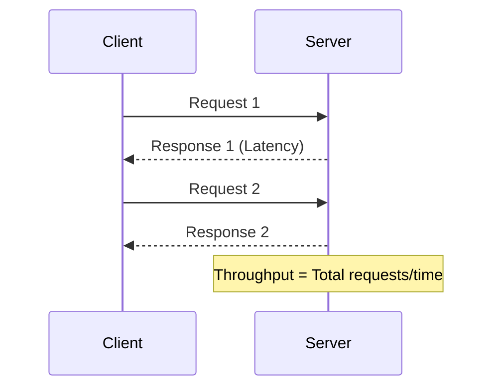
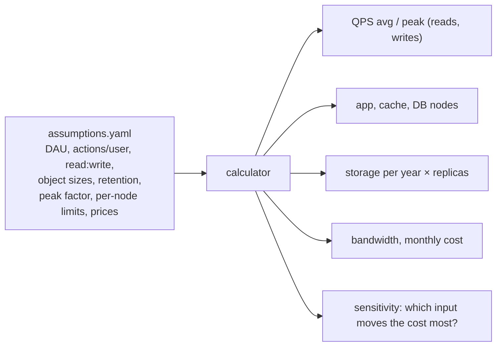
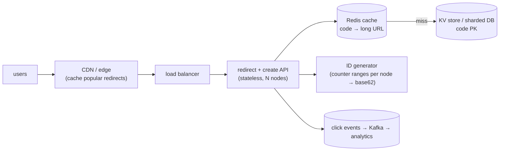

# Chapter 2 — Capacity Planning

> **Volume 4 — High-Level Design** · [Contents](index.md) · ← [Chapter 1 — Approaching a System Design Problem](ch01-approaching-a-system-design-problem.md) · Next → [Chapter 3 — Scalability & Reliability Fundamentals](ch03-scalability-and-reliability-fundamentals.md)

---

## Concept

QPS, latency percentiles (p50/p99), throughput, storage sizing, and translating requirements into hardware/tier estimates.

**In one sentence:** capacity planning turns product numbers ("10 million daily users") into engineering numbers (requests per second, servers, terabytes, dollars) with quick, explicit, back-of-envelope math — sized for the peak, not the average.

### Numbers Every Programmer Should Know

This table is the single most important reference in this course. **Memorize the orders of magnitude.** They will let you reason about why caching helps, why a cross-region call is bad, why disk seek is to be avoided, and why "just put it in memory" works.

Adapted from Jeff Dean's classic talk:

| Operation                                  | Time                | Mental shorthand                 |
|--------------------------------------------|---------------------|----------------------------------|
| L1 cache reference                         | 0.5 ns              | basically free                   |
| Branch mispredict                          | 5 ns                |                                  |
| L2 cache reference                         | 7 ns                | 14× L1                           |
| Mutex lock/unlock                          | 25 ns               |                                  |
| Main memory reference                      | 100 ns              | 200× L1, 20× L2                  |
| Compress 1 KB with Snappy                  | 3,000 ns (3 µs)     |                                  |
| Send 2 KB over commodity network           | ~1,000 ns (1 µs)    |                                  |
| Read 1 MB sequentially from memory         | 250,000 ns (250 µs) |                                  |
| Round trip within same datacenter          | 500,000 ns (0.5 ms) | network within a datacenter      |
| Read 4 KB randomly from SSD                | 150,000 ns (150 µs) |                                  |
| Read 1 MB sequentially from SSD            | 1,000,000 ns (1 ms) |                                  |
| Disk seek                                  | 10,000,000 ns (10 ms) | always avoid if possible       |
| Read 1 MB sequentially from disk           | 20,000,000 ns (20 ms) |                                |
| Round trip CA → Netherlands → CA           | 150,000,000 ns (150 ms) | speed of light over fiber     |

#### What this means in practice

- **Memory is ~100× faster than SSD, ~100,000× faster than disk seek.** That's why caches exist.
- **Same-datacenter round trip (0.5 ms) is ~300× faster than cross-continent (150 ms).** That's why CDNs and regional replicas matter.
- **Compression often pays off:** 3 µs to compress vs. saving network/disk time later.
- **A modern API endpoint that takes >100 ms has spent most of its time on something *other* than CPU.** It's usually network or disk.

> **Whenever you propose a design, sanity-check it against this table.** If your design has 5 sequential cross-region calls in a hot path, your p99 is already ≥ 750 ms — no amount of code optimization will fix that.

*(From AI Library chapter 1.)*

### Capacity Planning — Back-of-the-Envelope

Given:
- p99 latency budget: **100 ms**
- Each request takes: **~20 ms** of CPU
- Each server: **8 cores**

**Throughput per server:** `(8 cores × 1000 ms/s) / 20 ms ≈ 400 req/s` (ignoring I/O wait)

**At 10K req/s peak load:** `10,000 / 400 = 25 servers`, plus **+50% headroom** for spikes and rolling deploys → **40 servers**.

> **Rule of thumb:** aim for **60-70% steady-state utilization.** Higher = no margin for spikes. Lower = wasted money.

---

#### Capacity Estimation Cheat Sheet

Turn product numbers ("10 million daily users") into engineering numbers with quick, explicit math. Size for the **peak**, not the average, and be right within about 2×.

| Quantity | Formula or rule of thumb |
|----------|--------------------------|
| Average QPS | `daily active users × requests per user per day ÷ 86,400` |
| Peak QPS | `average × peak factor` (2–10×; 5× is a common assumption) |
| Read : write ratio | often 10:1 to 100:1 for consumer apps |
| Servers | `peak QPS ÷ QPS per server`, then add headroom (aim for about 60–70% utilization) and N+2 spare capacity for failures |
| Storage | `items per day × bytes per item × retention days × replication factor` |
| Bandwidth | `QPS × response size` |

**Numbers worth memorizing**

| Item | Value |
|------|-------|
| Seconds per day | 86,400, roughly 10⁵ |
| 1 million requests per day | about 12 QPS |
| 1 billion requests per day | about 12,000 QPS |
| One typical web/API server | about 1,000 QPS (anywhere from 100 to 10,000+) |
| One PostgreSQL primary, simple queries | about 10,000–50,000 QPS |
| Round trip inside a data center | about 0.5 ms; across continents about 100–150 ms |
| Powers of two | 2¹⁰ ≈ 10³ (KB), 2²⁰ ≈ 10⁶ (MB), 2³⁰ ≈ 10⁹ (GB), 2⁴⁰ ≈ 10¹² (TB) |

**The tail dominates when requests fan out.** A page that calls 100 services, each with a 1% chance of being slow, is slow about 63% of the time (`1 − 0.99¹⁰⁰`). So track **p50** (typical), **p99** (what the unlucky users feel) and **p99.9** for high-volume services, not just the average.

**State your assumptions.** Every estimate is only as good as its inputs. Write them down so others can challenge the right number.

*(From AI Library chapter 6.)*

### Key Metrics — Latency, Throughput, Scalability & Responsiveness

#### Latency vs. Throughput

| Metric      | Description                          | Unit       | Affects                |
|-------------|--------------------------------------|------------|------------------------|
| Latency     | Time to process a single request     | ms, s      | Responsiveness         |
| Throughput  | Requests processed per second        | RPS, TPS   | Scalability            |

> **Note:** Low latency ≠ high throughput. Both must be balanced per use case.

#### Code: Measuring Latency and Throughput (Python)

```python
import time
import requests

def measure_latency(url):
    start = time.time()
    response = requests.get(url)
    latency = time.time() - start
    return latency

def measure_throughput(url, n_requests):
    start = time.time()
    for _ in range(n_requests):
        requests.get(url)
    total_time = time.time() - start
    return n_requests / total_time

print("Latency:", measure_latency("https://example.com"))
print("Throughput:", measure_throughput("https://example.com", 100), "req/sec")
```

#### Diagram: Latency vs. Throughput

```
|--- Latency ---|
[Client]----request---->[Server]----response---->[Client]
            (1 request)
Throughput = Requests handled in 1 second
```



#### Scalability vs. Responsiveness

- **Scalability:** Can the system handle more load as users/data grow?
  - **Horizontal scaling:** Adding more servers.
  - **Vertical scaling:** Increasing resources of existing servers.
- **Responsiveness:** How quickly the system replies, even under heavy load. Tightly linked to latency.

> **Goal:** Good design should ensure responsiveness at scale.

*(From AI Library chapter 8.)*

### Measuring Performance — SLAs, SLOs, SLIs, and Percentiles

#### SLAs, SLOs, and SLIs

- **SLA (Service Level Agreement):** External contractual performance guarantee.
- **SLO (Service Level Objective):** Internal performance target.
- **SLI (Service Level Indicator):** Actual measured value.

**Example:**

```
SLA: 99.9% uptime for customers
SLO: 95% of requests < 300ms latency
SLI: Actual: 93% of requests < 300ms (need improvement!)
```

#### Percentiles: P50, P95, P99

**Why not just use averages?** Because averages hide outliers.

- **P50:** 50% (median) requests are faster.
- **P95:** 95% of requests are faster; 5% are slower.
- **P99:** The slowest 1% (tail latency) — critical for user experience.

**Visualization:**

```
|----|------------------|------------------|------------------|----|
  0%   50% (P50)         95% (P95)          99% (P99)         100%
```

*(From AI Library chapter 8.)*

The diagram, worked example, exercises, mini-project, design prompt, open-source reading, interview questions and checklist below are this chapter's practice layer.

---

## Prereqs

* [Vol 1 Ch 44 — Delivery: Load Balancing, Reverse Proxies & CDN](../volume-1-cs-foundations/ch44-delivery-load-balancing-reverse-proxies-and-cdn.md)
* [Vol 2 Ch 10 — Performance Engineering](../volume-2-software-engineering/ch10-performance-engineering.md)

---

## Diagram

**A capacity worksheet: QPS → servers → storage → cost**

```mermaid
flowchart LR
    A["assumptions<br/>10 M DAU · 50 req/user/day<br/>peak 5× · 1 KB response"] --> Q["avg QPS ≈ 5,800<br/>peak QPS ≈ 29,000"]
    Q --> S["servers = 29,000 ÷ 1,000<br/>≈ 29 → with 70% target and N+2<br/>≈ 44"]
    A --> ST["storage = writes/day × size<br/>× retention × 3 replicas"]
    Q --> BW["bandwidth = 29,000 × 1 KB<br/>≈ 29 MB/s ≈ 230 Mbit/s"]
    S & ST & BW --> C["cost / month"]
```



**Average vs peak traffic over a day**

```
 QPS
 29k ┤                        ╭──╮              ← size for this
     │                    ╭───╯  ╰──╮
 5.8k┤ ─ ─ ─ ─ ─ ─ ─ ─╭───╯─ ─ ─ ─ ─╰───╮─ ─ ─  average (misleading)
     │ ╮          ╭───╯                 ╰───╮
     │ ╰──────────╯                         ╰──
     └──────────────────────────────────────────► hour
       00   04   08   12   16   20   24
```

**Percentiles on a latency distribution**

```
 requests
   │ ▇
   │ ██▇
   │ ████▆
   │ ██████▅▃▂▁▁      ▁           ▁
   └─┬───────┬──────────┬───────────┬──► latency (ms)
    p50=40  mean=55   p99=320    p99.9=900
    "the average user" is fine; 1 in 100 waits 8× longer
```

---

## Example

**Estimate servers for 10M DAU with 50 req/user/day and 1000 QPS/server**

```
 requests/day = 10,000,000 × 50              = 500,000,000
 average QPS  = 500,000,000 ÷ 86,400          ≈ 5,800
 peak QPS     = 5,800 × 5                     ≈ 29,000
 raw servers  = 29,000 ÷ 1,000                ≈ 29
 headroom     = 29 ÷ 0.7 (run at 70%)         ≈ 42
 redundancy   = + 2 (lose a node during a deploy or failure) ≈ 44 servers
 spread over 3 availability zones             → 15 per zone (45)
```

```python
def plan(dau, req_per_user, peak=5, qps_per_server=1000, target_util=0.7, spare=2):
    avg = dau * req_per_user / 86_400
    peak_qps = avg * peak
    servers = -(-peak_qps // (qps_per_server * target_util)) + spare   # ceiling
    return round(avg), round(peak_qps), int(servers)

print(plan(10_000_000, 50))        # (5787, 28935, 44)
```

---

## Exercises

1. Size storage for a chat app (messages/user/day).

   <details><summary>Solution</summary>Assume 50 M DAU × 40 messages/day × 200 bytes (text + metadata) = 400 GB/day ≈ 146 TB/year raw. ×3 replicas ≈ 440 TB/year. Media is stored separately in object storage and usually dominates; text is the small part. Add indexes (~30–50%) and plan tiering: recent months hot, older data cold.</details>

2. Estimate peak QPS with a 5× daily peak factor.

   <details><summary>Solution</summary>For 50 M DAU sending 40 messages: 2 B/day ÷ 86,400 ≈ 23,000 writes/s average, ≈ 116,000/s at a 5× peak. Each message is delivered to on average 1–2 recipients, so the fan-out read/push rate is higher. Size queues and connection servers for the peak.</details>

3. A page calls 20 backend services in parallel. Each has a p99 of 100 ms. What fraction of page loads take ≥ 100 ms?

   <details><summary>Solution</summary><code>1 − 0.99²⁰ ≈ 18%</code>. Fan-out amplifies tail latency, which is why p99 per dependency matters, and why hedged requests and timeouts exist.</details>

---

## Mini project

**A capacity calculator that turns product assumptions into a resource plan.**



**Steps**

1. A YAML file of assumptions, with a comment on every number saying where it came from.
2. Compute reads/writes QPS (avg and peak), servers with headroom, storage over 1/3/5 years with replication, bandwidth, and cost.
3. Print a Markdown table plus the list of assumptions.
4. Sensitivity analysis: vary each input ±50% and show which changes the cost most.
5. Run it for two systems from this volume (URL shortener, chat).

**Done when:** changing one assumption reruns the whole plan, and the output lists every assumption next to the result.

---

## Design

**Design the data model and capacity plan for a URL shortener.**

Requirements: 100 M new short URLs per month; 100:1 read:write; links kept 5 years; redirect p99 < 50 ms.



**Capacity**

| Item | Estimate |
|------|----------|
| Writes | 100 M / month ≈ 39 QPS avg, ~200 peak |
| Reads | 100 × writes ≈ 3,900 QPS avg, ~20,000 peak |
| URLs in 5 years | 100 M × 60 = 6 B |
| Storage | 6 B × ~500 B/row ≈ 3 TB (× 3 replicas ≈ 9 TB) |
| Code length | base62: 62⁷ ≈ 3.5 × 10¹² ≫ 6 B, so 7 characters is plenty |
| Cache | 20% of links get 80% of traffic: hot set of ~20 M × 500 B ≈ 10 GB — fits in a small Redis cluster |

**Data model:** `urls(code PK, long_url, owner_id, created_at, expires_at)`; `clicks` go to an event stream, not the hot table.

**Decisions to justify**

* **ID generation:** a counter handed out in ranges per node, then base62-encoded, avoids collisions without a lookup; hashing the URL instead gives dedup but needs collision handling.
* **Storage choice:** access is purely by key, so a KV store (DynamoDB/Cassandra) or a sharded table keyed by `code` scales linearly.
* **301 vs 302:** 301 lets browsers cache the redirect (less load) but hides repeat clicks from analytics; 302 keeps analytics accurate.
* **Reads are cache-first,** so the DB sees only misses.

---

## Open source

* [`donnemartin/system-design-primer`](https://github.com/donnemartin/system-design-primer) — the "Back-of-the-envelope calculations" section, latency numbers every programmer should know, and a worked Pastebin/URL-shortener design.

---

## Interview

1. **"How do you estimate QPS from DAU?"**
   <details><summary>Answer</summary>QPS ≈ DAU × actions per user per day ÷ 86,400 (about 10⁵). Split reads from writes by the expected ratio, multiply by a peak factor (2–10×, state which), and add headroom. Example: 10 M DAU × 50 requests ≈ 5,800 QPS average, ≈ 29,000 peak. Always state the assumptions so they can be challenged.</details>

2. **"What percentile matters most for latency?"**
   <details><summary>Answer</summary>Usually p99 (or p99.9 at high volume). The average hides the slow requests real users hit, and with fan-out one slow dependency makes many pages slow. Set SLOs on high percentiles, watch p50 for general speed, and never alert on the average alone.</details>

---

## Checklist

- [ ] use back-of-envelope math
- [ ] plan for peak, not average
- [ ] state assumptions explicitly

---

> [Contents](index.md) · ← [Chapter 1 — Approaching a System Design Problem](ch01-approaching-a-system-design-problem.md) · Next → [Chapter 3 — Scalability & Reliability Fundamentals](ch03-scalability-and-reliability-fundamentals.md)
