# Chapter 3 — Scalability & Reliability Fundamentals

> **Volume 4 — High-Level Design** · [Contents](index.md) · ← [Chapter 2 — Capacity Planning](ch02-capacity-planning.md) · Next → [Chapter 4 — Distributed Systems Patterns](ch04-distributed-systems-patterns.md)

---

## Concept

Vertical vs horizontal scaling, statelessness, redundancy, failure domains, availability math (N nines).

**In one sentence:** you scale by buying a bigger machine (vertical) or more machines (horizontal); horizontal scaling needs stateless servers; and reliability comes from redundancy spread across independent failure domains, which you can reason about with simple probability.

### Types of Scalability

There are three main ways to scale a system.

#### Vertical Scaling ("Scaling Up")

Add more resources (CPU, RAM, Disk) to a single server.

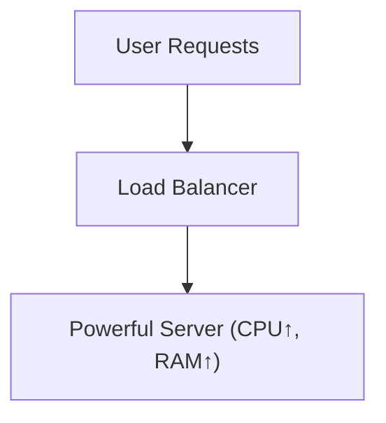

A simpler view:

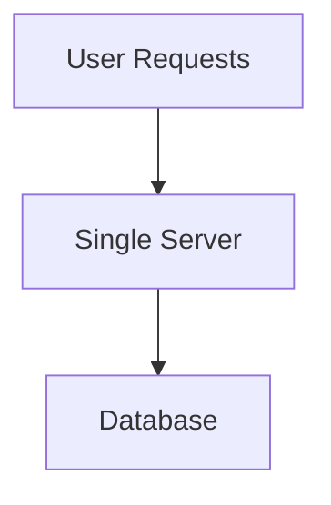

**Pros:**

- Simple to implement.
- Fast upgrades.
- No need for distributed coordination.

**Cons:**

- Physical hardware caps.
- Single point of failure (SPOF).
- Costly at scale.

**Example: Upgrading an AWS EC2 instance:**

```bash
aws ec2 modify-instance-attribute --instance-id i-1234567890abcdef0 --instance-type "{\"Value\": \"t3.2xlarge\"}"
```

#### Horizontal Scaling ("Scaling Out")

Add more servers/nodes, distributing traffic and workload.

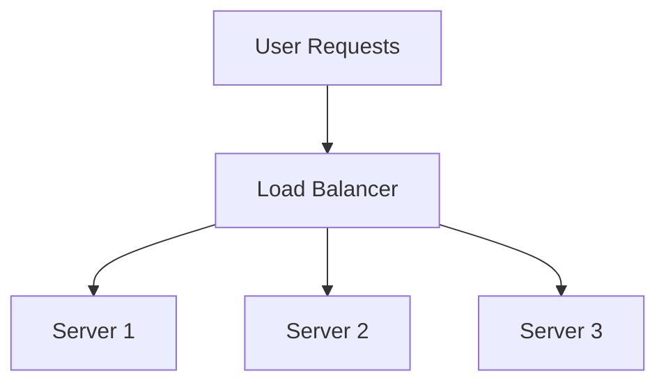

A more detailed version showing the shared database:

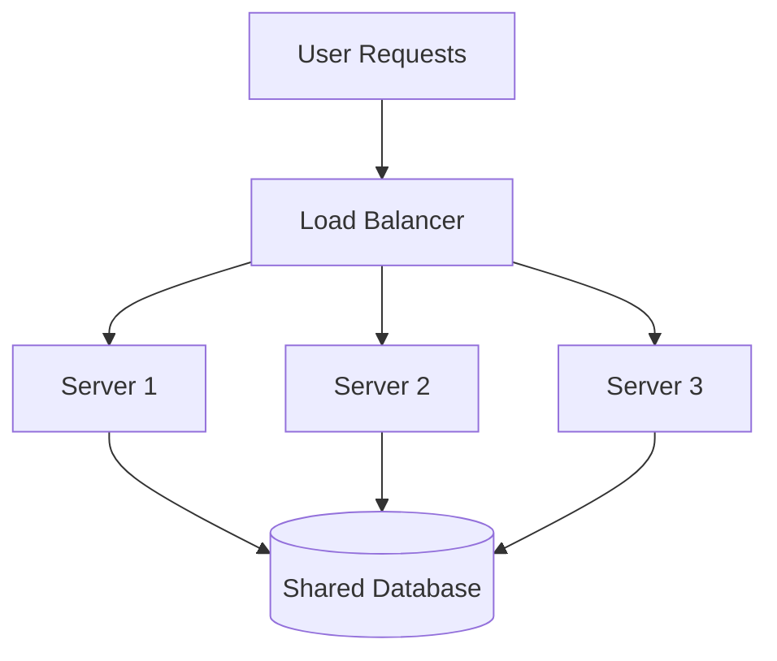

**Pros:**

- High resilience and availability.
- Can scale indefinitely.
- Parallelism, redundancy.

**Cons:**

- Requires stateless design or careful coordination.
- Needs load balancers.
- Complex setup (data consistency, replication).

**Example: Kubernetes Horizontal Pod Autoscaler (HPA) YAML:** *(Kubernetes runs your containers across many machines; the HPA adds or removes copies of a container as load changes.)*

```yaml
apiVersion: autoscaling/v2
kind: HorizontalPodAutoscaler
metadata:
  name: web-app-hpa
spec:
  scaleTargetRef:
    apiVersion: apps/v1
    kind: Deployment
    name: web-app
  minReplicas: 2
  maxReplicas: 10
  metrics:
  - type: Resource
    resource:
      name: cpu
      target:
        type: Utilization
        averageUtilization: 70
```

#### Diagonal Scaling (Hybrid)

Begin with vertical scaling for simplicity; transition to horizontal as needed. Common in cloud-native apps.

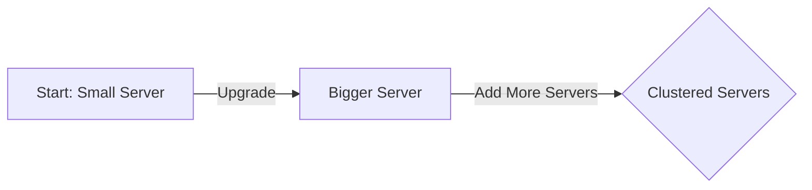

A two-phase view:

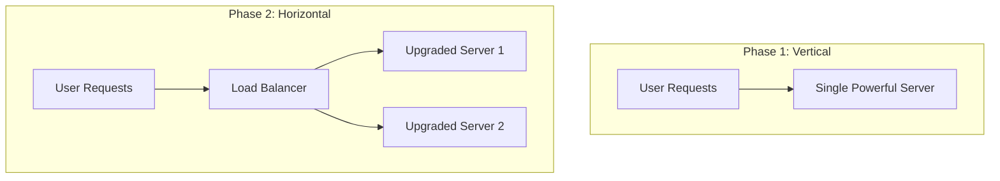

*Start vertical, then scale horizontally as needed.*

A single-graph view of all 3 types:

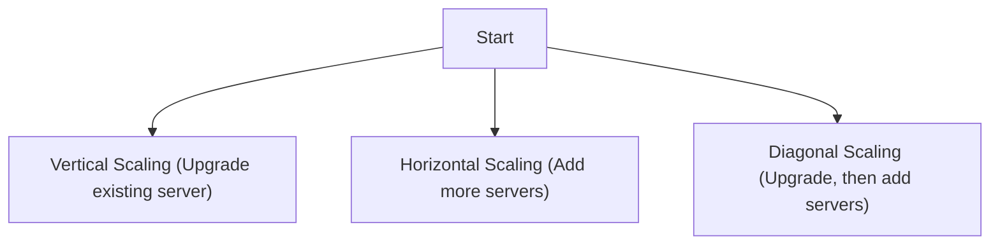

**Real-world examples:**

- **AWS Lambda:** Starts small (vertical), but can auto-scale (horizontal) based on demand.
- **Twitter:** From monolith (vertical) to microservices (horizontal) as user base grew.

#### Scaling Types — Comparison

A summary of all three types side-by-side:

| Scaling Type      | Approach                                  | Pros                | Cons                           |
|-------------------|-------------------------------------------|---------------------|--------------------------------|
| Vertical Scaling  | Upgrade single machine (CPU/RAM/Disk)     | Simple, fast        | Physical limits, SPOF*         |
| Horizontal Scaling| Add more machines/nodes                   | Resilient, scalable | Complex architecture           |
| Diagonal Scaling  | Start vertical, then add horizontal nodes | Flexible, cost-wise | Hybrid (must manage both)      |

> *SPOF: Single Point of Failure.

A version focused on pros/cons:

| Type              | Description                              | Pros                        | Cons                       |
|-------------------|------------------------------------------|-----------------------------|----------------------------|
| **Vertical**      | Add resources (CPU/RAM) to a single node | Simple, fast upgrades       | Physical limits, SPOF      |
| **Horizontal**    | Add more nodes/servers                   | High resilience, big scale  | Complex, needs LB/replica  |
| **Diagonal**      | Start vertical, then go horizontal       | Flexible, cost-efficient    | Coordination complexity    |

#### Trade-Offs: Cost, Complexity, and Performance

|   Strategy   | Cost (Initial) | Cost (Growth) | Complexity | Performance       |
|--------------|----------------|---------------|------------|-------------------|
| Vertical     | Low            | High          | Low        | High (initial)    |
| Horizontal   | Medium         | Linear        | High       | High (scalable)   |
| Diagonal     | Balanced       | Balanced      | Medium     | Balanced          |

**Summary:**

- **Vertical scaling** is easy and cheap to start, but gets expensive and risky at scale.
- **Horizontal scaling** is robust and future-proof, but requires orchestration, monitoring, and stateless patterns.
- **Diagonal scaling** gives early simplicity and long-term scalability, favored by modern cloud-native architectures.

*(From AI Library chapter 6.)*

### Stateless Service Design

The single most important enabler of horizontal scaling. A **stateless** service holds no per-request memory between requests; any instance can serve any request.

#### Where to Put the State Instead

| State                   | Where it goes               | Why                                  |
|-------------------------|------------------------------|--------------------------------------|
| User session            | Redis / Memcached            | Any instance can look it up by ID    |
| File uploads in progress| Object storage with session tokens | Resumable uploads work across servers |
| In-progress workflows   | Database or workflow engine (Temporal, Step Functions) | Survives restarts          |
| WebSocket state         | Pub/Sub layer (Redis Streams, Kafka) | Any WebSocket server can deliver to any user |

> **Rule:** if your service can't be killed and restarted at any moment without users noticing, you have hidden state. Find it.

*(From AI Library chapter 6.)*

### The 9s of Availability — What "Five Nines" Actually Means

| Availability  | Allowed downtime per year | Per month     | Per day      |
|---------------|---------------------------|---------------|--------------|
| 99%           | 3.65 days                 | 7.2 hours     | 14.4 minutes |
| 99.9%         | 8.77 hours                | 43.8 minutes  | 1.44 minutes |
| 99.95%        | 4.38 hours                | 21.9 minutes  | 43.2 seconds |
| 99.99%        | 52.6 minutes              | 4.38 minutes  | 8.64 seconds |
| 99.999%       | 5.26 minutes              | 26.3 seconds  | 0.86 seconds |

> **Reality check:** "Five nines" (99.999%) means **less than 6 minutes of downtime per year.** That includes deploys, patches, and unforeseen incidents. Achieving it requires multi-region active-active, automated failover, no single points of failure anywhere, and rigorous testing. It's *expensive*.
>
> Most products live at 99.9% (three nines) and that's usually fine.

#### Compounding: System ≠ Component Availability

If your service depends on 3 things, each 99.9% available:

`0.999 × 0.999 × 0.999 ≈ 0.997` = 99.7% (about 26 hours of downtime/year).

**Lesson:** the more dependencies, the lower your composite availability. Either make each component *more* reliable, or design to **work in degraded mode** when a dependency is down.

---

#### Availability Math and Failure Domains

**Series and parallel.** Availability multiplies when parts depend on each other, and improves when parts back each other up.

| Setup | Formula | Example with 99.9% parts |
|-------|---------|--------------------------|
| **Series** (A needs B needs C) | `A × B × C` | 2 in series: 99.8% |
| **Parallel** (any one of n is enough) | `1 − (1 − A)ⁿ` | 2 in parallel: 99.9999% |
| 5 services in series | `0.999⁵` | about 99.5%, roughly 44 hours of downtime a year |

Parallel math assumes the failures are **independent**. That is the reason to spread replicas across different zones, not just different servers.

**Failure domains** are things that fail together: a process, a host, a rack, an availability zone, a region, a cloud provider, a deploy, a configuration push. Spread replicas across domains so one failure never takes out every copy. **Correlated failures** (the same bad deploy everywhere, the same shared dependency) are the real enemy, because they defeat the parallel math.

**Levers that raise reliability:** redundancy (N+1, N+2), health checks with automatic failover, timeouts, retries with backoff, circuit breakers, **load shedding** (deliberately rejecting excess work so the rest succeeds), graceful degradation, and gradual rollouts.

*(From AI Library chapter 9.)*

### High Availability, Fault Tolerance & Failover

#### Redundancy

Redundancy prevents single points of failure. Types include:

- **Hardware:** Multiple servers/storage devices.
- **Network:** Multiple data centers, network connections, routers, paths.
- **Service:** Replicated microservices/databases.

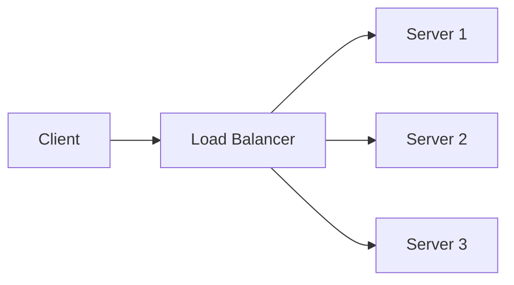

#### Redundancy Strategies

| Strategy           | Description                                          | Use Case                         |
|--------------------|------------------------------------------------------|----------------------------------|
| **N+1**            | One extra instance for failover                      | 3 servers for 2 needed           |
| **Active-Active**  | Multiple nodes handle requests together              | Load balancing across regions    |
| **Active-Passive** | One active node, standby nodes activated on failure  | Standby backup DB or service     |

##### N+1 Redundancy

- One more instance than needed (e.g., 3 servers for a 2-server load).
- If any one fails, the system remains available.

```
Required = N
Provisioned = N+1
If one fails, N remain to serve traffic.
```

##### Active-Active

- All nodes are active, sharing the workload.
- High availability and load distribution.
- Requires robust load balancing and state synchronization.

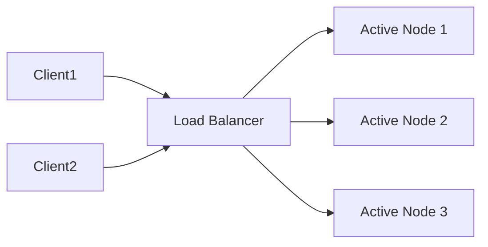

ASCII view:

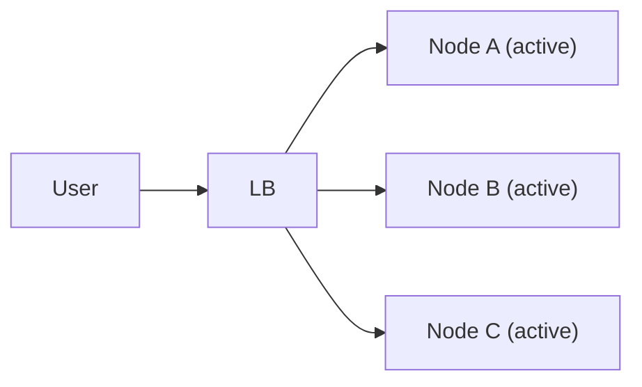

**Active-Active:** every node serves traffic.

##### Active-Passive

- Only one node is active; others are on standby.
- On failure, a passive node becomes active.
- Simpler, but less load-efficient and has failover latency.

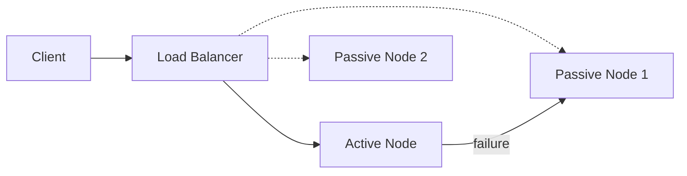

ASCII view:

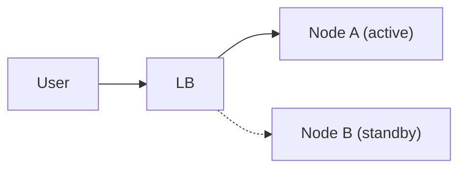

**Active-Passive:** the standby takes over only on failure.

---

#### Single Points of Failure (SPOF)

A **single point of failure** is any one component whose failure takes the whole system down. It is the most common reason a system is less reliable than the sum of its parts.

**Why it matters:**

- **Reliability:** one failed part means lost business and unhappy users (for example, nobody can reach checkout).
- **Scalability:** a design full of single points struggles to grow, because every extra component is one more thing that can break the chain.

**Finding them:** walk the path of one request from the user to the data and ask of every box, *"if this dies right now, what happens?"* If the answer is "everything stops", you have found one.

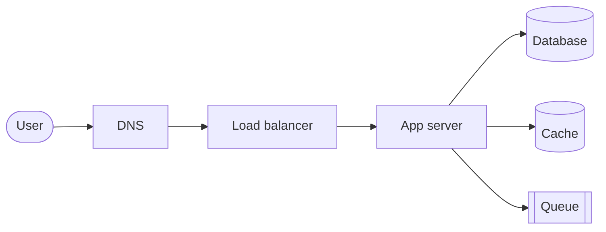

In this sketch every box is a single point of failure. Each fix below adds redundancy:

| Component | Typical single point | Remove it by |
|-----------|---------------------|--------------|
| App servers | one server | several instances behind a load balancer, spread across availability zones |
| Load balancer | one balancer | an active-passive pair with a shared virtual IP, or a managed, multi-zone load balancer |
| Database | one primary | replication with automatic failover, backups, and a standby in another zone |
| Cache and queue | one node | a replicated or clustered cache; a clustered broker with mirrored queues |
| DNS | one provider or name server | several name servers, ideally from more than one provider |
| Data center | one site or region | a second site or region (see Failing Over Between Data Centers) |

**Hidden single points** are easy to miss: a single expired TLS certificate, one shared configuration or secrets service, one deployment pipeline, one third-party API, one person who knows how a system works, or one cloud region.

**Trade-off:** every redundant part costs money and adds complexity (replication lag, failover logic, more to monitor). Spend redundancy where an outage costs more than the redundancy does, and rehearse the failover so you know it works.

### What Actually Breaks Production Systems

A **fault** is something going wrong inside or under your system — a disk dies, a dependency times out. A **failure** is when users no longer get the service they were promised. Resilience engineering is turning faults into non-failures. Most outages are not exotic; they come from a short list:

| Cause | What it looks like | First defence |
|-------|-------------------|---------------|
| **Hardware** | disks, memory, NICs, power, a whole data center | redundancy across failure domains |
| **Bad error handling** | errors swallowed, a too-broad `catch` that kills the process, a `TODO` in a handler. Studies of real outages in distributed databases found most *catastrophic* failures came from mishandled non-fatal errors — bugs that simple tests would have caught | test the error paths, not just the happy path |
| **Configuration changes** | a bad value, or a valid one that switches on a rarely-used, broken code path; often lands *hours later* when the code first reads it | treat config like code: version it, review it, validate it on change, roll it out gradually |
| **Single points of failure** | including humans running manual runbooks, DNS, and an expired TLS certificate | automate, add redundancy, monitor expiry dates; otherwise shrink the blast radius |
| **Network trouble** | not clean outages but *slow* calls and partial packet loss | timeouts everywhere ([Vol 3 Ch 14](../volume-3-low-level-design/ch14-resilience-patterns-idempotency-retries-backoff-circuit-breakers.md)) |
| **Resource leaks** | memory, threads, file handles, pooled connections never returned (often a call with no timeout) — the process gets slower and slower | timeouts, bounded pools, leak alerts, a watchdog that restarts a degraded instance |
| **Load surges** | daily peaks, scrapers, retries, DDoS | autoscaling plus load shedding and rate limiting |
| **Cascading failures** | one replica fails, its load moves to the others, they overload and fail too | headroom, load shedding, retry budgets, circuit breakers |

**Gray failures** — the most dangerous are failures nobody can see clearly: a node that is up but slow, a link dropping 2% of packets, a disk with rising latency. Health checks pass, yet users suffer. Watch latency percentiles and error rates *as clients see them*, not only "is it up".

**Metastable failures** — sometimes a system stays broken *after the trigger is gone*. Example: replica B drops out briefly; A takes double load and slows down; clients time out and retry, adding still more load; A gets ejected; B comes back alone and gets flattened the same way. The original fault has healed, but a feedback loop (retries, cache misses, queue backlogs) keeps the system in its bad state. Usually only a big intervention breaks the loop — shedding most traffic, pausing retries, warming caches before letting traffic back. Prevention beats cure: retry budgets, load shedding, circuit breakers, and capacity headroom stop the loop from forming.

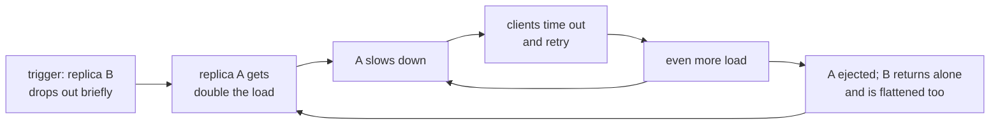

**Prioritise with a risk matrix** — you can't defend against everything. Score each fault by **likelihood × impact**: handle likely, high-impact faults first; accept rare, low-impact ones. Then either lower the likelihood (better tests, safer deploys) or lower the impact (redundancy, isolation, graceful degradation).

| Impact ↓ / Likelihood → | Rare | Unlikely | Possible | Likely | Almost certain |
|---|:-:|:-:|:-:|:-:|:-:|
| **Catastrophic** (all users, data loss) | 🟨 medium | 🟥 high | 🟥 high | 🟥 high | 🟥 high |
| **Major** (a region or core feature down) | 🟩 low | 🟨 medium | 🟥 high | 🟥 high | 🟥 high |
| **Moderate** (degraded, some users) | 🟩 low | 🟨 medium | 🟨 medium | 🟥 high | 🟥 high |
| **Minor** (a few users, workaround exists) | 🟩 low | 🟩 low | 🟨 medium | 🟨 medium | 🟨 medium |
| **Negligible** | 🟩 low | 🟩 low | 🟩 low | 🟩 low | 🟨 medium |

Example placements: an expired TLS certificate is *possible × catastrophic* (high — automate renewal and alert on expiry); a single disk failure in a replicated store is *likely × negligible* (low — redundancy already covers it).

**When redundancy actually helps** — adding a spare doesn't automatically raise availability. It only does if:

1. the added complexity (load balancer, failover logic) causes fewer outages than it prevents;
2. the system reliably detects which copies are healthy (health checks — slow detection means users see errors meanwhile);
3. the system can run *degraded* — the survivors have the capacity to absorb the failed part's load;
4. it returns to full redundancy — failed instances are replaced automatically.

And the copies must not fail **together**: replicas in one zone share power and network, so a zone outage takes them all. Availability zones (separate buildings close enough for synchronous replication) protect against that; regions protect against regional disasters, at the cost of asynchronous replication and multi-region complexity. Multi-region is usually driven by latency or data-residency laws more than by fear of losing a whole region.

*(From AI Library chapter 9.)*

The diagram, worked example, exercises, mini-project, design prompt, open-source reading, interview questions and checklist below are this chapter's practice layer.

---

## Prereqs

* [Chapter 2 — Capacity Planning](ch02-capacity-planning.md)

---

## Diagram

**Scale-up vs scale-out**

<div class="fig">
<svg xmlns="http://www.w3.org/2000/svg" viewBox="0 0 780 300" role="img" aria-label="Scaling up gives one big 64-core machine with a single point of failure; scaling out adds many small machines behind a load balancer" style="width:100%;max-width:780px;height:auto;font-family:inherit"><defs><marker id="ar" viewBox="0 0 10 10" refX="8" refY="5" markerWidth="7" markerHeight="7" orient="auto-start-reverse"><path d="M0 0L10 5L0 10z" fill="context-stroke"/></marker></defs><text x="130" y="24" font-size="14" text-anchor="middle" fill="var(--text)" font-weight="700">SCALE UP</text><text x="540" y="24" font-size="14" text-anchor="middle" fill="var(--text)" font-weight="700">SCALE OUT</text><rect x="50" y="44" width="160" height="150" rx="6" fill="var(--primary)" fill-opacity=".16" stroke="var(--primary)" stroke-width="1.6"/><text x="130" y="112" font-size="15" text-anchor="middle" fill="var(--text)" font-weight="700">64 cores</text><text x="130" y="136" font-size="13" text-anchor="middle" fill="var(--text-muted)">512 GB</text><text x="130" y="224" font-size="12.5" text-anchor="middle" fill="var(--danger)" font-weight="600">one box, one failure = outage</text><rect x="340" y="44" width="70" height="44" rx="8" fill="var(--success)" fill-opacity=".14" stroke="var(--success)" stroke-width="1.6"/><text x="375.0" y="70.55" font-size="13" text-anchor="middle" fill="var(--text)" font-weight="600">4c</text><line x1="375" y1="138" x2="375" y2="90" stroke="var(--text-muted)" stroke-width="1.6" marker-end="url(#ar)"/><rect x="420" y="44" width="70" height="44" rx="8" fill="var(--success)" fill-opacity=".14" stroke="var(--success)" stroke-width="1.6"/><text x="455.0" y="70.55" font-size="13" text-anchor="middle" fill="var(--text)" font-weight="600">4c</text><line x1="455" y1="138" x2="455" y2="90" stroke="var(--text-muted)" stroke-width="1.6" marker-end="url(#ar)"/><rect x="500" y="44" width="70" height="44" rx="8" fill="var(--success)" fill-opacity=".14" stroke="var(--success)" stroke-width="1.6"/><text x="535.0" y="70.55" font-size="13" text-anchor="middle" fill="var(--text)" font-weight="600">4c</text><line x1="535" y1="138" x2="535" y2="90" stroke="var(--text-muted)" stroke-width="1.6" marker-end="url(#ar)"/><rect x="580" y="44" width="70" height="44" rx="8" fill="var(--success)" fill-opacity=".14" stroke="var(--success)" stroke-width="1.6"/><text x="615.0" y="70.55" font-size="13" text-anchor="middle" fill="var(--text)" font-weight="600">4c</text><line x1="615" y1="138" x2="615" y2="90" stroke="var(--text-muted)" stroke-width="1.6" marker-end="url(#ar)"/><text x="700" y="70" font-size="12.5" text-anchor="start" fill="var(--text-muted)">… add more</text><rect x="340" y="138" width="310" height="44" rx="6" fill="var(--accent)" fill-opacity=".18" stroke="var(--accent)" stroke-width="1.6"/><text x="495" y="166" font-size="13.5" text-anchor="middle" fill="var(--text)" font-weight="600">load balancer</text></svg>
</div>

**Redundancy across failure domains, with the availability formula**

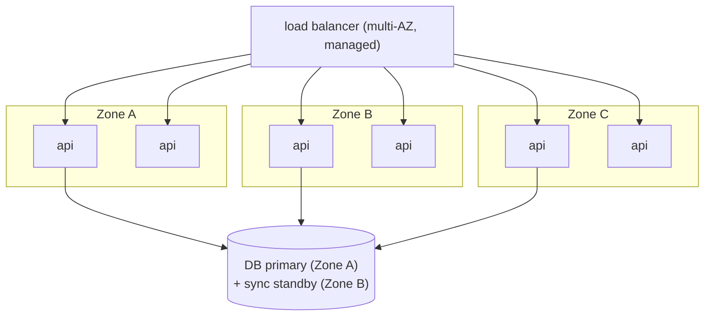

```
 zone availability 99.9%, 3 zones in parallel:   1 − (0.001)³ = 99.9999999%  (if independent)
 in series with the DB pair (99.99%):             ≈ 99.99%  ← the DB now limits the system
```

**Series vs parallel**

<div class="fig">
<svg xmlns="http://www.w3.org/2000/svg" viewBox="0 0 780 220" role="img" aria-label="Two 99.9 percent components in series give 99.80 percent; in parallel they give 99.9999 percent" style="width:100%;max-width:780px;height:auto;font-family:inherit"><defs><marker id="ar" viewBox="0 0 10 10" refX="8" refY="5" markerWidth="7" markerHeight="7" orient="auto-start-reverse"><path d="M0 0L10 5L0 10z" fill="context-stroke"/></marker></defs><text x="20" y="44" font-size="13.5" text-anchor="start" fill="var(--primary)" font-weight="700">SERIES</text><rect x="120" y="22" width="120" height="40" rx="8" fill="var(--primary)" fill-opacity=".14" stroke="var(--primary)" stroke-width="1.6"/><text x="180.0" y="46.55" font-size="13" text-anchor="middle" fill="var(--text)" font-weight="600">A 99.9%</text><line x1="240" y1="42" x2="280" y2="42" stroke="var(--text-muted)" stroke-width="1.6"/><rect x="280" y="22" width="120" height="40" rx="8" fill="var(--primary)" fill-opacity=".14" stroke="var(--primary)" stroke-width="1.6"/><text x="340.0" y="46.55" font-size="13" text-anchor="middle" fill="var(--text)" font-weight="600">B 99.9%</text><text x="430" y="48" font-size="14" text-anchor="start" fill="var(--text)" font-weight="700">= 0.999 × 0.999  =  99.80%</text><text x="20" y="140" font-size="13.5" text-anchor="start" fill="var(--success)" font-weight="700">PARALLEL</text><rect x="160" y="100" width="120" height="40" rx="8" fill="var(--success)" fill-opacity=".14" stroke="var(--success)" stroke-width="1.6"/><text x="220.0" y="124.55" font-size="13" text-anchor="middle" fill="var(--text)" font-weight="600">A 99.9%</text><rect x="160" y="150" width="120" height="40" rx="8" fill="var(--success)" fill-opacity=".14" stroke="var(--success)" stroke-width="1.6"/><text x="220.0" y="174.55" font-size="13" text-anchor="middle" fill="var(--text)" font-weight="600">B 99.9%</text><line x1="120" y1="145" x2="160" y2="120" stroke="var(--text-muted)" stroke-width="1.6"/><line x1="120" y1="145" x2="160" y2="170" stroke="var(--text-muted)" stroke-width="1.6"/><line x1="280" y1="120" x2="320" y2="145" stroke="var(--text-muted)" stroke-width="1.6"/><line x1="280" y1="170" x2="320" y2="145" stroke="var(--text-muted)" stroke-width="1.6"/><text x="430" y="152" font-size="14" text-anchor="start" fill="var(--text)" font-weight="700">= 1 − 0.001 × 0.001  =  99.9999%</text></svg>
</div>

---

## Example

```python
from functools import reduce

def series(*parts):   return reduce(lambda a, b: a * b, parts, 1.0)
def parallel(a, n):   return 1 - (1 - a) ** n

print(f"{series(0.999, 0.999):.4%}")          # 99.8001%
print(f"{parallel(0.999, 2):.6%}")            # 99.999900%
print(f"{series(*[0.999] * 5):.4%}")          # 99.5010% — 5 services in a chain

def downtime(avail, period_h=24 * 365):
    return (1 - avail) * period_h * 60        # minutes
for a in (0.99, 0.999, 0.9999, 0.99999):
    print(f"{a:.3%}: {downtime(a):8.1f} min/year")
```

**Making a stateful service horizontally scalable**

| | BEFORE: sessions in process memory | AFTER: sessions in Redis |
|---|---|---|
| Request path | user → LB → `api-2` (has the session) | user → LB → any api node → Redis `session:abc` |
| When a node dies | `api-2` dies → the user is logged out | the next request goes elsewhere, still logged in |
| Consequence | sticky sessions needed | no stickiness needed; autoscale freely |

---

## Exercises

1. Compute availability of three nines across 5 services.

   <details><summary>Solution</summary>In series: 0.999⁵ ≈ 99.50%, about 44 hours of downtime a year — much worse than any single service. Fixes: remove dependencies from the critical path, make calls optional (degrade gracefully), add redundancy per service, or use async processing.</details>

2. Make a stateful service horizontally scalable.

   <details><summary>Solution</summary>Find all state held in memory or on local disk: sessions, uploads, caches, scheduled jobs, in-memory queues. Move sessions to Redis or signed tokens, files to object storage, caches to a shared cache (or accept per-node caches), queues to a broker, and cron to a single scheduler with leader election. Then any node can serve any request.</details>

3. Why doesn't running 3 replicas in the same rack give "three nines times three"?

   <details><summary>Solution</summary>The parallel formula needs independent failures. A rack power or switch failure takes all three down together. Spread across racks, zones, or regions to make failures independent.</details>

---

## Mini project

**An availability/reliability calculator with failure-domain modeling.**

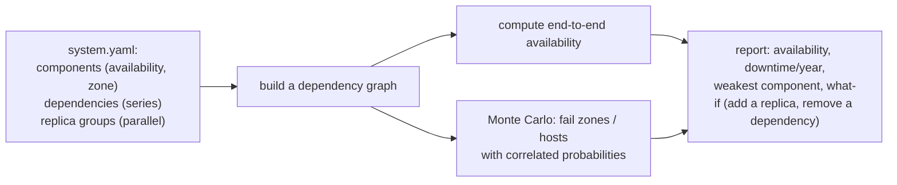

**Steps**

1. Describe components, their availability, their failure domain (zone), and how they combine.
2. Compute availability analytically for series/parallel groups.
3. Monte Carlo simulation where a zone failure takes down all components in it; compare with the analytic (independent) result.
4. Report the weakest link and the effect of each "what-if".

**Done when:** the simulation shows how correlated zone failures lower availability compared with the naive formula.

---

## Design

**Design a highly available stateless API tier.**

Target: 99.99% for the API tier, 20,000 peak QPS, zero-downtime deploys.

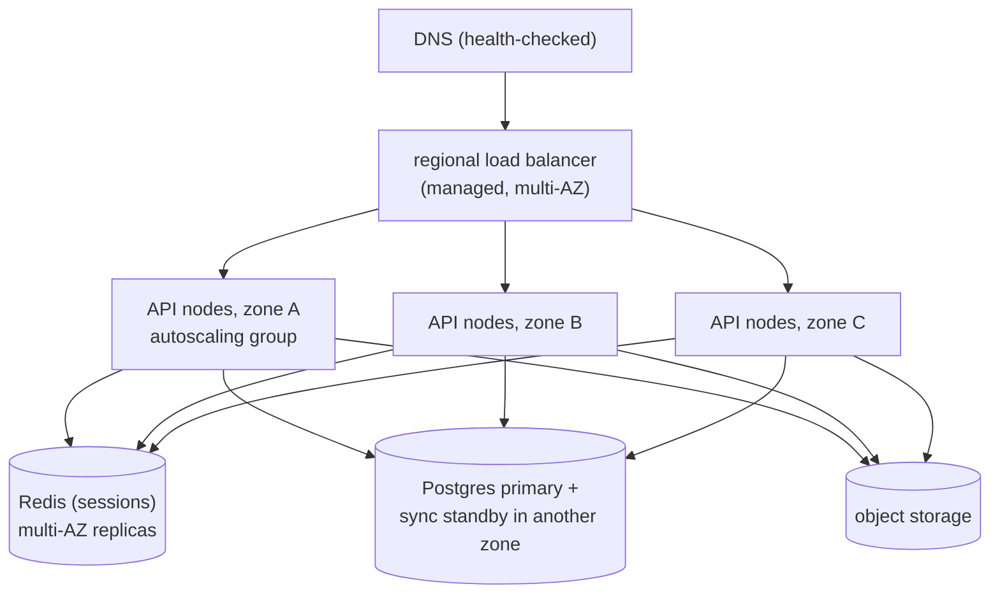

**Capacity:** 20,000 QPS ÷ (1,000 QPS/node × 0.7) ≈ 29 nodes; to survive losing a whole zone, the remaining two zones must carry the peak, so 29 ÷ 2 ≈ 15 per zone → **45 nodes** (15 × 3).

**Decisions to justify**

* **Stateless nodes** (sessions in Redis, files in object storage), so the autoscaler can replace nodes freely.
* **N+1 zones:** each zone holds enough capacity to lose one zone at peak.
* **Health checks** (readiness vs liveness) and connection draining for zero-downtime rolling deploys.
* **Timeouts, retries with jitter, and circuit breakers** around the DB and cache; serve degraded responses if a non-critical dependency fails.
* **The DB is the availability bottleneck:** synchronous standby in another zone with automatic failover; read replicas for scale.

---

## Open source

* [`donnemartin/system-design-primer`](https://github.com/donnemartin/system-design-primer) — sections on "Availability vs consistency", "Availability in numbers", and scaling a web app step by step. See also Google's *Site Reliability Engineering* book.

---

## Interview

1. **"Horizontal vs vertical scaling?"**
   <details><summary>Answer</summary>Vertical: a bigger machine — simple, no code change, but it has a ceiling and remains a single point of failure. Horizontal: more machines behind a load balancer — no hard ceiling and tolerant of node loss, but it requires stateless design, data partitioning, and coordination. Typically scale the stateless tier horizontally from the start and scale the database vertically first, then with replicas and sharding.</details>

2. **"What does 99.99% allow per year?"**
   <details><summary>Answer</summary>About 52.6 minutes of downtime per year (~4.4 minutes per month). That is too little time for a human to notice, diagnose, and fix most problems, so it requires automatic failover, redundancy across zones, safe deploys, and fast rollbacks.</details>

3. **"What is a metastable failure and how do you prevent one?"**
   <details><summary>Answer</summary>A failure that persists after its trigger has gone, because a feedback loop keeps the system overloaded: a brief outage causes timeouts, timeouts cause retries, retries add load, so the system never recovers on its own. Prevent it with retry budgets (retry at one layer, cap retries as a share of traffic), backoff with jitter, load shedding, circuit breakers and spare capacity. Once in it, you usually need a large action — shed or block most traffic, then ramp back up.</details>

4. **"Adding a second instance didn't improve availability. Why might that be?"**
   <details><summary>Answer</summary>Redundancy only helps if failures are detected quickly, the survivor has the capacity to run alone, failed copies are replaced, and the copies don't fail together. Two instances in the same zone, behind a health check that never fails, where one alone can't carry peak load, add complexity without adding availability. Spread them across zones, size for N−1, and test the failover.</details>

---

## Checklist

- [ ] design for statelessness
- [ ] spread across failure domains
- [ ] compute availability correctly
- [ ] list the common causes of outages and a defence for each
- [ ] recognise gray and metastable failures
- [ ] rank risks by likelihood × impact

---

> [Contents](index.md) · ← [Chapter 2 — Capacity Planning](ch02-capacity-planning.md) · Next → [Chapter 4 — Distributed Systems Patterns](ch04-distributed-systems-patterns.md)
