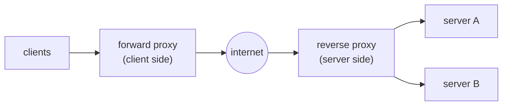
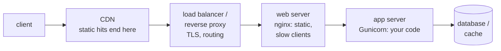
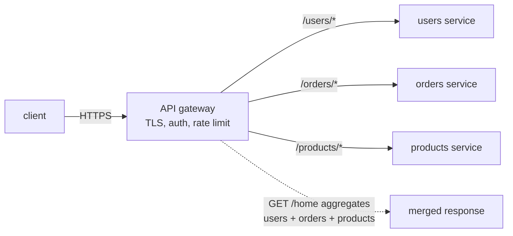
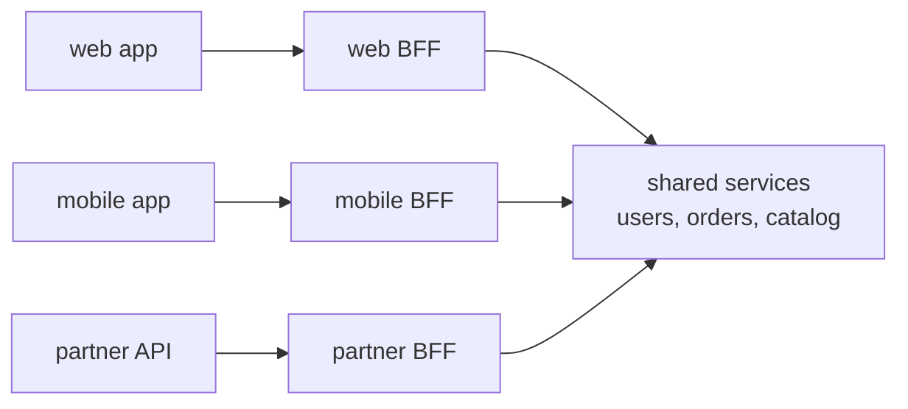
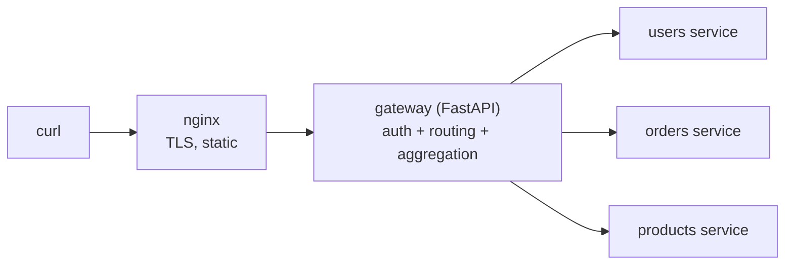
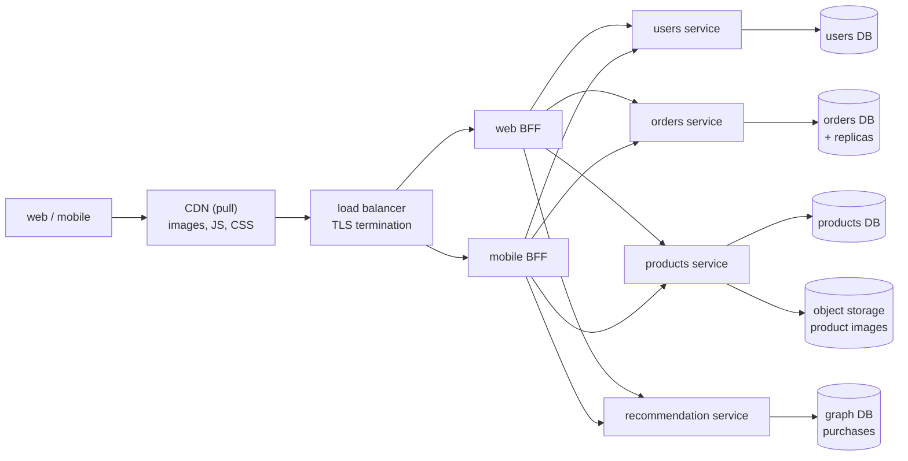

# Chapter 5 — Proxies, Gateways, Web Servers & Storage Types

> **Volume 4 — High-Level Design** · [Contents](index.md) · ← [Chapter 4 — Distributed Systems Patterns](ch04-distributed-systems-patterns.md) · Next → [Chapter 6 — Load Balancing](ch06-load-balancing.md)

---

## Concept

Forward vs reverse proxy, API gateway patterns, web vs app servers, CDN push vs pull, block/object/file storage, federation, graph databases.

**In one sentence:** the boxes between a client and your data — proxies, gateways, web servers, app servers — each have one job, and the boxes at the bottom — block, object, file storage, relational or graph databases — each fit one access pattern, so good design is matching each job and each access pattern to the right box.

**Read the full explanation in the AI Library** (it is explained there once, so this chapter does not repeat it):

* [Chapter 2 — Forward Proxy vs. Reverse Proxy: Key Differences](https://charikshith.github.io/AI_Library/notes/system-design/chapters/2%20-%20Networking%20%26%20Communication.html#275-forward-proxy-vs-reverse-proxy-key-differences)
* [Chapter 2 — API Gateways
](https://charikshith.github.io/AI_Library/notes/system-design/chapters/2%20-%20Networking%20%26%20Communication.html#29-api-gateways)
* [Chapter 2 — API Gateway Patterns](https://charikshith.github.io/AI_Library/notes/system-design/chapters/2%20-%20Networking%20%26%20Communication.html#295-api-gateway-patterns)
* [Chapter 2 — Web Servers vs. Application Servers](https://charikshith.github.io/AI_Library/notes/system-design/chapters/2%20-%20Networking%20%26%20Communication.html#210-web-servers-vs-application-servers)
* [Chapter 2 — Caching Strategies in CDNs](https://charikshith.github.io/AI_Library/notes/system-design/chapters/2%20-%20Networking%20%26%20Communication.html#2116-caching-strategies-in-cdns)
* [Chapter 7 — Block vs File vs Object Storage — They're NOT Interchangeable](https://charikshith.github.io/AI_Library/notes/system-design/chapters/7%20-%20Storage%20-%20Database%20and%20Storage.html#715-block-vs-file-vs-object-storage--theyre-not-interchangeable)
* [Chapter 7 — Database Federation](https://charikshith.github.io/AI_Library/notes/system-design/chapters/7%20-%20Storage%20-%20Database%20and%20Storage.html#717-database-federation)
* [Chapter 7 — Graph Databases: Why Traversal Beats Joins](https://charikshith.github.io/AI_Library/notes/system-design/chapters/7%20-%20Storage%20-%20Database%20and%20Storage.html#7161-graph-databases-why-traversal-beats-joins)
* [Chapter 8 — Normalization vs. Denormalization](https://charikshith.github.io/AI_Library/notes/system-design/chapters/8%20-%20Performance%20-%20Concepts%2C%20Tools%20%26%20Techniques.html#895-normalization-vs-denormalization)

This chapter is the **practice layer**: the diagram, worked example, exercises, mini-project, design prompt, open-source reading, interview questions and checklist below.

---

## Prereqs

* [Vol 1 Ch 44 — Delivery: Load Balancing, Reverse Proxies & CDN](../volume-1-cs-foundations/ch44-delivery-load-balancing-reverse-proxies-and-cdn.md)
* [Chapter 6 — Load Balancing](ch06-load-balancing.md)
* [Chapter 11 — Database Scaling](ch11-database-scaling.md)
* [Chapter 14 — CDN, Edge & Geo-Distribution](ch14-cdn-edge-and-geo-distribution.md)

---

## Diagram

**Forward vs reverse proxy**



**Request flow through the layers**



**API gateway doing routing, offloading and aggregation**



**Backends for Frontend**



**Push vs pull CDN**

```
 PULL                                         PUSH
 client -> edge (miss) -> origin               you -> upload to CDN / its storage
 origin -> edge caches for TTL                 client -> edge (already there)
 next client -> edge (hit)                     you must delete or replace old files
 expiry: TTL, purge, or new file name          cost: storage for everything pushed
```

---

## Example

```nginx
# nginx as TLS-terminating reverse proxy + web server in front of a Gunicorn app
upstream app {
    server 127.0.0.1:8000;          # gunicorn
    server 127.0.0.1:8001;
    keepalive 32;
}

server {
    listen 443 ssl;
    server_name shop.example.com;
    ssl_certificate     /etc/ssl/shop.crt;
    ssl_certificate_key /etc/ssl/shop.key;

    location /static/ {             # web server job: files straight from disk
        root /var/www;
        expires 30d;
        add_header Cache-Control "public, immutable";
    }

    location /api/ {                # reverse proxy job: pass to the app server
        proxy_pass http://app;
        proxy_set_header Host $host;
        proxy_set_header X-Forwarded-For $remote_addr;
        proxy_http_version 1.1;
        proxy_set_header Connection "";
    }
}
```

```bash
# app server: pre-forked worker processes (2 x cores + 1 is a common starting point)
gunicorn app:app --workers 5 --bind 127.0.0.1:8000
```

```python
# Gateway aggregation: one client call, three backend calls in parallel
import asyncio, httpx

async def home(user_id: str) -> dict:
    async with httpx.AsyncClient(timeout=0.5) as c:
        u, o, p = await asyncio.gather(
            c.get(f"http://users/users/{user_id}"),
            c.get(f"http://orders/orders?user={user_id}&limit=3"),
            c.get("http://products/featured"),
            return_exceptions=True,          # partial failure: do not fail the whole page
        )
    return {
        "user": u.json() if not isinstance(u, Exception) else None,
        "orders": o.json() if not isinstance(o, Exception) else [],
        "featured": p.json() if not isinstance(p, Exception) else [],
    }
```

```cypher
// Property graph: friends-of-friends recommendation (Cypher)
MATCH (me:User {id: 42})-[:FOLLOWS]->(:User)-[:FOLLOWS]->(rec:User)
WHERE rec <> me AND NOT (me)-[:FOLLOWS]->(rec)
RETURN rec.name, count(*) AS mutual
ORDER BY mutual DESC
LIMIT 10;
```

```sql
-- the same two-hop query in SQL needs a self-join per hop
SELECT f2.followee_id, COUNT(*) AS mutual
FROM follows f1
JOIN follows f2 ON f2.follower_id = f1.followee_id
WHERE f1.follower_id = 42
  AND f2.followee_id <> 42
  AND f2.followee_id NOT IN (SELECT followee_id FROM follows WHERE follower_id = 42)
GROUP BY f2.followee_id
ORDER BY mutual DESC
LIMIT 10;
```

---

## Exercises

1. Explain the difference between a forward proxy and a reverse proxy, and name one real product for each.

   <details><summary>Solution</summary>A forward proxy acts for clients (Squid on a corporate network filters and caches outbound traffic, hiding client IPs). A reverse proxy acts for servers (nginx, HAProxy or Envoy in front of a service handles TLS, caching and routing, hiding the backends). The question to ask: whose side is the proxy on, and who knows it is there?</details>

2. Pick block, object or file storage for: a PostgreSQL data volume, user-uploaded profile photos, a shared folder mounted by 10 web servers.

   <details><summary>Solution</summary>PostgreSQL: block (EBS) for low-latency random I/O. Profile photos: object (S3), with the key stored in the database and a CDN in front. Shared folder: file storage (EFS/NFS), because many machines need a POSIX file system at once. If the shared folder only holds uploaded assets, consider moving it to object storage instead.</details>

3. Your single database holds users, products and orders and is CPU-bound. When is federation a better first step than sharding, and what breaks?

   <details><summary>Solution</summary>When the load comes from different functions and the domains are mostly independent: split into users, products and orders databases. Joins across them move into application code or an API, and a checkout touching two databases needs a saga or two-phase commit instead of one transaction. If one table (say orders) is itself too big for one machine, sharding is still needed later.</details>

4. When would you choose a graph database over PostgreSQL?

   <details><summary>Solution</summary>When the core queries traverse relationships with unknown or deep depth (fraud rings, recommendations, permission graphs) and join cost grows with every hop. For fixed-depth lookups, filters, aggregates and strong transactional needs, stay relational; recursive CTEs cover occasional graph queries.</details>

---

## Mini project

**A tiny edge stack with docker compose: nginx → gateway → services.**



**Steps**

1. Three small services, each with its own SQLite or Postgres database (federation in miniature).
2. A FastAPI gateway: API-key check, path routing, and a `/home` endpoint that aggregates the three services with timeouts and partial failure.
3. nginx in front: TLS with a self-signed cert, `/static/` served from disk, everything else proxied.
4. Add a second gateway instance and let nginx balance across them; kill one and show requests keep working.
5. Store uploaded images in MinIO (S3-compatible object storage) and keep only the key in the database.

**Done when:** `/home` returns merged data even if one service is down (that field empty), static files never reach the gateway, and killing a gateway instance causes no failed requests.

---

## Design

**Design the edge and storage tier of an online shop.**

Requirements: 5M users, 20k peak requests/s at the edge (80% static assets and cacheable GETs), web and mobile apps with different payloads, product images up to 5 MB, orders must be transactional, "customers also bought" recommendations.



**Capacity:** 20k req/s × 20% dynamic = ~4k req/s reach the gateways; across 4 gateway nodes that is ~1k req/s each, comfortable for one proxy node. Images: 1M products × ~5 MB originals = ~5 TB, trivial for object storage and expensive on block storage.

**Decisions to justify**

* **Pull CDN with hashed file names** for assets; product images in object storage behind the CDN, so the origin only sees misses.
* **Redundant BFFs** (web and mobile) behind a load balancer: no single point of failure; a shared library (not a shared gateway) for auth and rate limiting to limit duplication.
* **Federation** by domain: users, products and orders databases scale and fail independently; orders keeps replicas, and checkout uses a saga rather than a cross-DB transaction.
* **Block storage** (EBS-style volumes) only under the databases; **object storage** for images and exports; **file storage** not needed.
* **Graph DB** only for recommendations, fed asynchronously from order events; the orders DB stays the source of truth.
* **Trade-off acknowledged:** more databases mean more operations work and no cross-domain joins; accept it for the isolation.

---

## Open source

* [`nginx/nginx`](https://github.com/nginx/nginx) — web server and reverse proxy with an event-driven worker model.
* [`haproxy/haproxy`](https://github.com/haproxy/haproxy) — high-performance TCP and HTTP load balancer and proxy.
* [`envoyproxy/envoy`](https://github.com/envoyproxy/envoy) — L4/L7 proxy used as an edge proxy, gateway data plane and service-mesh sidecar.
* [`Kong/kong`](https://github.com/Kong/kong) — API gateway with an auth, rate-limit and transform plugin ecosystem.
* [`squid-cache/squid`](https://github.com/squid-cache/squid) — long-standing forward caching proxy.
* [`benoitc/gunicorn`](https://github.com/benoitc/gunicorn) — pre-fork Python WSGI application server.
* [`apache/tomcat`](https://github.com/apache/tomcat) — Java servlet container with a thread-pool model.
* [`minio/minio`](https://github.com/minio/minio) — S3-compatible object storage you can run yourself.
* [`neo4j/neo4j`](https://github.com/neo4j/neo4j) — property graph database with the Cypher query language.

---

## Interview

1. **"What is the difference between a load balancer and a reverse proxy?"**
   <details><summary>Answer</summary>They overlap heavily and products like nginx, HAProxy and Envoy do both. A load balancer is defined by spreading traffic across several identical backends with health checks and failover. A reverse proxy is defined by sitting in front of servers and doing work on the way: TLS termination, caching, compression, rewriting, path or host routing. A load balancer may work at layer 4 without reading HTTP; a reverse proxy normally works at layer 7.</details>

2. **"Why put nginx in front of Gunicorn or Tomcat?"**
   <details><summary>Answer</summary>The event-driven web server handles thousands of slow or idle client connections cheaply, terminates TLS, serves static files directly and buffers requests and responses. The app server's limited worker processes or threads then spend their time running code, not waiting on slow clients.</details>

3. **"Explain the gateway patterns and the risks of an API gateway."**
   <details><summary>Answer</summary>Routing sends requests to backends by path, host or version. Offloading moves shared concerns (TLS, auth, rate limiting, logging) out of each service. Aggregation fans out and merges calls so clients make one request. BFF gives each client type its own gateway shaped to its needs. Risks: a single point of failure unless redundant, an extra hop of latency, and coupling if business logic accumulates in it. Keep it thin and redundant, and split per client with BFFs when teams or payloads diverge.</details>

4. **"Block, object or file storage for a given workload?"**
   <details><summary>Answer</summary>Block for databases and boot volumes needing low-latency random I/O from one machine. Object for large, immutable, read-whole data (images, video, backups, logs) at the lowest cost per GB and near-unlimited scale. File when several machines need a shared POSIX file system. Often the best design stores bytes in object storage and the metadata in a database.</details>

5. **"Federation vs sharding?"**
   <details><summary>Answer</summary>Federation splits databases by function (users, products, orders), reducing load per server and giving domains independent scaling, at the price of cross-database joins and transactions. Sharding splits one dataset's rows by key across servers, scaling a single large domain but adding resharding and cross-shard query complexity. Federate first along domain lines; shard a domain when its own data outgrows one node.</details>

---

## Checklist

- [ ] know whose side each proxy is on
- [ ] keep the gateway thin and redundant
- [ ] pick block, object or file storage by access pattern
- [ ] choose pull or push CDN deliberately
- [ ] federate by domain before sharding
- [ ] use a graph database only for relationship-heavy queries

---

> [Contents](index.md) · ← [Chapter 4 — Distributed Systems Patterns](ch04-distributed-systems-patterns.md) · Next → [Chapter 6 — Load Balancing](ch06-load-balancing.md)
