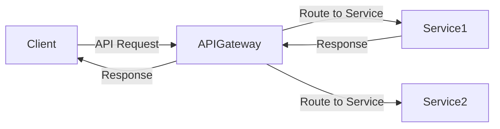
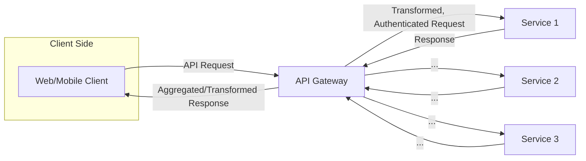
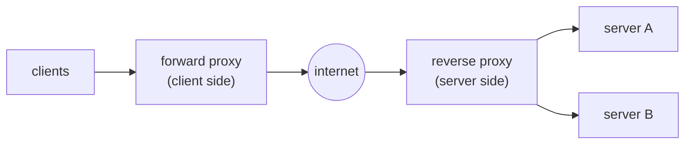
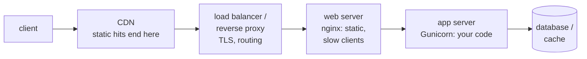
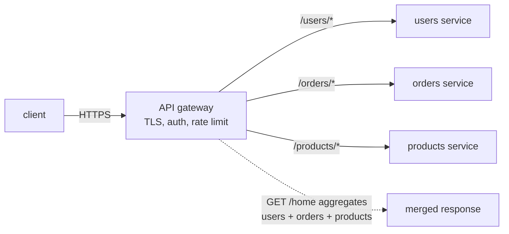
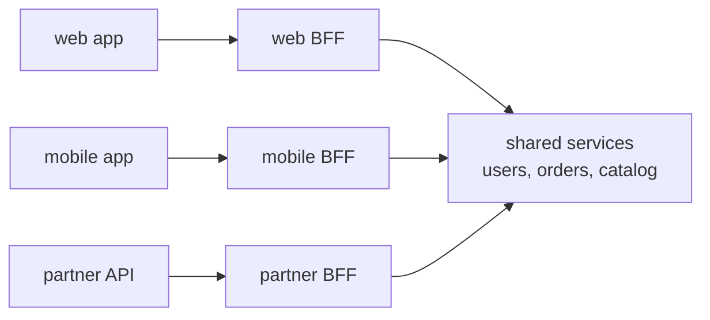
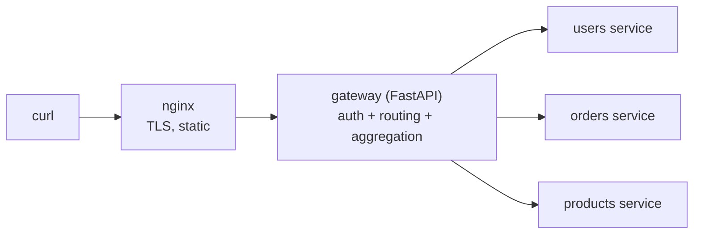
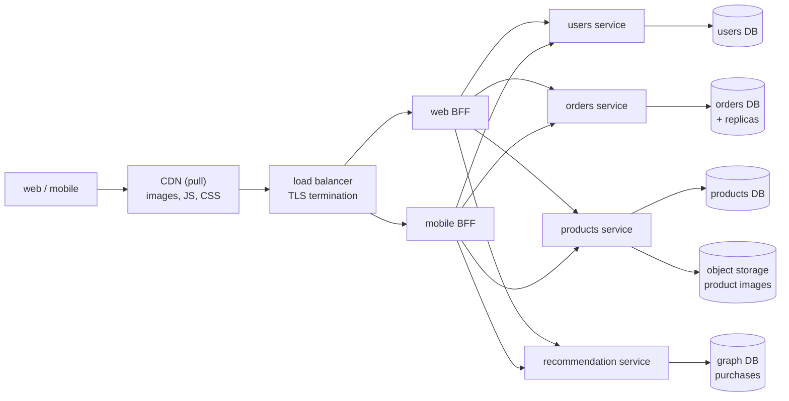

# Chapter 5 — Proxies, Gateways, Web Servers & Storage Types

> **Volume 4 — High-Level Design** · [Contents](index.md) · ← [Chapter 4 — Distributed Systems Patterns](ch04-distributed-systems-patterns.md) · Next → [Chapter 6 — Load Balancing](ch06-load-balancing.md)

---

## Concept

Forward vs reverse proxy, API gateway patterns, web vs app servers, CDN push vs pull, block/object/file storage, federation, graph databases.

**In one sentence:** the boxes between a client and your data — proxies, gateways, web servers, app servers — each have one job, and the boxes at the bottom — block, object, file storage, relational or graph databases — each fit one access pattern, so good design is matching each job and each access pattern to the right box.

### Forward Proxy vs. Reverse Proxy: Key Differences

| Aspect           | Forward Proxy                      | Reverse Proxy                              |
|------------------|------------------------------------|--------------------------------------------|
| Placement        | In front of clients                | In front of backend servers                |
| Protects         | Clients                            | Servers                                    |
| Use Case         | Anonymity, filtering, caching      | Load balancing, security, caching          |
| Common Users     | Individuals, organizations         | Web apps, APIs, cloud services             |
| Examples         | Squid, VPN, Tor                    | NGINX, HAProxy, Cloudflare, AWS ELB        |
| Visibility       | Hides client from server           | Hides server from client                   |

*(From AI Library chapter 2.)*

### API Gateways

An **API Gateway** is a server that acts as a centralized entry point for all client requests to your backend services. It is responsible for request routing, composition, protocol translation, authentication, rate limiting, caching, logging, and more.

#### Key Functions

- **Authentication & Authorization** (OAuth, JWT, API keys: ways to prove who is calling and what they may do; explained in Chapters 5 and 10)
- **Security** — DDoS protection, SSL termination, bot protection
- **Routing** — forwards requests to the correct backend service
- **Rate Limiting & Throttling**
- **Caching** — stores common responses to reduce backend load and response time
- **Request/Response Transformation** — modifies formats
- **Logging & Monitoring** — centralized observability
- **API Composition** — aggregates calls to multiple backend services

#### API Gateway Diagram



A more detailed view showing aggregation:



#### Sample API Gateway Implementation (Node.js + Express + http-proxy-middleware)

```js
const express = require('express');
const { createProxyMiddleware } = require('http-proxy-middleware');
const rateLimit = require('express-rate-limit');
const app = express();

// Rate Limiting
const limiter = rateLimit({
  windowMs: 1 * 60 * 1000, // 1 minute window
  max: 60                  // limit each IP to 60 requests per windowMs
});
app.use(limiter);

// Simple auth middleware
app.use((req, res, next) => {
  if (req.headers['x-api-key'] !== 'your-api-key') {
    return res.status(401).send('Unauthorized');
  }
  next();
});

// Proxy setup
app.use('/service1', createProxyMiddleware({ target: 'http://localhost:5001', changeOrigin: true }));
app.use('/service2', createProxyMiddleware({ target: 'http://localhost:5002', changeOrigin: true }));

app.listen(3000, () => console.log('API Gateway running on port 3000'));
```

#### API Gateway vs. Reverse Proxy — When to Use Which

This is *the* most common confusion. Both sit in front of your services. Both can route, terminate TLS, and load-balance. So what's different?

| Concern              | Reverse Proxy (NGINX, HAProxy)  | API Gateway (Kong, AWS API GW, Apigee) |
|----------------------|----------------------------------|-----------------------------------------|
| Routing              | ✓ by URL/host                   | ✓ by URL/host + API contract            |
| SSL termination      | ✓                                | ✓                                       |
| Load balancing       | ✓ first-class                    | sometimes (often delegates to LB)       |
| Authentication       | basic (mTLS, basic auth)         | first-class (OAuth, JWT, API keys)      |
| Rate limiting        | basic (global, per-IP)           | rich (per-API key, per-route, per-tier) |
| API composition      | ✗                                | ✓                                       |
| Request transform    | basic (headers)                  | ✓ (body, schema)                        |
| Schema validation    | ✗                                | ✓ (OpenAPI / GraphQL)                   |
| Developer portal     | ✗                                | ✓                                       |
| Pricing model        | free, open-source                | often per-API-call (managed services)   |

**Rule of thumb:**
- **Reverse proxy** = traffic infrastructure. You'd run it for any web service.
- **API Gateway** = API product surface. Use it when you're exposing APIs to external developers, multiple internal teams, or partners — anywhere you need quotas, plans, and a polished contract.
- **In practice you often use both:** a reverse proxy (e.g., NGINX) close to your services for routing/TLS, plus a managed API gateway at the edge for auth, quotas, and developer experience.

#### API Gateway Patterns

Four named patterns cover most of what a gateway is used for (names from the Azure Architecture Center and Sam Newman).

| Pattern | Idea | Trade-off |
|---------|------|-----------|
| Gateway Routing | One endpoint; route by path, host, header or version to different backends | Config grows; one bad route breaks many services |
| Gateway Offloading | Move shared cross-cutting work (TLS, auth, rate limits, compression, logging) out of every service into the gateway | Services must trust the gateway; keep business logic out of it |
| Gateway Aggregation | The client makes one call; the gateway fans out to N services and merges the results | Fewer client round trips, but latency of the slowest call and partial-failure handling |
| Backends for Frontend (BFF) | One gateway per client type (web, mobile, partner), each shaped for that client | More services to run; duplicated logic unless teams share libraries |

**Trade-offs of any gateway:** it is a single point of failure unless run as a redundant fleet behind a load balancer; it adds a hop of latency; and it becomes a coupling hotspot if business logic creeps in. Keep it thin, declarative and owned by a platform team. A gateway handles **north-south** traffic (clients to services); a service mesh handles **east-west** traffic (service to service).

#### API Gateways — Tips

- **Use JWT/OAuth2** for robust authentication and authorization.
- **Implement rate limiting** at the gateway to prevent abuse.
- **Aggregate requests** in the gateway to reduce client-server roundtrips (API composition).
- **Monitor logs** for suspicious activity and performance bottlenecks.
- **Cache GET responses** for expensive, non-sensitive data.

#### API Gateways — Interview Questions

- What is an API gateway and why is it important?
- How does an API gateway differ from a load balancer?
- How would you implement rate limiting and authentication in an API gateway?
- Describe a scenario where API aggregation/composition is beneficial.

*(From AI Library chapter 2.)*

### Web Servers vs. Application Servers

| | Web server | Application server |
|---|-----------|--------------------|
| Serves | Static files (HTML, CSS, JS, images) and proxies requests | Dynamic responses: runs your business code |
| Strength | Very fast at files, many idle connections, TLS | Runs the language runtime, framework, DB access |
| Examples | nginx, Apache httpd | Gunicorn / Uvicorn (Python), Tomcat (Java), Node.js, Puma, Kestrel |

The line is blurry (Node and Tomcat also serve files; nginx can call FastCGI), but the classic split exists because the two scale differently. Putting nginx in front of Gunicorn is common because nginx absorbs slow clients while Gunicorn workers stay free for real work.

**Concurrency models**

| Model | How | Examples | Trade-off |
|-------|-----|----------|-----------|
| Process per request | One OS process each | Apache prefork, Gunicorn sync workers | Isolation, but heavy memory and few connections |
| Thread per request | A thread pool | Tomcat, Apache worker MPM | Cheaper than processes; blocking I/O ties up a thread |
| Event loop | One thread multiplexes many connections with non-blocking I/O | nginx, Node.js | Huge connection counts; one slow CPU task blocks the loop |

**Request flow:** client → DNS → CDN (static hits end here) → load balancer / reverse proxy (TLS, routing) → web server (static files, buffers slow clients) → app server (your code) → cache / database.

*(From AI Library chapter 2.)*

### Caching Strategies in CDNs

CDNs cache frequently accessed content at edge servers. Key concepts:

**Cache Expiration (TTL):** determines how long an object stays cached before being refreshed.

```http
Cache-Control: public, max-age=86400
```

**Cache Invalidation** techniques to ensure freshness:

- **Manual Purge:** Explicitly remove/refresh objects.
- **Stale-While-Revalidate:** Serve stale content while fetching the latest version asynchronously.
- **Cache-Control Headers:** Fine-tune caching via HTTP headers.

**Example: Setting Cache-Control headers in Express.js**

```js
app.get('/static/*', (req, res) => {
  res.set('Cache-Control', 'public, max-age=86400'); // Cache for 1 day
  res.sendFile(/* ... */);
});
```

*(From AI Library chapter 2.)*

### Block vs File vs Object Storage — They're NOT Interchangeable

Probably the most common confusion in storage design.

| Type     | Access pattern                  | Examples                          | Use case                            |
|----------|----------------------------------|-----------------------------------|--------------------------------------|
| **Block** | Raw blocks, low-level, fast    | AWS EBS, Azure Disk, on-prem SAN  | Database disks, VM filesystems       |
| **File**  | Hierarchical filesystem, POSIX | AWS EFS, Azure Files, NFS         | Shared filesystem across servers     |
| **Object**| HTTP API, no hierarchy         | S3, GCS, Azure Blob               | Media, backups, data lakes, static sites |

> **Rule:** Use **block** for things that need a filesystem (DBs, VMs). Use **file** for legacy apps that need shared file access. Use **object** for everything else — it's cheaper, infinitely scalable, and HTTP-native.

*(From AI Library chapter 7.)*

### Database Federation

**Federation (functional partitioning)** splits databases **by function**: a users DB, a products DB, an orders DB, each on its own server. **Sharding** instead splits one table's rows across servers by a key.

| | Federation | Sharding |
|---|-----------|----------|
| Split by | Feature / bounded context | Row key (user id, hash) |
| Benefit | Less load per server, smaller working sets, per-domain ownership | Scales one huge dataset horizontally |
| Cost | Cross-DB joins become application code; cross-DB transactions need sagas or two-phase commit | Resharding, hot shards, cross-shard queries |
| When | Clear domain boundaries; a first step toward microservices | One domain's data outgrows one machine |

Federation does not remove the single-writer limit inside one function: a busy orders DB may still need replicas or sharding later.

*(From AI Library chapter 7.)*

### Graph Databases: Why Traversal Beats Joins

A **graph database** stores **nodes** (people, companies) and **edges** (relationships such as *knows* or *works at*), both of which can carry properties. Examples: Neo4j, Amazon Neptune, Dgraph, and Meta's in-house graph store (TAO) behind its social graph.

**The problem it solves.** Question: *which of my connections, or their connections, work at Stripe?*

- In **SQL** you keep a `friendships` table and an `employment` table. Each extra hop needs another join: one for friends, one for friends of friends, one more for the employer. Cost grows quickly with depth.
- In a **graph database** the relationships are stored directly with each node, so the query simply **walks** the connections. Work depends on the neighbourhood you touch, not on the size of the whole table.

```cypher
// Neo4j Cypher: people within 3 hops of me who work at Stripe
MATCH (me:Person {name: "You"})-[:KNOWS*1..3]-(p:Person)-[:WORKS_AT]->(:Company {name: "Stripe"})
RETURN DISTINCT p.name
```

**Trade-offs:** excellent for highly connected data (social networks, fraud rings, recommendations, knowledge graphs); weaker at bulk scans and aggregations over everything, and harder to split across machines (partition) than key-based stores.

*(From AI Library chapter 7.)*

### Normalization vs. Denormalization

(See `image-21.png` for diagram.)

#### Normalization

- **Goal:** Reduce data redundancy by organizing data into tables.
- **Benefits:** Minimizes storage costs and eliminates anomalies.
- **Drawback:** Can lead to complex joins and slower read performance.
- Splits data into related tables to reduce redundancy. Ideal for transactional (OLTP) systems.

#### Denormalization

- **Goal:** Introduce redundancy to reduce join operations and speed up reads.
- **Benefits:** Faster read performance.
- **Drawback:** Increased storage and potential data anomalies.
- Best for reporting/analytics (OLAP).

#### When to Use Each

- **Normalization:** For transactional systems (OLTP).
- **Denormalization:** For reporting systems or read-heavy workloads.

**Example:**

- *Normalized:* Separate `users` and `orders` tables, joined by `user_id`.
- *Denormalized:* Store user info directly in `orders` for faster reporting.

```sql
-- Normalized
SELECT u.name, o.amount
FROM users u
JOIN orders o ON u.id = o.user_id;

-- Denormalized: No join needed
SELECT customer_name, amount
FROM orders_denormalized;
```

> **Tip:** Normalize for consistency; denormalize for read performance (especially in reporting / data warehouse scenarios).

*(From AI Library chapter 8.)*

The diagram, worked example, exercises, mini-project, design prompt, open-source reading, interview questions and checklist below are this chapter's practice layer.

---

## Prereqs

* [Vol 1 Ch 44 — Delivery: Load Balancing, Reverse Proxies & CDN](../volume-1-cs-foundations/ch44-delivery-load-balancing-reverse-proxies-and-cdn.md)
* [Chapter 6 — Load Balancing](ch06-load-balancing.md)
* [Chapter 11 — Database Scaling](ch11-database-scaling.md)
* [Chapter 14 — CDN, Edge & Geo-Distribution](ch14-cdn-edge-and-geo-distribution.md)

---

## Diagram

**Forward vs reverse proxy**



**Request flow through the layers**



**API gateway doing routing, offloading and aggregation**



**Backends for Frontend**



**Push vs pull CDN**

| | PULL | PUSH |
|---|---|---|
| 1 | client → edge (miss) → origin | you → upload to CDN / its storage |
| 2 | origin → edge caches for TTL | client → edge (already there) |
| 3 | next client → edge (hit) | you must delete or replace old files |
| Expiry / cost | expiry: TTL, purge, or new file name | cost: storage for everything pushed |

---

## Example

```nginx
# nginx as TLS-terminating reverse proxy + web server in front of a Gunicorn app
upstream app {
    server 127.0.0.1:8000;          # gunicorn
    server 127.0.0.1:8001;
    keepalive 32;
}

server {
    listen 443 ssl;
    server_name shop.example.com;
    ssl_certificate     /etc/ssl/shop.crt;
    ssl_certificate_key /etc/ssl/shop.key;

    location /static/ {             # web server job: files straight from disk
        root /var/www;
        expires 30d;
        add_header Cache-Control "public, immutable";
    }

    location /api/ {                # reverse proxy job: pass to the app server
        proxy_pass http://app;
        proxy_set_header Host $host;
        proxy_set_header X-Forwarded-For $remote_addr;
        proxy_http_version 1.1;
        proxy_set_header Connection "";
    }
}
```

```bash
# app server: pre-forked worker processes (2 x cores + 1 is a common starting point)
gunicorn app:app --workers 5 --bind 127.0.0.1:8000
```

```python
# Gateway aggregation: one client call, three backend calls in parallel
import asyncio, httpx

async def home(user_id: str) -> dict:
    async with httpx.AsyncClient(timeout=0.5) as c:
        u, o, p = await asyncio.gather(
            c.get(f"http://users/users/{user_id}"),
            c.get(f"http://orders/orders?user={user_id}&limit=3"),
            c.get("http://products/featured"),
            return_exceptions=True,          # partial failure: do not fail the whole page
        )
    return {
        "user": u.json() if not isinstance(u, Exception) else None,
        "orders": o.json() if not isinstance(o, Exception) else [],
        "featured": p.json() if not isinstance(p, Exception) else [],
    }
```

```cypher
// Property graph: friends-of-friends recommendation (Cypher)
MATCH (me:User {id: 42})-[:FOLLOWS]->(:User)-[:FOLLOWS]->(rec:User)
WHERE rec <> me AND NOT (me)-[:FOLLOWS]->(rec)
RETURN rec.name, count(*) AS mutual
ORDER BY mutual DESC
LIMIT 10;
```

```sql
-- the same two-hop query in SQL needs a self-join per hop
SELECT f2.followee_id, COUNT(*) AS mutual
FROM follows f1
JOIN follows f2 ON f2.follower_id = f1.followee_id
WHERE f1.follower_id = 42
  AND f2.followee_id <> 42
  AND f2.followee_id NOT IN (SELECT followee_id FROM follows WHERE follower_id = 42)
GROUP BY f2.followee_id
ORDER BY mutual DESC
LIMIT 10;
```

---

## Exercises

1. Explain the difference between a forward proxy and a reverse proxy, and name one real product for each.

   <details><summary>Solution</summary>A forward proxy acts for clients (Squid on a corporate network filters and caches outbound traffic, hiding client IPs). A reverse proxy acts for servers (nginx, HAProxy or Envoy in front of a service handles TLS, caching and routing, hiding the backends). The question to ask: whose side is the proxy on, and who knows it is there?</details>

2. Pick block, object or file storage for: a PostgreSQL data volume, user-uploaded profile photos, a shared folder mounted by 10 web servers.

   <details><summary>Solution</summary>PostgreSQL: block (EBS) for low-latency random I/O. Profile photos: object (S3), with the key stored in the database and a CDN in front. Shared folder: file storage (EFS/NFS), because many machines need a POSIX file system at once. If the shared folder only holds uploaded assets, consider moving it to object storage instead.</details>

3. Your single database holds users, products and orders and is CPU-bound. When is federation a better first step than sharding, and what breaks?

   <details><summary>Solution</summary>When the load comes from different functions and the domains are mostly independent: split into users, products and orders databases. Joins across them move into application code or an API, and a checkout touching two databases needs a saga or two-phase commit instead of one transaction. If one table (say orders) is itself too big for one machine, sharding is still needed later.</details>

4. When would you choose a graph database over PostgreSQL?

   <details><summary>Solution</summary>When the core queries traverse relationships with unknown or deep depth (fraud rings, recommendations, permission graphs) and join cost grows with every hop. For fixed-depth lookups, filters, aggregates and strong transactional needs, stay relational; recursive CTEs cover occasional graph queries.</details>

---

## Mini project

**A tiny edge stack with docker compose: nginx → gateway → services.**



**Steps**

1. Three small services, each with its own SQLite or Postgres database (federation in miniature).
2. A FastAPI gateway: API-key check, path routing, and a `/home` endpoint that aggregates the three services with timeouts and partial failure.
3. nginx in front: TLS with a self-signed cert, `/static/` served from disk, everything else proxied.
4. Add a second gateway instance and let nginx balance across them; kill one and show requests keep working.
5. Store uploaded images in MinIO (S3-compatible object storage) and keep only the key in the database.

**Done when:** `/home` returns merged data even if one service is down (that field empty), static files never reach the gateway, and killing a gateway instance causes no failed requests.

---

## Design

**Design the edge and storage tier of an online shop.**

Requirements: 5M users, 20k peak requests/s at the edge (80% static assets and cacheable GETs), web and mobile apps with different payloads, product images up to 5 MB, orders must be transactional, "customers also bought" recommendations.



**Capacity:** 20k req/s × 20% dynamic = ~4k req/s reach the gateways; across 4 gateway nodes that is ~1k req/s each, comfortable for one proxy node. Images: 1M products × ~5 MB originals = ~5 TB, trivial for object storage and expensive on block storage.

**Decisions to justify**

* **Pull CDN with hashed file names** for assets; product images in object storage behind the CDN, so the origin only sees misses.
* **Redundant BFFs** (web and mobile) behind a load balancer: no single point of failure; a shared library (not a shared gateway) for auth and rate limiting to limit duplication.
* **Federation** by domain: users, products and orders databases scale and fail independently; orders keeps replicas, and checkout uses a saga rather than a cross-DB transaction.
* **Block storage** (EBS-style volumes) only under the databases; **object storage** for images and exports; **file storage** not needed.
* **Graph DB** only for recommendations, fed asynchronously from order events; the orders DB stays the source of truth.
* **Trade-off acknowledged:** more databases mean more operations work and no cross-domain joins; accept it for the isolation.

---

## Open source

* [`nginx/nginx`](https://github.com/nginx/nginx) — web server and reverse proxy with an event-driven worker model.
* [`haproxy/haproxy`](https://github.com/haproxy/haproxy) — high-performance TCP and HTTP load balancer and proxy.
* [`envoyproxy/envoy`](https://github.com/envoyproxy/envoy) — L4/L7 proxy used as an edge proxy, gateway data plane and service-mesh sidecar.
* [`Kong/kong`](https://github.com/Kong/kong) — API gateway with an auth, rate-limit and transform plugin ecosystem.
* [`squid-cache/squid`](https://github.com/squid-cache/squid) — long-standing forward caching proxy.
* [`benoitc/gunicorn`](https://github.com/benoitc/gunicorn) — pre-fork Python WSGI application server.
* [`apache/tomcat`](https://github.com/apache/tomcat) — Java servlet container with a thread-pool model.
* [`minio/minio`](https://github.com/minio/minio) — S3-compatible object storage you can run yourself.
* [`neo4j/neo4j`](https://github.com/neo4j/neo4j) — property graph database with the Cypher query language.

---

## Interview

1. **"What is the difference between a load balancer and a reverse proxy?"**
   <details><summary>Answer</summary>They overlap heavily and products like nginx, HAProxy and Envoy do both. A load balancer is defined by spreading traffic across several identical backends with health checks and failover. A reverse proxy is defined by sitting in front of servers and doing work on the way: TLS termination, caching, compression, rewriting, path or host routing. A load balancer may work at layer 4 without reading HTTP; a reverse proxy normally works at layer 7.</details>

2. **"Why put nginx in front of Gunicorn or Tomcat?"**
   <details><summary>Answer</summary>The event-driven web server handles thousands of slow or idle client connections cheaply, terminates TLS, serves static files directly and buffers requests and responses. The app server's limited worker processes or threads then spend their time running code, not waiting on slow clients.</details>

3. **"Explain the gateway patterns and the risks of an API gateway."**
   <details><summary>Answer</summary>Routing sends requests to backends by path, host or version. Offloading moves shared concerns (TLS, auth, rate limiting, logging) out of each service. Aggregation fans out and merges calls so clients make one request. BFF gives each client type its own gateway shaped to its needs. Risks: a single point of failure unless redundant, an extra hop of latency, and coupling if business logic accumulates in it. Keep it thin and redundant, and split per client with BFFs when teams or payloads diverge.</details>

4. **"Block, object or file storage for a given workload?"**
   <details><summary>Answer</summary>Block for databases and boot volumes needing low-latency random I/O from one machine. Object for large, immutable, read-whole data (images, video, backups, logs) at the lowest cost per GB and near-unlimited scale. File when several machines need a shared POSIX file system. Often the best design stores bytes in object storage and the metadata in a database.</details>

5. **"Federation vs sharding?"**
   <details><summary>Answer</summary>Federation splits databases by function (users, products, orders), reducing load per server and giving domains independent scaling, at the price of cross-database joins and transactions. Sharding splits one dataset's rows by key across servers, scaling a single large domain but adding resharding and cross-shard query complexity. Federate first along domain lines; shard a domain when its own data outgrows one node.</details>

---

## Checklist

- [ ] know whose side each proxy is on
- [ ] keep the gateway thin and redundant
- [ ] pick block, object or file storage by access pattern
- [ ] choose pull or push CDN deliberately
- [ ] federate by domain before sharding
- [ ] use a graph database only for relationship-heavy queries

---

> [Contents](index.md) · ← [Chapter 4 — Distributed Systems Patterns](ch04-distributed-systems-patterns.md) · Next → [Chapter 6 — Load Balancing](ch06-load-balancing.md)
