# Chapter 6 — Load Balancing

> **Volume 4 — High-Level Design** · [Contents](index.md) · ← [Chapter 5 — Proxies, Gateways, Web Servers & Storage Types](ch05-proxies-gateways-web-servers-and-storage-types.md) · Next → [Chapter 7 — Caching Strategies](ch07-caching-strategies.md)

---

## Concept

L4 vs L7, algorithms (round-robin, least-conn, consistent hashing), health checks, and sticky sessions.

**In one sentence:** a load balancer decides which backend gets each connection or request, and at system-design level the questions are *which layer* it works at, *which algorithm* fits the workload, *how it learns* a backend is unhealthy, and *what happens when the load balancer itself fails*.

### Load Balancing

Load balancing is a foundational building block in scalable, reliable, and high-performing system architectures. Whether you're designing for millions of users or just want smooth user experiences, understanding load balancing — its types, strategies, and real-world applications — is non-negotiable.

#### Why Load Balancing Matters

Modern applications must handle fluctuating traffic, minimize downtime, and ensure fast response times. **Load balancers** sit between clients and backend servers, distributing requests efficiently to prevent any one server from being overwhelmed.

**Key Benefits:**

- **High Availability:** Keeps systems running even during traffic spikes or server failures.
- **Traffic Distribution:** Spreads requests evenly, so no single server bears excessive load.
- **Failure Handling:** Automatically redirects traffic if a server becomes unhealthy.
- **Improved Performance:** Reduces latency by routing requests to the least busy or fastest server.
- **Scalability:** Easily add servers as your application grows — load balancers distribute requests automatically.

> **Real-World Example:** Consider a high-traffic e-commerce platform during a sale. Without load balancing, a single server could easily be swamped, causing slow performance or downtime. With load balancing, requests are smoothly distributed, ensuring a seamless experience for all users.

#### Types of Load Balancers

Load balancers can be categorized by **network layer** and **deployment model**.

##### By Network Layer

**Layer 4 Load Balancers (Transport Layer):**

- Operate at TCP/UDP level.
- Make routing decisions based on IP addresses and ports.
- Very fast, ideal for raw network traffic.
- **Example:** AWS Network Load Balancer, HAProxy (L4 mode).

**Layer 7 Load Balancers (Application Layer):**

- Operate at HTTP/HTTPS level.
- Inspect the actual content — HTTP headers, cookies, URLs.
- Can route requests based on content (e.g., send `/checkout` to a different server pool).
- **Example:** AWS Application Load Balancer, NGINX.

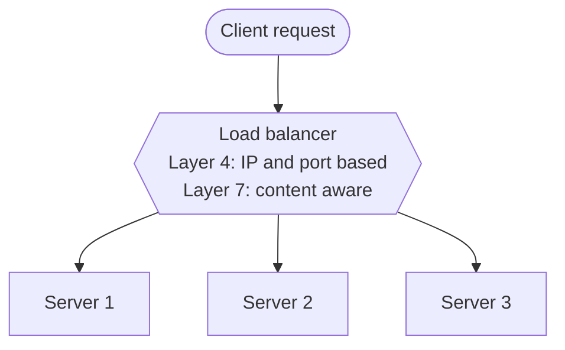


##### By Deployment Model

- **Hardware Load Balancers:** Dedicated devices for enterprises and data centers (e.g., F5 BIG-IP).
- **Software Load Balancers:** Run on general servers or VMs. Flexible and cost-effective (e.g., NGINX, HAProxy, Envoy).
- **Cloud-Based Load Balancers:** Managed by cloud providers, offer auto-scaling and easy integration (e.g., AWS ELB, GCP Load Balancer, Azure Load Balancer).

#### DNS-Based Load Balancing

The simplest way to spread traffic needs no extra machine: publish **several IP addresses for one domain name** (several `A` records). The DNS server hands out the addresses in rotating order (**round-robin DNS**), so different users reach different servers.

| Strengths | Limits |
|-----------|--------|
| nothing extra to buy or run | **no health checks:** a dead server keeps receiving traffic until you remove its record |
| works across data centers and regions | **caching:** resolvers keep answers for the record's TTL, so changes take time to reach everyone |
| cheap and simple | **crude balancing:** no awareness of load, connections or session stickiness; little customisation |

Managed DNS services (such as Route 53 or Cloudflare) fix the worst gaps with **health-checked** and **weighted** records, and **Geo-DNS** (see the DNS section) that routes users to the nearest site. For fine-grained balancing inside a data center, use a real load balancer (below) and keep DNS for choosing between sites.

#### Load Balancing Strategies

The strategy you choose impacts performance, reliability, and cost. Strategies are broadly classified as **static** or **dynamic**.

##### Static Load Balancing

**1. Round Robin** — distributes requests sequentially across servers.

```python
servers = ['S1', 'S2', 'S3']
request_count = 0

def get_next_server():
    global request_count
    server = servers[request_count % len(servers)]
    request_count += 1
    return server
```

**2. Least Connections** — routes new requests to the server with the fewest active connections.

**3. IP Hashing** — routes requests based on a **hash** of the client's IP (a hash is a fixed-size fingerprint computed from data; see the hashing primer in Chapter 1), providing session persistence.

```python
import hashlib

def get_server_by_ip(client_ip, servers):
    index = int(hashlib.sha256(client_ip.encode()).hexdigest(), 16) % len(servers)
    return servers[index]
```

**4. Consistent Hashing** — routes each request by hashing a **key** (a user ID, session ID or cache key) onto a ring of servers.

- Servers sit at points on a **hash ring**. A request's key is hashed to a point on the ring and goes to the **next server clockwise**.
- Adding or removing a server moves only about **1/N of the keys**, where plain `hash(key) % N` would reshuffle almost everything.
- **Virtual nodes** (each server appears at many points on the ring) keep the load even.
- **Use it when** the same key should keep landing on the same server: cache servers, session affinity, sharded stores. See the consistent-hashing discussion in the sharding section of Chapter 7.

##### Dynamic Load Balancing

**1. Least Response Time** — routes to the server with the fastest current response.

**2. Adaptive Load Balancing** — dynamically adjusts based on real-time metrics (CPU, memory, health).

**3. Weighted Load Balancing** — assigns more traffic to higher-capacity servers.

```python
servers = [('S1', 3), ('S2', 1)]  # (server, weight)

def weighted_round_robin(request_id):
    flat_list = [s for s, w in servers for _ in range(w)]
    return flat_list[request_id % len(flat_list)]
```

**Example: NGINX Weighted Load Balancer Config**

```nginx
http {
    upstream backend {
        server backend1.example.com weight=3;
        server backend2.example.com weight=1;
    }

    server {
        listen 80;
        location / {
            proxy_pass http://backend;
        }
    }
}
```

#### Load Balancers in Action

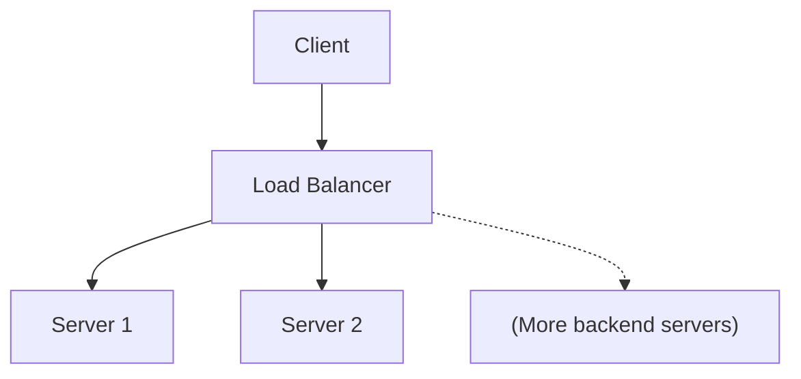

A Mermaid version of the same idea:

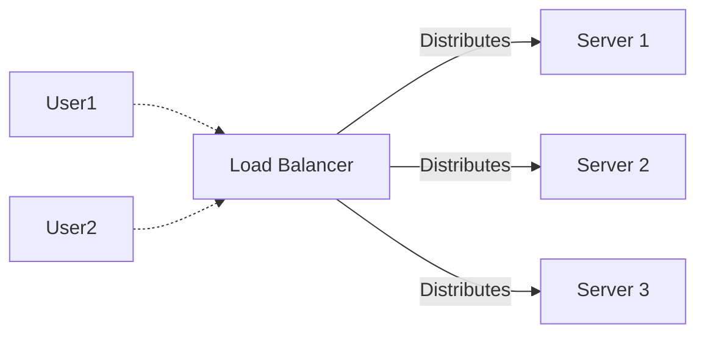

**How it works:**

- Client sends a request to the Load Balancer.
- Load Balancer chooses a backend server based on the configured strategy.
- If a server fails, the Load Balancer reroutes traffic to healthy servers.

#### Choosing the Right Load Balancer

- **Layer:** L4 for speed, L7 for content-aware routing.
- **Scalability:** Will you need auto-scaling? Use cloud-based solutions.
- **Security:** Need SSL termination or DDoS protection?
- **Cost & Flexibility:** Software load balancers are more flexible, hardware for enterprise performance.
- **Use Case:** API gateways, microservices, high-traffic web apps, etc.

#### Health Checks — What They Are

The LB needs to know which backends are alive. It does this via **health checks**:

- **Active health check (most common):** the LB hits a `/health` endpoint on each backend every N seconds (typically 5-30s). If it gets HTTP 200, backend stays in the pool; if it fails K times in a row, it's removed.
- **Passive health check:** the LB tracks real user traffic and ejects a backend after K consecutive failed requests.

A good `/health` endpoint should:

- Return fast (< 50 ms) — never block on slow dependencies.
- Reflect *only the local* health (don't fail if a downstream is slow; that's a separate concern).
- Optionally have a separate `/ready` endpoint for "I've finished startup and am ready to serve."

#### Sticky Sessions — What They Are and When to Avoid

**Sticky sessions** (a.k.a. *session affinity*) mean the LB always routes a given user to the *same* backend. Typically implemented via:

- **IP-hash sticky:** hash(client_IP) % N. Free but breaks if user's IP changes.
- **Cookie-based sticky:** LB injects a cookie identifying the backend.

**Why you might need it:** legacy apps that hold per-user state (session data, in-memory caches) on a specific backend.

**Why you should usually avoid it:**

- Breaks horizontal scaling — one user can't be load-balanced.
- A backend death loses that user's session.
- Some backends end up hot, others cold.

**The modern alternative:** make backends *stateless* and externalize session state to Redis/Memcached (fast in-memory data stores, see Chapter 8). Any backend can serve any user.

#### Load Balancing — Tips & Best Practices

- **Monitor Health:** Always enable health checks for backend servers.
- **Sticky Sessions:** Use session persistence (IP hash, cookies) if user state is needed.
- **SSL Offloading:** Terminate SSL at the load balancer to reduce backend load.
- **Auto Scaling:** For cloud setups, integrate load balancers with auto-scaling groups.
- **Rate Limiting:** Prevent abuse by integrating rate limiting (capping how many requests one client may send per time window, for example 100 per minute; see Chapter 6) at the load balancer or API gateway.
- **Failover:** Design for graceful failover — use multiple load balancers or DNS-based failover.
- **Logging & Monitoring:** Track traffic, errors, and latency at the load balancer for troubleshooting and analytics.
- **Security:** Use WAFs (Web Application Firewalls) and DDoS protection features available on most advanced load balancers.

#### Load Balancing — Interview Quick Reference

- **What is load balancing and why is it important?** Distributes traffic to ensure high availability, performance, and reliability.
- **Layer 4 vs. Layer 7 Load Balancers?**
  - L4: Fast, IP/Port-based.
  - L7: Content-aware, supports complex rules.
- **Static vs. Dynamic strategies?**
  - Static: Predefined rules, simple.
  - Dynamic: Adapt to real-time load/health.
- **How does a load balancer improve security?** Can perform SSL/TLS termination, DDoS filtering, hide backend servers.

#### Load Balancing — Further Reading

- [NGINX as a Load Balancer](https://docs.nginx.com/nginx/admin-guide/load-balancer/http-load-balancer/)
- [AWS Elastic Load Balancing](https://aws.amazon.com/elasticloadbalancing/)
- [HAProxy Documentation](https://www.haproxy.org/)
- [Kubernetes Ingress Controllers](https://kubernetes.io/docs/concepts/services-networking/ingress-controllers/)

*(From AI Library chapter 2.)*

### Load Balancing — The Backbone of Scalability

Scalability is at the heart of robust system design. As user bases and data volumes grow, ensuring your application remains fast, available, and cost-effective becomes critical. One of the key enablers is **load balancing** — the art and science of distributing incoming traffic across a pool of servers.

#### Why Load Balancing is Essential

Imagine a high-traffic e-commerce website during Black Friday. Without load balancing, a single server could get overwhelmed, causing slowdowns or outages. With a load balancer, incoming requests are automatically spread across multiple backend servers for maximum uptime and minimum latency.

**Key benefits:**

- **High Availability:** Keeps your app running even during server failures or traffic spikes.
- **Traffic Distribution:** Prevents overload by spreading requests evenly.
- **Improved Performance:** Routes requests to the least-busy or fastest server.
- **Graceful Failure Handling:** Detects and bypasses failed servers.
- **Scalability:** Makes it easy to add or remove servers as demand changes.
- **Reduces latency for users.**

> **Real-World Example:** During a flash sale, Amazon's load balancers distribute millions of requests per second across a massive fleet of servers, ensuring shoppers never see a 503 error.

#### Types of Load Balancers

Load balancers can be categorized by the **network layer** they operate on and by their **deployment model**.

##### By Network Layer

| Type                | Layer               | Examples                                |
|---------------------|---------------------|-----------------------------------------|
| Layer 4 (Transport) | TCP/UDP             | AWS NLB, HAProxy (TCP), F5              |
| Layer 7 (App)       | HTTP/HTTPS/gRPC     | AWS ALB, NGINX, Envoy, Google L7 LB     |

**Layer 4 (Transport Layer):**

- Operates at TCP/UDP level.
- Routes based on IP address and port.
- **Pros:** Blazing fast, efficient, low overhead.
- **Cons:** No content-based routing.

**Layer 7 (Application Layer):**

- Operates at HTTP/HTTPS.
- Routes based on HTTP headers, cookies, URLs, etc.
- **Pros:** Intelligent content-aware routing.
- **Cons:** Slightly more processing overhead.

##### Diagram: Layer 4 vs Layer 7

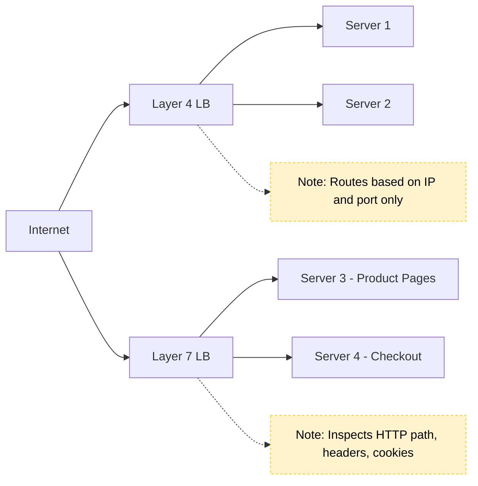

##### By Deployment Model

| Type                 | Examples                                          |
|----------------------|---------------------------------------------------|
| **Hardware**         | F5 BIG-IP, Citrix NetScaler                       |
| **Software**         | NGINX, HAProxy, Envoy                             |
| **Cloud-based**      | AWS ELB, Azure Load Balancer, GCP Load Balancer   |

**Hardware Load Balancers:**

- Specialized devices, used in large data centers.
- Often with SSL termination and DDoS protection.

**Software Load Balancers:**

- Apps running on commodity servers.
- Flexible, cost-effective, popular in microservices and Kubernetes.

**Cloud-based Load Balancers:**

- Managed services provided by cloud vendors.
- Handles scaling, failover, security out-of-the-box.

#### Load Balancing Algorithms

- **Round Robin:** Sequential distribution.
- **Least Connections:** Server with fewest active connections.
- **IP Hash:** Consistent routing based on client IP (supports sticky sessions).
- **Weighted:** Some servers get more requests based on capacity.
- **Least Response Time:** Fastest responding server.
- **Adaptive Load Balancing:** Continuously analyzes CPU, memory, and health metrics.

#### Code: Load Balancing Algorithms in Python

**Simple round-robin (pseudocode):**

```python
# Pseudocode: Simple Round Robin Load Balancer
servers = [srv1, srv2, srv3]
next_server = 0

def get_server():
    global next_server
    srv = servers[next_server]
    next_server = (next_server + 1) % len(servers)
    return srv
```

**Round-robin with function-level state:**

```python
servers = ['A', 'B', 'C']
idx = 0

def get_next_server():
    global idx
    server = servers[idx]
    idx = (idx + 1) % len(servers)
    return server
```

**Round-robin as a class:**

```python
class RoundRobinLB:
    def __init__(self, servers):
        self.servers = servers
        self.index = 0

    def get_server(self):
        server = self.servers[self.index]
        self.index = (self.index + 1) % len(self.servers)
        return server

# Usage
lb = RoundRobinLB(['server1', 'server2', 'server3'])
for _ in range(6):
    print(lb.get_server())
```

Output:

```
server1
server2
server3
server1
server2
server3
```

**Least connections:**

```python
connections = {'A': 3, 'B': 1, 'C': 2}

def get_least_connections():
    return min(connections, key=connections.get)
```

**IP hashing:**

```python
import hashlib

def ip_hash(ip, servers):
    idx = int(hashlib.md5(ip.encode()).hexdigest(), 16) % len(servers)
    return servers[idx]
```

**Weighted round robin:**

```python
servers = [('A', 3), ('B', 1)]  # (server, weight)
weighted_list = [s for s, w in servers for _ in range(w)]
idx = 0

def get_weighted_server():
    global idx
    server = weighted_list[idx]
    idx = (idx + 1) % len(weighted_list)
    return server
```

#### Load Balancer in Action

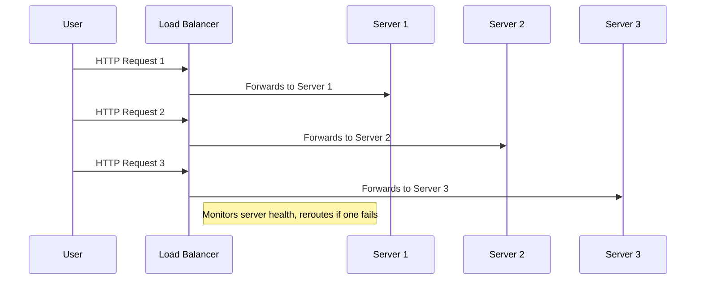

A simpler view:

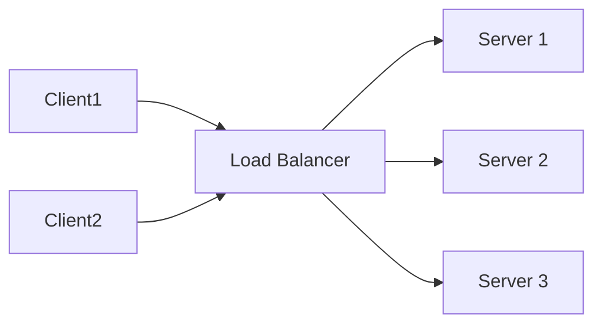

**Handling failures gracefully:** If Server 2 crashes, the load balancer detects this via health checks and reroutes all new traffic to Server 1 and Server 3 only, preserving high availability.

#### Sample NGINX Load Balancer Config

```nginx
http {
    upstream backend {
        server backend1.example.com weight=3;
        server backend2.example.com weight=2;
        server backend3.example.com weight=1;
    }

    server {
        listen 80;
        location / {
            proxy_pass http://backend;
        }
    }
}
```

#### Choosing a Load-Balancing Algorithm for the Workload

| Workload | Algorithm | Why |
|----------|-----------|-----|
| Short, uniform requests; identical servers | round robin or weighted round robin | simple and even |
| Long or variable requests (uploads, reports, streaming) | **least connections** or least outstanding requests | adapts to the real load |
| Latency-sensitive services, large fleets | **power of two choices (P2C)**: pick two backends at random and send the request to the one with lower load or latency | near-optimal results with no global state |
| **Cache or state affinity** (sharded caches, per-user state, WebSocket rooms) | **consistent hashing** (hash ring, Maglev, rendezvous) | the same key reaches the same backend, with minimal remapping when backends change |
| Hot keys under consistent hashing | consistent hashing **with bounded loads** | caps any one backend at, say, 1.25× the average |
| Canary releases and A/B tests | weighted routing by percentage or header | controlled exposure |

**Why consistent hashing?** With `hash(key) % N`, adding one server remaps almost every key, which empties every cache at once. On a hash ring, adding one server to N moves only about 1/(N+1) of the keys.

#### Health Checks in Depth

| Type | How it works | What it catches |
|------|--------------|-----------------|
| **Active** | the balancer probes a `/readyz` endpoint every few seconds, with rise and fall thresholds | dead or not-yet-ready nodes |
| **Passive** (outlier detection) | eject backends that return 5xx errors or time out on real traffic | "gray failures" that active checks miss |
| **Shallow vs. deep** | deep checks also test dependencies such as the database | deep checks can **cascade**: one database blip ejects every node at once, so keep readiness about the node itself |

**Connection draining.** When a backend is removed or deployed, stop sending it new requests but let in-flight ones finish before shutting it down, so users do not see errors during rollouts.

**When health checks lie: fail open.** A bad threshold, a bug in the `/health` handler, or a shared dependency blip can make *every* backend look unhealthy at once. A naive balancer then empties its pool and takes the whole service down by itself. Good balancers notice that "most of my backends are failing" is more likely a broken check than a dead fleet, and **ignore health checks** above a threshold, spreading traffic over all backends (Envoy calls this the *panic threshold*).

**Let a sick process restart itself.** Some degradations are slow and rare — a memory leak that eventually forces heavy swapping. Instead of complex recovery code, run a **watchdog** thread that checks a vital sign (free memory, a stuck event loop) and deliberately crashes or restarts the process once it stays past a threshold. The balancer drains it, the orchestrator restarts it, and the system heals while engineers find the root cause. The watchdog itself must be well tested — a buggy one restarts everything in a loop.

**Why balancing on load is harder than it looks.** If the balancer routes by each server's reported load, but that report is cached for a few seconds, a newly added server reporting 0 gets *all* the traffic until its next report, then reports overload and gets none — it oscillates (*herding*). Purely random choice beats stale load data; the best of both is **power of two random choices**: pick two servers at random and send the request to the less loaded one.

**Redundancy math.** With N servers behind a balancer, the service is down only if *all* are down: availability = `1 − (failure rate)^N`. Two 99% servers give `1 − 0.01² = 99.99%` — each independent server adds its "nines". Real gains are lower: the balancer takes time to remove a failed server, failures are often correlated, and the survivors must have the capacity to absorb the load.

#### Inside a Network (L4) Load Balancer

An L4 balancer owns a **virtual IP (VIP)**; clients only ever see the VIP. For each new TCP connection it picks a backend by **hashing the connection 4-tuple** (source IP and port, destination IP and port) — usually with consistent hashing so adding a backend disturbs few existing connections — then forwards that connection's packets, rewriting addresses (NAT).

- **Direct server return (DSR).** Responses are usually much larger than requests. With DSR, the balancer forwards only the inbound packets, and the backend replies **straight to the client** using the VIP as its source address, so the balancer handles a fraction of the bytes.
- **Scaling the balancer itself: Anycast + ECMP.** Several balancer machines announce the *same* VIP to the data center's edge routers with equal BGP weight (Anycast). The routers spread connections over them with **equal-cost multi-path routing**, which hashes each connection consistently so all its packets reach the same balancer. Google's Maglev and AWS's Network Load Balancer work this way.
- **Why an L4 tier in front of L7.** An L4 balancer just shuffles packets, so it is very fast but can't terminate TLS or look at HTTP. A common layout is L4 (internet-facing, cheap per packet, absorbs volumetric attacks such as **SYN floods** — huge numbers of half-opened TCP connections) in front of a pool of L7 proxies that do TLS, routing and retries.
- **Client-side balancing.** For internal traffic the balancing can move into each client's **sidecar proxy** (a service mesh, [Ch 10](ch10-service-mesh-and-service-discovery.md)), removing the central balancer — at the price of a control plane to configure all the sidecars.

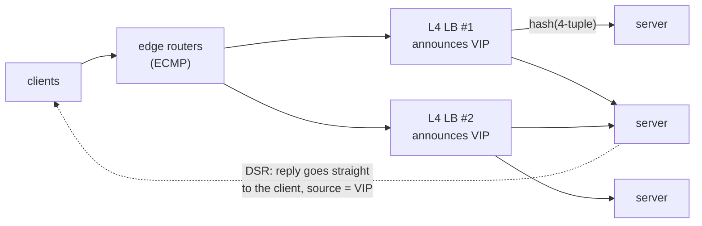

#### From Nothing to a Running Server: SSH, a Runtime and a Process Manager

Before you can put anything behind a load balancer, you need one working server. This walk-through shows the manual steps on any cloud provider (the first-server experience on DigitalOcean, AWS, Google Cloud and others is nearly identical). A server like this is called a **virtual private server (VPS)**; DigitalOcean calls it a *droplet*, AWS an *EC2 instance*.

**1. Create the server.** Choose a **region** near your users, an operating system (Ubuntu is the common default), and a size. Choose **SSH key** login rather than a password.

**2. Why SSH keys beat passwords.** A password can be guessed or stolen; an SSH key is a long random **key pair**. The public half sits on the server, the private half stays on your machine and is never sent. Only someone holding the private key can log in.

```bash
ssh-keygen -t ed25519 -C "me@laptop"      # creates a private and a public key
# paste the public key (~/.ssh/id_ed25519.pub) into the provider's console
ssh root@203.0.113.10                      # log in to the new server (or use the provider's web console)
```

You are now in a remote computer with only a terminal and no graphical interface.

**3. Install what the app needs.** A fresh server has no language runtime or Git:

```bash
sudo apt update && sudo apt install -y git
curl -o- https://raw.githubusercontent.com/nvm-sh/nvm/master/install.sh | bash   # Node version manager
source ~/.bashrc && nvm install 22
git clone https://github.com/you/user-management.git && cd user-management
npm install && node server.js              # works, but stops when you close the terminal
```

**4. Keep it running with a process manager.** Running `node server.js` by hand dies when the terminal closes or the app crashes. A **process manager** restarts crashed apps and starts them at boot. **PM2** is the common one for Node; **systemd** does the same job for any program.

```bash
npm install -g pm2
pm2 start server.js --name users          # runs in the background, restarts on a crash
pm2 save                                   # remember the process list
pm2 startup                                # prints a command; run it so PM2 itself starts at boot
pm2 logs users                             # read the app's output
```

**5. Make it safe to expose.** The app listens on a high port such as 3000, which visitors should not see.

- Put **NGINX** (a reverse proxy, see Chapter 2) on ports 80 and 443 and forward to `localhost:3000`, so users just use the domain name.
- Turn on the **firewall** and open only what is needed: `ufw allow OpenSSH`, `ufw allow 80,443/tcp`, then `ufw enable`.
- Keep the operating system patched and disable password login for SSH.

**6. Clone it.** Once one server works, take a **snapshot** (a saved copy of the whole disk) and launch a second server from it. This is the fastest way to get an identical machine for the load-balancer lab below, and it is why scalable systems treat servers as **disposable and reproducible** (see the containers primer in Chapter 4).

#### Hands-On Lab: Put a Load Balancer in Front of Two Servers

Seeing a load balancer work makes the theory stick. This lab needs only Docker and runs on your own machine.

**Goal:** run two identical servers behind NGINX, watch requests alternate, then stop one server and watch traffic keep flowing.

**1. Create a network and two servers** (each replies with its own name):

```bash
docker network create labnet
docker run -d --name app1 --network labnet hashicorp/http-echo -text="hello from app1"
docker run -d --name app2 --network labnet hashicorp/http-echo -text="hello from app2"
```

**2. Write the load balancer config** as `nginx.conf` in the current folder:

```nginx
upstream backend {
    server app1:5678;
    server app2:5678;
}
server {
    listen 80;
    location / { proxy_pass http://backend; }
}
```

**3. Start NGINX and send traffic:**

```bash
docker run -d --name lb --network labnet -p 8080:80 \
  -v "$PWD/nginx.conf:/etc/nginx/conf.d/default.conf:ro" nginx:alpine

for i in 1 2 3 4 5 6; do curl -s localhost:8080; done
```

You should see `hello from app1` and `hello from app2` taking turns: that is **round robin**.

**4. Try the strategies** from this chapter by editing `nginx.conf` and reloading (`docker exec lb nginx -s reload`):

- `least_conn;` as the first line inside `upstream` for **least connections**
- `ip_hash;` for **IP hashing** (one client now sticks to one server)
- `server app1:5678 weight=3;` for **weighted** balancing (app1 gets about three times the traffic)

**5. Test failure handling:**

```bash
docker stop app1
for i in 1 2 3 4; do curl -s localhost:8080; done   # every answer comes from app2
docker start app1                                    # it rejoins automatically
```

**6. Clean up:** `docker rm -f lb app1 app2 && docker network rm labnet`.

**The same idea in a cloud console** (any provider): create a server and install your app; take a **snapshot** and launch a **clone** from it; create a **load balancer** in the same network and region; add both servers as targets; define a **forwarding rule** (for example port 80 to port 80) and a **health check**; then open the load balancer's address, refresh repeatedly and check its metrics. This is the same flow you just did locally.

#### Choosing the Right Load Balancer

- **Layer 4:** Choose for raw speed and lower-level TCP/UDP traffic.
- **Layer 7:** Choose for intelligent routing (APIs, microservices).
- **Software:** Great for flexible, cost-effective deployments.
- **Hardware:** Enterprise-grade performance, in data centers.
- **Cloud:** Seamless scaling, built-in security, minimal management.

**Other considerations:**

- **SSL Termination:** Offload CPU-heavy encryption from backend servers.
- **DDoS Protection:** Many cloud/hardware LBs provide built-in attack mitigation.
- **Session Persistence:** Use IP hashing or sticky sessions if needed.

#### Load Balancing — Tips & Best Practices

- **Always set up health checks** for your backend servers.
- **Prefer stateless backend design** for easier load balancing.
- **Monitor metrics** like connection counts, response times, error rates.
- **For microservices**, consider using a service mesh (Istio, Linkerd) for advanced L7 routing.
- **Enable SSL termination** at the load balancer to reduce backend CPU load.
- **Use autoscaling** in conjunction with load balancing for elastic capacity.
- **Choose the right strategy** based on traffic patterns and backend capabilities.
- **Combine load balancing with autoscaling** for true elasticity in the cloud.
- **Monitor, test, and iterate** — don't "set and forget" your load balancer.

*(From AI Library chapter 6.)*

The diagram, worked example, exercises, mini-project, design prompt, open-source reading, interview questions and checklist below are this chapter's practice layer.

---

## Prereqs

* [Vol 1 Ch 44 — Delivery: Load Balancing, Reverse Proxies & CDN](../volume-1-cs-foundations/ch44-delivery-load-balancing-reverse-proxies-and-cdn.md)

---

## Diagram

**An LB distributing to backends with a consistent-hash ring**

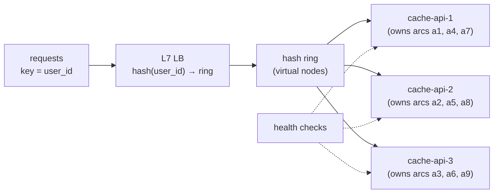

```
 hash(key) % N (N 3 → 4):     ~75% of keys move → every cache goes cold
 consistent hashing (3 → 4):  ~25% of keys move → only the new node starts cold
```

**Layers of load balancing for a global service**

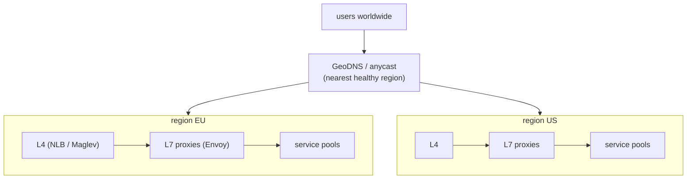

**Least connections with long requests**

```
 round robin:   b1 ████████████ (3 long uploads)   b2 █ (3 quick)   b3 █ (3 quick)  ← b1 overloaded
 least-conn:    b1 ████          b2 ████           b3 ████                        ← balanced by work
```

---

## Example

```python
import bisect, hashlib
from collections import Counter

def h(s):
    return int.from_bytes(hashlib.sha1(s.encode()).digest()[:8], "big")

class Ring:
    def __init__(self, nodes, vnodes=160):
        self.vnodes = vnodes
        self.points = sorted((h(f"{n}#{i}"), n) for n in nodes for i in range(vnodes))
    def add(self, node):
        self.points = sorted(self.points + [(h(f"{node}#{i}"), node) for i in range(self.vnodes)])
    def remove(self, node):                        # health check failed
        self.points = [p for p in self.points if p[1] != node]
    def pick(self, key):
        i = bisect.bisect(self.points, (h(key),)) % len(self.points)
        return self.points[i][1]

keys = [f"user:{i}" for i in range(20_000)]
ring = Ring(["b1", "b2", "b3"])
before = {k: ring.pick(k) for k in keys}
print(Counter(before.values()))                    # roughly even
ring.add("b4")
moved = sum(before[k] != ring.pick(k) for k in keys) / len(keys)
print(f"ring: {moved:.0%} moved")                  # ≈ 25% (28% in one run: vnodes aren't perfectly even)

mod_before = {k: h(k) % 3 for k in keys}
mod_moved = sum(mod_before[k] != h(k) % 4 for k in keys) / len(keys)
print(f"mod N: {mod_moved:.0%} moved")             # ≈ 75%
```

```python
# Least connections
class LeastConn:
    def __init__(self, backends): self.active = {b: 0 for b in backends}
    def acquire(self):
        b = min(self.active, key=self.active.get); self.active[b] += 1; return b
    def release(self, b): self.active[b] -= 1
```

---

## Exercises

1. Implement consistent hashing and show minimal remapping.

   <details><summary>Solution</summary>See <code>Ring</code>: going from 3 to 4 nodes moves ≈ 25% of keys vs ≈ 75% with modulo hashing. Show the effect of virtual nodes: with 1 vnode per server the load is very uneven; with 100–200 it's within a few percent.</details>

2. Add health-check-based removal.

   <details><summary>Solution</summary>A checker probes each backend every 2 s; after 3 consecutive failures call <code>ring.remove(node)</code> (only that node's keys move to their neighbors); after 2 successes <code>ring.add(node)</code> back. Use hysteresis (different rise/fall counts) to avoid flapping, and cap how many nodes can be ejected at once (e.g. 30%) so a bad check can't empty the pool.</details>

3. A service is behind consistent hashing and one celebrity user's key sends 20% of all traffic to one node. What do you do?

   <details><summary>Solution</summary>Consistent hashing with bounded loads (spill to the next node when a node exceeds 1.25× average); replicate hot keys to several nodes and pick one at random; add a local cache in front; or split that key by a suffix.</details>

---

## Mini project

**A consistent-hashing LB simulator.**

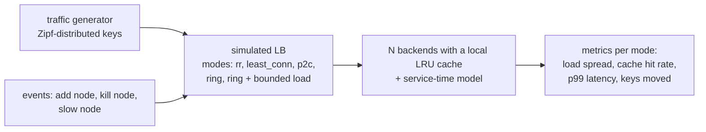

**Steps**

1. Backends with a local LRU cache (a hit is fast, a miss is slow) and a queue.
2. Implement round robin, least connections, P2C, a ring, and a ring with bounded loads.
3. Zipf-distributed keys (a few very hot); measure load imbalance, hit rate, and p99 per mode.
4. Events: add a node, kill a node, make one node slow; plot what each algorithm does.

**Done when:** the charts show the ring keeping cache hit rate high through node changes, and bounded loads protecting against hot keys.

---

## Design

**Design the load-balancing layer for a global service.**

Requirements: users on 4 continents, 500k peak RPS, p99 < 150 ms, survive a full region failure, some endpoints need WebSockets.

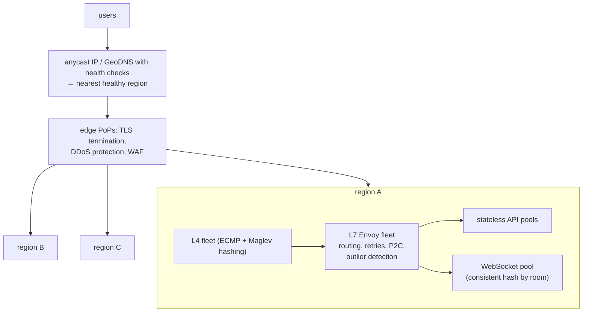

**Capacity:** with 3 regions and N+1 planning, each region must carry half the peak if one region fails: 500k ÷ 2 = 250k RPS per region. Envoy at ~20k RPS per proxy node at 60% target → 250k ÷ 12k ≈ 21 L7 nodes per region (round up to 24 across 3 zones). The L4 tier forwards packets and needs far fewer nodes.

**Decisions to justify**

* **Anycast/GeoDNS** for steering users to the nearest region, with health-checked failover and short DNS TTLs (30–60 s).
* **L4 in front of L7**: L4 scales packets cheaply and spreads connections; L7 does per-request routing and resilience.
* **P2C + outlier detection** for stateless APIs; **consistent hashing** for WebSocket rooms so members of a room land on the same node.
* **No single point of failure:** every tier is a fleet across zones; the edge absorbs DDoS.
* **Connection draining** on deploys, especially for long-lived WebSockets (clients reconnect with jitter).

---

## Open source

* [`envoyproxy/envoy`](https://github.com/envoyproxy/envoy) — ring hash and Maglev load balancers, least request with P2C, and outlier detection in `source/common/upstream/`.
* [`nginx/nginx`](https://github.com/nginx/nginx) — `upstream` with `hash $key consistent;` (ketama). Read Google's Maglev paper for L4 consistent hashing at scale.

---

## Interview

1. **"Consistent hashing — why?"**
   <details><summary>Answer</summary>To map keys to a changing set of servers while moving as few keys as possible. With modulo hashing, changing N remaps nearly all keys, destroying cache locality and causing a thundering herd on the backing store. On a hash ring, adding or removing a node only moves the keys in its arcs (~1/N). Virtual nodes even out the distribution, and bounded-load variants handle hot keys.</details>

2. **"L4 vs L7 LB?"**
   <details><summary>Answer</summary>L4 routes TCP/UDP connections by addresses and ports — very fast, protocol-agnostic, but blind to requests. L7 understands HTTP/gRPC, so it can route by path or header, balance per request (important for HTTP/2 multiplexing), retry, apply auth and rate limits, and terminate TLS, at a higher CPU cost. Large systems usually use both: L4 in front for scale, L7 behind for smart routing.</details>

---

## Checklist

- [ ] pick an algorithm per workload
- [ ] health-check everything
- [ ] plan for LB itself failing

---

> [Contents](index.md) · ← [Chapter 5 — Proxies, Gateways, Web Servers & Storage Types](ch05-proxies-gateways-web-servers-and-storage-types.md) · Next → [Chapter 7 — Caching Strategies](ch07-caching-strategies.md)
