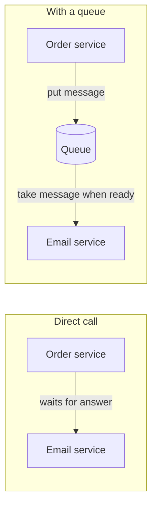
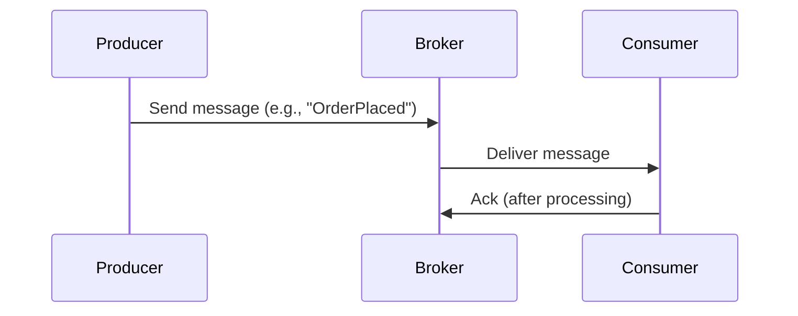
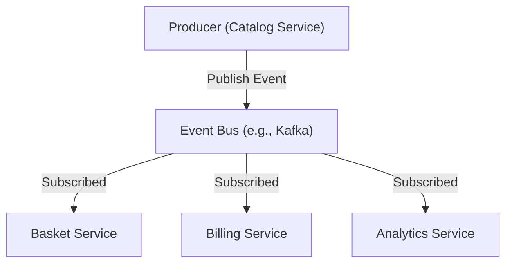
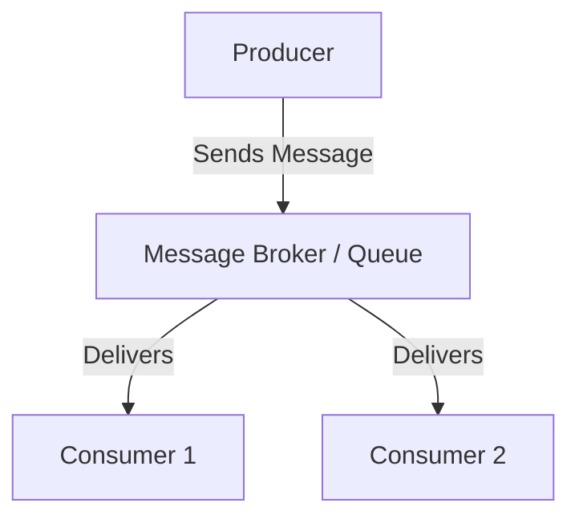
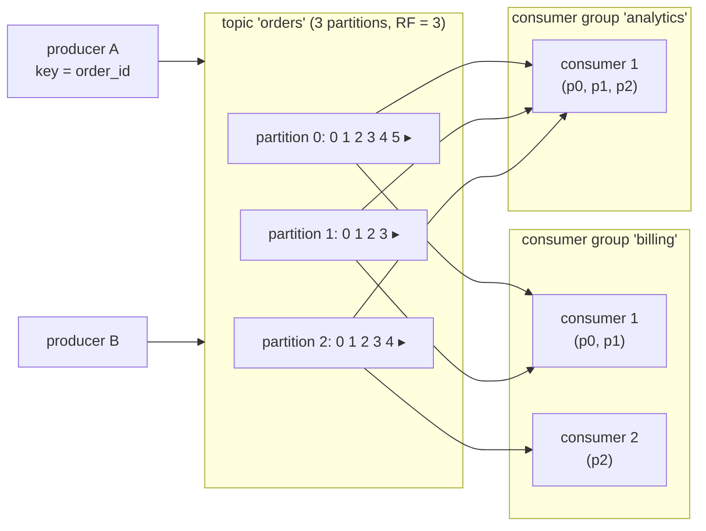
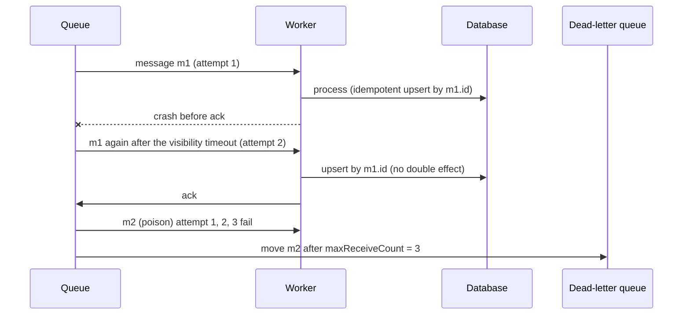
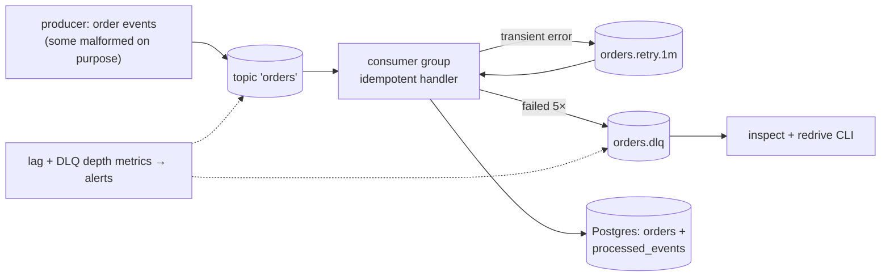
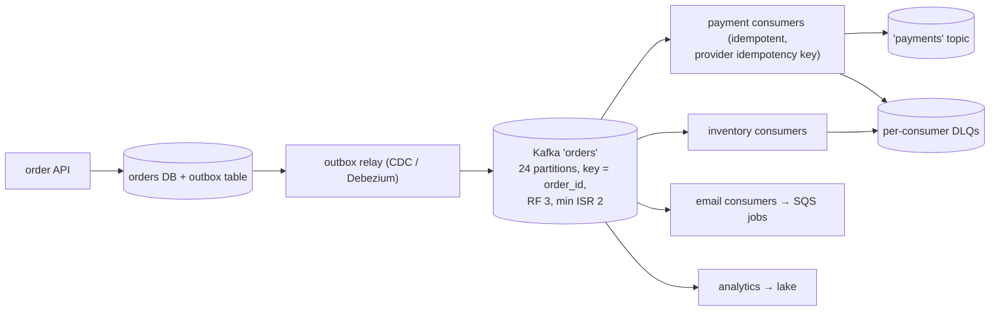

# Chapter 9 — Message Queues & Streaming (Kafka, SQS, Pub/Sub)

> **Volume 4 — High-Level Design** · [Contents](index.md) · ← [Chapter 8 — Rate Limiting, Throttling & Backpressure](ch08-rate-limiting-throttling-and-backpressure.md) · Next → [Chapter 10 — Service Mesh & Service Discovery](ch10-service-mesh-and-service-discovery.md)

---

## Concept

Queues vs logs, at-least/at-most/exactly-once, ordering, DLQs, and stream processing.

**In one sentence:** a message broker lets producers hand off work or events without waiting for consumers — a *queue* hands each message to one worker and forgets it, a *log* keeps an ordered history that many consumers read at their own pace — and every design must decide what happens when a message is lost, duplicated, or out of order.

### Building Block Primer: Message Queues in Plain Terms

> **Why this is here:** the patterns that follow (microservices, event-driven) lean on message queues, and you will see the names Kafka, RabbitMQ and SQS very soon. This primer explains the idea in plain terms first. Chapter 8 ("Messaging & Queues") goes deeper on brokers, delivery guarantees and code.

#### The Idea: Leave a Note Instead of Waiting

Imagine a restaurant. The waiter does not stand in the kitchen waiting for each dish. They hang an **order ticket** on a rail and go back to the customers. The cook takes tickets from the rail whenever ready.

A **message queue** is that rail:

- A **producer** puts a **message** (a small piece of data describing something to do) onto the queue.
- The queue **holds** it safely.
- A **consumer** takes the message later and does the work.

The producer does not wait, and does not even need to know who the consumer is or whether it is running right now.



#### Why Bother? Four Problems a Queue Solves

| Problem without a queue | What a queue gives you |
|-------------------------|------------------------|
| **Slow work blocks the user.** Sending an email or resizing a video makes the page wait. | Reply to the user immediately; do the slow work in the background. |
| **Traffic spikes crash the service.** 10,000 requests in one second hit a service that handles 500. | The queue **absorbs the spike**; consumers work through the backlog at their own pace. This is called **buffering** or *load leveling*. |
| **One service down means the caller fails.** If the email service is restarting, the order fails. | Messages wait in the queue until the consumer is back, so nothing is lost. |
| **Services are tangled together.** The order service must know about email, inventory, analytics. | The producer only knows the queue; new consumers can be added without changing it (**loose coupling**). |

#### Vocabulary

| Term | Meaning |
|------|---------|
| **Message** | one unit of work or news, e.g. "order 42 was placed" |
| **Producer** (publisher) | the service that sends messages |
| **Consumer** (subscriber, worker) | the service that receives and processes them |
| **Broker** | the software that runs the queues (RabbitMQ, Kafka, Amazon SQS) |
| **Queue** | an ordered holding area; usually each message goes to **one** consumer |
| **Topic** | a named channel that **many** subscribers can listen to (publish/subscribe) |
| **Acknowledgement (ack)** | the consumer telling the broker "done, you can delete it" |
| **Dead-letter queue (DLQ)** | a side queue where messages that keep failing are parked for inspection |

#### What Happens to One Message

1. The producer sends the message; the broker stores it.
2. A consumer receives it. For a short time the broker **hides** it from other consumers (a *visibility timeout*), so two workers do not do the same job.
3. The consumer finishes and sends an **ack**. The broker deletes the message.
4. If no ack arrives (the consumer crashed), the message **reappears** and another consumer retries it.
5. If it fails again and again, it moves to the **dead-letter queue** instead of looping forever.

#### The Catches You Must Know

- **Duplicates can happen.** Step 4 means a message may be processed twice. Most systems promise **at-least-once** delivery. So consumers should be **idempotent**: handling the same message twice must have the same effect as once (see Chapter 9, Idempotency Keys).
- **Order is not free.** Strict first-in-first-out ordering is possible but limits parallelism; with many consumers, messages can finish out of order.
- **A growing backlog is a warning.** If consumers are slower than producers, the queue gets longer and users wait longer. Monitor queue length and add consumers.
- **Not everything belongs in a queue.** If the user needs the answer right now (checking a password), use a normal request and response.

#### Queue, Pub/Sub or Stream?

| Style | Who gets each message | Typical use | Example product |
|-------|----------------------|-------------|-----------------|
| **Work queue** | one consumer among many | background jobs, task distribution | Amazon SQS, RabbitMQ |
| **Publish/subscribe** | every subscriber gets a copy | notifying many services about an event | SNS, RabbitMQ exchanges, Redis pub/sub |
| **Event stream (log)** | each reader keeps its own position and can **replay** history | analytics, audit trails, rebuilding state | Kafka, Kinesis |

*Goes deeper in:* the Event-Driven Architecture section later in this chapter (messaging patterns) and Chapter 8 (delivery guarantees, RabbitMQ vs Kafka, sample code).

*(From AI Library chapter 4.)*

### Messaging & Queues for Decoupling

Asynchronous messaging **decouples** services, boosts scalability, and enhances resilience.

#### Why Use Asynchronous Messaging?

Traditional synchronous calls force producers (e.g., APIs) to wait for consumers (e.g., email sender, payment processor) to finish their work. This **tightly couples** services and limits scalability.

(See `image-14.png` for sync vs. async comparison.)

**Asynchronous messaging decouples these components:**

- **Loose coupling:** Producers and consumers don't need to know about each other.
- **Performance:** Producers can send messages and move on immediately.
- **Scalability:** Consumers can scale independently.
- **Resilience:** If a consumer fails, messages are not lost.
- **Flexibility:** Add new consumers without touching producers.

#### Core Concepts

(See `image-15.png` for architecture overview.)

| Concept       | Description                                                 |
|---------------|-------------------------------------------------------------|
| **Message**   | Packet of data (JSON, binary, etc.)                         |
| **Producer**  | Sends message (e.g., order service)                         |
| **Consumer**  | Receives and processes messages (e.g., inventory updater)   |
| **Broker**    | Middleware that stores and routes messages (RabbitMQ, Kafka)|
| **Queue/Topic** | Logical channel for delivery                              |
| **Ack**       | Acknowledgement from consumer after successful processing   |

#### Typical Flow



For a **pub/sub event bus**:



A simpler view:



#### Real-World Example: Decoupled Order Processing

(See `image-16.png` for diagram.)

1. **Catalog Service** updates a product price.
2. After DB update, it publishes a `PriceUpdated` event to the broker.
3. **Basket Service** receives the event and updates any cart items with the old price.
4. **Billing** and **Analytics** services also subscribe to the event and trigger their own logic.
5. If any consumer is down, the message stays in the queue until it's back.

**Benefits:**

- **No direct calls** between services = no tight coupling.
- **Downstream failures** don't block the producer.
- **Easy to add new consumers** (e.g., promotions service).

#### When to Use Queues?

- **Bursty workloads:** Traffic spikes (flash sales), batch imports.
- **Background jobs:** Emails, processing, report generation, exports.
- **Rate limiting / expensive ops:** Spreading out heavy API calls or processing.
- **Buffering:** Smoothing out peaks to avoid overloading downstream systems.
- **Decoupling between services.**

#### Popular Message Brokers: RabbitMQ vs. Kafka

##### RabbitMQ — Traditional Message Broker

- Built on AMQP, designed for reliable message delivery.
- Follows a **push-based model:** messages are pushed to consumers.
- Supports acknowledgements, retries, and dead-letter queues.
- Great for task distribution, background jobs, and real-time notifications.
- Focuses on **routing flexibility** (direct, topic, fanout exchanges).
- Messages are **removed after consumption.**

##### Kafka — Distributed Event Streaming Platform

- Built for **high-throughput**, durable, distributed event logs.
- Uses a **pull-based model:** consumers read at their own pace.
- Stores messages in **partitioned logs;** supports message replay.
- Ideal for **event sourcing**, **real-time analytics**, and **stream processing**.
- Highly **scalable and fault-tolerant.**
- Messages are **retained for configurable durations** (even after consumption).

##### RabbitMQ vs Kafka

| Feature        | RabbitMQ                          | Kafka                                |
|----------------|-----------------------------------|--------------------------------------|
| **Type**       | Message broker (AMQP)             | Event streaming platform             |
| **Model**      | Push-based                        | Pull-based                           |
| **Delivery**   | Messages delivered to consumers   | Consumers fetch from log             |
| **Use Case**   | Task queues, notifications, jobs  | Event sourcing, analytics, ETL       |
| **Retention**  | Message gone after consumption    | Retained for days; supports replay   |
| **Routing**    | Flexible (direct, topic, fanout)  | Partitioned topics                   |
| **Scale**      | Good                              | Excellent (built for high throughput)|

#### Delivery Guarantees

- **At-least-once** (default): Message retried until acknowledged; possible duplicates. *Consumer must be idempotent* (processing the same message twice has the same effect as once; see Chapter 9, Idempotency Keys).
- **At-most-once:** Message delivered only once (no retries); possible loss.
- **Exactly-once:** Processed once and only once; hardest to implement, supported by Kafka under constraints.

#### Delivery Semantics in Practice and the Outbox Pattern

| Semantic | How it works | Risk |
|----------|--------------|------|
| **At most once** | acknowledge **before** processing | a crash loses the message |
| **At least once** (the usual default) | acknowledge **after** processing | a crash after processing causes redelivery, so duplicates |
| **"Exactly once"** | at-least-once delivery **plus idempotent processing** (deduplicate by message ID, use upserts, store offsets together with results), or Kafka transactions for read-process-write inside Kafka | it holds end to end only if every side effect is idempotent or transactional |

**Rule:** design every consumer to be idempotent. True exactly-once *delivery* cannot be had across a network, so aim for exactly-once *effect*. "Exactly once" at the broker does not cover your database write or the email you sent.

**Failures and retries.** After N failed attempts, move the message to a **dead-letter queue** so one poison message cannot block the rest. Alert on its depth and provide a redrive tool. Use exponential backoff between retries (delay queues or retry topics).

**Consumer-group rebalance (Kafka).** When a consumer joins, leaves or stops sending heartbeats, partitions are reassigned within the group. Consumption pauses, and uncommitted work may be redone, which is one more reason for idempotency. Cooperative-sticky assignment and static membership reduce the disruption.

**The outbox pattern (solving the dual-write problem).** A service that updates its database *and* publishes an event can fail between the two steps. Instead, write the event to an **outbox table in the same database transaction** as the business change, and let a separate relay (or change-data-capture) publish rows from the outbox to the broker. The database and the event stream can then never disagree.

#### Ordering, FIFO Queues and Visibility Timeout

**Order is not free.** With several consumers working in parallel, messages can finish out of order even if they were sent in order.

| Setup | Ordering you get | Trade-off |
|-------|------------------|-----------|
| **Standard queue** (for example Amazon SQS standard) | best effort, may deliver out of order and more than once | very high throughput |
| **FIFO queue** (SQS FIFO) | strict first-in-first-out **within a message group** | lower throughput; ordering is per group, not global |
| **Partitioned log** (Kafka) | strict order **within a partition**; a key (such as a user ID) always lands in the same partition | no ordering across partitions; parallelism = number of partitions |

**Design rule:** order only what must be ordered. Pick the key (account ID, order ID) whose events must stay in sequence and route by it, so different keys can still be processed in parallel. If strict order is impossible, put a **sequence number** in each message and let the consumer discard or reorder stale ones.

**Visibility timeout.** When a consumer receives a message, the broker hides it from other consumers for a set time. If the consumer acknowledges before the timeout, the message is deleted. If it crashes or is too slow, the message becomes visible again and is retried. Set the timeout **longer than your slowest normal processing time**; too short causes duplicate work, too long delays retries after a crash. Messages that keep failing go to a **dead-letter queue** (see the queue primer in Chapter 4).

#### Queue Types: Standard, FIFO, Priority and Delay

| Queue type | Behaviour | Typical use |
|------------|-----------|-------------|
| **Standard** | best-effort ordering, at-least-once delivery | high-volume background work |
| **FIFO** | strict order within a group, exactly-once processing options | payments, ledger updates |
| **Priority** | higher-priority messages are delivered first, even if they arrived later | urgent notifications ahead of bulk email |
| **Delay** | a message becomes visible only after a set wait | reminders, retry after a pause |
| **Dead-letter** | receives messages that keep failing | inspection and replay of poison messages |

**Priority queues in practice:** some brokers support priorities natively (RabbitMQ does); others, such as Amazon SQS, do not, so the common pattern is **one queue per priority** with consumers polling the urgent queue first.

**Watch for starvation:** if urgent messages never stop arriving, low-priority ones may wait forever. Reserve some capacity for the low-priority queue, or **age** messages so their priority rises the longer they wait.

#### Sample Code: Publishing & Consuming Messages

##### Example 1: RabbitMQ (Python with `pika`)

**Producer:**

```python
import pika

connection = pika.BlockingConnection(pika.ConnectionParameters('localhost'))
channel = connection.channel()
channel.queue_declare(queue='tasks')
channel.basic_publish(exchange='', routing_key='tasks', body='Hello World!')
connection.close()
```

A second producer variant:

```python
import pika

connection = pika.BlockingConnection(pika.ConnectionParameters('localhost'))
channel = connection.channel()
channel.queue_declare(queue='orders')

channel.basic_publish(exchange='', routing_key='orders', body='{"order_id": 123}')
print("Sent order message.")
connection.close()
```

**Consumer (auto-ack):**

```python
def callback(ch, method, properties, body):
    print(f"Received {body}")

channel.basic_consume(queue='tasks', on_message_callback=callback, auto_ack=True)
channel.start_consuming()
```

**Consumer (with explicit ack):**

```python
import pika

def callback(ch, method, properties, body):
    print(f"Received {body}")
    # process order...
    ch.basic_ack(delivery_tag=method.delivery_tag)

connection = pika.BlockingConnection(pika.ConnectionParameters('localhost'))
channel = connection.channel()
channel.queue_declare(queue='orders')
channel.basic_consume(queue='orders', on_message_callback=callback)

print('Waiting for messages...')
channel.start_consuming()
```

**Consumer with durable queue:**

```python
import pika

def callback(ch, method, properties, body):
    print("Received %r" % body)
    ch.basic_ack(delivery_tag=method.delivery_tag)

connection = pika.BlockingConnection(pika.ConnectionParameters('localhost'))
channel = connection.channel()
channel.queue_declare(queue='task_queue', durable=True)
channel.basic_consume(queue='task_queue', on_message_callback=callback)
channel.start_consuming()
```

##### Example 2: Kafka (Node.js with `kafkajs`)

**Producer:**

```js
const { Kafka } = require('kafkajs');
const kafka = new Kafka({ clientId: 'producer', brokers: ['localhost:9092'] });

const producer = kafka.producer();
await producer.connect();
await producer.send({
  topic: 'order-events',
  messages: [{ value: JSON.stringify({ orderId: 123 }) }],
});
await producer.disconnect();
```

**Consumer:**

```js
const { Kafka } = require('kafkajs');
const kafka = new Kafka({ clientId: 'consumer', brokers: ['localhost:9092'] });

const consumer = kafka.consumer({ groupId: 'order-group' });
await consumer.connect();
await consumer.subscribe({ topic: 'order-events', fromBeginning: true });

await consumer.run({
  eachMessage: async ({ message }) => {
    const order = JSON.parse(message.value.toString());
    console.log('Received order:', order);
    // process order...
  }
});
```

#### Messaging — Best Practices

- **Idempotent consumers:** Ensure re-processing a message doesn't cause incorrect results.
- **Dead-letter queues (DLQ):** Capture and inspect messages that fail multiple times.
- **Monitor queues:** Track length and processing time to detect bottlenecks.
- **Graceful retries:** Use exponential backoff or circuit breakers.
- **Choose guarantees wisely:** At-least-once is common, but know your requirements.
- **Security:** Encrypt messages, use authentication & authorization.

#### Messaging — Tips & Tricks

- **Make operations idempotent:** Store processed message IDs or use database upserts.
- **Use DLQs:** Never silently drop or lose failing messages.
- **Monitor and alert:** Set up alerts for queue length, processing failures, and latency.
- **Don't block consumers:** Design consumers to be fast and non-blocking.
- **Automate scaling:** Use auto-scaling for consumer groups based on queue depth.
- **Tune prefetch/batch sizes:** For RabbitMQ, set channel prefetch; for Kafka, tune consumer batch size.

*(From AI Library chapter 8.)*

The diagram, worked example, exercises, mini-project, design prompt, open-source reading, interview questions and checklist below are this chapter's practice layer.

---

## Prereqs

* [Vol 1 Ch 43 — WebSockets, gRPC, MQTT & SSE](../volume-1-cs-foundations/ch43-websockets-grpc-mqtt-and-sse.md)
* [Vol 1 Ch 49 — Redis, Elasticsearch, Neo4j & Vector Databases](../volume-1-cs-foundations/ch49-redis-elasticsearch-neo4j-and-vector-databases.md)

---

## Diagram

**Producer → broker → consumer group with partitions and offsets**



<div class="fig">
<svg xmlns="http://www.w3.org/2000/svg" viewBox="0 0 760 230" role="img" aria-label="Partition 0 holds messages 0 to 5; billing has committed offset 3 (lag 2) and analytics offset 5 (lag 0); new messages append at the end" style="width:100%;max-width:760px;height:auto;font-family:inherit"><defs><marker id="ar" viewBox="0 0 10 10" refX="8" refY="5" markerWidth="7" markerHeight="7" orient="auto-start-reverse"><path d="M0 0L10 5L0 10z" fill="context-stroke"/></marker></defs><text x="20" y="36" font-size="13" text-anchor="start" fill="var(--text)" font-weight="700">partition 0:</text><rect x="130" y="16" width="62" height="34" rx="8" fill="var(--primary)" fill-opacity=".14" stroke="var(--primary)" stroke-width="1.6"/><text x="161.0" y="37.55" font-size="13" text-anchor="middle" fill="var(--text)" font-weight="600">[0]</text><rect x="200" y="16" width="62" height="34" rx="8" fill="var(--primary)" fill-opacity=".14" stroke="var(--primary)" stroke-width="1.6"/><text x="231.0" y="37.55" font-size="13" text-anchor="middle" fill="var(--text)" font-weight="600">[1]</text><rect x="270" y="16" width="62" height="34" rx="8" fill="var(--primary)" fill-opacity=".14" stroke="var(--primary)" stroke-width="1.6"/><text x="301.0" y="37.55" font-size="13" text-anchor="middle" fill="var(--text)" font-weight="600">[2]</text><rect x="340" y="16" width="62" height="34" rx="8" fill="var(--primary)" fill-opacity=".14" stroke="var(--primary)" stroke-width="1.6"/><text x="371.0" y="37.55" font-size="13" text-anchor="middle" fill="var(--text)" font-weight="600">[3]</text><rect x="410" y="16" width="62" height="34" rx="8" fill="var(--primary)" fill-opacity=".14" stroke="var(--primary)" stroke-width="1.6"/><text x="441.0" y="37.55" font-size="13" text-anchor="middle" fill="var(--text)" font-weight="600">[4]</text><rect x="480" y="16" width="62" height="34" rx="8" fill="var(--primary)" fill-opacity=".14" stroke="var(--primary)" stroke-width="1.6"/><text x="511.0" y="37.55" font-size="13" text-anchor="middle" fill="var(--text)" font-weight="600">[5]</text><text x="560" y="38" font-size="12.5" text-anchor="start" fill="var(--text-muted)">▸ new messages append here</text><line x1="371" y1="90" x2="371" y2="54" stroke="var(--accent)" stroke-width="1.6" marker-end="url(#ar)"/><text x="411" y="108" font-size="12.5" text-anchor="end" fill="var(--accent)" font-weight="700">billing: committed offset = 3 (lag = 2)</text><line x1="511" y1="150" x2="511" y2="54" stroke="var(--success)" stroke-width="1.6" marker-end="url(#ar)"/><text x="491" y="168" font-size="12.5" text-anchor="end" fill="var(--success)" font-weight="700">analytics: committed offset = 5 (lag = 0)</text><text x="380" y="212" font-size="12.5" text-anchor="middle" fill="var(--text-muted)" font-weight="600">each group keeps its own bookmark; messages stay until retention expires</text></svg>
</div>

**At-least-once with a DLQ**



---

## Example

```python
# Kafka consumer: at-least-once + idempotent processing (confluent-kafka)
from confluent_kafka import Consumer
import json

c = Consumer({
    "bootstrap.servers": "localhost:9092",
    "group.id": "billing",
    "enable.auto.commit": False,                 # commit only after processing
    "auto.offset.reset": "earliest",
    "partition.assignment.strategy": "cooperative-sticky",
})
c.subscribe(["orders"])

while True:
    msg = c.poll(1.0)
    if msg is None or msg.error():
        continue
    event = json.loads(msg.value())
    with db.transaction():
        # idempotent: the unique constraint on event_id makes redelivery harmless
        db.execute("INSERT INTO processed_events (event_id) VALUES (%s) ON CONFLICT DO NOTHING RETURNING 1",
                   (event["event_id"],))
        if db.rowcount == 1:
            charge(event)                        # side effect only on first delivery
    c.commit(message=msg, asynchronous=False)
```

```python
# SQS with a DLQ (boto3)
import boto3, json
sqs = boto3.client("sqs")
dlq_arn = sqs.get_queue_attributes(QueueUrl=DLQ_URL, AttributeNames=["QueueArn"])["Attributes"]["QueueArn"]
sqs.set_queue_attributes(QueueUrl=JOBS_URL, Attributes={
    "RedrivePolicy": json.dumps({"deadLetterTargetArn": dlq_arn, "maxReceiveCount": "5"}),
    "VisibilityTimeout": "60",                   # longer than the worst-case processing time
})

while True:
    resp = sqs.receive_message(QueueUrl=JOBS_URL, MaxNumberOfMessages=10, WaitTimeSeconds=20)  # long polling
    for m in resp.get("Messages", []):
        handle(json.loads(m["Body"]))            # must be idempotent
        sqs.delete_message(QueueUrl=JOBS_URL, ReceiptHandle=m["ReceiptHandle"])   # the "ack"
```

```bash
kafka-topics.sh --create --topic orders --partitions 12 --replication-factor 3 --config min.insync.replicas=2
kafka-consumer-groups.sh --describe --group billing        # lag per partition
```

---

## Exercises

1. Design exactly-once processing for a payment.

   <details><summary>Solution</summary>You can't get exactly-once <i>delivery</i>, so make the <i>effect</i> happen once. Each payment event has a stable <code>payment_id</code>. The consumer writes a row keyed by <code>payment_id</code> (unique constraint) and the charge record in one DB transaction, and passes <code>payment_id</code> as the idempotency key to the payment provider. Only then commit the offset. A redelivery hits the unique constraint and the provider returns the original result. Use the outbox pattern ([Ch 12](ch12-event-driven-systems.md)) for publishing follow-up events.</details>

2. Explain a consumer-group rebalance.

   <details><summary>Solution</summary>The group coordinator tracks members through heartbeats. When one joins, leaves, or misses heartbeats (or exceeds <code>max.poll.interval.ms</code>), a rebalance reassigns partitions. With the eager protocol all consumers stop and give up their partitions; with cooperative-sticky only the moved partitions pause. Uncommitted offsets on moved partitions are reprocessed by the new owner — hence idempotency. Static membership (<code>group.instance.id</code>) avoids rebalances on quick restarts.</details>

3. You need per-customer ordering but high throughput. How do you partition?

   <details><summary>Solution</summary>Partition by <code>customer_id</code>: each customer's events stay ordered in one partition, while different customers spread across many partitions and consumers. Watch for hot customers and choose enough partitions up front (increasing them later changes the key → partition mapping).</details>

---

## Mini project

**A producer/consumer pipeline with retries and a dead-letter queue.**



**Steps**

1. Run Redpanda or Kafka locally (or LocalStack SQS).
2. A producer emits order events keyed by `order_id`, 2% malformed and 5% "transient failure".
3. A consumer with manual commits and idempotent writes (dedup table).
4. Retry topics with increasing delays; after 5 attempts send the message to a DLQ with the error attached.
5. A CLI to inspect and redrive DLQ messages after a fix.
6. Chaos: kill consumers mid-batch and add consumers during load (rebalance); verify no duplicates and no loss.

**Done when:** after chaos runs, every valid order is in the DB exactly once, every poison message is in the DLQ with a reason, and lag returns to zero.

---

## Design

**Design an order-processing pipeline on a queue.**

Requirements: 5,000 orders/s at peak, each order triggers payment, inventory, email, and analytics; per-order ordering; no lost or double-charged orders.



**Capacity:** 5,000 events/s × ~1 KB = 5 MB/s in; with 4 consumer groups ≈ 20 MB/s out — small for Kafka. Partitions: if one payment consumer handles ~250 events/s (payment API latency), 5,000 ÷ 250 = 20 consumers → **24 partitions** for headroom. Retention of 7 days: 5 MB/s × 604,800 s ≈ 3 TB × 3 replicas ≈ 9 TB.

**Decisions to justify**

* **Log (Kafka) over a queue** because four independent systems each need every order and replay is valuable.
* **The outbox pattern** so the DB write and the event publish can't disagree.
* **Key by `order_id`** for per-order ordering; no global ordering needed.
* **At-least-once everywhere + idempotent consumers**; payment uses the provider's idempotency key.
* **Retry topics + DLQs** per consumer group so one failing integration doesn't stall the others; alerts on consumer lag and DLQ depth.

---

## Open source

* [`apache/kafka`](https://github.com/apache/kafka) — partitions, replication (ISR), consumer groups, transactions; the "Design" section of the docs is essential reading.
* [`aws/aws-sdk`](https://github.com/aws/aws-sdk) (SQS) — SQS semantics: visibility timeouts, long polling, FIFO groups, and redrive policies.

---

## Interview

1. **"Queue vs stream (Kafka vs SQS)?"**
   <details><summary>Answer</summary>A queue (SQS) distributes tasks: each message goes to one consumer and is deleted on ack; it offers per-message retries, visibility timeouts, and easy scaling of workers, but no replay and little ordering. A stream (Kafka) is a retained, partitioned log: many consumer groups read independently, can replay, and keep order per partition, with very high throughput — but you manage partitions, offsets, and rebalances, and per-message retry is DIY. Use queues for jobs, logs for events that many systems consume.</details>

2. **"How do you guarantee ordering?"**
   <details><summary>Answer</summary>Only within a partition (Kafka) or message group (SQS FIFO). Route all messages that must be ordered relative to each other with the same key, process each partition with a single consumer at a time, and keep retries from reordering (retry in place or park the key). Avoid needing a global order — it removes all parallelism. Consumers can also use sequence numbers to detect gaps and out-of-order events.</details>

---

## Checklist

- [ ] pick delivery semantics explicitly
- [ ] use DLQs
- [ ] keep consumers idempotent

---

> [Contents](index.md) · ← [Chapter 8 — Rate Limiting, Throttling & Backpressure](ch08-rate-limiting-throttling-and-backpressure.md) · Next → [Chapter 10 — Service Mesh & Service Discovery](ch10-service-mesh-and-service-discovery.md)
