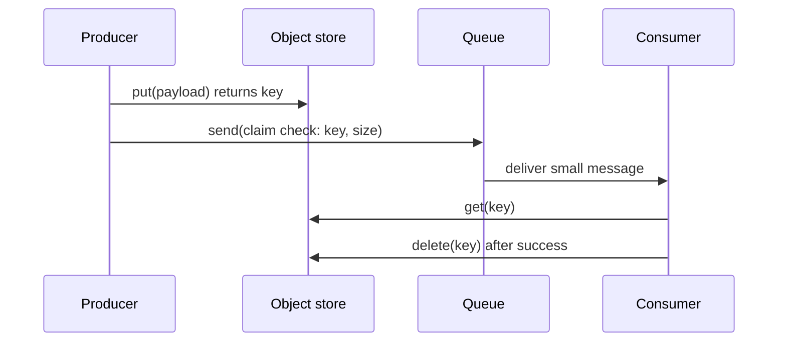
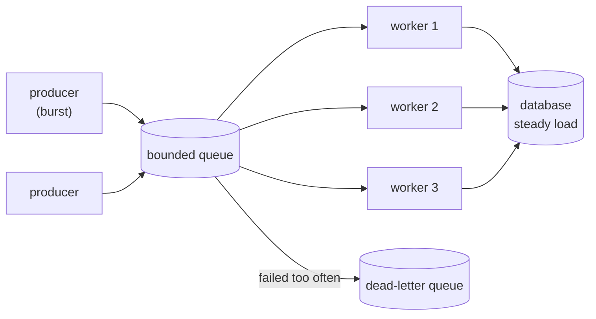
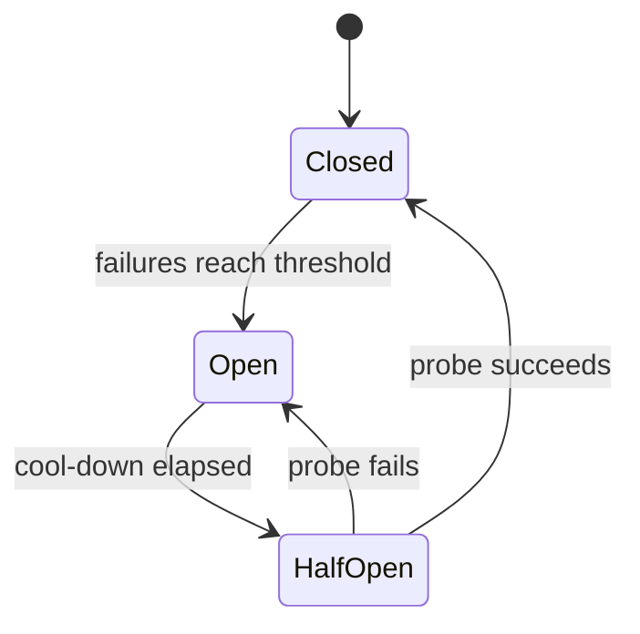
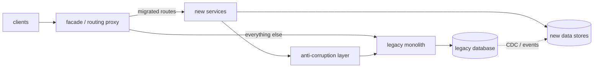

# Chapter 13 — Cloud Design Patterns

> **Volume 4 — High-Level Design** · [Contents](index.md) · ← [Chapter 12 — Event-Driven Systems](ch12-event-driven-systems.md) · Next → [Chapter 14 — CDN, Edge & Geo-Distribution](ch14-cdn-edge-and-geo-distribution.md)

---

## Concept

A catalog of the named patterns for building reliable, scalable distributed applications in the cloud: messaging, data management, design and implementation, reliability, and security.

**In one sentence:** a cloud design pattern is a named, reusable answer to a recurring distributed-systems problem — it tells you the problem, the shape of the solution, and the trade-off you accept — so you can say "put a bulkhead there" instead of re-deriving it in every design review.

### Cloud Design Patterns Catalog

**Mental model — a toolbox, not a checklist.** Each pattern is one tool with one job (a queue absorbs bursts, a breaker stops a retry storm, a sidecar bolts on a capability). Good designs use a handful of them where a real problem exists; a design that uses all of them is over-engineered. Always ask "which problem does this solve here?" before reaching for the tool.

**Where this catalog comes from.** The grouping and names follow the cloud design patterns catalog in the Azure Architecture Center, which roadmap.sh also lists. The ideas are not Azure-specific: every pattern maps to AWS, GCP, Kubernetes or plain open source. Where a pattern is covered in depth elsewhere in this guide, the entry here is short and links to that chapter.

**Not all patterns are equally important.** Learn these seven first — they appear in almost every real system and interview: **Circuit Breaker, Retry, Cache-Aside, CQRS, Publisher/Subscriber, Strangler Fig, Sidecar.** The rest are good vocabulary; look them up when the problem shows up.

##### Messaging patterns

| Pattern | What it is / problem it solves | Use when | Watch out |
|---------|--------------------------------|----------|-----------|
| Sequential Convoy | Process related messages in order (per session, account or key) while unrelated groups still run in parallel. Solves ordering without a single-threaded bottleneck. | Order matters within a group (events for one order, one user, one device). | Needs a partition or session key; one hot key becomes a bottleneck; a poison message blocks its group. |
| Scheduler Agent Supervisor | A scheduler runs a multi-step job by dispatching each step to an agent; a supervisor watches for failed or stuck steps and recovers or retries them. Solves long workflows that span services. | Distributed workflows that must self-heal (provisioning, onboarding, order fulfilment). | Steps must be idempotent; state must be durable; this is basically a workflow engine, so consider buying one (Temporal, Step Functions). |
| Queue-Based Load Leveling | A queue between producers and a service buffers bursts so the service consumes at its own steady pace. Solves overload from spiky traffic. | Bursty writes to a slower backend; work that can finish later. | Adds latency; the caller gets no immediate result; the queue must be bounded and monitored (depth, age) — see Ch 8. |
| Publisher/Subscriber | A publisher announces events to a channel; any number of subscribers receive them without the publisher knowing who they are. Solves tight coupling and fan-out. | One event, many independent reactions (email, analytics, search index). | Delivery is usually at-least-once, so consumers must be idempotent; harder to trace who reacted; schema evolution. See Ch 9. |
| Priority Queue | Messages carry a priority so urgent work is processed before bulk work. Solves starvation of important requests behind a backlog. | Mixed workloads (paid vs free tier, interactive vs batch). | Low priority can starve forever (add aging); not every broker supports it natively — separate queues per priority also work. |
| Pipes and Filters | Break a complex task into independent steps (filters) connected by channels (pipes). Solves monolithic processing that cannot be reused or scaled per step. | Multi-stage transformations (ingest, validate, enrich, store); steps that scale differently. | Latency of every hop; failures between stages need a retry or dead-letter plan; too many tiny stages hurts throughput. |
| Competing Consumers | Several consumers read from one queue and each message goes to exactly one of them. Solves throughput and availability of a single consumer. | A queue backlog grows; you want to scale workers horizontally. | Ordering is lost across consumers (see Sequential Convoy); needs idempotency and a visibility timeout or ack; poison messages need a dead-letter queue. |
| Choreography | Services react to each other's events with no central controller; each service knows only its own step. Solves central coordinator bottlenecks and coupling. | Small, stable flows across a few teams. | The overall flow is implicit and hard to see or debug; cyclic event chains; compare with orchestration (a coordinator that calls each step) as flows grow. |
| Claim Check | Store the large payload in an external store and send only a small reference (the claim check) through the messaging system. Solves message-size limits and expensive large messages. | Payloads exceed the broker limit, or most consumers do not need the body. | Two systems to keep consistent; orphaned payloads need a lifecycle or TTL; the consumer needs access to the store. |
| Asynchronous Request-Reply | The client sends a request, gets an immediate acknowledgement (for example `202 Accepted` plus a status URL), and polls or is called back for the result. Solves long-running operations over HTTP. | Work takes longer than a normal request timeout. | Clients must poll or expose a callback; you must store job state and expire it; make the status endpoint cheap. |

##### Data management patterns

| Pattern | What it is / problem it solves | Use when | Watch out |
|---------|--------------------------------|----------|-----------|
| Valet Key | Give the client a short-lived, narrowly scoped token (a pre-signed URL, SAS token) to access one resource directly. Solves proxying large transfers through your servers. | Direct upload or download from object storage. | Tokens are bearer secrets: keep them short-lived, scoped to one object and one action; you lose the proxy as a validation point. |
| Static Content Hosting | Serve static files (HTML, JS, images) from object storage behind a CDN instead of the web servers. Solves wasted compute and slow delivery. | Any site with static assets or a single-page app. See Ch 14. | Cache invalidation and versioned file names; CORS and access rules. |
| Sharding | Split a dataset into partitions (shards) across nodes by a key. Solves a data set or write rate that no single node can hold. | One node's storage or write throughput is exhausted. See Ch 11. | Shard-key choice, hot shards, cross-shard queries and transactions, resharding cost. |
| Materialized View | Pre-compute and store the result of a complex query in a shape ready to read. Solves slow, expensive read queries. | Read-heavy dashboards, search pages, denormalised read models. | The view is stale until refreshed; you need a refresh strategy (on write, scheduled, event-driven). |
| Index Table | Create your own lookup table keyed by a non-key field in a store that has no secondary indexes. Solves slow queries on non-key attributes in NoSQL stores. | Querying by a field other than the partition key (for example find user by email). | You maintain it yourself, so it can drift from the base table; extra writes. |
| Event Sourcing | Store every state change as an immutable event; current state is derived by replaying events. Solves lost history and hard auditing. | Audit-critical domains, temporal queries, rebuilding read models. See Vol 3 Ch 12. | Event schema versioning, replay time (use snapshots), eventual consistency, a steep learning curve. |
| CQRS | Separate the model that handles writes (commands) from the model that serves reads (queries). Solves read and write needs that pull one model in opposite directions. | Very different read and write loads or shapes; often paired with Event Sourcing. See Vol 3 Ch 12. | More moving parts; the read side is eventually consistent; overkill for simple CRUD. |
| Cache-Aside | The application checks the cache first, loads from the database on a miss, then fills the cache. Solves repeated expensive reads. | Read-heavy data that tolerates brief staleness. See Ch 7. | Stale data, invalidation, stampedes on a cold or expiring key. |

##### Design and implementation patterns

| Pattern | What it is / problem it solves | Use when | Watch out |
|---------|--------------------------------|----------|-----------|
| Strangler Fig | Put a facade in front of a legacy system and route one feature at a time to new code until the old system can be switched off. Solves risky big-bang rewrites. | Migrating a monolith or legacy system incrementally. | Two systems run for a long time; the facade is a single point of failure; shared data is the hard part; set an end date or the migration never finishes. |
| Sidecar | Deploy a helper process next to the main app (same pod or host) to provide cross-cutting capability — logging, proxying, config, mTLS. Solves duplicating that code in every language. | A service mesh proxy, log shipper, or secrets agent. See Ch 10. | Extra resource use per instance; the sidecar lifecycle is coupled to the app; one more thing to upgrade. |
| Leader Election | Instances choose one coordinator to own a task, using a consensus store or lease. Solves duplicated work and conflicting writers. | Singleton jobs, partition ownership, scheduled tasks across replicas. | Split brain if leases are mishandled (use fencing tokens); failover delay; prefer a managed lock or lease service over rolling your own. |
| External Configuration Store | Move configuration out of the deployed package into a central store the app reads at startup or at runtime. Solves redeploying to change a setting. | Many services or environments share settings; feature flags. | The store becomes a dependency (cache the last good value); access control and audit; secrets belong in a secrets manager. |
| Compute Resource Consolidation | Run several small tasks or services in one compute unit. Solves wasted cost and overhead of many tiny deployments. | Many low-utilisation components with similar scaling and security needs. | Noisy neighbours, shared failure domain, harder independent scaling and deploys. |
| Backends for Frontend (BFF) | One backend per kind of client (web, mobile) shaped to that client's needs. Solves a one-size-fits-all API that suits no one. | Web and mobile need very different payloads or flows. | More services to maintain; shared logic can be duplicated — push it down into shared services. |
| Anti-Corruption Layer | A translation layer between a new system and a legacy or foreign one so the old model does not leak into the new design. Solves legacy concepts polluting the new domain. | Integrating with or migrating from a legacy system; third-party APIs with awkward models. See Vol 3 Ch 9. | Extra latency and code to maintain; can become a permanent crutch; keep it thin and tested. |
| Ambassador | A helper proxy beside a client that handles outbound network concerns — retries, timeouts, routing, TLS, monitoring. Solves repeating client-side connectivity logic. | Legacy or polyglot clients that need resilience without code changes. | An extra hop; it is a sidecar specialised for the client side of calls. |
| Gateway Routing / Offloading / Aggregation | One entry point that routes requests to services (routing), takes over shared work such as TLS, auth and rate limits (offloading), and combines several backend calls into one response (aggregation). Solves clients that must know every service and every cross-cutting concern. | Many services behind one public API. See Ch 5. | A single point of failure and bottleneck; keep business logic out of the gateway. |

##### Reliability patterns

| Pattern | What it is / problem it solves | Use when | Watch out |
|---------|--------------------------------|----------|-----------|
| Deployment Stamps | Deploy independent, identical copies (stamps or scale units) of the whole application and data to serve a subset of tenants or a region. Solves scale limits and blast radius. | Multi-tenant SaaS, regional or compliance isolation. See Ch 15. | Cost and operational overhead per stamp; a routing layer to map tenant to stamp; global data. |
| Geodes | Geographically distributed nodes, each able to serve any request, with data replicated between them (active-active). Solves latency and regional failure. | Global users who need low latency and regional resilience. | Replicating and reconciling data across regions; conflict resolution; consistency trade-offs. See Ch 14. |
| Health Endpoint Monitoring | The service exposes a health endpoint that checks its own dependencies; external tools probe it. Solves discovering failures only when users complain. | Load balancers, orchestrators and monitors need liveness or readiness. | Shallow checks lie, deep checks can cause cascading failures; protect the endpoint; separate liveness from readiness. |
| Bulkhead | Isolate resources (thread pools, connection pools, instances) per dependency or per tenant so one failure cannot drain everything. Solves cascading resource exhaustion. | Calling several dependencies of unequal reliability; protecting a critical path. | Resources are partitioned and so less efficiently used; sizing each pool. |
| Circuit Breaker | Wrap a remote call and, after repeated failures, stop calling it for a while (open), then probe (half-open) before resuming. Solves retry storms against a failing dependency. See Vol 3 Ch 14. | Any remote call that can fail or hang. | Threshold and timeout tuning; needs a sensible fallback; per-instance state versus shared state. |
| Compensating Transaction | Undo earlier completed steps of a multi-step process with explicit reverse operations when a later step fails. Solves consistency without distributed locks (the basis of the saga). | Workflows across services with no shared transaction. | Compensations must be idempotent and may themselves fail; some actions cannot be undone (an email already sent); intermediate states are visible. |
| Retry | Retry a transient failure, with backoff and jitter, a limited number of times. Solves brief network or service blips. See Vol 3 Ch 14. | Transient faults on idempotent operations. | Retrying non-idempotent calls duplicates effects; retries multiply load during an outage (use budgets and a breaker); stack of retries across layers. |
| Throttling | Control how much of a resource a consumer may use, and reject, delay or degrade the excess. Solves overload and noisy neighbours. See Ch 8. | Shared services, multi-tenant APIs, autoscaling lag. | Return clear 429s with `Retry-After`; unfair limits; clients must back off. |

##### Security patterns

| Pattern | What it is / problem it solves | Use when | Watch out |
|---------|--------------------------------|----------|-----------|
| Federated Identity | Delegate authentication to an external identity provider (OIDC, SAML) instead of storing credentials yourself. Solves password management and single sign-on across apps. | Enterprise SSO, social login, partner access. See Ch 18. | The identity provider becomes a critical dependency; token validation, claim mapping and logout are subtle. |
| Gatekeeper | A dedicated front-end host validates and sanitises requests, then forwards only the clean ones to the trusted back end. Solves exposing the component that holds data or privileges. | Sensitive workloads; limiting the damage of a compromised front end. | Another hop and component; it must hold no secrets and have minimal privileges; do not make it a bottleneck. |
| Valet Key | A scoped, short-lived token for direct access to one resource (listed under data management above). Solves granting access without proxying or sharing full credentials. | Pre-signed uploads and downloads, delegated access. | Treat the token as a secret; keep the scope and lifetime small. |

##### Which pattern for which problem

| Problem | Reach for |
|---------|-----------|
| Traffic spikes overwhelm a backend | Queue-Based Load Leveling, Throttling, Competing Consumers |
| Remote dependency is failing or slow | Circuit Breaker, Retry (with backoff), Bulkhead |
| Messages too large for the broker | Claim Check |
| Operation takes minutes, caller is HTTP | Asynchronous Request-Reply |
| Many systems react to one event | Publisher/Subscriber, Choreography |
| Related messages must stay in order | Sequential Convoy |
| Urgent work stuck behind bulk work | Priority Queue |
| Reads are slow or expensive | Cache-Aside, Materialized View, CQRS |
| One database node is full | Sharding, Index Table (for secondary lookups) |
| Need full history and audit | Event Sourcing |
| Rewriting a legacy system safely | Strangler Fig + Anti-Corruption Layer |
| Cross-cutting concerns in many services | Sidecar, Ambassador, Gateway Offloading |
| Different clients need different APIs | Backends for Frontend, Gateway Aggregation |
| Only one instance may do a job | Leader Election |
| Multi-step workflow across services fails halfway | Compensating Transaction, Scheduler Agent Supervisor |
| Tenant or regional isolation and scale | Deployment Stamps, Geodes |
| Upload or download without proxying | Valet Key, Static Content Hosting |
| Do not store passwords or sessions yourself | Federated Identity |
| Protect the trusted back end from raw input | Gatekeeper |
| Change settings without redeploying | External Configuration Store |
| Know whether an instance is healthy | Health Endpoint Monitoring |

*(From AI Library chapter 12.)*

The diagram, worked example, exercises, mini-project, design prompt, open-source reading, interview questions and checklist below are this chapter's practice layer.

---

## Prereqs

* [Vol 4 Ch 9 — Caching Strategies](ch07-caching-strategies.md)
* [Vol 4 Ch 10 — Rate Limiting, Throttling & Backpressure](ch08-rate-limiting-throttling-and-backpressure.md)
* [Vol 4 Ch 11 — Message Queues & Streaming (Kafka, SQS, Pub/Sub)](ch09-message-queues-and-streaming-kafka-sqs-pub.md)
* [Vol 4 Ch 15 — Event-Driven Systems](ch12-event-driven-systems.md)
* [Vol 3 Ch 14 — Resilience Patterns: Idempotency, Retries, Backoff, Circuit Breakers](../volume-3-low-level-design/ch14-resilience-patterns-idempotency-retries-backoff-circuit-breakers.md)

---

## Diagram

**Claim Check — the payload goes around the queue, the reference goes through it**



**Queue-Based Load Leveling + Competing Consumers**



**Circuit Breaker states**



---

## Example

Claim Check plus Competing Consumers in one runnable file (Python standard library only). The "object store" is a dict standing in for S3 or Azure Blob; the queue is a bounded `queue.Queue`.

```python
import queue, threading, uuid, time

object_store = {}                      # stand-in for S3 / Blob storage
q = queue.Queue(maxsize=10)            # bounded: producers block when it is full
results, lock = [], threading.Lock()

def produce(n):
    for i in range(n):
        payload = ("report-%d " % i).encode() * 100_000        # ~1 MB: too big for a message
        key = str(uuid.uuid4())
        object_store[key] = payload                            # 1. store the payload
        q.put({"claim": key, "size": len(payload), "id": i})   # 2. send only the reference
    for _ in range(WORKERS):
        q.put(None)                                            # one stop signal per worker

def consume(name):
    while True:
        msg = q.get()
        if msg is None:
            break
        data = object_store[msg["claim"]]                      # 3. redeem the claim check
        time.sleep(0.05)                                       # pretend to process it
        with lock:
            results.append((name, msg["id"], len(data)))
        del object_store[msg["claim"]]                         # 4. clean up after success

WORKERS = 3
threads = [threading.Thread(target=consume, args=("w%d" % i,)) for i in range(WORKERS)]
for t in threads:
    t.start()
produce(9)
for t in threads:
    t.join()

print(len(results), "messages handled by", len({r[0] for r in results}), "workers")
print("store empty:", not object_store)
```

A real consumer must acknowledge only after success, and a message that fails repeatedly goes to a dead-letter queue. Here is an idempotent consumer, because at-least-once delivery means duplicates happen:

```python
processed = set()                      # in production: a unique-key table or Redis SET

def handle(msg):
    if msg["id"] in processed:         # duplicate delivery, safe to skip
        return
    do_work(msg)
    processed.add(msg["id"])           # record after the work (or in the same transaction)
```

The Circuit Breaker, in about 25 lines:

```python
import time

class CircuitBreaker:
    def __init__(self, threshold=3, cooldown=10.0):
        self.threshold, self.cooldown = threshold, cooldown
        self.failures, self.opened_at = 0, None

    def call(self, fn, *args):
        if self.opened_at is not None:
            if time.monotonic() - self.opened_at < self.cooldown:
                raise RuntimeError("circuit open: failing fast")
            # cool-down over: half-open, let one probe through
        try:
            result = fn(*args)
        except Exception:
            self.failures += 1
            if self.failures >= self.threshold or self.opened_at is not None:
                self.opened_at = time.monotonic()              # (re)open
            raise
        self.failures, self.opened_at = 0, None                # success closes it
        return result
```

An Asynchronous Request-Reply exchange over HTTP looks like this:

```http
POST /reports HTTP/1.1
Content-Type: application/json

HTTP/1.1 202 Accepted
Location: /reports/jobs/7f3a
Retry-After: 5

GET /reports/jobs/7f3a   ->  200 {"status": "running"}
GET /reports/jobs/7f3a   ->  303 See Other, Location: /reports/42   (when finished)
```

---

## Exercises

1. Which pattern fits: an image-upload API where files are 20 MB but the queue limit is 256 KB?

   <details><summary>Solution</summary>Claim Check: upload the file to object storage (using a Valet Key so the client uploads directly), then enqueue a small message holding the object key and metadata. Consumers fetch the file by key and delete or expire it after processing.</details>

2. A payment service calls a fraud service that sometimes hangs. List the patterns you would combine and say why.

   <details><summary>Solution</summary>A timeout on every call; Retry with exponential backoff and jitter only for idempotent calls and with a budget; a Circuit Breaker so a hanging fraud service fails fast instead of tying up threads; a Bulkhead (separate pool) so fraud problems cannot exhaust the pool used for other calls; and a defined fallback (for example queue the payment for review) when the circuit is open.</details>

3. Competing Consumers broke the ordering of events for one order. Fix it without giving up parallelism.

   <details><summary>Solution</summary>Apply Sequential Convoy: partition or session by order id so all messages of one order go to one consumer in order, while different orders run in parallel. In Kafka that is the partition key; in Service Bus it is a session id. Watch for hot keys.</details>

4. Why can Choreography become hard to operate, and what do you do about it?

   <details><summary>Solution</summary>No component owns the end-to-end flow, so it is hard to see, test, and find where a step stalled. Add correlation ids and distributed tracing, document the event flow, and move complex or long flows to an orchestrator or a Scheduler Agent Supervisor workflow engine.</details>

---

## Mini project

**A resilience toolkit with four patterns and a chaos test.**

**Steps**

1. Implement Retry (backoff with full jitter, max attempts, retry-only-on list), Circuit Breaker (closed, open, half-open), Bulkhead (a semaphore per dependency) and a Throttle.
2. Compose them as decorators: `retry(breaker(bulkhead(timeout(call))))`. Discuss why the order matters.
3. Build a flaky fake dependency that can fail, hang, or slow down on command.
4. Chaos test: run 200 concurrent calls while the dependency is down; show that without the toolkit threads pile up and with it the system fails fast and recovers after the dependency returns.
5. Add Claim Check and Competing Consumers from the Example as a second module, with a dead-letter queue and an idempotent handler.

**Done when:** the chaos test shows bounded latency and bounded concurrency during the outage, the breaker closes again after recovery, and no duplicate effects occur under redelivery.

---

## Design

**Design an incremental migration of a monolith using Strangler Fig and an Anti-Corruption Layer.**

Requirements (assumed for the exercise): an order-management monolith with one shared relational database; 6 teams; must stay live throughout; migrate order, catalog and billing one at a time over several quarters; no big-bang cutover; every step reversible.



**Steps**

1. **Put the facade in first.** Introduce a routing proxy (API gateway or reverse proxy) in front of the monolith that passes everything through unchanged. Ship it, and prove it adds no meaningful latency or risk.
2. **Pick a seam.** Choose a capability with clear boundaries and low coupling (for example catalog reads) and build it as a new service.
3. **Add the Anti-Corruption Layer.** The new service talks to the monolith only through an ACL that translates legacy concepts (a status code with 12 magic values, a wide denormalised table) into the new domain model, and back.
4. **Move the data carefully.** Use change data capture or events from the legacy database to populate the new store; run old and new in parallel and compare (shadow traffic) before trusting the new one. Make one side the single writer per entity to avoid dual-write bugs.
5. **Shift traffic gradually.** Route by feature flag: internal users, 1 percent, 10 percent, all. Rollback is a routing change.
6. **Retire.** Delete the legacy code and tables for that capability, then move on. Keep a list of what is left and a target date, otherwise the monolith lives forever.

**Components:** facade (gateway), new services each with its own data store, ACL (an adapter library or a small service), CDC pipeline, feature-flag service, dashboards comparing old and new results.

**Trade-offs to justify**

* **Facade as a single point of failure:** run several instances; keep it dumb (routing and offloading only).
* **ACL as permanent debt:** it is scaffolding. Delete it once the legacy side is gone.
* **Shared database temptation:** letting new services read the monolith tables directly is fast but re-couples everything; prefer events and an owned store.
* **Cost of running both:** accepted; it buys reversibility. Compare to a rewrite, where nothing ships until everything does.
* **Consistency during migration:** eventual consistency between old and new data; define which system is the source of truth per entity at each stage.

---

## Open source

* [`MicrosoftDocs/architecture-center`](https://github.com/MicrosoftDocs/architecture-center) — the source of the Azure Architecture Center, including the cloud design patterns catalog this chapter follows.
* [`App-vNext/Polly`](https://github.com/App-vNext/Polly) — .NET resilience library: retry, circuit breaker, timeout, bulkhead, fallback.
* [`resilience4j/resilience4j`](https://github.com/resilience4j/resilience4j) — Java library with circuit breaker, retry, bulkhead and rate limiter.
* [`dapr/dapr`](https://github.com/dapr/dapr) — sidecar-based runtime offering pub/sub, state, secrets and service invocation building blocks.
* [`envoyproxy/envoy`](https://github.com/envoyproxy/envoy) — proxy used as a sidecar, ambassador and gateway, with circuit breaking and retries built in.
* [`etcd-io/etcd`](https://github.com/etcd-io/etcd) — consensus store commonly used for leader election and distributed locks.
* [`temporalio/temporal`](https://github.com/temporalio/temporal) — durable workflow engine (scheduler-agent-supervisor and compensation style workflows).
* [`apache/kafka`](https://github.com/apache/kafka) — log-based broker for pub/sub, competing consumers (consumer groups) and keyed ordering.

---

## Interview

1. **"Explain the Circuit Breaker pattern and how it differs from Retry."**
   <details><summary>Answer</summary>Retry assumes a failure is transient and tries again, with backoff and jitter. A Circuit Breaker assumes a failure may persist: after enough failures it opens and fails calls immediately, then lets a probe through after a cool-down (half-open) and closes if it succeeds. Together: retry handles blips, the breaker stops retries from hammering a dependency that is down. Retries wrap inside the breaker's accounting, and both need timeouts and idempotent operations.</details>

2. **"How would you migrate a monolith to microservices?"**
   <details><summary>Answer</summary>Strangler Fig: put a facade in front, extract one capability at a time behind it, route traffic gradually with flags, and delete the old code when done. Use an Anti-Corruption Layer so the new model is not shaped by legacy concepts. The hard part is data: use events or CDC, define one writer per entity, and run old and new in parallel to compare. Avoid a big-bang rewrite because nothing is delivered until everything is, and rollback is impossible.</details>

3. **"Choreography or orchestration?"**
   <details><summary>Answer</summary>Choreography: services react to events, giving low coupling and no central bottleneck, but the flow is implicit and hard to debug. Orchestration: a coordinator calls each step, which makes the flow explicit, testable and easier to change, at the price of a central component and more coupling to it. Use choreography for small flows with few participants and orchestration (or a workflow engine) for long, branching or compensating flows.</details>

4. **"When would you use CQRS, and what does it cost you?"**
   <details><summary>Answer</summary>When reads and writes have different shapes or scale needs: a normalised write model that enforces invariants and one or more denormalised read models (materialized views) optimised for queries. The cost is eventual consistency between sides, more components and more code. It is overkill for plain CRUD. It pairs naturally with Event Sourcing, where events feed the read models.</details>

5. **"How do you handle messages larger than the broker limit?"**
   <details><summary>Answer</summary>Claim Check: store the payload in object storage, send a small message with its key, and have the consumer fetch it. Give the producer a Valet Key (pre-signed URL) for direct upload, set a lifecycle or TTL so orphaned objects expire, and delete after successful processing.</details>

---

## Checklist

- [ ] can name the problem each pattern solves, not just its definition
- [ ] know the seven to learn first: Circuit Breaker, Retry, Cache-Aside, CQRS, Pub/Sub, Strangler Fig, Sidecar
- [ ] every retry is bounded, backed off with jitter, and only on idempotent operations
- [ ] every consumer is idempotent and has a dead-letter queue
- [ ] every queue is bounded and monitored
- [ ] migrations use a facade, an anti-corruption layer, and a rollback path
- [ ] tokens (valet keys) are short-lived and narrowly scoped

---

> [Contents](index.md) · ← [Chapter 12 — Event-Driven Systems](ch12-event-driven-systems.md) · Next → [Chapter 14 — CDN, Edge & Geo-Distribution](ch14-cdn-edge-and-geo-distribution.md)
