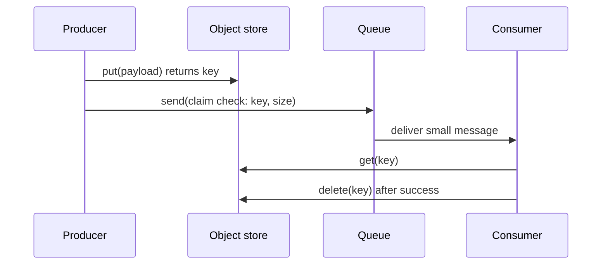
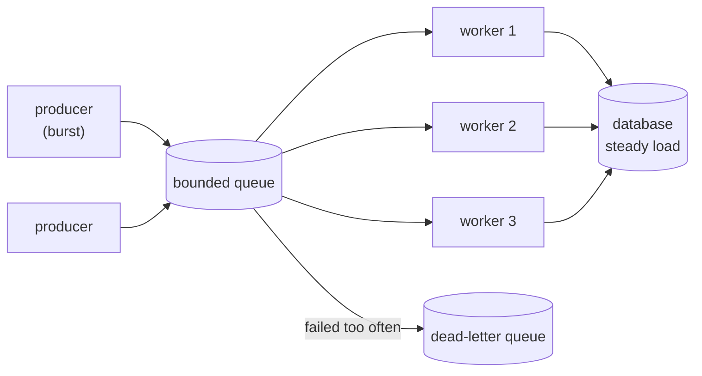
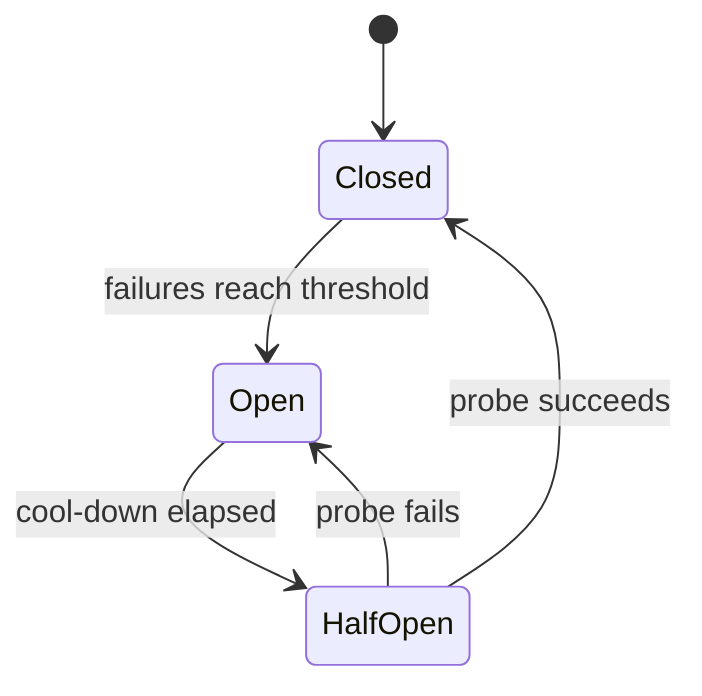
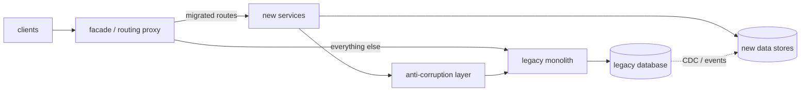

# Chapter 13 — Cloud Design Patterns

> **Volume 4 — High-Level Design** · [Contents](index.md) · ← [Chapter 12 — Event-Driven Systems](ch12-event-driven-systems.md) · Next → [Chapter 14 — CDN, Edge & Geo-Distribution](ch14-cdn-edge-and-geo-distribution.md)

---

## Concept

A catalog of the named patterns for building reliable, scalable distributed applications in the cloud: messaging, data management, design and implementation, reliability, and security.

**In one sentence:** a cloud design pattern is a named, reusable answer to a recurring distributed-systems problem — it tells you the problem, the shape of the solution, and the trade-off you accept — so you can say "put a bulkhead there" instead of re-deriving it in every design review.

**Read the full explanation in the AI Library** (it is explained there once, so this chapter does not repeat it):

* [Chapter 12 — Cloud Design Patterns Catalog](https://charikshith.github.io/AI_Library/notes/system-design/chapters/12%20-%20Cloud%20Design%20Patterns.html#122-cloud-design-patterns-catalog)

This chapter is the **practice layer**: the diagram, worked example, exercises, mini-project, design prompt, open-source reading, interview questions and checklist below.

---

## Prereqs

* [Vol 4 Ch 9 — Caching Strategies](ch07-caching-strategies.md)
* [Vol 4 Ch 10 — Rate Limiting, Throttling & Backpressure](ch08-rate-limiting-throttling-and-backpressure.md)
* [Vol 4 Ch 11 — Message Queues & Streaming (Kafka, SQS, Pub/Sub)](ch09-message-queues-and-streaming-kafka-sqs-pub.md)
* [Vol 4 Ch 15 — Event-Driven Systems](ch12-event-driven-systems.md)
* [Vol 3 Ch 14 — Resilience Patterns: Idempotency, Retries, Backoff, Circuit Breakers](../volume-3-low-level-design/ch14-resilience-patterns-idempotency-retries-backoff-circuit-breakers.md)

---

## Diagram

**Claim Check — the payload goes around the queue, the reference goes through it**



**Queue-Based Load Leveling + Competing Consumers**



**Circuit Breaker states**



---

## Example

Claim Check plus Competing Consumers in one runnable file (Python standard library only). The "object store" is a dict standing in for S3 or Azure Blob; the queue is a bounded `queue.Queue`.

```python
import queue, threading, uuid, time

object_store = {}                      # stand-in for S3 / Blob storage
q = queue.Queue(maxsize=10)            # bounded: producers block when it is full
results, lock = [], threading.Lock()

def produce(n):
    for i in range(n):
        payload = ("report-%d " % i).encode() * 100_000        # ~1 MB: too big for a message
        key = str(uuid.uuid4())
        object_store[key] = payload                            # 1. store the payload
        q.put({"claim": key, "size": len(payload), "id": i})   # 2. send only the reference
    for _ in range(WORKERS):
        q.put(None)                                            # one stop signal per worker

def consume(name):
    while True:
        msg = q.get()
        if msg is None:
            break
        data = object_store[msg["claim"]]                      # 3. redeem the claim check
        time.sleep(0.05)                                       # pretend to process it
        with lock:
            results.append((name, msg["id"], len(data)))
        del object_store[msg["claim"]]                         # 4. clean up after success

WORKERS = 3
threads = [threading.Thread(target=consume, args=("w%d" % i,)) for i in range(WORKERS)]
for t in threads:
    t.start()
produce(9)
for t in threads:
    t.join()

print(len(results), "messages handled by", len({r[0] for r in results}), "workers")
print("store empty:", not object_store)
```

A real consumer must acknowledge only after success, and a message that fails repeatedly goes to a dead-letter queue. Here is an idempotent consumer, because at-least-once delivery means duplicates happen:

```python
processed = set()                      # in production: a unique-key table or Redis SET

def handle(msg):
    if msg["id"] in processed:         # duplicate delivery, safe to skip
        return
    do_work(msg)
    processed.add(msg["id"])           # record after the work (or in the same transaction)
```

The Circuit Breaker, in about 25 lines:

```python
import time

class CircuitBreaker:
    def __init__(self, threshold=3, cooldown=10.0):
        self.threshold, self.cooldown = threshold, cooldown
        self.failures, self.opened_at = 0, None

    def call(self, fn, *args):
        if self.opened_at is not None:
            if time.monotonic() - self.opened_at < self.cooldown:
                raise RuntimeError("circuit open: failing fast")
            # cool-down over: half-open, let one probe through
        try:
            result = fn(*args)
        except Exception:
            self.failures += 1
            if self.failures >= self.threshold or self.opened_at is not None:
                self.opened_at = time.monotonic()              # (re)open
            raise
        self.failures, self.opened_at = 0, None                # success closes it
        return result
```

An Asynchronous Request-Reply exchange over HTTP looks like this:

```http
POST /reports HTTP/1.1
Content-Type: application/json

HTTP/1.1 202 Accepted
Location: /reports/jobs/7f3a
Retry-After: 5

GET /reports/jobs/7f3a   ->  200 {"status": "running"}
GET /reports/jobs/7f3a   ->  303 See Other, Location: /reports/42   (when finished)
```

---

## Exercises

1. Which pattern fits: an image-upload API where files are 20 MB but the queue limit is 256 KB?

   <details><summary>Solution</summary>Claim Check: upload the file to object storage (using a Valet Key so the client uploads directly), then enqueue a small message holding the object key and metadata. Consumers fetch the file by key and delete or expire it after processing.</details>

2. A payment service calls a fraud service that sometimes hangs. List the patterns you would combine and say why.

   <details><summary>Solution</summary>A timeout on every call; Retry with exponential backoff and jitter only for idempotent calls and with a budget; a Circuit Breaker so a hanging fraud service fails fast instead of tying up threads; a Bulkhead (separate pool) so fraud problems cannot exhaust the pool used for other calls; and a defined fallback (for example queue the payment for review) when the circuit is open.</details>

3. Competing Consumers broke the ordering of events for one order. Fix it without giving up parallelism.

   <details><summary>Solution</summary>Apply Sequential Convoy: partition or session by order id so all messages of one order go to one consumer in order, while different orders run in parallel. In Kafka that is the partition key; in Service Bus it is a session id. Watch for hot keys.</details>

4. Why can Choreography become hard to operate, and what do you do about it?

   <details><summary>Solution</summary>No component owns the end-to-end flow, so it is hard to see, test, and find where a step stalled. Add correlation ids and distributed tracing, document the event flow, and move complex or long flows to an orchestrator or a Scheduler Agent Supervisor workflow engine.</details>

---

## Mini project

**A resilience toolkit with four patterns and a chaos test.**

**Steps**

1. Implement Retry (backoff with full jitter, max attempts, retry-only-on list), Circuit Breaker (closed, open, half-open), Bulkhead (a semaphore per dependency) and a Throttle.
2. Compose them as decorators: `retry(breaker(bulkhead(timeout(call))))`. Discuss why the order matters.
3. Build a flaky fake dependency that can fail, hang, or slow down on command.
4. Chaos test: run 200 concurrent calls while the dependency is down; show that without the toolkit threads pile up and with it the system fails fast and recovers after the dependency returns.
5. Add Claim Check and Competing Consumers from the Example as a second module, with a dead-letter queue and an idempotent handler.

**Done when:** the chaos test shows bounded latency and bounded concurrency during the outage, the breaker closes again after recovery, and no duplicate effects occur under redelivery.

---

## Design

**Design an incremental migration of a monolith using Strangler Fig and an Anti-Corruption Layer.**

Requirements (assumed for the exercise): an order-management monolith with one shared relational database; 6 teams; must stay live throughout; migrate order, catalog and billing one at a time over several quarters; no big-bang cutover; every step reversible.



**Steps**

1. **Put the facade in first.** Introduce a routing proxy (API gateway or reverse proxy) in front of the monolith that passes everything through unchanged. Ship it, and prove it adds no meaningful latency or risk.
2. **Pick a seam.** Choose a capability with clear boundaries and low coupling (for example catalog reads) and build it as a new service.
3. **Add the Anti-Corruption Layer.** The new service talks to the monolith only through an ACL that translates legacy concepts (a status code with 12 magic values, a wide denormalised table) into the new domain model, and back.
4. **Move the data carefully.** Use change data capture or events from the legacy database to populate the new store; run old and new in parallel and compare (shadow traffic) before trusting the new one. Make one side the single writer per entity to avoid dual-write bugs.
5. **Shift traffic gradually.** Route by feature flag: internal users, 1 percent, 10 percent, all. Rollback is a routing change.
6. **Retire.** Delete the legacy code and tables for that capability, then move on. Keep a list of what is left and a target date, otherwise the monolith lives forever.

**Components:** facade (gateway), new services each with its own data store, ACL (an adapter library or a small service), CDC pipeline, feature-flag service, dashboards comparing old and new results.

**Trade-offs to justify**

* **Facade as a single point of failure:** run several instances; keep it dumb (routing and offloading only).
* **ACL as permanent debt:** it is scaffolding. Delete it once the legacy side is gone.
* **Shared database temptation:** letting new services read the monolith tables directly is fast but re-couples everything; prefer events and an owned store.
* **Cost of running both:** accepted; it buys reversibility. Compare to a rewrite, where nothing ships until everything does.
* **Consistency during migration:** eventual consistency between old and new data; define which system is the source of truth per entity at each stage.

---

## Open source

* [`MicrosoftDocs/architecture-center`](https://github.com/MicrosoftDocs/architecture-center) — the source of the Azure Architecture Center, including the cloud design patterns catalog this chapter follows.
* [`App-vNext/Polly`](https://github.com/App-vNext/Polly) — .NET resilience library: retry, circuit breaker, timeout, bulkhead, fallback.
* [`resilience4j/resilience4j`](https://github.com/resilience4j/resilience4j) — Java library with circuit breaker, retry, bulkhead and rate limiter.
* [`dapr/dapr`](https://github.com/dapr/dapr) — sidecar-based runtime offering pub/sub, state, secrets and service invocation building blocks.
* [`envoyproxy/envoy`](https://github.com/envoyproxy/envoy) — proxy used as a sidecar, ambassador and gateway, with circuit breaking and retries built in.
* [`etcd-io/etcd`](https://github.com/etcd-io/etcd) — consensus store commonly used for leader election and distributed locks.
* [`temporalio/temporal`](https://github.com/temporalio/temporal) — durable workflow engine (scheduler-agent-supervisor and compensation style workflows).
* [`apache/kafka`](https://github.com/apache/kafka) — log-based broker for pub/sub, competing consumers (consumer groups) and keyed ordering.

---

## Interview

1. **"Explain the Circuit Breaker pattern and how it differs from Retry."**
   <details><summary>Answer</summary>Retry assumes a failure is transient and tries again, with backoff and jitter. A Circuit Breaker assumes a failure may persist: after enough failures it opens and fails calls immediately, then lets a probe through after a cool-down (half-open) and closes if it succeeds. Together: retry handles blips, the breaker stops retries from hammering a dependency that is down. Retries wrap inside the breaker's accounting, and both need timeouts and idempotent operations.</details>

2. **"How would you migrate a monolith to microservices?"**
   <details><summary>Answer</summary>Strangler Fig: put a facade in front, extract one capability at a time behind it, route traffic gradually with flags, and delete the old code when done. Use an Anti-Corruption Layer so the new model is not shaped by legacy concepts. The hard part is data: use events or CDC, define one writer per entity, and run old and new in parallel to compare. Avoid a big-bang rewrite because nothing is delivered until everything is, and rollback is impossible.</details>

3. **"Choreography or orchestration?"**
   <details><summary>Answer</summary>Choreography: services react to events, giving low coupling and no central bottleneck, but the flow is implicit and hard to debug. Orchestration: a coordinator calls each step, which makes the flow explicit, testable and easier to change, at the price of a central component and more coupling to it. Use choreography for small flows with few participants and orchestration (or a workflow engine) for long, branching or compensating flows.</details>

4. **"When would you use CQRS, and what does it cost you?"**
   <details><summary>Answer</summary>When reads and writes have different shapes or scale needs: a normalised write model that enforces invariants and one or more denormalised read models (materialized views) optimised for queries. The cost is eventual consistency between sides, more components and more code. It is overkill for plain CRUD. It pairs naturally with Event Sourcing, where events feed the read models.</details>

5. **"How do you handle messages larger than the broker limit?"**
   <details><summary>Answer</summary>Claim Check: store the payload in object storage, send a small message with its key, and have the consumer fetch it. Give the producer a Valet Key (pre-signed URL) for direct upload, set a lifecycle or TTL so orphaned objects expire, and delete after successful processing.</details>

---

## Checklist

- [ ] can name the problem each pattern solves, not just its definition
- [ ] know the seven to learn first: Circuit Breaker, Retry, Cache-Aside, CQRS, Pub/Sub, Strangler Fig, Sidecar
- [ ] every retry is bounded, backed off with jitter, and only on idempotent operations
- [ ] every consumer is idempotent and has a dead-letter queue
- [ ] every queue is bounded and monitored
- [ ] migrations use a facade, an anti-corruption layer, and a rollback path
- [ ] tokens (valet keys) are short-lived and narrowly scoped

---

> [Contents](index.md) · ← [Chapter 12 — Event-Driven Systems](ch12-event-driven-systems.md) · Next → [Chapter 14 — CDN, Edge & Geo-Distribution](ch14-cdn-edge-and-geo-distribution.md)
