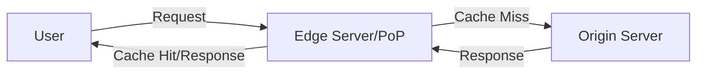
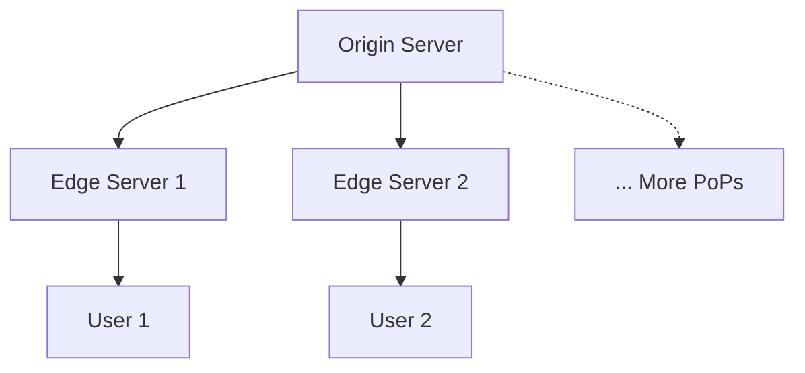
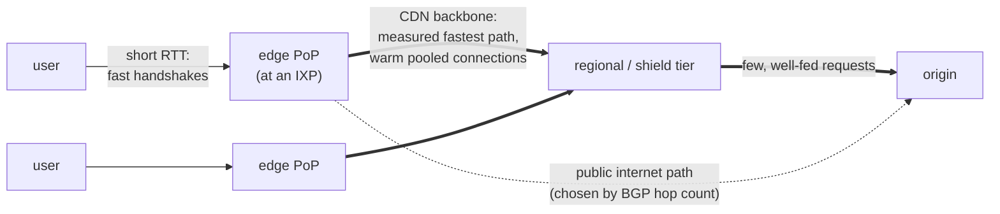
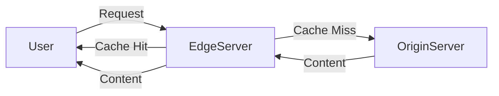
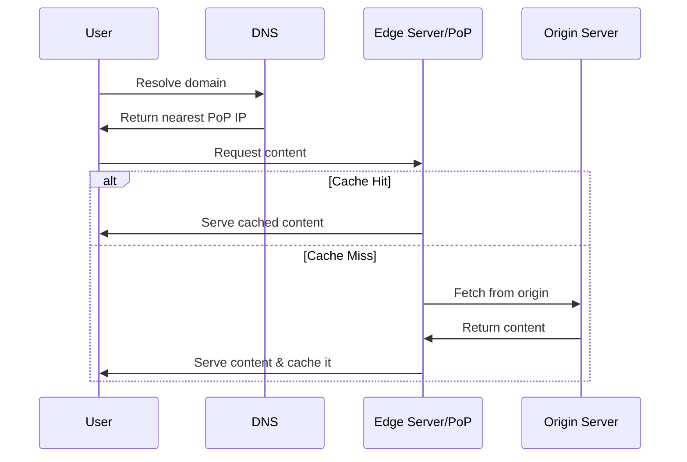
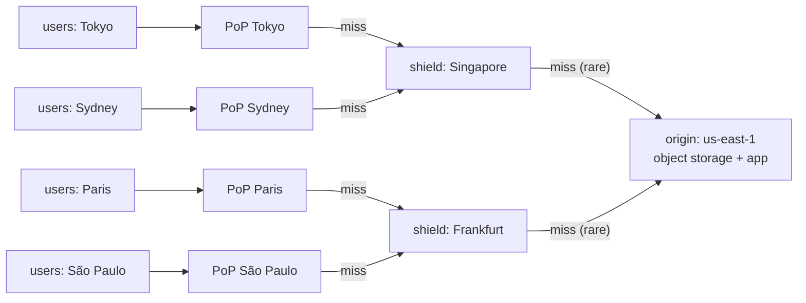
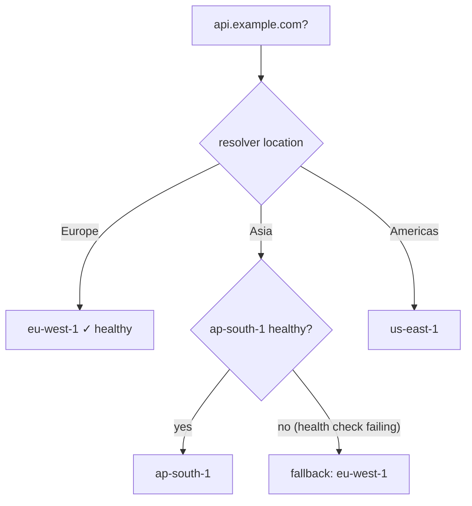
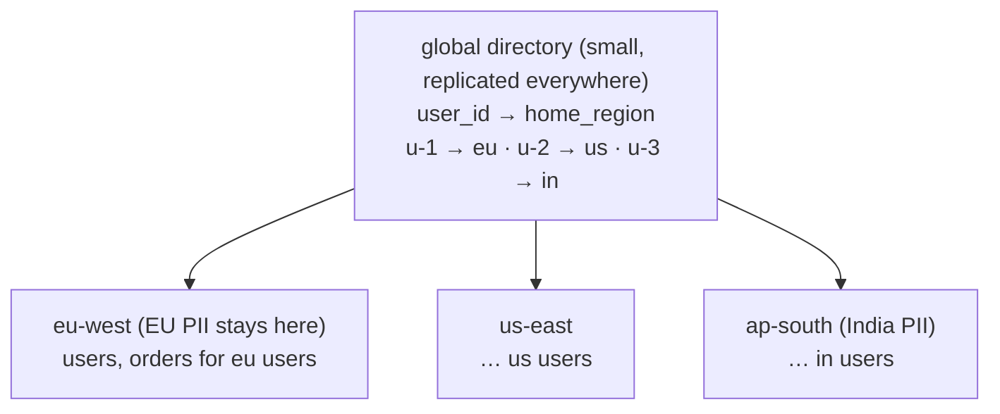
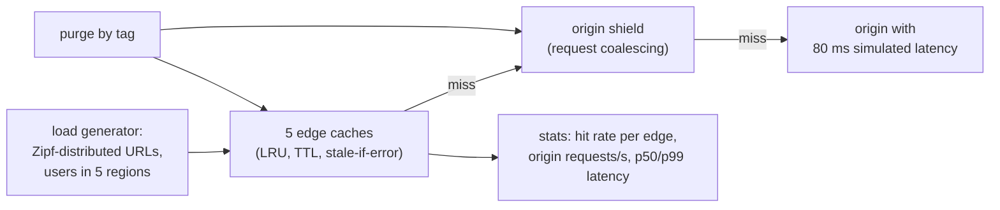
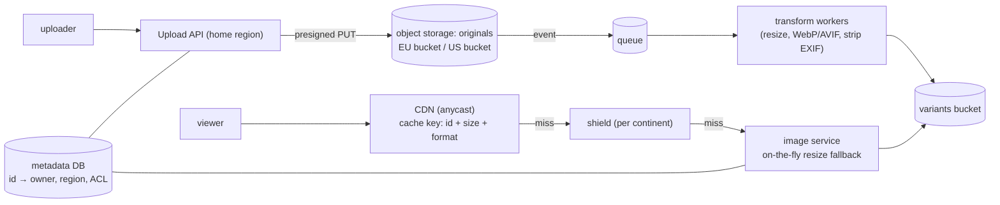

# Chapter 14 — CDN, Edge & Geo-Distribution

> **Volume 4 — High-Level Design** · [Contents](index.md) · ← [Chapter 13 — Cloud Design Patterns](ch13-cloud-design-patterns.md) · Next → [Chapter 15 — Multi-Tenancy](ch15-multi-tenancy.md)

---

## Concept

Caching at the edge, geo-routing, data residency, and multi-region consistency.

**In one sentence:** the speed of light is a hard limit, so global systems put copies of content and compute close to users (CDN edges, regional deployments), route each user to the nearest healthy place, keep data where the law says it must live, and choose carefully which data is shared across regions and how consistent it must be.

### CDN, Edge and Geo-Distribution in Depth

**Mental model — a coffee chain.** One roastery (the origin) supplies hundreds of cafés (edge PoPs). Each café keeps the popular beans on its shelf (cache) and orders from the regional warehouse (origin shield) when it runs out. Customers go to the nearest café (geo-routing). Some local laws say a city's customer loyalty records must stay in that country (data residency).

**Why distance matters**

| Route | Distance | Light in fiber (~200,000 km/s), round trip |
|-------|---------:|--------------------------------:|
| Same city | 50 km | 0.5 ms |
| Frankfurt ↔ London | 640 km | ~6 ms |
| New York ↔ London | 5,600 km | ~56 ms (~70 ms in practice) |
| New York ↔ Sydney | 16,000 km | ~160 ms (~200+ ms in practice) |

A page needing 5 sequential round trips (DNS, TCP, TLS, HTML, API) from Sydney to a US-only origin: ~1 s just in physics. From a local edge: ~50 ms.

**CDN caching**

| Concept | Meaning |
|---------|---------|
| PoP | point of presence: an edge data center near users |
| Cache key | usually host + path + query (+ `Vary` headers); normalize it to raise hit rates |
| TTL | from `Cache-Control: max-age / s-maxage` or edge rules |
| **Origin shield** | a mid-tier cache in one region that all edges miss to, so the origin sees ~1 request per object instead of one per PoP |
| Purge / invalidation | remove objects by URL, tag, or prefix (seconds to minutes) |
| **Cache busting** | put a content hash in the file name (`app.3f9a1c.js`) → `max-age=31536000, immutable`; a new deploy means a new URL, no purge needed |
| `stale-while-revalidate` / `stale-if-error` | serve slightly stale content while refreshing, or when the origin is down |
| Edge compute | small functions at the PoP (Cloudflare Workers, Lambda@Edge): auth checks, redirects, A/B, personalization |

**Geo-routing options**

| Method | How | Notes |
|--------|-----|-------|
| GeoDNS / latency-based DNS | DNS answers with the nearest region's IP | depends on the resolver's location; TTL limits failover speed |
| **Anycast** | the same IP announced from many PoPs; BGP delivers to the nearest | used by CDNs and DNS providers; fast failover |
| Global load balancer | one anycast IP → proxies to the best healthy region | e.g. Google Cloud LB, AWS Global Accelerator |
| Health-checked failover | remove unhealthy regions from answers | always pair routing with health checks |

**Multi-region data patterns**

| Pattern | Writes | Reads | Consistency | Fits |
|---------|--------|-------|-------------|------|
| Single primary region + read replicas | one region | local replicas | strong for writes, stale reads elsewhere | most apps; simple |
| Active-passive (DR) | primary only; secondary on standby | primary | strong; failover loses the async lag | disaster recovery (Ch 17) |
| **Geo-partitioned (home region)** | each user's data lives in their home region | local for local users | strong within a region | data residency, low latency for most traffic |
| Active-active multi-leader | any region | local | eventual; conflicts (LWW, CRDTs) | carts, presence, likes, collaborative data |
| Global consensus (Spanner, CockroachDB) | any region, via quorum | local (maybe stale) or quorum | strong | when correctness is non-negotiable; each write pays cross-region latency |

**Data residency** — laws (GDPR, India's DPDP, China's PIPL, sector rules) may require that personal data is stored or processed in a region. Design: a user → home-region mapping at sign-up; region-local databases for PII; only non-personal or aggregated data in global services; encryption with region-held keys; logs and backups count too.

*(From AI Library chapter 2.)*

### Content Delivery Networks (CDNs)

A **Content Delivery Network (CDN)** is a globally distributed network of servers (also called Points of Presence, or PoPs) designed to deliver content (web pages, images, videos, APIs, etc.) to users efficiently, reliably, and securely. By caching content closer to users, CDNs reduce latency, enhance availability, and offload traffic from origin servers.

#### Why Do We Need CDNs?

Without a CDN, every client request must travel the entire distance to the origin server (which could be on another continent), resulting in:

- **High latency** due to geographical distance.
- **Overloaded origin servers** under heavy traffic.
- **Bandwidth bottlenecks** and slow load times.

CDNs solve these problems by:

- Serving content from the nearest edge server.
- Distributing user load across many servers.
- Caching and optimizing content to reduce bandwidth and cost.
- Handling massive traffic and DDoS attacks.
- Optimizing bandwidth and cost.

#### CDN Architecture & Components

| Component             | Description                                                                       |
|-----------------------|-----------------------------------------------------------------------------------|
| **Origin Server**     | Central server hosting the original content.                                       |
| **Edge Server / PoP** | Distributed servers caching and serving content closer to users.                   |
| **Request Routing**   | Logic that directs traffic to the optimal edge server (geo, latency, load).        |

**Basic CDN Architecture:**



**ASCII view:**



Requests are routed to the nearest edge server.

#### The CDN as an Overlay Network

It is tempting to think a CDN is "just a cache". Its bigger value is the **network** it runs on top of the internet — an *overlay*:

- **The internet routes for reachability, not speed.** BGP picks paths mostly by the number of networks crossed, ignoring latency and congestion. A CDN measures its own paths continuously and routes traffic between its PoPs along the fastest, least congested ones.
- **PoPs sit at internet exchange points**, where ISPs interconnect, so a user's packets reach the CDN within a few short hops, and nearly the whole journey to the origin runs over the CDN's own links.
- **Short first hop, warm long haul.** TCP and TLS handshakes and slow start all cost round trips (see [Vol 1 Ch 41](../volume-1-cs-foundations/ch41-transport-and-security-tcp-udp-quic-tls.md)). The user handshakes with a PoP a few milliseconds away; the PoP talks to the origin over **pre-opened, already-warmed connections** with large windows. Throughput is roughly window ÷ RTT, so shortening the RTT the user sees raises their bandwidth even for content that can't be cached.
- **Dynamic and API traffic benefits too** (often sold as *dynamic site acceleration*), and with the CDN as the front door the origin is hidden behind it, which is what makes CDN-level DDoS protection possible.
- **Edge count vs hit ratio:** more edge locations bring content closer to more users but split the traffic, so each edge's hit ratio falls and the origin sees more misses. A middle tier of fewer, larger caches (*regional edge* / *origin shield*) restores the hit ratio.



#### How a CDN Handles Requests

1. **User Requests Content:** A user tries to load a resource (e.g., image, video, API data).
2. **CDN Resolves to Nearest Edge Server:** DNS and routing logic direct the request to the best PoP (based on geography, latency, load).
3. **Cache Hit:** If the content is cached at the edge, it is served instantly.
4. **Cache Miss:** If not cached, the edge server fetches from the origin, caches it for future requests, and serves the user.
5. **Subsequent Requests:** Future users benefit from the cached content, improving speed and reliability.

A combined flow showing the user → edge → origin → cache journey:



#### CDN Request Flow (Sequence Diagram)



#### Key CDN Features & Benefits

| Feature                       | Benefit                                                |
|-------------------------------|--------------------------------------------------------|
| **Caching & Replication** (copies of data kept closer to users or on several machines; Chapters 7 and 8)     | Reduces latency and origin server load.                |
| **Load Balancing**            | Handles massive traffic, provides high availability.   |
| **Compression & Optimization**| Reduces bandwidth, speeds up delivery.                 |
| **Security**                  | DDoS mitigation, SSL/TLS, bot filtering.               |

#### Caching Strategies in CDNs

CDNs cache frequently accessed content at edge servers. Key concepts:

**Cache Expiration (TTL):** determines how long an object stays cached before being refreshed.

```http
Cache-Control: public, max-age=86400
```

**Cache Invalidation** techniques to ensure freshness:

- **Manual Purge:** Explicitly remove/refresh objects.
- **Stale-While-Revalidate:** Serve stale content while fetching the latest version asynchronously.
- **Cache-Control Headers:** Fine-tune caching via HTTP headers.

**Example: Setting Cache-Control headers in Express.js**

```js
app.get('/static/*', (req, res) => {
  res.set('Cache-Control', 'public, max-age=86400'); // Cache for 1 day
  res.sendFile(/* ... */);
});
```

#### Request Routing, Load Balancing, and Failover

CDNs use intelligent algorithms for:

- **Geo-Based Routing:** Directs users to the geographically nearest PoP.
- **Latency-Based Routing:** Picks the PoP with the fastest response time.
- **Load-Aware Routing:** Avoids sending requests to overloaded PoPs.

**Failover Handling:** If a PoP fails, traffic is rerouted to the next closest or most responsive PoP, ensuring high availability.

#### Compression, Minification, and Optimization

CDNs further optimize content delivery by:

- **Compression:**
  - Gzip/Brotli for text files (HTML, CSS, JS)
  - Image compression (WebP, AVIF)
- **Minification:**
  - Remove whitespace and comments from JS/CSS.
- **Bundling:**
  - Combine multiple files into one to reduce HTTP requests.

**Example: Enable Gzip Compression in Node.js**

```js
const express = require('express');
const compression = require('compression');

const app = express();
app.use(compression());
```

#### Security Features

- **DDoS Protection:** Rate limiting, traffic filtering, anomaly detection.
- **SSL/TLS Offloading:** Edge servers handle encryption, reducing load on origin.
- **Bot Mitigation:** Block malicious bots before reaching origin.
- **Web Application Firewall (WAF):** Protects against common web threats.

#### CDN Use Cases

- **Static Content Delivery:** Images, CSS, JS, videos, HTML.
- **Dynamic Content Optimization:** API responses, personalized pages (with careful caching).
- **API Acceleration:** Edge caching of API responses for speed.
- **Edge Computing:** Run lightweight computation at the edge (e.g., video transcoding, A/B testing).

#### CDN Nuances Worth Knowing

- **Pull CDN (most common):** Edge fetches from origin on first cache miss, then serves cached copy. Cloudflare, CloudFront, Fastly default to this. **Easy to set up** (just point DNS at the CDN).
- **Push CDN:** You manually upload assets to the CDN. Used for very large, rarely-changing files (game patches, software downloads).
- **Origin shield:** A *single* designated edge in front of your origin so all other edges fetch from it on a miss. Reduces load on your origin during a stampede.
- **Cache key design:** Two URLs that should serve the same content (e.g., with vs. without a marketing query parameter) need to share a cache key, or you'll cache them separately and waste hit-rate. Most CDNs let you strip irrelevant query params from the key.
- **Signed URLs:** For private content (paid videos, private documents), the CDN won't serve unless the URL includes a short-lived signature your origin generated. Lets you put auth at the origin while still using the CDN for delivery.
- **Cache invalidation:** Two strategies — **purge** (CDN evicts on demand, often costly/slow) or **versioning** (rename the file: `style.css?v=42`, and old versions just expire). Versioning is almost always better.

#### Sample Code: CDN Integration

**1. Using a CDN with HTML Assets**

```html
<!-- Using Cloudflare CDN for jQuery -->
<script src="https://cdnjs.cloudflare.com/ajax/libs/jquery/3.6.0/jquery.min.js"></script>
```

**2. Setting Cache Headers for CDN in Express.js**

```js
app.use('/static', express.static('public', {
  maxAge: '7d', // Cache static files for 7 days
  setHeaders: function (res, path) {
    res.setHeader('Cache-Control', 'public, max-age=604800');
  }
}));
```

**3. Configuring a CDN (Pseudocode Example)**

```yaml
cdn:
  origin: https://mywebsite.com
  edge_servers:
    - location: us-east
    - location: eu-west
    - location: asia
  cache:
    ttl: 86400 # 24 hours
    stale_while_revalidate: true
  security:
    ddos_protection: true
    ssl: enabled
```

#### CDN — Tips & Best Practices

- **Set Appropriate TTLs:** Static assets get longer TTLs (days/weeks); dynamic content gets shorter TTLs or no caching.
- **Use Versioning:** Change asset filenames when deploying updates to avoid stale caches.
- **Purge Carefully:** Only purge what's necessary to avoid cache stampedes.
- **Leverage Compression & Minification:** Serve compressed/minified assets to reduce bandwidth and speed up delivery.
- **Secure Your CDN:** Enforce HTTPS, enable DDoS protection, and configure WAF rules.
- **Monitor Edge Cache Hit Ratio:** Optimize your caching strategy for the highest possible hit ratio.
- **Edge Computing:** Use edge functions for lightweight logic (A/B testing, geofencing, etc.).
- **API Caching:** Use with care — define cache keys and invalidation logic for APIs to avoid stale data.
- **Set appropriate cache headers** (`Cache-Control`, `ETag`, `Expires`) in your API/gateway responses to control CDN caching.
- **Use edge caching** for high-traffic API endpoints that serve the same data to many users.
- **Purge CDN cache** immediately on deployment of new content or API changes to avoid serving stale data.
- **Enable SSL/TLS termination** at the CDN for better security and performance.
- **Monitor CDN analytics** for usage patterns and anomalies.

#### CDN — Interview Questions

**Basics:**

- What is a CDN, and how does it work?
- Why do we need CDNs in modern system design?
- What are the key benefits of using a CDN?

**Architecture:**

- Explain the difference between an origin server and an edge server in a CDN.
- What is a PoP in a CDN?
- How does request routing work in a CDN?

**Caching:**

- What is the difference between a cache hit and a cache miss?
- How does cache expiration (TTL) work in a CDN?
- Describe cache invalidation strategies in a CDN.

**Load Balancing & Failover:**

- How do CDNs use load balancing?
- What happens if a CDN PoP fails?

**Optimization:**

- What compression and minification techniques do CDNs use?
- How does API acceleration work in a CDN?

**Security:**

- How does a CDN protect against DDoS attacks?
- What is SSL/TLS offloading, and why is it useful?

**Advanced:**

- What is edge computing in the context of CDNs?
- How would you design a CDN for a large-scale video streaming platform?
- How do CDNs help in real-time applications like online gaming or stock trading?

#### CDN — Further Reading

- [Cloudflare CDN Docs](https://developers.cloudflare.com/cdn/)
- [AWS CloudFront](https://aws.amazon.com/cloudfront/)
- [Google Cloud CDN](https://cloud.google.com/cdn/)
- [Akamai CDN](https://www.akamai.com/)

*(From AI Library chapter 2.)*

The diagram, worked example, exercises, mini-project, design prompt, open-source reading, interview questions and checklist below are this chapter's practice layer.

---

## Prereqs

* [Vol 1 Ch 44 — Delivery: Load Balancing, Reverse Proxies & CDN](../volume-1-cs-foundations/ch44-delivery-load-balancing-reverse-proxies-and-cdn.md)

---

## Diagram

**A global CDN with edge PoPs and origin shielding**



**Cache hit ratio math**

```
 1,000 PoPs, a hot object with TTL 60 s:
   without a shield: up to 1,000 origin fetches per minute
   with 2 shields:   ~2 origin fetches per minute
 at a 95% edge hit rate and 1M req/s → 50k req/s reach the shields → a few hundred reach the origin
```

**Geo-DNS routing to the nearest region, with fallback**



**Geo-partitioned users (home region)**



A request for `u-1` arriving in `us-east` is proxied to `eu-west` (or the client is redirected).

---

## Example

**A CDN cache rule and cache-busting headers**

```nginx
# Origin (nginx) — send the right headers; the CDN honors them
location ~* \.(js|css|woff2|png|jpg|svg)$ {
    # file names contain a content hash, e.g. app.3f9a1c.js
    add_header Cache-Control "public, max-age=31536000, immutable";
}
location = /index.html {
    add_header Cache-Control "public, max-age=0, s-maxage=60, stale-while-revalidate=300";
}
location /api/ {
    add_header Cache-Control "private, no-store";            # never cache personalized API responses at the edge
}
location /api/products/ {
    add_header Cache-Control "public, s-maxage=30, stale-if-error=600";
    add_header Surrogate-Key "products";                     # purge all products with one tag
}
```

```js
// Edge function (Cloudflare Workers style): normalize the cache key + geo redirect
export default {
  async fetch(req) {
    const url = new URL(req.url);
    ["utm_source", "utm_medium", "utm_campaign", "fbclid"].forEach(p => url.searchParams.delete(p));
    if (url.pathname === "/" && req.cf?.country === "DE") url.pathname = "/de/";
    return fetch(new Request(url.toString(), req), { cf: { cacheEverything: true } });
  },
};
```

**Geo-DNS (Route 53 style)**

| Name | Record | Target | Health check |
|---|---|---|---|
| `api.example.com` | latency | `eu-west-1` ALB | `/healthz` |
| `api.example.com` | latency | `us-east-1` ALB | `/healthz` |
| `api.example.com` | latency | `ap-south-1` ALB | `/healthz` |

TTL 60 s → a failed region stops receiving new resolutions within about 1–2 minutes.

---

## Exercises

1. Explain cache-busting for static assets.

   <details><summary>Solution</summary>Build tools put a content hash in each asset's file name (<code>app.3f9a1c.js</code>). The HTML references the hashed names. Assets are served with <code>max-age=1 year, immutable</code>, so browsers and CDNs never revalidate them. A new deploy produces new names, so users get new code immediately without purging. Only the small HTML entry point gets a short TTL.</details>

2. Design multi-region with a primary/secondary.

   <details><summary>Solution</summary>Primary region: app + read-write DB. Secondary: app (scaled down or read-only) + an async DB replica + replicated object storage. Global routing sends all traffic to the primary; reads can be served locally in the secondary with stale-read tolerance. Failover: health checks fail → promote the replica → switch routing (DNS or global LB) → scale up the secondary. RPO = replication lag (seconds); RTO = detection + promotion + DNS (minutes). Rehearse it regularly.</details>

3. Why must personalized API responses never be cached with `public`?

   <details><summary>Solution</summary>A shared cache would serve one user's data to the next user who requests the same URL — a data leak. Use <code>private, no-store</code> (or a cache key that includes the auth identity, only for data designed for it) and keep the CDN out of personalized paths.</details>

---

## Mini project

**A simulated CDN with edge caches and origin fetch.**



**Steps**

1. Five edge caches (an LRU dict with TTL), each with a latency to users of 10 ms and to the shield of 60 ms.
2. A shield with request coalescing: concurrent misses for one key share one origin fetch.
3. Generate traffic with a Zipf distribution (a few hot objects, a long tail).
4. Measure the hit rate, origin load, and latency percentiles with and without the shield, and with different TTLs.
5. Add `stale-if-error`: take the origin down and show edges still serving.
6. Add tag-based purge and measure how long until stale content disappears.

**Done when:** your numbers show the shield cutting origin load by an order of magnitude, and edges keep serving through an origin outage.

---

## Design

**Design a globally distributed image-serving system.**

Requirements: 500M images, 20k uploads/s peak, 2M image views/s globally, several sizes and formats per image (thumbnail, medium, WebP/AVIF); p95 view latency < 100 ms worldwide; EU users' private images stay in the EU.



**Decisions to justify**

* **Upload directly to object storage** with presigned URLs; the API never proxies bytes.
* **Pre-generate common variants** asynchronously; an on-the-fly resize service is the fallback for rare sizes, and results are cached.
* **The CDN does nearly all the work.** Images are immutable (a new upload = a new ID), so TTL = 1 year. 2M views/s at a 98% edge hit rate leaves ~40k/s for shields and ~few thousand/s for origin.
* **Format negotiation:** the `Accept` header → the cache key includes the format bucket (AVIF / WebP / JPEG), not the raw header, to keep the hit rate high.
* **Private images:** signed URLs with short expiry (validated at the edge); EU-resident originals and variants live only in EU buckets, and the EU shield only fetches from them.
* **Storage math:** 500M images × (2 MB original + ~500 KB of variants) ≈ 1.25 PB; use tiered storage for originals that are rarely accessed.

---

## Open source

* [`traefik/traefik`](https://github.com/traefik/traefik) — an edge router with automatic TLS, middlewares, and routing rules.
* [`envoyproxy/envoy`](https://github.com/envoyproxy/envoy) (edge) — used as the edge proxy in many CDNs and meshes; see its HTTP cache filter and locality-aware load balancing. See also `varnishcache/varnish-cache` for a classic HTTP cache.

---

## Interview

1. **"How does a CDN reduce origin load?"**
   <details><summary>Answer</summary>Edges serve cached responses for repeated requests, so only misses reach the origin. Shields collapse misses from hundreds of edges into one fetch per object, and request coalescing merges concurrent misses for the same key. Long TTLs on immutable, hash-named assets, normalized cache keys, and <code>stale-while-revalidate</code> / <code>stale-if-error</code> raise the hit rate further. Typically 90–99% of traffic never reaches the origin.</details>

2. **"Multi-region consistency — how?"**
   <details><summary>Answer</summary>Pick per data type. Most data: a single write region (or a per-user home region) with async replicas — strong within the home region, stale reads elsewhere. Data that tolerates conflicts (carts, counters, presence): active-active with LWW or CRDTs. Data needing global strong consistency (money, inventory, uniqueness): a consensus-based database (Spanner, CockroachDB) paying cross-region write latency, or route those writes to one region. Always define the RPO for failover.</details>

---

## Checklist

- [ ] cache immutable assets forever
- [ ] route by geo with fallback
- [ ] design for data residency

---

> [Contents](index.md) · ← [Chapter 13 — Cloud Design Patterns](ch13-cloud-design-patterns.md) · Next → [Chapter 15 — Multi-Tenancy](ch15-multi-tenancy.md)
