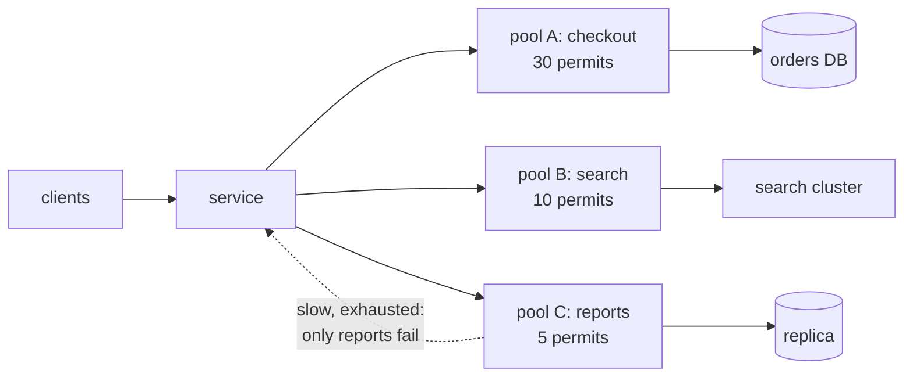
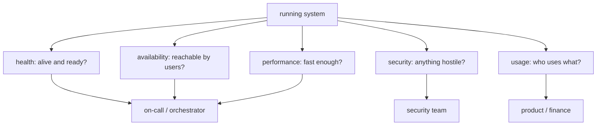
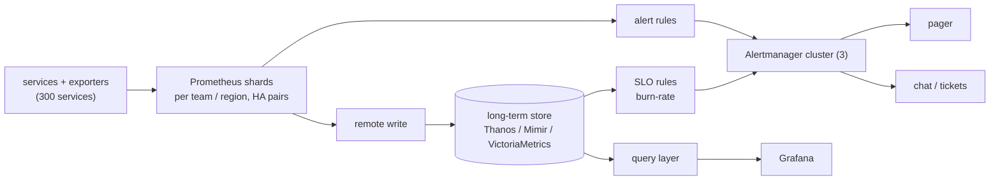

# Chapter 16 — Performance Antipatterns & Monitoring

> **Volume 4 — High-Level Design** · [Contents](index.md) · ← [Chapter 15 — Multi-Tenancy](ch15-multi-tenancy.md) · Next → [Chapter 17 — Disaster Recovery (Backups, RTO/RPO)](ch17-disaster-recovery-backups-rto-rpo.md)

---

## Concept

The ten classic performance antipatterns, the bulkhead fix, and the five kinds of monitoring: health, availability, performance, security, usage.

**In one sentence:** most slow or fragile systems are slow in one of ten well-known ways, and you only find which one by instrumenting the system (metrics, logs, traces), watching the right signals, and alerting on user-visible symptoms rather than every internal blip.

**Mental model — a restaurant kitchen.** An antipattern is a kitchen habit that works at lunch for four tables and collapses at dinner for forty: one cook doing every dish (busy frontend), a trip to the market for each egg (chatty I/O), buying the whole cow to use one steak (extraneous fetching). Monitoring is the pass where the head chef sees ticket times, which stations are backed up, and whether the fridge is still cold — and the alarm should ring when customers wait too long, not whenever a pan clatters.

### Part 1 — Performance antipatterns

These ten come from the Azure Architecture Center's performance antipatterns catalogue: recurring mistakes that are invisible at low load and dominate at scale.

**1. Busy Database**

* **Symptom and cause:** DB CPU and I/O saturate while app servers idle, because too much work (formatting, business logic in stored procedures, heavy reports on the primary) runs inside the database.
* **Detect:** high DB CPU with low app CPU; slow-query log; long statements in `pg_stat_activity`.
* **Fix:** move formatting and logic to the app tier, send reports to read replicas ([Ch 11](ch11-database-scaling.md)), cache hot results ([Ch 7](ch07-caching-strategies.md)).

**2. Busy Frontend**

* **Symptom and cause:** request threads are all occupied, so even trivial requests queue, because CPU-heavy or long work (image resizing, PDF generation) runs on the threads that serve users.
* **Detect:** high CPU on web nodes, worker-pool saturation, cheap endpoints slow only while expensive ones run.
* **Fix:** return `202 Accepted`, enqueue the job ([Ch 9](ch09-message-queues-and-streaming-kafka-sqs-pub.md)) and process it on a separate worker pool.

**3. Chatty I/O**

* **Symptom and cause:** latency is the sum of round trips, not of work, because of N+1 queries, one HTTP call per item or one write per row.
* **Detect:** traces showing a "comb" of short spans; query count per request; call rate to a dependency far above the user request rate.
* **Fix:** batch, join or use `IN (...)`, paginate, offer coarser endpoints, prefetch or cache.

```python
# BAD: 1 + N queries
orders = db.query("SELECT * FROM orders WHERE user_id = %s", uid)
for o in orders:
    o.items = db.query("SELECT * FROM items WHERE order_id = %s", o.id)

# GOOD: 2 queries total
orders = db.query("SELECT * FROM orders WHERE user_id = %s", uid)
items = db.query("SELECT * FROM items WHERE order_id = ANY(%s)", [o.id for o in orders])
```

**4. Extraneous Fetching**

* **Symptom and cause:** high bandwidth, memory and DB I/O for little output, because of `SELECT *`, filtering a whole table in the app, or no pagination.
* **Detect:** rows fetched vs rows used; response sizes in traces; egress per request.
* **Fix:** select only needed columns, filter and aggregate in the query, paginate, use covering indexes.

```python
# BAD: pull everything, filter in memory
recent = [r for r in db.query("SELECT * FROM events") if r.ts > cutoff][:50]
# GOOD: let the database do it
recent = db.query("SELECT id, ts, kind FROM events WHERE ts > %s ORDER BY ts DESC LIMIT 50", cutoff)
```

**5. Improper Instantiation**

* **Symptom and cause:** socket exhaustion, a TLS handshake on every call, memory churn, because shareable objects (HTTP clients, DB connections, compiled regexes) are created per request.
* **Detect:** many `TIME_WAIT` sockets, connections near limits, high connect time in traces.
* **Fix:** create once and reuse (singletons, dependency injection, pools, keep-alive).

```python
# BAD: a new client (new TCP + TLS handshake) per call
def get_price(sku): return requests.get(f"https://prices.internal/{sku}").json()
# GOOD: one pooled session per process
session = requests.Session()
def get_price(sku): return session.get(f"https://prices.internal/{sku}", timeout=2).json()
```

**6. Monolithic Persistence**

* **Symptom and cause:** one database is too slow for search, too costly for blobs and too contended for sessions, because every kind of data lives in one store.
* **Detect:** wildly different access patterns inside one cluster; one workload's spikes slow another's.
* **Fix:** polyglot persistence: relational for transactions, object storage for blobs, a search engine for text, a cache for sessions. The cost is more systems to run and keep consistent ([Ch 12](ch12-event-driven-systems.md)).

**7. No Caching**

* **Symptom and cause:** identical expensive reads repeat and hammer the database or an upstream API, because there is no cache or its hit ratio is near zero (bad keys or TTLs).
* **Detect:** cache hit ratio; identical queries in the slow-query log; high read QPS on rarely changing data.
* **Fix:** cache at the right layer (CDN, app, Redis), choose the pattern and TTL deliberately, protect against stampedes ([Ch 7](ch07-caching-strategies.md)).

**8. Noisy Neighbor**

* **Symptom and cause:** one tenant, job or service degrades everyone sharing a resource, because shared pools, CPUs, disks or queues have no per-tenant limit.
* **Detect:** per-tenant breakdown of latency and resource use; one tenant's spikes correlating with others' errors.
* **Fix:** quotas and rate limits ([Ch 8](ch08-rate-limiting-throttling-and-backpressure.md)), [multi-tenancy isolation](ch15-multi-tenancy.md), and bulkheads (below).

**9. Retry Storm**

* **Symptom and cause:** a brief dependency blip becomes a long outage, because clients retry at once, without backoff, jitter or a budget, often at several layers.
* **Detect:** request rate to a dependency exceeds user request rate; synchronized retry waves right after errors begin.
* **Fix:** timeouts, exponential backoff with jitter, retry budgets, retry at one layer, circuit breakers, idempotency ([Vol 3 Ch 14](../volume-3-low-level-design/ch14-resilience-patterns-idempotency-retries-backoff-circuit-breakers.md)).

```
 retry amplification: 3 layers, each makes up to 3 attempts
 client ──×3──► gateway ──×3──► service ──×3──► database (already failing)
 one user request can become 3 × 3 × 3 = 27 database attempts
```

**10. Synchronous I/O**

* **Symptom and cause:** low CPU but high latency and low throughput, because calling threads block on network or disk and a small pool caps concurrency.
* **Detect:** worker pool fully busy with idle CPU; threads parked in socket reads in a thread dump.
* **Fix:** async/non-blocking I/O, a sized pool for blocking calls, and run independent calls concurrently.

```python
# BAD: sequential (latency = a + b + c)
user = fetch_user(uid); orders = fetch_orders(uid); recs = fetch_recs(uid)
# GOOD: concurrent (latency ≈ max(a, b, c))
user, orders, recs = await asyncio.gather(fetch_user(uid), fetch_orders(uid), fetch_recs(uid))
```

**Summary**

| Antipattern | Typical symptom | Usual cause | Main fix |
|-------------|-----------------|-------------|----------|
| Busy Database | DB CPU/I/O saturated | logic and formatting in the DB | move work to app tier, replicas, cache |
| Busy Frontend | request threads exhausted | heavy work on request threads | queue + background workers |
| Chatty I/O | latency = sum of round trips | N+1, one call per item | batch, join, coarser APIs |
| Extraneous Fetching | high bandwidth and memory | `SELECT *`, filter in app | project, filter in query, paginate |
| Improper Instantiation | socket exhaustion, handshakes | new client per request | reuse pooled clients |
| Monolithic Persistence | one store fits no workload | everything in one database | polyglot persistence |
| No Caching | repeated identical reads | no cache, or bad keys/TTLs | layered caching |
| Noisy Neighbor | one tenant hurts others | shared resource, no limits | quotas, isolation, bulkheads |
| Retry Storm | blip becomes outage | immediate unbounded retries | backoff + jitter + budget + breaker |
| Synchronous I/O | idle CPU, low throughput | blocking calls on few threads | async, concurrency |

### Bulkhead

**Bulkhead** — named after the watertight compartments of a ship's hull: partition resources so a failure or overload in one compartment cannot sink the rest. It is the structural fix for noisy neighbors and cascading failure: give each tenant, endpoint or dependency its own pool (threads, connections, semaphore permits, queue slots) with a hard cap.

| Variant | Isolates | Example |
|---------|----------|---------|
| Semaphore bulkhead | concurrent calls | max 20 in-flight calls to the payments API |
| Thread-pool bulkhead | threads plus a queue | a separate pool per downstream dependency |
| Connection-pool partition | DB connections | reporting gets 5 connections, checkout gets 30 |
| Per-tenant / per-tier | tenant traffic | premium and free tenants on separate pools or cells |
| Deployment-level | whole stacks | separate clusters or cells per region or customer group |

Combine it with timeouts and a circuit breaker ([Vol 3 Ch 14](../volume-3-low-level-design/ch14-resilience-patterns-idempotency-retries-backoff-circuit-breakers.md)); per-tenant limits are in [Ch 8](ch08-rate-limiting-throttling-and-backpressure.md) and [Ch 15](ch15-multi-tenancy.md). The cost is lower utilization: idle capacity in one compartment cannot be lent to another.

### Part 2 — Monitoring

Each kind of monitoring answers a different question.

| Kind | Question it answers | Example signals | Typical tools |
|------|---------------------|-----------------|---------------|
| Health monitoring | Is each component alive and able to serve? | liveness/readiness probes, dependency checks, restarts | Kubernetes probes, load balancer health checks |
| Availability monitoring | Can users actually reach and use it? | synthetic checks from outside, success ratio, uptime vs SLO | `blackbox_exporter`, uptime services |
| Performance monitoring | How fast and how efficiently? | latency percentiles, throughput, saturation, queue depth, cache hit ratio | Prometheus + Grafana, APM, traces |
| Security monitoring | Is something hostile or unexpected happening? | failed logins, permission denials, unusual egress, audit-log anomalies | SIEM, audit logs, Falco |
| Usage monitoring | What do users do, and what does it cost? | active users, feature adoption, requests per tenant, quota use | product analytics, billing metering |

**Health endpoint monitoring.** Expose cheap HTTP endpoints that monitors and orchestrators poll.

| Probe | Question | On failure | Should check |
|-------|----------|------------|--------------|
| Liveness (`/healthz`) | Is the process stuck and in need of a restart? | restart the container | only the process itself, never dependencies |
| Readiness (`/readyz`) | Can this instance take traffic right now? | remove from the load balancer, do not restart | warm-up done, critical dependencies reachable |
| Startup | Has a slow-starting app finished booting? | hold off the other probes | initialization |

Gotcha: if liveness checks the database, a database outage restarts every pod at once and turns a partial failure into a total one. Keep health checks cheap and fast, and separate from deep dependency checks.

### Part 3 — Instrumentation, visualization and alerting

**Instrumentation** means emitting metrics, logs and traces ([Vol 1 Ch 58](../volume-1-cs-foundations/ch58-observability-logs-metrics-traces-and-opentelemetry.md), [Vol 2 Ch 16](../volume-2-software-engineering/ch16-observability-logs-metrics-and-traces.md); using them in an incident: [Vol 2 Ch 18](../volume-2-software-engineering/ch18-production-debugging.md)) — not repeated here.

| Method | For | Signals |
|--------|-----|---------|
| RED | request-driven services | **R**ate, **E**rrors, **D**uration |
| USE | resources (CPU, disk, pools, queues) | **U**tilization, **S**aturation, **E**rrors |
| Four golden signals (Google SRE) | any user-facing system | latency, traffic, errors, saturation |

Rules: counters for events, gauges for current values, histograms for latency (percentiles can be computed from buckets and aggregated across instances); label only by low-cardinality dimensions (route template, status code), never user ID or raw URL — every distinct label combination is a new time series.

**Visualization.** A dashboard answers "is it healthy?" in five seconds: SLIs on top (success rate, p99), then RED per service, then USE per resource, with deploy markers; link panels to runbooks and traces.

**Alerting** — alert on symptoms, investigate causes.

| Practice | Why |
|----------|-----|
| Symptom alerts page, cause alerts only inform | "error rate above SLO" matters to users; "CPU 85%" may not |
| Every page is actionable and urgent | otherwise it is noise |
| SLO-based, multi-window burn-rate alerts | catch fast burns quickly and slow burns before the budget is gone |
| Route by severity and ownership | page for urgent, ticket for slow, dashboard for informational |

**Alert fatigue** — too many low-value alerts train people to ignore pages, so a real one is missed. Delete or demote alerts nobody acts on, group and deduplicate (Alertmanager), add `for:` durations, and review pages in every post-incident review.

**Burn rate** = error rate ÷ (1 − SLO); 1 uses the error budget exactly over the SLO window. For a 30-day window the Google SRE Workbook suggests paging at 14.4× over 1 hour (2% of budget) and 6× over 6 hours (5%), and a ticket at 1× over 3 days (10%), each paired with a window about 1/12 as long so the alert clears quickly.

```yaml
# 99.9% SLO: page on fast burn (14.4 x budget) over 1h AND 5m
- alert: HighErrorBudgetBurn
  expr: |
    ( sum(rate(http_requests_total{code=~"5.."}[1h])) / sum(rate(http_requests_total[1h])) ) > (14.4 * 0.001)
    and
    ( sum(rate(http_requests_total{code=~"5.."}[5m])) / sum(rate(http_requests_total[5m])) ) > (14.4 * 0.001)
  labels: { severity: page }
```

---

## Prereqs

* [Vol 1 Ch 58 — Observability: Logs, Metrics, Traces & OpenTelemetry](../volume-1-cs-foundations/ch58-observability-logs-metrics-traces-and-opentelemetry.md)
* [Vol 2 Ch 16 — Observability: Logs, Metrics & Traces](../volume-2-software-engineering/ch16-observability-logs-metrics-and-traces.md)
* [Vol 2 Ch 18 — Production Debugging](../volume-2-software-engineering/ch18-production-debugging.md)
* [Vol 3 Ch 14 — Resilience Patterns: Idempotency, Retries, Backoff & Circuit Breakers](../volume-3-low-level-design/ch14-resilience-patterns-idempotency-retries-backoff-circuit-breakers.md)
* [Ch 8 — Rate Limiting, Throttling & Backpressure](ch08-rate-limiting-throttling-and-backpressure.md)
* [Ch 15 — Multi-Tenancy](ch15-multi-tenancy.md)

---

## Diagram

**Bulkhead: one pool per dependency or tenant**



**The five kinds of monitoring**



---

## Example

A dependency-free Python service with `/healthz` (liveness), `/readyz` (readiness) and `/metrics` in the Prometheus text format, with a counter and a histogram.

```python
# app.py  --  python app.py   (stdlib only, Python 3.9+)
import random, threading, time
from http.server import BaseHTTPRequestHandler, ThreadingHTTPServer

LOCK = threading.Lock()
BUCKETS = [0.005, 0.01, 0.025, 0.05, 0.1, 0.25, 0.5, 1.0, 2.5]
REQS = {}        # (route, code) -> count                      (counter)
HIST = {}        # route -> [bucket counts..., +Inf, sum]      (histogram)
STATE = {"started": time.time(), "db_up": True}

def observe(route, code, secs):
    with LOCK:
        REQS[(route, code)] = REQS.get((route, code), 0) + 1
        h = HIST.setdefault(route, [0] * (len(BUCKETS) + 1) + [0.0])
        for i, b in enumerate(BUCKETS):
            if secs <= b:
                h[i] += 1
                break
        else:
            h[len(BUCKETS)] += 1            # +Inf bucket
        h[-1] += secs

def render_metrics():
    out = ["# TYPE http_requests_total counter"]
    with LOCK:
        for (route, code), n in sorted(REQS.items()):
            out.append(f'http_requests_total{{route="{route}",code="{code}"}} {n}')
        out.append("# TYPE http_request_duration_seconds histogram")
        for route, h in sorted(HIST.items()):
            cum = 0
            for i, b in enumerate(BUCKETS):
                cum += h[i]
                out.append(f'http_request_duration_seconds_bucket{{route="{route}",le="{b}"}} {cum}')
            cum += h[len(BUCKETS)]
            out.append(f'http_request_duration_seconds_bucket{{route="{route}",le="+Inf"}} {cum}')
            out.append(f'http_request_duration_seconds_sum{{route="{route}"}} {h[-1]:.6f}')
            out.append(f'http_request_duration_seconds_count{{route="{route}"}} {cum}')
    return "\n".join(out) + "\n"

class Handler(BaseHTTPRequestHandler):
    def do_GET(self):
        t0, route = time.perf_counter(), self.path.split("?")[0]
        if route == "/healthz":                      # liveness: process only, no dependencies
            code, body = 200, "ok\n"
        elif route == "/readyz":                     # readiness: warm-up done and DB reachable
            warm = time.time() - STATE["started"] > 2
            code = 200 if warm and STATE["db_up"] else 503
            body = f"warm={warm} db={STATE['db_up']}\n"
        elif route == "/metrics":
            code, body = 200, render_metrics()
        elif route == "/_toggle_db":                 # demo only: simulate a dependency outage
            STATE["db_up"] = not STATE["db_up"]
            code, body = 200, f"db_up={STATE['db_up']}\n"
        elif route == "/work":
            time.sleep(random.expovariate(1 / 0.05))            # ~50 ms mean latency
            code, body = (500, "boom\n") if random.random() < 0.05 else (200, "done\n")
        else:
            route, code, body = "other", 404, "not found\n"     # fixed label: no cardinality blow-up
        data = body.encode()
        self.send_response(code)
        self.send_header("Content-Length", str(len(data)))
        self.end_headers()
        self.wfile.write(data)
        if route != "/metrics":
            observe(route, code, time.perf_counter() - t0)

    def log_message(self, *args):                    # keep the console quiet
        pass

if __name__ == "__main__":
    ThreadingHTTPServer(("0.0.0.0", 8000), Handler).serve_forever()
```

```bash
python app.py &
curl -i localhost:8000/healthz            # 200 ok
curl -i localhost:8000/readyz             # 503 for the first 2 s, then 200
for i in $(seq 1 50); do curl -s localhost:8000/work > /dev/null; done
curl -s localhost:8000/metrics | head -20
curl localhost:8000/_toggle_db; curl -i localhost:8000/readyz   # 503: pulled from rotation, not restarted
```

```promql
# p99 latency per route, aggregated across instances
histogram_quantile(0.99, sum by (route, le) (rate(http_request_duration_seconds_bucket[5m])))
# error ratio (the SLI)
sum(rate(http_requests_total{code=~"5.."}[5m])) / sum(rate(http_requests_total[5m]))
```

```python
# Bulkhead: cap concurrent calls per dependency; reject fast instead of queueing forever
import threading

class BulkheadFull(Exception): pass

class Bulkhead:
    def __init__(self, name: str, max_concurrent: int, wait: float = 0.05):
        self.name, self.wait = name, wait
        self.sem = threading.BoundedSemaphore(max_concurrent)

    def call(self, fn, *args, **kwargs):
        if not self.sem.acquire(timeout=self.wait):
            raise BulkheadFull(self.name)          # caller falls back or returns 503
        try:
            return fn(*args, **kwargs)
        finally:
            self.sem.release()

reports = Bulkhead("reports-db", max_concurrent=5)
checkout = Bulkhead("orders-db", max_concurrent=30)
# A flood of slow report queries fills only the 5 report permits; checkout keeps its 30.
```

---

## Exercises

1. An endpoint takes 900 ms; the trace shows 120 sequential spans of 5 ms each to the same database. Which antipattern, and what is the fix?

   <details><summary>Solution</summary>Chatty I/O (N+1): 120 × ~5 ms ≈ 600 ms of round trips. Replace the loop with one or two batched queries (a join or <code>IN</code> list) and add a per-request query-count metric so regressions are visible.</details>

2. A dependency has a 30-second outage, and when it recovers it is knocked over again repeatedly for ten minutes. Why, and what do you change?

   <details><summary>Solution</summary>A retry storm: clients, at several layers, retry immediately, so the recovering service gets far more than normal load. Add timeouts, exponential backoff with full jitter, a retry budget, retries at one layer only, a circuit breaker, and load shedding at the dependency.</details>

3. Your liveness probe runs <code>SELECT 1</code> against the database, and your SLO is 99.9% with a measured 0.5% error ratio over the last hour. What can go wrong with the probe, and what is the burn rate?

   <details><summary>Solution</summary>When the database is slow or down, every pod fails liveness and restarts together, removing all capacity: keep liveness to the process and put dependency checks in readiness. Burn rate = 0.5% ÷ (1 − 0.999 = 0.1%) = 5, a slow-burn (ticket-level) rate below the 14.4× fast-burn page threshold.</details>

---

## Mini project

**A service with health endpoints, metrics, dashboards and SLO alerts, run locally.**

**Steps**

1. Run the Example service, Prometheus, Alertmanager and Grafana with Docker Compose.
2. Build a Grafana dashboard: request rate, error ratio, p50/p95/p99 from the histogram, and a readiness panel.
3. Add the burn-rate alert and a "readiness down for 2 min" alert; send them to a webhook that prints them.
4. Write a load generator and a fault injector (extra latency, 5xx rate, `/_toggle_db`).
5. Reproduce a retry storm with a naive client, then fix it with backoff, jitter and a bulkhead, and compare the graphs.

**Done when:** injected faults fire exactly the intended alerts (and no others), the dashboard shows the before/after of the retry-storm fix, and each alert links to a short runbook.

---

## Design

**Design a metrics and alerting pipeline for a company with about 300 services.**

Requirements: collect metrics from all services and hosts, dashboards in under a second, alert evaluation every 15–60 seconds, a page within about 2 minutes of an SLO burn, 15 days at full resolution and 13 months downsampled, survive the loss of a zone, and no single team's metrics may break the system.



**Capacity (all numbers are assumptions for illustration):** 300 services × 10 instances = 3,000 targets × 500 series each = 1.5M active series. At a 15 s scrape interval that is 1.5M ÷ 15 = 100k samples/s. Prometheus documentation cites roughly 1–2 bytes per sample after compression, so 100k × 86,400 ≈ 8.6B samples/day ≈ 9–17 GB/day; 15 days ≈ 130–260 GB before replication. About 6 Prometheus shards gives roughly 250k series each. Downsampling to 5-minute resolution cuts the sample count by 20× (5 min ÷ 15 s). Alertmanager's problem is grouping and routing, not volume.

**Decisions to justify**

* **Pull vs push:** pull (scrape) gives a free "up" signal and central control; push (OpenTelemetry Collector, remote write) suits short-lived jobs and firewalled networks.
* **Shard by team or region, HA pairs:** limits blast radius; per-target sample limits stop one bad release from taking down all metrics.
* **Cardinality governance:** label allow-lists, per-service series budgets, alerts on series growth. Cardinality, not request volume, usually breaks metrics systems.
* **Alert from SLOs:** one SLO spec per service generates the burn-rate rules, so every team gets the same tested alerts.
* **Watch the watcher:** a dead-man's-switch alert that always fires and pages if it stops arriving, plus an external probe, so a broken pipeline is not silent.
* **Routing:** page only on SLO symptoms; group by service, inhibit cause alerts while a symptom alert fires; tickets for the rest.

---

## Open source

* [`prometheus/prometheus`](https://github.com/prometheus/prometheus) — pull-based metrics collection, TSDB, PromQL and alert rule evaluation.
* [`prometheus/alertmanager`](https://github.com/prometheus/alertmanager) — grouping, deduplication, inhibition, silencing and routing of alerts.
* [`grafana/grafana`](https://github.com/grafana/grafana) — dashboards and visualization over many data sources.
* [`prometheus/blackbox_exporter`](https://github.com/prometheus/blackbox_exporter) — probes HTTP, TCP and ICMP endpoints from outside for availability monitoring.
* [`thanos-io/thanos`](https://github.com/thanos-io/thanos) and [`VictoriaMetrics/VictoriaMetrics`](https://github.com/VictoriaMetrics/VictoriaMetrics) — long-term, horizontally scalable storage for Prometheus-style metrics.
* [`open-telemetry/opentelemetry-collector`](https://github.com/open-telemetry/opentelemetry-collector) — vendor-neutral pipeline for receiving, processing and exporting metrics, logs and traces.
* [`resilience4j/resilience4j`](https://github.com/resilience4j/resilience4j) — bulkhead, circuit breaker, retry and rate limiter for the JVM.

---

## Interview

1. **"A service is slow but its CPU is low. What do you check?"**
   <details><summary>Answer</summary>Low CPU with high latency means waiting, not computing. Look in traces for time spent on downstream calls (chatty or synchronous I/O, serial calls that could run concurrently), pool and queue saturation (USE), lock contention and dependency latency. Compare p50 with p99, and check recent deploys and per-tenant breakdowns for a noisy neighbor.</details>

2. **"What is a retry storm and how do you prevent it?"**
   <details><summary>Answer</summary>Clients retry failed calls immediately and at several layers, multiplying load on a struggling dependency (3 layers × 3 attempts = 27×), so a short blip becomes a sustained outage. Prevent it with timeouts, exponential backoff with jitter, retry budgets, retrying at one layer, circuit breakers, idempotent operations, and server-side load shedding with <code>Retry-After</code>.</details>

3. **"Liveness vs readiness, and how do you avoid alert fatigue?"**
   <details><summary>Answer</summary>Liveness asks "restart this process?" and checks only the process; readiness asks "send it traffic now?" and may check warm-up and critical dependencies, removing the instance from rotation without restarting it. For alerting, page only on user-visible SLO symptoms with multi-window burn-rate alerts, keep cause metrics on dashboards, give every page a runbook, group and inhibit in Alertmanager, and delete alerts that never lead to action.</details>

---

## Checklist

- [ ] can name the ten performance antipatterns and the symptom of each
- [ ] every outbound call has a timeout, backoff with jitter and a retry budget
- [ ] shared resources are partitioned with bulkheads or quotas
- [ ] liveness checks the process only; readiness checks dependencies
- [ ] every service exposes RED metrics with low-cardinality labels
- [ ] pages are SLO burn-rate alerts; every page has a runbook
- [ ] the monitoring pipeline itself is monitored (dead-man's switch)

---

> [Contents](index.md) · ← [Chapter 15 — Multi-Tenancy](ch15-multi-tenancy.md) · Next → [Chapter 17 — Disaster Recovery (Backups, RTO/RPO)](ch17-disaster-recovery-backups-rto-rpo.md)
