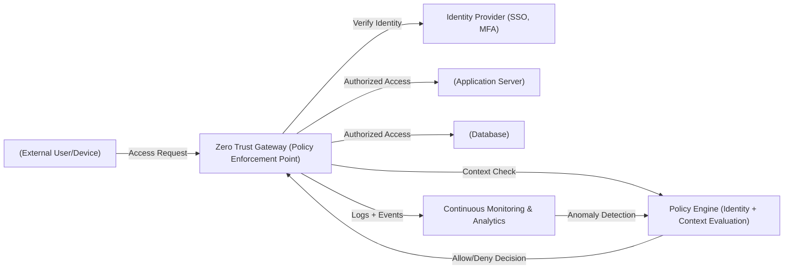
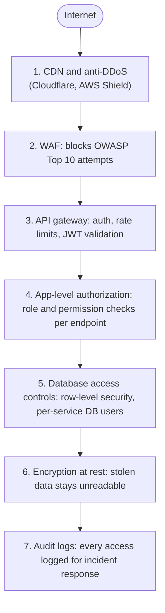
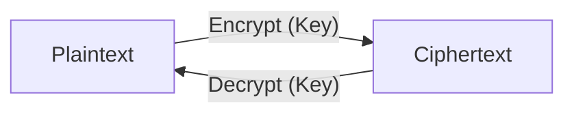
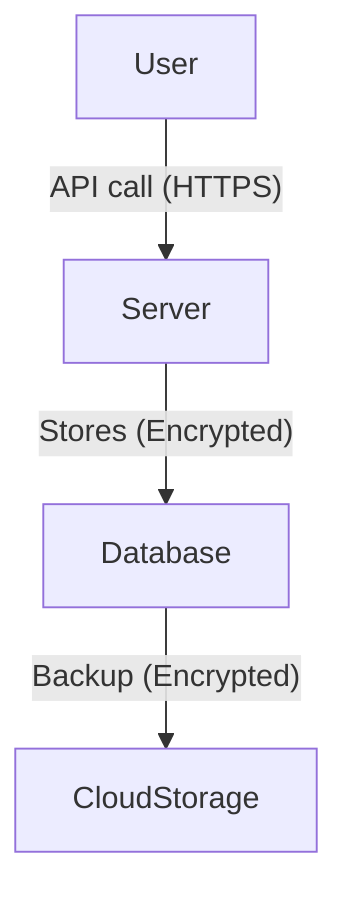
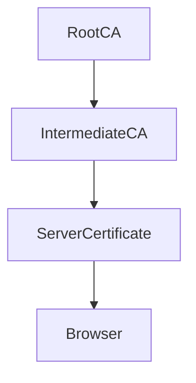
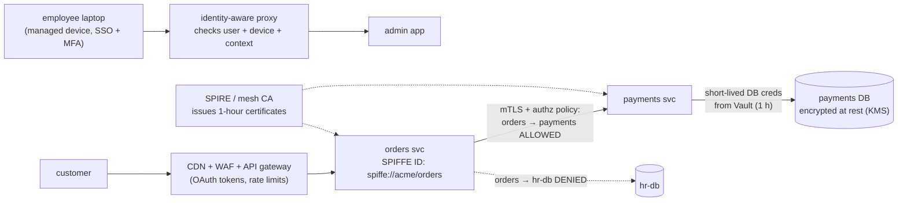
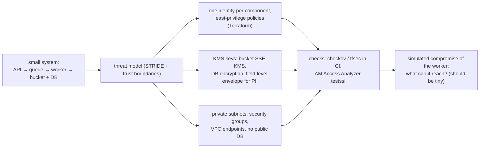
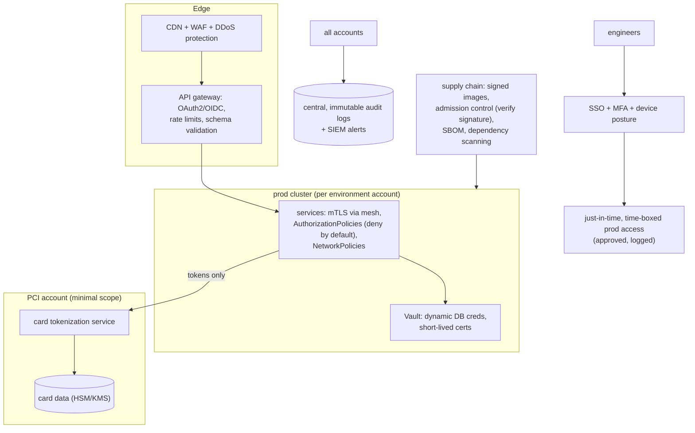

# Chapter 18 — Security at the System Level

> **Volume 4 — High-Level Design** · [Contents](index.md) · ← [Chapter 17 — Disaster Recovery (Backups, RTO/RPO)](ch17-disaster-recovery-backups-rto-rpo.md) · Next → [Chapter 19 — Authentication & Authorization in System Design](ch19-authentication-and-authorization-in-system-design.md)

---

## Concept

Zero-trust, IAM, secrets, encryption in transit/at rest, and blast-radius reduction.

**In one sentence:** system-level security assumes any component can be compromised, so every request is authenticated and authorized regardless of network location (zero trust), every identity gets only the permissions it needs, credentials are short-lived and rotated, data is encrypted everywhere, and the architecture is split so a breach in one part can't spread to the rest.

### Zero Trust Security Model

**Definition:** A cybersecurity framework based on the principle: **"Never trust, always verify."**

Zero Trust assumes that **no user, device, or application** — whether inside or outside the network — should be automatically trusted. Every access request must be **authenticated, authorized, and continuously validated.**

> The traditional perimeter-based security model is obsolete — threats can come from **inside** the network too.

#### Key Principles

| Principle                                  | Description                                                                                                          |
|--------------------------------------------|----------------------------------------------------------------------------------------------------------------------|
| **1. Verify Explicitly**                   | Always authenticate and authorize every request using **all available data** (identity, device, location, behavior). |
| **2. Least Privilege Access**              | Give users and applications **only the minimum required access.**                                                    |
| **3. Assume Breach**                       | Design systems as if they are already compromised. Continuously monitor, inspect, and segment traffic.               |
| **4. Microsegmentation**                   | Divide the network into isolated zones so that attackers cannot move laterally.                                      |
| **5. Continuous Monitoring**               | Use real-time analytics and telemetry to detect anomalies and re-evaluate trust dynamically.                         |
| **6. Strong Identity and Device Management** | Use MFA, SSO, and device posture checks (e.g., OS version, security patches).                                       |

#### How Zero Trust Works

1. **User/Device requests access** → identity verified (via SSO/MFA).
2. **Policy Engine** evaluates context (who, what, where, how).
3. **Access granted** only to the specific resource, for a specific session.
4. **Session continuously monitored** for anomalies (behavioral analytics).
5. **Access revoked** if the session or device becomes non-compliant.

#### Zero Trust Architecture Components

| Component                          | Function                                                                |
|------------------------------------|-------------------------------------------------------------------------|
| **Identity Provider (IdP)**        | Authenticates users (Azure AD, Okta).                                   |
| **Policy Engine**                  | Decides access based on identity, device, risk score, and context.      |
| **Policy Enforcement Point (PEP)** | Enforces decisions (reverse proxy, gateway, endpoint agent).            |
| **Telemetry & Analytics**          | Collects logs, detects anomalies, provides continuous trust evaluation. |
| **Microsegmented Network**         | Isolates systems and limits lateral movement.                           |

#### Advantages

- Prevents unauthorized access — even if attackers breach the network.
- Reduces lateral movement and insider threat impact.
- Improves compliance (NIST SP 800-207, ISO 27001).
- Scales well across cloud, hybrid, and remote environments.
- Enhances visibility across all access points.

#### Challenges

- Complex to implement in legacy networks.
- Requires identity centralization and strong IAM policies.
- Continuous monitoring can increase operational overhead.
- Needs integration across identity, network, endpoint, and application layers.

#### Comparison: Traditional vs. Zero Trust

| Aspect          | Traditional Security         | Zero Trust Security               |
|-----------------|------------------------------|-----------------------------------|
| **Trust Model** | "Trust but verify"           | "Never trust, always verify"      |
| **Perimeter**   | Network boundary (firewall)  | Identity & device-centric         |
| **Access**      | Implicit once inside network | Explicit, per request/session     |
| **Focus**       | Keep outsiders out           | Protect resources everywhere      |
| **Visibility**  | Limited                      | Continuous monitoring & analytics |

#### Zero Trust Architecture Diagram



#### Zero Trust in Practice

- Use **SSO + MFA** for all users and admins.
- Enforce **device posture checks** before granting access.
- Apply **microsegmentation** at network and workload level.
- Implement **just-in-time (JIT)** privileged access.
- Integrate with **SIEM/SOAR** tools for active monitoring.
- Continuously **evaluate session risk** and revoke access dynamically.

> **Analogy:** Zero Trust is like airport security — every traveler must show ID (authenticate), get screened (policy check), and can only enter specific gates (authorized resources). Even inside, behavior is continuously monitored.

*(From AI Library chapter 10.)*

### Secrets Management — Don't Put Secrets in Code

Hard-coded API keys, DB passwords, and TLS certs in source repos are how breaches happen. Use a **secrets manager.**

| Tool                       | Pros                                       | Cons                          |
|----------------------------|--------------------------------------------|-------------------------------|
| **HashiCorp Vault**        | Cloud-agnostic, dynamic secrets, fine-grained policies | Operational complexity |
| **AWS Secrets Manager / Parameter Store** | Native AWS integration, automatic rotation | AWS-only |
| **GCP Secret Manager**     | Native GCP integration, versioned          | GCP-only                      |
| **Azure Key Vault**        | Native Azure integration                   | Azure-only                    |
| **Doppler / 1Password Secrets Automation** | Developer-friendly UX           | Hosted SaaS                   |

**The non-negotiables for any secrets system:**

1. **Rotate** secrets regularly (and ideally on-demand if compromised).
2. **Audit** — log every access; alert on unusual patterns.
3. **Least privilege** — each service gets only the secrets it needs.
4. **Never in source control** — use `.gitignore` + pre-commit hooks (`gitleaks`, `trufflehog`).

*(From AI Library chapter 10.)*

### Defense in Depth — Layered Security

A single security control will eventually fail. **Layer your defenses** so an attacker has to bypass multiple controls.




> **Lesson:** even if one layer is bypassed, the next catches it. Don't rely on a single "wall."

---

#### Reducing the Blast Radius

Assume some component will eventually be compromised, and design so the damage stays small:

- Use separate cloud **accounts or projects** for each environment and each sensitive system (production, staging and security tooling are different accounts).
- **Segment the network:** private subnets, security groups that allow only the needed ports from the needed sources, and egress denied by default.
- Use a **cell-based architecture**: shards of users served by independent stacks, so a failure or breach touches one cell.
- Give each service its **own identity**, with its own permissions and secrets (one service, one identity).
- Apply **rate limits, quotas and budgets** so a stolen key cannot do unlimited damage.

*(From AI Library chapter 10.)*

### Data Protection & Secure Communication

#### Encryption: The Heart of Data Protection

Encryption converts readable data (**plaintext**) into an unreadable format (**ciphertext**) using a secret key.



#### Symmetric vs. Asymmetric Encryption

| Symmetric Encryption                 | Asymmetric Encryption                                  |
|--------------------------------------|--------------------------------------------------------|
| Single key (shared)                  | Key pair: Public + Private                             |
| Fast, efficient                      | Slower, but more secure for key exchange               |
| Used for large data                  | Used for identity, digital signatures, key exchange    |
| Challenge: secure key sharing        | Challenge: computational overhead                      |

**Symmetric Encryption:**

- Uses **one key** for both encryption and decryption.
- **Fast** and efficient — ideal for encrypting **large amounts of data.**
- Example algorithms: **AES**, **DES**, **Blowfish.**

**Asymmetric Encryption:**

- Uses a **key pair** — one **public key** (for encryption) and one **private key** (for decryption).
- Enables **secure key exchange** and **digital signatures.**
- Example algorithms: **RSA**, **ECC**, **Diffie-Hellman.**

**Combined Usage:** Often used together, e.g., in TLS handshakes — asymmetric encryption secures key exchange; symmetric encryption is then used for data transmission.

(See `image-27.png` for symmetric vs. asymmetric diagram.)

**Example (Python `cryptography` library — symmetric):**

```python
from cryptography.fernet import Fernet

# Generate a key
key = Fernet.generate_key()
cipher = Fernet(key)

# Encrypt
plaintext = b'secret data'
ciphertext = cipher.encrypt(plaintext)

# Decrypt
decrypted = cipher.decrypt(ciphertext)
assert decrypted == plaintext
```

#### TLS Handshake (Simplified)

1. **Client Hello:** Client proposes cipher suites.
2. **Server Hello:** Server selects cipher suite, sends certificate (with public key).
3. **Key Exchange:** Client encrypts a random symmetric key with server's public key.
4. **Secure Session:** Both use the symmetric key for fast, secure data transfer.

#### Encryption: At Rest & In Transit

| Encryption at Rest                              | Encryption in Transit               |
|-------------------------------------------------|--------------------------------------|
| Protects stored data (disks, DBs, backups)      | Protects data moving across network  |
| Techniques: Full-disk, field-level encryption   | Techniques: TLS/SSL (HTTPS)          |
| Use Cases: Cloud storage, user files, logs      | Use Cases: APIs, login sessions      |



#### TLS/SSL and HTTPS

- **HTTPS = HTTP over TLS.** Adds a secure encryption layer (TLS) on top of HTTP. TLS = Transport Layer Security; SSL = Secure Sockets Layer.
- **Ensures confidentiality, integrity, and authenticity:** Protects data from being read, altered, or spoofed during transmission.
- **TLS Handshake:** Key exchange + cipher negotiation. Establishes a secure session.

(See `image-28.png` for TLS handshake diagram.)

**Sample HTTPS server (Express.js):**

```js
const https = require('https');
const fs = require('fs');
const app = require('./app');
const options = {
  key: fs.readFileSync('key.pem'),
  cert: fs.readFileSync('cert.pem')
};
https.createServer(options, app).listen(443);
```

#### Hashing & Salting: Secure Password Storage

##### Hashing

Hashing converts input data into a fixed-length string using a mathematical algorithm. It is a **one-way** operation.

**Pros:**

- **Irreversible:** Protects original data even if hashes are leaked.
- **Efficient:** Quick to compute and compare during authentication.
- **Fixed output size:** Consistent length regardless of input size.
- **Good for integrity checks:** Detects if data has been tampered with.

**Cons:**

- **Vulnerable to rainbow table attacks:** Precomputed hash databases can reveal common passwords.
- **Identical inputs = identical hashes:** Enables pattern recognition if no extra protection (like salting).

##### Salting

Salting adds a **unique random value (salt)** to each password **before hashing.** Ensures even identical passwords produce **different hashes.**

**Pros:**

- **Prevents rainbow table attacks.**
- **Increases security:** Makes brute-force attacks more difficult.
- **Protects common passwords.**

**Cons:**

- **Requires storage for salts:** Each salt must be stored securely with the hash.
- **Adds computational overhead.**
- **Not encryption:** Doesn't allow password recovery — only verification.

##### Common Secure Hash Algorithms

**SHA-256**, **SHA-512**, **bcrypt**, **scrypt**, **Argon2** (preferred for password storage).

| Technique   | Purpose                       | Reversible | Security Level | Example Use               |
|-------------|-------------------------------|------------|----------------|---------------------------|
| **Hashing** | Converts data into fixed hash | No         | Moderate       | Data integrity, checksums |
| **Salting** | Adds randomness to hashes     | No         | High           | Password storage          |

(See `image-29.png` for hashing diagram.)

**Hashing example with bcrypt (Python):**

```python
import bcrypt

password = b"supersecret"
# Generate salt and hash
hashed = bcrypt.hashpw(password, bcrypt.gensalt())

# To verify:
bcrypt.checkpw(password, hashed)  # Returns True
```

A simpler form:

```python
import bcrypt

password = b"supersecret"
salt = bcrypt.gensalt()
hashed = bcrypt.hashpw(password, salt)
# Store hashed in DB, never store raw password!
```

#### Public Key Infrastructure (PKI) & Digital Certificates

**PKI** is a framework that manages **digital certificates** and **public-key encryption** to enable secure communication, authentication, and data integrity over untrusted networks.

PKI provides the foundation for **HTTPS**, **digital signatures**, **email encryption**, and **secure user/device authentication.**

##### Key Components

- **Certificate Authority (CA):** Issues and verifies digital certificates.
- **Registration Authority (RA):** Verifies identities before certificate issuance.
- **Public/Private Key Pair:** Used for encryption and decryption or signing and verification.
- **Digital Certificates:** Bind public keys to verified identities.
- **Certificate Revocation List (CRL):** Tracks invalid or compromised certificates.

##### Pros of PKI

- **Strong security:** Enables encryption, authentication, and data integrity.
- **Scalability:** Supports secure communication across large distributed systems.
- **Trust framework:** Certificates issued by trusted authorities enhance reliability.
- **Non-repudiation:** Digital signatures prove the origin and authenticity of data.
- **Automation support:** Modern systems allow automated certificate renewal and management.

##### Cons of PKI

- **Complex setup and management:** Requires proper configuration, key rotation, and certificate lifecycle management.
- **High cost:** Involves infrastructure, licensing, and operational expenses.
- **Single point of trust:** Compromise of a CA can impact many users.
- **Revocation challenges:** CRLs or OCSP responses may be slow or unavailable.
- **User mismanagement:** Improper key handling can compromise security.

##### Common Use Cases

- **HTTPS (SSL/TLS):** Secure web communication.
- **Email encryption:** Protects message content (S/MIME).
- **Code signing:** Verifies authenticity of software.
- **VPNs and Zero Trust networks:** Ensures secure device and user access.

**Certificate Chain Diagram:**



#### Secure API Communication

**Key techniques:**

- **HTTPS (TLS):** Encrypts data in transit.
- **API keys:** Identify and authenticate API consumers.
- **OAuth 2.0 / OpenID Connect:** Provide secure delegated authorization.
- **JWT:** Enable stateless authentication and authorization.
- **HMAC:** Ensures message integrity and authenticity.
- **Rate limiting & throttling:** Prevent abuse or denial-of-service attacks.
- **Input validation:** Protects against injection and data corruption attacks.

**Pros:** Data confidentiality, integrity, authentication & authorization, scalability, user trust.

**Cons:** Added complexity, performance overhead, key management risks, misconfiguration risks, maintenance burden.

**Best practices:**

- Always use **HTTPS** (disable plain HTTP).
- Implement **strong authentication** (OAuth 2.0, API keys, or mutual TLS).
- Apply **rate limiting**, **monitoring**, and **logging.**
- Rotate and expire **tokens/keys** regularly.
- Use **WAFs (Web Application Firewalls)** to filter malicious traffic.

(See `image-30.png` for secure API diagram.)

**JWT example (Python, PyJWT):**

```python
import jwt
SECRET = 'your-secret-key'

# Encode
token = jwt.encode({'user': 'alice'}, SECRET, algorithm='HS256')

# Decode/verify
payload = jwt.decode(token, SECRET, algorithms=['HS256'])
```

#### Data Protection — Cheat Sheet

| Concept            | What to Use/Do                       | Why                        |
|--------------------|--------------------------------------|----------------------------|
| Data at Rest       | Full-disk, DB encryption             | Protects stored data       |
| Data in Transit    | TLS/SSL, HTTPS                       | Prevents eavesdropping     |
| Passwords          | Hash + Salt (bcrypt, Argon2)         | Not reversible, secure     |
| Communication Auth | PKI, CA-signed certificates          | Verifies identity          |
| APIs               | HTTPS, JWT/OAuth2, rate limiting     | Secure, prevent abuse      |
| Certificate Mgmt   | Automate renewal, use strong CAs     | Avoid expired/weak certs   |

*(From AI Library chapter 10.)*

The diagram, worked example, exercises, mini-project, design prompt, open-source reading, interview questions and checklist below are this chapter's practice layer.

---

## Prereqs

* [Vol 2 Ch 11 — Security & Threat Modeling](../volume-2-software-engineering/ch11-security-and-threat-modeling.md)

---

## Diagram

**A zero-trust architecture with identity-aware access and mTLS**



**Blast radius: separate accounts and cells**

```
 organization
 ├── account: security (logs, audit, backups — write-only from others)
 ├── account: prod-payments      ← PCI scope, the smallest possible
 ├── account: prod-core
 │     ├── cell-1 (users 0–24%)
 │     ├── cell-2 (users 25–49%)  a bad deploy or a compromise hits one cell, not everyone
 │     └── …
 ├── account: staging            no network path to prod; no prod data
 └── account: sandbox
```

**Envelope encryption**

```
 KMS master key (never leaves the KMS/HSM)
      │ encrypts
      ▼
 data key (random per object / per tenant) ──encrypts──► data
 stored together:  [encrypted data key][ciphertext]
 read: ask KMS to decrypt the data key (logged, IAM-checked) → decrypt the data in memory
 delete a tenant's key → all their data becomes unreadable (crypto-shredding)
```

---

## Example

```json
{
  "Version": "2012-10-17",
  "Statement": [
    {
      "Sid": "ReadOwnReports",
      "Effect": "Allow",
      "Action": ["s3:GetObject"],
      "Resource": "arn:aws:s3:::acme-reports/tenant-*/reports/*"
    },
    {
      "Sid": "DecryptWithReportsKeyOnly",
      "Effect": "Allow",
      "Action": ["kms:Decrypt"],
      "Resource": "arn:aws:kms:eu-west-1:111122223333:key/5f1e…",
      "Condition": { "StringEquals": { "kms:ViaService": "s3.eu-west-1.amazonaws.com" } }
    }
  ]
}
```

```yaml
# Istio: require mTLS everywhere, and allow only orders → payments
apiVersion: security.istio.io/v1beta1
kind: PeerAuthentication
metadata: { name: default, namespace: prod }
spec: { mtls: { mode: STRICT } }
---
apiVersion: security.istio.io/v1beta1
kind: AuthorizationPolicy
metadata: { name: payments-allow-orders, namespace: prod }
spec:
  selector: { matchLabels: { app: payments } }
  action: ALLOW
  rules:
    - from: [{ source: { principals: ["cluster.local/ns/prod/sa/orders"] } }]
      to:   [{ operation: { methods: ["POST"], paths: ["/charge"] } }]
```

```bash
# Vault: dynamic, short-lived database credentials
vault write database/roles/payments-app \
    db_name=payments \
    creation_statements="CREATE ROLE \"{{name}}\" LOGIN PASSWORD '{{password}}' VALID UNTIL '{{expiration}}'; \
                         GRANT SELECT, INSERT ON ledger TO \"{{name}}\";" \
    default_ttl=1h max_ttl=4h
vault read database/creds/payments-app      # username v-payments-8f3k…, a password, lease 1h
```

```python
# Envelope encryption with AWS KMS
import boto3, os
from cryptography.hazmat.primitives.ciphers.aead import AESGCM
kms = boto3.client("kms")

def encrypt(plaintext: bytes, key_id: str) -> dict:
    dk = kms.generate_data_key(KeyId=key_id, KeySpec="AES_256")
    nonce = os.urandom(12)
    ct = AESGCM(dk["Plaintext"]).encrypt(nonce, plaintext, None)
    return {"edk": dk["CiphertextBlob"], "nonce": nonce, "ct": ct}    # the plaintext key is discarded

def decrypt(blob: dict) -> bytes:
    key = kms.decrypt(CiphertextBlob=blob["edk"])["Plaintext"]        # IAM-checked, logged
    return AESGCM(key).decrypt(blob["nonce"], blob["ct"], None)
```

---

## Exercises

1. Design least-privilege IAM for a service.

   <details><summary>Solution</summary>List exactly what the service does: reads objects under one prefix, writes to one queue, and decrypts with one KMS key. Grant only those actions on those ARNs, with conditions (region, VPC endpoint, tags). Give it its own role through workload identity (no access keys). Deny wildcards via policy checks in CI. Start from access logs (IAM Access Analyzer can generate a policy from CloudTrail) and review unused permissions quarterly.</details>

2. Encrypt data at rest and in transit.

   <details><summary>Solution</summary>At rest: enable KMS encryption on volumes, the database, snapshots, and buckets (default-deny unencrypted uploads with a bucket policy); use envelope encryption at the application level for sensitive fields. In transit: TLS 1.3 at the edge with HSTS; mTLS between services (mesh or SPIRE); <code>sslmode=verify-full</code> to the database. Verify with scanners (e.g. <code>testssl.sh</code>) and config rules that alert on unencrypted resources.</details>

3. A CI job has an AWS access key with `AdministratorAccess` stored as a repo secret. List the risks and a fix.

   <details><summary>Solution</summary>Risks: a long-lived key that anyone who can edit workflows (or a compromised action) can exfiltrate; unlimited blast radius across the account; no expiry. Fix: GitHub OIDC federation to a role that is assumable only from this repo and branch (via conditions), with least-privilege permissions for the deploy, and credentials that expire in minutes. Delete the key and review CloudTrail for its past use.</details>

---

## Mini project

**A threat model + least-privilege IAM + encryption for a small system.**



**Steps**

1. Draw the system and its trust boundaries; list STRIDE threats per boundary.
2. Terraform (on LocalStack or a sandbox account): a separate role for each component, with only the actions it needs.
3. Encryption: KMS keys, bucket policy denying unencrypted uploads, DB encryption, and envelope encryption for one PII field.
4. Networking: private subnets, security groups with specific sources, VPC endpoints instead of public egress.
5. Policy checks in CI (`checkov`, `tfsec`) that fail on wildcards, public buckets, or missing encryption.
6. "Assume breach" exercise: with the worker's credentials, list everything it can access; document the blast radius.

**Done when:** each component's reachable resources are exactly what it needs, CI blocks insecure changes, and the blast-radius write-up fits in a paragraph.

---

## Design

**Design the security posture for a multi-service platform.**

Requirements: ~40 microservices on Kubernetes across 3 environments; handles payments (PCI) and personal data (GDPR); 200 engineers; must pass SOC 2; must contain the impact of any single compromised service or credential.



**Decisions to justify**

* **Zero trust inside the cluster:** mesh mTLS with workload identities, and authorization policies that deny by default (service A may call only B's specific endpoints).
* **Shrink PCI scope:** only a small tokenization service in a separate account ever sees card numbers; everything else handles tokens.
* **No long-lived secrets:** workload identity → Vault or cloud roles; dynamic DB credentials; CI via OIDC.
* **Human access:** SSO + MFA + managed devices; no standing prod access — just-in-time elevation with approval, time limits, and session recording.
* **Blast radius:** an account per environment and per sensitive domain; per-service identities; cell-based deployment for the core; egress allow-lists.
* **Supply chain:** only signed images from the internal registry are admitted (policy controller); SBOMs; dependency and image scanning in CI.
* **Detect and respond:** central immutable audit logs, alerts on anomalous IAM or KMS use, and incident runbooks ([Vol 2 Ch 17](../volume-2-software-engineering/ch17-incident-response-and-postmortems.md)).

---

## Open source

* [`hashicorp/vault`](https://github.com/hashicorp/vault) — secrets engines (dynamic DB credentials, PKI, transit encryption-as-a-service), leases, and audit devices.
* [`spiffe/spire`](https://github.com/spiffe/spire) — issues short-lived workload identities (X.509 SVIDs) based on attestation, the foundation for mTLS without shared secrets. See also Google's BeyondCorp papers on zero trust.

---

## Interview

1. **"Zero trust — what changes?"**
   <details><summary>Answer</summary>Network location stops granting trust. Every request — user-to-app and service-to-service — is authenticated with a strong identity (user + device posture, or a workload certificate), authorized against an explicit least-privilege policy, and encrypted, even inside the private network. VPN-style broad access is replaced by per-application, identity-aware access, with continuous verification and logging. The goal is that a single breached host or credential can't move laterally.</details>

2. **"How do you manage secrets at scale?"**
   <details><summary>Answer</summary>Centralize them in a secrets manager with fine-grained access and audit logs; give workloads identities (IAM roles, Kubernetes service accounts, SPIFFE) so they authenticate without a bootstrap secret; prefer dynamic, short-lived credentials generated on demand; rotate everything else automatically; never put secrets in code, images, or logs (scan for leaks); and scope each secret to one service so a leak has a small blast radius.</details>

---

## Checklist

- [ ] least privilege everywhere
- [ ] encrypt transit + rest
- [ ] rotate credentials automatically

---

> [Contents](index.md) · ← [Chapter 17 — Disaster Recovery (Backups, RTO/RPO)](ch17-disaster-recovery-backups-rto-rpo.md) · Next → [Chapter 19 — Authentication & Authorization in System Design](ch19-authentication-and-authorization-in-system-design.md)
