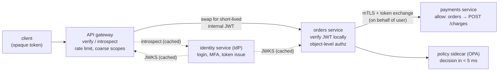
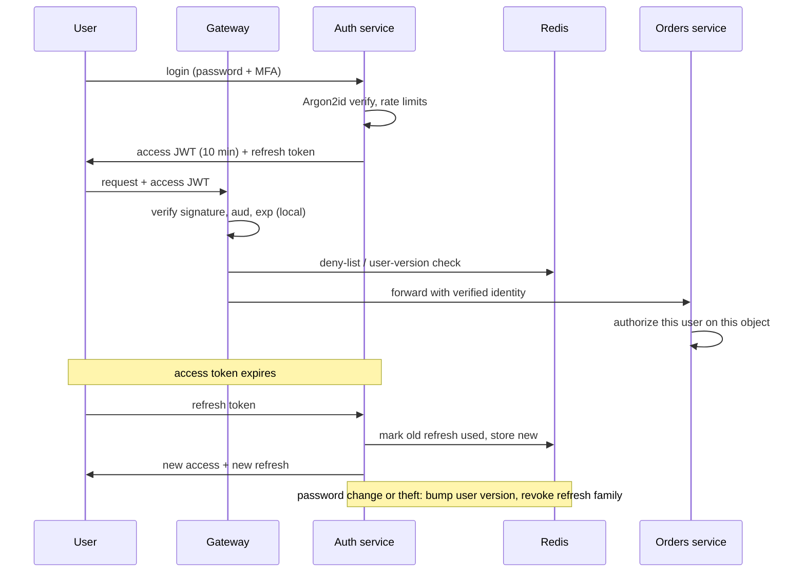
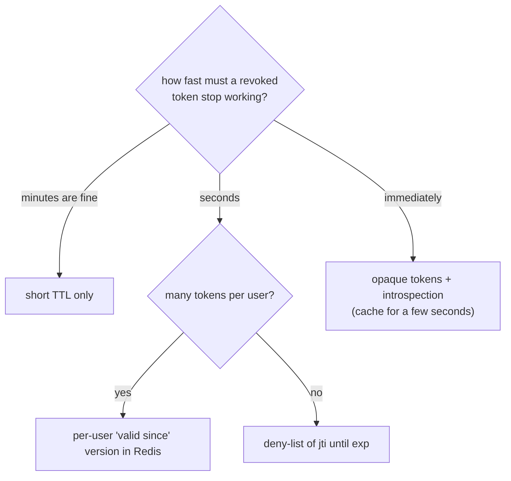
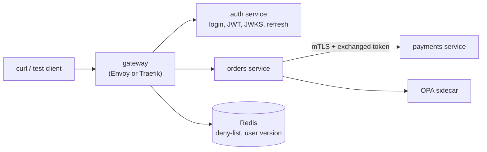

# Chapter 19 — Authentication & Authorization in System Design

> **Volume 4 — High-Level Design** · [Contents](index.md) · ← [Chapter 18 — Security at the System Level](ch18-security-at-the-system-level.md) · Next → [Chapter 20 — Cloud Architecture](ch20-cloud-architecture.md)

---

## Concept

Where identity is checked in a large system, how it travels between services, how tokens are issued, verified, rotated, and revoked at scale, how services trust each other, how permissions are decided, and how all of it survives failure.

**In one sentence:** in a distributed system, authentication happens once at the edge and becomes a signed identity that every hop can verify cheaply, while authorization is decided by the service that owns the data, using a policy it can check in microseconds and a design that keeps working when the identity service is down.

**Mental model — an airport.** You show your passport once at check-in (**authentication**, a central identity service). You get a boarding pass (**a token**). Each gate scans the pass without phoning the airline (**local verification**). Staff-only doors need a different badge (**service identity**). A cancelled pass is flagged on a list the gates sync every few minutes (**revocation**). The gate agent, not the check-in desk, decides whether *you* may board *this* flight (**authorization at the resource**).

> This chapter is the **design** view. For what a JWT, OAuth2 flow, or SSO *is*, read [Vol 2 Ch 12 — Authentication & Authorization](../volume-2-software-engineering/ch12-authentication-and-authorization.md) first.

### 1. The questions a design must answer

| Question | Typical answer |
|----------|----------------|
| Who authenticates users? | one **identity service / IdP** (build on Keycloak, Cognito, Auth0, Okta; do not hand-roll) |
| Where is the token first checked? | the **edge / API gateway** |
| Do inner services re-check? | **yes** (zero trust: any hop can be reached by something unexpected) |
| How does a service know *who* the caller is? | a **signed token** or mTLS identity, never a plain header from the network |
| How do services call each other? | **workload identity** (mTLS / service tokens), plus per-service allow rules |
| Who decides "may do X on Y"? | the **service that owns Y**, via a shared policy library or sidecar |
| How do you cut off a stolen token? | short life + deny-list / version check |
| What if the identity service is down? | existing tokens keep working; login degrades; keys are cached |

### 2. Where to check: edge, service, or both

| Pattern | What it does | Weakness |
|---------|--------------|----------|
| **Edge only** ("hard shell") | gateway checks the token; inner services trust anything that reaches them | one bypass (a misrouted call, a compromised pod) exposes everything |
| **Per-service only** | every service verifies the token itself | duplicated logic, slow to change, uneven quality |
| **Edge + service** (recommended) | gateway: authenticate, coarse checks (valid token, scopes, rate limit); each service: verify token or identity again and do fine-grained authorization | a little repeated work, which is cheap with local verification |
| **Mesh-enforced** | the sidecar (Envoy/Istio) verifies JWTs and mTLS for every service | needs a mesh; app still owns object-level rules |

The gateway cannot do object-level authorization ("may Priya read *invoice 42*?") because it does not own the data. That check always lives in the service.

### 3. Token architecture

**Pattern A — JWT everywhere.** The IdP issues a short-lived JWT; the gateway and each service verify it locally using cached public keys (JWKS). Fast, no per-request network call. Weakness: the token is readable by clients and hard to revoke.

**Pattern B — opaque outside, JWT inside (the "phantom token" pattern).** Clients hold a random opaque token. The gateway exchanges it (introspection, with a cache) for a short-lived internal JWT and forwards that. Clients never see claims; revocation is instant at the gateway; internal calls stay stateless. Cost: one cached lookup at the edge.

**Pattern C — token exchange for downstream calls.** When Service A calls Service B on a user's behalf, A swaps the user's token for a new one scoped to B (OAuth 2.0 Token Exchange, RFC 8693). B sees *who* (the user) and *via whom* (service A), and the token cannot be replayed against C. This limits the **confused deputy** problem, where a service with broad power is tricked into using it for the wrong user.

**Propagating identity safely**

* Never trust headers like `X-User-Id` just because they arrived. Accept them only from the gateway over mTLS, and have the gateway **strip** any client-supplied copy.
* Prefer passing a **signed** token. Then identity survives queues and async hops (put the user ID and tenant in the message and re-check).
* Keep claims small: IDs and scopes, not whole permission lists (tokens bloat headers; permissions change faster than tokens expire).

### 4. Service-to-service identity

Services are callers too, and "inside the network" is not proof of anything.

| Mechanism | How | Notes |
|-----------|-----|-------|
| **mTLS with workload identity** | each workload gets a short-lived certificate naming it (SPIFFE ID such as `spiffe://prod/ns/prod/sa/orders`); both sides verify | automated by a mesh (Istio, Linkerd) or SPIRE; no shared secrets |
| **OAuth2 Client Credentials** | the service gets a short-lived token for its own identity | good across trust zones and for third parties |
| **Cloud workload identity** | the platform issues credentials to a pod/VM (IAM roles for service accounts) | no long-lived keys in config |
| **Static API keys / passwords** | a shared secret | last resort; rotate, scope, and keep out of code |

Identity is only half: add **allow rules** ("only `orders` may `POST /charges` on `payments`"). Default deny between services; open each path on purpose. This is what limits **blast radius** (see [Ch 18](ch18-security-at-the-system-level.md)).

### 5. Keys and rotation at scale

* The IdP signs with a private key (held in KMS/HSM). Everyone else gets only **public keys** from a **JWKS** endpoint.
* Each token's header has a `kid` (key ID). **Rotate with overlap:** publish the new key, start signing with it, keep the old public key until every old token has expired.
* Verifiers **cache JWKS** (minutes to hours) and refetch on an unknown `kid`, with a limit on refetches so a flood of bad `kid`s cannot hammer the IdP. A verifier that cannot reach the IdP keeps using its cache.
* Allow a little **clock skew** (about 30–60 seconds) on `exp`/`nbf`, and keep servers on NTP.

### 6. Revocation at scale

A signed token cannot be recalled, so choose how stale a revocation may be:

| Approach | Revocation delay | Cost |
|----------|------------------|------|
| **Short TTL only** (5–15 min) | up to the TTL | nothing extra; refresh tokens do the work |
| **Deny-list of `jti`** in a shared cache | seconds | one cache lookup per request; list is small if TTL is short (entries only live until `exp`) |
| **Per-user "tokens valid since" / version** | seconds | one cache lookup per request; one write revokes every token of a user |
| **Introspection / opaque tokens** | immediate | a network call per request, or a short cache |
| **Push revocation** (publish an event; gateways update a local list) | seconds | needs pub/sub ([Ch 9](ch09-message-queues-and-streaming-kafka-sqs-pub.md)) and a fallback if the event is missed |

Pick by risk: a bank revokes in seconds; a news site can live with 15 minutes. Sensitive actions (change password, move money) should also demand a **fresh login** or a step-up check, whatever the token says.

### 7. Sessions and the login path at scale

* **Session store:** a Redis cluster keyed by random session ID, sharded by ID, with TTLs. Size is small: about 10M active sessions × ~0.5 KB ≈ 5 GB (a rough estimate; measure yours).
* **Login is CPU-heavy on purpose.** Argon2id/bcrypt cost tens of milliseconds per check. At an illustrative 50 ms per hash, one core handles about 20 logins/s, so 2,000 logins/s needs roughly 100 cores. Put hashing in a **separate auth service** that scales on its own, so a login spike cannot starve the product.
* **Credential stuffing** (attackers replaying leaked passwords) is the main threat to a login endpoint: rate-limit by IP *and* by account ([Ch 8](ch08-rate-limiting-throttling-and-backpressure.md)), check passwords against breach lists, add bot detection and MFA, and return the same error for "no such user" and "wrong password".
* **MFA/passkeys** shift the load from "guess the password" to "steal a device". Offer passkeys, and require MFA for admin and sensitive actions.

### 8. Authorization at scale

| Placement | How | Good for | Watch for |
|-----------|-----|----------|-----------|
| **Library in each service** | the same policy package, in-process | low latency, simple | version drift across services |
| **Sidecar PDP** (OPA/Cedar agent) | service asks `localhost` for a decision | one policy language, no network hop off-box | policy distribution and testing |
| **Central PDP service** | all services call one decision service | one place to change rules, relationship graphs | an extra hop and a new critical dependency; cache and set tight timeouts |

* **Relationship-based access (Zanzibar style)** answers "can X view doc Y?" by walking a graph (user → group → folder → doc). Systems like SpiceDB implement it. The hard part is **consistency**: a just-revoked permission must not be served from a stale cache (the "new enemy problem"), so these systems pass a consistency token with the write and check reads against it.
* **List endpoints:** do not fetch 10,000 rows and filter in code. Push the permission filter into the query (`WHERE tenant_id = ? AND ...`, row-level security from [Ch 15](ch15-multi-tenancy.md)), or ask the PDP for the allowed IDs.
* **Keep decisions fast:** budget a few milliseconds, cache positive decisions briefly, and make the failure mode explicit (fail **closed** for writes and sensitive reads).
* **Audit:** log each decision (who, what, resource, allow/deny, policy version) for investigations and compliance.

### 9. Multi-tenant and B2B identity

* Put `tenant_id` in the token and **check it against the resource's tenant on every access**. Never take the tenant from the request body or URL alone.
* **Enterprise SSO ("bring your own IdP"):** each customer connects their own OIDC or SAML IdP. Store per-tenant IdP config, map the user to a tenant at login (by email domain or tenant URL), and use **SCIM** to create and remove users when the customer's directory changes.
* **Roles per tenant:** the same user may be admin in one tenant and viewer in another; model membership as (user, tenant, role).
* **Impersonation / support access:** a separate, audited, time-boxed token, never a shared admin password.

### 10. Third-party and public APIs

* **Developers** get OAuth2 clients (for acting on a user's behalf: Authorization Code + PKCE) or Client Credentials (their own backend), with **scopes** the user approves.
* **API keys** suit simple server-to-server use; attach scopes, an owner, **per-key rate limits** ([Ch 8](ch08-rate-limiting-throttling-and-backpressure.md)), and rotation.
* **Webhooks** you send: sign the body with an HMAC and a timestamp so receivers can verify the sender and reject replays. **Webhooks** you receive: verify the signature before trusting anything.

### 11. Availability and failure modes

The identity service is on the critical path of *login*, but it should **not** be on the critical path of *every request*.

* Local JWT verification + cached JWKS means requests keep flowing while the IdP is down; only **new logins and refreshes** fail.
* Run the IdP multi-zone, and multi-region for large systems; replicate user and session data; practise failover.
* Give refresh tokens a grace period for retries, and let clients back off with jitter so recovery is not a stampede.
* **Fail closed** on security decisions, but separate *can't decide* from *denied*, and alert on spikes of either.
* **Build vs buy:** identity is security-critical and unforgiving. Use a mature product or open-source IdP unless identity is your business.

---

## Prereqs

* [Vol 2 Ch 12 — Authentication & Authorization](../volume-2-software-engineering/ch12-authentication-and-authorization.md)
* [Vol 2 Ch 11 — Security & Threat Modeling](../volume-2-software-engineering/ch11-security-and-threat-modeling.md)
* [Ch 5 — Proxies, Gateways, Web Servers & Storage Types](ch05-proxies-gateways-web-servers-and-storage-types.md)
* [Ch 10 — Service Mesh & Service Discovery](ch10-service-mesh-and-service-discovery.md)
* [Ch 15 — Multi-Tenancy](ch15-multi-tenancy.md)
* [Ch 18 — Security at the System Level](ch18-security-at-the-system-level.md)

---

## Diagram

**Edge authentication, token exchange, and service-to-service trust**



**Login and token lifecycle, with revocation**



**Which revocation approach?**



---

## Example

```yaml
# Envoy: verify JWTs at the edge (jwt_authn filter)
http_filters:
- name: envoy.filters.http.jwt_authn
  typed_config:
    "@type": type.googleapis.com/envoy.extensions.filters.http.jwt_authn.v3.JwtAuthentication
    providers:
      corp_idp:
        issuer: https://auth.example.com
        audiences: ["orders-api"]
        remote_jwks:
          http_uri:
            uri: https://auth.example.com/.well-known/jwks.json
            cluster: idp
            timeout: 2s
          cache_duration: 600s          # keep working if the IdP is briefly down
        forward: false                  # do not pass the raw client token inward
        payload_in_metadata: jwt_payload
    rules:
    - match: { prefix: /api/ }
      requires: { provider_name: corp_idp }
- name: envoy.filters.http.router
  typed_config:
    "@type": type.googleapis.com/envoy.extensions.filters.http.router.v3.Router
```

```yaml
# Istio: only the orders workload may call POST /charges on payments (default deny otherwise)
apiVersion: security.istio.io/v1
kind: AuthorizationPolicy
metadata: { name: payments-allow-orders, namespace: prod }
spec:
  selector:
    matchLabels: { app: payments }
  action: ALLOW
  rules:
  - from:
    - source:
        principals: ["cluster.local/ns/prod/sa/orders"]   # the caller's mTLS identity
    to:
    - operation:
        methods: ["POST"]
        paths: ["/charges"]
```

```rego
# OPA policy: scope + same-tenant check. Anything not allowed is denied.
package orders.authz
import rego.v1

default allow := false

scopes := split(input.claims.scope, " ")

allow if {
    input.method == "GET"
    "orders:read" in scopes
    input.claims.tenant_id == input.resource.tenant_id
}

allow if {
    input.method == "POST"
    "orders:write" in scopes
    input.claims.tenant_id == input.resource.tenant_id
    input.claims.role in {"admin", "editor"}
}
```

```python
# Revocation check at the gateway: deny-list plus per-user "valid since" (Redis).
def is_revoked(claims: dict, redis) -> bool:
    if redis.exists(f"revoked:jti:{claims['jti']}"):              # one token revoked
        return True
    valid_since = redis.get(f"user:{claims['sub']}:valid_since")  # all tokens before this time
    return valid_since is not None and claims["iat"] < int(valid_since)

def revoke_user(redis, user_id: str, now: int):
    redis.set(f"user:{user_id}:valid_since", now)                 # logout everywhere / password change
```

---

## Exercises

1. Why must inner services verify identity again if the gateway already did?

   <details><summary>Solution</summary>Zero trust: the gateway can be bypassed (a misrouted call, a compromised pod, an internal tool), and only the service that owns the data can decide object-level access. A second local verification costs microseconds, so the safety is cheap. The gateway still does coarse checks and rate limiting; services do the fine ones.</details>

2. A service reads the user from an <code>X-User-Id</code> header. What goes wrong and how do you fix it?

   <details><summary>Solution</summary>Anything that can reach the service can set that header and become any user. Accept identity only from a signed token or an mTLS-authenticated gateway, make the gateway strip client-supplied copies, and have the service verify the signature itself.</details>

3. Revocation must take effect within 10 seconds for 5 million active users, with 20,000 requests per second. Pick an approach.

   <details><summary>Solution</summary>Short access tokens (5–10 minutes) plus a per-user "valid since" value in a replicated Redis. Each request costs one cache read (about 20,000 reads/s is small for Redis; add a local cache of 1–5 seconds if needed). One write revokes every token of a user. Deny-list by <code>jti</code> works too, but needs one entry per token. Opaque tokens give instant revocation but put the IdP or an introspection cache on every request.</details>

4. The identity service goes down for 20 minutes. What still works and what fails?

   <details><summary>Solution</summary>Requests with valid, unexpired access tokens keep working (local verification with cached JWKS). New logins and token refreshes fail; clients with expiring tokens will start failing within the token lifetime. Mitigations: cache JWKS, multi-zone IdP, a refresh grace window, and client backoff with jitter. Security decisions still fail closed.</details>

5. A customer wants to log in with their own company SSO. What do you build?

   <details><summary>Solution</summary>Per-tenant IdP configuration (OIDC or SAML), a tenant lookup at login (by email domain or tenant URL), mapping of the IdP user to a tenant membership and role, SCIM for provisioning and deprovisioning, and <code>tenant_id</code> in the token, checked on every resource access. Keep a break-glass admin path in case their IdP is down.</details>

---

## Mini project

**A gateway, an auth service, and two services with token exchange and service-level allow rules.**



**Steps**

1. Run an auth service that issues 10-minute RS256 JWTs (with `iss`, `aud`, `sub`, `tenant_id`, `scope`) and serves a JWKS endpoint.
2. Put a gateway in front that verifies the JWT locally (cached JWKS), strips client-supplied identity headers, and checks Redis for revocation.
3. Give `orders` a policy sidecar (OPA) that enforces scope and same-tenant access.
4. Make `orders` call `payments` over mTLS using a token exchanged for audience `payments`; allow only that caller and path.
5. Add rotation: publish a second signing key, switch signing, and keep serving both keys until old tokens expire.
6. Chaos tests: stop the auth service and show existing tokens still work; revoke one user and show requests fail within the target time; call `payments` directly without a certificate and show it is refused; send a token for tenant A to tenant B's resource and show it is denied.

**Done when:** all four chaos tests pass, key rotation causes zero failed requests, and every denial appears in a decision log with a reason.

---

## Design

**Design 1 — Authentication for a multi-tenant B2B SaaS with enterprise SSO.**

* **Requirements:** 5,000 tenants, 2M users, some tenants require SAML or OIDC SSO and SCIM, others use email + password with MFA; sensitive data separated per tenant; an admin console.
* **Shape:** a hosted or self-run IdP fronts logins; per-tenant IdP federation; the gateway verifies JWTs; each service enforces `tenant_id` plus roles; SCIM endpoint for user lifecycle; audit log for every login and permission change.
* **Decisions to justify:** build vs buy the IdP; how a login finds its tenant; how roles are stored and cached; how a tenant's IdP outage is handled (break-glass admin); whether each tenant gets its own signing key; how support impersonation is audited.

**Design 2 — Identity for a public API platform.**

* **Requirements:** third-party developers, 50,000 API clients, 20,000 requests per second at peak, user-granted access (OAuth2) and server-to-server keys, per-client limits and billing, instant disable of an abused key.
* **Shape:** developer portal issues clients and keys; Authorization Code + PKCE for user access and Client Credentials for server access; API keys stored as hashes with a prefix, scopes, and an owner; the gateway checks keys/tokens (cached) and applies per-client rate limits; usage events go to a queue for billing; webhooks are HMAC-signed.
* **Decisions to justify:** opaque keys with cached lookup versus JWT access tokens; how fast a disabled key must stop working and how you ensure it; how keys are rotated without downtime; what you log without logging secrets.

**Design 3 — Login and sessions for a consumer app with 100M users.**

* **Requirements:** 10M daily active users, peak 2,000 logins per second, mobile and web, social sign-in (OIDC), passkeys, strong defence against credential stuffing, revocation within 10 seconds on password change.
* **Shape:** a dedicated auth service (autoscaled for password hashing) behind its own rate limits and bot checks; short-lived access JWT plus rotating refresh tokens in HttpOnly cookies (web) or secure storage (mobile); Redis for refresh families and the user "valid since" version; passkeys as the preferred factor; multi-region with a primary for writes or a globally replicated store.
* **Decisions to justify:** sessions versus tokens for web; how many cores the login path needs and where hashing runs; how to rate-limit by IP and by account without locking out real users; whether login is multi-region active-active, and how to avoid a password change taking effect only in one region.

---

## Open source

* [`keycloak/keycloak`](https://github.com/keycloak/keycloak) and [`ory/hydra`](https://github.com/ory/hydra) — identity providers and OAuth2/OIDC servers.
* [`spiffe/spire`](https://github.com/spiffe/spire) — workload identity (SPIFFE IDs and short-lived certificates).
* [`envoyproxy/envoy`](https://github.com/envoyproxy/envoy) — the `jwt_authn` and external authorization filters; [`oauth2-proxy/oauth2-proxy`](https://github.com/oauth2-proxy/oauth2-proxy) — put OIDC login in front of an app.
* [`open-policy-agent/opa`](https://github.com/open-policy-agent/opa) and [`authzed/spicedb`](https://github.com/authzed/spicedb) — policy engine and Zanzibar-style relationship-based authorization.
* [`hashicorp/vault`](https://github.com/hashicorp/vault) — dynamic credentials and a transit/signing engine.

---

## Interview

1. **"Where would you authenticate in a microservices system?"**
   <details><summary>Answer</summary>At the edge (API gateway) first: verify the token, apply rate limits and coarse scope checks. Then inside each service verify the signed identity again (local JWT verification or mTLS) and do object-level authorization, because only the service owns the data and the gateway can be bypassed. The identity service issues tokens; it is not called on every request.</details>

2. **"How do services call each other securely?"**
   <details><summary>Answer</summary>Give each workload a short-lived identity (mTLS certificates via a mesh or SPIRE, or client-credentials tokens), verify it on both sides, and add default-deny allow rules per caller and path. When acting for a user, exchange the user's token for one scoped to the next service so identity propagates without replay or confused-deputy problems.</details>

3. **"JWT revocation at scale: how?"**
   <details><summary>Answer</summary>Keep access tokens short (minutes) so revocation is bounded. For faster cut-off, store a per-user "valid since" version (or a <code>jti</code> deny-list) in a replicated cache that the gateway checks — a single cheap read — and revoke refresh tokens. If immediate revocation is required, use opaque tokens with a cached introspection call.</details>

4. **"What happens to your system if the auth service is down?"**
   <details><summary>Answer</summary>Valid tokens keep working because verification is local with cached public keys. New logins and refreshes fail, so tokens expire into errors within their lifetime. Reduce the impact with a multi-zone or multi-region IdP, JWKS caching, a refresh grace window, client backoff, and fail-closed security decisions with clear alerting.</details>

5. **"How would you design enterprise SSO for a multi-tenant SaaS?"**
   <details><summary>Answer</summary>Per-tenant OIDC/SAML federation to the customer's IdP, tenant resolution at login (domain or tenant URL), tenant memberships and roles in your database, SCIM for provisioning, <code>tenant_id</code> in tokens checked on every resource access, per-tenant audit logs, and a break-glass admin path for IdP outages.</details>

6. **"Centralized policy service or library per service?"**
   <details><summary>Answer</summary>A library or sidecar gives low latency and no new network dependency, but risks version drift. A central decision service gives one place to change rules and supports relationship graphs, but adds a hop and a critical dependency, so cache decisions and set tight timeouts. Many systems use a shared policy language (OPA/Cedar) with sidecar evaluation and central policy distribution.</details>

7. **"How do you protect the login endpoint from credential stuffing?"**
   <details><summary>Answer</summary>Rate-limit per IP and per account, check passwords against breach lists, add bot detection and CAPTCHA on suspicious patterns, require MFA or passkeys, return identical errors for unknown user and wrong password, and alert on spikes in failures. Run password hashing in its own scalable service so attacks cannot starve other traffic.</details>

---

## Checklist

- [ ] authenticate at the edge and verify again inside services
- [ ] never trust identity headers that did not come from a verified source
- [ ] give every workload an identity and default-deny service-to-service calls
- [ ] rotate signing keys with overlap; cache JWKS
- [ ] choose a revocation approach that matches the risk
- [ ] keep the identity service off the per-request path
- [ ] enforce tenant and object checks in the owning service
- [ ] log every authorization decision

---

> [Contents](index.md) · ← [Chapter 18 — Security at the System Level](ch18-security-at-the-system-level.md) · Next → [Chapter 20 — Cloud Architecture](ch20-cloud-architecture.md)
