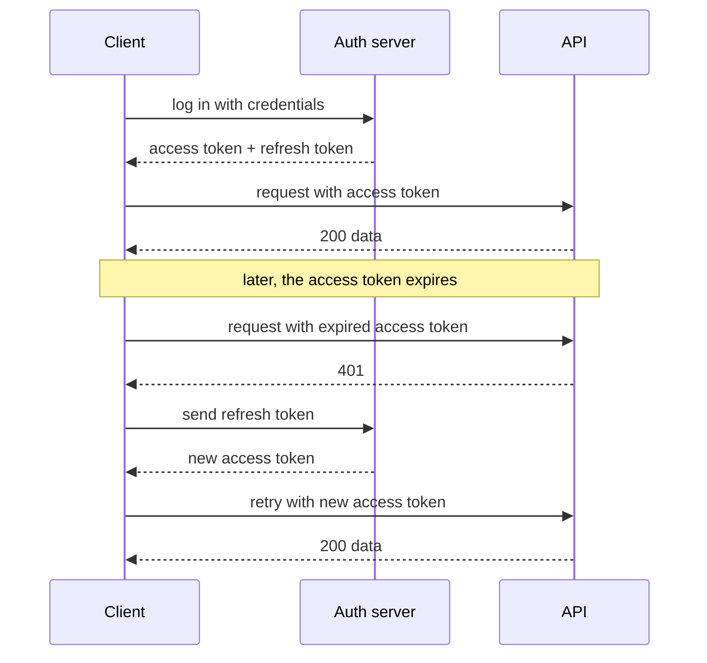
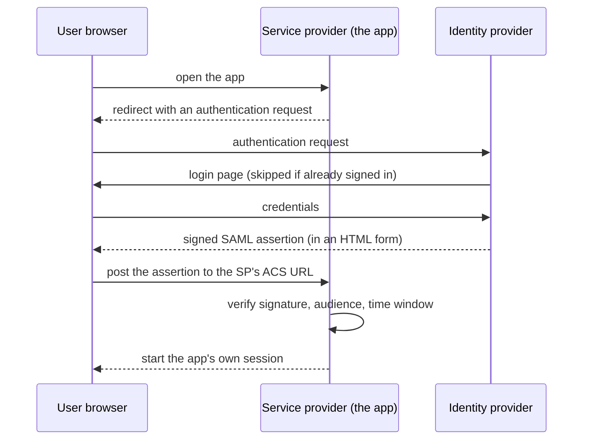
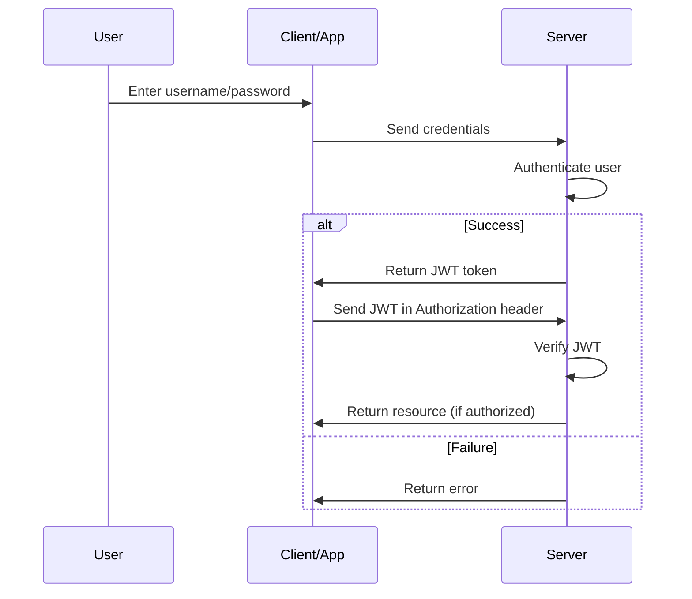
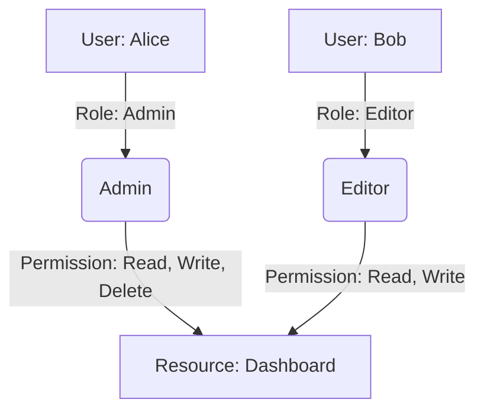
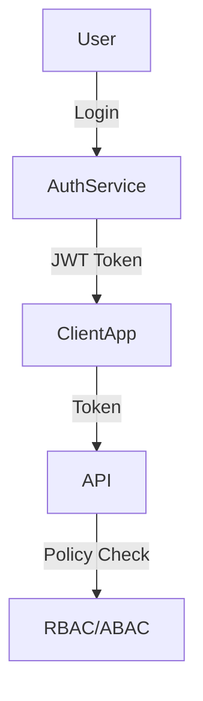
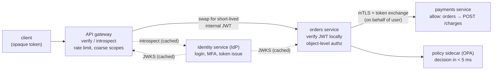
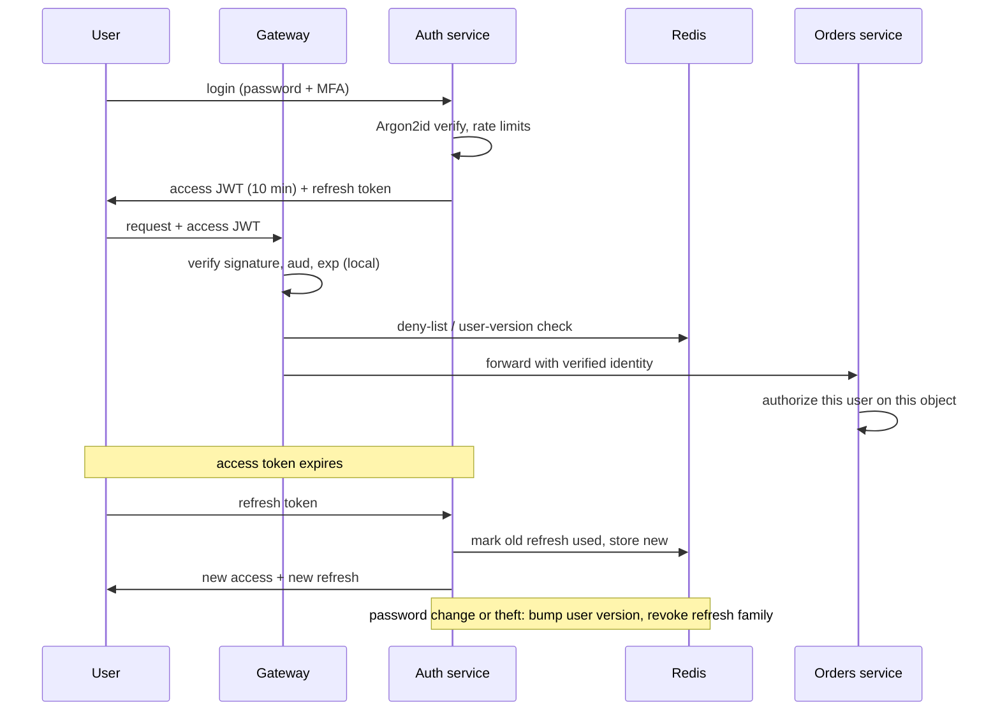
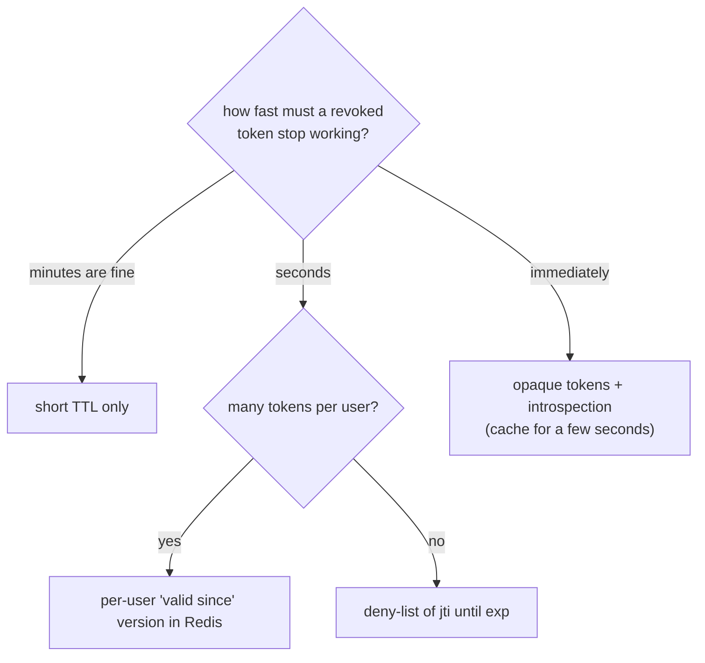
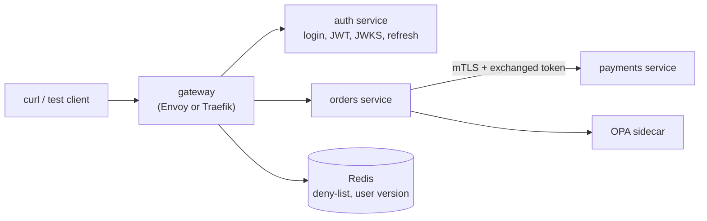

# Chapter 19 — Authentication & Authorization in System Design

> **Volume 4 — High-Level Design** · [Contents](index.md) · ← [Chapter 18 — Security at the System Level](ch18-security-at-the-system-level.md) · Next → [Chapter 20 — Cloud Architecture](ch20-cloud-architecture.md)

---

## Concept

Where identity is checked in a large system, how it travels between services, how tokens are issued, verified, rotated, and revoked at scale, how services trust each other, how permissions are decided, and how all of it survives failure.

**In one sentence:** in a distributed system, authentication happens once at the edge and becomes a signed identity that every hop can verify cheaply, while authorization is decided by the service that owns the data, using a policy it can check in microseconds and a design that keeps working when the identity service is down.

### Authentication Primer: Proving Who You Are

> **Why this sits here:** earlier chapters already mentioned cookies, JWT, OAuth and API keys. This primer puts the whole picture in one place before the next section goes into sessions and tokens in detail. Chapter 10 later covers attacks and secure flows.

#### Authentication vs. Authorization

| | **Authentication (AuthN)** | **Authorization (AuthZ)** |
|--|----------------------------|---------------------------|
| Question | *Who are you?* | *What are you allowed to do?* |
| Happens | first | after authentication |
| Failure response | **401 Unauthorized** (we do not know who you are) | **403 Forbidden** (we know you, but you may not do this) |
| Example | logging in with a password | a normal user trying to open the admin page |

Every method below answers only the first question. A request arrives carrying some **credential** (password, key, token), the server checks it, and either lets the request continue or rejects it with 401.

#### The Authentication Methods, From Simplest to Most Modern

##### Basic Authentication

The client sends the username and password on **every request** in a header: `Authorization: Basic <base64(username:password)>`.

- Base64 is an *encoding*, not encryption. Anyone who sees the header can decode it instantly, so basic auth is acceptable only over HTTPS.
- Even then it is mostly limited to internal tools, because the secret travels with every single request.

##### Digest Authentication

An attempt to avoid sending the password. The server first answers `401` with a challenge, and the client replies with a **hash** of the credentials combined with that challenge (traditionally computed with MD5). The password itself is not sent.

- It relies on old hashing and is rarely used today. Know it exists; do not choose it for new systems.

##### API Keys

A random string issued to each client (an app or a partner), sent with every request, usually in an `X-API-Key` header.

| Aspect | Detail |
|--------|--------|
| Server side | stores a **hash** of each key plus what it may do (its *scopes*); looks the key up on every request |
| Missing or wrong key | `401` |
| Strength | simple; easy to issue and revoke per client; good for server-to-server calls |
| Weakness | if the key leaks, anyone can act as the owner; no expiry unless you build it; the key itself carries no information, so every check needs a lookup |

Treat keys like passwords: keep them out of source code, rotate them, and give each one the narrowest permissions possible.

##### Sessions (Server-Side State)

After the user logs in, the server creates a **session** record and sends back only a **session ID** inside a **cookie**. The browser returns the cookie on every request, and the server looks the ID up.

- The server must remember every session, so this is **stateful**. Sessions are usually stored in a fast shared store such as Redis, so any server can find them.
- Great for traditional websites; awkward for APIs spread across many servers. The next section covers sessions in depth.

##### Bearer Tokens and JWT

The client logs in once and receives a **token**. It then sends `Authorization: Bearer <token>` with every request. "Bearer" only means *whoever holds this token gets in*; it describes how the token is used, not what is inside it.

- An older style of token was an **opaque random string** that the server looked up in a database each time, which is stateful again.
- A **JWT (JSON Web Token)** is a *signed* package of facts (user id, expiry time, roles). Any server holding the verification key can check the signature **without a database lookup**. That makes it **stateless** and easy to scale.
- Trade-off: a signed token cannot simply be "switched off" before it expires, so keep its lifetime short.

##### Access Tokens and Refresh Tokens

Modern systems hand out a **pair** of tokens at login:

| Token | Lifetime | Used for |
|-------|----------|----------|
| **Access token** | short (about 15 minutes to an hour) | every API call |
| **Refresh token** | long (days to weeks) | only to get a new access token |



The user stays logged in without retyping the password, and a stolen access token is useful only briefly. **Where to keep the refresh token:** not in `localStorage`, where any injected script can read it; prefer an `HttpOnly`, `Secure`, `SameSite` cookie, or keep it on the server side.

#### Letting Other Apps In: OAuth 2.0 and OpenID Connect

These two are the most misunderstood pieces.

**OAuth 2.0 is about authorization**: *what may this app do on my behalf?* Example: you let a photo-printing app read your Google Drive files.

1. The app sends you to Google's **consent screen**, which lists the permissions it wants.
2. You approve, and Google gives the app a short-lived **authorization code**.
3. The app exchanges the code for an **access token**.
4. The app calls the Drive API with that token.

The access token proves the app may touch certain files. It does **not** tell the app who you are.

**OpenID Connect (OIDC)** adds the missing identity part on top of OAuth 2.0. The same flow also returns an **ID token**, a JWT that carries identity facts such as user id and email. The app verifies its signature and learns who logged in. This is what "**Sign in with Google / GitHub / Microsoft**" uses.

#### Single Sign-On (SSO)

SSO is a **user experience**: log in once, then use many services without logging in again, such as one Google account for Gmail, Drive and Calendar. A company **identity provider** (Okta, Microsoft Entra, Google) keeps a central login session. When you open a second app, that app redirects you to the identity provider, which sees you are already signed in and sends you straight back with proof of identity.

That proof is carried by one of two protocols:

| | **SAML 2.0** | **OpenID Connect** |
|--|--------------|--------------------|
| Format | XML **assertion** | JSON **ID token** (a JWT) |
| Age | older | modern, built on OAuth 2.0 |
| Typical use | enterprise and legacy systems (Salesforce, corporate portals) | consumer and mobile apps, "Sign in with ..." buttons |

Both are secure and both are still widely used; pick whichever the other side supports.

#### The Terms People Mix Up

| Term | What it really is |
|------|-------------------|
| Basic, digest, API key, session | concrete **authentication methods** |
| **Bearer** | a **pattern**: whoever holds the token gets access |
| **JWT** | a **token format** (signed JSON), not a method by itself |
| **OAuth 2.0** | an **authorization framework** (not authentication) |
| **OpenID Connect** | an **identity layer** on top of OAuth 2.0 (this one is authentication) |
| **SSO** | a **user experience** built with SAML or OIDC |

#### Which Should You Pick?

| Situation | Reasonable choice |
|-----------|-------------------|
| Traditional server-rendered website | session cookie, with sessions in Redis |
| Public API, mobile app, many microservices | short-lived JWT access token plus a refresh token |
| Another company's server calling yours | API key (scoped, rotated), or mutual TLS |
| "Sign in with Google / GitHub" for your users | OpenID Connect |
| Employees using many internal apps | SSO with an identity provider (SAML or OIDC) |
| Anything new | avoid basic and digest |

*Goes deeper in:* the next section (sessions, cookies and JWT in detail), Chapter 10 (secure OAuth flows, JWT pitfalls, SSO, attacks).

*(From AI Library chapter 5.)*

### Authentication & Authorization

#### Authentication vs. Authorization

| Concept            | What is it?                                       | Example                       | Mnemonic                |
|--------------------|---------------------------------------------------|-------------------------------|-------------------------|
| **Authentication** | Verifying *who* the user is                       | Logging in with password/MFA  | "Who are you?"          |
| **Authorization**  | Deciding *what* the authenticated user can do     | Accessing admin dashboard     | "What can you do here?" |

**Key point:** You *authenticate* first, then the system *authorizes* your actions.

#### Common Authentication Methods

##### Basic Authentication

Username and password sent with every request (use only with HTTPS).

```http
GET /protected HTTP/1.1
Authorization: Basic dXNlcjpwYXNz
```

##### OAuth 2.0

Delegated access: third-party apps access user data without seeing credentials. Example: "Login with Google" or "Login with Facebook".

##### OpenID Connect

Built on OAuth2; adds an identity layer for authentication. Use case: Single Sign-On (SSO) across multiple apps.

##### JWT (JSON Web Token)

Stateless: server issues a signed token after login; client sends it with each request.

```json
{
  "sub": "1234567890",
  "name": "John Doe",
  "role": "admin",
  "exp": 1711234567
}
```

#### Session-Based vs. Token-Based Authentication

| Feature            | Session-Based                  | Token-Based (e.g., JWT)          |
|--------------------|--------------------------------|----------------------------------|
| **Storage**        | Server memory/database         | Client-side (token)              |
| **Scalability**    | Challenging in distributed env | Scales easily in microservices   |
| **State**          | Stateful                       | Stateless                        |
| **Security Concerns** | Session hijacking, CSRF     | Token theft, token expiry        |

**Session-based flow:**

1. User logs in.
2. Server creates a session, sends session ID cookie.
3. Client sends cookie with each request.
4. Cons: Scalability challenges in distributed systems.

**Token-based flow:**

1. User logs in.
2. Server issues signed JWT.
3. Client sends JWT in `Authorization` header.
4. Cons: Requires secure token storage and handling.

#### Access Control Models (Authorization)

##### RBAC — Role-Based Access Control

- Assign permissions to roles, roles to users.
- **Example roles:** `admin`, `editor`, `viewer`.
- **Pros:** Simple, scalable for standard teams.
- **Cons:** Not granular for complex orgs.

##### ABAC — Attribute-Based Access Control

- Access based on user attributes (department, project, clearance).
- **Pros:** Fine-grained control.
- **Cons:** Harder to manage at scale.

##### DAC — Discretionary Access Control

- Resource owners set access permissions.
- **Example:** File-sharing apps.

##### MAC — Mandatory Access Control

- Central authority enforces strict policies.
- **Example:** Military/government systems.

#### Single Sign-On (SSO) & Identity Federation

- **SSO:** User logs in once, gains access to multiple apps/services without re-authenticating.
- **Identity Federation:** Trust external identity providers (Google, Facebook, Microsoft) for authentication across organizational boundaries.
- **Benefit:** Fewer passwords, less friction, better user experience.

#### SAML 2.0 in Depth

**SAML** (Security Assertion Markup Language) is an XML-based protocol that lets a company's **identity provider (IdP)** vouch for a user to many **service providers (SPs)**, which are the applications. It is common in enterprises (Salesforce, internal portals).



**What the assertion carries:** who the user is, attributes (email, groups), who issued it, **who it is meant for** (the audience), and a validity window.

**What the service provider must verify:** the XML **signature** against the IdP's certificate (exchanged earlier as *metadata*), the **audience** and **recipient** (so an assertion for another app cannot be replayed here), the `NotOnOrAfter` time, and that the assertion has not been used before.

**Common mistakes:** trusting an unsigned assertion; checking the signature on the wrong element (*XML signature wrapping*); skipping the audience check; accepting assertions with no expiry.

**SAML or OIDC?** Use SAML when enterprise customers or legacy apps demand it. Prefer OpenID Connect for new consumer, mobile and single-page apps. Both give single sign-on; they differ in format (XML assertion vs. JSON ID token). See the authentication primer in Chapter 5 for the comparison.

#### Refresh Tokens: Rotation and Storage

Short-lived access tokens limit damage, but the **refresh token** that creates new ones is now the valuable secret.

- **Rotation:** every time a refresh token is used, issue a **new** refresh token and invalidate the old one.
- **Reuse detection:** if an already-used refresh token appears again, assume it was stolen. Revoke the **entire token family** (every token from that login) and force a new sign-in.
- **Expiry:** use an **absolute lifetime** (for example 30 days) as well as an idle timeout, so a session cannot live forever.
- **Revoke on events:** password change, logout, suspected compromise, or removing a device.
- **Where to keep it:** in a browser, an `HttpOnly`, `Secure`, `SameSite` cookie (never `localStorage`); in a mobile app, the platform keystore (iOS Keychain, Android Keystore); on a server, encrypted at rest.
- **Bind it** to the client where possible (device or sender-constrained tokens) so a copied token is useless elsewhere.

#### API Key Hygiene

API keys are simple, which is why they leak. Handle them like passwords:

| Practice | Why |
|----------|-----|
| Generate keys with a cryptographically secure random source, at least 32 bytes | guessing must be impossible |
| Give each key a **visible prefix** (`sk_live_...`) | lets you recognise it in logs and secret scanners without exposing it |
| Store only a **hash** of the key, and show the full key once at creation | a database leak does not reveal usable keys |
| Attach **scopes** and an owner to every key | least privilege; you can tell whose key was used |
| Support **rotation** with two valid keys during the switch-over | no downtime when replacing a key |
| Set **expiry** and allow instant **revocation** | contain leaks |
| Never put keys in URLs, source code, client-side code or logs | URLs are logged and cached; code gets published |
| Rate-limit and monitor **per key** | abuse and leaks show up as unusual volume |
| For high-value calls, sign each request (HMAC) or use mutual TLS | a stolen key alone is not enough |

#### Code Examples

##### JWT Authentication with Node.js / Express

```javascript
const jwt = require('jsonwebtoken');

// Issue JWT after login
app.post('/login', (req, res) => {
  // ...validate user
  const token = jwt.sign({ userId: user.id, role: user.role }, process.env.JWT_SECRET, { expiresIn: '1h' });
  res.json({ token });
});

// Verify JWT on protected route
function authenticateJWT(req, res, next) {
  const authHeader = req.headers.authorization;
  if (authHeader) {
    const token = authHeader.split(' ')[1];
    jwt.verify(token, process.env.JWT_SECRET, (err, user) => {
      if (err) return res.sendStatus(403);
      req.user = user;
      next();
    });
  } else {
    res.sendStatus(401);
  }
}
```

A simpler form:

```js
const jwt = require('jsonwebtoken');
function authenticate(req, res, next) {
  const token = req.header('Authorization').replace('Bearer ', '');
  try {
    const payload = jwt.verify(token, process.env.JWT_SECRET);
    req.user = payload;
    next();
  } catch (err) {
    res.status(401).json({error: 'Unauthorized'});
  }
}
```

##### RBAC Middleware

```javascript
function authorizeRoles(...allowedRoles) {
  return (req, res, next) => {
    if (req.user && allowedRoles.includes(req.user.role)) {
      next();
    } else {
      res.sendStatus(403); // Forbidden
    }
  }
}

// Usage:
app.get('/admin', authenticateJWT, authorizeRoles('admin'), (req, res) => {
  res.send('Welcome, admin!');
});
```

#### Diagrams

**Authentication & Authorization Flow:**



**RBAC Model:**



**End-to-end auth flow:**



#### Authentication / Authorization Tips

- **Always use HTTPS** even for development.
- **Keep JWTs short-lived:** Use refresh tokens for longer sessions.
- **Never store sensitive data in JWTs:** Tokens can be decoded by anyone.
- **Secure cookies:** Set `HttpOnly`, `Secure`, and `SameSite` attributes.
- **Centralize session/token invalidation** to handle logout and token revocation.
- **Use established libraries:** Don't roll your own crypto/auth code.
- **Implement rate limiting:** Protect authentication endpoints from brute-force attacks.
- **Audit permissions regularly:** Remove unused roles/permissions (principle of least privilege).
- **Log authentication events** for auditing and intrusion detection.
- **Educate users:** Encourage strong passwords and enable MFA.

---

#### Authentication and Authorization at Scale

In a distributed system, authenticate once at the edge, turn the result into a signed identity every hop can verify cheaply, and let the service that owns the data make the authorization decision. The identity service must not sit on the critical path of every request.

**Where to check**

| Pattern | What it does | Weakness |
|---------|--------------|----------|
| Edge only | The gateway checks the token; inner services trust anything that reaches them | One bypass or compromised pod exposes everything |
| Per-service only | Every service verifies the token itself | Duplicated logic, uneven quality |
| Edge + service (recommended) | Gateway: authenticate, coarse checks (valid token, scopes, rate limit). Service: verify again and do fine-grained, object-level authorization | A little repeated work, cheap with local verification |
| Mesh-enforced | The sidecar verifies JWTs and mTLS for every service | Needs a mesh; the app still owns object-level rules |

The gateway cannot decide "may Priya read invoice 42?" because it does not own the data. That check always lives in the service.

**Token architecture**

| Pattern | How it works | Notes |
|---------|--------------|-------|
| JWT everywhere | The IdP issues a short-lived JWT; every hop verifies it locally with cached public keys | Fast, but claims are readable by clients and revocation is hard |
| Opaque outside, JWT inside ("phantom token") | Clients hold a random opaque token; the gateway swaps it (cached introspection) for a short-lived internal JWT | Claims stay hidden, revocation is instant at the gateway, one cached lookup at the edge |
| Token exchange for downstream calls | When service A calls B for a user, A swaps the user's token for one scoped to B (OAuth 2.0 Token Exchange, RFC 8693) | B sees who (the user) and via whom (A); limits the confused-deputy problem, where a powerful service is tricked into acting for the wrong user |

Propagate identity safely: never trust a header such as `X-User-Id` just because it arrived. Accept it only from the gateway over mTLS, and have the gateway strip any client-supplied copy. Prefer a signed token, so identity survives queues and async hops. Keep claims small (IDs and scopes, not whole permission lists).

**Service-to-service identity**

| Mechanism | How | Notes |
|-----------|-----|-------|
| mTLS with workload identity | Each workload gets a short-lived certificate naming it (a SPIFFE ID such as `spiffe://prod/ns/prod/sa/orders`) | Automated by a mesh or SPIRE; no shared secrets |
| OAuth2 Client Credentials | The service gets a token for its own identity | Good across trust zones and for third parties |
| Cloud workload identity | The platform issues credentials to a pod or VM | No long-lived keys in config |
| Static API keys | A shared secret | Last resort: rotate, scope, keep out of code |

Identity is half the job: add allow rules ("only `orders` may call `POST /charges` on `payments`"), default deny between services, and open each path on purpose.

**Keys and rotation**

* The IdP signs with a private key held in a KMS or HSM; everyone else gets only public keys from a **JWKS** endpoint.
* Each token header carries a `kid` (key ID). Rotate with overlap: publish the new key, start signing with it, and keep the old public key until every old token has expired.
* Verifiers cache the JWKS and refetch on an unknown `kid`, with a limit so a flood of bad `kid`s cannot hammer the IdP. A verifier that cannot reach the IdP keeps using its cache.
* Allow about 30-60 seconds of clock skew on `exp` and `nbf`.

**Revocation: choose how stale it may be**

| Approach | Delay | Cost |
|----------|-------|------|
| Short TTL only (5-15 min) | Up to the TTL | Nothing extra; refresh tokens do the work |
| Deny-list of token IDs (`jti`) in a shared cache | Seconds | One cache lookup per request; entries only live until `exp` |
| Per-user "tokens valid since" version | Seconds | One lookup per request; one write revokes all of a user's tokens |
| Introspection / opaque tokens | Immediate | A network call per request, or a short cache |
| Push revocation over pub/sub | Seconds | Needs a messaging system and a fallback if an event is missed |

A bank revokes in seconds; a news site can live with 15 minutes. Sensitive actions (change password, move money) should demand a fresh login whatever the token says.

**The login path at scale**

* Sessions live in a Redis cluster keyed by a random session ID with TTLs. 10M active sessions at about 0.5 KB each is roughly 5 GB (measure yours).
* Password hashing is CPU-heavy on purpose. At an illustrative 50 ms per hash one core does about 20 logins per second, so 2,000 logins per second needs about 100 cores. Put hashing in a separate auth service that scales on its own, so a login spike cannot starve the product.
* **Credential stuffing** (replaying leaked passwords) is the main threat: rate-limit by IP and by account, check passwords against breach lists, add bot detection and MFA, and return the same error for "no such user" and "wrong password".
* Offer passkeys, and require MFA for admin and sensitive actions.

**Authorization at scale**

| Placement | How | Good for | Watch for |
|-----------|-----|----------|-----------|
| Library in each service | The same policy package, in-process | Low latency, simple | Version drift |
| Sidecar decision point (OPA, Cedar agent) | The service asks `localhost` | One policy language, no off-box hop | Policy distribution and testing |
| Central decision service | All services call one service | One place to change rules; relationship graphs | An extra hop and a critical dependency: cache, set tight timeouts |

* **Relationship-based access (Zanzibar style, e.g. SpiceDB)** answers "can X view doc Y?" by walking a graph (user, group, folder, doc). The hard part is consistency: a just-revoked permission must not be served from a stale cache (the "new enemy problem"), so these systems pass a consistency token with the write.
* **List endpoints:** do not fetch 10,000 rows and filter in code. Push the permission filter into the query (`WHERE tenant_id = ?`, row-level security) or ask the decision point for the allowed IDs.
* Budget a few milliseconds per decision, cache positive decisions briefly, fail closed for writes and sensitive reads, and log every decision (who, what, resource, allow or deny, policy version).

**Multi-tenant and third-party identity**

* Put `tenant_id` in the token and check it against the resource's tenant on every access; never trust a tenant taken only from the body or URL.
* Enterprise "bring your own IdP": store per-tenant OIDC or SAML config, map users to a tenant at login (email domain or tenant URL), and use **SCIM** to create and remove users when the customer's directory changes. Model membership as (user, tenant, role). Support access should be a separate, audited, time-boxed token.
* Public APIs: OAuth2 Authorization Code + PKCE for acting on a user's behalf, Client Credentials for a developer's backend, API keys with scopes, owner, per-key rate limits and rotation. Sign outgoing webhooks with an HMAC and a timestamp; verify signatures on incoming ones.

**Availability.** Local JWT verification with a cached JWKS means requests keep flowing while the IdP is down; only new logins and refreshes fail. Run the IdP multi-zone (multi-region at large scale), give refresh tokens a retry grace period, have clients back off with jitter, fail closed on security decisions (but separate "can't decide" from "denied"), and buy or adopt a mature IdP unless identity is your business.

*(From AI Library chapter 10.)*

The diagram, worked example, exercises, mini-project, design prompt, open-source reading, interview questions and checklist below are this chapter's practice layer.

---

## Prereqs

* [Vol 2 Ch 12 — Authentication & Authorization](../volume-2-software-engineering/ch12-authentication-and-authorization.md)
* [Vol 2 Ch 11 — Security & Threat Modeling](../volume-2-software-engineering/ch11-security-and-threat-modeling.md)
* [Ch 5 — Proxies, Gateways, Web Servers & Storage Types](ch05-proxies-gateways-web-servers-and-storage-types.md)
* [Ch 10 — Service Mesh & Service Discovery](ch10-service-mesh-and-service-discovery.md)
* [Ch 15 — Multi-Tenancy](ch15-multi-tenancy.md)
* [Ch 18 — Security at the System Level](ch18-security-at-the-system-level.md)

---

## Diagram

**Edge authentication, token exchange, and service-to-service trust**



**Login and token lifecycle, with revocation**



**Which revocation approach?**



---

## Example

```yaml
# Envoy: verify JWTs at the edge (jwt_authn filter)
http_filters:
- name: envoy.filters.http.jwt_authn
  typed_config:
    "@type": type.googleapis.com/envoy.extensions.filters.http.jwt_authn.v3.JwtAuthentication
    providers:
      corp_idp:
        issuer: https://auth.example.com
        audiences: ["orders-api"]
        remote_jwks:
          http_uri:
            uri: https://auth.example.com/.well-known/jwks.json
            cluster: idp
            timeout: 2s
          cache_duration: 600s          # keep working if the IdP is briefly down
        forward: false                  # do not pass the raw client token inward
        payload_in_metadata: jwt_payload
    rules:
    - match: { prefix: /api/ }
      requires: { provider_name: corp_idp }
- name: envoy.filters.http.router
  typed_config:
    "@type": type.googleapis.com/envoy.extensions.filters.http.router.v3.Router
```

```yaml
# Istio: only the orders workload may call POST /charges on payments (default deny otherwise)
apiVersion: security.istio.io/v1
kind: AuthorizationPolicy
metadata: { name: payments-allow-orders, namespace: prod }
spec:
  selector:
    matchLabels: { app: payments }
  action: ALLOW
  rules:
  - from:
    - source:
        principals: ["cluster.local/ns/prod/sa/orders"]   # the caller's mTLS identity
    to:
    - operation:
        methods: ["POST"]
        paths: ["/charges"]
```

```rego
# OPA policy: scope + same-tenant check. Anything not allowed is denied.
package orders.authz
import rego.v1

default allow := false

scopes := split(input.claims.scope, " ")

allow if {
    input.method == "GET"
    "orders:read" in scopes
    input.claims.tenant_id == input.resource.tenant_id
}

allow if {
    input.method == "POST"
    "orders:write" in scopes
    input.claims.tenant_id == input.resource.tenant_id
    input.claims.role in {"admin", "editor"}
}
```

```python
# Revocation check at the gateway: deny-list plus per-user "valid since" (Redis).
def is_revoked(claims: dict, redis) -> bool:
    if redis.exists(f"revoked:jti:{claims['jti']}"):              # one token revoked
        return True
    valid_since = redis.get(f"user:{claims['sub']}:valid_since")  # all tokens before this time
    return valid_since is not None and claims["iat"] < int(valid_since)

def revoke_user(redis, user_id: str, now: int):
    redis.set(f"user:{user_id}:valid_since", now)                 # logout everywhere / password change
```

---

## Exercises

1. Why must inner services verify identity again if the gateway already did?

   <details><summary>Solution</summary>Zero trust: the gateway can be bypassed (a misrouted call, a compromised pod, an internal tool), and only the service that owns the data can decide object-level access. A second local verification costs microseconds, so the safety is cheap. The gateway still does coarse checks and rate limiting; services do the fine ones.</details>

2. A service reads the user from an <code>X-User-Id</code> header. What goes wrong and how do you fix it?

   <details><summary>Solution</summary>Anything that can reach the service can set that header and become any user. Accept identity only from a signed token or an mTLS-authenticated gateway, make the gateway strip client-supplied copies, and have the service verify the signature itself.</details>

3. Revocation must take effect within 10 seconds for 5 million active users, with 20,000 requests per second. Pick an approach.

   <details><summary>Solution</summary>Short access tokens (5–10 minutes) plus a per-user "valid since" value in a replicated Redis. Each request costs one cache read (about 20,000 reads/s is small for Redis; add a local cache of 1–5 seconds if needed). One write revokes every token of a user. Deny-list by <code>jti</code> works too, but needs one entry per token. Opaque tokens give instant revocation but put the IdP or an introspection cache on every request.</details>

4. The identity service goes down for 20 minutes. What still works and what fails?

   <details><summary>Solution</summary>Requests with valid, unexpired access tokens keep working (local verification with cached JWKS). New logins and token refreshes fail; clients with expiring tokens will start failing within the token lifetime. Mitigations: cache JWKS, multi-zone IdP, a refresh grace window, and client backoff with jitter. Security decisions still fail closed.</details>

5. A customer wants to log in with their own company SSO. What do you build?

   <details><summary>Solution</summary>Per-tenant IdP configuration (OIDC or SAML), a tenant lookup at login (by email domain or tenant URL), mapping of the IdP user to a tenant membership and role, SCIM for provisioning and deprovisioning, and <code>tenant_id</code> in the token, checked on every resource access. Keep a break-glass admin path in case their IdP is down.</details>

---

## Mini project

**A gateway, an auth service, and two services with token exchange and service-level allow rules.**



**Steps**

1. Run an auth service that issues 10-minute RS256 JWTs (with `iss`, `aud`, `sub`, `tenant_id`, `scope`) and serves a JWKS endpoint.
2. Put a gateway in front that verifies the JWT locally (cached JWKS), strips client-supplied identity headers, and checks Redis for revocation.
3. Give `orders` a policy sidecar (OPA) that enforces scope and same-tenant access.
4. Make `orders` call `payments` over mTLS using a token exchanged for audience `payments`; allow only that caller and path.
5. Add rotation: publish a second signing key, switch signing, and keep serving both keys until old tokens expire.
6. Chaos tests: stop the auth service and show existing tokens still work; revoke one user and show requests fail within the target time; call `payments` directly without a certificate and show it is refused; send a token for tenant A to tenant B's resource and show it is denied.

**Done when:** all four chaos tests pass, key rotation causes zero failed requests, and every denial appears in a decision log with a reason.

---

## Design

**Design 1 — Authentication for a multi-tenant B2B SaaS with enterprise SSO.**

* **Requirements:** 5,000 tenants, 2M users, some tenants require SAML or OIDC SSO and SCIM, others use email + password with MFA; sensitive data separated per tenant; an admin console.
* **Shape:** a hosted or self-run IdP fronts logins; per-tenant IdP federation; the gateway verifies JWTs; each service enforces `tenant_id` plus roles; SCIM endpoint for user lifecycle; audit log for every login and permission change.
* **Decisions to justify:** build vs buy the IdP; how a login finds its tenant; how roles are stored and cached; how a tenant's IdP outage is handled (break-glass admin); whether each tenant gets its own signing key; how support impersonation is audited.

**Design 2 — Identity for a public API platform.**

* **Requirements:** third-party developers, 50,000 API clients, 20,000 requests per second at peak, user-granted access (OAuth2) and server-to-server keys, per-client limits and billing, instant disable of an abused key.
* **Shape:** developer portal issues clients and keys; Authorization Code + PKCE for user access and Client Credentials for server access; API keys stored as hashes with a prefix, scopes, and an owner; the gateway checks keys/tokens (cached) and applies per-client rate limits; usage events go to a queue for billing; webhooks are HMAC-signed.
* **Decisions to justify:** opaque keys with cached lookup versus JWT access tokens; how fast a disabled key must stop working and how you ensure it; how keys are rotated without downtime; what you log without logging secrets.

**Design 3 — Login and sessions for a consumer app with 100M users.**

* **Requirements:** 10M daily active users, peak 2,000 logins per second, mobile and web, social sign-in (OIDC), passkeys, strong defence against credential stuffing, revocation within 10 seconds on password change.
* **Shape:** a dedicated auth service (autoscaled for password hashing) behind its own rate limits and bot checks; short-lived access JWT plus rotating refresh tokens in HttpOnly cookies (web) or secure storage (mobile); Redis for refresh families and the user "valid since" version; passkeys as the preferred factor; multi-region with a primary for writes or a globally replicated store.
* **Decisions to justify:** sessions versus tokens for web; how many cores the login path needs and where hashing runs; how to rate-limit by IP and by account without locking out real users; whether login is multi-region active-active, and how to avoid a password change taking effect only in one region.

---

## Open source

* [`keycloak/keycloak`](https://github.com/keycloak/keycloak) and [`ory/hydra`](https://github.com/ory/hydra) — identity providers and OAuth2/OIDC servers.
* [`spiffe/spire`](https://github.com/spiffe/spire) — workload identity (SPIFFE IDs and short-lived certificates).
* [`envoyproxy/envoy`](https://github.com/envoyproxy/envoy) — the `jwt_authn` and external authorization filters; [`oauth2-proxy/oauth2-proxy`](https://github.com/oauth2-proxy/oauth2-proxy) — put OIDC login in front of an app.
* [`open-policy-agent/opa`](https://github.com/open-policy-agent/opa) and [`authzed/spicedb`](https://github.com/authzed/spicedb) — policy engine and Zanzibar-style relationship-based authorization.
* [`hashicorp/vault`](https://github.com/hashicorp/vault) — dynamic credentials and a transit/signing engine.

---

## Interview

1. **"Where would you authenticate in a microservices system?"**
   <details><summary>Answer</summary>At the edge (API gateway) first: verify the token, apply rate limits and coarse scope checks. Then inside each service verify the signed identity again (local JWT verification or mTLS) and do object-level authorization, because only the service owns the data and the gateway can be bypassed. The identity service issues tokens; it is not called on every request.</details>

2. **"How do services call each other securely?"**
   <details><summary>Answer</summary>Give each workload a short-lived identity (mTLS certificates via a mesh or SPIRE, or client-credentials tokens), verify it on both sides, and add default-deny allow rules per caller and path. When acting for a user, exchange the user's token for one scoped to the next service so identity propagates without replay or confused-deputy problems.</details>

3. **"JWT revocation at scale: how?"**
   <details><summary>Answer</summary>Keep access tokens short (minutes) so revocation is bounded. For faster cut-off, store a per-user "valid since" version (or a <code>jti</code> deny-list) in a replicated cache that the gateway checks — a single cheap read — and revoke refresh tokens. If immediate revocation is required, use opaque tokens with a cached introspection call.</details>

4. **"What happens to your system if the auth service is down?"**
   <details><summary>Answer</summary>Valid tokens keep working because verification is local with cached public keys. New logins and refreshes fail, so tokens expire into errors within their lifetime. Reduce the impact with a multi-zone or multi-region IdP, JWKS caching, a refresh grace window, client backoff, and fail-closed security decisions with clear alerting.</details>

5. **"How would you design enterprise SSO for a multi-tenant SaaS?"**
   <details><summary>Answer</summary>Per-tenant OIDC/SAML federation to the customer's IdP, tenant resolution at login (domain or tenant URL), tenant memberships and roles in your database, SCIM for provisioning, <code>tenant_id</code> in tokens checked on every resource access, per-tenant audit logs, and a break-glass admin path for IdP outages.</details>

6. **"Centralized policy service or library per service?"**
   <details><summary>Answer</summary>A library or sidecar gives low latency and no new network dependency, but risks version drift. A central decision service gives one place to change rules and supports relationship graphs, but adds a hop and a critical dependency, so cache decisions and set tight timeouts. Many systems use a shared policy language (OPA/Cedar) with sidecar evaluation and central policy distribution.</details>

7. **"How do you protect the login endpoint from credential stuffing?"**
   <details><summary>Answer</summary>Rate-limit per IP and per account, check passwords against breach lists, add bot detection and CAPTCHA on suspicious patterns, require MFA or passkeys, return identical errors for unknown user and wrong password, and alert on spikes in failures. Run password hashing in its own scalable service so attacks cannot starve other traffic.</details>

---

## Checklist

- [ ] authenticate at the edge and verify again inside services
- [ ] never trust identity headers that did not come from a verified source
- [ ] give every workload an identity and default-deny service-to-service calls
- [ ] rotate signing keys with overlap; cache JWKS
- [ ] choose a revocation approach that matches the risk
- [ ] keep the identity service off the per-request path
- [ ] enforce tenant and object checks in the owning service
- [ ] log every authorization decision

---

> [Contents](index.md) · ← [Chapter 18 — Security at the System Level](ch18-security-at-the-system-level.md) · Next → [Chapter 20 — Cloud Architecture](ch20-cloud-architecture.md)
