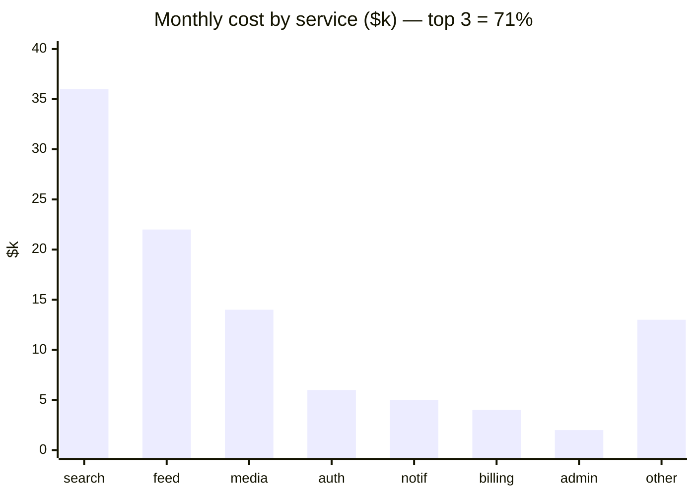
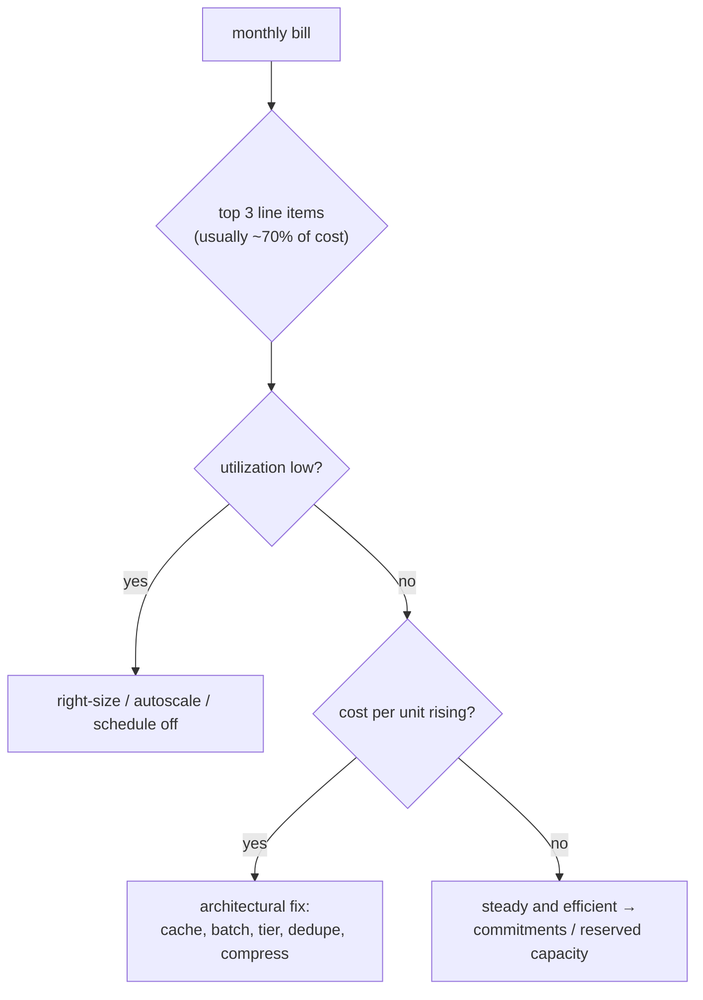
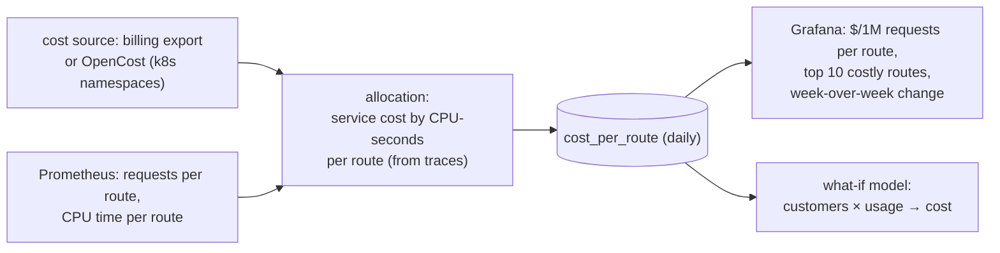
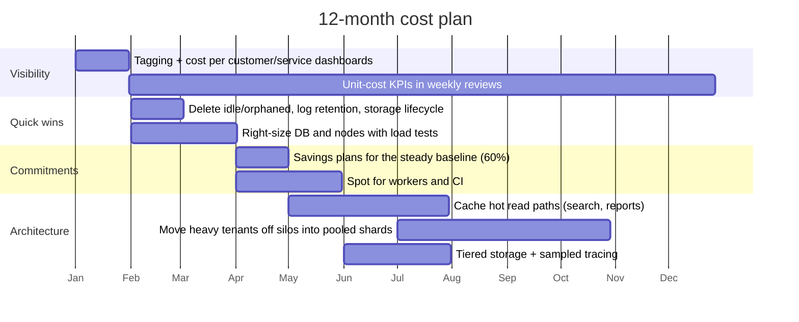

# Chapter 21 — Cost & Capacity Economics

> **Volume 4 — High-Level Design** · [Contents](index.md) · ← [Chapter 20 — Cloud Architecture](ch20-cloud-architecture.md) · Next → [Chapter 22 — The 30-System Design Portfolio](ch22-the-30-system-design-portfolio.md)

---

## Concept

Unit economics, cloud cost drivers, right-sizing, and cost as a design constraint.

**In one sentence:** at the design level, cost is a requirement like latency — you estimate the cost of an architecture before building it, express it per unit of business value, find which components dominate as scale grows, and choose designs whose cost grows slower than revenue.

### Cost and Capacity Economics

**Mental model — running a restaurant.** You don't just look at the monthly total. You know the *cost per plate*: ingredients, staff minutes, a share of rent. If a dish costs €9 to make and sells for €8, selling more of it makes things worse. Architecture decisions set your cost per plate.

This chapter is the **design-time** view. For operational cost hygiene (tagging, right-sizing a running cluster, purchase models), see Vol 1 Ch 59.

**Unit economics**

| Metric | Formula | Use |
|--------|---------|-----|
| Cost per request | infra cost ÷ requests | API efficiency; compare services |
| **Cost per active customer / tenant** | infra cost ÷ monthly active customers (or tenants) | pricing, margins, plan design |
| Cost per transaction / order | infra cost ÷ orders | e-commerce, payments |
| Cost per GB stored / processed | storage or pipeline cost ÷ GB | data platforms |
| Infra cost as % of revenue (COGS) | infra ÷ revenue | SaaS gross margin (healthy SaaS: infra ≈ 5–15% of revenue) |
| Marginal cost | Δcost ÷ Δunits | does the next customer cost less than the average? |

**How costs scale with design choices**

| Design choice | Cost behavior |
|---------------|---------------|
| Per-tenant silos | fixed cost per tenant → bad for many small tenants (Ch 15) |
| Fan-out on write for feeds | writes × followers: celebrities explode cost |
| Synchronous calls to paid APIs per request | linear in traffic × price; cache or batch |
| Keeping all logs / traces | linear in traffic × retention; sample and tier |
| Multi-region active-active | ~2–3× infra + cross-region transfer |
| Chatty microservices across AZs | transfer charges per GB on every hop |
| LLM calls per request | often the *largest* cost line; see Vol 5 Ch 18 |

**Right-sizing, continuously** — compare provisioned capacity with p95 usage (CPU, memory, IOPS, connections); keep headroom for SLOs (e.g. target 60–70% CPU at peak); autoscale; review monthly because usage drifts; pick newer, cheaper instance families (ARM).

**Reducing spend without hurting reliability**

1. Measure unit cost and the SLOs *together* on one dashboard.
2. Remove pure waste first (idle, orphaned, over-retained) — no reliability impact.
3. Right-size with load tests, one change at a time; watch p99 and errors.
4. Buy commitments only for the proven steady baseline.
5. Architectural changes (caching, batching, tiered storage, fewer cross-zone hops) — with ADRs.
6. Never cut redundancy that the SLO depends on (multi-AZ, backups) without an explicit decision.

*(From AI Library chapter 14.)*

### Cost Optimization Strategies

Cloud costs can spiral if autoscaling is not managed carefully. Best practices:

| Strategy                       | Description                                                          |
|--------------------------------|----------------------------------------------------------------------|
| **Avoid Over-provisioning**    | Scale just enough for demand; avoid idle resources.                  |
| **Use Spot/Preemptible VMs**   | For batch/non-critical workloads; up to 80% cheaper.                 |
| **Set Resource Limits/Quotas** | Prevent runaway scaling, especially in dev/test environments.        |
| **Rightsize Regularly**        | Analyze actual usage and adjust resource size accordingly.           |
| **Auto-pausing/Scale-to-zero** | Use features that pause/stop idle services (e.g., Cloud Run, Lambda) |

*(From AI Library chapter 6.)*

### Capacity Planning

**What it is.** Capacity planning answers *"how much of each resource will we need, and when, to meet the SLO at the busiest moment?"* Cost work asks how cheaply you can run; capacity work asks how little you can run without breaking. They meet at the same number. Too little capacity costs outages and lost sales. Too much costs money every hour. The goal is enough for the forecast peak plus a deliberate margin. The back-of-envelope estimation method (daily users → requests/s → servers, storage, bandwidth) is in [Ch 2](ch02-capacity-planning.md); this section is the ongoing planning loop that ties those numbers to cost.

**The loop**

1. **Measure today:** peak load (requests/s, messages/s, concurrent users) per component, and what limits it: CPU, memory, connections, disk IOPS, or a downstream quota.
2. **Find the ceiling per unit:** load-test one instance (or one shard or database) until the p99 latency breaks the SLO or errors appear. That rate, not the CPU graph, is the unit's real capacity, and the resource that ran out first is the bottleneck.
3. **Forecast demand:** take the trend (growth per month) and multiply by seasonality (Black Friday, end of month, the start of term), then add known events: launches, marketing pushes, a big customer onboarding. Plan for the *peak*, not the average.
4. **Size with headroom:** divide the forecast peak by the per-unit capacity *at the target utilisation*, not at 100%, then add redundancy for failures.
5. **Provision, then re-measure:** order or reserve the capacity in good time (quotas, hardware lead times), and repeat every quarter, or whenever forecast and actual drift apart.

**Why not run at 100%?** A server that is busy 90% of the time is idle only 10% of the time, so new requests mostly arrive while it is busy and have to queue. Queueing theory puts numbers on this. In the simplest model, the average time a request spends in the system is the service time divided by (1 − utilisation). The curve stays almost flat to about 60%, then climbs steeply. On top of that, the "average" hides bursts within each second, and a failed node pushes its load onto the survivors. Hence the usual target of **60–70% at peak** for latency-sensitive services. Batch workers that only care about throughput can run much hotter.

<div class="fig">
<svg xmlns="http://www.w3.org/2000/svg" viewBox="0 0 760 350" role="img" aria-label="Average wait in a simple queue grows as one over one minus utilisation: about 2 times the service time at 50 percent busy, 3.3 times at 70 percent, 5 times at 80 percent and 10 times at 90 percent, so capacity plans target roughly 60 to 70 percent at peak to leave room for bursts and failures" style="width:100%;max-width:760px;height:auto;font-family:inherit"><defs><marker id="v4c21x1-ar" viewBox="0 0 10 10" refX="8" refY="5" markerWidth="7" markerHeight="7" orient="auto-start-reverse"><path d="M0 0L10 5L0 10z" fill="context-stroke"/></marker></defs><rect x="456.0" y="40" width="61.0" height="230" fill="var(--success)" fill-opacity=".14"/><text x="486.5" y="56" font-size="11.5" text-anchor="middle" fill="var(--success)" font-weight="700">target</text><text x="486.5" y="70" font-size="11.5" text-anchor="middle" fill="var(--success)" font-weight="700">at peak</text><rect x="608.5" y="40" width="91.5" height="230" fill="var(--danger)" fill-opacity=".08"/><text x="694" y="56" font-size="11.5" text-anchor="end" fill="var(--danger)" font-weight="700">danger</text><line x1="90" y1="270" x2="714" y2="270" stroke="var(--text-muted)" stroke-width="1.6" marker-end="url(#v4c21x1-ar)"/><line x1="90" y1="270" x2="90" y2="26" stroke="var(--text-muted)" stroke-width="1.6" marker-end="url(#v4c21x1-ar)"/><text x="90" y="288" font-size="11" text-anchor="middle" fill="var(--text-muted)" font-weight="400">0%</text><text x="212.0" y="288" font-size="11" text-anchor="middle" fill="var(--text-muted)" font-weight="400">20%</text><text x="334.0" y="288" font-size="11" text-anchor="middle" fill="var(--text-muted)" font-weight="400">40%</text><text x="456.0" y="288" font-size="11" text-anchor="middle" fill="var(--text-muted)" font-weight="400">60%</text><text x="578.0" y="288" font-size="11" text-anchor="middle" fill="var(--text-muted)" font-weight="400">80%</text><text x="700.0" y="288" font-size="11" text-anchor="middle" fill="var(--text-muted)" font-weight="400">100%</text><text x="82" y="254.83333333333334" font-size="11" text-anchor="end" fill="var(--text-muted)" font-weight="400">1×</text><text x="82" y="197.33333333333331" font-size="11" text-anchor="end" fill="var(--text-muted)" font-weight="400">4×</text><text x="82" y="120.66666666666666" font-size="11" text-anchor="end" fill="var(--text-muted)" font-weight="400">8×</text><text x="82" y="44.0" font-size="11" text-anchor="end" fill="var(--text-muted)" font-weight="400">12×</text><text x="395.0" y="310" font-size="12" text-anchor="middle" fill="var(--text)" font-weight="600">utilisation (how busy each server is)</text><text x="100" y="30" font-size="12" text-anchor="start" fill="var(--text)" font-weight="600">time in system ÷ service time</text><polyline points="90.0,250.8 96.1,250.6 102.2,250.4 108.3,250.2 114.4,250.0 120.5,249.8 126.6,249.6 132.7,249.4 138.8,249.2 144.9,248.9 151.0,248.7 157.1,248.5 163.2,248.2 169.3,248.0 175.4,247.7 181.5,247.5 187.6,247.2 193.7,246.9 199.8,246.6 205.9,246.3 212.0,246.0 218.1,245.7 224.2,245.4 230.3,245.1 236.4,244.8 242.5,244.4 248.6,244.1 254.7,243.7 260.8,243.4 266.9,243.0 273.0,242.6 279.1,242.2 285.2,241.8 291.3,241.4 297.4,241.0 303.5,240.5 309.6,240.1 315.7,239.6 321.8,239.1 327.9,238.6 334.0,238.1 340.1,237.5 346.2,237.0 352.3,236.4 358.4,235.8 364.5,235.2 370.6,234.5 376.7,233.8 382.8,233.1 388.9,232.4 395.0,231.7 401.1,230.9 407.2,230.1 413.3,229.2 419.4,228.3 425.5,227.4 431.6,226.4 437.7,225.4 443.8,224.4 449.9,223.3 456.0,222.1 462.1,220.9 468.2,219.6 474.3,218.2 480.4,216.8 486.5,215.2 492.6,213.6 498.7,211.9 504.8,210.1 510.9,208.2 517.0,206.1 523.1,203.9 529.2,201.5 535.3,199.0 541.4,196.3 547.5,193.3 553.6,190.1 559.7,186.7 565.8,182.9 571.9,178.7 578.0,174.2 584.1,169.1 590.2,163.5 596.3,157.3 602.4,150.2 608.5,142.2 614.6,133.1 620.7,122.6 626.8,110.3 632.9,95.8 639.0,78.3 645.1,57.0" fill="none" stroke="var(--primary)" stroke-width="2.4"/><circle cx="395.0" cy="231.7" r="4" fill="var(--primary)"/><text x="387.0" y="223.66666666666666" font-size="12" text-anchor="end" fill="var(--text)" font-weight="700" font-family="ui-monospace,Consolas,monospace">2×</text><circle cx="517.0" cy="206.1" r="4" fill="var(--primary)"/><text x="509.0" y="198.11111111111111" font-size="12" text-anchor="end" fill="var(--text)" font-weight="700" font-family="ui-monospace,Consolas,monospace">3.3×</text><circle cx="578.0" cy="174.2" r="4" fill="var(--primary)"/><text x="570.0" y="166.16666666666663" font-size="12" text-anchor="end" fill="var(--text)" font-weight="700" font-family="ui-monospace,Consolas,monospace">5×</text><circle cx="639.0" cy="78.3" r="4" fill="var(--primary)"/><text x="647.0" y="84.33333333333329" font-size="12" text-anchor="start" fill="var(--text)" font-weight="700" font-family="ui-monospace,Consolas,monospace">10×</text><text x="700" y="338" font-size="11.5" text-anchor="end" fill="var(--text-muted)" font-weight="400" font-style="italic">Simple queue model (M/M/1): W = S ÷ (1 − ρ). Real systems differ in detail, never in shape.</text></svg>
</div>

**Worked example.** Today's peak is 6,000 requests/s and traffic grows 60% a year, so next year's peak is 9,600. A launch is expected to add another 25%: **forecast peak = 12,000 req/s**. A load test shows one instance meets the p99 SLO up to 400 req/s.

| Step | Calculation | Result |
|------|-------------|--------|
| usable per instance at 65% | 400 × 0.65 | 260 req/s |
| instances for the peak | 12,000 ÷ 260 | 47 |
| survive losing 1 of 3 zones | the 2 remaining zones must carry 12,000 req/s at ≤ 85% (an emergency limit): 12,000 ÷ (400 × 0.85) = 36 instances in 2 zones → 18 per zone | **54 instances (18 × 3)** |
| check normal running | 12,000 ÷ 54 | 222 req/s each ≈ 56% busy ✓ |

Planning for the failure case (*N+1*: keep running with one zone, or one node, gone) is what turned 47 into 54. Skipping that step is the most common capacity mistake.

**Autoscaling doesn't remove the need to plan.** It reacts in minutes, but a spike arrives in seconds, and new instances need time to boot and warm their caches. It is bounded by account quotas and by your maximum instance count. And it only scales *stateless* tiers. A sensible split is a reserved or committed baseline sized to the normal daily peak (cheap; see the cost strategies above), autoscaling between the baseline and the forecast peak, and pre-scaling *before* a known event rather than waiting for the alarms.

**The parts that don't autoscale**
- **Databases:** connections, write throughput and storage grow with the data, not the traffic. Track growth per month and plan read replicas, sharding or a bigger instance months ahead ([Ch 11](ch11-database-scaling.md)).
- **Storage:** forecast GB per month × retention. Disks that fill up fail hard and all at once.
- **Downstream limits:** third-party API quotas, payment-provider rate limits, IP address ranges, licence counts.
- **Queues and caches:** consumer counts and cache memory must grow with the traffic, or lag and miss rates climb quietly.

**Pitfalls:** sizing from CPU graphs instead of a load test; planning for the average instead of the peak; forgetting the failure case (N+1); load-testing with an unrealistic mix (all cache hits, or one endpoint only); and leaving a forecast unchecked for a year.

The diagram, worked example, exercises, mini-project, design prompt, open-source reading, interview questions and checklist below are this chapter's practice layer.

---

## Prereqs

* [Chapter 20 — Cloud Architecture](ch20-cloud-architecture.md)

---

## Diagram

**A cost breakdown by service with the top spenders highlighted**



```
 service   $k/mo   requests/mo   $ per 1M req   note
 search      36        1,200M          30        ← heavy index nodes; the top spender
 feed        22          900M          24        fan-out on write
 media       14        3,000M           5        mostly CDN; efficient per request
 auth         6        2,500M           2
```

**Unit cost vs scale: good and bad designs**

<div class="fig">
<svg xmlns="http://www.w3.org/2000/svg" viewBox="0 0 900 320" role="img" aria-label="Cost per customer: per-customer silos flatten at a high floor, while a shared pool with caching keeps falling with scale" style="width:100%;max-width:780px;height:auto;font-family:inherit"><defs><marker id="ar" viewBox="0 0 10 10" refX="8" refY="5" markerWidth="7" markerHeight="7" orient="auto-start-reverse"><path d="M0 0L10 5L0 10z" fill="context-stroke"/></marker></defs><line x1="80" y1="270" x2="80" y2="30" stroke="var(--text-muted)" stroke-width="1.6" marker-end="url(#ar)"/><line x1="80" y1="270" x2="610" y2="270" stroke="var(--text-muted)" stroke-width="1.6" marker-end="url(#ar)"/><text x="72" y="28" font-size="12.5" text-anchor="start" fill="var(--text-muted)">$ per customer</text><text x="600" y="296" font-size="12.5" text-anchor="end" fill="var(--text-muted)">customers</text><path d="M85.2,84.1 L90.4,94.0 L95.6,103.3 L100.8,111.9 L106.0,120.0 L111.2,127.5 L116.4,134.4 L121.6,140.9 L126.8,147.0 L132.0,152.6 L137.2,157.8 L142.4,162.7 L147.6,167.3 L152.8,171.5 L158.0,175.4 L163.2,179.1 L168.4,182.5 L173.6,185.7 L178.8,188.6 L184.0,191.4 L189.2,194.0 L194.4,196.3 L199.6,198.6 L204.8,200.6 L210.0,202.6 L215.2,204.4 L220.4,206.0 L225.6,207.6 L230.8,209.0 L236.0,210.4 L241.2,211.6 L246.4,212.8 L251.6,213.9 L256.8,214.9 L262.0,215.9 L267.2,216.7 L272.4,217.6 L277.6,218.3 L282.8,219.0 L288.0,219.7 L293.2,220.3 L298.4,220.9 L303.6,221.4 L308.8,221.9 L314.0,222.4 L319.2,222.8 L324.4,223.2 L329.6,223.6 L334.8,223.9 L340.0,224.2 L345.2,224.5 L350.4,224.8 L355.6,225.1 L360.8,225.3 L366.0,225.5 L371.2,225.8 L376.4,226.0 L381.6,226.1 L386.8,226.3 L392.0,226.5 L397.2,226.6 L402.4,226.7 L407.6,226.9 L412.8,227.0 L418.0,227.1 L423.2,227.2 L428.4,227.3 L433.6,227.4 L438.8,227.5 L444.0,227.6 L449.2,227.6 L454.4,227.7 L459.6,227.8 L464.8,227.8 L470.0,227.9 L475.2,227.9 L480.4,228.0 L485.6,228.0 L490.8,228.0 L496.0,228.1 L501.2,228.1 L506.4,228.2 L511.6,228.2 L516.8,228.2 L522.0,228.2 L527.2,228.3 L532.4,228.3 L537.6,228.3 L542.8,228.3 L548.0,228.3 L553.2,228.4 L558.4,228.4 L563.6,228.4 L568.8,228.4 L574.0,228.4 L579.2,228.4 L584.4,228.4 L589.6,228.5 L594.8,228.5 L600.0,228.5" stroke="var(--danger)" stroke-width="2.6" fill="none"/><path d="M85.2,90.1 L90.4,94.4 L95.6,98.5 L100.8,102.5 L106.0,106.4 L111.2,110.3 L116.4,114.0 L121.6,117.7 L126.8,121.2 L132.0,124.7 L137.2,128.1 L142.4,131.4 L147.6,134.6 L152.8,137.7 L158.0,140.8 L163.2,143.8 L168.4,146.7 L173.6,149.5 L178.8,152.3 L184.0,155.0 L189.2,157.6 L194.4,160.2 L199.6,162.7 L204.8,165.2 L210.0,167.5 L215.2,169.9 L220.4,172.1 L225.6,174.3 L230.8,176.5 L236.0,178.6 L241.2,180.7 L246.4,182.7 L251.6,184.6 L256.8,186.5 L262.0,188.4 L267.2,190.2 L272.4,192.0 L277.6,193.7 L282.8,195.4 L288.0,197.0 L293.2,198.6 L298.4,200.1 L303.6,201.7 L308.8,203.2 L314.0,204.6 L319.2,206.0 L324.4,207.4 L329.6,208.7 L334.8,210.0 L340.0,211.3 L345.2,212.6 L350.4,213.8 L355.6,215.0 L360.8,216.1 L366.0,217.2 L371.2,218.3 L376.4,219.4 L381.6,220.4 L386.8,221.5 L392.0,222.5 L397.2,223.4 L402.4,224.4 L407.6,225.3 L412.8,226.2 L418.0,227.1 L423.2,227.9 L428.4,228.8 L433.6,229.6 L438.8,230.4 L444.0,231.1 L449.2,231.9 L454.4,232.6 L459.6,233.4 L464.8,234.1 L470.0,234.7 L475.2,235.4 L480.4,236.1 L485.6,236.7 L490.8,237.3 L496.0,237.9 L501.2,238.5 L506.4,239.1 L511.6,239.6 L516.8,240.2 L522.0,240.7 L527.2,241.2 L532.4,241.7 L537.6,242.2 L542.8,242.7 L548.0,243.2 L553.2,243.6 L558.4,244.1 L563.6,244.5 L568.8,244.9 L574.0,245.4 L579.2,245.8 L584.4,246.2 L589.6,246.5 L594.8,246.9 L600.0,247.3" stroke="var(--success)" stroke-width="2.6" fill="none"/><text x="620" y="120" font-size="12.5" text-anchor="start" fill="var(--danger)" font-weight="700">bad: per-customer silos →</text><text x="620" y="138" font-size="12.5" text-anchor="start" fill="var(--text-muted)">the curve flattens at a high floor</text><text x="620" y="222" font-size="12.5" text-anchor="start" fill="var(--success)" font-weight="700">good: shared pool + caching →</text><text x="620" y="240" font-size="12.5" text-anchor="start" fill="var(--text-muted)">keeps falling (economies of scale)</text></svg>
</div>

**Where to look first**



---

## Example

**Right-sizing an over-provisioned cluster, and reserving capacity for steady load**

```
 cluster: 30 × 8-vCPU nodes, on-demand ($0.34/h each)      = 30 × 0.34 × 730 ≈ $7,450/mo
 observed: p95 CPU 22%, p95 memory 35%, peak day = 1.4 × average

 step 1 right-size: needed at peak ≈ 30 × 8 × 0.22 / 0.65 target ≈ 81 vCPU ≈ 11 nodes
 step 2 split: 8 nodes steady (a 1-year commitment, ~40% off) + 0–6 autoscaled on-demand
 cost ≈ 8 × 0.34 × 0.6 × 730 + (avg 2 extra) × 0.34 × 730 ≈ $1,191 + $496 ≈ $1,690/mo
 saving ≈ 77% — verified with a load test at 1.5× peak: p99 unchanged, 0 errors
```

```python
# Unit economics model for a design review
def monthly_infra(customers, req_per_customer=30_000, cost_per_m_req=6.0,
                  gb_per_customer=2.0, cost_per_gb=0.023, fixed=4_000):
    requests = customers * req_per_customer
    return fixed + requests / 1e6 * cost_per_m_req + customers * gb_per_customer * cost_per_gb

for c in (1_000, 10_000, 100_000):
    total = monthly_infra(c)
    print(f"{c:>7,} customers  ${total:>9,.0f}/mo  ${total / c:6.2f} per customer")
#   1,000 customers  $    4,226/mo  $  4.23 per customer
#  10,000 customers  $    6,260/mo  $  0.63 per customer
# 100,000 customers  $   26,600/mo  $  0.27 per customer
# with a $10/month price: infra is 42% of revenue at 1k customers, 2.7% at 100k
```

---

## Exercises

1. Find and fix the top cost driver in a sample bill.

   <details><summary>Solution</summary>In the chart above, search is the top driver at $30 per 1M requests, 6× media's cost. Check node utilization and index size; typical fixes: a result cache for popular queries (often 30–60% hit rate), fewer replicas off-peak, cheaper instance types for warm data, shrinking the index (dropping unused fields). Measure $/1M requests before and after, with p99 latency alongside.</details>

2. Compute unit cost per request.

   <details><summary>Solution</summary>Unit cost = the service's allocated cost ÷ its requests in the same period. For search: $36,000 ÷ 1,200M = $0.00003 per request = $30 per million. Allocate shared costs (cluster overhead, observability) by a fair key such as CPU-seconds, and track the number weekly per service.</details>

3. A feature adds one call to a third-party API ($0.002 per call) on every page view (50M/month). What do you tell the team?

   <details><summary>Solution</summary>$100,000/month — probably more than the whole infra bill. Cache results (per user or per item with a TTL), batch calls, call only when the result is visible, or negotiate volume pricing. Put the unit cost in the design doc before building.</details>

---

## Mini project

**A cost model + dashboard tracking cost per endpoint.**



**Steps**

1. Get daily cost per service (billing export, or OpenCost on a local cluster).
2. Allocate each service's cost to routes by their share of CPU-seconds (from traces or profiling metrics).
3. Store daily `(route, requests, cost)`; compute $/1M requests.
4. Dashboard: the top 10 routes by total cost and by unit cost, plus trends.
5. A what-if model (like the Python above) for pricing and capacity planning.
6. Alert when a route's unit cost rises 30% week over week (e.g. an accidental N+1 query).

**Done when:** you can say which endpoint is most expensive per request, and a deliberately introduced inefficiency shows up on the dashboard within a day.

---

## Design

**Design a cost-optimization plan for a growing service.**

Situation: a B2B SaaS with 3,000 customers, infra at $140k/month (28% of revenue) and growing faster than revenue; target < 15% within 12 months without reducing the 99.9% SLO.



**Decisions to justify**

* **Visibility first:** without cost per customer and per service, you'll optimize the wrong things. Tag enforcement; untagged spend reported.
* **Quick wins** (typically 10–25%) with near-zero risk: waste removal, retention, lifecycle policies.
* **Right-sizing with evidence:** load tests at 1.5× peak before and after; SLO dashboards next to cost.
* **Commit only to the proven floor** (~60% of the baseline), leaving room for architecture changes that reduce usage.
* **Architecture changes** attack the unit cost: caching, pooling small tenants (their silo fixed costs dominate), cheaper storage tiers, sampling observability data.
* **Guardrails:** no changes to redundancy the SLO depends on without an ADR; each change reversible; track the error budget.
* **Expected result:** waste −15%, right-sizing −15%, commitments −12%, architecture −20% ≈ infra at ~12–14% of revenue as revenue grows.

---

## Open source

* [`opencost/opencost`](https://github.com/opencost/opencost) — Kubernetes cost allocation by namespace, workload, and label, with real cloud pricing. See also `infracost/infracost` (cost of Terraform changes in PRs) and the FinOps Foundation framework.

---

## Interview

1. **"How do you reduce cloud spend without hurting reliability?"**
   <details><summary>Answer</summary>Put cost and SLOs on the same dashboard. First remove pure waste (idle resources, over-retention, orphaned volumes). Then right-size using p95 utilization plus headroom, validated by load tests. Buy commitments for the steady floor; use spot for interruptible work. Then attack unit cost architecturally (caching, batching, storage tiers, fewer cross-zone hops). Make one reversible change at a time, and never remove redundancy the SLO relies on without an explicit decision.</details>

2. **"What's unit economics for infra?"**
   <details><summary>Answer</summary>Measuring infrastructure cost per unit of business value — per request, customer, tenant, order, or GB — instead of as a total. It shows whether cost grows proportionally with the business, which features or customers are expensive to serve, and whether a design scales economically. It links engineering to margins: infra as a share of revenue (COGS), and marginal cost per new customer.</details>

3. **"How many servers do you need for next year's peak?"**
   <details><summary>Answer</summary>Load-test one server to find the rate at which it still meets the p99 SLO. Forecast the peak (trend × seasonality + known launches). Divide the peak by the per-server rate at a 60–70% target utilisation, then size so that losing one zone or node (N+1) still keeps the survivors below an emergency limit of about 85%. Autoscale above a reserved baseline, and plan the parts that don't autoscale (database, storage, quotas) separately.</details>

---

## Checklist

- [ ] track cost per unit of value
- [ ] right-size continuously
- [ ] plan capacity from a load-tested per-unit ceiling, the forecast peak, 60–70% target utilisation and N+1
- [ ] treat cost as a first-class requirement

---

> [Contents](index.md) · ← [Chapter 20 — Cloud Architecture](ch20-cloud-architecture.md) · Next → [Chapter 22 — The 30-System Design Portfolio](ch22-the-30-system-design-portfolio.md)
