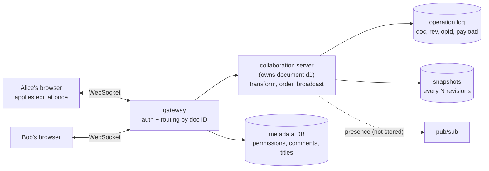
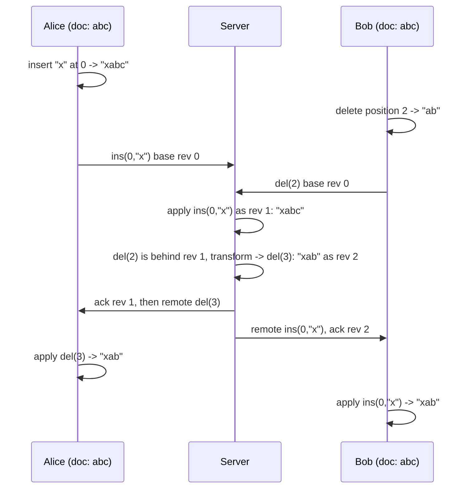
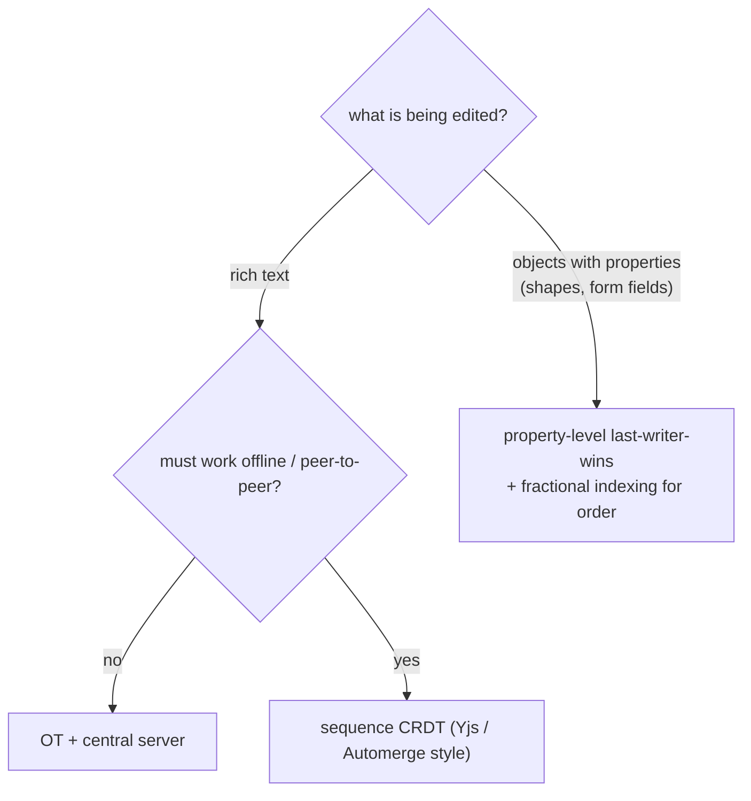
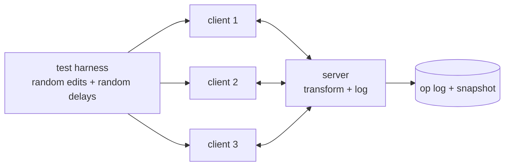

# Chapter 23 — Design a Collaborative Document Editor (Google Docs)

> **Volume 4 — High-Level Design** · [Contents](index.md) · ← [Chapter 22 — The 30-System Design Portfolio](ch22-the-30-system-design-portfolio.md) · Next → [Chapter 24 — Design an Auction Platform (eBay)](ch24-design-an-auction-platform-ebay.md)

---

## Concept

Design a document editor where many people type at the same time, each sees their own keystrokes instantly, and everyone ends with the **same** document. The hard part is not storage or scale; it is **convergence**: what happens when two people edit the same spot at the same moment.

**In one sentence:** let every client apply its own edit immediately, send the edit to a server that fixes one global order, and use either **operational transformation (OT)** or a **CRDT** so that concurrent edits, applied in different orders on different machines, still produce identical text.

**Mental model — two editors, one printed page.** Alice and Bob each hold a copy of the sentence "abc". Alice inserts "x" at the start; Bob deletes the "c". If Bob's instruction ("delete character 2") is replayed on Alice's copy unchanged, it deletes the wrong letter, because Alice's insert shifted everything right. **OT** rewrites Bob's instruction to "delete character 3" before replaying it. A **CRDT** avoids the problem by giving every letter a permanent name, so Bob's instruction says "delete the letter named c" and position never matters.

### 1. Requirements

| Functional | Non-functional |
|------------|----------------|
| create, open, and edit rich-text documents | **your own typing appears at once** (no waiting for the server) |
| many people edit one document at the same time | **convergence:** everyone ends with identical text |
| see others' cursors and selections (presence) | an edit is never lost once acknowledged (durability) |
| comments anchored to text, suggestions | opening a large document is fast |
| version history, undo and redo | works through brief disconnects; offline edits merge later |
| sharing and permissions (view, comment, edit) | scales to millions of documents; most have one editor, a few have dozens |

**Out of scope here:** spreadsheets and slides (same ideas, different data models), full-text search across documents, and the rendering engine.

### 2. Why the obvious approaches fail

| Approach | Why it fails |
|----------|--------------|
| **Lock the document** while someone edits | one person at a time; locks left behind by closed tabs |
| **Last write wins on the whole document** | the second save erases the first person's work |
| **Send the whole document on every keystroke** | far too much data, and it still needs a merge rule |
| **Send "insert at position 5" without adjusting** | positions go stale the moment another edit lands first |

So the system must send **operations** (small edits) and have a **rule that makes concurrent operations commute**, meaning the order they arrive in does not change the result.

### 3. Operational transformation (OT)

OT sends operations such as `insert(pos, char)` and `delete(pos)`. When an operation arrives that was made against an older version of the document, the receiver **transforms** it against the operations it has not seen, so it still means what its author intended.

* Worked example from the literature: start with `abc`. Operation O1 inserts `x` at position 0, and O2 deletes `c` (position 2). If O1 runs first, O2 must become `delete position 3`. Without that shift it would delete `b`. Either order then gives `xab`.
* **TP1** (the property a transform function must satisfy): for two concurrent operations a and b on the same document, applying a then transform(b, a) must equal applying b then transform(a, b).
* **The demo below satisfies TP1 but deliberately not TP2** (8 of the 729 operation triples on a 4-character document fail it). That is fine **only because a central server fixes one order**; do not reuse this `transform` in a peer-to-peer setting.
* **TP2** is a stricter three-operation condition. It is needed only when operations can be transformed in different document states, which is the situation that arises when there is no central server to fix one order.
* **History:** Ellis and Gibbs published the first OT algorithm in 1989. Nichols et al. (1995, the Jupiter system) simplified it with **a central server that orders operations**, and that centralized shape is what Google Wave and Google Docs followed. Wikipedia dates OT's adoption as a core technique behind Wave and Docs to 2009. Google's own blog series *What's different about the new Google Docs* (September 2010, including a post titled *Conflict resolution*) is the primary reference for the Docs design; papers that cite it describe OT with a single server that decides the total order of operations. Google's internal code is not public, so do not assume details beyond that.
* **Correctness is hard.** Early OT algorithms had correctness bugs, and published proofs are described as complicated and error-prone. This is why real systems pair OT with heavy randomized testing (as the demo below does).
* **Strengths:** small messages, no per-character IDs, mature (it has powered production editors for over a decade).
* **Weaknesses:** the transform rules grow quickly with every new operation type (rich text, tables, nested lists); in practice it uses a central server to order operations (peer-to-peer OT needs algorithms that satisfy TP2, which are hard to get right); per-user undo needs careful inverse transforms.

### 4. CRDTs (conflict-free replicated data types)

A CRDT designs the data structure itself so that replicas converge **without a transform step**. Shapiro, Preguiça, Baquero and Zawirski (2011) gave the formal conditions: if all replicas receive the same set of updates and concurrent updates commute, they converge ("strong eventual consistency"). Operation-based designs also need each update delivered after the updates it depends on (causal delivery); state-based designs instead merge whole states with an order-independent join.

For text, a **sequence CRDT** gives every character a unique, permanent ID and defines a total order over IDs.

* **Insert** names the character it goes *after* (by ID), not a numeric position.
* **Delete** marks the character as a **tombstone** instead of removing it, so later operations that refer to it still work.
* Two people inserting at the same spot get different IDs; the ID order decides which comes first, identically on every replica.
* **Strengths:** no central server needed for correctness (works peer-to-peer, offline-first); convergence is easier to argue than for OT transforms, though sequence CRDTs have their own pitfalls, such as concurrent inserts interleaving.
* **Weaknesses:** every character carries metadata; tombstones accumulate until **garbage collection**; identity-based positions are harder to retrofit onto an existing OT product.
* **Performance depends on the implementation, not just the idea.** One author's published benchmark (Seph Gentle, July 2021) replayed a real trace of about 260,000 edits ending at about 100,000 characters: an early Automerge preview took 291 s and about 880 MB, a list-based reference CRDT 31 s, Yjs 0.97 s and 3.3 MB, and plain string splicing 0.61 s. His conclusion is that slow CRDT numbers came from implementation choices (per-character objects, tree structures), and that run-length encoding and better data structures remove most of the cost. These are one person's single-user, local-replay measurements; they do not measure concurrent merging, network size, or load time.
* Production libraries such as **Yjs** and **Automerge** expose shared text types with formatting; Yjs's `Y.Text` supports formatting attributes and converts to and from Quill-style deltas.

### 5. A third way: property-level "last writer wins" (Figma's approach)

Not every editor is a text stream. For design tools, Figma's engineering post describes a deliberately simpler system:

* The **server is the central authority** and decides the order of events.
* The document is a tree of objects; each has properties. For one property on one object, **the last value the server receives wins**. Edits to different properties never conflict.
* Child order uses **fractional indexing** (a position is a fraction between neighbours); parent and position are stored together so a move is atomic; the server rejects changes that would create a cycle.
* Figma says CRDTs inspired the design but it does **not** use true CRDTs, because it can drop the overhead needed to work with no central authority. It chose not to use OT because OT seemed too complex for its needs.
* This works well when conflicts are rare and "pick one value" is acceptable. It would be wrong for text, where two people typing in the same paragraph must **both** keep their words.

### 6. Choosing

| | OT + central server | Sequence CRDT | Property-level LWW |
|-|---------------------|---------------|--------------------|
| Best for | rich text, Google-Docs-style | text with offline or peer-to-peer; local-first apps | structured objects (design tools, forms, settings) |
| Needs a central order | in practice yes (peer-to-peer OT needs TP2) | no (but a server still helps with persistence and auth) | yes |
| Message size | small | larger (IDs) | small |
| Merge quality for text | excellent if transforms are correct | excellent | **poor** (one writer wins) |
| Hard part | writing and proving transform rules | memory, tombstones, GC | deciding which conflicts you can accept |
| Undo | inverse transforms, tricky | tricky | simple (restore the old value) |

**Rule of thumb:** text collaboration → OT or a sequence CRDT; object graphs with rare conflicts → property-level LWW. A **server that orders operations** simplifies all three, and every large product uses one for permissions, persistence, and history anyway.

### 7. Architecture

* **Client:** applies the user's edit locally at once, keeps a small queue of unacknowledged operations, and sends them over a **WebSocket** ([Vol 1 Ch 43](../volume-1-cs-foundations/ch43-websockets-grpc-mqtt-and-sse.md)).
* **Collaboration server, one owner per document.** All editors of a document connect to the process that owns it, so one place orders operations. Figma's post says it runs a separate server process per multiplayer document. Route by document ID (consistent hashing or a routing table), and keep the mapping in a small shared store so another server can take over.
* **Operation log:** every accepted operation is appended with a revision number before it is acknowledged. This is the durable truth ([event sourcing, Vol 3 Ch 12](../volume-3-low-level-design/ch12-event-bus-cqrs-and-event-sourcing.md)).
* **Snapshots:** periodically store the full document at a revision, so opening a document loads the latest snapshot and replays only newer operations.
* **Presence (cursors, selections, "who is here"):** ephemeral. Broadcast through the document's server or a pub/sub channel, **never write it to the log**, drop it when the connection drops.
* **Metadata** (owner, title, permissions, comments, share links): a normal database (SQL). Figma's post says comments, users and teams live in Postgres, separate from the multiplayer system.
* **Permissions:** checked at connect time and on every operation, using the identity design in [Ch 19](ch19-authentication-and-authorization-in-system-design.md). A viewer's connection must be unable to send edits.
* **Comments and suggestions** are anchored to a **range**. When an operation arrives, the anchors are transformed too (or stored as CRDT positions), so a comment stays attached to its words.
* **Rich text:** model the document as text plus **attributes** on ranges (bold, link) and nested blocks (lists, tables). Each new operation type is more transform rules in OT; in a CRDT it is more metadata.

### 8. How one edit travels (OT with a central server)

1. Alice presses a key. Her client **applies it immediately** and, if nothing is in flight, sends `(operation, base revision)`.
2. The server receives it. If its log has newer operations than Alice's base revision, it **transforms** her operation past them, applies it, **appends it to the log**, and assigns the next revision.
3. The server **acknowledges** Alice and **broadcasts** the transformed operation to everyone else.
4. Each other client transforms the incoming operation against its own **unacknowledged** edits, then applies it. Alice's client, on the acknowledgement, sends her next queued edit (one operation in flight at a time keeps the client logic simple).

### 9. Scale, failure, and edge cases

* **Hot documents:** a document with hundreds of live editors is limited by one server's broadcast fan-out. Cap active editors (and make extra viewers read-only), batch operations every 50–200 ms, and send viewers a coalesced stream.
* **Reconnects:** the client reconnects, sends its last known revision and unacknowledged operations; the server transforms and applies them or tells the client to reload. Figma's client downloads a fresh copy on reconnect and re-applies its offline edits on top.
* **Duplicates:** give every operation a client-generated ID (client ID + counter) so a retry after a lost acknowledgement is ignored, not applied twice.
* **Server crash:** another server loads the latest snapshot, replays the log, and clients reconnect. Anything not yet in the log was never acknowledged, so clients still hold it and resend.
* **Ordering across servers:** never let two servers accept operations for the same document; use a lease or a consensus-backed owner record ([Vol 1 Ch 50–51](../volume-1-cs-foundations/ch50-cap-consistency-and-consensus.md)).
* **Log growth:** merge consecutive typing into runs, snapshot regularly, and keep full history only as long as the retention policy says.
* **Undo:** undo your own last edit, not everyone's. In OT that is the inverse operation transformed against everything since; in a CRDT it is another operation that targets the same character IDs.
* **Large pastes and bulk edits:** send them as one operation, not thousands of single characters (a known source of slowness in naive designs).

### 10. Estimates (illustrative assumptions; replace them with your own)

* 10M daily active users; at peak about **400,000 people typing at once**.
* A person typing about 40 words per minute produces roughly 3–4 characters per second. Batched every ~200 ms, an active typist sends at most about 3 non-empty messages per second; with pauses, take **2** on average (this counts content edits only, not cursor updates) → about **800k inbound messages/s**.
* Most documents have one or two editors; average broadcast fan-out of 1.5 → about **1.2M outbound messages/s**.
* Servers must handle inbound and outbound traffic: 0.8M + 1.2M ≈ **2M messages/s**. If one collaboration server handles about 40,000 messages/s in total (assumed) that is **50 servers**. Connections point the same way: assume 1M open connections (400k typists plus idle tabs and viewers) at about 20,000 per server → **50 servers**. With 2–3× headroom for peaks and failover, plan for roughly **100–150**.
* The log: at roughly 20 bytes per character operation, 400k typists × 3 chars/s ≈ **24 MB/s**. That is about **2 TB per day only if the peak lasted all day**; real daily volume is lower, so measure your daily average — and this is before compaction. Run-length merging of consecutive typing and batching commonly cut this by an order of magnitude; state your own compaction factor.

---

## Prereqs

* [Ch 4 — Distributed Systems Patterns](ch04-distributed-systems-patterns.md)
* [Ch 9 — Message Queues & Streaming (Kafka, SQS, Pub/Sub)](ch09-message-queues-and-streaming-kafka-sqs-pub.md)
* [Ch 19 — Authentication & Authorization in System Design](ch19-authentication-and-authorization-in-system-design.md)
* [Vol 1 Ch 43 — WebSockets, gRPC, MQTT & SSE](../volume-1-cs-foundations/ch43-websockets-grpc-mqtt-and-sse.md)
* [Vol 1 Ch 50 — CAP, Consistency & Consensus](../volume-1-cs-foundations/ch50-cap-consistency-and-consensus.md)
* [Vol 3 Ch 12 — Event Bus, CQRS & Event Sourcing](../volume-3-low-level-design/ch12-event-bus-cqrs-and-event-sourcing.md)

---

## Diagram

**Architecture**



**The worked example: concurrent insert and delete on "abc"**



**Which approach?**



---

## Example

Two small, runnable engines, both property-tested. The first is OT with a central server (the Jupiter / Google shape); the second is a tiny sequence CRDT.

```python
"""Operational transformation for plain text: single-character insert/delete,
a central server that orders operations (the Jupiter / Google-style design)."""

NOP = ("nop",)


def apply(doc, op):
    if op[0] == "ins":                      # ("ins", pos, char, site)
        return doc[:op[1]] + op[2] + doc[op[1]:]
    if op[0] == "del":                      # ("del", pos)
        return doc[:op[1]] + doc[op[1] + 1:]
    return doc


def transform(a, b):
    """Rewrite op `a` so it still means the same thing after concurrent op `b` has been applied."""
    if a == NOP or b == NOP:
        return a
    if a[0] == "ins" and b[0] == "ins":
        # same position: the lower site id goes first, so both sides pick the same order
        if a[1] < b[1] or (a[1] == b[1] and a[3] < b[3]):
            return a
        return ("ins", a[1] + 1, a[2], a[3])
    if a[0] == "ins" and b[0] == "del":
        return a if a[1] <= b[1] else ("ins", a[1] - 1, a[2], a[3])
    if a[0] == "del" and b[0] == "ins":
        return a if a[1] < b[1] else ("del", a[1] + 1)
    if a[1] < b[1]:                         # del vs del
        return a
    if a[1] > b[1]:
        return ("del", a[1] - 1)
    return NOP                              # both deleted the same character


class Server:
    def __init__(self, doc=""):
        self.doc, self.log = doc, []        # log[i] = the i-th operation, in server order

    def receive(self, op, base_rev):
        """A client built `op` when it had seen `base_rev` operations."""
        for old in self.log[base_rev:]:     # transform past everything the client has not seen
            op = transform(op, old)
        self.doc = apply(self.doc, op)
        self.log.append(op)
        return op                           # broadcast this form to the other clients


class Client:
    def __init__(self, site, doc=""):
        self.site, self.doc, self.rev = site, doc, 0
        self.inflight, self.buffer = None, []   # one op on the wire, the rest queued

    def local(self, op):
        self.doc = apply(self.doc, op)      # show my own edit immediately
        if self.inflight is None:
            self.inflight = op
            return (op, self.rev)           # message to send to the server
        self.buffer.append(op)
        return None

    def on_ack(self):
        self.rev += 1
        self.inflight = None
        if self.buffer:
            self.inflight = self.buffer.pop(0)
            return (self.inflight, self.rev)
        return None

    def on_remote(self, op):
        pending = ([self.inflight] if self.inflight else []) + self.buffer
        mine = []
        for p in pending:                   # pass the remote op through my unacknowledged ops
            op, p = transform(op, p), transform(p, op)
            mine.append(p)
        if self.inflight:
            self.inflight, self.buffer = mine[0], mine[1:]
        else:
            self.buffer = mine
        self.doc = apply(self.doc, op)
        self.rev += 1
```

```python
"""A tiny sequence CRDT (RGA style): every character has a unique id; inserts name the
character they go after; deletes leave a tombstone. Operations commute, so replicas
converge with no central server (they must still deliver an op after the ops it depends on)."""


class Replica:
    def __init__(self, site):
        self.site, self.clock = site, 0
        self.nodes = [("head", "", False)]          # (id, char, deleted); id = (counter, site)
        self.seen = set()                           # ids of ops already applied (makes delivery idempotent)

    def _index(self, node_id):
        for i, n in enumerate(self.nodes):
            if n[0] == node_id:
                return i
        return None

    def text(self):
        return "".join(c for _, c, dead in self.nodes if not dead)

    def _visible_ids(self):
        return [i for i, _, dead in self.nodes[1:] if not dead]

    def local_insert(self, pos, char):
        ids = self._visible_ids()
        after = ids[pos - 1] if pos > 0 else "head"
        self.clock += 1
        op = ("ins", (self.clock, self.site), after, char)
        self.apply(op)
        return op

    def local_delete(self, pos):
        op = ("del", ("d", self._visible_ids()[pos]))
        self.apply(op)
        return op

    def ready(self, op):                            # have the ops this one depends on arrived?
        target = op[2] if op[0] == "ins" else op[1][1]
        return target == "head" or self._index(target) is not None

    def apply(self, op):
        if op[0] == "ins":
            _, node_id, after, char = op
            if node_id in self.seen:
                return
            self.seen.add(node_id)
            self.clock = max(self.clock, node_id[0])
            i = self._index(after) + 1
            while i < len(self.nodes) and self.nodes[i][0] > node_id:   # skip newer siblings
                i += 1
            self.nodes.insert(i, (node_id, char, False))
        else:
            target = op[1][1]
            i = self._index(target)
            self.nodes[i] = (target, self.nodes[i][1], True)            # tombstone; repeating it is harmless
```

The key tests that were run against exactly this code (the full test file also contains `run_rga`, which does the same random-delivery check for the CRDT):

```python
from ot_core import NOP, Client, Server, apply, transform
import random
from collections import deque


def all_ops(doc, site, ch):
    ops = [("ins", p, ch, site) for p in range(len(doc) + 1)]
    ops += [("del", p) for p in range(len(doc))]
    return ops


def test_tp1():
    checked = 0
    for n in range(0, 5):
        doc = "abcd"[:n]
        for a in all_ops(doc, 1, "X"):
            for b in all_ops(doc, 2, "Y"):
                left = apply(apply(doc, a), transform(b, a))
                right = apply(apply(doc, b), transform(a, b))
                assert left == right, (doc, a, b, left, right)
                checked += 1
    return checked


def test_worked_example():
    # the textbook example: "abc"; O1 inserts "x" at 0, O2 deletes "c" (position 2)
    o1, o2 = ("ins", 0, "x", 1), ("del", 2)
    assert transform(o2, o1) == ("del", 3)
    assert apply(apply("abc", o1), transform(o2, o1)) == "xab"
    assert apply(apply("abc", o2), transform(o1, o2)) == "xab"


# ---------- OT: random clients + random network delays, all must converge ----------
def run_ot(seed, clients=3, steps=60):
    rnd = random.Random(seed)
    server = Server("hello")
    cs = [Client(i + 1, "hello") for i in range(clients)]
    up = [deque() for _ in cs]       # client -> server (FIFO per client)
    down = [deque() for _ in cs]     # server -> client (FIFO per client)

    def send(i, msg):
        if msg:
            up[i].append(msg)

    def edit(i):
        c = cs[i]
        if c.doc and rnd.random() < 0.4:
            op = ("del", rnd.randrange(len(c.doc)))
        else:
            op = ("ins", rnd.randint(0, len(c.doc)), rnd.choice("abcdefgh"), c.site)
        send(i, c.local(op))

    def deliver_up(i):
        op, base = up[i].popleft()
        out = server.receive(op, base)
        down[i].append(("ack", None))
        for j in range(len(cs)):
            if j != i:
                down[j].append(("op", out))

    def deliver_down(i):
        kind, op = down[i].popleft()
        if kind == "ack":
            send(i, cs[i].on_ack())
        else:
            cs[i].on_remote(op)

    for _ in range(steps):
        choice = rnd.random()
        if choice < 0.45:
            edit(rnd.randrange(len(cs)))
        elif choice < 0.72:
            ready = [i for i in range(len(cs)) if up[i]]
            if ready:
                deliver_up(rnd.choice(ready))
        else:
            ready = [i for i in range(len(cs)) if down[i]]
            if ready:
                deliver_down(rnd.choice(ready))
    while any(up) or any(down):      # drain the network
        for i in range(len(cs)):
            if up[i]:
                deliver_up(i)
            if down[i]:
                deliver_down(i)
    docs = {c.doc for c in cs} | {server.doc}
    assert len(docs) == 1, (seed, docs)
    assert all(c.inflight is None and not c.buffer for c in cs)
    return server.doc
```

```text
Results of running the full test file (Python 3):
  OT   TP1 checked for every pair of concurrent operations on documents up to 4 characters (165 pairs): pass
  OT   worked example "abc" -> "xab": pass
  OT   3,000 random runs, 3 clients, random network delays, all clients and the server identical: pass
  RGA  3,000 random runs, 3 replicas, random delivery order and duplicates, all identical: pass
  Sanity check of the tests themselves: removing the insert tie-break (OT) or the sibling-ordering step
  (CRDT) makes the tests fail, so they would catch those bugs.
```

**Wire format sketch (WebSocket, JSON):**

```json
{"type": "op",   "doc": "d1", "baseRev": 128, "opId": "c7-451", "ops": [{"ins": [12, "H"]}]}
{"type": "ack",  "doc": "d1", "rev": 129, "opId": "c7-451"}
{"type": "op",   "doc": "d1", "rev": 130, "from": "c3", "ops": [{"del": [4]}]}
{"type": "cursor", "doc": "d1", "from": "c3", "anchor": 18, "head": 22}
```

---

## Exercises

1. Walk through the `abc` example by hand: what does each site end with, and what would happen if the delete were not transformed?

   <details><summary>Solution</summary>Alice has <code>xabc</code> after inserting at 0. Bob has <code>ab</code> after deleting position 2. If the server applies Bob's unchanged <code>del(2)</code> to <code>xabc</code>, it removes <code>b</code> and gives <code>xac</code>, which is wrong. Transformed to <code>del(3)</code> it removes <code>c</code>, giving <code>xab</code>, and Bob's client applies <code>ins(0,"x")</code> to <code>ab</code> to get <code>xab</code> as well.</details>

2. Two people type different letters at the same position at the same time. How do OT and the CRDT each decide the order?

   <details><summary>Solution</summary>OT breaks the tie with a fixed rule, here the lower site ID goes first, and both sides apply the same rule so they pick the same order. The CRDT gives each insert a unique ID (counter, site) and orders siblings by ID, so every replica sorts them identically.</details>

3. Why does the CRDT keep deleted characters as tombstones?

   <details><summary>Solution</summary>Another replica may have made an insert "after" that character before it saw the delete. If the character were physically removed, that insert's reference would point at nothing. Tombstones keep references valid; garbage collection removes them only when every replica is known to have seen the delete.</details>

4. A user is offline for an hour and comes back. What happens in an OT design, a CRDT design, and a Figma-style property design?

   <details><summary>Solution</summary>OT: the client resends its unacknowledged operations with their base revision and the server transforms them past an hour of history, which can be long and awkward; many products make the client reload the latest copy and reapply local edits. CRDT: the replica exchanges missing operations in any order and converges, which is the natural fit for offline. Figma-style: the post describes downloading a fresh copy and re-applying offline edits on top; conflicting properties resolve to the last value the server sees.</details>

5. Why must presence (cursors) stay out of the operation log?

   <details><summary>Solution</summary>It changes many times per second, has no value after the user leaves, and would bloat the log and snapshot replay. It is broadcast and discarded. Only the document's content operations need durability and ordering.</details>

6. A document has 800 live editors and the owning server is overloaded. What do you change?

   <details><summary>Solution</summary>Cap the number of active editors and make the rest read-only viewers; send viewers a batched, coalesced stream instead of every keystroke; push fan-out to a pub/sub layer or edge relays while the one owning server still orders operations; and batch edits every 50–200 ms. Do not let a second server accept edits for the same document.</details>

---

## Mini project

**Build the editor core: an OT server with three clients, plus a CRDT replica, with property tests.**



**Steps**

1. Start from the code above. Add a text file that stores each server operation in an append-only log with its revision number.
2. Add snapshots: every 100 revisions write the document; make a new server start from the latest snapshot plus the log tail, and check it equals a replay from revision 0.
3. Add operation IDs and make a repeated `(client, opId)` a no-op, then test a lost acknowledgement.
4. Add a WebSocket layer (any language) so real browsers or scripts can connect; add a cursor message that is broadcast and not logged.
5. Add range **comments**: store each comment as a start and end position and transform both when operations arrive. Test that a comment still covers its words after concurrent edits.
6. Extend the operations to support **multi-character** inserts and deletes and show your property tests still pass (this is where transform bugs usually appear).
7. Implement per-user undo for your own edits and test it with concurrent edits from others.

**Done when:** thousands of randomized runs converge, a crashed server recovers to the same document from snapshot and log, a duplicate message changes nothing, and comments stay attached to their words.

---

## Design

**Design a collaborative document editor for 10M daily users.**

**Requirements.** Real-time editing for up to about 100 people per document (most have 1–3); rich text with comments and suggestions; version history; offline tolerance of minutes to hours; sharing with view, comment, and edit roles.

**Estimates.** See section 10: about 400k concurrent typists, ~0.8M inbound and ~1.2M outbound messages/s at peak, about 50 collaboration servers before headroom (100–150 with headroom), up to roughly 2 TB/day of raw operations if peak lasted all day (before compaction).

**API.**

| Interface | Purpose |
|-----------|---------|
| `POST /docs`, `GET /docs/{id}` | create and read metadata |
| `GET /docs/{id}/snapshot?rev=N` | fast load: snapshot plus operations after it |
| WebSocket `/docs/{id}/live` | operations, acks, presence |
| `GET /docs/{id}/history?from=&to=` | version history by revision range |
| `POST /docs/{id}/comments`, `PATCH .../comments/{cid}` | comments and resolution |
| `PUT /docs/{id}/permissions` | sharing |

**Data model.**

| Store | Key | Holds |
|-------|-----|-------|
| `docs` (SQL) | `doc_id` | owner, title, ACL, `latest_rev`, `snapshot_rev` |
| `ops` (append-only) | `(doc_id, rev)` | `op_id`, author, timestamp, payload |
| `snapshots` (object storage) | `(doc_id, rev)` | full document at that revision |
| `comments` (SQL) | `(doc_id, comment_id)` | anchor start and end, thread, state |

**Decisions to justify**

* OT with a central owner per document, versus a sequence CRDT: text quality, offline needs, team skill, and the cost of writing transforms for rich text.
* How a document is mapped to its owning server, and how ownership moves safely when a server fails.
* How often to snapshot, and how long to keep the full operation history.
* What happens to editors beyond the active-editor cap.
* How comment anchors and suggestions survive concurrent edits.
* How permissions are enforced on a live connection, including revoking access mid-session ([Ch 19](ch19-authentication-and-authorization-in-system-design.md)).
* How offline edits are merged, and when to refuse and ask the user to reload.
* Which numbers in your estimate you would validate first with a load test.

---

## Open source

* [`yjs/yjs`](https://github.com/yjs/yjs) and [`automerge/automerge`](https://github.com/automerge/automerge) — widely used CRDT libraries with shared text types.
* [`josephg/diamond-types`](https://github.com/josephg/diamond-types) — a fast CRDT implementation by the author of the benchmark cited above.
* [`share/sharedb`](https://github.com/share/sharedb) — a real-time database using OT, with a Node server.
* [`ether/etherpad-lite`](https://github.com/ether/etherpad-lite) — a long-running collaborative editor that uses OT.
* [`ProseMirror/prosemirror-collab`](https://github.com/ProseMirror/prosemirror-collab) — a central-authority collaboration module for a rich-text editor framework.

---

## Sources and verification

How this chapter was checked, and what was not:

* **Figma's multiplayer design** (server authority, last-writer-wins per property, fractional indexing, cycle handling, process per document, reconnect behaviour, Postgres for other data): read from Figma's own engineering post, *How Figma's multiplayer technology works*.
* **OT history and the TP1/TP2 definitions, the `abc` worked example, centralized (Jupiter, Google) versus peer-to-peer:** read from the Wikipedia article *Operational transformation*, which cites Ellis and Gibbs (1989, ACM SIGMOD '89) and Nichols et al. (1995). Wikipedia is a secondary source.
* **CRDT definition and convergence conditions:** Shapiro, Preguiça, Baquero, Zawirski, *Conflict-free replicated data types* (SSS 2011, LNCS 6976; INRIA report RR-7687). Only the bibliographic record and abstract-level claims were checked.
* **Performance figures:** Seph Gentle, *CRDTs go brrr* (July 2021). They are one author's measurements on one machine and one trace.
* **Yjs text type behaviour** (formatting attributes, Quill-style deltas): Yjs documentation for `Y.Text`.
* **Google Docs and OT.** Google published a blog series, *What's different about the new Google Docs* (September 2010; the *Conflict resolution* post is dated 22 September 2010). I confirmed the title and date of that post but the page text did not load for me, so the statement that Docs uses OT with a central server rests on the Wikipedia article and on research papers that cite the series. Google's internal implementation is not public.
* **Independent review.** A second reviewer checked this chapter's claims and code. It reproduced the test results, confirmed the Figma, Wikipedia, benchmark, and library claims listed above, and found the problems now fixed in this text: the server-count arithmetic, the typing-rate wording, the log-size assumption, the central-server wording, the TP2 limitation, and the CRDT definition.
* **Code:** the OT and CRDT code above was run. The OT code passes an exhaustive check of every pair of concurrent single-character operations on small documents and 3,000 random multi-client runs; the CRDT passes 3,000 random runs with reordered and duplicated delivery. Both test sets were mutation-checked (removing a key rule made them fail). This shows the demo is correct for **single-character operations on plain text**; it does **not** prove a production rich-text OT system correct.
* **Estimates** in section 10 are assumptions, labelled as such.

---

## Interview

1. **"How do two people edit the same document at once without overwriting each other?"**
   <details><summary>Answer</summary>Each client applies its edit locally at once and sends it as an operation to a server that orders operations. The system uses OT (transform concurrent operations so they still mean the same thing) or a sequence CRDT (give every character a unique ID so position does not matter). Either way, all replicas converge to the same text.</details>

2. **"OT versus CRDT: how do you choose?"**
   <details><summary>Answer</summary>OT with a central server gives small messages and is proven in production for rich text, but transform rules are hard to write and verify, and it needs the central order. CRDTs converge without a central order, which suits offline and peer-to-peer, but carry per-character metadata and need garbage collection. Pick by offline requirements, document model complexity, and team experience; either way keep a server for persistence, permissions, and history.</details>

3. **"What is a tombstone and why do you need it?"**
   <details><summary>Answer</summary>A marker left in place of a deleted character in a sequence CRDT. Other replicas may reference the character in operations they made before seeing the delete; removing it would break those references. Tombstones are cleaned up by garbage collection once every replica has seen the delete.</details>

4. **"How does a client show your own typing instantly yet stay correct?"**
   <details><summary>Answer</summary>It applies the edit optimistically, keeps it in a queue of unacknowledged operations, and when remote operations arrive it transforms them against that queue (OT) or merges by ID (CRDT). The server's order is the source of truth, and the client's view converges to it.</details>

5. **"How do you scale to millions of documents and a few very busy ones?"**
   <details><summary>Answer</summary>Shard by document ID so one server owns each active document and orders its operations. Scale out by adding servers and moving ownership. For a hot document, cap active editors, batch and coalesce updates, and fan out to read-only viewers through pub/sub. Store the log and snapshots in durable storage so any server can take over.</details>

6. **"What happens when the collaboration server crashes mid-edit?"**
   <details><summary>Answer</summary>Operations are acknowledged only after they are in the durable log, so nothing acknowledged is lost. Another server loads the latest snapshot, replays the log, and clients reconnect and resend anything unacknowledged, with operation IDs making retries safe.</details>

7. **"How do you handle undo in a collaborative editor?"**
   <details><summary>Answer</summary>Undo applies only the current user's last operation. In OT you build its inverse and transform it past everything that happened since; in a CRDT you issue a new operation that targets the same character IDs. Both are subtle, so test with concurrent edits.</details>

8. **"Why not keep presence (cursors) in the operation log?"**
   <details><summary>Answer</summary>It is high-frequency, short-lived, and worthless after the user leaves. It is broadcast and discarded; only content operations are persisted.</details>

---

## Checklist

- [ ] apply edits locally first; reconcile with the server's order afterwards
- [ ] choose OT, a sequence CRDT, or property-level LWW on purpose, and say why
- [ ] one owner per document orders its operations
- [ ] log every accepted operation durably before acknowledging it; snapshot regularly
- [ ] give every operation an ID so retries are harmless
- [ ] keep presence out of the log
- [ ] check permissions on the live connection, not only at page load
- [ ] test convergence with randomized edits and random delivery

---

> [Contents](index.md) · ← [Chapter 22 — The 30-System Design Portfolio](ch22-the-30-system-design-portfolio.md) · Next → [Chapter 24 — Design an Auction Platform (eBay)](ch24-design-an-auction-platform-ebay.md)
