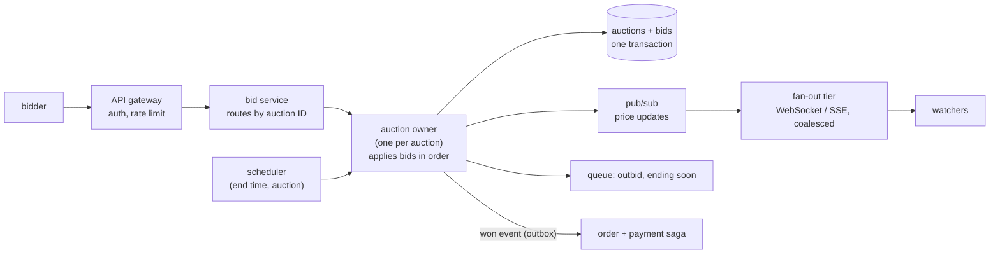
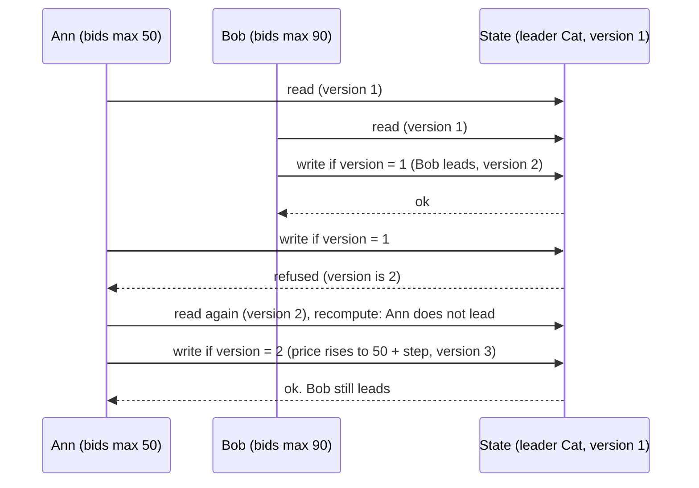
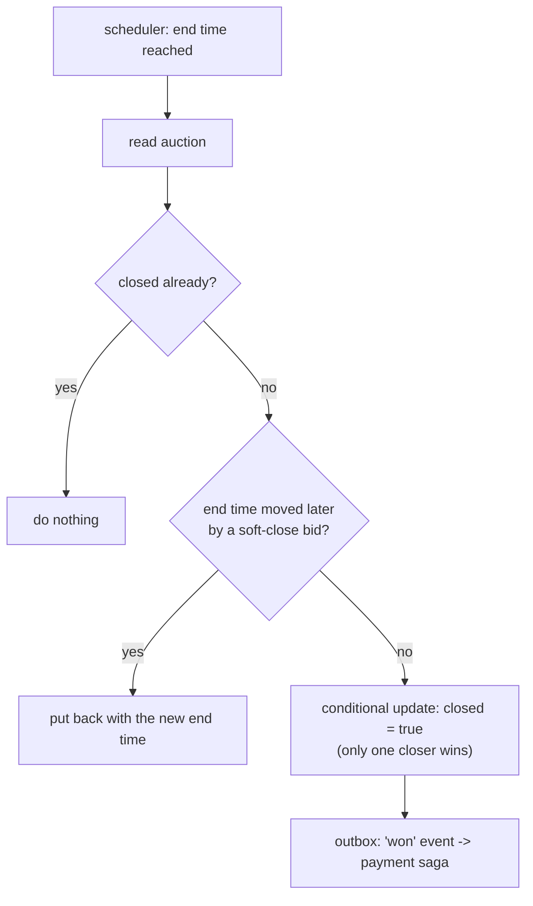
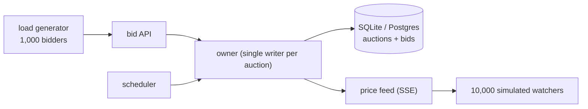

# Chapter 24 — Design an Auction Platform (eBay)

> **Volume 4 — High-Level Design** · [Contents](index.md) · ← [Chapter 23 — Design a Collaborative Document Editor (Google Docs)](ch23-design-a-collaborative-document-editor-google-docs.md)

---

## Concept

Design a platform where sellers list items and buyers bid until a closing time. The interesting parts are not listing and search; they are **correctness under simultaneous bids**, **the rush in the last seconds**, **fairness about time**, and **telling thousands of watchers the price changed**.

**In one sentence:** accept each bid through **one place that orders bids per auction**, apply simple deterministic rules (minimum increment, proxy maximum, tie-break, optional soft close), store every decision, and close the auction exactly once.

**Mental model — a clerk at the auction door.** Everyone shouts bids at once, but only one clerk writes them in the book, one at a time. Whatever order the clerk writes them is the order that counts. The clerk never lets two people write in the same line at the same time. Everything in this chapter is about building that clerk so it is correct, fast on a busy item, and does not fail if the clerk faints.

**Scope:** a timed, ascending auction with **proxy ("maximum") bidding**, as eBay-style sites run. Not covered: live floor auctions, sealed-bid and Dutch auctions, search, shipping, and payment-provider details.

### 1. Requirements

| Functional | Non-functional |
|------------|----------------|
| sellers list an item with a start price and an end time | **no lost or double-counted bids**, even when thousands arrive at once |
| buyers place bids; the highest bidder leads | the visible price and winner are always consistent |
| watchers see the current price and time left | the last seconds of a popular auction must not melt the system |
| outbid, ending-soon, and won notifications | fair about time: the server's clock decides, not the client's |
| the winner is determined once, at the end, and then pays | an auction closes **exactly once** |
| seller and buyer history | resists abuse: shill bidding, bots, bid retraction games |

### 2. The bidding rules (proxy bidding)

A bidder enters the **most they are willing to pay** (their *maximum*). The system bids for them in small steps, only as high as needed to stay in front. eBay's help pages describe it this way: the system bids in increments on the bidder's behalf to keep them in the lead, but only up to their limit.

**Bid increments.** The step grows with the price. eBay's published table (current price → increment):

| Current price | Increment |
|---------------|-----------|
| $0.01 – $0.99 | $0.05 |
| $1.00 – $4.99 | $0.25 |
| $5.00 – $24.99 | $0.50 |
| $25.00 – $99.99 | $1.00 |
| $100.00 – $249.99 | $2.50 |
| $250.00 – $499.99 | $5.00 |
| $500.00 – $999.99 | $10.00 |
| $1,000.00 – $2,499.99 | $25.00 |
| $2,500.00 – $4,999.99 | $50.00 |
| $5,000.00 and up | $100.00 |

**The visible price** is not the leader's maximum. It is **one increment above the second-highest maximum**, capped at the leader's own maximum. The standard example: a $12.00 maximum is outbid by a $15.00 maximum, and the price becomes $12.50 (the $12 bidder's maximum plus one $0.50 step). The $15.00 stays secret.

**The rules this chapter implements** (a design, in the spirit of eBay's published behaviour):

1. A new bid must be at least the visible price plus one increment (the first bid must be at least the start price).
2. A bid above the leader's maximum makes that bidder the leader, at second-highest maximum plus one increment, capped at the new maximum.
3. A bid **equal** to the leader's maximum does not take the lead: the **earlier** bid wins ties.
4. A bid below the leader's maximum does not change the leader; it raises the visible price to the challenger's maximum plus one increment (never above the leader's maximum).
5. The leader may **raise their own maximum**; this never changes the visible price (the price only rises when a challenger forces it) and **never extends the closing time** (see section 3).
6. **The leader's maximum is a secret.** It is stored on the server and never sent to clients.
7. **Duplicate requests are ignored**: the same bidder sending the same `bidId` again gets a `duplicate` answer and the bid is not applied twice (the client then reads the auction to learn the outcome; a production system can also store each outcome and return the original answer).

Rules 3 and 5 (and the extension rules in section 3) are design choices in this chapter, not claims about any particular site's exact behaviour.

### 3. Soft close and sniping

A **sniper** bids in the last seconds so rivals cannot react. A **soft close** (anti-sniping extension) answers this: if a bid arrives inside a **trigger window** before the end, the closing time is pushed out by an **extension**, up to an optional **maximum number of extensions**. Vendor documentation for auction software describes these three settings. Some sites use a fixed end time instead; the choice is a product decision.

The exact rules in this chapter's engine:

* **Reset mode:** the new end is *the bid's time + the extension length*, and only if that is later than the current end. (Some products instead *add* the extension to the current end; either is a valid choice, but pick one and say so.)
* An extension is **counted** only when it really moves the end, so an early bid inside a wide window cannot use up the allowance without effect.
* **A leader who only raises their own maximum does not extend the auction**, because that bid changes neither the price nor who is winning. Otherwise a leader could keep an auction open indefinitely at no cost.

Soft close costs something: closing times become unpredictable, so everything after the close (winner notification, payment, packing) must wait until the extensions stop.

### 4. The core problem: two bids at the same moment

Two bidders read "price $10, leader Cat". Ann bids $50 and Bob bids $90. If each computes a new state from the old one and **blindly writes it**, whoever writes last wins, even if that is Ann's lower bid. Bob's higher bid is silently lost. This is the lost-update problem.

You need a **single serialization point per auction**. Options:

| Option | How it works | Good for | Watch for |
|--------|--------------|----------|-----------|
| **Conditional update (optimistic)** | Read the row and its version; compute the new state; `UPDATE ... WHERE version = old`; retry if no row changed | simple; most auctions have few simultaneous bids | **retry storms** on a hot auction (many bidders keep retrying the same row) |
| **Atomic script in Redis (Lua)** | the whole read-compute-write runs as one script; Redis guarantees atomic execution and blocks other work while it runs | very low latency; the logic lives next to the data | scripts must be short; you must pass every key the script touches as an argument; scripts are not persisted and the script cache can be lost on restart or failover, so the client must reload them; data durability depends on Redis persistence and replication |
| **Single writer per auction** (a partitioned log or an actor: all bids for an auction go to one partition and one consumer applies them in order) | ordering is built in; replay from the log is natural | hot auctions; audit; recovery | hot-partition limits; failover must guarantee only one writer |
| **Distributed lock** | take a lock, read, write, release | seems easy | lock timeouts and clock problems create exactly the double-writer bug you were avoiding; prefer the options above |

**A practical design:** route all bids for one auction to **one owner** (a partition or shard chosen by auction ID). Inside the owner, apply bids one at a time with the pure function in the example below, write the result and the bid record in one transaction, and publish the outcome. Use the conditional-update variant for the long tail of quiet auctions and a single-writer queue for the few hot ones.

### 5. Time, ordering, and fairness

* **The server's clock decides.** Never trust a client timestamp. Stamp each bid with the time the owner receives it, and compare against the auction's end time on the same clock. With optimistic retries, **read the clock again on every attempt** (the example's `bid` accepts a clock function for this reason); a bid that loses a race and retries after the end time must be refused.
* **Arrival order is the order.** Two bids in the same millisecond are ordered by the owner's queue, not by anything the clients sent.
* **Reject after the end at the owner.** Closing is a separate job that may run a little late; because the owner refuses bids after the end time, a late close job is harmless.
* **Latency is unfair by nature.** A bidder on a slow link loses to one on a fast link. State it in the rules, and show a server-time countdown, not the user's device time.

### 6. Closing an auction exactly once

* A **scheduler** holds `(end time, auction ID)`. Use a sorted set or delayed queue, a timer wheel, or a durable timer service. The example uses a heap.
* When an auction is due, the closer reads the current auction state. If a soft-close extension moved the end later, it **puts the auction back** with the new end time instead of closing.
* Closing is an **idempotent conditional update**: set closed only if not closed and the end time has passed (`UPDATE ... SET closed = true WHERE id = ? AND closed = false AND end_at <= now`). Two closers racing both succeed safely, because only one change happens.
* **Closing storms:** many auctions end on the hour and at midnight. Spread work across partitions and workers, and use a queue so each closed auction becomes one durable event.
* After the close, publish a `won` event through a **transactional outbox** ([Vol 1 Ch 52](../volume-1-cs-foundations/ch52-event-sourcing-and-cqrs-distributed-view.md)). Downstream steps (invoice, payment, notifications) run as a saga ([Ch 12](ch12-event-driven-systems.md)). If the winner does not pay, offer the item to the next-highest bidder or relist it.

### 7. Watchers, fan-out, and the last minute

* A popular auction may have 100,000 watchers. Do not send each one every bid. **Coalesce:** send at most one or two price updates per second per auction, and always the latest.
* Deliver by **WebSocket or Server-Sent Events** ([Vol 1 Ch 43](../volume-1-cs-foundations/ch43-websockets-grpc-mqtt-and-sse.md)) fed by a pub/sub channel per auction. Viewers who are not bidding can fall back to polling a cached price endpoint every few seconds.
* **Cache** the read side (title, photos, current price) at a CDN or cache layer ([Ch 7](ch07-caching-strategies.md), [Ch 14](ch14-cdn-edge-and-geo-distribution.md)). Only the bid endpoint touches the owner.
* **Notifications** (outbid, ending soon, won) go through a queue ([Ch 9](ch09-message-queues-and-streaming-kafka-sqs-pub.md)) so a slow email provider cannot slow bidding.
* **Rate-limit bids** per user and per auction ([Ch 8](ch08-rate-limiting-throttling-and-backpressure.md)) to stop bots and accidental loops.

### 8. Data model

* **`auctions`**: `auction_id`, `seller_id`, title, `start_price`, `end_at`, `state`, `version`, `leader_id`, **`top_max` (secret)**, `price`, `ext_used`, soft-close settings.
* **`bids`** (append-only): `auction_id`, `seq`, **`bid_id` (unique)**, `bidder_id`, `max_amount`, `outcome` (accepted, too low, closed, duplicate), `received_at`. Keep rejected bids too; they are evidence in disputes. (The demo engine keeps only the ID of a rejected bid; a real system writes the outcome to the log.)
* **`watchers`**, **`notifications`**, and later **`orders`** and **`payments`**.
* Keep **money as integers** (cents). The example does.
* **Never return `top_max`** from any API. Return the price, the bid count, and whether *you* are leading.

### 9. Abuse and trust

* **Shill bidding:** a seller (or friends) bids up their own item. Detect with account linking, device and payment signals, and bid-pattern analysis; forbid sellers from bidding on their own items.
* **Bots and snipers:** rate limits, bot detection, and soft close reduce the benefit. Third-party sniping tools exist; decide whether to allow them.
* **Retractions and non-paying winners:** define when a bid may be retracted, track a buyer's history, and consider requiring a verified payment method for high-value items.
* **Identity and permissions:** use the design in [Ch 19](ch19-authentication-and-authorization-in-system-design.md); a bidder must be authenticated, and sellers' tools must be separated from buyers'.

### 10. Estimates (illustrative assumptions; replace them with your own)

* 10 million live auctions; 2 million bids per hour on average → about **550 bids/s**.
* Bids cluster near the end. Assume a **20× peak** for the busiest minutes → about **11,000 bids/s** overall.
* The hottest single auction might see **500 bids/s** in its last 10 seconds. That is a single-key problem, which is why one auction must be handled by one owner and why conditional-update retries can pile up.
* Auction state (current price, leader, counters; the secret maximum): assume about 1 KB × 10 million live auctions ≈ **10 GB**, small enough to keep in memory across a few owner nodes.
* Bid storage: about 200 bytes per bid × 48 million bids/day ≈ **10 GB/day** (before indexes and replicas).
* Watchers: if 100,000 people watch the hottest auction and you coalesce to 1 update per second, that is **100,000 messages/s** for that one auction, so push through a fan-out tier and not through the bid owner.

---

## Prereqs

* [Ch 7 — Caching Strategies](ch07-caching-strategies.md)
* [Ch 8 — Rate Limiting, Throttling & Backpressure](ch08-rate-limiting-throttling-and-backpressure.md)
* [Ch 9 — Message Queues & Streaming (Kafka, SQS, Pub/Sub)](ch09-message-queues-and-streaming-kafka-sqs-pub.md)
* [Ch 12 — Event-Driven Systems](ch12-event-driven-systems.md)
* [Ch 19 — Authentication & Authorization in System Design](ch19-authentication-and-authorization-in-system-design.md)
* [Vol 1 Ch 47 — ACID, Transactions & Isolation](../volume-1-cs-foundations/ch47-acid-transactions-and-isolation.md)

---

## Diagram

**Architecture**



**Two bids at the same moment: why serialization matters**



**Closing with a soft close**



---

## Example

A working auction engine: proxy bidding, soft close, duplicate protection, optimistic concurrency, and a closing scheduler. The decision logic is a **pure function**, so it is easy to test and easy to run inside any owner (a database transaction, a Redis script, or a single-writer consumer).

```python
"""Timed auction with proxy ("maximum") bidding, optional soft close, duplicate-safe bids,
optimistic concurrency, and a closing scheduler. Money is integer cents; time is seconds."""
import heapq
import threading
from dataclasses import dataclass, replace

# eBay's published increment table: from this price (cents) up, the increment (cents) is ...
INCREMENTS = [(0, 5), (100, 25), (500, 50), (2500, 100), (10000, 250), (25000, 500),
              (50000, 1000), (100000, 2500), (250000, 5000), (500000, 10000)]


def increment(price):
    step = INCREMENTS[0][1]
    for floor, s in INCREMENTS:
        if price >= floor:
            step = s
    return step


@dataclass(frozen=True)
class Auction:
    start: int                      # starting price
    end: int                        # closing time
    window: int = 0                 # soft close: a bid this close to the end ...
    extend: int = 0                 # ... moves the end to (bid time + extend), if that is later ...
    max_ext: int = 0                # ... at most this many times
    ext_used: int = 0
    leader: str = None
    top: int = 0                    # the leader's secret maximum
    price: int = 0                  # the price everyone sees
    bids: tuple = ()                # accepted bids: (bid_id, bidder, max, time)
    seen: frozenset = frozenset()   # every (bidder, bid_id) already handled (accepted or rejected)
    closed: bool = False
    version: int = 0                # bumped on every change; used for compare-and-set


def place_bid(a, bidder, mx, now, bid_id):
    """Pure function: (auction, bid) -> (new auction, status). `now` must come from the server's clock."""
    key = (bidder, bid_id)
    if key in a.seen:
        return a, "duplicate"                              # a retry of a request already handled
    if a.closed or now >= a.end:
        return a, "closed"
    seen = a.seen | {key}
    if a.leader is None:
        if mx < a.start:
            return replace(a, seen=seen, version=a.version + 1), "too_low"
        leader, top, price = bidder, mx, a.start
    elif bidder == a.leader:                               # the leader raises their own maximum
        if mx <= a.top:
            return replace(a, seen=seen, version=a.version + 1), "too_low"
        leader, top, price = bidder, mx, a.price
    elif mx < a.price + increment(a.price):                # must beat the visible price by one increment
        return replace(a, seen=seen, version=a.version + 1), "too_low"
    elif mx > a.top:                                       # new leader pays one increment over the old maximum
        leader, top, price = bidder, mx, max(a.price, min(mx, a.top + increment(a.top)))
    elif mx == a.top:                                      # tie: the earlier bid keeps the lead
        leader, top, price = a.leader, a.top, a.top
    else:                                                  # leader stays; price rises toward the challenger's maximum
        leader, top, price = a.leader, a.top, max(a.price, min(a.top, mx + increment(mx)))
    end, used = a.end, a.ext_used
    if (a.extend and bidder != a.leader                   # a leader raising their own maximum never extends
            and now >= a.end - a.window and used < a.max_ext
            and now + a.extend > a.end):                   # only count an extension that really moves the end
        end, used = now + a.extend, used + 1               # soft close ("reset" mode: end = bid time + extend)
    return replace(a, leader=leader, top=top, price=price, end=end, ext_used=used,
                   bids=a.bids + ((bid_id, bidder, mx, now),), seen=seen, version=a.version + 1), "ok"


class Store:
    """Stands in for a database row with a conditional update (compare-and-set on version)."""
    def __init__(self, auction):
        self._a, self._lock = auction, threading.Lock()

    def get(self):
        return self._a

    def cas(self, expected_version, new):
        with self._lock:
            if self._a.version != expected_version:
                return False
            self._a = new
            return True


def bid(store, bidder, mx, now, bid_id, hook=None):
    """`now` is a number (tests) or a function returning the server's clock (production): it is read again
    on every retry, so a bid that loses a race and retries after the end time is correctly refused."""
    while True:                                            # optimistic concurrency: retry on conflict
        a = store.get()
        new, status = place_bid(a, bidder, mx, now() if callable(now) else now, bid_id)
        if hook:
            hook()                                         # tests use this to force an interleaving
        if new is a or store.cas(a.version, new):
            return status


class Scheduler:
    """Closes auctions when due. Extended auctions are re-queued; closing is idempotent."""
    def __init__(self):
        self.heap = []

    def schedule(self, end, auction_id):
        heapq.heappush(self.heap, (end, auction_id))

    def due(self, now, stores):
        closed = []
        while self.heap and self.heap[0][0] <= now:
            _, aid = heapq.heappop(self.heap)
            while True:
                a = stores[aid].get()
                if a.closed:
                    break
                if a.end > now:                            # a late bid pushed the end out: look again later
                    heapq.heappush(self.heap, (a.end, aid))
                    break
                if stores[aid].cas(a.version, replace(a, closed=True, version=a.version + 1)):
                    closed.append(aid)
                    break
        return closed
```

The tests that were run against exactly this code. They include a deliberately broken "blind write" version to show the lost-update bug is real:

```python
import random
import threading
import time
from dataclasses import replace

from auction_core import Auction, Scheduler, Store, bid, increment, place_bid


def test_increment_table_boundaries():
    # eBay's table: $0.01-0.99 -> 0.05, 1.00-4.99 -> 0.25, 5.00-24.99 -> 0.50, 25.00-99.99 -> 1.00, ...
    cases = {1: 5, 99: 5, 100: 25, 499: 25, 500: 50, 2499: 50, 2500: 100, 9999: 100, 10000: 250,
             24999: 250, 25000: 500, 49999: 500, 50000: 1000, 99999: 1000, 100000: 2500,
             249999: 2500, 250000: 5000, 499999: 5000, 500000: 10000, 9_000_000: 10000}
    for price, step in cases.items():
        assert increment(price) == step, (price, step)


def test_ebay_style_example():
    # $12.00 maximum, then a $15.00 maximum: the price becomes $12.50 (one $0.50 step over the loser)
    a = Auction(start=100, end=1000)
    a, s1 = place_bid(a, "ann", 1200, 1, "b1")
    a, s2 = place_bid(a, "bob", 1500, 2, "b2")
    assert (s1, s2) == ("ok", "ok") and a.leader == "bob" and a.price == 1250 and a.top == 1500


def oracle(a):
    """Closed-form expectation from the accepted bids only.
    The leader is the earliest bid with the highest maximum. The price is set by the last bid that was
    NOT the leader raising their own maximum (a raise never changes the visible price):
    price = min(leader's max, second-highest max + its increment), but never below the start price."""
    if not a.bids:
        return None, 0
    leader, top, last_forcing = None, -1, 0
    for k, (_, bidder, mx, _) in enumerate(a.bids, 1):
        if bidder != leader:
            last_forcing = k
        if mx > top:                                       # strictly greater: the earlier bid wins ties
            leader, top = bidder, mx
    prefix = a.bids[:last_forcing]
    best = max(b[2] for b in prefix)
    lead = next(b[1] for b in prefix if b[2] == best)
    others = [b[2] for b in prefix if b[1] != lead]
    price = a.start if not others else max(a.start, min(best, max(others) + increment(max(others))))
    return leader, price


def check(a):
    leader, price = oracle(a)
    assert a.leader == leader, (a.leader, leader)
    assert a.price == price, (a.price, price)
    if a.leader:
        assert a.start <= a.price <= a.top
    assert a.ext_used <= a.max_ext
    keys = [(b[1], b[0]) for b in a.bids]
    assert len(keys) == len(set(keys)), "a bid was accepted twice"


def test_random_sequential(trials=3000):
    for seed in range(trials):
        rnd = random.Random(seed)
        a = Auction(start=rnd.choice([100, 500, 2500]), end=1000, window=30, extend=30, max_ext=3)
        now, last_price, moves = 0, 0, 0
        for i in range(rnd.randint(1, 25)):
            now += rnd.randint(0, 60)
            bidder = rnd.choice(["a", "b", "c", "d"])
            mx = rnd.randint(50, 30000)
            before = a
            a, status = place_bid(a, bidder, mx, now, f"id{seed}-{i}")
            if status == "ok":
                assert now < a.end                                 # never accepted after the end
            else:
                assert a.bids == before.bids and a.leader == before.leader and a.price == before.price
            assert a.price >= last_price                           # the visible price never goes down
            last_price = a.price
            assert a.end >= before.end                             # the end never moves earlier
            moves += a.end > before.end
            assert a.ext_used == moves                             # an extension is counted only when the end moves
            check(a)


def test_duplicate_is_ignored():
    a = Auction(start=100, end=1000)
    a, _ = place_bid(a, "ann", 500, 1, "same")
    again, status = place_bid(a, "ann", 500, 2, "same")
    assert status == "duplicate" and again is a
    other, status = place_bid(a, "bob", 900, 3, "same")             # same id from a different bidder is a new bid
    assert status == "ok" and other.leader == "bob"


def test_extension_is_counted_only_when_the_end_moves():
    a = Auction(start=100, end=100, window=30, extend=10, max_ext=1)
    a, _ = place_bid(a, "ann", 500, 75, "1")                       # inside the window, but 75 + 10 < 100
    assert a.end == 100 and a.ext_used == 0
    a, _ = place_bid(a, "bob", 900, 95, "2")                       # 95 + 10 > 100: the end moves
    assert a.end == 105 and a.ext_used == 1


def test_leader_raising_their_own_maximum_does_not_extend():
    a = Auction(start=100, end=100, window=10, extend=10, max_ext=3)
    a, _ = place_bid(a, "ann", 500, 50, "1")
    a, _ = place_bid(a, "ann", 900, 95, "2")                       # ann leads and only raises her ceiling
    assert a.end == 100 and a.ext_used == 0 and a.price == 100
    a, _ = place_bid(a, "bob", 700, 96, "3")                       # a real challenger does extend
    assert a.end == 106 and a.ext_used == 1


def test_soft_close_and_cap():
    a = Auction(start=100, end=100, window=10, extend=10, max_ext=2)
    a, _ = place_bid(a, "ann", 500, 50, "1")
    assert a.end == 100                                            # early bid: no extension
    a, _ = place_bid(a, "bob", 900, 95, "2")
    assert a.end == 105 and a.ext_used == 1
    a, _ = place_bid(a, "ann", 1500, 104, "3")
    assert a.end == 114 and a.ext_used == 2
    a, _ = place_bid(a, "bob", 2500, 113, "4")
    assert a.end == 114 and a.ext_used == 2                        # cap reached: end no longer moves
    a, status = place_bid(a, "ann", 4000, 114, "5")
    assert status == "closed"


# ---- concurrency: a broken "blind write" version versus compare-and-set ----
def naive_bid(store, bidder, mx, now, bid_id, hook):
    a = store.get()
    new, status = place_bid(a, bidder, mx, now, bid_id)
    hook()
    store._a = new                                                 # blind write: overwrites whatever is there now
    return status


def force_race(bid_fn):
    """Two bidders read the same state; bob (the higher bid) commits first, ann (lower) commits last."""
    store = Store(replace(Auction(start=100, end=1000), leader="cat", top=1000, price=100,
                          bids=(("c0", "cat", 1000, 0),), seen=frozenset({"c0"}), version=1))
    both_read = threading.Barrier(2)
    bob_done = threading.Event()
    calls = {"bob": 0, "ann": 0}

    def bob_hook():
        calls["bob"] += 1
        if calls["bob"] == 1:                                      # only the first read is synchronised
            both_read.wait(timeout=5)

    def ann_hook():
        calls["ann"] += 1
        if calls["ann"] == 1:
            both_read.wait(timeout=5)
            bob_done.wait(timeout=5)                               # ann commits after bob

    def run_bob():
        bid_fn(store, "bob", 9000, 5, "bob-1", bob_hook)
        bob_done.set()

    t1 = threading.Thread(target=run_bob)
    t2 = threading.Thread(target=lambda: bid_fn(store, "ann", 5000, 6, "ann-1", ann_hook))
    t1.start(); t2.start(); t1.join(); t2.join()
    return store.get()


def test_blind_write_loses_the_highest_bid():
    final = force_race(naive_bid)
    assert final.leader == "ann"                                   # the bug: bob's 9000 was overwritten


def test_compare_and_set_keeps_the_highest_bid():
    final = force_race(bid)
    assert final.leader == "bob" and final.top == 9000 and final.price == 5100
    check(final)


def test_threaded_stress():
    rnd = random.Random(7)
    store = Store(Auction(start=100, end=10**9))
    jitter = lambda: time.sleep(rnd.random() * 0.0005)
    results, lock = [], threading.Lock()

    def worker(w):
        local = random.Random(w)
        for i in range(150):
            st = bid(store, f"u{w}", local.randint(100, 50000), i, f"w{w}-{i}", jitter)
            with lock:
                results.append(st)

    threads = [threading.Thread(target=worker, args=(w,)) for w in range(8)]
    [t.start() for t in threads]; [t.join() for t in threads]
    final = store.get()
    assert len(results) == 1200 and results.count("ok") == len(final.bids)
    assert len(final.seen) == 1200                                 # every request was recorded exactly once
    check(final)


def test_retry_after_a_lost_race_uses_a_fresh_clock():
    store = Store(Auction(start=100, end=100))
    clock = [99]

    def interfere():                                               # during bob's first attempt, someone else commits
        if clock[0] == 99:
            a = store.get()
            new, _ = place_bid(a, "ann", 500, 99, "ann-1")
            assert store.cas(a.version, new)
            clock[0] = 101                                         # and the clock passes the end time

    assert bid(store, "bob", 900, lambda: clock[0], "bob-1", interfere) == "closed"
    assert store.get().leader == "ann"


def test_scheduler_closes_once_and_requeues_extended():
    stores = {"x": Store(Auction(start=100, end=100, window=10, extend=10, max_ext=2))}
    sched = Scheduler()
    sched.schedule(100, "x")
    bid(stores["x"], "ann", 500, 95, "1")                          # extends the end to 105
    assert sched.due(101, stores) == [] and not stores["x"].get().closed
    assert sched.due(105, stores) == ["x"] and stores["x"].get().closed
    sched.schedule(105, "x")                                       # a stale duplicate entry
    assert sched.due(200, stores) == []                            # already closed: nothing happens
    assert bid(stores["x"], "bob", 9000, 106, "2") == "closed"


if __name__ == "__main__":
    test_increment_table_boundaries(); print("increment table matches eBay's published tiers: ok")
    test_ebay_style_example(); print("$12 max vs $15 max -> $12.50: ok")
    test_random_sequential(); print("3,000 random bid sequences match the closed-form oracle: ok")
    test_duplicate_is_ignored(); test_soft_close_and_cap(); print("duplicates ignored; soft close + cap: ok")
    test_extension_is_counted_only_when_the_end_moves(); test_leader_raising_their_own_maximum_does_not_extend()
    print("extension counted only when the end moves; a leader's own raise does not extend: ok")
    test_retry_after_a_lost_race_uses_a_fresh_clock(); print("a retry after a lost race re-reads the clock: ok")
    test_blind_write_loses_the_highest_bid(); print("blind write version loses the higher bid (the bug is real): ok")
    test_compare_and_set_keeps_the_highest_bid(); print("compare-and-set keeps the higher bid: ok")
    for _ in range(5):
        test_threaded_stress()
    print("5 threaded stress runs (8 threads x 150 bids): ok")
    test_scheduler_closes_once_and_requeues_extended(); print("scheduler: closes once, re-queues extended: ok")
```

```text
Results of running the full test file (Python 3):
  increment table matches eBay's published tiers at every boundary: pass
  $12.00 maximum vs $15.00 maximum -> $12.50 visible price: pass
  3,000 random bid sequences (4 bidders, soft close) agree with a separately written closed-form check
  of leader and price, and the end time and extension count behave: pass
  duplicate bids are ignored (a different bidder reusing the ID is a new bid); soft close extends and stops at the cap: pass
  an extension is counted only when the end moves; a leader raising their own maximum does not extend: pass
  a retry after a lost race re-reads the clock and refuses a bid that is now too late: pass
  blind-write version: the higher bid is overwritten (the bug is real): pass
  compare-and-set version: the higher bid survives, price 51.00: pass
  5 threaded stress runs (8 threads x 150 bids each): every request recorded once, state matches the check: pass
  scheduler: closes once, re-queues an extended auction, ignores a stale entry: pass
```

**Checking the tests themselves.** Each of these deliberate edits to the engine makes the test file fail, so the tests do guard these rules:

| Edit made to the engine | Rule it breaks |
|-------------------------|----------------|
| `if a.closed or now >= a.end:` → `if False:` | no bids after the close |
| `if key in a.seen:` → `if False:` | duplicate bids ignored |
| remove `and used < a.max_ext` | soft-close cap |
| `elif mx > a.top:` → `elif mx >= a.top:` | earlier bid wins ties |
| `elif mx < a.price + increment(a.price):` → `elif False:` | minimum bid |
| let the leader set a lower maximum | leader can only raise their maximum |
| `a.top + increment(a.top)` → `a.top + 1` | price uses the increment table |
| remove `and now + a.extend > a.end` | an extension is counted only when the end moves |
| `bidder != a.leader` → `True` | a leader's own raise never extends |
| read the clock once, outside the retry loop | each retry re-reads the clock |
| `key = (bidder, bid_id)` → `key = bid_id` | duplicates are per bidder |

Two other edits I tried at first did not change behaviour (the `max()` that stops the price falling is redundant given the minimum-bid rule, and a disabled tie branch falls through to code that gives the same result), so they are not counted.

**Bid request and response sketch (HTTPS, JSON):**

```json
POST /auctions/8841/bids
{"bidId": "9d3f-...-c1", "maxAmount": 1500}

200 {"status": "ok", "youLead": true, "price": 1250, "endsAt": "2026-10-20T18:05:00Z"}
200 {"status": "too_low", "minimumBid": 1300}
409 {"status": "closed"}
```

---

## Exercises

1. A bidder bids a maximum of $12.00, then another bids $15.00. What does everyone see, and what is secret?

   <details><summary>Solution</summary>The $15.00 bidder leads and the visible price is $12.50: the loser's maximum ($12.00) plus one $0.50 step. The $15.00 maximum is stored on the server and never sent to clients. The loser sees only that they were outbid.</details>

2. Two bidders read the auction at the same instant and both write back. Why is the result wrong, and how do conditional updates fix it?

   <details><summary>Solution</summary>Each computed a new state from the same old one, so whoever writes last overwrites the other, and a higher bid can be lost. With a conditional update (<code>WHERE version = old</code>) the second writer is refused, reads the fresh state, recomputes, and writes again, so both bids are applied in some order and the higher one survives.</details>

3. A mobile app times out and retries the same bid three times. How do you avoid counting it three times?

   <details><summary>Solution</summary>The client generates a unique <code>bidId</code> once per bid and reuses it on retries. The owner records every (bidder, <code>bidId</code>) it has handled (a unique constraint on the bids table) and does not apply a repeat again: the demo answers <code>duplicate</code> and the client reads the auction to see the outcome; a production system can store each outcome and return the original answer.</details>

4. One auction gets 500 bids per second in its last 10 seconds, and conditional-update retries are piling up. What do you change?

   <details><summary>Solution</summary>Stop letting bidders race on the row. Send every bid for that auction to one owner (a partition and a single consumer, or a short atomic script) that applies bids in order. Retries disappear because there is only one writer. Keep the optimistic approach for quiet auctions.</details>

5. The user's phone shows 17:59:58 when they tap Bid, but the request reaches the server at 18:00:00.1 by the server's clock, and the auction ends at 18:00:00. Is the bid accepted?

   <details><summary>Solution</summary>No. The server's clock decides, not the client's. The owner compares the time it received the bid against the end time. Display a countdown based on server time (and tell users that network delay counts against them).</details>

6. With a 60-second soft close in reset mode, an auction scheduled to end at 18:00 receives a bid at 17:59:55 from a challenger, so it now ends at 18:00:55. What must the closer do at 18:00?

   <details><summary>Solution</summary>Read the current state, see that the end time moved, and put the auction back on the schedule for 18:00:55 without closing it. Closing is only done by a conditional update that checks the end time, so a closer that raced with a late bid cannot close an auction that was just extended.</details>

---

## Mini project

**Build the bid owner, a closing scheduler, and a live price feed.**



**Steps**

1. Start from the engine above. Store each auction and each bid in a database; write the new state and the bid record in **one transaction**.
2. Put an HTTP API in front (`POST /auctions/{id}/bids`, `GET /auctions/{id}`). Add authentication so a bidder can only bid as themselves, and make sure no response ever contains the leader's maximum.
3. Add per-auction ordering: one worker per auction (a queue per auction ID) so there is a single writer, and compare it with the conditional-update version under a load test.
4. Add the scheduler as a separate process using a durable table or queue of `(end time, auction ID)`; restart it in the middle of a run and check each auction still closes exactly once.
5. Add an SSE price feed that coalesces to one update per second per auction, and measure the fan-out cost with 10,000 simulated watchers.
6. Add a `won` event through an outbox table and a consumer that creates an order once, even if the event is delivered twice.
7. Run a chaos test: random duplicate requests, a crash between the bid write and the publish, a closer racing a late bid. After each run check the same properties the tests above check: the leader holds the highest maximum, the price matches the rules, no bid is counted twice, and each auction closed once.

**Done when:** a 1,000-bidder load test produces no lost or double-counted bids, the hottest auction does not trigger retry storms, a scheduler restart does not double-close or skip a close, and no API response ever exposes a maximum bid.

---

## Design

**Design an auction platform for 10 million live auctions.**

**Requirements.** Timed ascending auctions with proxy bidding; optional soft close; watchers and notifications; reliable close and handoff to payment; protection against abuse.

**Estimates.** See section 10: about 550 bids/s on average, about 11,000 bids/s at peak, up to 500 bids/s on one auction, about 10 GB/day of bid records, and up to 100,000 watcher updates/s on a hot auction.

**API.**

| Interface | Purpose |
|-----------|---------|
| `POST /auctions` | seller creates an auction |
| `GET /auctions/{id}` | public state: price, time left, bid count, whether you lead |
| `POST /auctions/{id}/bids` | place a bid (`bidId`, `maxAmount`) |
| `GET /auctions/{id}/live` (SSE) or WebSocket | live price and time updates, coalesced |
| `GET /users/me/bids` | my bids and their status |
| `POST /auctions/{id}/watch` | add to watchlist and subscribe to alerts |

**Data model.** See section 8: `auctions` (with a secret `top_max`), append-only `bids` with a unique `bid_id`, plus watchers, notifications, orders, and payments.

**Decisions to justify**

* One owner per auction: conditional update, atomic Redis script, or a partitioned log with a single consumer, and how it changes for hot auctions.
* Hard close versus soft close, and what that does to payment and fulfilment timing.
* The server-clock rule, and how the countdown shown to users is kept honest.
* How the scheduler survives restarts and extension events, and how closing storms are spread.
* How watcher updates are coalesced and what happens to slow clients.
* What the system promises when the owner fails mid-bid (nothing acknowledged is lost, a retry is safe).
* Anti-fraud: shill bidding detection, bot limits, and what a bidder must verify before bidding on high-value items.
* What you do when a winner does not pay.

---

## Open source

* [`redis/redis`](https://github.com/redis/redis) — atomic Lua scripting and sorted sets, the building blocks for fast bid application and end-time schedules.
* [`apache/kafka`](https://github.com/apache/kafka) — partition by auction ID to get single-writer ordering and a replayable bid log.
* [`temporalio/temporal`](https://github.com/temporalio/temporal) — durable timers and workflows, a way to implement closing and the post-auction payment saga.

---

## Sources and verification

How this chapter was checked, and what was not:

* **Bid increments:** the full table above was read from eBay's own automatic-bidding help page (*eBay help: Automatic bidding*) when I fetched it. An independent reviewer's fetch of that page was blocked by a bot check, and found the same ten tiers in secondary sources instead. The test file checks every boundary of the table.
* **Proxy bidding behaviour:** eBay's help says the system bids in increments for you, only up to your limit; that wording was read from the page. The $12.00 versus $15.00 → $12.50 example comes from eBay's *How Bidding Works* help page as returned by a search; the page itself would not load for me (it redirected to a bot check), so treat that example as **reported, not read directly**. The automatic-bidding page does not explain how the visible price is computed or how ties are broken.
* **Design choices, not eBay facts:** an earlier bid winning a tie (community posts describe eBay this way, which is not official policy); a leader raising their own maximum never changing the price or the end time; reset-mode extensions that count only when the end moves.
* **Soft close:** the trigger window, extension, and maximum-extensions settings come from auction-software vendor documentation and industry glossaries (secondary sources). This chapter does not claim that any particular marketplace uses them.
* **Redis scripting:** read from the official Redis documentation (*Scripting with Lua*): scripts execute atomically and block other server activity while running; all keys a script touches should be passed as key arguments; the script cache is volatile and may need reloading after restart or failover; replication sends the script's effects.
* **Code and tests:** the engine and tests above were run. They include an exhaustive check of the increment table, 3,000 random bid sequences compared with a separately written closed-form check, a forced race that shows the blind-write bug and the compare-and-set fix, threaded stress runs, and scheduler tests; eleven deliberate edits to the engine are each caught (table above). The closed-form check reuses the engine's `increment` function (the table itself is tested on its own), and its first version was wrong about the "leader raises their own maximum" case; the check was corrected, not the engine, because that behaviour is a stated design choice. This shows the demo is consistent with its own rules; it does **not** prove a production auction system correct (no database, network failures, or real clocks).
* **Independent review:** a second reviewer ran the code and found a real bug (an extension was counted even when it did not move the end, so an early bid could use up the allowance and a later last-second bid got no extension), a clock that was read only once across retries, an API example with a wrong minimum bid, and several inconsistencies between the prose and the code. All were fixed and each now has a test.
* **Estimates** in section 10 are assumptions, labelled as such.

---

## Interview

1. **"Two people bid at the same time. How do you make sure the highest bid wins?"**
   <details><summary>Answer</summary>Serialize bids per auction. Either use a conditional update with a version number (retry on conflict), an atomic script in the data store, or route all bids for an auction to a single writer. The bid logic is deterministic, so applying bids one at a time in arrival order always produces a consistent result. Never read-modify-write blindly.</details>

2. **"What is proxy bidding and what does the visible price mean?"**
   <details><summary>Answer</summary>A bidder enters a secret maximum and the system bids for them in increments only as high as needed. The visible price is one increment above the second-highest maximum, capped at the leader's maximum. The leader's maximum is never revealed.</details>

3. **"How do you stop last-second sniping?"**
   <details><summary>Answer</summary>Use a soft close: a bid inside a trigger window before the end extends the deadline by a set amount, up to a cap. This makes sniping less useful but makes end times unpredictable, so payment and fulfilment must wait until the auction truly closes.</details>

4. **"How do you make sure an auction closes exactly once?"**
   <details><summary>Answer</summary>A scheduler triggers closing, and closing is an idempotent conditional update (set closed only if not already closed and the end time has passed). If an extension moved the end time, the closer puts the auction back instead of closing. Publishing the won event goes through an outbox so downstream steps run exactly once logically.</details>

5. **"A popular auction has 100,000 watchers. How do you show live prices?"**
   <details><summary>Answer</summary>Publish price changes to a pub/sub channel per auction and push them through a separate WebSocket or SSE fan-out tier, coalescing to one or two updates per second per auction. Static data comes from caches or a CDN. The bid owner never talks to watchers.</details>

6. **"Whose clock decides when an auction ends?"**
   <details><summary>Answer</summary>The server's. Client timestamps are untrusted. The owner stamps each bid on arrival and compares it with the end time, and the UI shows a server-time countdown. Network delay is part of the rules, so say so.</details>

7. **"A client retries a bid after a timeout. What prevents a double bid?"**
   <details><summary>Answer</summary>A client-generated unique bid ID reused on retries, with a unique constraint or seen-set on the server (keyed per bidder). A repeat is not applied again; the server answers that it is a duplicate, or returns the stored outcome.</details>

8. **"What can go wrong after the auction ends?"**
   <details><summary>Answer</summary>The winner may not pay, the payment may fail, or events may be delivered twice. Use an outbox for the won event, a saga for payment with compensation, idempotent consumers, and a fallback such as offering the item to the next bidder or relisting.</details>

---

## Checklist

- [ ] one serialization point per auction; no blind read-modify-write
- [ ] the leader's maximum is a secret and never leaves the server
- [ ] every bid has a unique ID, so retries are harmless
- [ ] the server's clock decides; the owner rejects bids after the end
- [ ] closing is idempotent, re-checks extensions, and publishes through an outbox
- [ ] watcher updates are coalesced; bids are rate-limited
- [ ] money is stored as integers
- [ ] test with duplicates, races, extensions, and crashes

---

> [Contents](index.md) · ← [Chapter 23 — Design a Collaborative Document Editor (Google Docs)](ch23-design-a-collaborative-document-editor-google-docs.md)
