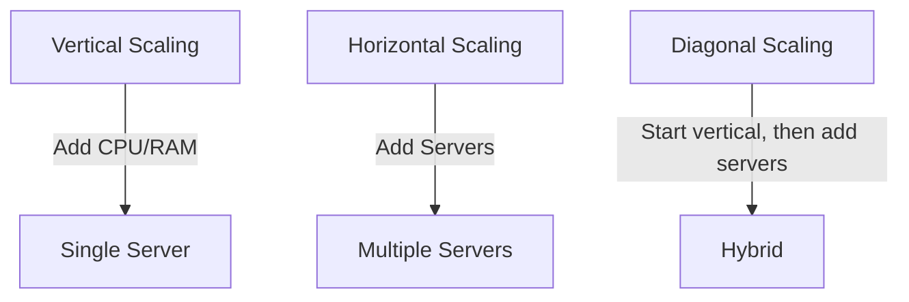

# Chapter 28 — Library Ch 6 — Scalability

> **Volume 4 — High-Level Design** · [Contents](index.md) · ← [Chapter 27 — Library Ch 5 — Web Concepts](ch27-library-05-web-concepts.md) · Next → [Chapter 29 — Library Ch 7 — Storage](ch29-library-07-storage.md)

---

## Concept

Horizontal vs vertical, Amdahl's Law, USL, stateless design, circuit breakers, bulkheads, rate limiting, backpressure, capacity planning.

**In one sentence:** Scalability is the backbone of robust modern systems — enabling web applications, APIs, and microservices to gracefully handle growth in users, data, and workload.

Scalability is the backbone of robust modern systems — enabling web applications, APIs, and microservices to gracefully handle growth in users, data, and workload.

In this chapter, we'll explore the **core principles, strategies, common pitfalls, and best practices** for designing scalable systems — drawing from theory and real-world cloud solutions. You'll learn vertical/horizontal/diagonal scaling, load balancing, autoscaling, and cost optimization.

---

### Learning Outcomes

After reading this chapter, you'll be able to:

1. Choose between vertical, horizontal, and diagonal scaling for a given growth pattern.
2. Apply **Amdahl's Law** and recognize the limits of parallelism.
3. Design **stateless services** that scale horizontally without coordination.
4. Use **circuit breakers, bulkheads, and rate limiting** to prevent cascading failures.
5. Estimate capacity for a service from QPS, latency, and resource limits.


---

### What is Scalability?

> **Scalability** is the capability of a system to handle an increasing load — or its potential to accommodate growth — without sacrificing performance, reliability, or availability.

A scalable system won't break, slow down, or become unreliable as more users come online or data volumes grow. Whether it's 1,000 users or 1 million, a well-designed system maintains its SLAs and keeps the user experience smooth.

**Key properties:**

- Maintains throughput and latency under growing traffic.
- Avoids downtime or service degradation.
- Grows efficiently without massive re-engineering.


### Why Systems Need to Scale

- **User base growth:** Viral success or global expansion increases the number of users dramatically.
- **Data volume explosion:** IoT, analytics, and sensors can generate data that grows exponentially.
- **Peak events:** Black Friday, ticket sales, news spikes, or viral trends cause sudden traffic surges.
- **Service Level Agreements (SLAs):** Meet strict performance (e.g., <200ms response) and uptime targets (e.g., 99.99%).
- **Avoid downtime:** Unscalable systems crash or slow down under pressure, causing user churn.
- **Expanding to new regions or markets.**


### Types of Scalability

*This section is in [Chapter 3 — Scalability & Reliability Fundamentals](ch03-scalability-and-reliability-fundamentals.md), next to that chapter's practice material, so it is not repeated here.*

### Common Challenges in Scaling

| Challenge   | Description                                              | Example                        |
|-------------|----------------------------------------------------------|--------------------------------|
| Latency     | Delay in response due to distributed components          | Microservices, DB hops         |
| Bottlenecks | Slowest service limits overall throughput                | Locked DB, single-threaded job |
| Downtime    | More servers = more potential failure points             | Outages during deployments     |
| Cost        | More resources = higher bills (especially in cloud)      | Over-provisioned instances     |


### Scaling Strategies — A Deep Dive

#### When to Use Which Strategy?

| Approach    | When to Use                            | Real-World Example            |
|-------------|----------------------------------------|-------------------------------|
| Vertical    | MVPs, startups, low initial traffic    | Early-stage SaaS, blogs       |
| Horizontal  | High-scale apps, resilience needed     | Twitter, Facebook             |
| Diagonal    | Cloud-native with uncertain workloads  | AWS Lambda, GCP Cloud Run     |

**Real-world choices:**

- **Twitter:** Monolith → microservices (horizontal) as user base grew.
- **AWS Lambda:** Diagonal + autoscaling.
- **Startups:** Vertical first, then horizontal as needed.

#### Example: Setting up AWS Auto Scaling Group (Horizontal)

```bash
aws autoscaling create-auto-scaling-group \
  --auto-scaling-group-name my-asg \
  --launch-configuration-name my-launch-config \
  --min-size 2 \
  --max-size 10 \
  --desired-capacity 2 \
  --vpc-zone-identifier "subnet-12345678,subnet-23456789"
```

#### Practical Tips for Scaling Strategy Choice

- **Start simple:** Early-stage startups or MVPs should favor vertical scaling to keep things simple and cost-effective.
- **Know when to switch:** Monitor system metrics. When you approach hardware limits or need high availability, start planning horizontal or diagonal scaling.
- **Embrace statelessness:** For horizontal scaling, design services to be stateless. Use shared databases or distributed caches for state.
- **Use managed services:** Cloud providers offer powerful auto-scaling and load balancing solutions (AWS ELB, Azure Load Balancer).
- **Don't over-engineer:** Avoid building distributed systems too early. Scale complexity with actual demand.
- **Implement load balancers:** Distribute traffic, prevent overload, increase reliability.
- **Monitor proactively:** Use CloudWatch, Prometheus, or Grafana to anticipate scaling needs before issues arise.


### Load Balancing — The Backbone of Scalability

*This section is in [Chapter 6 — Load Balancing](ch06-load-balancing.md), next to that chapter's practice material, so it is not repeated here.*

### Autoscaling in Cloud Environments

In modern cloud architecture, **autoscaling** is a core technique for building highly available, cost-effective, and resilient systems.

#### What is Autoscaling?

**Autoscaling** is the **automatic adjustment of compute resources** (servers, containers, or functions) in response to real-time demand.

- **Objective:** Maintain performance and availability while optimizing costs.
- **Common use cases:** Microservices, web applications, event-driven systems, batch processing.

> *"Autoscaling plays a critical role in keeping system performance available and cost-efficient, especially where demand can vary drastically and unpredictably."*

#### How Autoscaling Works

Autoscaling decisions are **triggered by metrics** such as:

- **CPU usage**
- **Memory consumption**
- **Request rate**
- **Queue length**
- **Custom business KPIs**

#### Autoscaling Types

| Type               | Description                                                      | Example                |
|--------------------|------------------------------------------------------------------|------------------------|
| **Horizontal**     | Add/remove instances (scale out/in)                              | Add EC2 VMs/Pods       |
| **Vertical**       | Resize a single instance (scale up/down)                         | Add CPU/RAM to server  |
| **Diagonal**       | Start vertical, then add horizontal as needed (hybrid approach)  | Cloud-native workloads |

**Diagram: Scaling Types**



#### Scaling Policies

- **Reactive Scaling:** Triggers when specific metrics cross thresholds (e.g., CPU > 80%).
- **Predictive Scaling:** Uses historical trends and ML to forecast and scale *before* demand spikes.
- **Scheduled Scaling:** Scales resources at set times based on known traffic patterns (e.g., daily peaks, Black Friday).

#### Autoscaling Across Major Cloud Providers

All major clouds offer first-class autoscaling features.

| Provider | Autoscaling Services                                                                      |
|----------|-------------------------------------------------------------------------------------------|
| AWS      | EC2 Auto Scaling Groups, Lambda, ECS, EKS                                                 |
| Azure    | VM Scale Sets, App Service Plans, AKS                                                     |
| GCP      | Managed Instance Groups (MIGs), Cloud Run, GKE, Functions                                 |

A more detailed view:

| Cloud  | Compute Autoscaling                | Container Autoscaling             | Monitoring / Metrics     |
|--------|------------------------------------|-----------------------------------|--------------------------|
| **AWS**   | EC2 Auto Scaling Groups, Lambda | ECS, EKS (Kubernetes) Autoscaling | CloudWatch               |
| **Azure** | VM Scale Sets, App Service Plans| AKS (Kubernetes) Autoscaling      | Azure Monitor            |
| **GCP**   | Managed Instance Groups, Functions | Cloud Run, GKE Autoscaling     | Stackdriver/Operations   |

#### Example: AWS EC2 Auto Scaling Group (CloudFormation YAML)

```yaml
Resources:
  MyAutoScalingGroup:
    Type: AWS::AutoScaling::AutoScalingGroup
    Properties:
      MinSize: '2'
      MaxSize: '10'
      DesiredCapacity: '2'
      LaunchConfigurationName: !Ref MyLaunchConfig
      TargetGroupARNs:
        - !Ref MyTargetGroup
      MetricsCollection:
        - Granularity: "1Minute"
```

A version with tags:

```yaml
Resources:
  MyAutoScalingGroup:
    Type: AWS::AutoScaling::AutoScalingGroup
    Properties:
      MinSize: 2
      MaxSize: 10
      DesiredCapacity: 4
      LaunchConfigurationName: !Ref MyLaunchConfig
      TargetGroupARNs:
        - !Ref MyTargetGroup
      MetricsCollection:
        - Granularity: "1Minute"
      Tags:
        - Key: Name
          Value: MyASGInstance
          PropagateAtLaunch: true
```

#### Example: Azure VM Scale Set (CLI)

```bash
az vmss create \
  --resource-group myResourceGroup \
  --name myScaleSet \
  --image UbuntuLTS \
  --upgrade-policy-mode automatic \
  --custom-data cloud-init.txt \
  --admin-username azureuser

az vmss autoscale create \
  --resource-group myResourceGroup \
  --name myAutoscaleSetting \
  --vmss-name myScaleSet \
  --min-count 2 --max-count 10 --count 2
```

#### Example: GCP Managed Instance Group (gcloud)

```bash
gcloud compute instance-groups managed create my-group \
  --base-instance-name my-instance \
  --template my-instance-template \
  --size 2 \
  --zone us-central1-a

gcloud compute instance-groups managed set-autoscaling my-group \
  --max-num-replicas 10 \
  --min-num-replicas 2 \
  --target-cpu-utilization 0.75 \
  --cool-down-period 90
```


### Cloud Building Blocks: An AWS Service Map

*This section is in [Chapter 20 — Cloud Architecture](ch20-cloud-architecture.md), next to that chapter's practice material, so it is not repeated here.*

### Monitoring & Proactive Scaling

Effective autoscaling depends on robust monitoring.

- **Key Metrics:** CPU, memory, network, queue depth, custom KPIs.
- **Tools:** AWS CloudWatch, Prometheus, Azure Monitor, GCP Operations, Grafana.
- **Proactive Scaling:** Use ML/trends to *forecast* demand, not just react.
- **Scheduled Scaling:** Predefine scaling windows for known peak times (Black Friday, daily traffic patterns).


### Cost Optimization Strategies

*This section is in [Chapter 21 — Cost & Capacity Economics](ch21-cost-and-capacity-economics.md), next to that chapter's practice material, so it is not repeated here.*

### The Fundamental Laws

#### Amdahl's Law — Why Adding Servers Doesn't Linearly Scale

If 95% of a workload is parallelizable and 5% is serial, the **maximum speedup is 20×** — no matter how many machines you throw at it.

```
Speedup ≤  1 / ((1 - P) + P/N)
where P = parallel fraction, N = number of processors
```

| Parallel %  | Max speedup (∞ machines) |
|-------------|-------------------------|
| 50%         | 2×                       |
| 90%         | 10×                      |
| 95%         | 20×                      |
| 99%         | 100×                     |

**Lesson:** the serial part of your system is the bottleneck. Profile to find it; eliminate it before adding more machines.

#### Universal Scalability Law (Gunther)

In practice, scaling is often *worse* than Amdahl predicts because of **coordination overhead** — locks, consensus, distributed transactions. There's a point past which adding more nodes makes the system *slower*. This is why "just add another microservice" doesn't always help.


### Stateless Service Design

*This section is in [Chapter 3 — Scalability & Reliability Fundamentals](ch03-scalability-and-reliability-fundamentals.md), next to that chapter's practice material, so it is not repeated here.*

### Failure Containment Patterns

Scaling isn't only about handling load — it's about preventing one failure from cascading.

#### Circuit Breaker

If a downstream service is failing, **stop calling it for a while** so the failing service can recover and your service doesn't waste resources waiting on timeouts.

```
States:  CLOSED  →  OPEN  →  HALF-OPEN  →  CLOSED
         (normal)   (fail fast)  (try one)  (back to normal)
```

**Implementation:** count failures in a window; trip if >N% fail; after a cooldown, allow one trial request.

#### Bulkhead

Isolate resources so failure in one part of the system can't drown the rest. Just like the watertight compartments on a ship — if one floods, the rest stay dry.

**Example:** dedicate separate thread pools (or connection pools) per downstream service. If the slow payment service eats all 200 threads, your auth calls still have their own pool.

#### Rate Limiting

Cap how many requests any one client (IP, user, API key) can send in a window. Protects against abuse *and* against your own systems thundering when something goes wrong.

**Algorithms (in order of sophistication):**

| Algorithm        | Simplicity | Burst handling | Memory cost |
|------------------|-----------|-----------------|-------------|
| Fixed window     | simplest   | bad (allows 2× burst at window edges) | tiny |
| Sliding window log | precise  | great           | high (stores timestamps) |
| Sliding window counter | balanced | good       | low |
| Token bucket     | most flexible | great (allows bursts up to bucket size) | small |
| Leaky bucket     | smoothes traffic | enforces constant rate | small |

> **Default choice:** token bucket. Easy to reason about, allows reasonable bursts, well-supported in libraries.

#### Backpressure

When you can't keep up, **tell upstream to slow down** rather than silently dropping or queuing forever. Standard mechanisms: HTTP 429, gRPC `RESOURCE_EXHAUSTED`, blocking writes on a bounded queue.


### Rate Limiting, Throttling and Backpressure

*This section is in [Chapter 8 — Rate Limiting, Throttling & Backpressure](ch08-rate-limiting-throttling-and-backpressure.md), next to that chapter's practice material, so it is not repeated here.*

### Capacity Planning — Back-of-the-Envelope

*This section is in [Chapter 2 — Capacity Planning](ch02-capacity-planning.md), next to that chapter's practice material, so it is not repeated here.*

### Combined Tips & Tricks

A consolidated master list drawn from all sections.

#### General Scaling

- **Start simple:** Use vertical scaling for MVPs; switch to horizontal as needs grow. Don't over-engineer.
- **Design stateless services:** Easier to distribute and scale horizontally. Use shared databases or distributed caches for state.
- **Choose the right scaling strategy:** Horizontal for resilience, vertical for simplicity, diagonal for flexibility.
- **Know when to switch:** Monitor system metrics; switch when approaching hardware limits or needing high availability.
- **Document scaling decisions:** Record why/when you chose vertical, horizontal, or diagonal scaling to aid future maintenance.

#### Automation & Monitoring

- **Automate monitoring:** Track key metrics and set up alerts.
- **Monitor everything:** Use dashboards and alerts (CloudWatch, Prometheus, Grafana).
- **Monitor both technical and business KPIs:** e.g., queue depth, orders per minute.
- **Plan for failure:** Implement health checks and graceful failover in load balancers.
- **Test under load:** Use chaos engineering and load testing to surface bottlenecks early.

#### Load Balancers

- **Implement load balancers:** Distribute traffic, prevent overload, increase reliability.
- **Choose the right load balancing strategy:** Match to traffic patterns.
- **Always set up health checks** for backend servers.
- **For microservices**, consider using a service mesh (Istio, Linkerd) for advanced L7 routing.
- **Enable SSL termination** at the load balancer to reduce backend CPU load.

#### Autoscaling

- **Set conservative thresholds at first, then tune.** Avoid thrashing (rapid scaling in/out).
- **Test autoscaling in staging with simulated traffic spikes.**
- **Combine reactive and predictive scaling for best results.**
- **Document your scaling policies** and update them as usage patterns evolve.
- **For serverless, check for concurrency limits and cold start implications.**
- **Always review cloud provider pricing calculators** to forecast cost under peak loads.
- **Limit autoscaling:** Set quotas to avoid runaway costs.

#### Cost Optimization

- **Avoid over-provisioning.** Use auto-pausing and scale-to-zero features in serverless/cloud.
- **Use spot/preemptible instances** for batch workloads (up to 80% cheaper).
- **Rightsize regularly** based on actual usage.
- **Set resource limits/quotas** to prevent runaway costs in dev/test environments.


### Sample Interview Questions

1. What does scalability mean in system design?
2. Compare vertical and horizontal scaling. When would you use each?
3. Explain diagonal scaling and why it's useful in cloud-native apps.
4. What are common bottlenecks, and how do you identify them?
5. How does a load balancer improve availability and performance?
6. What is autoscaling, and how is it implemented in AWS/Azure/GCP?
7. How do you optimize for cost while scaling in the cloud?
8. Describe a scenario where horizontal scaling wouldn't help.
9. How do you balance cost and complexity in scaling strategies?
10. What challenges arise in horizontal scaling and how would you solve them?
11. Explain the difference between Layer 4 and Layer 7 load balancers — with examples.
12. Compare Round Robin vs. Least Connections — pros/cons.
13. When would you use software, hardware, or cloud-based load balancers?
14. How do you handle failover and high availability?
15. How does predictive autoscaling work?
16. How would you set up autoscaling for a containerized app?
17. What challenges arise with autoscaling in real-time systems?
18. How can you ensure cost optimization when implementing autoscaling?


### Key Takeaways

- **Scalability is essential** for growth, reliability, and performance in modern architectures.
- **Vertical, horizontal, and diagonal scaling** serve different needs — choose wisely based on workload and growth patterns.
- **Load balancers are key** to distributing traffic and ensuring uptime.
- **Autoscaling** enables agility and cost efficiency in the cloud.
- **Continuous monitoring and optimization** keep your system healthy as it grows.
- **Your scaling strategy should evolve** with your system's growth and requirements.
- **Align autoscaling with cost optimization goals** to avoid budget overruns.


### Further Reading

**AWS:**

- [AWS Auto Scaling Documentation](https://docs.aws.amazon.com/autoscaling/)
- [AWS Elastic Load Balancing](https://aws.amazon.com/elasticloadbalancing/)

**Azure:**

- [Azure Autoscale Documentation](https://learn.microsoft.com/en-us/azure/azure-monitor/autoscale/autoscale-overview)
- [Azure Load Balancer](https://azure.microsoft.com/en-us/services/load-balancer/)

**GCP:**

- [GCP Autoscaling Documentation](https://cloud.google.com/compute/docs/autoscaler/)
- [Google Cloud Load Balancing](https://cloud.google.com/load-balancing)
- [Cloud Cost Optimization Guide](https://cloud.google.com/solutions/cost-optimization)

**Tools:**

- [NGINX Load Balancing Docs](https://docs.nginx.com/nginx/admin-guide/load-balancer/http-load-balancer/)
- [NGINX Load Balancing Guide](https://docs.nginx.com/nginx/admin-guide/load-balancer/)
- [HAProxy Documentation](https://www.haproxy.org/)


**Diagram rendering note:** To view the Mermaid diagrams, use a Markdown viewer with Mermaid support (e.g., VS Code with Mermaid plugin, GitHub, HackMD).


**Next Up:** Chapter 7 — Storage: Database and Storage → — how databases are structured, stored, and scaled in distributed systems.


*(From AI Library chapter 6.)*

