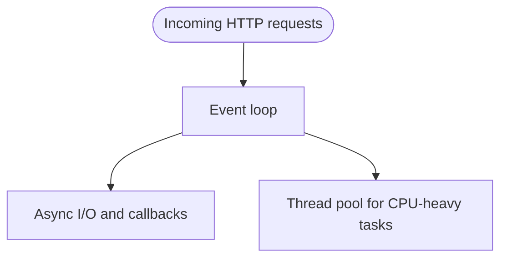

# Chapter 30 — Library Ch 8 — Performance

> **Volume 4 — High-Level Design** · [Contents](index.md) · ← [Chapter 29 — Library Ch 7 — Storage](ch29-library-07-storage.md) · Next → [Chapter 31 — Library Ch 9 — Reliability & DR](ch31-library-09-reliability-dr.md)

---

## Concept

Caching patterns (5 of them), cache stampede, N+1 query, message queues, indexing, query optimization, concurrency vs parallelism.

**In one sentence:** Performance is the heart of modern system design.

Performance is the heart of modern system design. It's not just about how fast your system runs — it's about how well it scales, how it responds under pressure, and how efficiently it utilizes resources. In this chapter, we'll break down the essential pillars of performance: latency, throughput, caching, messaging queues, concurrency, and database optimization.

---

### Learning Outcomes

After reading this chapter, you'll be able to:

1. Reason about **p50, p95, p99** latency and explain why averages lie.
2. Pick the right caching strategy (cache-aside, write-through, write-back) for a workload.
3. Diagnose and prevent **cache stampedes** and the **thundering herd** problem.
4. Spot the **N+1 query** problem in code and fix it.
5. Size a database connection pool correctly (smaller than you think).


---

### Introduction to System Performance

Performance in system design is a **multidimensional goal** — balancing speed, scalability, and efficiency:

- **Speed:** How quickly does your system respond? (Measured as latency.)
- **Capacity:** How much work can it handle at once? (Measured as throughput.)
- **Efficiency:** How well does it use resources under stress? (CPU, memory, network.)

> **Performance is not a single metric — it's about achieving the right balance for your application.**

#### Why Performance Matters

- **User expectations:** Slow systems lose users and revenue.
- **Business impact:** Performance affects drop-offs, bounce rates, and costs.
- **System stability:** Poor performance leads to instability and outages.

> **Performance is a feature, not an afterthought.**


### Key Metrics — Latency, Throughput, Scalability & Responsiveness

*This section is in [Chapter 2 — Capacity Planning](ch02-capacity-planning.md), next to that chapter's practice material, so it is not repeated here.*

### Measuring Performance — SLAs, SLOs, SLIs, and Percentiles

*This section is in [Chapter 2 — Capacity Planning](ch02-capacity-planning.md), next to that chapter's practice material, so it is not repeated here.*

### Performance Testing & Monitoring

#### Performance Testing Types

| Type             | Description               | Goal                        |
|------------------|---------------------------|-----------------------------|
| Load Testing     | Normal expected load      | Baseline performance        |
| Stress Testing   | Beyond normal load        | Graceful degradation/crash  |
| Spike Testing    | Sudden burst load         | Absorb traffic spikes       |
| Endurance (Soak) | Extended duration load    | Memory leaks / fatigue      |

**Goal:** Identify bottlenecks & ensure reliability.

##### CLI Example: Load Testing with `wrk`

```bash
wrk -t8 -c400 -d30s https://yourapi.com/api/endpoint
```

#### Performance Monitoring

- **Testing** is pre-deployment; **monitoring** is continuous in production.
- **APM tools:** New Relic, Datadog.
- **Logs & metrics:** ELK stack, Prometheus + Grafana.

**What to track:**

- Latency & throughput.
- Error rates.
- Resource usage (CPU, memory, DB queries).


### Caching for Speed Optimization

*This section is in [Chapter 7 — Caching Strategies](ch07-caching-strategies.md), next to that chapter's practice material, so it is not repeated here.*

### Messaging & Queues for Decoupling

*This section is in [Chapter 9 — Message Queues & Streaming (Kafka, SQS, Pub/Sub)](ch09-message-queues-and-streaming-kafka-sqs-pub.md), next to that chapter's practice material, so it is not repeated here.*

### Concurrency & Parallelism

Unlocking performance often means handling **many tasks at once** — but how?

#### Concurrency vs. Parallelism

(See `image-17.png` for diagram.)

| Aspect        | Concurrency                                       | Parallelism                            |
|---------------|---------------------------------------------------|----------------------------------------|
| Definition    | Multiple tasks start/run/complete in overlapping time | Multiple tasks executed *simultaneously* |
| Hardware      | Single or multi-core                              | Multi-core required                    |
| Focus         | Task management (responsiveness)                  | Task execution (throughput)            |
| Example       | Async web server                                  | Matrix computation on threads          |

**Concurrency** is about *managing* multiple tasks at the same time. These tasks may overlap in their execution, but do not necessarily run simultaneously. It allows a system to handle multiple things at once, improving responsiveness, even on a single CPU core.

- Task management, not simultaneous execution.
- Can be achieved on a single-core CPU.
- Gives the *illusion* of doing many things at once by rapidly switching context.

**Example:** A web server handling multiple HTTP requests using asynchronous I/O.

```python
# Python asyncio concurrent server (single-threaded, concurrent)
import asyncio

async def handle_request(reader, writer):
    data = await reader.read(100)
    message = data.decode()
    print(f"Received {message}")
    writer.write(data)
    await writer.drain()
    writer.close()

async def main():
    server = await asyncio.start_server(handle_request, '127.0.0.1', 8888)
    async with server:
        await server.serve_forever()

asyncio.run(main())
```

**Parallelism** is about *executing* multiple tasks at the same time. It requires multiple CPU cores. The goal is to increase *throughput* and speed.

- Actual simultaneous execution.
- Requires multi-core CPUs.
- Improves throughput and computational speed.

**Example:** Parallel matrix computation.

```python
from multiprocessing import Pool

def compute_square(x):
    return x * x

if __name__ == '__main__':
    with Pool(4) as p:  # 4 parallel processes
        results = p.map(compute_square, [1,2,3,4,5,6,7,8])
    print(results)
```

**Concurrency vs. Parallelism ASCII:**

```
Concurrency (Task Management)        Parallelism (Task Execution)
+------------------------------+     +--------------------------+
| Task A  | Task B | Task C    |     | Task A | Task B | Task C |
|========>|========|=========> |     |========|========|========|
|    (Interleaved, Overlapping)|     |(Executed Simultaneously)|
+------------------------------+     +--------------------------+
```

#### Processes vs. Threads

(See `image-18.png` for diagram.)

|                 | Process                          | Thread                       |
|-----------------|----------------------------------|------------------------------|
| **Memory**      | Own memory space                 | Shared memory within process |
| **Creation**    | Heavy, slow                      | Lightweight, fast            |
| **Isolation**   | Fully isolated                   | Less isolated, share data    |
| **Safety**      | Safer, one crash ≠ all crash     | Prone to race conditions     |
| **Use Case**    | Separate apps (browser, editor)  | Multiple tasks in app        |

**Examples:**

- **Processes:** Chrome and Word, each with its memory.
- **Threads:** Multiple HTTP request handlers in a web server, sharing cache.

#### Thread Pools & Worker Models

##### Thread Pools

- **What:** Pre-created pool of threads reused for multiple tasks.
- **Why:** Avoids the overhead of creating/destroying threads per task.
- **Where:** Web servers (ASP.NET Core, Java, Python), database connection pooling.

```java
ExecutorService pool = Executors.newFixedThreadPool(8);
pool.submit(() -> {
    // handle request
});
```

```python
from concurrent.futures import ThreadPoolExecutor

def process_task(task_id):
    print(f"Processing {task_id}")

with ThreadPoolExecutor(max_workers=4) as executor:
    for i in range(10):
        executor.submit(process_task, i)
```

A simpler variant for a request handler:

```python
from concurrent.futures import ThreadPoolExecutor

def process_request(request):
    # Handle request
    pass

with ThreadPoolExecutor(max_workers=10) as executor:
    for req in incoming_requests:
        executor.submit(process_request, req)
```

##### Worker Model

- **What:** Tasks are distributed to idle workers from a shared queue.
- **Why:** Improves scalability and balances CPU utilization.
- **Where:** Background job processing, e.g., RabbitMQ workers.

```javascript
const { Worker } = require('worker_threads');
const tasks = [/* ... */]; // some task list

tasks.forEach(task => {
  const worker = new Worker('./worker.js', { workerData: task });
  worker.on('message', result => console.log(result));
});
```

#### Asynchronous Processing

**Why Async?**

- Avoids blocking threads on I/O (file, DB, network).
- Boosts throughput, keeps system responsive.

**Techniques:**

- Async/await (C#, JS, Python).
- Promises/Futures.
- Message Queues (RabbitMQ, Kafka).

```javascript
async function getUserData(id) {
  const user = await db.findUserById(id); // Non-blocking I/O
  return user;
}
```

#### Concurrency in Web Servers

| Traditional Servers          | Modern Servers                         |
|------------------------------|----------------------------------------|
| Spawn thread/process/request | Use async / non-blocking I/O           |
| High resource usage          | Event loop or thread pool models       |
| Hard to scale                | Efficient, handles more with less      |

**Modern examples:**

- **Node.js:** Event-loop, non-blocking I/O.
- **ASP.NET Core / Nginx:** Thread pools + async I/O.

#### Common Pitfalls: Race Conditions & Deadlocks

##### Race Condition

- Occurs when multiple threads access/modify shared data unsafely.
- Can corrupt data or cause unpredictable bugs.
- **Fix:** Synchronize access (locks, mutexes).

```python
import threading

counter = 0
lock = threading.Lock()

def increment():
    global counter
    for _ in range(1000):
        with lock:
            counter += 1
```

##### Deadlock

- Threads stuck waiting for each other's resources.
- System can freeze.
- **Fix:** Lock ordering, timeouts, avoiding nested locks.

#### Concurrency — Best Practices

- Prefer async/non-blocking I/O for I/O-bound tasks.
- Use thread pools for CPU-bound work, not raw threads.
- Always synchronize access to shared data.
- Detect & avoid deadlocks (consistent lock ordering).
- Monitor performance with appropriate metrics.

**Real-world scenarios:**

- Web servers (Node.js/ASP.NET): Thread pool + async I/O.
- Background jobs (RabbitMQ, Kafka): Worker model.
- Parallel image rendering: Each frame on different core.

#### Concurrency — Summary Table

| Concept             | Purpose              | Typical Tools/Techniques        | Example                        |
|---------------------|----------------------|---------------------------------|--------------------------------|
| Concurrency         | Task management      | Async/await, event loop, coros  | Node.js HTTP server            |
| Parallelism         | Task execution       | Thread pool, multiprocessing    | Java ThreadPool, Python Pool   |
| Thread Pool         | Reduce overhead      | Executors, Pool, Task queue     | ASP.NET Core, Java Executors   |
| Worker Model        | Distribute workload  | Queues + workers                | RabbitMQ, Celery, Sidekiq      |
| Async Processing    | Non-blocking I/O     | Promises, Futures, async/await  | JS async functions, C# await   |
| Synchronization     | Prevent race bugs    | Locks, mutexes, semaphores      | threading.Lock (Python)        |
| Deadlock Avoidance  | System stability     | Lock ordering, timeouts         | Consistent lock strategy       |

#### Event Loop (Simplified)




### Database Performance Optimization Techniques

*This section is in [Chapter 11 — Database Scaling](ch11-database-scaling.md), next to that chapter's practice material, so it is not repeated here.*

### Performance Anti-Patterns (and How to Fix Them)

*This section is in [Chapter 16 — Performance Antipatterns & Monitoring](ch16-performance-antipatterns-and-monitoring.md), next to that chapter's practice material, so it is not repeated here.*

### Cache Patterns — The Full Picture

*This section is in [Chapter 7 — Caching Strategies](ch07-caching-strategies.md), next to that chapter's practice material, so it is not repeated here.*

### Performance Antipatterns Catalog and Monitoring

*This section is in [Chapter 16 — Performance Antipatterns & Monitoring](ch16-performance-antipatterns-and-monitoring.md), next to that chapter's practice material, so it is not repeated here.*

### Combined Tips & Tricks

A consolidated master list drawn from all sections.

#### Monitoring & Metrics

- **Always monitor:** Use tools like Prometheus, Grafana, DataDog.
- **Set SLOs/SLAs:** Make performance measurable and accountable.
- **Track percentiles:** P95 and P99 are often more important than the average.
- **Watch for bottlenecks:** They often hide until your system is under stress.
- **Document your performance strategy:** Make it part of your architecture, not an afterthought.

#### Testing

- **Test under real conditions:** Simulate both steady load and traffic spikes.
- **Test under load:** Locust, JMeter, k6 to simulate concurrency issues before production.

#### Caching

- **Cache wisely:** Cache only what's expensive or slow to compute, and ensure consistency.
- **Apply TTL smartly:** Especially on volatile or time-sensitive data.
- **Prevent cache stampede:** Use locks or request coalescing.
- **Automate cache invalidation:** Design carefully for dynamic content.

#### Messaging

- **Design for failure:** Ensure your queue/message broker can handle spikes and outages.
- **Make consumers idempotent:** Especially in queuing systems with at-least-once delivery.

#### Concurrency

- **Use thread pools:** Avoid creating/destroying threads for each task.
- **Async for I/O-bound, thread pool for CPU-bound.**
- **Always use locks for shared data:** Protect shared variables with mutexes/locks.
- **Avoid nested locks:** Keep locking hierarchy simple to reduce deadlock risk.
- **Prefer async/non-blocking I/O:** Especially for I/O-bound tasks.

#### Database

- **Tune your DB:** Indexes, sharding, connection pooling, and query optimization all matter.
- **Use prepared statements:** Prevent SQL injection and improve plan caching.
- **Minimize data transfer:** Fetch only required columns.
- **Use connection pools:** For efficient database access.
- **Batch writes:** Aggregate writes where possible to reduce DB round-trips.
- **Async processing:** Offload heavy/slow tasks to background workers.
- **Paginate large datasets:** Never fetch "all" in production APIs.
- **Profile & test:** Use `EXPLAIN` in SQL to analyze query plans.
- **Automate index management:** Remove unused indexes and tune existing ones.


### Sample Interview Questions

1. What is the difference between latency and throughput?
2. Explain SLAs, SLOs, and SLIs. Why use P95/P99 instead of average?
3. What are the four main caching strategies? Compare them.
4. Compare LRU, LFU, FIFO, and TTL eviction policies.
5. Why use asynchronous messaging? When would you use queues?
6. Compare RabbitMQ and Kafka. When to use which?
7. Explain at-least-once, at-most-once, and exactly-once delivery.
8. How do queues improve scalability and fault tolerance?
9. How would you design an order processing system with queues?
10. How do you ensure idempotency in consumers?
11. What is the difference between concurrency and parallelism?
12. How do threads differ from processes?
13. What is a thread pool, and why is it preferred over creating new threads?
14. How would you design a web server for thousands of concurrent requests?
15. What is a race condition? How do you prevent it?
16. How do you debug and resolve a deadlock?
17. How does the event loop work in Node.js?
18. Explain master-slave vs. master-master replication trade-offs.
19. How does sharding differ from partitioning?
20. When would you denormalize a database schema?
21. Why use connection pooling?
22. When would you use a materialized view?


### Summary & Key Takeaways

- Performance = speed, scalability, and efficiency under real-world load.
- Use **caching** to reduce latency and load.
- Employ **asynchronous messaging** for decoupling and resilience.
- Harness **concurrency and parallelism** for better resource usage.
- Optimize **database** layers with replication, sharding, indexing, and smart queries.
- **Monitor, test, and prioritize performance** at every stage.
- **Concurrency ≠ Parallelism:** Concurrency manages tasks; parallelism executes them simultaneously.
- **Use the right tool:** Async for I/O-bound, thread pool for CPU-bound.
- **Threads are lighter than processes** but require careful handling (race conditions, deadlocks).

> **Performance isn't a luxury. It's a core feature for modern, user-friendly, and scalable systems.**


### Further Reading

- [System Design Interview – Alex Xu](https://www.amazon.com/System-Design-Interview-insiders-Second/dp/B08CMF2CQF)
- [Google SRE Book: SLIs, SLOs, SLAs](https://sre.google/sre-book/service-level-objectives/)
- [Redis Documentation](https://redis.io/documentation)
- [RabbitMQ Docs](https://www.rabbitmq.com/documentation.html)
- [Apache Kafka Docs](https://kafka.apache.org/documentation/)
- [RabbitMQ vs Kafka](https://www.cloudamqp.com/blog/when-to-use-rabbitmq-or-apache-kafka.html)
- [Martin Fowler: Event-Driven Architecture](https://martinfowler.com/articles/201701-event-driven.html)
- [Python asyncio docs](https://docs.python.org/3/library/asyncio.html)
- [Java Concurrency (Oracle)](https://docs.oracle.com/javase/tutorial/essential/concurrency/)
- [Node.js Event Loop](https://nodejs.dev/learn/the-nodejs-event-loop)
- [Thread Pool Pattern](https://en.wikipedia.org/wiki/Thread_pool_pattern)
- [RabbitMQ Worker Model](https://www.rabbitmq.com/tutorials/tutorial-two-python.html)
- [Cache-Aside Pattern — Microsoft docs](https://learn.microsoft.com/en-us/azure/architecture/patterns/cache-aside)
- [PostgreSQL Indexing Documentation](https://www.postgresql.org/docs/current/indexes.html)
- [Database Sharding Patterns](https://docs.microsoft.com/en-us/azure/architecture/patterns/sharding)
- [CAP Theorem Explained (Martin Kleppmann)](https://martin.kleppmann.com/2012/04/09/cap-theorem.html)


**Next Up:** Chapter 9 — Reliability, Availability & Disaster Recovery → — how to ensure your systems remain robust and resilient in the face of failures.


*(From AI Library chapter 8.)*

