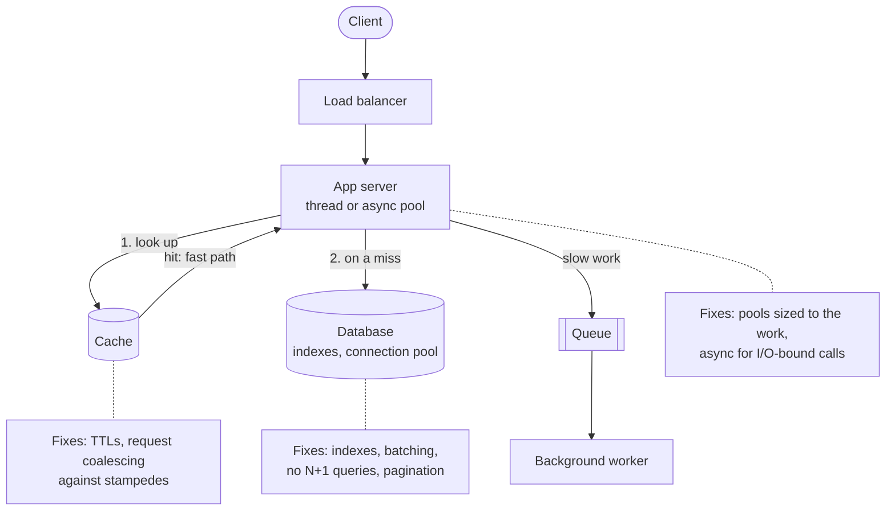

# Chapter 30 — Library Ch 8 — Performance

> **Volume 4 — High-Level Design** · [Contents](index.md) · ← [Chapter 29 — Library Ch 7 — Storage](ch29-library-07-storage.md) · Next → [Chapter 31 — Library Ch 9 — Reliability & DR](ch31-library-09-reliability-dr.md)

---

## Concept

Caching patterns (5 of them), cache stampede, N+1 query, message queues, indexing, query optimization, concurrency vs parallelism.

**In one sentence:** Performance is the heart of modern system design.

Performance is the heart of modern system design. It's not just about how fast your system runs — it's about how well it scales, how it responds under pressure, and how efficiently it utilizes resources. In this chapter, we'll break down the essential pillars of performance: latency, throughput, caching, messaging queues, concurrency, and database optimization.

---

### Learning Outcomes

After reading this chapter, you'll be able to:

1. Reason about **p50, p95, p99** latency and explain why averages lie.
2. Pick the right caching strategy (cache-aside, write-through, write-back) for a workload.
3. Diagnose and prevent **cache stampedes** and the **thundering herd** problem.
4. Spot the **N+1 query** problem in code and fix it.
5. Size a database connection pool correctly (smaller than you think).


---

### Introduction to System Performance

Performance in system design is a **multidimensional goal** — balancing speed, scalability, and efficiency:

- **Speed:** How quickly does your system respond? (Measured as latency.)
- **Capacity:** How much work can it handle at once? (Measured as throughput.)
- **Efficiency:** How well does it use resources under stress? (CPU, memory, network.)

> **Performance is not a single metric — it's about achieving the right balance for your application.**

#### Why Performance Matters

- **User expectations:** Slow systems lose users and revenue.
- **Business impact:** Performance affects drop-offs, bounce rates, and costs.
- **System stability:** Poor performance leads to instability and outages.

> **Performance is a feature, not an afterthought.**


### Where time goes in a request

Each hop adds latency, and each has its own standard fix. Find the slowest hop first, then apply the fix for that hop.



### Key Metrics — Latency, Throughput, Scalability & Responsiveness

*This section is in [Chapter 2 — Capacity Planning](ch02-capacity-planning.md), next to that chapter's practice material, so it is not repeated here.*

### Measuring Performance — SLAs, SLOs, SLIs, and Percentiles

*This section is in [Chapter 2 — Capacity Planning](ch02-capacity-planning.md), next to that chapter's practice material, so it is not repeated here.*

### Performance Testing & Monitoring

#### Performance Testing Types

| Type             | Description               | Goal                        |
|------------------|---------------------------|-----------------------------|
| Load Testing     | Normal expected load      | Baseline performance        |
| Stress Testing   | Beyond normal load        | Graceful degradation/crash  |
| Spike Testing    | Sudden burst load         | Absorb traffic spikes       |
| Endurance (Soak) | Extended duration load    | Memory leaks / fatigue      |

The four types differ in the shape of the load over time. Load and soak tests hold a normal level; soak simply runs for hours to expose leaks. Stress keeps rising until something breaks. Spike jumps suddenly and drops back.

**Goal:** Identify bottlenecks & ensure reliability.

##### CLI Example: Load Testing with `wrk`

```bash
wrk -t8 -c400 -d30s https://yourapi.com/api/endpoint
```

#### Performance Monitoring

- **Testing** is pre-deployment; **monitoring** is continuous in production.
- **APM tools:** New Relic, Datadog.
- **Logs & metrics:** ELK stack, Prometheus + Grafana.

**What to track:**

- Latency & throughput.
- Error rates.
- Resource usage (CPU, memory, DB queries).


### Caching for Speed Optimization

*This section is in [Chapter 7 — Caching Strategies](ch07-caching-strategies.md), next to that chapter's practice material, so it is not repeated here.*

### Messaging & Queues for Decoupling

*This section is in [Chapter 9 — Message Queues & Streaming (Kafka, SQS, Pub/Sub)](ch09-message-queues-and-streaming-kafka-sqs-pub.md), next to that chapter's practice material, so it is not repeated here.*

### Concurrency & Parallelism

*This section is in [Volume 3, Chapter 13 — Concurrency Patterns & Thread Safety](../volume-3-low-level-design/ch13-concurrency-patterns-and-thread-safety.md), next to that chapter's practice material, so it is not repeated here.*

### Database Performance Optimization Techniques

*This section is in [Chapter 11 — Database Scaling](ch11-database-scaling.md), next to that chapter's practice material, so it is not repeated here.*

### Performance Anti-Patterns (and How to Fix Them)

*This section is in [Chapter 16 — Performance Antipatterns & Monitoring](ch16-performance-antipatterns-and-monitoring.md), next to that chapter's practice material, so it is not repeated here.*

### Cache Patterns — The Full Picture

*This section is in [Chapter 7 — Caching Strategies](ch07-caching-strategies.md), next to that chapter's practice material, so it is not repeated here.*

### Performance Antipatterns Catalog and Monitoring

*This section is in [Chapter 16 — Performance Antipatterns & Monitoring](ch16-performance-antipatterns-and-monitoring.md), next to that chapter's practice material, so it is not repeated here.*

### Combined Tips & Tricks

A consolidated master list drawn from all sections.

#### Monitoring & Metrics

- **Always monitor:** Use tools like Prometheus, Grafana, DataDog.
- **Set SLOs/SLAs:** Make performance measurable and accountable.
- **Track percentiles:** P95 and P99 are often more important than the average.
- **Watch for bottlenecks:** They often hide until your system is under stress.
- **Document your performance strategy:** Make it part of your architecture, not an afterthought.

#### Testing

- **Test under real conditions:** Simulate both steady load and traffic spikes.
- **Test under load:** Locust, JMeter, k6 to simulate concurrency issues before production.

#### Caching

- **Cache wisely:** Cache only what's expensive or slow to compute, and ensure consistency.
- **Apply TTL smartly:** Especially on volatile or time-sensitive data.
- **Prevent cache stampede:** Use locks or request coalescing.
- **Automate cache invalidation:** Design carefully for dynamic content.

#### Messaging

- **Design for failure:** Ensure your queue/message broker can handle spikes and outages.
- **Make consumers idempotent:** Especially in queuing systems with at-least-once delivery.

#### Concurrency

- **Use thread pools:** Avoid creating/destroying threads for each task.
- **Async for I/O-bound, thread pool for CPU-bound.**
- **Always use locks for shared data:** Protect shared variables with mutexes/locks.
- **Avoid nested locks:** Keep locking hierarchy simple to reduce deadlock risk.
- **Prefer async/non-blocking I/O:** Especially for I/O-bound tasks.

#### Database

- **Tune your DB:** Indexes, sharding, connection pooling, and query optimization all matter.
- **Use prepared statements:** Prevent SQL injection and improve plan caching.
- **Minimize data transfer:** Fetch only required columns.
- **Use connection pools:** For efficient database access.
- **Batch writes:** Aggregate writes where possible to reduce DB round-trips.
- **Async processing:** Offload heavy/slow tasks to background workers.
- **Paginate large datasets:** Never fetch "all" in production APIs.
- **Profile & test:** Use `EXPLAIN` in SQL to analyze query plans.
- **Automate index management:** Remove unused indexes and tune existing ones.


### Sample Interview Questions

1. What is the difference between latency and throughput?
2. Explain SLAs, SLOs, and SLIs. Why use P95/P99 instead of average?
3. What are the four main caching strategies? Compare them.
4. Compare LRU, LFU, FIFO, and TTL eviction policies.
5. Why use asynchronous messaging? When would you use queues?
6. Compare RabbitMQ and Kafka. When to use which?
7. Explain at-least-once, at-most-once, and exactly-once delivery.
8. How do queues improve scalability and fault tolerance?
9. How would you design an order processing system with queues?
10. How do you ensure idempotency in consumers?
11. What is the difference between concurrency and parallelism?
12. How do threads differ from processes?
13. What is a thread pool, and why is it preferred over creating new threads?
14. How would you design a web server for thousands of concurrent requests?
15. What is a race condition? How do you prevent it?
16. How do you debug and resolve a deadlock?
17. How does the event loop work in Node.js?
18. Explain master-slave vs. master-master replication trade-offs.
19. How does sharding differ from partitioning?
20. When would you denormalize a database schema?
21. Why use connection pooling?
22. When would you use a materialized view?


### Summary & Key Takeaways

- Performance = speed, scalability, and efficiency under real-world load.
- Use **caching** to reduce latency and load.
- Employ **asynchronous messaging** for decoupling and resilience.
- Harness **concurrency and parallelism** for better resource usage.
- Optimize **database** layers with replication, sharding, indexing, and smart queries.
- **Monitor, test, and prioritize performance** at every stage.
- **Concurrency ≠ Parallelism:** Concurrency manages tasks; parallelism executes them simultaneously.
- **Use the right tool:** Async for I/O-bound, thread pool for CPU-bound.
- **Threads are lighter than processes** but require careful handling (race conditions, deadlocks).

> **Performance isn't a luxury. It's a core feature for modern, user-friendly, and scalable systems.**


### Further Reading

- [System Design Interview – Alex Xu](https://www.amazon.com/System-Design-Interview-insiders-Second/dp/B08CMF2CQF)
- [Google SRE Book: SLIs, SLOs, SLAs](https://sre.google/sre-book/service-level-objectives/)
- [Redis Documentation](https://redis.io/documentation)
- [RabbitMQ Docs](https://www.rabbitmq.com/documentation.html)
- [Apache Kafka Docs](https://kafka.apache.org/documentation/)
- [RabbitMQ vs Kafka](https://www.cloudamqp.com/blog/when-to-use-rabbitmq-or-apache-kafka.html)
- [Martin Fowler: Event-Driven Architecture](https://martinfowler.com/articles/201701-event-driven.html)
- [Python asyncio docs](https://docs.python.org/3/library/asyncio.html)
- [Java Concurrency (Oracle)](https://docs.oracle.com/javase/tutorial/essential/concurrency/)
- [Node.js Event Loop](https://nodejs.dev/learn/the-nodejs-event-loop)
- [Thread Pool Pattern](https://en.wikipedia.org/wiki/Thread_pool_pattern)
- [RabbitMQ Worker Model](https://www.rabbitmq.com/tutorials/tutorial-two-python.html)
- [Cache-Aside Pattern — Microsoft docs](https://learn.microsoft.com/en-us/azure/architecture/patterns/cache-aside)
- [PostgreSQL Indexing Documentation](https://www.postgresql.org/docs/current/indexes.html)
- [Database Sharding Patterns](https://docs.microsoft.com/en-us/azure/architecture/patterns/sharding)
- [CAP Theorem Explained (Martin Kleppmann)](https://martin.kleppmann.com/2012/04/09/cap-theorem.html)


**Next Up:** Chapter 9 — Reliability, Availability & Disaster Recovery → — how to ensure your systems remain robust and resilient in the face of failures.


*(From AI Library chapter 8.)*

