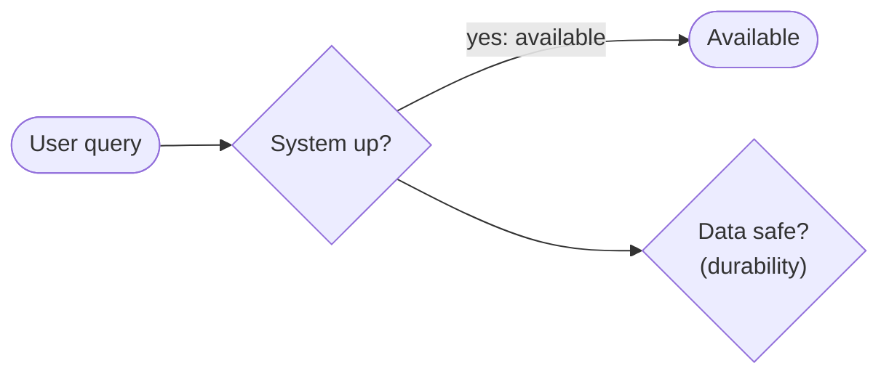
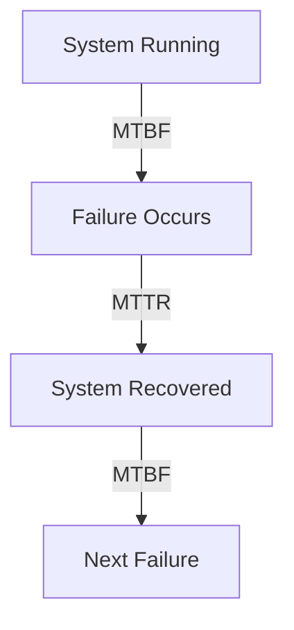
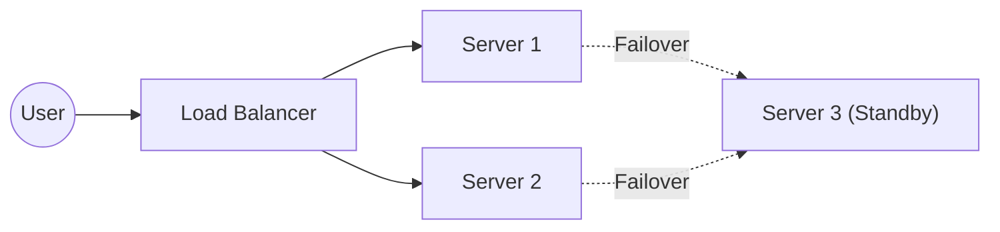
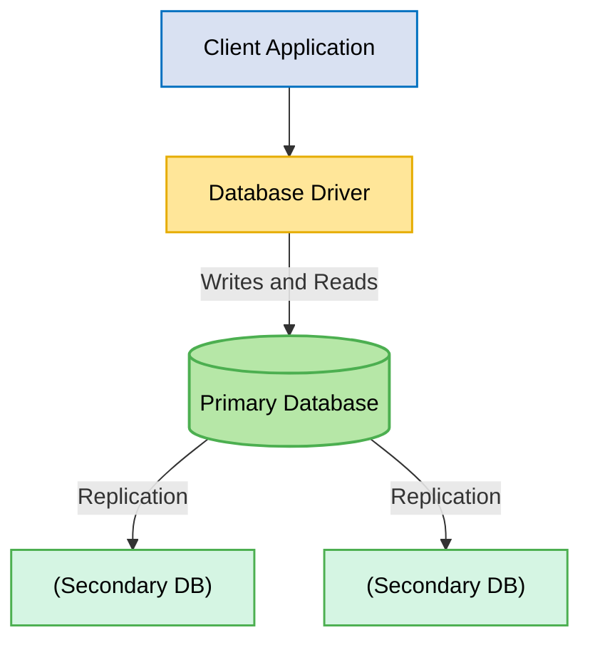
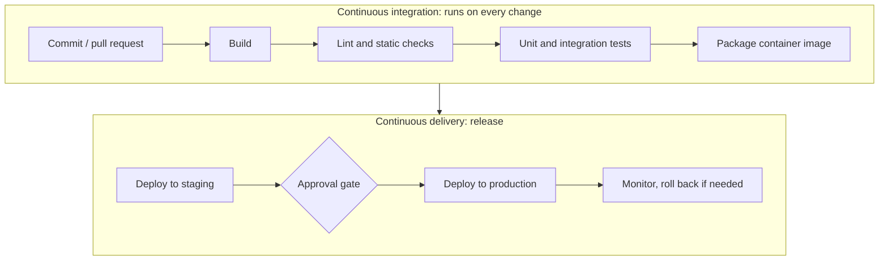

# Chapter 31 — Library Ch 9 — Reliability & DR

> **Volume 4 — High-Level Design** · [Contents](index.md) · ← [Chapter 30 — Library Ch 8 — Performance](ch30-library-08-performance.md) · Next → [Chapter 32 — Library Ch 10 — Security](ch32-library-10-security.md)

---

## Concept

9s of availability, retry-with-backoff, idempotency keys, active-active vs active-passive, RTO/RPO, chaos engineering.

**In one sentence:** Welcome to one of the most critical aspects of modern system design: Reliability, Availability, and Disaster Recovery.

Welcome to one of the most critical aspects of modern system design: **Reliability, Availability, and Disaster Recovery**. Whether you're designing a high-traffic web application, building cloud-native microservices, or architecting distributed platforms at scale, ensuring your systems can withstand failures and recover gracefully is paramount.

This chapter covers:

- Core concepts of system reliability (MTBF, MTTR, SLAs)
- High availability, fault tolerance, and failover mechanisms
- Backup and recovery strategies
- Disaster recovery in practice
- Real-world patterns, trade-offs, and actionable tips

> *"Systems fail. Reliability is how gracefully they handle it."*

---

### Learning Outcomes

After reading this chapter, you'll be able to:

1. Compute the **9s of availability** and translate "99.99% uptime" into hours of allowed downtime.
2. Pick **RTO and RPO targets** based on business needs and design backups accordingly.
3. Apply **retry-with-backoff, circuit breakers, bulkheads, and idempotency keys** correctly.
4. Distinguish **active-active vs active-passive** and when each is right.
5. Run a **chaos engineering** experiment and explain what it would prove.


---

### Introduction to System Reliability

Modern users expect systems to be **always available, consistent, and trustworthy**. Any downtime can result in financial loss, reputational damage, and erosion of user trust. Reliability isn't just about preventing failures — it's about how quickly and gracefully a system can recover when something does go wrong.


### Core Concepts: Reliability, Availability & Durability

#### What is System Reliability?

Reliability is a system's ability to **operate continuously without failure**. It encompasses:

- **Correctness:** The system performs its intended function without errors.
- **Consistency:** Predictable, repeatable behavior across requests and over time.
- **Fault Tolerance:** The ability to withstand failures without total disruption.
- **Availability / Uptime:** The percentage of time the system is working and accessible.

#### Availability vs. Durability

| Concept       | Description                                     | Example                              |
|---------------|-------------------------------------------------|--------------------------------------|
| **Availability** | System is accessible and responsive             | Can query a database anytime         |
| **Durability**   | Data is safe and not lost (even after failures) | Data remains after system crash      |




### Key Metrics: MTBF, MTTR, SLAs

- **MTBF (Mean Time Between Failures):** Average time a system runs before encountering a failure. *Higher MTBF = more stable system.*
- **MTTR (Mean Time To Recovery):** Average time to recover from a failure. *Lower MTTR = faster recovery.*

```
High MTBF + Low MTTR = High Reliability
```



#### SLAs (Service Level Agreements)

Contractual guarantees about system performance (e.g., 99.9% uptime, response time, error rate).

> 99.9% uptime = ~8.76 hours downtime/year.

Common metrics: availability, response time, error rate.

#### Code Example: MTBF/MTTR Calculation

```python
import statistics

failure_times = [100, 120, 95, 110]    # uptime between failures in hours
recovery_times = [2, 1.5, 3, 2.5]      # recovery durations in hours

mtbf = statistics.mean(failure_times)
mttr = statistics.mean(recovery_times)

print(f"MTBF: {mtbf} hrs, MTTR: {mttr} hrs")
```


### Reliability in Distributed & Cloud-Native Systems

#### Impact of Reliability on System Design

Design decisions that affect reliability:

- **Redundancy:** Multiple instances, failover setups.
- **Health checks and monitoring.**
- **Retry mechanisms and circuit breakers.**
- **Distributed design patterns:** Replication, quorum.

#### Reliability in Distributed Systems

**Challenges:**

- Network partitions.
- Node failures.
- Eventual consistency.

**Solutions:**

- Use **CAP-aware design.**
- Ensure **fault isolation.**
- Implement **replication** & **consensus algorithms** (e.g., Paxos, Raft).

#### Reliability in Cloud-Native Systems

Cloud infrastructure is inherently unreliable.

**Design for:**

- **Transient failures.**
- **Auto-scaling and self-healing.**
- **Chaos engineering** to test resilience.

> *"Design for failure"* is the **cloud-native mindset.**


### High Availability, Fault Tolerance & Failover

*This section is in [Chapter 3 — Scalability & Reliability Fundamentals](ch03-scalability-and-reliability-fundamentals.md), next to that chapter's practice material, so it is not repeated here.*

### Graceful Degradation

Graceful degradation is about keeping **core functionality alive** during partial failures, even if some features are unavailable.

- **Definition:** System still operates at a reduced capacity during failures.
- Example: During high traffic, disable non-essential features.
- Helps maintain **user experience** even when full service isn't possible.
- Critical for ensuring users still benefit from some **functionality during outages.**

**Example:** If a recommendation engine fails on an e-commerce site, the main shopping and checkout features remain operational.

```python
def handle_request(request):
    if not essential_feature_available():
        # Disable non-essential feature
        return minimal_viable_response(request)
    return full_feature_response(request)
```

```python
# Pseudocode for graceful degradation in a Flask app
@app.route('/recommendations')
def recommendations():
    try:
        return get_recommendations(user_id)
    except RecommendationServiceError:
        # Degrade gracefully: show popular items instead
        return get_popular_items()
```

A simpler form:

```python
def handle_request():
    try:
        return full_service()
    except ServiceOverloadError:
        return degraded_service()  # e.g., disable image uploads
```


### High Availability Patterns

#### Load Balancing

Distribute traffic evenly across backend nodes. Essential for removing bottlenecks and handling node failures.

```nginx
upstream backend {
    server backend1.example.com;
    server backend2.example.com;
    server backend3.example.com;
}
server {
    listen 80;
    location / {
        proxy_pass http://backend;
    }
}
```

#### Replication

Replicate data across nodes/data centers for availability and durability.

- **Synchronous replication:** Zero data loss, but higher latency.
- **Asynchronous replication:** Lower latency, but possible data loss on failure.

#### Failover

Automatically switches to a backup node if a primary fails.

```yaml
# Kubernetes deployment with readiness/liveness probes for failover
livenessProbe:
  httpGet:
    path: /healthz
    port: 8080
  initialDelaySeconds: 3
  periodSeconds: 3
```

#### High Availability Diagram




### Designing for Redundancy

#### Redundant Components

Design with multiple instances of key components (servers, databases, etc.) to avoid single points of failure.

#### Geographical Redundancy

- Use **multiple data centers** or **cloud regions** for disaster recovery.
- Ensures high availability and resilience during regional outages.
- Distribute components across multiple regions to handle data center/region outages.

#### Failing Over Between Data Centers

A **data center** is a building (or campus) of servers with its own power, cooling and network. Cloud providers group them into **regions** and **availability zones**. Running in more than one data center protects you from a whole-site failure. The comparison of **active-active** and **active-passive** designs is in the section of that name later in this chapter; this part covers what makes either one work in practice.

**Routing users to a healthy site:** use **Geo-DNS** (see the DNS chapter) or a global load balancer to send each user to the nearest healthy site, and to drop a failed site from the answers. Keep DNS **TTLs** short enough for a failover to take effect quickly.

**Things that go wrong:**

- **Replication lag:** the standby is a few seconds behind, which sets your **RPO** (how much data you can lose).
- **Split brain:** both sites believe they are the primary and accept conflicting writes. Use a quorum or an external arbiter to decide the single winner.
- **Untested failover:** a switch you have never exercised often fails. Rehearse it regularly.
- **Capacity:** if one site fails, can the survivors carry the whole load? In active-active designs each site must be sized for that.

#### Automated Failover

- Ensure **failover happens automatically** without manual intervention.
- Enables seamless service continuity when a primary system fails.

**Example architecture:** A client application connects to a database driver, which handles connections to a primary database. The primary replicates data to secondary databases, ensuring redundancy and quick recovery during failure.



**Automation:** Use health checks; orchestration tools like Kubernetes, AWS Auto Scaling, Azure Availability Sets.


### Health Monitoring & Self-Healing Systems

#### Health Monitoring

- Track server uptime, API responses, error rates, CPU/memory usage.
- Alert on anomalies before users notice.

#### Self-Healing

- Systems that **automatically recover** (restart, redeploy, reroute).
- E.g., Kubernetes restarts crashed pods automatically.

```yaml
# Kubernetes pod auto-restart example
restartPolicy: Always
```

```yaml
livenessProbe:
  httpGet:
    path: /health
    port: 8080
  initialDelaySeconds: 30
  periodSeconds: 10
```


### Backup & Recovery Strategies

*This section is in [Chapter 17 — Disaster Recovery (Backups, RTO/RPO)](ch17-disaster-recovery-backups-rto-rpo.md), next to that chapter's practice material, so it is not repeated here.*

### Disaster Recovery in Practice

*This section is in [Chapter 17 — Disaster Recovery (Backups, RTO/RPO)](ch17-disaster-recovery-backups-rto-rpo.md), next to that chapter's practice material, so it is not repeated here.*

### The 9s of Availability — What "Five Nines" Actually Means

*This section is in [Chapter 3 — Scalability & Reliability Fundamentals](ch03-scalability-and-reliability-fundamentals.md), next to that chapter's practice material, so it is not repeated here.*

### Retry Patterns Done Right

*This section is in [Volume 3, Chapter 14 — Resilience Patterns (Idempotency, Retries, Backoff, Circuit Breakers)](../volume-3-low-level-design/ch14-resilience-patterns-idempotency-retries-backoff-circuit-breakers.md), next to that chapter's practice material, so it is not repeated here.*

### Idempotency Keys

*This section is in [Volume 3, Chapter 14 — Resilience Patterns (Idempotency, Retries, Backoff, Circuit Breakers)](../volume-3-low-level-design/ch14-resilience-patterns-idempotency-retries-backoff-circuit-breakers.md), next to that chapter's practice material, so it is not repeated here.*

### Active-Active vs Active-Passive

| Mode             | Behavior                                                                      | Pros                                  | Cons                                |
|------------------|-------------------------------------------------------------------------------|---------------------------------------|--------------------------------------|
| **Active-Active**| All regions serve traffic simultaneously; data replicated bidirectionally     | Zero failover time; uses all capacity | Conflict resolution required; complex |
| **Active-Passive**| One region serves; other(s) on standby, take over on failure                | Simpler; clean failover               | Standby capacity is paid for and idle |

*Routing, replication lag and split brain are covered under Failing Over Between Data Centers in the redundancy section.*

**Rule of thumb:** active-active is the right answer for read-heavy systems where eventual consistency is OK (social feeds, content delivery). Active-passive is simpler for transactional systems (banking, ticketing) where conflict resolution would be a nightmare.


### Chaos Engineering — Failure as a Practice

You don't know if your reliability mechanisms work until you actually break things in production. **Chaos engineering** = deliberately injecting failures (kill pods, drop network packets, fail dependencies) to verify the system survives.

**Famous tools:**
- **Chaos Monkey** (Netflix) — kills random EC2 instances.
- **Gremlin** — broader fault injection: CPU, memory, network, dependencies.
- **LitmusChaos** (CNCF) — Kubernetes-native chaos experiments.

**Start small:**
1. Pick a non-critical service in staging.
2. Hypothesize what will happen ("if I kill this pod, traffic shifts to others, p99 stays under 200ms").
3. Inject the failure.
4. Measure. If you were wrong, fix the system *before* it happens for real.

> **Rule:** if you've never killed a database in staging, you don't know if your failover works. **Reliability is a measurable claim, not a feeling.**


### CI/CD and Safe Deployment

> **Why this belongs in reliability:** most outages are caused by **changes**. A good delivery pipeline makes changes small, tested and reversible, which protects availability more than almost any other habit.

#### What the Terms Mean

| Term | Meaning |
|------|---------|
| **Continuous Integration (CI)** | every change is merged often and automatically built and tested |
| **Continuous Delivery (CD)** | every change that passes is **ready** to release; a human presses the button |
| **Continuous Deployment** | every change that passes is released **automatically**, with no button |

#### A Typical Pipeline



Each stage is a **gate**: if it fails, the change stops and nobody is paged at night. Fast stages (lint, unit tests) run first so feedback arrives in minutes.

#### Example: A CircleCI Configuration

```yaml
version: 2.1
jobs:
  test:
    docker:
      - image: cimg/node:20.11
    steps:
      - checkout
      - run: npm ci
      - run: npm run lint
      - run: npm test
  deploy:
    docker:
      - image: cimg/base:stable
    steps:
      - checkout
      - run: ./scripts/deploy.sh production
workflows:
  build-and-deploy:
    jobs:
      - test
      - hold:
          type: approval          # a human must approve before production
          requires: [test]
          filters: { branches: { only: main } }
      - deploy:
          requires: [hold]
          filters: { branches: { only: main } }
```

**Reading it:** *jobs* are units of work with their own environment and steps; the *workflow* wires jobs together, sets the order (`requires`) and adds a manual approval step. GitHub Actions, GitLab CI and Jenkins express the same ideas in their own syntax.

#### Deployment Strategies

| Strategy | How | Strength | Risk or cost |
|----------|-----|----------|--------------|
| **Rolling** | replace instances a few at a time | no extra capacity needed | old and new versions run together for a while |
| **Blue-green** | build a full new environment ("green"), switch traffic over at once from the old ("blue") | instant switch and instant rollback | double the infrastructure during release |
| **Canary** | send a small share of traffic (1 to 5 percent) to the new version, then increase | real-traffic test with limited blast radius | needs good monitoring and traffic splitting |
| **Feature flags** | ship code switched off, enable it later for chosen users | decouples deploy from release; instant off switch | flags pile up and must be cleaned |

#### Hot Fixes and Faster Pipelines

**Hot fix:** a small, urgent change that goes to production quickly to stop an ongoing problem, ahead of the normal release schedule. Typical flow:

1. **Detect:** monitoring and alerts show the failure (error rate or latency jumps). Teams usually route alerts to a chat channel and an on-call pager so someone sees them within minutes.
2. **Stabilise first:** roll back the last release or switch off a feature flag if that restores service; fixing forward is for when rollback is impossible.
3. **Diagnose:** use logs, metrics and traces to find the root cause, and, where safe, inspect the running application.
4. **Fix on a short branch,** run the *same* pipeline (a hot fix is not a reason to skip tests, only to keep the change tiny), and deploy through the normal path.
5. **Follow up:** merge the fix back to the main branch, write a short post-incident review, and replace the quick patch with a permanent solution.

**Keeping the pipeline fast:**

- **Cache dependencies** (for example `node_modules` or a package cache) between runs, keyed on the lock file, so builds do not download everything each time.
- **Pass build outputs between jobs** with the CI system's workspace or artifact feature instead of rebuilding in every job.
- **Run independent jobs in parallel** (lint, unit tests, security scan) and put the quickest checks first.
- **Protect the main branch:** require a passing pipeline and a reviewer's approval before a pull request can merge.

#### Making Releases Safe

- **Small, frequent changes** are easier to understand and to roll back than big ones.
- **Automate rollback** and rehearse it. Define the trigger up front (for example an error rate above a threshold).
- **Database changes** need care: use **expand then contract**. First add the new column or table (compatible with old code), deploy the code, migrate data, and only later remove the old structure. Never ship a change that requires old and new code to disagree.
- **Observe after release:** watch error rate, latency and business metrics for the new version (see Chapter 8) before widening a canary.
- **Same artifact everywhere:** build the container image once and promote that exact image from staging to production.
- **Protect secrets:** the pipeline needs credentials, so store them in a secrets manager and limit what each job can reach (see Chapter 10).

### Combined Tips & Tricks

A consolidated master list drawn from all sections.

#### Design Philosophy

- **Design for failure:** Assume components/services will fail; plan accordingly. Use retries, circuit breakers, fallback logic.
- **Cloud-native mindset:** Leverage managed services' redundancy and auto-healing (AWS RDS Multi-AZ, GCP Cloud SQL HA).
- **Balance cost vs. risk:** Higher SLAs and lower RTO/RPO mean higher cost and complexity. Align with business needs.

#### Automation

- **Automate everything:** Backups, failover, health checks, restore tests.
- **Use circuit breakers and retries:** Prevent cascading failures due to repeated calls to failing services.

#### Testing

- **Test regularly:** Run DR drills, test backups, simulate failures (chaos engineering).
- **Test your DR plan:** *If you haven't tested it, you don't have it.*
- **Test across regions:** Don't assume multi-region just "works" — validate failover and data consistency.

#### Monitoring

- **Monitor key metrics:** Track MTBF, MTTR, availability, error rates, backup status.
- **Monitor and alert:** Don't just collect metrics — act on them.
- **Implement the 3-2-1 backup rule:** 3 copies, 2 different media, 1 offsite.

#### User Experience

- **Gracefully degrade:** Prioritize core features; design for partial service during failures.
- **Document SLAs and recovery objectives:** Explicitly define and communicate RTO/RPO.

#### Documentation

- **Document and review:** Keep disaster recovery and backup plans up to date and review them periodically.
- **Document your DR plan:** Ensure everyone knows the process and their role.

#### Backup-Specific

- **Test restores regularly:** A backup you've never restored is a backup you don't have.
- **Monitor success & failures:** Set up dashboards/alerts.
- **Cloud backups:** Use object storage with lifecycle policies for cost savings.
- **Immutable backups:** Protect against ransomware by making backups write-once, read-many (WORM).
- **Geo-redundancy:** For mission-critical data, store backups in different regions.
- **Automate cleanup:** Use scripts or cloud policies to prune old backups.


### Sample Interview Questions

- How would you design a system for 99.99% availability?
- What's the difference between backup and failover?
- How do you optimize RTO and RPO in a distributed environment?
- How would you design DR for a high-traffic web app?
- What are RTO and RPO, and how do you optimize them?
- What are the challenges with geo-distributed DR systems?
- Explain quorum-based design in distributed recovery.
- How do you ensure high availability across multiple regions?
- Compare active-active and active-passive redundancy.
- What is graceful degradation? Provide an example.
- How do you detect and recover from failures automatically?


### Summary & Key Takeaways

- **Reliability is foundational** — measured by metrics like MTBF, MTTR, and SLAs.
- **Design choices must anticipate and tolerate failure.**
- **Redundancy** (hardware, network, service) prevents single points of failure.
- Patterns like **N+1, active-active, and active-passive** support high availability.
- **Graceful degradation** keeps core user experience intact during partial failures.
- **Load balancing, replication, automated failover, and self-healing** are critical patterns in real-world HA systems.
- **Backup and disaster recovery** strategies require regular testing, automation, and a clear understanding of RTO/RPO trade-offs.
- **Geographical redundancy and quorum-based designs** support resilience in distributed and cloud-native environments.
- **DR is more than backups** — it's about *system continuity.*
- **Combine failover + backup** for true resilience.
- **DR is core architecture** for mission-critical systems, not an afterthought.


### Further Reading

- [Google SRE Book: Reliability](https://sre.google/sre-book/reliability/)
- [Google SRE Book: Reliability and Recovery](https://sre.google/sre-book/)
- [AWS Well-Architected Framework: Reliability Pillar](https://docs.aws.amazon.com/wellarchitected/latest/reliability-pillar/welcome.html)
- [AWS Disaster Recovery Whitepaper](https://aws.amazon.com/whitepapers/disaster-recovery/)
- [AWS Backup Best Practices](https://docs.aws.amazon.com/backup/latest/devguide/best-practices.html)
- [PostgreSQL Backup & Restore Docs](https://www.postgresql.org/docs/current/backup.html)
- [Google Cloud: Disaster Recovery Planning Guide](https://cloud.google.com/architecture/disaster-recovery-cookbook)
- [Kubernetes Documentation: Self-Healing](https://kubernetes.io/docs/concepts/workloads/pods/pod-lifecycle/#pod-lifetime)
- [CAP Theorem in Distributed Systems](https://en.wikipedia.org/wiki/CAP_theorem)


**Next Up:** Chapter 10 — Security in System Design → — protect your reliable systems from modern threats.


*(From AI Library chapter 9.)*

