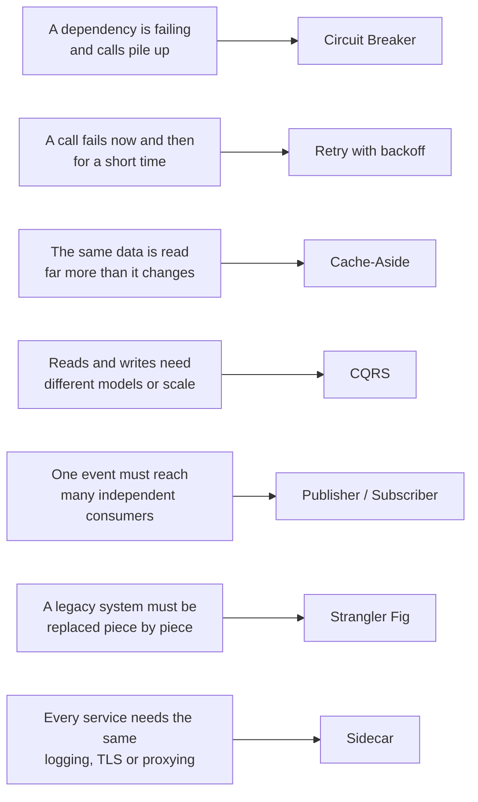

# Chapter 34 — Library Ch 12 — Cloud Design Patterns

> **Volume 4 — High-Level Design** · [Contents](index.md) · ← [Chapter 33 — Library Ch 11 — Distributed Systems Fundamentals](ch33-library-11-distributed-systems-fundamentals.md) · Next → [Chapter 35 — Library Ch 13 — Multi-Tenancy](ch35-library-13-multi-tenancy.md)

---

## Concept

A catalog of named patterns for messaging, data, design, reliability and security, and which to learn first.

**In one sentence:** A cloud design pattern is a named, reusable answer to a recurring distributed-systems problem.

A cloud design pattern is a named, reusable answer to a recurring distributed-systems problem. This chapter is the catalog: what each pattern solves, when to use it, and what to watch out for.

---

### Learning Outcomes

After reading this chapter, you'll be able to:

1. Use pattern names (Circuit Breaker, Cache-Aside, CQRS, Sidecar, Strangler Fig) precisely in a design discussion.
2. Match a problem to a pattern with the trade-off you accept.
3. Recognise the seven patterns that appear in almost every real system and interview.

### Cloud Design Patterns Catalog

*This section is in [Chapter 13 — Cloud Design Patterns](ch13-cloud-design-patterns.md), next to that chapter's practice material, so it is not repeated here.*

### The seven patterns to learn first, by the problem they solve

### Key Takeaways

- Learn Circuit Breaker, Retry, Cache-Aside, CQRS, Publisher/Subscriber, Strangler Fig and Sidecar first.
- A pattern is a tool with a cost; use a handful where a real problem exists.
- Most patterns are provider-neutral and map to AWS, GCP, Azure and Kubernetes equivalents.

### Sample Interview Questions

- When would you use Queue-Based Load Leveling instead of autoscaling?
- How does a Strangler Fig migration reduce risk?
- What does a Sidecar give you that a library does not?
- Compare Cache-Aside with Materialized View.
- What is a Claim Check and when do you need one?

### Further Reading

- Azure Architecture Center, *Cloud Design Patterns*
- Sam Newman, *Building Microservices*
- AWS Well-Architected Framework

**Next Up:** Chapter 13 — Multi-Tenancy →

*(From AI Library chapter 12.)*

