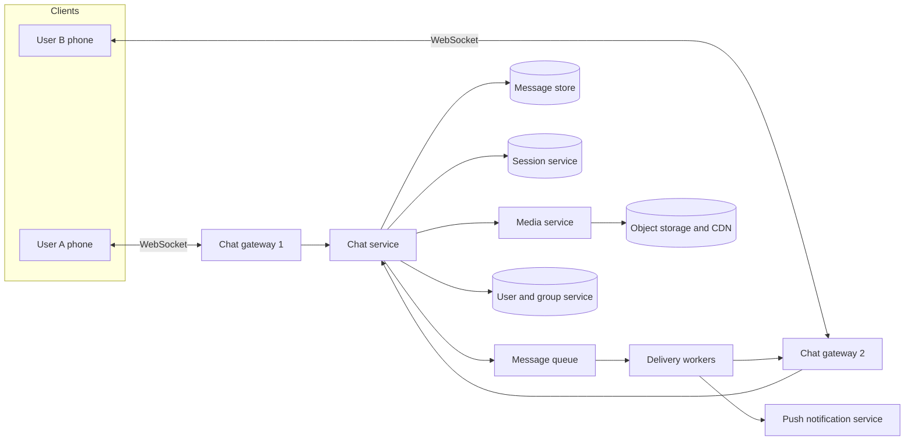
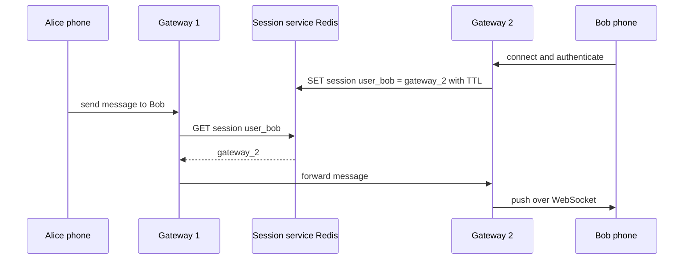
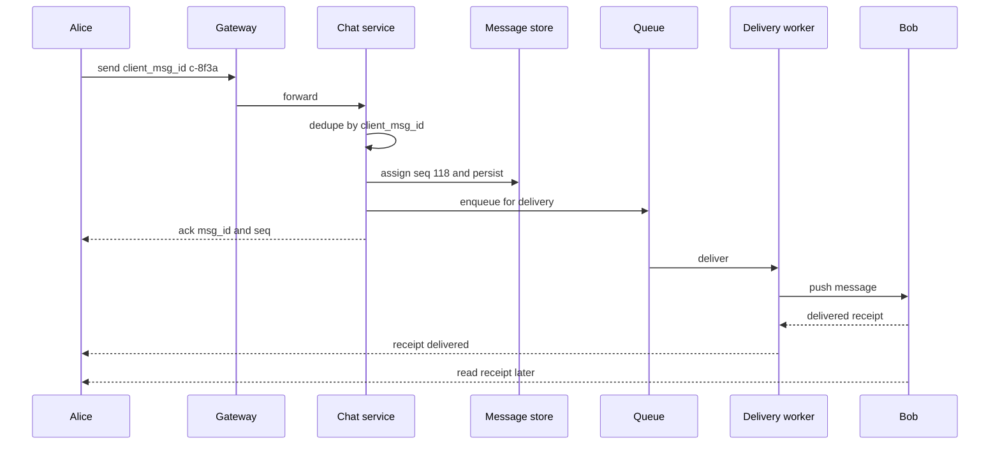
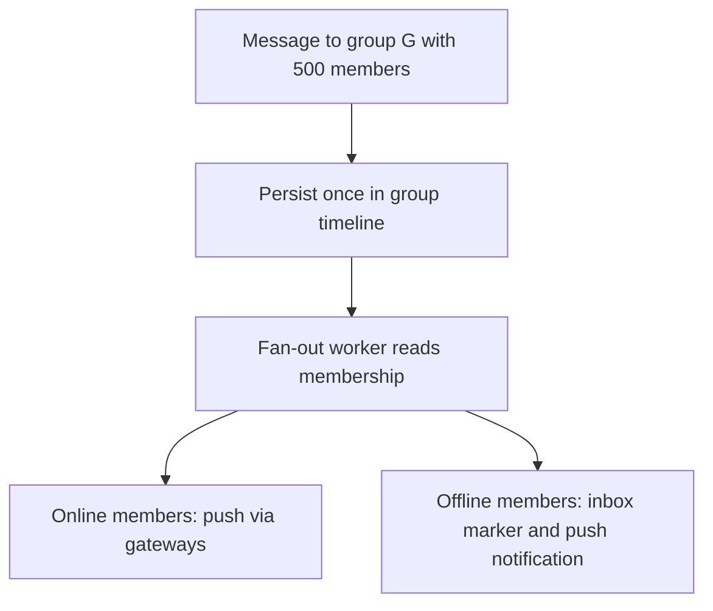

# Chapter 39 — Library Ch 17 — Chat & Messaging

> **Volume 4 — High-Level Design** · [Contents](index.md) · ← [Chapter 38 — Library Ch 16 — URL Shortener](ch38-library-16-url-shortener.md) · Next → [Chapter 40 — Library Ch 18 — News Feed](ch40-library-18-news-feed.md)

---

## Concept

Persistent connections, per-conversation ordering, delivery receipts, group fan-out, offline sync and end-to-end encryption.

**In one sentence:** In this case study we design a real-time chat application like WhatsApp, Messenger, Telegram or Slack.

In this case study we design a **real-time chat application** like WhatsApp, Messenger, Telegram or Slack. It is the classic test of **persistent connections**, **message ordering and delivery guarantees**, and **fan-out to groups**, with offline users and end-to-end encryption on top.

We apply the 4-step blueprint from Chapter 15: understand the problem, estimate scale, design at a high level, then decide on technology.

---

### Learning Outcomes

After working through this case study, you'll be able to:

1. Choose between **WebSocket, long polling and Server-Sent Events** for real-time delivery, and defend the choice.
2. Route a message to the right connected device with a **session (presence) service** when millions of users hold open connections to thousands of gateways.
3. Guarantee **at-least-once delivery with idempotent deduplication**, per-conversation **ordering**, and **delivery and read receipts**.
4. Design **1-to-1 and group fan-out** (fan-out on write for small groups, hybrid for large ones).
5. Handle **offline users** with an inbox, push notifications and multi-device sync.
6. Explain how **end-to-end encryption** changes the server's role.
7. Pick storage for message history and justify partitioning by conversation.


---

### Introduction & Scope

A chat system looks simple (send text, receive text) but combines the hardest parts of distributed systems:

- **Millions of long-lived connections**, not short request-response cycles.
- **Delivery guarantees** over unreliable mobile networks.
- **Ordering** inside a conversation.
- **Fan-out** to groups.
- **Offline users** who must receive everything when they return.
- **Privacy**: the provider should not be able to read the messages.

#### How It Works at the Highest Level

1. Every client keeps one **persistent connection** to a chat gateway.
2. To send, the client pushes a message over that connection.
3. The server stores it, finds where each recipient is connected, and pushes it there.
4. If a recipient is offline, the message waits in their inbox and a **push notification** (APNs, FCM) wakes the app.
5. Receipts flow back the same way.


### Functional Requirements

**In scope**

1. **1-to-1 chat** with text (and media references).
2. **Group chat**, up to about 1,000 members.
3. **Delivery status**: sent, delivered, read.
4. **Online / last-seen presence** and typing indicators.
5. **Offline delivery** and push notifications.
6. **Multi-device**: the same account on a phone, a laptop and a tablet.
7. **Message history** stored per conversation.
8. **Media** (images, video, files) via links to object storage.

**Out of scope here:** voice and video calls, stories, payments, channels with millions of subscribers (we cover the idea in the beyond-MVP section).


### Non-Functional Requirements

| Requirement | Target | Why |
|-------------|--------|-----|
| **Latency** | p99 end-to-end under 500 ms for online recipients | Chat must feel instant |
| **Reliability** | No lost messages; no duplicates visible to users | Trust is the product |
| **Ordering** | Messages in a conversation appear in the order sent | Otherwise conversations make no sense |
| **Availability** | 99.99%; degrade gracefully | People depend on it |
| **Scalability** | Hundreds of millions of concurrent connections | Global product |
| **Privacy** | End-to-end encryption by default | Expected by users |
| **Efficiency** | Low battery and data use on mobile | Keep-alives and payloads must be small |


### Estimating Scale & Bottlenecks

| Quantity | Assumption | Result |
|----------|-----------|--------|
| Registered users | 1 billion | |
| Daily active users | 500 million | |
| Messages per user per day | 40 | 20 billion messages/day |
| Average send rate | 20 B ÷ 86,400 | about 230,000 messages/s |
| Peak (about 3×) | | about 700,000 messages/s |
| Concurrent connections | 40% of DAU online at peak | about 200 million |
| Gateway capacity | 100,000 connections per server (tuned) | about 2,000 gateway servers |
| Message size | 100 bytes of text plus 100 bytes metadata | about 200 bytes |
| Storage per day | 20 B × 200 B | about 4 TB/day, about 1.5 PB/year |
| Media | Say 10% of messages carry media averaging 200 KB | about 400 TB/day (stored in object storage) |

**Bottlenecks**

- **Connection count:** memory per connection and file descriptors, not CPU, limit each gateway.
- **Routing:** finding which of 2,000 gateways holds a given user's connection.
- **Hot groups:** a 1,000-member group multiplies each message by 1,000.
- **Reconnect storms:** a gateway failure drops 100,000 connections that all reconnect at once.
- **Media:** bandwidth and storage dwarf text.


### Choosing the Real-Time Transport

| Option | How it works | Pros | Cons |
|--------|--------------|------|------|
| **Polling** | Client asks every few seconds | Trivial | Wasteful, slow, drains battery |
| **Long polling** | Client asks; server holds the request until data exists | Works everywhere | One request per message round, overhead |
| **Server-Sent Events** | One-way server push over HTTP | Simple, auto-reconnect | Server to client only |
| **WebSocket** | Full-duplex over one TCP connection | Low overhead, bi-directional, real-time | Stateful connections, needs sticky routing and heartbeats |
| **MQTT / custom TCP** | Lightweight pub/sub protocol | Very efficient on mobile (WhatsApp started on XMPP and moved to a tuned custom protocol) | More engineering |

**Decision:** **WebSocket** (or a binary protocol over TCP for native apps) for sending and receiving, with **HTTPS** for everything that is not real-time (login, media upload, history fetch). Send **heartbeats** (for example every 30 seconds) so both sides detect dead connections and NAT timeouts, and use **exponential backoff with jitter** on reconnect.


### API Design

Real-time traffic uses frames on the socket; the rest is a normal REST API.

**Socket frames (JSON shown for readability, binary in production)**

```json
// client -> server
{ "type": "send", "client_msg_id": "c-8f3a", "conversation_id": "c_42", "body": "hi", "ts_client": 1730000000 }

// server -> client
{ "type": "ack", "client_msg_id": "c-8f3a", "msg_id": "m_9001", "seq": 118 }
{ "type": "message", "msg_id": "m_9001", "conversation_id": "c_42", "from": "u_7", "seq": 118, "body": "hi" }
{ "type": "receipt", "msg_id": "m_9001", "status": "delivered", "by": "u_9" }
```

**REST**

| Endpoint | Purpose |
|----------|---------|
| `POST /v1/auth/login` | Obtain a token for the socket |
| `GET /v1/conversations/{id}/messages?before_seq=118&limit=50` | Page through history |
| `POST /v1/media` | Get a pre-signed URL to upload an attachment |
| `POST /v1/devices` | Register a push token (APNs or FCM) |

Two details matter:

- The **client generates `client_msg_id`**. If the connection drops after sending, the client retries with the same id, and the server de-duplicates. This is what makes at-least-once delivery safe.
- Every message gets a **sequence number (`seq`) per conversation**, assigned by the server. It defines the order and lets a client ask "give me everything after seq 118".


### High-Level Architecture



#### Component Responsibilities

| Component | Job |
|-----------|-----|
| **Chat gateway** | Terminates WebSockets, authenticates, heartbeats, forwards frames; holds no business logic |
| **Session service** | Maps `user/device` to the gateway that currently holds their connection (in Redis) |
| **Chat service** | Validates, de-duplicates, assigns `seq`, persists, hands off for delivery |
| **Message queue** | Decouples accepting a message from delivering it; absorbs bursts |
| **Delivery workers** | Look up recipients' sessions and push; fall back to inbox and push notifications |
| **Message store** | Durable history, partitioned by conversation |
| **Push notification service** | Calls APNs and FCM for offline devices |
| **Media service** | Issues pre-signed upload URLs, makes thumbnails, serves via CDN |
| **User and group service** | Profiles, contacts, group membership |

Keep gateways **stateless except for their open connections**: everything durable lives behind them. A gateway can then be restarted at the cost of a reconnect, nothing more.


### Connections, Sessions and Routing

At 200 million concurrent connections the key question is: **given a recipient, which gateway holds their socket?**



| Design choice | Detail |
|---------------|--------|
| **Session store** | Redis hash or key per user: `user -> {device -> gateway_id}`, with a TTL refreshed by heartbeats so crashed gateways expire |
| **Gateway-to-gateway delivery** | Direct RPC to the target gateway, or publish to a per-gateway channel on a message bus; the second is easier to scale and retry |
| **Load balancing** | Layer 4 balancers with connection draining; clients reconnect to any gateway because routing is looked up, not baked in |
| **Reconnect storms** | Jittered backoff on clients; capacity headroom; rate-limit new connections per gateway |
| **Gateway drain** | During deploys, stop accepting connections, ask clients to reconnect elsewhere gradually |


### Message Delivery, Ordering and Receipts

#### The Delivery Contract

Networks drop packets and phones lose signal, so exactly-once is impossible end to end. The practical contract is:

> **At-least-once delivery on the wire, plus idempotent de-duplication, gives the appearance of exactly-once.**

#### Send Path



- The sender sees one tick (**sent**) when the **server persists** and acks, two ticks (**delivered**) when the recipient's device acknowledges, and blue ticks (**read**) when the recipient opens the conversation.
- If the ack is lost, the client **retries with the same `client_msg_id`**; the chat service sees it again and returns the original `msg_id` and `seq`.
- The recipient's device also de-duplicates by `msg_id`, in case the delivery worker retried.

#### Ordering

Global ordering is unnecessary and expensive. What users need is **per-conversation ordering**.

| Approach | How | Note |
|----------|-----|------|
| **Server-assigned sequence per conversation** | Chat service increments a counter for the conversation (a single writer per conversation, or Redis `INCR`) | Simple and reliable; partition by `conversation_id` so one partition owns the counter |
| **Timestamps** | Order by client or server time | Clock skew causes reordering; avoid as the primary key |
| **Lamport / hybrid logical clocks** | Logical time that respects causality | Useful across regions |

Because the queue and the message store are both **partitioned by `conversation_id`**, all messages of a conversation flow through one partition in order. Clients detect gaps in `seq` (they got 117 then 119) and fetch the missing message.


### Group Chat and Fan-Out

When Alice posts in a group of N members, the system must deliver to N-1 people.

| Strategy | How | Good for | Cost |
|----------|-----|----------|------|
| **Fan-out on write** | Store one copy of the message; push (and write an inbox entry) to each member immediately | Small groups (up to a few hundred) | Writes multiply by N |
| **Fan-out on read** | Store the message once; members pull new messages for their groups when they open the app | Huge groups and channels | Reads are slower and more complex |
| **Hybrid** | Fan-out on write for online members; others catch up on read | Large groups | More moving parts |



Important details:

- **Store the message once**, keyed by `(group_id, seq)`. Per-member state is only a **cursor** ("last read seq") and delivery receipts, not a copy of the body.
- **Membership changes** are events in the same ordered log, so a new member sees history from when they joined, and a removed member stops receiving immediately.
- **Receipts in groups** are expensive (N receipts per message). Aggregate: show "delivered to 37", and send per-user read state only to the sender.
- **Rate-limit** large groups to protect fan-out workers.


### Offline Users, Push and Multi-Device Sync

When the recipient has no live session:

1. The message is already **persisted** with its `seq`.
2. The delivery worker adds it to the user's **inbox** (or simply relies on per-conversation cursors).
3. A **push notification** goes to APNs or FCM. For privacy, send only "You have a new message" or an encrypted payload.
4. When the app reconnects, it sends its cursors: `{conversation_id: last_seq_seen}`. The server replies with everything newer, in order.

#### Multi-Device

- Treat each **device** as its own session and its own cursor set.
- A message is delivered to **all of a user's devices**; each device acknowledges independently.
- Read state is synced across devices by writing a "read up to seq N" event to the user's own timeline.
- With end-to-end encryption, a sender encrypts the message **once per recipient device** (see below).


### Data Model and Storage

#### What We Store

| Data | Access pattern | Store |
|------|----------------|-------|
| **Messages** | Append; read the latest N for a conversation; fetch ranges by `seq` | Wide-column store (Cassandra, ScyllaDB, HBase), partition key `conversation_id`, clustering key `seq` |
| **Conversations / groups / members** | Lookups by id; list a user's conversations | Relational database or key-value store |
| **User profiles and contacts** | Key lookups | Relational database with a cache |
| **Sessions (who is online where)** | Very hot key-value reads and writes with TTL | Redis cluster |
| **Receipts and cursors** | Frequent small updates | Key-value store keyed by `(user, conversation)` |
| **Media** | Large immutable blobs | Object storage plus CDN |

#### Messages Table

```
messages(
  conversation_id  text,      -- partition key
  seq              bigint,    -- clustering key, ascending
  msg_id           uuid,
  sender_id        text,
  body             blob,      -- ciphertext when end-to-end encrypted
  kind             text,      -- text, image, system
  created_at       timestamp,
  PRIMARY KEY ((conversation_id), seq)
)
```

Why this works: the most common query is "latest 50 messages in this conversation", which is one partition and a contiguous range, so it is a single-node read. **Very large conversations** can be bucketed (`conversation_id + month`) so a partition never grows without bound.

#### Retention

Many products keep messages on the **device** and only hold them on the server until delivered (WhatsApp's model). Others keep history forever (Slack). This choice changes storage by orders of magnitude, so state it as a requirement.


### Presence, Typing Indicators and Media

#### Presence (Online / Last Seen)

Presence is a high-volume, low-value signal, so do not persist every change.

- The gateway updates the session record with a TTL on each heartbeat. "Online" means a live session exists; "last seen" is the time it expired.
- Notify only **interested watchers** (the user's open chats or contacts who are online), not everyone.
- For large contact lists, **pull on demand** (query presence when a chat is opened) instead of pushing every change.
- Let users hide last seen: a privacy setting is a product requirement.

#### Typing Indicators

Pure **ephemeral events**: send over the socket, never persist, drop if the recipient is offline, throttle to one event every few seconds.

#### Media

Never send media bytes through chat gateways.

1. The client requests a **pre-signed upload URL** and uploads directly to object storage.
2. The client sends a chat message containing the **media id, size, thumbnail and decryption key** (encrypted for the recipient).
3. The recipient downloads from the CDN using a signed link.
4. A background job creates thumbnails and scans for abuse where the product is not end-to-end encrypted.


### End-to-End Encryption

With end-to-end encryption (E2EE), **only the sender's and recipient's devices can read a message**; servers store and forward ciphertext.

| Piece | Role |
|-------|------|
| **Identity key pair** per device | Long-term identity |
| **Prekeys** uploaded to the server | Let a sender start an encrypted session while the recipient is offline |
| **Double Ratchet (Signal protocol)** | Derives a fresh key per message; gives forward secrecy and post-compromise security |
| **Safety numbers / key verification** | Lets users detect a man-in-the-middle |

What changes in the design:

- The server **cannot search, moderate or index** message bodies. Features must run on the device or use metadata only.
- In groups, the sender encrypts once per member device (or uses sender keys), so group size drives CPU on the sender.
- **Multi-device** means every device has its own key, and adding a device needs a secure linking flow.
- **Backups** must be encrypted with a key the provider does not hold.
- The server still sees **metadata** (who talks to whom, when). Minimising it (sealed sender, short retention) is a design decision.


### Tech Stack & Infrastructure Decisions

| Need | Choices | Notes |
|------|---------|-------|
| **Real-time gateway** | Custom server in Erlang/Elixir, Go, Java Netty or Node; WebSocket or MQTT | Erlang's lightweight processes are why WhatsApp ran millions of connections per server |
| **Session store** | Redis Cluster | TTLs and fast lookups |
| **Message bus** | Kafka (partition by conversation) or a per-gateway channel on Redis/NATS | Kafka for durability and replay |
| **Message store** | Cassandra / ScyllaDB / HBase | Write-heavy, partitioned by conversation |
| **Metadata** | PostgreSQL or MySQL with a cache | Users, groups |
| **Media** | S3-compatible object storage, CDN | Pre-signed URLs |
| **Push** | APNs, FCM | One service wraps both |
| **Observability** | Connection counts per gateway, send-to-deliver latency, queue lag, reconnect rate, push success rate | Alert on queue lag and reconnect storms |
| **Deployment** | Kubernetes or dedicated hosts for gateways; multi-region active-active | Gateways benefit from tuned kernels (many file descriptors) |


### Beyond MVP — What a Senior Designer Adds

#### Large Channels and Broadcast

A channel with millions of subscribers cannot use per-member fan-out on write. Use **fan-out on read** (subscribers pull) plus push notifications through a topic mechanism, and cache the latest messages at the CDN.

#### Search

With server-readable messages, build a search index (Elasticsearch) partitioned by user or conversation. With E2EE, search must be **local to the device**.

#### Spam and Abuse

Rate limits per user and per conversation, new-account throttles, report and block flows, and client-side detection for E2EE products.

#### Disaster Recovery and Regions

Route users to the nearest region; replicate the message store across regions; make `seq` assignment region-aware (a conversation has one **home region** for its sequencer, or use hybrid logical clocks).

#### Reliability Details

- **Backpressure:** when a recipient is slow, buffer a bounded number of messages per connection and fall back to the inbox.
- **Exactly-once illusion:** de-duplicate at the chat service and on the device.
- **Poison messages:** a malformed message must not block a partition; send it to a dead-letter queue.


### Tips and Tricks

- **Say "persistent connection" and "at-least-once plus idempotency"** within the first minutes. They define the whole design.
- **Show the routing problem**: "which gateway holds Bob?" is the question interviewers are waiting for; answer with a session service and a TTL.
- **Order per conversation**, never globally. Name the partition key.
- **Do the numbers**: 700K messages/s, 200 million connections, 2,000 gateways.
- **Treat groups separately**: store one copy, per-member cursors, hybrid fan-out.
- **Mention push notifications** for offline users and **sync by cursor** on reconnect.
- **Do not forget E2EE trade-offs**: no server-side search, per-device encryption, metadata exposure.
- **Never route media through chat servers.**


### Summary

#### Final Design Flow

1. Clients keep a **WebSocket** to a stateless **gateway**; a **session service** records which gateway holds each device.
2. A send goes to the **chat service**, which de-duplicates by `client_msg_id`, assigns a per-conversation `seq`, persists the message, acks the sender and enqueues delivery.
3. **Delivery workers** look up each recipient's session and push, or add to the inbox and send a **push notification**.
4. Receipts (sent, delivered, read) travel back the same path; groups aggregate them.
5. Groups store **one message copy** and per-member cursors; large groups use hybrid fan-out.
6. Reconnecting clients **sync by cursor**, receiving anything newer than their last `seq`.
7. Messages live in a **wide-column store** partitioned by conversation; media lives in **object storage behind a CDN**.
8. **End-to-end encryption** keeps bodies unreadable to the server.

#### Scale Estimates Recap

| Item | Estimate |
|------|----------|
| Messages | 20 B/day, about 230K/s average, 700K/s peak |
| Concurrent connections | About 200 million |
| Gateways | About 2,000 at 100K connections each |
| Text storage | About 4 TB/day |
| Media storage | Hundreds of TB/day in object storage |


### Further Reading

- Rick Reed, *That's Billions with a B: Scaling to the Next Level at WhatsApp* (Erlang Factory talk)
- Signal Foundation, *The Double Ratchet Algorithm* and *X3DH Key Agreement Protocol*
- Alex Xu, *System Design Interview*, chapter on designing a chat system
- Facebook Engineering, *Building Mobile-First Infrastructure for Messenger*
- IETF RFC 6455, *The WebSocket Protocol*
- Martin Kleppmann, *Designing Data-Intensive Applications*, chapters on partitioning and stream processing


**Next Up:** [Chapter 18 — Design a News Feed (Twitter / Instagram) →](./18%20-%20Design%20a%20News%20Feed%20(aka%20Twitter%20and%20Instagram).md)


*(From AI Library chapter 17.)*

