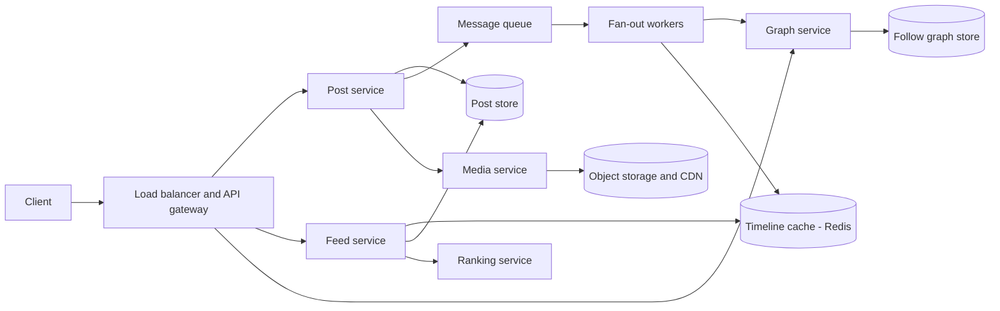
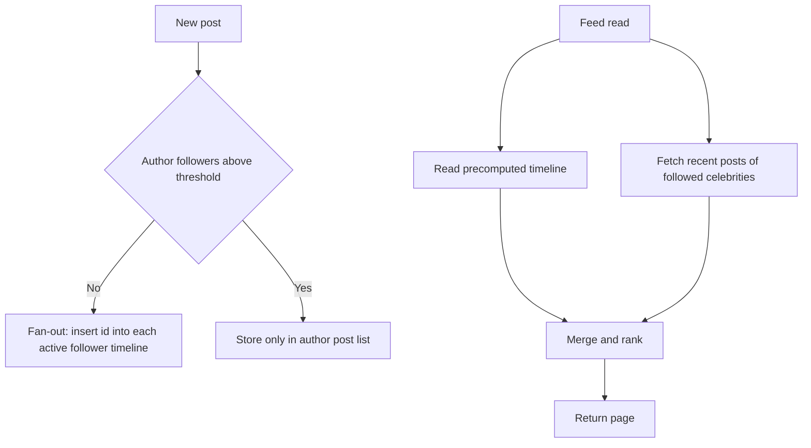
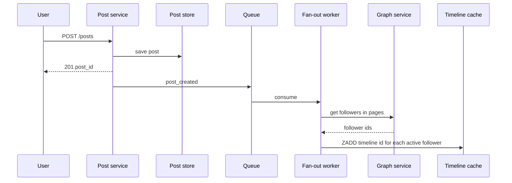
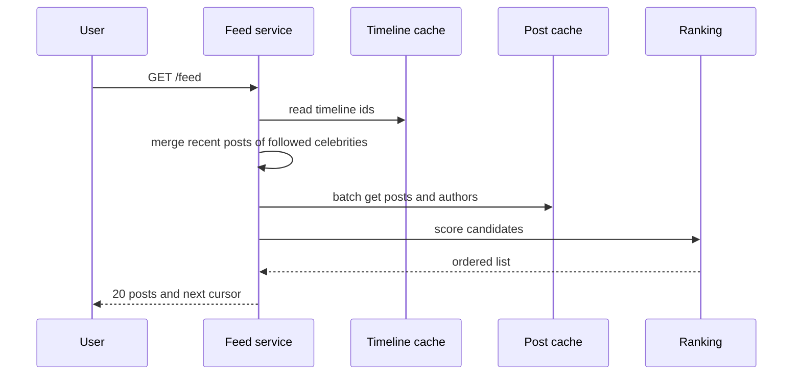
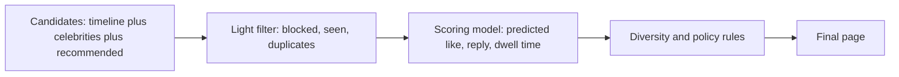

# Chapter 40 — Library Ch 18 — News Feed

> **Volume 4 — High-Level Design** · [Contents](index.md) · ← [Chapter 39 — Library Ch 17 — Chat & Messaging](ch39-library-17-chat-messaging.md) · Next → [Chapter 41 — Library Ch 19 — Key-Value Store & Cache](ch41-library-19-key-value-store-cache.md)

---

## Concept

Fan-out on write vs read, the celebrity problem, timeline caches, cursor pagination and ranking.

**In one sentence:** In this case study we design a news feed: the home timeline that shows a user the latest posts from the accounts they follow, as on Twitter/X, Instagram, Facebook and LinkedIn.

In this case study we design a **news feed**: the home timeline that shows a user the latest posts from the accounts they follow, as on Twitter/X, Instagram, Facebook and LinkedIn. It is the canonical **read-heavy fan-out** problem, and it exposes one of the most important trade-offs in system design: **do the work when a post is written, or when the feed is read?**

We apply the 4-step blueprint from Chapter 15: understand the problem, estimate scale, design at a high level, then decide on technology.

---

### Learning Outcomes

After working through this case study, you'll be able to:

1. Compare **fan-out on write (push)**, **fan-out on read (pull)** and the **hybrid** model, and say when each wins.
2. Handle the **celebrity (hot account) problem** that breaks naive push.
3. Design the **follow graph**, the **post store** and the **timeline cache** and size each one.
4. Use **cursor-based pagination** so feeds stay stable while new posts arrive.
5. Add **ranking** (a candidate-generation and scoring pipeline) on top of a chronological feed.
6. Keep media, counters and notifications from dominating the design.
7. Reason about **consistency, caching and failure** for a system whose reads outnumber writes by orders of magnitude.


---

### Introduction & Scope

A **news feed** (or home timeline) is a personalised, scrollable list of recent posts from people (and sometimes pages, groups or ads) the user follows. Two things make it hard:

- **Skewed reads and writes.** Each post is written once but read by every follower, so reads can outnumber writes by 100× or more.
- **Skewed graphs.** Most accounts have a few hundred followers; a few have tens of millions. A design that is perfect for the average account fails for the celebrity.

#### Two Different Surfaces

| Surface | Example | Content |
|---------|---------|---------|
| **Home timeline** | Twitter "Following", Instagram home | Posts from accounts I follow |
| **User timeline** | A profile page | Posts by one account |

The user timeline is easy (a list of one account's posts). The home timeline is the interesting problem and the focus of this chapter.


### Functional Requirements

**In scope**

1. **Publish a post** (text, optionally media references).
2. **Follow and unfollow** accounts.
3. **Home timeline:** see recent posts from followed accounts, newest first (or ranked), with infinite scroll.
4. **User timeline:** list one account's posts.
5. **Interactions:** like, reply, repost, with counts shown on posts.
6. **Notifications** for key events (new follower, reply), kept brief.

**Out of scope here:** direct messages (see the chat chapter), search, ads, video transcoding (see the video chapter), live streams.


### Non-Functional Requirements

| Requirement | Target | Why |
|-------------|--------|-----|
| **Read latency** | p99 under 300 ms for the home timeline | The core experience |
| **Freshness** | A new post appears in followers' feeds within a few seconds | Real-time feel; minutes would be a failure |
| **Availability** | 99.99%; prefer showing a slightly stale feed over an error | Reads dominate |
| **Scalability** | Hundreds of millions of users; accounts with 100M followers | Skewed graph |
| **Consistency** | Eventual is fine for feeds and counts; a user must see their own post immediately (read-your-writes) | Perceived correctness |
| **Durability** | Posts are never lost | They are the product |


### Estimating Scale & Bottlenecks

| Quantity | Assumption | Result |
|----------|-----------|--------|
| Daily active users | 300 million | |
| Posts per day | 100 million (about 1 post per 3 users per day) | about 1,200 posts/s, peak about 4,000/s |
| Average followers | 200 | |
| Feed reads per user per day | 10 opens of 20 posts | 3 billion feed reads/day, about 35,000/s average, 100,000/s peak |
| Post size | 300 bytes text and metadata | 30 GB/day of post data, about 11 TB/year |
| Media | 20% of posts, 500 KB average | 10 TB/day in object storage |
| Fan-out writes (push) | 1,200 posts/s × 200 followers | about 240,000 timeline inserts/s average |
| Timeline cache | 300 M users × 800 post ids × 8 bytes | about 1.9 TB of ids (fits in a Redis cluster) |

**What the numbers say**

- Reads (100K/s) are about 25× posts (4K/s), and **each read must be cheap**. This favours precomputing the feed.
- Push fan-out is 240K inserts/s on average: heavy but fine. A single celebrity with 50 million followers turns **one post into 50 million inserts**, which is not.
- Storing only **post ids** in the timeline cache (not post bodies) keeps the cache small.


### API Design

| Endpoint | Purpose |
|----------|---------|
| `POST /v1/posts` | Create a post `{text, media_ids[]}`; returns `post_id` |
| `GET /v1/feed?cursor=<opaque>&limit=20` | Home timeline |
| `GET /v1/users/{id}/posts?cursor=&limit=20` | User timeline |
| `POST /v1/users/{id}/follow`, `DELETE /v1/users/{id}/follow` | Follow graph |
| `POST /v1/posts/{id}/like` | Like (idempotent) |
| `POST /v1/media` | Get a pre-signed URL for upload |

#### Pagination: Cursors, Not Offsets

`?page=3` breaks when new posts arrive: items shift and the user sees duplicates or gaps. Use a **cursor** that encodes the last item seen (for example `post_id` or `(score, post_id)`):

```
GET /v1/feed?limit=20
-> { "items": [...], "next_cursor": "eyJpZCI6IjkwMDEifQ" }
GET /v1/feed?cursor=eyJpZCI6IjkwMDEifQ&limit=20
```

Time-ordered ids (Snowflake style: timestamp plus machine plus sequence) make "older than this id" a simple range query.


### High-Level Architecture



#### Component Responsibilities

| Component | Job |
|-----------|-----|
| **Post service** | Validates and stores posts, emits a `post_created` event |
| **Graph service** | Stores who follows whom; answers "followers of X" and "accounts X follows" |
| **Fan-out workers** | Consume `post_created`, look up followers, insert the post id into their timelines |
| **Timeline cache** | Per-user list of recent post ids (Redis sorted set or list) |
| **Feed service** | Builds a response: read ids from cache, merge celebrity posts, hydrate, rank |
| **Ranking service** | Orders candidates by predicted relevance |
| **Media service** | Upload URLs, thumbnails, CDN |


### Fan-Out: Push, Pull and Hybrid

This is the heart of the problem.

#### Fan-Out on Write (Push)

When Alice posts, a worker looks up her followers and **inserts the post id into each follower's timeline cache**.

| Pros | Cons |
|------|------|
| Reading a feed is one cheap cache read | A post by an account with 50M followers triggers 50M writes |
| Predictable read latency | Wasted work for inactive followers who never open the app |
| | Slower to publish for big accounts; feed updates lag |

#### Fan-Out on Read (Pull)

Store nothing per follower. When Bob opens his feed, fetch the recent posts of **everyone he follows** and merge them.

| Pros | Cons |
|------|------|
| Posting is a single write, no fan-out | Reading is expensive: 500 followed accounts means 500 lookups and a merge on every open |
| No wasted work for inactive users | High, variable read latency |
| Handles celebrities trivially | |

#### Hybrid (what real systems do)

- **Push** for ordinary accounts (the vast majority of posts).
- **Pull** for celebrities: mark accounts above a follower threshold (say 1 million) as "celebrity", and do **not** fan their posts out.
- At read time, the feed service takes the **precomputed timeline (pushed posts)** and **merges in recent posts from the celebrities the user follows** (a handful of lookups, each cached).
- Also **skip fan-out for inactive users**: only push to users active in the last N days; rebuild their feed on return.



| Strategy | Write cost | Read cost | Best for |
|----------|------------|-----------|----------|
| Push | High for big accounts | Very low | Typical accounts, read-heavy |
| Pull | Very low | High | Celebrities, very inactive users |
| **Hybrid** | Bounded | Low | The real world |


### Data Model and Storage

#### Follow Graph

Needs two fast lookups: **who follows X** (for fan-out) and **whom does X follow** (for pull and for celebrity merging).

```
follows(follower_id, followee_id, created_at)   -- index both directions
```

| Scale | Store |
|-------|-------|
| Moderate | Relational database sharded by `follower_id`, plus a mirrored table sharded by `followee_id` |
| Large | Wide-column store or a graph-optimised store (Twitter's FlockDB, Facebook's TAO) with caching of adjacency lists |

Sharding by one side makes the other side a scatter-gather; keeping **both directions** as separate tables avoids that at the cost of double writes.

#### Posts

```
posts(
  post_id     bigint,      -- time-ordered id (Snowflake)
  author_id   bigint,
  text        text,
  media       json,
  created_at  timestamp,
  PRIMARY KEY (post_id)
)
posts_by_author(author_id, post_id DESC)   -- user timeline
```

Posts are immutable (edits create a new version or a flag), so they cache extremely well. Shard by `post_id` or `author_id`; a wide-column store (Cassandra) or sharded MySQL both work.

#### Counters (likes, reposts)

High-write, tolerates slight staleness. Use **sharded counters** or a counter service with in-memory aggregation and periodic flush, not `UPDATE ... SET likes = likes + 1` on one row.


### The Timeline Cache

Per user, keep a bounded list of recent **post ids** (not bodies).

| Choice | Detail |
|--------|--------|
| **Structure** | Redis sorted set `timeline:{user_id}` with score = time-ordered post id, or a capped list |
| **Size** | Cap at about 800 ids per user; older posts are fetched from the database on demand |
| **Eviction** | Keep timelines only for **active** users; rebuild for returning users |
| **Hydration** | After reading 20 ids, batch-fetch post bodies from a **post cache** (`MGET`), then author profiles; misses go to the database |
| **Rebuild** | If a timeline is missing, build it with pull (merge recent posts of followed accounts) and store it |

```python
def home_feed(user_id, cursor=None, limit=20):
    ids = redis.zrevrangebyscore(f"timeline:{user_id}",
                                 max=cursor or "+inf", min="-inf", start=0, num=limit + 5)
    ids += celebrity_recent_ids(user_id, since=ids[-1] if ids else None)   # pull part
    ids = sorted(set(ids), reverse=True)[:limit]
    posts = post_cache.mget(ids)                                           # hydrate
    return rank(posts, user_id), (ids[-1] if ids else None)
```


### Critical Flows

#### Publish a Post



The user gets their response **before** fan-out finishes; fan-out is asynchronous and idempotent (inserting the same id twice is harmless). Show the author their own post immediately by **inserting it into their own timeline synchronously** (read-your-writes).

#### Read the Home Feed



#### Follow and Unfollow

- **Follow:** write the edge in both tables; **backfill** the new followee's recent posts into the follower's timeline (a handful), so the feed feels instant.
- **Unfollow:** write the removal; **filter at read time** (drop posts from accounts no longer followed) and let old ids age out, rather than scanning timelines.


### Ranking the Feed

A purely chronological feed is the baseline. Most products rank.



| Stage | What happens |
|-------|--------------|
| **Candidate generation** | Take a few hundred recent ids from the timeline, plus celebrity posts and optionally recommendations |
| **Filtering** | Remove blocked or muted authors, posts already seen, and policy violations |
| **Scoring** | A machine-learned model predicts engagement (like, reply, click, dwell time) from features such as author affinity, post age, content type and past behaviour |
| **Re-ranking** | Enforce diversity (not ten posts from one author), freshness and ad slots |
| **Logging** | Record what was shown and what the user did, to train the next model |

Keep ranking **behind a service** with a latency budget (for example 50 ms), and **fall back to chronological order** if it times out. Compute **features offline** where possible and store them in a feature store, so the online path only does lookups.


### Media, Counters and Notifications

#### Media

Upload through **pre-signed URLs** straight to object storage; process (resize, transcode, scan) asynchronously; serve through a **CDN**. The post stores only media ids and metadata. Feeds show a placeholder until processing finishes.

#### Counters

Likes and reply counts are read constantly. Cache them on the post object, update asynchronously (event stream into a counter service), and accept that a count may lag by seconds. Prevent double-likes with a `(user, post)` unique key.

#### Notifications

New follower, reply or mention events go to a **notification service** through the same queue. Aggregate ("Alice and 12 others liked your post") and rate-limit so a viral post does not send a million push notifications.


### Tech Stack & Infrastructure Decisions

| Need | Choices | Notes |
|------|---------|-------|
| **API layer** | Stateless services behind a load balancer | Autoscale on QPS |
| **Post store** | MySQL (sharded, as Instagram and Twitter began), Cassandra, DynamoDB | Time-ordered ids simplify sharding |
| **Follow graph** | Sharded MySQL, TAO-style cache over MySQL, or a graph store | Store both directions |
| **Timeline cache** | Redis Cluster | Sorted sets of ids; memory is the cost driver |
| **Post and object cache** | Memcached or Redis | Immutable posts cache very well |
| **Queue** | Kafka | Partition by author or follower for ordering and parallelism |
| **Ranking** | Online scoring service plus feature store, offline training on a data lake | Fallback to chronological |
| **Media** | S3-compatible storage, CDN, async processing | |
| **IDs** | Snowflake-style generator | Sortable by time |
| **Observability** | Feed latency, fan-out lag, cache hit rate, queue depth, timeline rebuild rate | Fan-out lag is the leading failure signal |


### Beyond MVP — What a Senior Designer Adds

#### Handling the Thundering Herd on a Celebrity Post

A single viral post is read millions of times per second. Cache the post object aggressively (in-process, then Redis, then CDN for public pages), coalesce duplicate cache misses, and keep a **hot-key replica** set.

#### Consistency Details

- **Read-your-writes:** insert your own post into your timeline synchronously and pin it for a short time.
- **Monotonic reads:** use the same cache replica or a cursor so a feed does not go backwards on refresh.
- **Deletes:** deleting a post must remove it from caches; hydrating by id and **dropping ids that no longer exist** makes deletes safe without scanning timelines.

#### Cold Start and Re-Engagement

A new or returning user has no timeline: build it by pull, show recommendations, and prompt follows.

#### Multi-Region

Serve reads from the nearest region with replicated post stores and regional timeline caches; route writes to a home region or use multi-leader replication for posts with conflict-free ids.

#### Abuse and Safety

Spam and bot detection on post creation, per-user rate limits, content moderation before fan-out for flagged accounts, and the ability to **retract** a post across all timelines quickly.

#### Cost Control

Timeline caches dominate memory cost. Limit depth, keep only active users, compress ids, and measure cost per daily active user.


### Tips and Tricks

- **Lead with the fan-out trade-off** (write vs read), then say "hybrid" and explain the celebrity problem.
- **Cache ids, hydrate bodies.** It shows you understand the memory math.
- **Use cursors.** Mention that offset pagination breaks in a live feed.
- **Quantify:** 100K feed reads/s, 240K fan-out inserts/s, 1.9 TB of ids.
- **Make fan-out asynchronous and idempotent**, and say what the user sees in the meantime (their own post, instantly).
- **Plan the fallback:** if ranking is down, show chronological; if the cache is cold, pull.
- **Do not forget deletes, unfollows and blocks** at read time.


### Summary

#### Final Design Flow

1. A post is saved by the **post service**, which acks the user and emits `post_created`.
2. **Fan-out workers** push the post id into the **timeline cache** of each active follower, except for **celebrity accounts**, which are pulled at read time.
3. A feed read takes the user's **precomputed timeline**, merges recent celebrity posts, **hydrates** posts from a cache, **ranks** them (falling back to time order) and returns a page with a **cursor**.
4. The **follow graph** is stored in both directions; unfollows are filtered at read time.
5. Media goes through **pre-signed uploads, object storage and a CDN**; counters are aggregated asynchronously.
6. The design is **eventually consistent** with read-your-writes for the author.

#### Scale Estimates Recap

| Item | Estimate |
|------|----------|
| Posts | 100 M/day, about 1,200/s (peak 4,000/s) |
| Feed reads | 3 B/day, peak about 100K/s |
| Push fan-out | About 240K timeline inserts/s average |
| Timeline cache | About 1.9 TB of post ids |
| Media | About 10 TB/day |


### Further Reading

- Raffi Krikorian, *Timelines at Scale* (Twitter, QCon talk)
- Twitter Engineering, *The Infrastructure Behind Twitter: Scale* and *Snowflake: Announcing Snowflake*
- Nathan Bronson et al., *TAO: Facebook's Distributed Data Store for the Social Graph* (USENIX ATC 2013)
- Instagram Engineering, *Sharding & IDs at Instagram*
- Alex Xu, *System Design Interview*, chapter on designing a news feed system
- Martin Kleppmann, *Designing Data-Intensive Applications*, the Twitter example in chapter 1


**Next Up:** Chapter 19 — Design a Distributed Key-Value Store & Cache →


*(From AI Library chapter 18.)*

