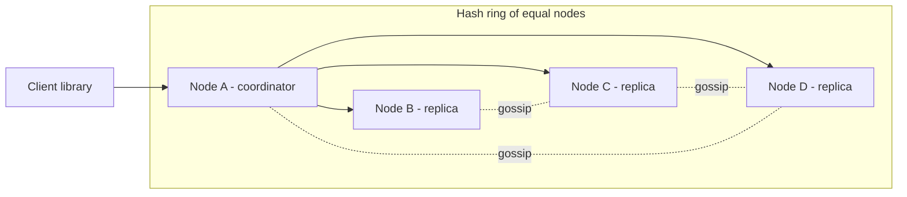
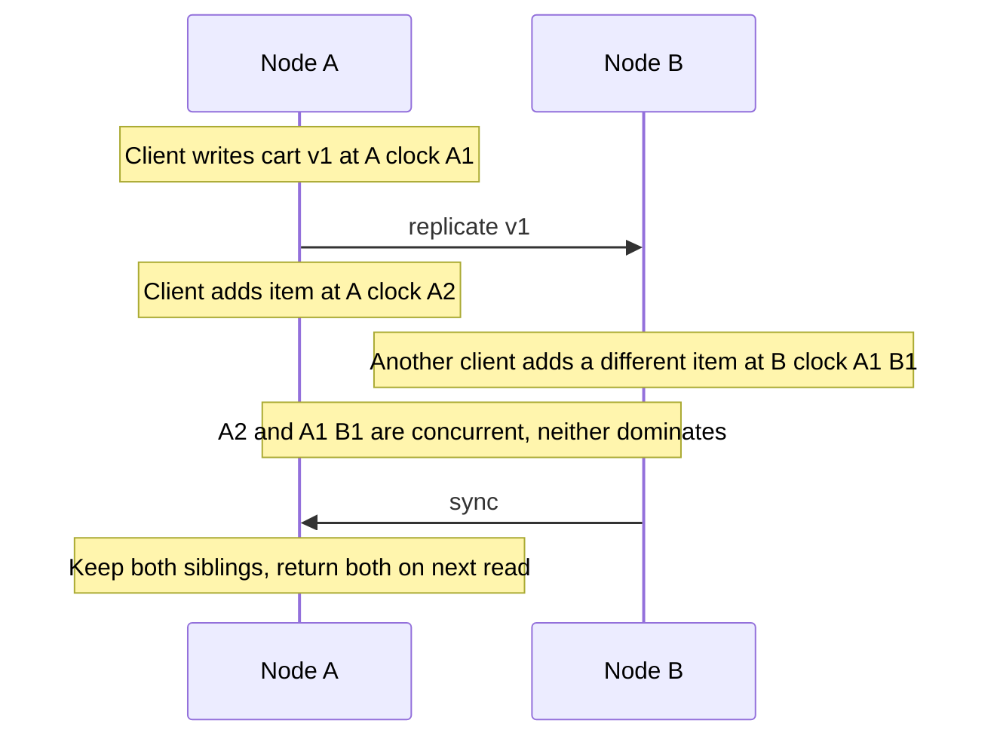
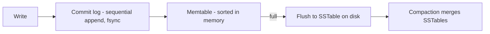
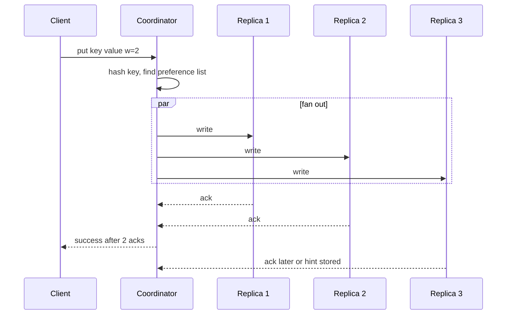
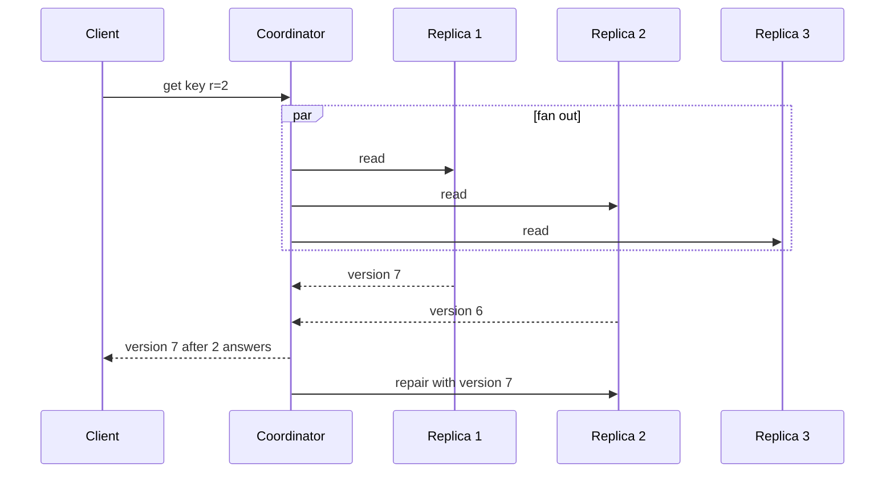

# Chapter 41 — Library Ch 19 — Key-Value Store & Cache

> **Volume 4 — High-Level Design** · [Contents](index.md) · ← [Chapter 40 — Library Ch 18 — News Feed](ch40-library-18-news-feed.md) · Next → [Chapter 42 — Library Ch 20 — Payment System](ch42-library-20-payment-system.md)

---

## Concept

Consistent hashing, N/R/W quorums, hinted handoff, vector clocks, LSM trees, and the cache variant.

**In one sentence:** In this case study we design the storage engine that sits underneath half the internet: a distributed key-value store in the style of Amazon Dynamo, Apache Cassandra, Riak and Redis Cluster.

In this case study we design the storage engine that sits underneath half the internet: a **distributed key-value store** in the style of Amazon Dynamo, Apache Cassandra, Riak and Redis Cluster. It is the best place in the whole course to see replication, partitioning, quorums, failure detection and consistency trade-offs working together in one system.

We apply the 4-step blueprint from Chapter 15: understand the problem, estimate scale, design at a high level, then decide on technology. We also design the cache variant of the same system, because most interview questions in this space are really two questions: "build a store" and "build a cache in front of it".

---

### Learning Outcomes

After working through this case study, you'll be able to:

1. Partition data across many machines with **consistent hashing and virtual nodes**, and explain what happens when a node joins or leaves.
2. Replicate every key to N nodes and tune **N, R and W** to trade consistency against latency and availability.
3. Keep writes available during failures with **sloppy quorums and hinted handoff**, and repair divergence with **read repair and Merkle-tree anti-entropy**.
4. Detect failed nodes without a central coordinator using **gossip**.
5. Resolve conflicting writes with **vector clocks**, last-write-wins, or CRDTs, and know what each costs.
6. Explain the **LSM-tree write path** (commit log, memtable, SSTable, compaction, Bloom filter) and why it makes writes cheap.
7. Design the **cache variant**: eviction policy, TTLs, and the failure modes that sit in front of a database.


---

### Introduction & Scope

A **key-value store** is the simplest database there is: you `put(key, value)` and `get(key)`. There are no joins, no secondary indexes and no schema. That simplicity is exactly what lets it scale to millions of operations per second across hundreds of machines.

You meet this system in two forms:

| Form | Examples | Durability | Typical role |
|------|----------|------------|--------------|
| **Durable store** | DynamoDB, Cassandra, Riak, etcd, FoundationDB | Data must survive crashes | Primary database for shopping carts, sessions, profiles, feature flags, metadata |
| **Cache** | Memcached, Redis (as a cache), Hazelcast | Data may be lost and rebuilt | A fast layer in front of a slower database |

Both share the same distributed core (partition, replicate, detect failures), so we design the durable store first and then show what changes for the cache.

#### Why Build One?

- A relational database on one machine tops out at tens of thousands of operations per second and a few terabytes. Past that you must **shard**, and a purpose-built key-value store does the sharding for you.
- Many workloads only ever look up by one key: a user's session, a cart, a device's last known state. They pay for features (joins, transactions) they never use.
- Availability matters more than strict consistency for these workloads. Amazon's original Dynamo paper was motivated by one sentence: the shopping cart must always accept writes.

#### The Core Tension

The CAP theorem says that when the network partitions, you choose consistency or availability. Dynamo-style stores choose **availability** by default and let you slide toward consistency per request. Systems such as etcd and ZooKeeper choose consistency (they use a consensus protocol, Raft or Paxos). Keep this choice in mind: almost every decision below is an expression of it.


### Functional Requirements

**In scope**

1. `put(key, value)` stores a value (up to a size limit, say 1 MB).
2. `get(key)` returns the value, or "not found".
3. `delete(key)` removes a key.
4. Optional **TTL** per key (needed for the cache variant and for sessions).
5. Optional **conditional writes** (compare-and-set) for simple coordination.

**Out of scope**

- Range scans over arbitrary keys, secondary indexes, joins, multi-key transactions. (We mention how to add range scans in the beyond-MVP section.)


### Non-Functional Requirements

| Requirement | Target | Why |
|-------------|--------|-----|
| **Latency** | p99 under 10 ms for reads and writes inside a region | It is on the hot path of other systems |
| **Availability** | 99.99%+; writes keep working when nodes or a data center fail | The store is a dependency of everything |
| **Scalability** | Add nodes online; capacity and throughput grow roughly linearly | Growth must not need downtime |
| **Durability** | Acknowledged writes survive node loss (durable store only) | Data is the product |
| **Consistency** | Tunable: from eventual to strong per request | Different callers need different guarantees |
| **Operational simplicity** | No single coordinator, no special nodes | Fewer special cases to fail |


### Estimating Scale & Bottlenecks

Assume a mid-size deployment for a large consumer product.

| Quantity | Assumption | Result |
|----------|-----------|--------|
| Keys | 10 billion | |
| Average value size | 1 KB | 10 TB of raw data |
| Replication factor N | 3 | 30 TB stored |
| Operations | 1 million per second, 90% reads | 900K reads/s, 100K writes/s |
| Per-node capacity | 20 TB disk, 50K ops/s at p99 under 10 ms | |

**Nodes needed:** storage says 30 TB ÷ 20 TB ≈ 2 nodes, but throughput says 1,000,000 ÷ 50,000 = 20 nodes. Throughput, not capacity, drives the node count. Add headroom of about 40% for failures and rebalancing and you land near **30 nodes**, each holding about 1 TB of data. With only 1 TB per node, recovering a failed node from its peers takes minutes rather than hours, which is a deliberate design target.

**Where the bottlenecks are**

- **Hot keys:** one celebrity key can saturate its three replicas regardless of cluster size.
- **Disk write amplification:** compaction rewrites data repeatedly; it competes with foreground traffic.
- **Network during recovery:** rebuilding a failed node moves terabytes between nodes.
- **Coordinator fan-out:** each request touches several replicas, so latency is set by the slowest of the nodes you wait for.


### API Design

A small, boring API is a feature.

```
PUT    /v1/kv/{key}?ttl=3600&w=2          body: value bytes, optional header If-Match: <version>
GET    /v1/kv/{key}?r=2                   -> 200 value + version, or 404
DELETE /v1/kv/{key}?w=2
```

| Parameter | Meaning |
|-----------|---------|
| `w`, `r` | How many replicas must acknowledge a write or answer a read (the quorum knobs) |
| `ttl` | Seconds until the key expires |
| `version` / `If-Match` | Opaque version (vector clock or timestamp) for conditional writes and for letting the client merge conflicts |

A `GET` may return **several versions** when concurrent writes conflicted and could not be reconciled automatically; the client merges them and writes back. This is how Dynamo's shopping cart works.


### High-Level Architecture

The defining decision: **there is no master**. Every node can coordinate any request, and every node runs the same software.



#### Component Responsibilities

| Component | Job |
|-----------|-----|
| **Client library** | Hashes the key, finds a node (or any node), retries, merges conflicting versions |
| **Coordinator (any node)** | Receives the request, finds the replicas for the key, fans out, waits for R or W answers, replies |
| **Partitioner** | Maps a key to a position on the hash ring |
| **Replicator** | Copies each key to N nodes |
| **Gossip / membership** | Spreads who is alive and who owns which ranges |
| **Storage engine** | Persists data on one node (commit log + memtable + SSTables) |
| **Repair services** | Hinted handoff, read repair, Merkle-tree anti-entropy |


### Partitioning with Consistent Hashing

With simple modulo hashing (`node = hash(key) % N`), adding one node remaps almost every key. In a store holding terabytes, that means moving almost everything. **Consistent hashing** fixes this.

1. Imagine the output range of a hash function as a ring (0 to 2¹²⁸).
2. Hash each **node** onto the ring.
3. Hash each **key** onto the ring; the key belongs to the first node clockwise from it.
4. When a node joins or leaves, only the keys between it and its neighbour move: about **1/N of the data**, not all of it.

#### Virtual Nodes

A single point per machine gives uneven ranges and makes one neighbour absorb all of a failed node's load. **Virtual nodes** give each physical machine many points (for example 128–256).

| Benefit | Why |
|---------|-----|
| Even load | Many small ranges average out the randomness |
| Smooth failure | A dead node's ranges are spread across all remaining nodes, not dumped on one neighbour |
| Heterogeneous hardware | A machine with twice the disk takes twice the virtual nodes |
| Parallel rebuild | A joining node streams from many peers at once |

```python
import bisect, hashlib

class Ring:
    def __init__(self, vnodes=128):
        self.vnodes, self.ring, self.owner = vnodes, [], {}

    def _h(self, s):
        return int(hashlib.md5(s.encode()).hexdigest(), 16)

    def add(self, node):
        for i in range(self.vnodes):
            h = self._h(f"{node}#{i}")
            bisect.insort(self.ring, h)
            self.owner[h] = node

    def replicas(self, key, n=3):
        """Walk clockwise and collect n DISTINCT physical nodes."""
        i = bisect.bisect(self.ring, self._h(key)) % len(self.ring)
        out = []
        while len(out) < n:
            node = self.owner[self.ring[i % len(self.ring)]]
            if node not in out:
                out.append(node)
            i += 1
        return out
```

The **preference list** for a key is the first N distinct physical nodes clockwise. Skipping repeated physical nodes is essential, otherwise all three "replicas" could be the same machine.


### Replication and Quorums

Each key is stored on **N** nodes (typically 3). A request talks to all N but only waits for some of them:

- **W** = replicas that must acknowledge a write before it succeeds.
- **R** = replicas that must answer a read.

**The rule:** if **R + W > N**, every read quorum overlaps every write quorum in at least one node, so a read sees the latest acknowledged write (assuming no concurrent writes and no sloppy quorum).

| Configuration (N=3) | Behaviour | Use for |
|---------------------|-----------|---------|
| W=1, R=1 | Fastest, may read stale data, writes survive 2 failures | Metrics, caches, "last seen" |
| W=2, R=2 | R+W=4 > 3: strong-ish reads, tolerates 1 failure | Default for most data |
| W=3, R=1 | Fast reads, writes fail if any node is down | Read-heavy data that rarely changes |
| W=1, R=3 | Fast writes, slow and fragile reads | Write-heavy ingest with rare reads |

Latency is set by the **slowest of the replicas you wait for**, so choosing R or W below N also cuts tail latency: waiting for 2 of 3 skips the slowest node.


### Handling Failures

A store with hundreds of machines is always partially broken. Design so that failure is the normal case.

#### Failure Detection with Gossip

A central health checker would be a single point of failure. Instead, every node, once per second, picks a few random peers and exchanges its membership table (node, heartbeat counter, timestamp). If a node's heartbeat has not advanced for a threshold, peers mark it **suspect**, then **down**. Information spreads in O(log N) rounds, with no coordinator. Production systems often use the **phi-accrual** detector, which outputs a suspicion level instead of a hard yes/no, so a slow network does not cause false alarms.

#### Sloppy Quorums and Hinted Handoff

If one of a key's three home nodes is down, a strict quorum could refuse the write. A **sloppy quorum** instead writes to the next healthy node on the ring. That stand-in stores a **hint** ("this belongs to node B") and delivers the data when B returns.

| Strict quorum | Sloppy quorum |
|---------------|---------------|
| Consistent with R + W > N | R + W > N no longer guarantees you read the latest write |
| Writes fail when too many home nodes are down | Writes stay available |
| Simple reasoning | Needs repair afterwards |

#### Anti-Entropy with Merkle Trees

Hints are lost if the stand-in dies, and replicas can drift for many other reasons. Background **anti-entropy** compares replicas cheaply:

1. Each node builds a **Merkle tree** over a key range: leaves are hashes of individual rows, parents are hashes of their children.
2. Two replicas compare root hashes. If equal, the whole range is identical, and nothing is transferred.
3. If different, they descend only into the subtrees whose hashes differ, finding the exact divergent keys with a handful of hash comparisons.

#### Read Repair

When a read contacts several replicas and sees different versions, the coordinator returns the newest and **writes it back** to the stale replicas. Hot data heals itself on every read.

#### Multi-Data-Center Failure

Place the N replicas across **racks and availability zones** (and, for a global store, across regions with `local_quorum` for latency and asynchronous cross-region replication). A preference list that skips nodes in the same rack survives a rack loss.


### Versioning and Conflict Resolution

With no master and writes accepted on different replicas, two clients can update the same key concurrently. The store needs a rule.

| Strategy | How it works | Cost |
|----------|--------------|------|
| **Last-write-wins (LWW)** | Each write has a timestamp; highest wins | Simple, but depends on clock accuracy, and silently drops one of two concurrent updates |
| **Vector clocks** | Each version carries a counter per node that touched it; compare to tell "happened after" from "concurrent" | Detects true conflicts; the client or application must merge; clocks grow, so prune them |
| **CRDTs** (counters, sets, registers) | Data types designed so that concurrent updates always merge deterministically | Only works for types with a defined merge (counters, sets, maps) |
| **Application merge** | Return all conflicting versions ("siblings") to the client | Most flexible, pushes work to callers |

#### Vector Clock Example



A version `[A:2]` dominates `[A:1]` (it saw everything the older one saw). `[A:2]` and `[A:1, B:1]` are **concurrent**: neither contains the other, so both are kept and the application merges them (for a cart: union the items).

**Deletes** are writes too. Removing a key writes a **tombstone** (a marker with a version), otherwise a stale replica would resurrect the key during repair. Tombstones are garbage-collected after a grace period longer than the repair interval.


### The Storage Engine on One Node

Each node needs a local engine that makes **writes cheap and reads acceptable**. The standard answer is a **log-structured merge tree (LSM tree)**, used by Cassandra, RocksDB, LevelDB and HBase.

#### Write Path



1. **Commit log:** append the write sequentially to disk (fast, durable). If the node crashes, replay the log.
2. **Memtable:** insert into a sorted in-memory structure.
3. **Flush:** when the memtable is full, write it out as an immutable **SSTable** (sorted string table).
4. **Compaction:** background merging of SSTables removes overwritten values and tombstones and keeps read cost bounded.

Writes are sequential appends, so a spinning disk or SSD sustains very high write throughput. The price is **write amplification** (data is rewritten during compaction) and **read amplification** (a key might be in several SSTables).

#### Read Path

1. Check the **memtable**.
2. For each SSTable (newest first), ask its **Bloom filter** "might this key be here?" A Bloom filter says "definitely not" or "maybe", with no false negatives, so most SSTables are skipped without touching disk.
3. For "maybe" SSTables, use the **index** to find the block, read it, and return the newest version found.
4. A **block cache** keeps hot blocks in memory.

| Engine | Strength | Weakness |
|--------|----------|----------|
| **LSM tree** | Very high write throughput, sequential I/O | Compaction cost, read amplification |
| **B-tree** (as in most relational engines) | Predictable reads, in-place updates | Random writes, lower write throughput |

Pick LSM for write-heavy key-value workloads and B-tree for read-heavy workloads with range queries.


### Critical Flows

#### Write Flow



#### Read Flow with Read Repair




### The Cache Variant

A cache is a key-value store with different priorities: **speed over durability**, so we relax the design.

| Aspect | Durable store | Cache |
|--------|---------------|-------|
| Replication | N copies, quorum | Often none, or one replica for failover |
| Persistence | Commit log and SSTables | In memory; optional snapshots |
| On node loss | Data survives | Data is lost and refetched from the source of truth |
| Capacity limit | Disk | RAM, so it must **evict** |
| Consistency | Tunable | Eventual; stale reads are acceptable for a TTL |

#### Eviction Policies

| Policy | Evicts | Note |
|--------|--------|------|
| **LRU** | Least recently used | Good default; implemented with a hash map plus doubly linked list for O(1) |
| **LFU** | Least frequently used | Better for stable hot sets; needs aging |
| **TTL** | Expired entries | Bounds staleness; always set one |
| **FIFO / random** | Oldest or random | Cheap, rarely best |

```python
from collections import OrderedDict

class LRU:
    def __init__(self, cap):
        self.cap, self.d = cap, OrderedDict()
    def get(self, k):
        if k not in self.d: return None
        self.d.move_to_end(k)
        return self.d[k]
    def put(self, k, v):
        self.d[k] = v
        self.d.move_to_end(k)
        if len(self.d) > self.cap:
            self.d.popitem(last=False)
```

#### Cache Failure Modes

| Problem | What happens | Fix |
|---------|--------------|-----|
| **Cache stampede** | A hot key expires and thousands of requests hit the database at once | Per-key lock or request coalescing; refresh early; add jitter to TTLs |
| **Cache penetration** | Requests for keys that do not exist always miss and hit the database | Cache "not found" briefly; Bloom filter in front |
| **Hot key** | One key overloads one node | Replicate hot keys or add a local in-process cache |
| **Cold start** | A restarted cache is empty and the database is overwhelmed | Warm the cache; rate-limit refills |
| **Inconsistency** | Cache and database disagree after a write | Invalidate on write (delete the key), keep TTL as a safety net |


### Tech Stack & Infrastructure Decisions

| Need | Choices | Notes |
|------|---------|-------|
| **Buy instead of build** | DynamoDB, Cassandra, ScyllaDB, Riak | In practice you almost always use one of these; building is an interview exercise |
| **Strong consistency** | etcd, ZooKeeper, FoundationDB, Spanner | Consensus-based; fewer writes per second, linearizable |
| **Cache** | Redis, Memcached | Memcached: multi-threaded, simple, strings only; Redis: data structures, persistence, replication, cluster mode |
| **Storage engine** | RocksDB, LevelDB | Embeddable LSM engines |
| **Membership** | Gossip (SWIM, Serf) or ZooKeeper/etcd | Gossip has no extra dependency |
| **Serialization** | Protocol Buffers, Avro | Compact, versioned |
| **Observability** | p50/p99 latency per operation, hinted-handoff queue depth, compaction backlog, repair lag, hot-key reports | The leading indicators of trouble |


### Beyond MVP — What a Senior Designer Adds

#### Range Queries

Pure hash partitioning scatters adjacent keys. Offer a **composite key**: a *partition key* (hashed, chooses the node) plus a *clustering key* (sorted within the partition). Queries by partition key plus a range of clustering keys stay on one node. This is the Cassandra and DynamoDB model.

#### Multi-Region

Keep N replicas in each region, use **local quorums** for latency, and replicate across regions asynchronously. Conflicts across regions are resolved with the same vector-clock or LWW rules. Decide up front whether a region failure may lose the last second of writes.

#### Rebalancing Without Pain

Add a node by assigning it virtual nodes and **streaming** only the affected ranges. Throttle streaming so foreground latency does not suffer, and mark ranges as "joining" until complete.

#### Transactions

Single-key operations are atomic on the replicas. For multi-key atomicity, you need a different design (two-phase commit across partitions, or a database such as Spanner or FoundationDB). State that clearly rather than bolting it on.

#### Security and Multi-Tenancy

TLS between all nodes, authentication and per-keyspace authorization, encryption at rest, per-tenant quotas, and request-size limits.


### Tips and Tricks

- **Say "there is no master"** early. It frames the rest of the design.
- **Always state N, R and W** and the R + W > N rule, then say what you give up with a sloppy quorum.
- **Use virtual nodes** whenever you mention consistent hashing; an interviewer will ask what happens to load when a node dies.
- **Name the conflict strategy.** "We use last-write-wins, which can drop a concurrent write" is a better answer than silence.
- **Draw the LSM write path** (log, memtable, SSTable, compaction) and mention Bloom filters for reads.
- **Separate the cache from the store.** Say what is relaxed (durability, replication) and list stampede, penetration and hot-key fixes.
- **Estimate first.** Showing that throughput, not capacity, sets the node count is a senior signal.


### Summary

#### Final Design Flow

1. A client hashes the key and sends the request to any node (or a node it knows owns the range).
2. That node becomes the **coordinator**, finds the **preference list** (N distinct nodes clockwise on the ring), and fans out.
3. It waits for **W** acks (writes) or **R** answers (reads) and replies; stragglers finish in the background.
4. Failures are handled by **gossip detection, sloppy quorums with hinted handoff, read repair and Merkle-tree anti-entropy**.
5. Concurrent writes are reconciled with **vector clocks, LWW or CRDTs**.
6. Each node stores data in an **LSM tree**: commit log, memtable, SSTables, compaction, Bloom filters.
7. The cache variant drops replication and durability, and adds **eviction, TTLs and stampede protection**.

#### Scale Estimates Recap

| Item | Estimate |
|------|----------|
| Keys / data | 10 B keys, 10 TB raw, 30 TB with N=3 |
| Throughput | 1 M ops/s (900K reads, 100K writes) |
| Nodes | About 30, set by throughput rather than disk |
| Data per node | About 1 TB (fast recovery) |


### Further Reading

- Giuseppe DeCandia et al., *Dynamo: Amazon's Highly Available Key-value Store* (SOSP 2007)
- Avinash Lakshman and Prashant Malik, *Cassandra: A Decentralized Structured Storage System*
- Fay Chang et al., *Bigtable: A Distributed Storage System for Structured Data* (the LSM-tree lineage)
- Martin Kleppmann, *Designing Data-Intensive Applications*, chapters 3, 5, 6 and 9
- Patrick O'Neil et al., *The Log-Structured Merge-Tree (LSM-Tree)*
- Marc Shapiro et al., *Conflict-free Replicated Data Types*
- Diego Ongaro and John Ousterhout, *In Search of an Understandable Consensus Algorithm (Raft)*


**Next Up:** Chapter 20 — Design a Payment System →


*(From AI Library chapter 19.)*

