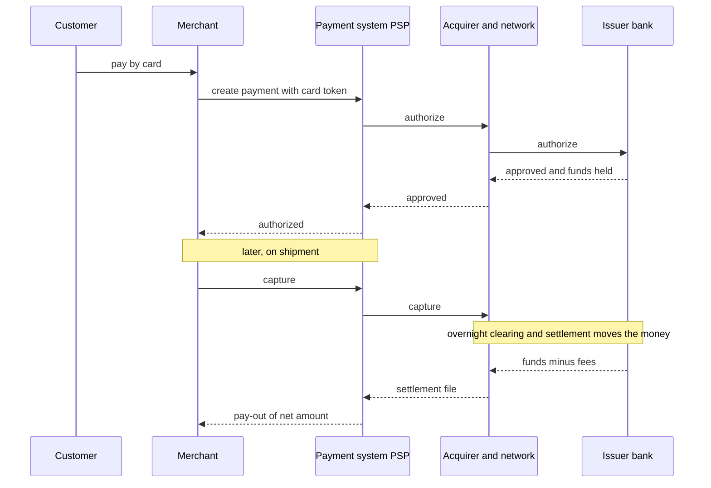
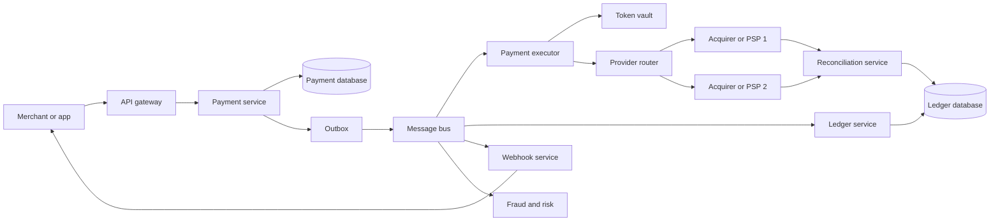
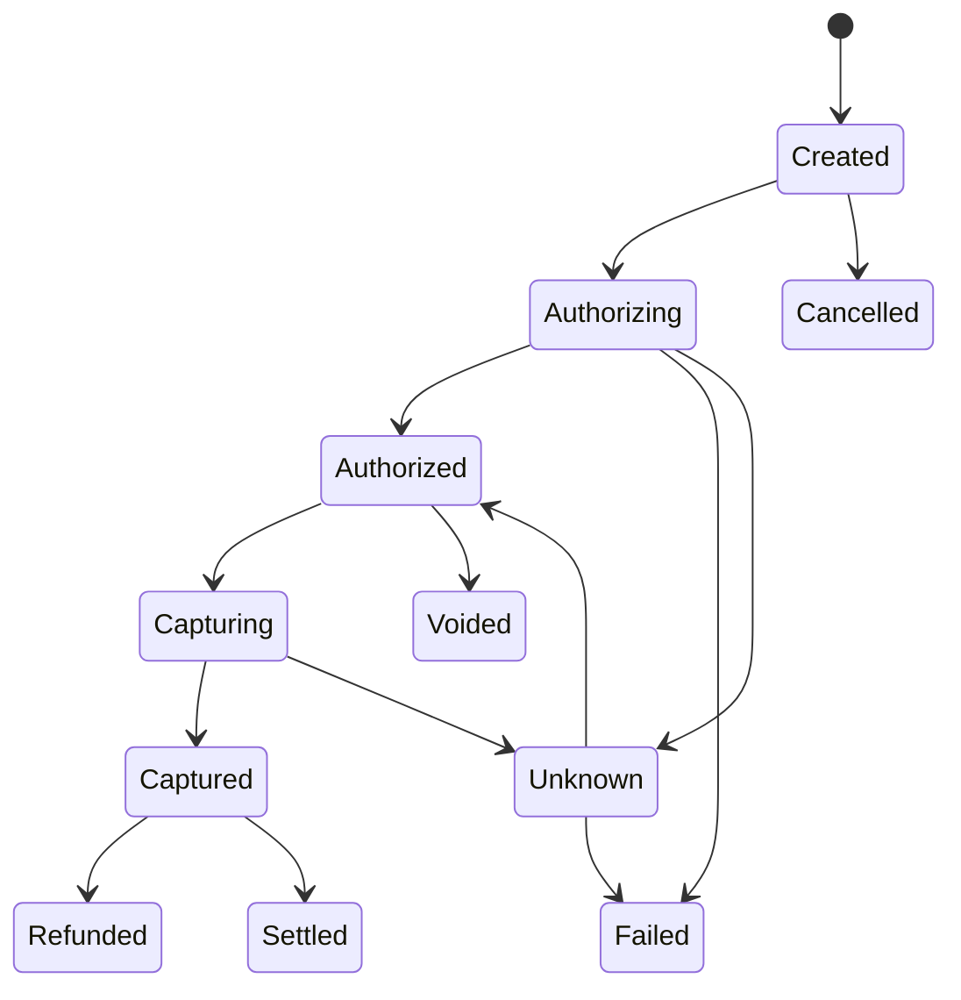
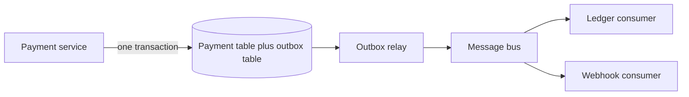

# Chapter 42 — Library Ch 20 — Payment System

> **Volume 4 — High-Level Design** · [Contents](index.md) · ← [Chapter 41 — Library Ch 19 — Key-Value Store & Cache](ch41-library-19-key-value-store-cache.md) · Next → [Chapter 43 — Library Ch 21 — Auction Platform (eBay)](ch43-library-21-auction-platform-ebay.md)

---

## Concept

Idempotency, double-entry ledgers, payment state machines, unknown outcomes, outbox, reconciliation and PCI.

**In one sentence:** In this case study we design a payment system: the service behind checkout on an e-commerce site, a marketplace or an app, in the style of Stripe, Adyen, PayPal or the payment layer inside Amazon and Uber.

In this case study we design a **payment system**: the service behind checkout on an e-commerce site, a marketplace or an app, in the style of Stripe, Adyen, PayPal or the payment layer inside Amazon and Uber. Unlike most systems in this course, the main requirement is not speed or scale, it is **correctness**. Money must never be created, lost or moved twice.

We apply the 4-step blueprint from Chapter 15: understand the problem, estimate scale, design at a high level, then decide on technology.

---

### Learning Outcomes

After working through this case study, you'll be able to:

1. Describe the **card payment lifecycle** (authorize, capture, settle, refund, chargeback) and who the parties are.
2. Make every operation **idempotent** with idempotency keys, so retries and timeouts never double-charge.
3. Model money correctly with a **double-entry ledger** and an append-only transaction log.
4. Coordinate a payment across services with a **state machine, the outbox pattern and sagas**, and handle **unknown outcomes** from external providers.
5. Run **reconciliation** to detect and correct differences with banks and processors.
6. Handle **PCI compliance** by never touching raw card data (tokenization).
7. Design for **failure**: retries with backoff, timeouts, dead-letter queues, and safe manual repair.


---

### Introduction & Scope

A payment system moves value between a **buyer** and a **seller**. The business that builds it (the **merchant** or **platform**) usually does not move money itself: it orchestrates card networks, banks and payment processors, records everything, and keeps customers and sellers informed.

#### Why Is It Different?

| Most systems | Payment systems |
|--------------|-----------------|
| A lost write is annoying | A lost or duplicated write is a financial and legal problem |
| Eventual consistency is fine | Money needs strong guarantees and an audit trail |
| Speed is the goal | **Correctness first**, then latency |
| You control all components | You depend on **external parties** (banks, card networks) that are slow, flaky and give ambiguous answers |

#### The Core Principle

> Assume every call can fail, time out or be repeated. Design so that doing anything twice is safe, and so that every cent can be traced and reconciled.


### Functional Requirements

**In scope**

1. **Pay-in:** charge a customer for an order using a card, wallet or bank transfer.
2. **Authorize and capture** (two-step) as well as one-step charge.
3. **Refunds**, full or partial.
4. **Pay-out:** send seller earnings to bank accounts (for marketplaces).
5. **Payment status** queries and webhooks to the merchant.
6. **Ledger and reporting:** every movement of money is recorded.
7. **Reconciliation** with external statements.
8. **Retries and recovery** for failed or unknown payments.

**Out of scope here:** subscription billing, currency conversion detail, tax calculation, building a card network, detailed fraud machine learning.


### Non-Functional Requirements

| Requirement | Target | Why |
|-------------|--------|-----|
| **Correctness** | No double charges, no lost payments, ledger always balances | Legal and trust |
| **Durability** | Zero loss of an acknowledged payment record | Audit and disputes |
| **Consistency** | Strong consistency inside the ledger and payment record | Money |
| **Availability** | 99.99% for creating payments; degrade gracefully if a provider is down | Revenue |
| **Latency** | Charge response in a few seconds (provider time dominates) | Checkout conversion |
| **Security** | PCI DSS compliance, encryption, least privilege | Regulation |
| **Auditability** | Immutable history, who changed what and why | Regulators and finance teams |
| **Resilience** | Survive provider outages, timeouts and duplicate requests | Constant in practice |


### Estimating Scale & Bottlenecks

Payment volume is modest compared with social products, but each transaction is precious.

| Quantity | Assumption | Result |
|----------|-----------|--------|
| Transactions per day | 10 million | about 115/s average, peak about 1,000/s |
| Ledger entries per payment | 4 to 6 (double entry across several accounts) | about 50 million entries/day |
| Ledger entry size | 200 bytes | about 10 GB/day, about 3.6 TB/year (kept for years) |
| Webhooks to merchants | 3 per payment | about 30 million/day |
| Reconciliation files | Daily statements from each provider | Millions of rows each |

**Bottlenecks**

- **Provider latency and limits:** each charge waits on an external call (0.5 to 3 seconds), and providers rate-limit.
- **Hot accounts:** a large merchant's ledger account is updated by thousands of payments a second (contention on one row).
- **Correctness under retries:** the hard problem is not throughput but handling timeouts and duplicates safely.
- **Reconciliation volume:** matching millions of rows across systems every day.


### How Card Payments Work

You need the vocabulary before the design.

| Party | Role |
|-------|------|
| **Cardholder** | The buyer |
| **Merchant** | The seller |
| **PSP (payment service provider)** | Your payment system, or one like Stripe or Adyen; offers a single API for merchants |
| **Acquirer** | The merchant's bank; receives the charge request |
| **Card network** | Visa, Mastercard; routes between acquirer and issuer |
| **Issuer** | The cardholder's bank; approves or declines |

#### The Phases



1. **Authorization:** the issuer checks the card and funds and puts a **hold**; no money has moved.
2. **Capture:** the merchant claims the held amount (usually when goods ship). A one-step charge does both.
3. **Clearing and settlement:** in batches (often daily), the networks and banks move the actual money; fees are deducted. Funds reach the merchant days later.
4. **Refund:** returns money; can be partial.
5. **Chargeback:** the cardholder disputes the charge with their bank; the merchant can lose the money and pay a fee.


### API Design

| Endpoint | Purpose |
|----------|---------|
| `POST /v1/payments` | Create a payment `{amount, currency, customer_id, payment_method_token, capture: true/false}` with header **`Idempotency-Key`** |
| `POST /v1/payments/{id}/capture` | Capture an authorized payment (partial allowed) |
| `POST /v1/payments/{id}/refunds` | Refund `{amount}` (idempotent) |
| `GET /v1/payments/{id}` | Current state and history |
| `POST /v1/payouts` | Pay a seller |
| `POST /v1/webhooks/endpoints` | Register where we send events |

**Design rules**

- **Amounts are integers in the smallest currency unit** (cents), never floats. Store the currency with every amount. (Floating point cannot represent 0.10 exactly.)
- **Every mutating request carries an idempotency key.**
- **Never accept raw card numbers**; accept a **token** produced by a PCI-compliant vault or a client-side library.
- Return **202 / "processing"** when the outcome is not yet known; do not guess.
- **Webhooks** deliver state changes: signed with an HMAC, retried with backoff, and consumers de-duplicate by event id.


### High-Level Architecture



#### Component Responsibilities

| Component | Job |
|-----------|-----|
| **API gateway** | Authentication, rate limiting, request validation |
| **Payment service** | Owns the **payment record and state machine**; enforces idempotency |
| **Payment executor** | Calls external providers; handles retries and unknown outcomes |
| **Token vault** | Stores card data in a PCI-scoped environment and issues tokens; the only place real card numbers exist |
| **Provider router** | Chooses which acquirer or PSP to use (cost, approval rate, availability, currency) and fails over |
| **Ledger service** | Append-only double-entry record of money movements |
| **Webhook service** | Notifies merchants reliably |
| **Fraud and risk** | Scores payments before and during processing |
| **Reconciliation service** | Compares our records with provider statements and bank files |


### Idempotency

The single most important idea in payments. A customer double-clicks "Pay"; a mobile app times out and retries; a load balancer replays a request. **The charge must happen exactly once.**

#### How It Works

1. The client generates a unique **idempotency key** (a UUID) per intended operation and sends it in a header.
2. The server stores `(merchant_id, idempotency_key) -> {request_hash, response / status}` with a **unique constraint**.
3. On a request:
   - **New key:** insert the row (state "in progress"), process, then save the response.
   - **Same key, same request body, finished:** return the **stored response** without re-running.
   - **Same key, still in progress:** return 409 or wait.
   - **Same key, different body:** reject (client bug).

```python
def create_payment(merchant_id, key, body):
    h = hash(body)
    try:
        db.insert("idempotency", merchant_id=merchant_id, key=key,
                  request_hash=h, status="in_progress")      # unique(merchant_id, key)
    except UniqueViolation:
        row = db.get("idempotency", merchant_id, key)
        if row.request_hash != h:
            raise Conflict("key reused with a different request")
        if row.status == "done":
            return row.response                              # replay, no second charge
        raise InProgress()
    payment = process(body)                                   # may call providers
    db.update("idempotency", merchant_id, key, status="done", response=payment)
    return payment
```

#### Idempotency With External Providers

Pass **your own payment id as the provider's idempotency key** on every call (Stripe, Adyen and others support this). Then if you retry after a timeout, the provider will not charge a second time. Providers without such support need a **query-before-retry** step ("did a charge with reference X succeed?").


### The Payment State Machine

A payment is not a single event: it moves through states, and **only legal transitions are allowed**.



- **Unknown** is a first-class state, not an error. It means "we asked the provider and do not know the answer" (timeout, connection reset). A payment in `Unknown` is resolved by **polling or querying the provider**, never by guessing or blindly retrying with a new key.
- Every transition is **recorded as an event** (who, when, why, request and response ids), giving an audit trail and enabling replay.
- Transitions use **optimistic locking** (`UPDATE ... WHERE id = ? AND state = 'Authorizing'`) so two workers cannot both move the same payment.
- States are **terminal** once final (`Failed`, `Refunded`, `Settled`); corrections are new entries, never edits.


### The Ledger: Double-Entry Bookkeeping

The payment record says what happened to a payment. The **ledger** says where every unit of money is.

#### Double-Entry Rule

Every movement is recorded as **two or more entries that sum to zero**: a debit from one account and an equal credit to another. Money is never "created" or "deleted", only moved.

| Event | Debit | Credit |
|-------|-------|--------|
| Customer pays 100.00 | Customer card receivable 100.00 | Merchant payable 100.00 |
| Platform fee 3.00 | Merchant payable 3.00 | Platform revenue 3.00 |
| Processor fee 1.50 | Processing expense 1.50 | Processor payable 1.50 |
| Pay-out of 97.00 | Merchant payable 97.00 | Bank cash 97.00 |

```
ledger_entries(
  entry_id        bigint,        -- append-only
  transaction_id  uuid,          -- groups the balanced set of entries
  account_id      bigint,
  direction       text,          -- DEBIT or CREDIT
  amount          bigint,        -- smallest unit, always positive
  currency        text,
  created_at      timestamp,
  PRIMARY KEY (entry_id)
)
-- invariant per transaction_id: sum(DEBIT) = sum(CREDIT)
```

#### Properties

| Property | Why |
|----------|-----|
| **Append-only and immutable** | History can be audited; mistakes are fixed with **reversing entries**, never updates or deletes |
| **Balanced per transaction** | A database constraint or check catches bugs immediately |
| **Written in one database transaction** | All entries of a transaction commit together or not at all (use ACID storage such as PostgreSQL) |
| **Balances are derived** | Account balance = sum of entries (cache it, but the entries are the truth) |
| **Idempotent writes** | Unique constraint on `(transaction_id, account_id, direction)` or on an external reference |

#### Hot Accounts

A single merchant or platform account touched by thousands of payments per second creates a **row-lock bottleneck**. Options: **split the account** into many sub-accounts (shards) and sum them, **batch** entries per interval, or compute the balance from entries with periodic **snapshots** instead of updating a balance row on every payment.


### Talking to External Providers

Providers are the least reliable part. Expect timeouts, partial failures, duplicate callbacks and contradictory states.

#### Retries

| Rule | Detail |
|------|--------|
| **Retry only safe calls** | A call with an idempotency key or a read-only query |
| **Exponential backoff with jitter** | Avoid synchronized retry storms |
| **Cap attempts and time** | Then move the payment to `Unknown` and route to a recovery job |
| **Timeouts everywhere** | Short connect and read timeouts; never wait forever |
| **Circuit breaker per provider** | Stop calling a failing provider and route elsewhere |

#### Synchronous vs Asynchronous Results

Many methods (bank transfers, 3-D Secure, wallets) return **later** via a **webhook** or redirect. The system must handle:

- **The webhook arrives before the API response** (race), so the handler must tolerate out-of-order events and use the state machine to ignore stale ones.
- **Duplicate webhooks:** de-duplicate by provider event id.
- **Missed webhooks:** a background job **polls** payments stuck in `Authorizing` or `Unknown` beyond a threshold.
- **Verification:** check the webhook signature, and where possible re-fetch the payment from the provider rather than trusting the payload.

#### Routing and Failover

The **provider router** picks the best provider for each payment by cost, currency and card type, approval rate and health. If provider A is down, fail over to B **only when it is safe**: a payment in an unknown state at A must be resolved at A before it is retried at B, otherwise the customer could be charged twice.


### Consistency Across Services: Outbox and Sagas

Creating a payment touches several services (payment database, ledger, webhook queue). There is no distributed transaction across them, and a crash between "save payment" and "publish event" would lose the event.

#### The Outbox Pattern

1. In **one local database transaction**, write the payment change **and** a row in an `outbox` table describing the event.
2. A relay process reads new outbox rows and publishes them to the message bus, marking them sent.
3. Consumers are **idempotent** (de-duplicate by event id).

This gives **at-least-once publishing without losing events**, even if the service crashes between steps.



#### Sagas

A multi-step business flow (reserve inventory, charge, ship) is a **saga**: a chain of local transactions where each step has a **compensating action** (refund, release stock) if a later step fails. Prefer **orchestration** (a coordinator tracks the flow) for payments, because the flow must be observable and auditable.


### Reconciliation

Even with careful design, your records and the outside world will disagree: a webhook is missed, a provider reverses a charge, a bank file has an extra line. **Reconciliation** is the safety net.

1. **Collect** daily settlement and statement files from every provider and bank.
2. **Normalise** them into a common format.
3. **Match** each external line to an internal payment (by provider reference, amount, date).
4. **Classify differences:**

| Case | Meaning | Action |
|------|---------|--------|
| In our system, not in statement | We think it succeeded; the provider disagrees | Query provider; maybe mark failed and notify |
| In statement, not in our system | Money moved that we did not record | Create the record, investigate, possibly refund |
| Amounts differ | Fees, FX or partial capture | Adjust ledger with explicit entries |
| Duplicate | A double charge | Refund and root-cause |

5. **Report** exceptions to a human queue; fixes are **new ledger entries**, never edits.

Run it **daily at minimum**, and also run **continuous mini-reconciliations** (for example, every payment stuck in a non-final state for more than N minutes).


### Security, Compliance and Fraud

#### PCI DSS and Tokenization

Card numbers (PANs) and security codes are heavily regulated. The standard approach is to **keep them out of your systems entirely**:

- The browser or app sends card data **directly to a PCI-certified vault** (hosted fields, SDK) and receives a **token**.
- Your servers only ever see tokens and the last four digits.
- Never log card data. Never store the CVV after authorization.
- Encrypt sensitive data at rest and in transit; restrict access with least privilege and audit logs.

#### Fraud and Risk

| Layer | Technique |
|-------|-----------|
| **Rules** | Velocity limits (many cards from one device), blocked countries, amount thresholds |
| **Machine learning** | Score each payment from device, history and behaviour; approve, challenge or decline |
| **3-D Secure / SCA** | Extra customer authentication; shifts liability to the issuer |
| **Post-payment** | Chargeback monitoring, manual review queues |

Fraud checks sit **before** authorization to avoid wasted fees, and must be fast (tens of milliseconds) with a safe fallback if the service is down.

#### Other Controls

TLS everywhere, request signing, webhook signatures, strict authorization on refund and pay-out operations, **dual control** for large manual adjustments, and immutable audit logs.


### Tech Stack & Infrastructure Decisions

| Need | Choices | Notes |
|------|---------|-------|
| **Payment and ledger database** | PostgreSQL or MySQL (ACID), sharded by merchant or account; or Spanner / CockroachDB | Strong consistency is non-negotiable here |
| **Idempotency and outbox** | Same relational database | Keeps them in the same transaction |
| **Message bus** | Kafka or SQS/SNS with dead-letter queues | At-least-once, idempotent consumers |
| **Cache** | Redis for rate limits and read-through of non-critical data | Never as the source of truth for money |
| **Token vault** | Dedicated PCI-scoped service or a vendor | Isolated network, HSM-backed keys |
| **Orchestration** | Temporal or a workflow engine, or an in-house state machine | Durable timers and retries |
| **Webhooks** | Queue plus signed HTTP workers, retry with backoff | Per-merchant rate limits |
| **Observability** | Success and decline rates per provider, unknown-state count and age, ledger imbalance alarms, reconciliation exceptions | Alert on any imbalance immediately |
| **Deployment** | Multi-AZ, with a tested failover; payments pinned to a primary region | Active-passive often safer than multi-leader for money |


### Beyond MVP — What a Senior Designer Adds

#### Multi-Currency and FX

Store the **original currency and amount**, the **settlement currency**, and the **exchange rate used** on each ledger transaction. Never convert and discard the source.

#### Pay-Outs and Marketplace Flows

Hold funds in **escrow accounts** until delivery, split payments among several sellers, apply platform fees, and schedule pay-outs with minimum thresholds. Each of these is a ledger transaction.

#### Subscriptions and Retries (Dunning)

Recurring billing adds a scheduler, retry schedules for failed renewals, card-updater services, and customer notifications.

#### Disaster Recovery

RPO of zero for the ledger (synchronous replication within a region, a carefully designed cross-region replica), tested restores, and the ability to **rebuild every derived view from the append-only ledger and event log**.

#### Operational Safety

Feature flags per provider, kill switches, **dry-run** modes for reconciliation fixes, rate limits on pay-outs, and runbooks for provider outages.

#### Testing

Provider **sandboxes** and recorded fixtures, chaos tests that inject timeouts after a charge succeeds, property tests asserting ledger balance, and replay of production traffic in staging.


### Tips and Tricks

- **Open with "correctness over speed"** and name idempotency, the ledger and reconciliation as the three pillars.
- **Idempotency keys everywhere:** client to you, and you to the provider.
- **Use integers for money** and say why floats are wrong.
- **Treat "unknown" as a real state**, resolved by querying the provider, not retried blindly.
- **Make the ledger append-only and double-entry**; fix mistakes with reversing entries.
- **Use the outbox pattern** to avoid losing events between a database write and a publish.
- **Never touch card data**; use tokenization.
- **Always mention reconciliation**: it is what separates a toy design from a real one.
- **Call out hot-account contention** and how you would shard the account.


### Summary

#### Final Design Flow

1. A merchant calls `POST /payments` with an **idempotency key** and a **card token**.
2. The **payment service** records the payment (state `Created`), writes an **outbox** event in the same transaction, and returns.
3. The **payment executor** runs fraud checks, picks a provider through the **router**, and calls it **with our payment id as the provider idempotency key**, with timeouts, retries and a circuit breaker.
4. The result moves the **state machine** forward; ambiguous results go to `Unknown` and are resolved by **polling the provider**.
5. The **ledger service** records **balanced, append-only double-entry** transactions for each money movement.
6. The **webhook service** notifies the merchant reliably.
7. **Reconciliation** compares ledger and statements daily and raises exceptions; fixes are new entries.
8. **Tokenization** keeps card data out of scope; every action is audited.

#### Scale Estimates Recap

| Item | Estimate |
|------|----------|
| Payments | 10 M/day, about 115/s average, 1,000/s peak |
| Ledger entries | About 50 M/day, about 3.6 TB/year |
| Webhooks | About 30 M/day |
| Hard problems | Duplicates, unknown outcomes, hot accounts, reconciliation |


### Further Reading

- Stripe Engineering, *Designing robust and predictable APIs with idempotency*
- Brandur Leach, *Implementing Stripe-like Idempotency Keys in Postgres*
- Alex Xu, *System Design Interview Volume 2*, chapters on payment systems and a digital wallet
- Pat Helland, *Life Beyond Distributed Transactions: An Apostate's Opinion*
- Chris Richardson, *Microservices Patterns* (the saga and transactional outbox patterns)
- Square Engineering, *Books, an immutable double-entry accounting database service*
- PCI Security Standards Council, *PCI DSS* and the *Tokenization Guidelines*


**Next Up:** [Chapter 21 — Design an Auction Platform (aka eBay) →](./21%20-%20Design%20an%20Auction%20Platform%20(aka%20eBay).md)


*(From AI Library chapter 20.)*

