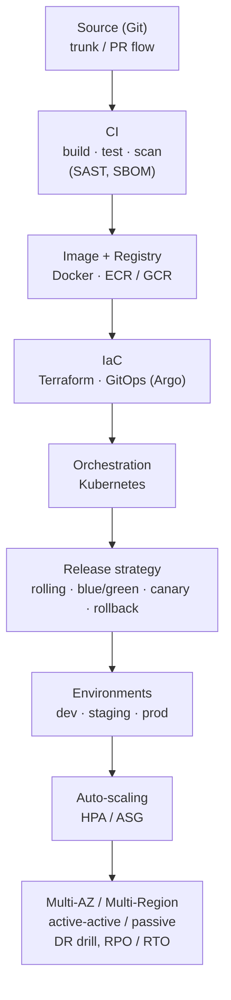
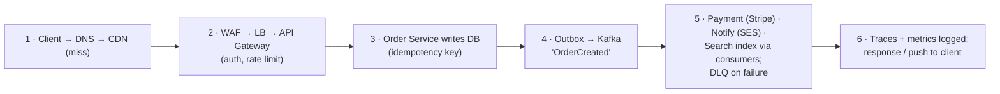

# Chapter 52 — System Design Components Map: Where Everything Fits

> **Volume 4 — High-Level Design** · [Contents](index.md) · ← [Chapter 51 — Library Ch 29 — Final Prep](ch51-library-29-final-prep-mindset.md)

---

## Concept

A one-page map of every component a real application uses, grouped into layers, with where each one sits and what it is for.

**In one sentence:** a real system is a stack of layers (clients, edge, backend services, data) with async, AI and external services beside it, cross-cutting concerns applied once to all of it, and a deployment pipeline underneath, so good design is choosing the right component for each layer and knowing the trade-offs.

### The seven things to study

<svg xmlns="http://www.w3.org/2000/svg" viewBox="0 0 1080 470" role="img" aria-label="Seven study topics: foundations, design method, building blocks, distributed systems, reliability and security, build and deploy, real-world and AI" style="width:100%;max-width:1080px;height:auto;font-family:inherit"><defs><marker id="ar" viewBox="0 0 10 10" refX="8" refY="5" markerWidth="7" markerHeight="7" orient="auto-start-reverse"><path d="M0 0L10 5L0 10z" fill="context-stroke"/></marker></defs><rect x="12" y="12" width="254" height="214" rx="12" fill="#2f6fd0" fill-opacity=".07" stroke="#2f6fd0" stroke-width="1.8"/><circle cx="38" cy="40" r="16" fill="1" fill-opacity="0.2" stroke="#2f6fd0" stroke-width="1.6"/><text x="38" y="45" font-size="11.5" text-anchor="middle" fill="#fff" font-weight="700">T1</text><text x="62" y="45" font-size="13.5" text-anchor="start" fill="#2f6fd0" font-weight="700">FOUNDATIONS</text><text x="28" y="78" font-size="11.4" text-anchor="start" fill="var(--text)">•  Programming &amp; DSA, Concurrency</text><text x="28" y="102" font-size="11.4" text-anchor="start" fill="var(--text)">•  OS, Networking (TCP/IP, HTTP/2/3, TLS)</text><text x="28" y="126" font-size="11.4" text-anchor="start" fill="var(--text)">•  SQL / NoSQL basics</text><text x="28" y="150" font-size="11.4" text-anchor="start" fill="var(--text)">•  Cloud fundamentals, Linux &amp; Git</text><text x="28" y="174" font-size="11.4" text-anchor="start" fill="var(--text)">•  Estimation &amp; Math</text><rect x="278" y="12" width="254" height="214" rx="12" fill="#e0245e" fill-opacity=".07" stroke="#e0245e" stroke-width="1.8"/><circle cx="304" cy="40" r="16" fill="1" fill-opacity="0.2" stroke="#e0245e" stroke-width="1.6"/><text x="304" y="45" font-size="11.5" text-anchor="middle" fill="#fff" font-weight="700">T2</text><text x="328" y="45" font-size="13.5" text-anchor="start" fill="#e0245e" font-weight="700">DESIGN METHOD</text><text x="294" y="78" font-size="11.4" text-anchor="start" fill="var(--text)">•  Requirements (FR / NFR)</text><text x="294" y="102" font-size="11.4" text-anchor="start" fill="var(--text)">•  Capacity &amp; Estimation</text><text x="294" y="126" font-size="11.4" text-anchor="start" fill="var(--text)">•  API Design &amp; Contracts</text><text x="294" y="150" font-size="11.4" text-anchor="start" fill="var(--text)">•  Data Modeling</text><text x="294" y="174" font-size="11.4" text-anchor="start" fill="var(--text)">•  High-level → Deep dive</text><text x="294" y="198" font-size="11.4" text-anchor="start" fill="var(--text)">•  Trade-offs &amp; ADRs</text><rect x="544" y="12" width="254" height="214" rx="12" fill="#f08a00" fill-opacity=".07" stroke="#f08a00" stroke-width="1.8"/><circle cx="570" cy="40" r="16" fill="1" fill-opacity="0.2" stroke="#f08a00" stroke-width="1.6"/><text x="570" y="45" font-size="11.5" text-anchor="middle" fill="#fff" font-weight="700">T3</text><text x="594" y="45" font-size="13.5" text-anchor="start" fill="#f08a00" font-weight="700">BUILDING BLOCKS</text><text x="560" y="78" font-size="11.4" text-anchor="start" fill="var(--text)">•  DNS, CDN, LB, Proxies</text><text x="560" y="102" font-size="11.4" text-anchor="start" fill="var(--text)">•  API Gateway, Service Mesh</text><text x="560" y="126" font-size="11.4" text-anchor="start" fill="var(--text)">•  Caching, DB &amp; Storage</text><text x="560" y="150" font-size="11.4" text-anchor="start" fill="var(--text)">•  Search &amp; Indexing</text><text x="560" y="174" font-size="11.4" text-anchor="start" fill="var(--text)">•  Queues, Streams, Pub/Sub</text><text x="560" y="198" font-size="11.4" text-anchor="start" fill="var(--text)">•  Schedulers, Object storage</text><rect x="810" y="12" width="254" height="214" rx="12" fill="#6a2fd0" fill-opacity=".07" stroke="#6a2fd0" stroke-width="1.8"/><circle cx="836" cy="40" r="16" fill="1" fill-opacity="0.2" stroke="#6a2fd0" stroke-width="1.6"/><text x="836" y="45" font-size="11.5" text-anchor="middle" fill="#fff" font-weight="700">T4</text><text x="860" y="45" font-size="13.5" text-anchor="start" fill="#6a2fd0" font-weight="700">DISTRIBUTED SYSTEMS</text><text x="826" y="78" font-size="11.4" text-anchor="start" fill="var(--text)">•  Replication, Sharding</text><text x="826" y="102" font-size="11.4" text-anchor="start" fill="var(--text)">•  Consistency, CAP / PACELC</text><text x="826" y="126" font-size="11.4" text-anchor="start" fill="var(--text)">•  Consensus, Leader election, Quorum</text><text x="826" y="150" font-size="11.4" text-anchor="start" fill="var(--text)">•  Distributed Transactions (Saga, 2PC)</text><text x="826" y="174" font-size="11.4" text-anchor="start" fill="var(--text)">•  Clocks, Gossip, Back-pressure</text><text x="826" y="198" font-size="11.4" text-anchor="start" fill="var(--text)">•  Idempotency</text><rect x="12" y="238" width="254" height="214" rx="12" fill="#2e9d4b" fill-opacity=".07" stroke="#2e9d4b" stroke-width="1.8"/><circle cx="38" cy="266" r="16" fill="1" fill-opacity="0.2" stroke="#2e9d4b" stroke-width="1.6"/><text x="38" y="271" font-size="11.5" text-anchor="middle" fill="#fff" font-weight="700">T5</text><text x="62" y="271" font-size="13.5" text-anchor="start" fill="#2e9d4b" font-weight="700">RELIABILITY &amp; SECURITY</text><text x="28" y="304" font-size="11.4" text-anchor="start" fill="var(--text)">•  Fault tolerance, SLO / SLA</text><text x="28" y="328" font-size="11.4" text-anchor="start" fill="var(--text)">•  Observability, Incident mgmt</text><text x="28" y="352" font-size="11.4" text-anchor="start" fill="var(--text)">•  Backup &amp; DR (RPO / RTO)</text><text x="28" y="376" font-size="11.4" text-anchor="start" fill="var(--text)">•  AuthN, AuthZ, Encryption, Zero trust</text><text x="28" y="400" font-size="11.4" text-anchor="start" fill="var(--text)">•  Threat modeling, Compliance</text><text x="28" y="424" font-size="11.4" text-anchor="start" fill="var(--text)">•  Cost (FinOps)</text><rect x="278" y="238" width="254" height="214" rx="12" fill="#1a7fd0" fill-opacity=".07" stroke="#1a7fd0" stroke-width="1.8"/><circle cx="304" cy="266" r="16" fill="1" fill-opacity="0.2" stroke="#1a7fd0" stroke-width="1.6"/><text x="304" y="271" font-size="11.5" text-anchor="middle" fill="#fff" font-weight="700">T6</text><text x="328" y="271" font-size="13.5" text-anchor="start" fill="#1a7fd0" font-weight="700">BUILD &amp; DEPLOY</text><text x="294" y="304" font-size="11.4" text-anchor="start" fill="var(--text)">•  Testing (unit → E2E, load)</text><text x="294" y="328" font-size="11.4" text-anchor="start" fill="var(--text)">•  Docker, Kubernetes</text><text x="294" y="352" font-size="11.4" text-anchor="start" fill="var(--text)">•  CI/CD, IaC, GitOps</text><text x="294" y="376" font-size="11.4" text-anchor="start" fill="var(--text)">•  Blue/green, Canary, Rollback</text><text x="294" y="400" font-size="11.4" text-anchor="start" fill="var(--text)">•  DevSecOps, DB migrations</text><text x="294" y="424" font-size="11.4" text-anchor="start" fill="var(--text)">•  Chaos &amp; Perf engineering</text><rect x="544" y="238" width="254" height="214" rx="12" fill="#d0249e" fill-opacity=".07" stroke="#d0249e" stroke-width="1.8"/><circle cx="570" cy="266" r="16" fill="1" fill-opacity="0.2" stroke="#d0249e" stroke-width="1.6"/><text x="570" y="271" font-size="11.5" text-anchor="middle" fill="#fff" font-weight="700">T7</text><text x="594" y="271" font-size="13.5" text-anchor="start" fill="#d0249e" font-weight="700">REAL-WORLD &amp; AI</text><text x="560" y="304" font-size="11.4" text-anchor="start" fill="var(--text)">•  Chat, Feeds, Video, Maps</text><text x="560" y="328" font-size="11.4" text-anchor="start" fill="var(--text)">•  E-commerce, Payments</text><text x="560" y="352" font-size="11.4" text-anchor="start" fill="var(--text)">•  Collab editing, Gaming, IoT</text><text x="560" y="376" font-size="11.4" text-anchor="start" fill="var(--text)">•  URL shortener, Rate limiter</text><text x="560" y="400" font-size="11.4" text-anchor="start" fill="var(--text)">•  AI: LLM, RAG, Agents, MLOps</text></svg>

### The reference architecture

Read it top to bottom: a request enters at the clients, crosses the edge, is handled by backend services that read and write the data layer, and hands slow or fan-out work to the async layer. Cross-cutting concerns apply to every service, and everything is built and shipped by the deployment layer.

<svg xmlns="http://www.w3.org/2000/svg" viewBox="0 0 1100 740" role="img" aria-label="Reference architecture: clients, edge, backend services, data, with async, AI and external services alongside, cross-cutting concerns and deployment" style="width:100%;max-width:1100px;height:auto;font-family:inherit"><defs><marker id="ar" viewBox="0 0 10 10" refX="8" refY="5" markerWidth="7" markerHeight="7" orient="auto-start-reverse"><path d="M0 0L10 5L0 10z" fill="context-stroke"/></marker></defs><text x="20" y="30" font-size="14" text-anchor="start" fill="#e2a400" font-weight="700">L1  CLIENTS</text><text x="696" y="30" font-size="11.5" text-anchor="end" fill="var(--text-muted)">user interface layer</text><rect x="20" y="44" width="78.48" height="24" rx="6" fill="#e2a400" fill-opacity=".16" stroke="#e2a400" stroke-width="1.2"/><text x="59.24" y="60.0" font-size="12" text-anchor="middle" fill="var(--text)">🖥 Web App</text><rect x="104.48" y="44" width="71.76" height="24" rx="6" fill="#e2a400" fill-opacity=".16" stroke="#e2a400" stroke-width="1.2"/><text x="140.36" y="60.0" font-size="12" text-anchor="middle" fill="var(--text)">📱 Mobile</text><rect x="182.24" y="44" width="91.92" height="24" rx="6" fill="#e2a400" fill-opacity=".16" stroke="#e2a400" stroke-width="1.2"/><text x="228.20000000000002" y="60.0" font-size="12" text-anchor="middle" fill="var(--text)">🔌 3rd-party</text><rect x="8" y="8" width="700" height="72" rx="12" fill="#e2a400" fill-opacity=".06" stroke="#e2a400" stroke-width="1.8"/><line x1="358" y1="82" x2="358" y2="102" stroke="var(--text-muted)" stroke-width="1.6" marker-end="url(#ar)"/><text x="20" y="128" font-size="14" text-anchor="start" fill="#1a8f9e" font-weight="700">L2  EDGE / NETWORK</text><text x="696" y="128" font-size="11.5" text-anchor="end" fill="var(--text-muted)">global scale and entry point</text><rect x="20" y="142" width="51.6" height="24" rx="6" fill="#1a8f9e" fill-opacity=".16" stroke="#1a8f9e" stroke-width="1.2"/><text x="45.8" y="158.0" font-size="12" text-anchor="middle" fill="var(--text)">🌐 DNS</text><rect x="77.6" y="142" width="58.32000000000001" height="24" rx="6" fill="#1a8f9e" fill-opacity=".16" stroke="#1a8f9e" stroke-width="1.2"/><text x="106.75999999999999" y="158.0" font-size="12" text-anchor="middle" fill="var(--text)">☁️ CDN</text><rect x="141.92000000000002" y="142" width="105.36000000000001" height="24" rx="6" fill="#1a8f9e" fill-opacity=".16" stroke="#1a8f9e" stroke-width="1.2"/><text x="194.60000000000002" y="158.0" font-size="12" text-anchor="middle" fill="var(--text)">🛡️ WAF / DDoS</text><rect x="253.28000000000003" y="142" width="165.84" height="24" rx="6" fill="#1a8f9e" fill-opacity=".16" stroke="#1a8f9e" stroke-width="1.2"/><text x="336.20000000000005" y="158.0" font-size="12" text-anchor="middle" fill="var(--text)">⚖️ Load Balancer L4/L7</text><rect x="425.12" y="142" width="212.88000000000002" height="24" rx="6" fill="#1a8f9e" fill-opacity=".16" stroke="#1a8f9e" stroke-width="1.2"/><text x="531.5600000000001" y="158.0" font-size="12" text-anchor="middle" fill="var(--text)">🚪 API Gateway / Reverse Proxy</text><rect x="20" y="172" width="138.96" height="24" rx="6" fill="#1a8f9e" fill-opacity=".16" stroke="#1a8f9e" stroke-width="1.2"/><text x="89.48" y="188.0" font-size="12" text-anchor="middle" fill="var(--text)">📡 Realtime Gateway</text><rect x="164.96" y="172" width="125.52000000000001" height="24" rx="6" fill="#1a8f9e" fill-opacity=".16" stroke="#1a8f9e" stroke-width="1.2"/><text x="227.72000000000003" y="188.0" font-size="12" text-anchor="middle" fill="var(--text)">🕸️ Network (VPC)</text><rect x="8" y="106" width="700" height="102" rx="12" fill="#1a8f9e" fill-opacity=".06" stroke="#1a8f9e" stroke-width="1.8"/><line x1="358" y1="210" x2="358" y2="230" stroke="var(--text-muted)" stroke-width="1.6" marker-end="url(#ar)"/><text x="20" y="256" font-size="14" text-anchor="start" fill="#2e9d4b" font-weight="700">L3  BACKEND SERVICES</text><text x="696" y="256" font-size="11.5" text-anchor="end" fill="var(--text-muted)">monolith (modular) or microservices</text><rect x="20" y="270" width="280.08000000000004" height="24" rx="6" fill="#2e9d4b" fill-opacity=".16" stroke="#2e9d4b" stroke-width="1.2"/><text x="160.04000000000002" y="286.0" font-size="12" text-anchor="middle" fill="var(--text)">API Layer: Controllers · GraphQL · gRPC</text><rect x="20" y="302" width="58.32000000000001" height="24" rx="6" fill="#2e9d4b" fill-opacity=".16" stroke="#2e9d4b" stroke-width="1.2"/><text x="49.160000000000004" y="318.0" font-size="12" text-anchor="middle" fill="var(--text)">👤 User</text><rect x="84.32000000000001" y="302" width="78.48" height="24" rx="6" fill="#2e9d4b" fill-opacity=".16" stroke="#2e9d4b" stroke-width="1.2"/><text x="123.56" y="318.0" font-size="12" text-anchor="middle" fill="var(--text)">📦 Product</text><rect x="168.8" y="302" width="65.04" height="24" rx="6" fill="#2e9d4b" fill-opacity=".16" stroke="#2e9d4b" stroke-width="1.2"/><text x="201.32000000000002" y="318.0" font-size="12" text-anchor="middle" fill="var(--text)">🧾 Order</text><rect x="239.84000000000003" y="302" width="78.48" height="24" rx="6" fill="#2e9d4b" fill-opacity=".16" stroke="#2e9d4b" stroke-width="1.2"/><text x="279.08000000000004" y="318.0" font-size="12" text-anchor="middle" fill="var(--text)">💳 Payment</text><rect x="324.32000000000005" y="302" width="71.76" height="24" rx="6" fill="#2e9d4b" fill-opacity=".16" stroke="#2e9d4b" stroke-width="1.2"/><text x="360.20000000000005" y="318.0" font-size="12" text-anchor="middle" fill="var(--text)">🔔 Notify</text><rect x="402.08000000000004" y="302" width="98.64000000000001" height="24" rx="6" fill="#2e9d4b" fill-opacity=".16" stroke="#2e9d4b" stroke-width="1.2"/><text x="451.40000000000003" y="318.0" font-size="12" text-anchor="middle" fill="var(--text)">🔍 Search svc</text><rect x="506.72" y="302" width="125.52000000000001" height="24" rx="6" fill="#2e9d4b" fill-opacity=".16" stroke="#2e9d4b" stroke-width="1.2"/><text x="569.48" y="318.0" font-size="12" text-anchor="middle" fill="var(--text)">📁 Upload / Media</text><rect x="20" y="332" width="91.92" height="24" rx="6" fill="#2e9d4b" fill-opacity=".16" stroke="#2e9d4b" stroke-width="1.2"/><text x="65.96000000000001" y="348.0" font-size="12" text-anchor="middle" fill="var(--text)">⏰ Scheduler</text><rect x="20" y="364" width="186.00000000000003" height="24" rx="6" fill="#2e9d4b" fill-opacity=".16" stroke="#2e9d4b" stroke-width="1.2"/><text x="113.00000000000001" y="380.0" font-size="12" text-anchor="middle" fill="var(--text)">Cache (Redis / Memcached)</text><rect x="212.00000000000003" y="364" width="239.76000000000002" height="24" rx="6" fill="#2e9d4b" fill-opacity=".16" stroke="#2e9d4b" stroke-width="1.2"/><text x="331.88000000000005" y="380.0" font-size="12" text-anchor="middle" fill="var(--text)">🕷️ Service Mesh (Istio / Linkerd)</text><rect x="8" y="234" width="700" height="166" rx="12" fill="#2e9d4b" fill-opacity=".06" stroke="#2e9d4b" stroke-width="1.8"/><line x1="358" y1="402" x2="358" y2="422" stroke="var(--text-muted)" stroke-width="1.6" marker-end="url(#ar)"/><text x="20" y="448" font-size="14" text-anchor="start" fill="#2f6fd0" font-weight="700">L4  DATA LAYER</text><text x="696" y="448" font-size="11.5" text-anchor="end" fill="var(--text-muted)">owns persistence; backend owns logic</text><rect x="20" y="462" width="125.52000000000001" height="24" rx="6" fill="#2f6fd0" fill-opacity=".16" stroke="#2f6fd0" stroke-width="1.2"/><text x="82.76" y="478.0" font-size="12" text-anchor="middle" fill="var(--text)">🗄️ Relational DB</text><rect x="151.52" y="462" width="65.04" height="24" rx="6" fill="#2f6fd0" fill-opacity=".16" stroke="#2f6fd0" stroke-width="1.2"/><text x="184.04000000000002" y="478.0" font-size="12" text-anchor="middle" fill="var(--text)">🍃 NoSQL</text><rect x="222.56" y="462" width="125.52000000000001" height="24" rx="6" fill="#2f6fd0" fill-opacity=".16" stroke="#2f6fd0" stroke-width="1.2"/><text x="285.32" y="478.0" font-size="12" text-anchor="middle" fill="var(--text)">🪣 Object Storage</text><rect x="354.08000000000004" y="462" width="118.80000000000001" height="24" rx="6" fill="#2f6fd0" fill-opacity=".16" stroke="#2f6fd0" stroke-width="1.2"/><text x="413.48" y="478.0" font-size="12" text-anchor="middle" fill="var(--text)">🔍 Search Engine</text><rect x="478.88000000000005" y="462" width="145.68" height="24" rx="6" fill="#2f6fd0" fill-opacity=".16" stroke="#2f6fd0" stroke-width="1.2"/><text x="551.72" y="478.0" font-size="12" text-anchor="middle" fill="var(--text)">🧱 Distributed Cache</text><rect x="20" y="492" width="91.92" height="24" rx="6" fill="#2f6fd0" fill-opacity=".16" stroke="#2f6fd0" stroke-width="1.2"/><text x="65.96000000000001" y="508.0" font-size="12" text-anchor="middle" fill="var(--text)">🔮 Vector DB</text><rect x="117.92" y="492" width="179.28000000000003" height="24" rx="6" fill="#2f6fd0" fill-opacity=".16" stroke="#2f6fd0" stroke-width="1.2"/><text x="207.56" y="508.0" font-size="12" text-anchor="middle" fill="var(--text)">📈 Time-series / Graph DB</text><rect x="303.20000000000005" y="492" width="172.56" height="24" rx="6" fill="#2f6fd0" fill-opacity=".16" stroke="#2f6fd0" stroke-width="1.2"/><text x="389.48" y="508.0" font-size="12" text-anchor="middle" fill="var(--text)">🏢 Data Warehouse / Lake</text><rect x="481.76000000000005" y="492" width="85.2" height="24" rx="6" fill="#2f6fd0" fill-opacity=".16" stroke="#2f6fd0" stroke-width="1.2"/><text x="524.36" y="508.0" font-size="12" text-anchor="middle" fill="var(--text)">🔧 Data Ops</text><rect x="8" y="426" width="700" height="102" rx="12" fill="#2f6fd0" fill-opacity=".06" stroke="#2f6fd0" stroke-width="1.8"/><text x="738" y="30" font-size="14" text-anchor="start" fill="#d0382f" font-weight="700">L5  ASYNC &amp; EVENTS</text><text x="1080" y="30" font-size="11.5" text-anchor="end" fill="var(--text-muted)">decouple, buffer, retry</text><rect x="738" y="44" width="172.56" height="24" rx="6" fill="#d0382f" fill-opacity=".16" stroke="#d0382f" stroke-width="1.2"/><text x="824.28" y="60.0" font-size="12" text-anchor="middle" fill="var(--text)">📨 Queue / Pub-Sub / Log</text><rect x="916.56" y="44" width="145.68" height="24" rx="6" fill="#d0382f" fill-opacity=".16" stroke="#d0382f" stroke-width="1.2"/><text x="989.4" y="60.0" font-size="12" text-anchor="middle" fill="var(--text)">🌊 Stream Processing</text><rect x="738" y="74" width="159.12" height="24" rx="6" fill="#d0382f" fill-opacity=".16" stroke="#d0382f" stroke-width="1.2"/><text x="817.56" y="90.0" font-size="12" text-anchor="middle" fill="var(--text)">⚙️ Background Workers</text><rect x="903.12" y="74" width="118.80000000000001" height="24" rx="6" fill="#d0382f" fill-opacity=".16" stroke="#d0382f" stroke-width="1.2"/><text x="962.52" y="90.0" font-size="12" text-anchor="middle" fill="var(--text)">Retry + backoff</text><rect x="738" y="104" width="132.24" height="24" rx="6" fill="#d0382f" fill-opacity=".16" stroke="#d0382f" stroke-width="1.2"/><text x="804.12" y="120.0" font-size="12" text-anchor="middle" fill="var(--text)">Dead-letter queue</text><rect x="876.24" y="104" width="112.08000000000001" height="24" rx="6" fill="#d0382f" fill-opacity=".16" stroke="#d0382f" stroke-width="1.2"/><text x="932.28" y="120.0" font-size="12" text-anchor="middle" fill="var(--text)">Outbox pattern</text><rect x="738" y="134" width="152.4" height="24" rx="6" fill="#d0382f" fill-opacity=".16" stroke="#d0382f" stroke-width="1.2"/><text x="814.2" y="150.0" font-size="12" text-anchor="middle" fill="var(--text)">Idempotent consumers</text><rect x="896.4" y="134" width="118.80000000000001" height="24" rx="6" fill="#d0382f" fill-opacity=".16" stroke="#d0382f" stroke-width="1.2"/><text x="955.8" y="150.0" font-size="12" text-anchor="middle" fill="var(--text)">Schema registry</text><rect x="726" y="8" width="366" height="162" rx="12" fill="#d0382f" fill-opacity=".06" stroke="#d0382f" stroke-width="1.8"/><text x="738" y="206" font-size="14" text-anchor="start" fill="#7a3fc4" font-weight="700">L6  AI / ML (optional)</text><text x="1080" y="206" font-size="11.5" text-anchor="end" fill="var(--text-muted)"></text><rect x="738" y="220" width="105.36000000000001" height="24" rx="6" fill="#7a3fc4" fill-opacity=".16" stroke="#7a3fc4" stroke-width="1.2"/><text x="790.6800000000001" y="236.0" font-size="12" text-anchor="middle" fill="var(--text)">🧠 LLM Gateway</text><rect x="849.36" y="220" width="159.12" height="24" rx="6" fill="#7a3fc4" fill-opacity=".16" stroke="#7a3fc4" stroke-width="1.2"/><text x="928.9200000000001" y="236.0" font-size="12" text-anchor="middle" fill="var(--text)">📚 RAG / Vector Search</text><rect x="738" y="250" width="125.52000000000001" height="24" rx="6" fill="#7a3fc4" fill-opacity=".16" stroke="#7a3fc4" stroke-width="1.2"/><text x="800.76" y="266.0" font-size="12" text-anchor="middle" fill="var(--text)">🖥️ Model Serving</text><rect x="869.52" y="250" width="91.92" height="24" rx="6" fill="#7a3fc4" fill-opacity=".16" stroke="#7a3fc4" stroke-width="1.2"/><text x="915.48" y="266.0" font-size="12" text-anchor="middle" fill="var(--text)">🤖 AI Agents</text><rect x="738" y="280" width="138.96" height="24" rx="6" fill="#7a3fc4" fill-opacity=".16" stroke="#7a3fc4" stroke-width="1.2"/><text x="807.48" y="296.0" font-size="12" text-anchor="middle" fill="var(--text)">Guardrails &amp; Evals</text><rect x="882.96" y="280" width="51.6" height="24" rx="6" fill="#7a3fc4" fill-opacity=".16" stroke="#7a3fc4" stroke-width="1.2"/><text x="908.76" y="296.0" font-size="12" text-anchor="middle" fill="var(--text)">MLOps</text><rect x="726" y="184" width="366" height="132" rx="12" fill="#7a3fc4" fill-opacity=".06" stroke="#7a3fc4" stroke-width="1.8"/><text x="738" y="352" font-size="14" text-anchor="start" fill="#c2410c" font-weight="700">L7  EXTERNAL SERVICES</text><text x="1080" y="352" font-size="11.5" text-anchor="end" fill="var(--text-muted)"></text><rect x="738" y="366" width="145.68" height="24" rx="6" fill="#c2410c" fill-opacity=".16" stroke="#c2410c" stroke-width="1.2"/><text x="810.84" y="382.0" font-size="12" text-anchor="middle" fill="var(--text)">🪪 Identity Provider</text><rect x="889.6800000000001" y="366" width="138.96" height="24" rx="6" fill="#c2410c" fill-opacity=".16" stroke="#c2410c" stroke-width="1.2"/><text x="959.1600000000001" y="382.0" font-size="12" text-anchor="middle" fill="var(--text)">💳 Payment Gateways</text><rect x="738" y="396" width="159.12" height="24" rx="6" fill="#c2410c" fill-opacity=".16" stroke="#c2410c" stroke-width="1.2"/><text x="817.56" y="412.0" font-size="12" text-anchor="middle" fill="var(--text)">✉️ Email / SMS / Push</text><rect x="903.12" y="396" width="105.36000000000001" height="24" rx="6" fill="#c2410c" fill-opacity=".16" stroke="#c2410c" stroke-width="1.2"/><text x="955.8" y="412.0" font-size="12" text-anchor="middle" fill="var(--text)">🗺️ Maps / Geo</text><rect x="738" y="426" width="125.52000000000001" height="24" rx="6" fill="#c2410c" fill-opacity=".16" stroke="#c2410c" stroke-width="1.2"/><text x="800.76" y="442.0" font-size="12" text-anchor="middle" fill="var(--text)">🔗 3rd-party APIs</text><rect x="869.52" y="426" width="118.80000000000001" height="24" rx="6" fill="#c2410c" fill-opacity=".16" stroke="#c2410c" stroke-width="1.2"/><text x="928.92" y="442.0" font-size="12" text-anchor="middle" fill="var(--text)">🔑 Secrets / KMS</text><rect x="738" y="456" width="192.72000000000003" height="24" rx="6" fill="#c2410c" fill-opacity=".16" stroke="#c2410c" stroke-width="1.2"/><text x="834.36" y="472.0" font-size="12" text-anchor="middle" fill="var(--text)">📊 Analytics &amp; Logging SaaS</text><rect x="726" y="330" width="366" height="162" rx="12" fill="#c2410c" fill-opacity=".06" stroke="#c2410c" stroke-width="1.8"/><line x1="708" y1="330" x2="726" y2="330" stroke="var(--text-muted)" stroke-width="1.6" marker-end="url(#ar)" marker-start="url(#ar)"/><text x="20" y="564" font-size="14" text-anchor="start" fill="#64748b" font-weight="700">⟲  CROSS-CUTTING CONCERNS</text><text x="1080" y="564" font-size="11.5" text-anchor="end" fill="var(--text-muted)">owned once, applied to every service, no duplicates</text><rect x="20" y="578" width="105.36000000000001" height="24" rx="6" fill="#64748b" fill-opacity=".16" stroke="#64748b" stroke-width="1.2"/><text x="72.68" y="594.0" font-size="12" text-anchor="middle" fill="var(--text)">AuthN / AuthZ</text><rect x="131.36" y="578" width="152.4" height="24" rx="6" fill="#64748b" fill-opacity=".16" stroke="#64748b" stroke-width="1.2"/><text x="207.56" y="594.0" font-size="12" text-anchor="middle" fill="var(--text)">Encryption &amp; Secrets</text><rect x="289.76" y="578" width="165.84" height="24" rx="6" fill="#64748b" fill-opacity=".16" stroke="#64748b" stroke-width="1.2"/><text x="372.68" y="594.0" font-size="12" text-anchor="middle" fill="var(--text)">Rate Limiting &amp; Quotas</text><rect x="461.6" y="578" width="165.84" height="24" rx="6" fill="#64748b" fill-opacity=".16" stroke="#64748b" stroke-width="1.2"/><text x="544.52" y="594.0" font-size="12" text-anchor="middle" fill="var(--text)">Config &amp; Feature Flags</text><rect x="633.44" y="578" width="105.36000000000001" height="24" rx="6" fill="#64748b" fill-opacity=".16" stroke="#64748b" stroke-width="1.2"/><text x="686.1200000000001" y="594.0" font-size="12" text-anchor="middle" fill="var(--text)">Observability</text><rect x="744.8000000000001" y="578" width="118.80000000000001" height="24" rx="6" fill="#64748b" fill-opacity=".16" stroke="#64748b" stroke-width="1.2"/><text x="804.2" y="594.0" font-size="12" text-anchor="middle" fill="var(--text)">Alerting &amp; SLOs</text><rect x="869.6000000000001" y="578" width="85.2" height="24" rx="6" fill="#64748b" fill-opacity=".16" stroke="#64748b" stroke-width="1.2"/><text x="912.2000000000002" y="594.0" font-size="12" text-anchor="middle" fill="var(--text)">Resilience</text><rect x="960.8000000000002" y="578" width="85.2" height="24" rx="6" fill="#64748b" fill-opacity=".16" stroke="#64748b" stroke-width="1.2"/><text x="1003.4000000000002" y="594.0" font-size="12" text-anchor="middle" fill="var(--text)">Governance</text><rect x="8" y="542" width="1084" height="72" rx="12" fill="#64748b" fill-opacity=".06" stroke="#64748b" stroke-width="1.8"/><text x="20" y="650" font-size="14" text-anchor="start" fill="#0f766e" font-weight="700">L8  DEPLOYMENT &amp; INFRASTRUCTURE</text><text x="1080" y="650" font-size="11.5" text-anchor="end" fill="var(--text-muted)">source to multi-region</text><rect x="20" y="664" width="98.64000000000001" height="24" rx="6" fill="#0f766e" fill-opacity=".16" stroke="#0f766e" stroke-width="1.2"/><text x="69.32000000000001" y="680.0" font-size="12" text-anchor="middle" fill="var(--text)">Source (Git)</text><rect x="124.64000000000001" y="664" width="31.44" height="24" rx="6" fill="#0f766e" fill-opacity=".16" stroke="#0f766e" stroke-width="1.2"/><text x="140.36" y="680.0" font-size="12" text-anchor="middle" fill="var(--text)">CI</text><rect x="162.08" y="664" width="125.52000000000001" height="24" rx="6" fill="#0f766e" fill-opacity=".16" stroke="#0f766e" stroke-width="1.2"/><text x="224.84000000000003" y="680.0" font-size="12" text-anchor="middle" fill="var(--text)">Image + Registry</text><rect x="293.6" y="664" width="98.64000000000001" height="24" rx="6" fill="#0f766e" fill-opacity=".16" stroke="#0f766e" stroke-width="1.2"/><text x="342.92" y="680.0" font-size="12" text-anchor="middle" fill="var(--text)">IaC / GitOps</text><rect x="398.24" y="664" width="192.72000000000003" height="24" rx="6" fill="#0f766e" fill-opacity=".16" stroke="#0f766e" stroke-width="1.2"/><text x="494.6" y="680.0" font-size="12" text-anchor="middle" fill="var(--text)">Orchestration (Kubernetes)</text><rect x="596.96" y="664" width="125.52000000000001" height="24" rx="6" fill="#0f766e" fill-opacity=".16" stroke="#0f766e" stroke-width="1.2"/><text x="659.72" y="680.0" font-size="12" text-anchor="middle" fill="var(--text)">Release strategy</text><rect x="728.48" y="664" width="98.64000000000001" height="24" rx="6" fill="#0f766e" fill-opacity=".16" stroke="#0f766e" stroke-width="1.2"/><text x="777.8000000000001" y="680.0" font-size="12" text-anchor="middle" fill="var(--text)">Environments</text><rect x="833.12" y="664" width="98.64000000000001" height="24" rx="6" fill="#0f766e" fill-opacity=".16" stroke="#0f766e" stroke-width="1.2"/><text x="882.44" y="680.0" font-size="12" text-anchor="middle" fill="var(--text)">Auto-scaling</text><rect x="20" y="694" width="172.56" height="24" rx="6" fill="#0f766e" fill-opacity=".16" stroke="#0f766e" stroke-width="1.2"/><text x="106.28" y="710.0" font-size="12" text-anchor="middle" fill="var(--text)">Multi-AZ / Multi-Region</text><rect x="8" y="628" width="1084" height="102" rx="12" fill="#0f766e" fill-opacity=".06" stroke="#0f766e" stroke-width="1.8"/></svg>

### Layer by layer

**L1 · Clients (user interface layer):** web app, mobile, third-party clients.

| Component | What it does | Examples |
|---|---|---|
| Frontend components | UI, state, routing, API client, auth, caching, realtime, error and RUM | React / Angular / Vue · REST / GraphQL · OAuth / OIDC · Service Worker · WebSocket / SSE |
| Rendering and delivery | How pages reach the user | SSR / SSG / ISR · PWA and offline · code splitting · BFF per client |
| Considerations | What the client layer must get right | CORS, XSS, CSRF · performance · feature flags · i18n and accessibility |

**L2 · Edge and network (global scale, outside → inside):**

| Component | What it does | Examples |
|---|---|---|
| 🌐 DNS | Names to addresses, geo and latency routing | Route 53, Cloud DNS |
| ☁️ CDN | Static content, media, cache invalidation | CloudFront, Cloudflare |
| 🛡️ WAF / DDoS protection | Bot management, IP rules, L3 to L7 DDoS shield |  |
| ⚖️ Load balancer (L4 / L7) | Spread traffic, health checks | ALB / NLB, Nginx, Envoy |
| 🚪 API gateway / reverse proxy | TLS termination, auth, routing, API versioning, throttling |  |
| 📡 Realtime gateway | WebSocket / SSE / push fan-out |  |
| 🕸️ Network | Private networking and firewalls | VPC, subnets, private link, NAT, firewall |

**L3 · Backend services (modular monolith or microservices; solid arrows are synchronous calls, dashed arrows are asynchronous events):**

| Component | What it does | Examples |
|---|---|---|
| API layer | Controllers, GraphQL, gRPC; validation, AuthN/AuthZ, rate limit, routing, pagination, idempotency keys | sync (REST / gRPC) · async (events) |
| Application services (business logic) | Service-to-service calls, service discovery, config, timeouts / retries / circuit breakers, sagas and workflow orchestration, CQRS / event sourcing | User · Product · Order · Payment · Notify · Search · Upload / Media (presigned URLs) · Scheduler / Cron |
| Cache | Session, response and hot data | Redis / Memcached |
| 🕷️ Service mesh | mTLS, traffic management, observability, retries | Istio / Linkerd |

**L4 · Data layer (it owns persistence; the backend owns logic):**

| Component | What it does | Examples |
|---|---|---|
| 🗄️ Relational DB | ACID, replicas | Postgres, MySQL |
| 🍃 NoSQL | Scale-out key-value, document, wide-column | Mongo, Cassandra, Dynamo |
| 🪣 Object storage | Files and backups | S3 / GCS |
| 🔍 Search engine | Full-text and indexing | Elasticsearch / OpenSearch |
| 🧱 Distributed cache | TTL and eviction | Redis cluster |
| 🔮 Vector DB | Embeddings and similarity | Pinecone, Weaviate, pgvector |
| 📈 Time-series / graph DB | Metrics, relationships | Influx, Timescale, Neo4j |
| 🏢 Data warehouse / lake | Analytics, ETL / ELT | BigQuery, Snowflake |
| 🔧 Data Ops | Replication and CDC, schema migrations, backup / restore, retention, PII governance, sharding |  |

**L5 · Async and events (decouple, buffer, retry):**

| Component | What it does | Examples |
|---|---|---|
| 📨 Queue vs Pub/Sub vs Log | Queue = work, Pub/Sub = fan-out, Log = replay | Queue: SQS, RabbitMQ · Pub/Sub: SNS, NATS · Log / stream: Kafka, Kinesis |
| Reliability patterns | Retry with backoff, dead-letter queue, outbox pattern, exactly-once / idempotent consumers, schema registry |  |
| 🌊 Stream processing | Aggregation over event streams | Flink, Spark Streaming |
| ⚙️ Background workers | Emails, reports, video, index updates |  |

**L6 · AI / ML (optional):**

| Component | What it does | Examples |
|---|---|---|
| 🧠 LLM gateway | Routing, limits, semantic cache |  |
| 📚 RAG / vector search | Ingest, embed, retrieve |  |
| 🖥️ Model serving | GPU scaling, batching |  |
| 🤖 AI agents | Tools, memory |  |
| Guardrails and evals | Safety, prompts, quality |  |
| MLOps | Feature store, registry, LLM cost and tracing |  |

**L7 · External services:**

| Component | What it does | Examples |
|---|---|---|
| 🪪 Identity provider | SSO / OIDC | Auth0, Okta, Cognito |
| 💳 Payment gateways | Charges, webhooks | Stripe, PayPal |
| ✉️ Email / SMS / push | Notifications | SES, Twilio, FCM / APNs |
| 🗺️ Maps / geo | Location services | Google Maps, geohash |
| 🔗 3rd-party APIs | CRM, ERP, partners; rate limited |  |
| 🔑 Secrets manager / KMS | Keys and secrets | Vault, AWS KMS |
| 📊 Analytics and logging SaaS | Product analytics, errors, logs | Datadog, Sentry, Mixpanel |

**Cross-cutting concerns (owned once, applied to every service, no duplicates):**

| Component | What it does | Examples |
|---|---|---|
| AuthN / AuthZ | Identity and permissions everywhere | OAuth2, OIDC, JWT, RBAC / ABAC |
| Encryption and secrets | Protect data in transit and at rest | TLS, mTLS, KMS, at rest |
| Rate limiting and quotas | Enforced at the gateway | token bucket, leaky bucket |
| Config and feature flags | Change behaviour without a deploy | Consul, etcd, LaunchDarkly |
| Observability | Logs · metrics · traces | OpenTelemetry, Prometheus, Grafana, ELK |
| Alerting and SLOs | SLI / SLO, error budgets, on-call | PagerDuty, runbooks |
| Resilience | Contain failure | circuit breaker, bulkhead, timeouts, retries, fallbacks |
| Governance | Audit and compliance | audit logs, GDPR / PII, multi-tenancy, FinOps |

### L8 · Deployment and infrastructure

### Example request flow: "Place an order"

### Monolith or microservices

The same layers apply to both.

| | Monolith | Microservices |
|---|---|---|
| Deploy | one deploy | independent deploys |
| Data | shared DB | DB per service |
| Operations | simple; scale together; keep modular boundaries | needs a mesh and tracing |
| Consistency | strong, in one database | eventual |

### Key trade-offs

| Choice | The trade-off |
|---|---|
| SQL vs NoSQL | consistency vs scale |
| Queue vs stream | work vs replay |
| Sync vs async | simple vs resilient |
| Cache | speed vs staleness |
| CP vs AP under a partition | consistency vs availability |

### How to use this map

1. **Pick your use case:** e-commerce, chat, video streaming.
2. **Identify requirements:** users, data, features, constraints.
3. **Map components:** choose the components you need from each layer.
4. **Choose an architecture style:** monolith, microservices or modular monolith.
5. **Design for the non-functional needs:** scale, reliability, security, cost.
6. **Deploy and operate:** use CI/CD, monitor, iterate.

*(Source: a one-page "System design components, where they fit in a real application" poster.)*
